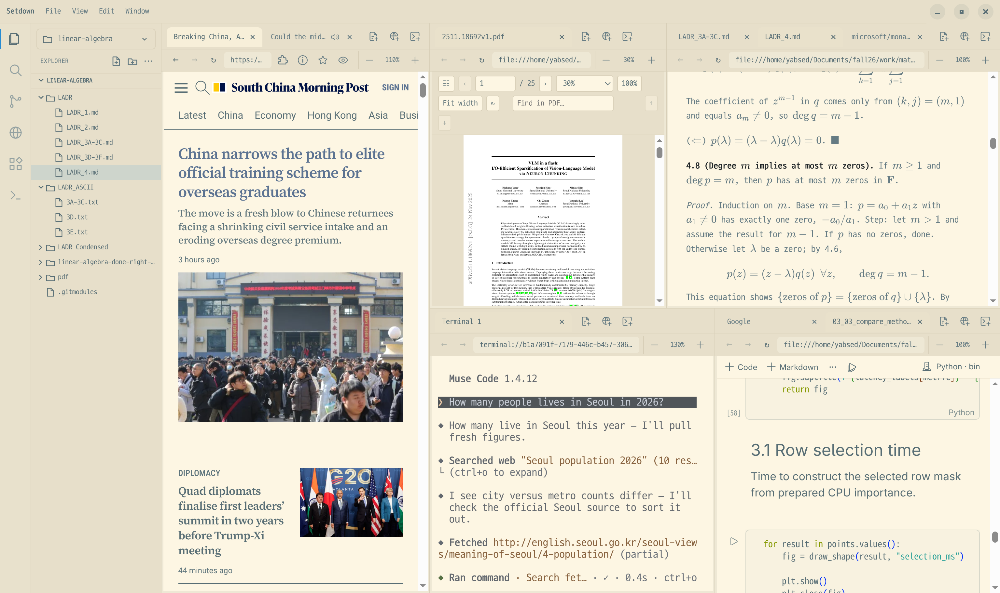

<p align="center">
  
</p>

<h1 align="center">Setdown</h1>

<p align="center"><strong>Write plain. Read beautifully.</strong></p>

Setdown is a desktop Markdown reader and editor. Write in plain text, then read
your words as a beautifully typeset document. Keep your references and tools
close, with your writing at the center.

> **Security notice:** This software was not written by a professional developer
> and may not be sufficiently secure.

<p align="center">
  <a href="https://github.com/yabsed/setdown/releases/latest">Download for Windows &amp; Linux</a> ·
  <a href="https://github.com/yabsed/setdown/releases">All releases</a>
</p>

<p align="center">
  <picture>
    <source media="(prefers-color-scheme: dark)" srcset="docs/assets-2/image2.png">
    <source media="(prefers-color-scheme: light)" srcset="docs/assets-2/image.png">
    
  </picture>
</p>

<p align="center">
  <sub>Your notes and the things that inform them, side by side.</sub><br>
  <a href="docs/assets-2/image.png">Light</a> ·
  <a href="docs/assets-2/image2.png">Dark</a> ·
  <a href="docs/assets-2/setdown-demo.gif">Watch the demo</a>
</p>

## Write plain

Your documents are Markdown files on your computer. Write notes, work through
an equation, or draft a longer piece in plain text.

Double-click a passage to edit its source. Press `Esc` to return to reading
in the same place.

## Read beautifully

Give your words room to breathe. Read formatted text, equations, tables, and
images in a document made for reading. Choose a light or dark theme that feels
comfortable to you.

When you revise, review Markdown changes as rendered documents or source diffs.
See how the document reads as well as what changed.

## Keep the rest close

A paper beside your notes. An article beside your draft. Arrange tabs into split
panes, resize them, or move them between windows.

- **References.** Open web pages, PDFs, and images alongside your writing. Switch
  supported articles to Reader mode and export them as Markdown or PDF.
- **Code and notebooks.** Edit source files, run Jupyter cells, and inspect outputs.
  Open a terminal when you need one.
- **Git.** Stage changes, commit, and browse history in the same workspace.

## Get started

Download the [latest release](https://github.com/yabsed/setdown/releases/latest)
for **Windows x64** (`.exe`) or **Linux x64** (`.deb`, `.rpm`, `.AppImage`).

1. Open a Markdown file, or choose **File → Open Folder…** for Explorer, search, and Git.
2. Double-click a passage to write. Press `Esc` to read.
3. Open a reference and drag its tab to an edge to keep it beside your document.

Git features require Git. Notebook execution requires a Python environment;
see the [notebook guide](docs/notebooks.md).

## Run from source

Use Node.js 22.12+ in the Node 22 series and npm. The first build needs network access.

```bash
npm ci
npm start
```

[Development guide](docs/architecture/overview.md) ·
[Language support](docs/language-support.md) ·
[Preview performance contract](docs/preview-performance-contract.md)

## License

[GPL-3.0-only](LICENSE). Third-party components retain their own licenses and notices.
