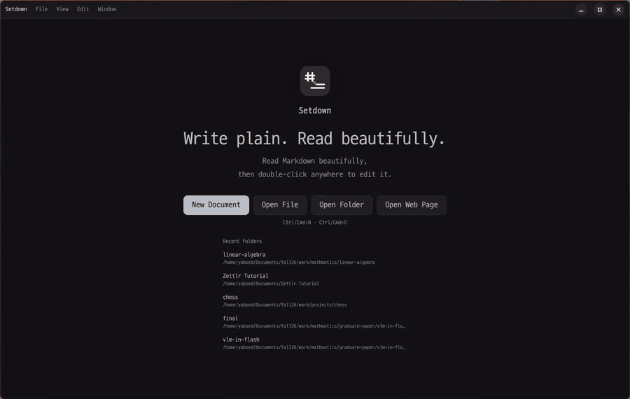

<p align="center">
  
</p>

<h1 align="center">Setdown</h1>

<p align="center"><strong>Your tabs. Your layout. Your workspace.</strong></p>

A desktop workspace for Markdown, code, notebooks, and the web. Keep notes,
references, and tools side by side, and arrange your tabs around the task at hand.

<p align="center">
  <a href="https://github.com/yabsed/setdown/releases/latest">Download for Windows &amp; Linux</a> ·
  <a href="https://github.com/yabsed/setdown/releases">All releases</a>
</p>

<p align="center">
  
</p>

<p align="center"><sub>Full demo · 3× speed</sub></p>

## Make room for your work

- **Arrange your workspace.** Drag tabs into split groups, resize panes, and move
  tabs between windows. Keep the views you need together.
- **Write, then read.** Markdown with equations, tables, and images. Double-click
  a passage to edit its source; press `Esc` to return to reading in the same place.
- **Keep references close.** Open web pages beside your files. Switch supported
  articles to Reader mode and export them as Markdown or PDF.
- **See what changed.** Review Markdown changes as rendered documents or source
  diffs. Stage, commit, and browse Git history without leaving your workspace.
- **Explore code and notebooks.** Edit source files, run Jupyter cells, inspect
  outputs, and use the integrated terminal alongside your notes.
- **Make it yours.** Choose light or dark themes across the workspace. Open PDFs
  and images in tabs with the rest of your work.

## Get started

Download the [latest release](https://github.com/yabsed/setdown/releases/latest)
for **Windows x64** (`.exe`) or **Linux x64** (`.deb`, `.rpm`, `.AppImage`).

1. Open a file, or choose **File → Open Folder…** for Explorer, search, and Git.
2. Drag a tab to an edge to split the workspace.
3. Double-click Markdown to edit; press `Esc` to read.

Git features require Git. Notebook execution requires a Python environment;
see the [notebook guide](docs/notebooks.md).

## Run from source

Use Node.js 22.12+ in the Node 22 series and npm. The first build needs network access.

```bash
npm ci
npm start
```

[Development guide](docs/architecture/overview.md) ·
[Language support](docs/language-support.md) ·
[Preview performance contract](docs/preview-performance-contract.md)

## License

[GPL-3.0-only](LICENSE). Third-party components retain their own licenses and notices.
