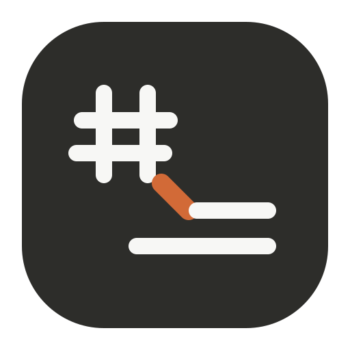
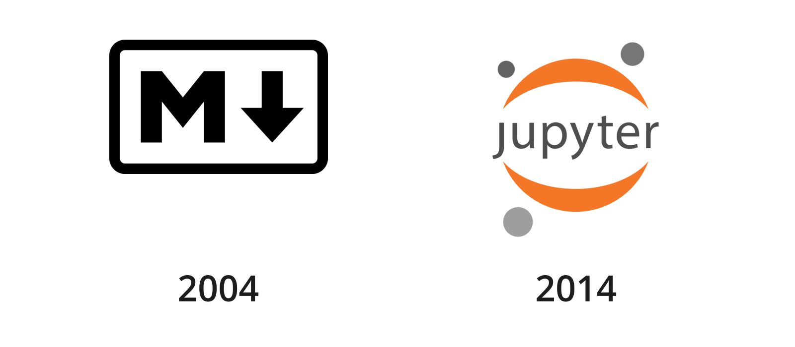
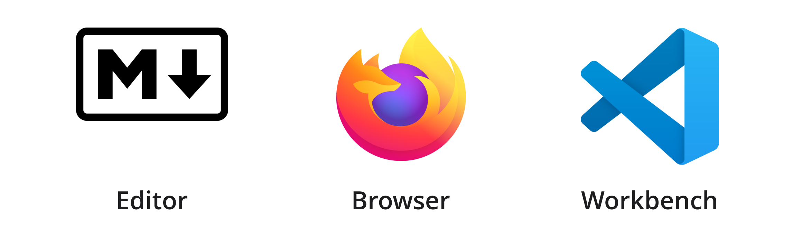
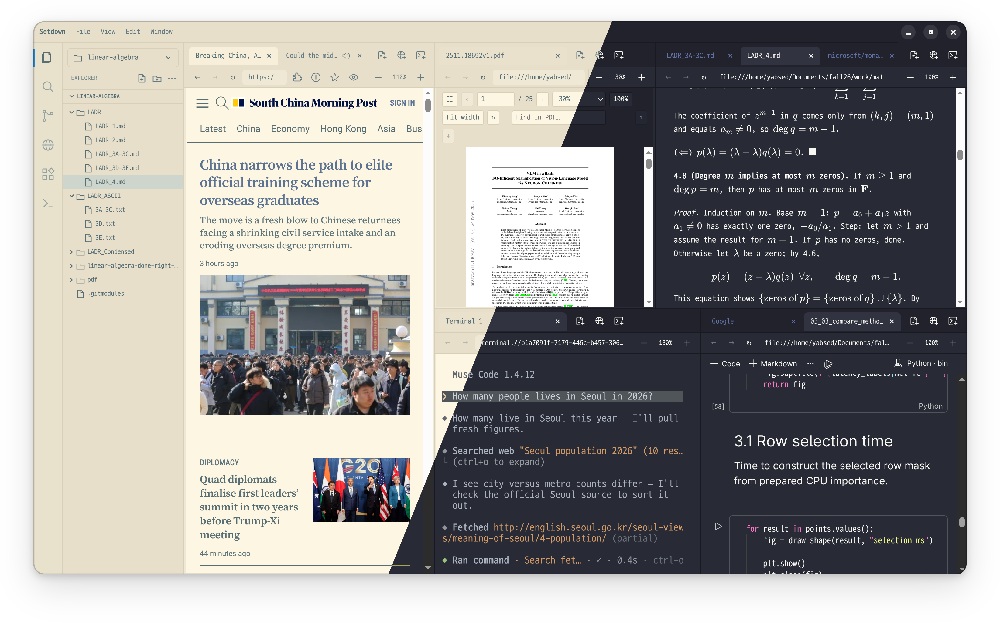

<p align="center">
  
</p>

<h1 align="center">Setdown</h1>

<p align="center"><strong>An editor, a browser, and a workbench. One app.</strong></p>

<p align="center">
  <a href="https://github.com/yabsed/setdown/releases/latest">Download for Windows &amp; Linux</a> ·
  <a href="https://github.com/yabsed/setdown/releases">All releases</a>
</p>

This is a day I’ve been looking forward to for two-and-a-half months.

Every once in a while, a revolutionary tool comes along that changes everything.
And — well, first of all, one’s very fortunate if you get to work on just one of
these in your career. The rest of us have been fortunate to build on a few of
them. 2004, Markdown. It didn’t just change how we take notes. It changed how the
whole software world writes — every README you’ve ever read. In 2014, Jupyter. And
it didn’t just change the way we run code, it changed the way science gets
written down.

<p align="center">
  
</p>

Well, today, we’re introducing three revolutionary products of this class. The
first one is a plain-text editor that reads like a typeset page. The second is a
revolutionary research browser. And the third is a breakthrough workbench for
code and notebooks.

So, three things: a plain-text editor that reads like a typeset page; a
revolutionary research browser; and a breakthrough workbench for code and
notebooks. An editor, a browser, and a workbench. An editor, a browser … are you
getting it?

<p align="center">
  
</p>

These are not three separate apps, this is one app, and we are calling it
Setdown. Today, Setdown is going to reinvent the notebook, and here it is.

<p align="center">
  
</p>

<p align="center">
  <a href="docs/assets-2/setdown-demo.gif">Watch the demo</a>
</p>

## An editor

A plain-text editor that reads like a typeset page.

Your documents are Markdown files on your computer. Write notes, work through an
equation, or draft a longer piece in plain text. Then read formatted text,
equations, tables, and images as a page made for reading, in a light or dark
theme.

Double-click a passage to edit its source. Press `Esc` to return to reading in
the same place. When you revise, review Markdown changes as rendered documents
or source diffs.

## A browser

A research browser, beside your writing.

Open web pages, PDFs, and images next to your document: a paper beside your
notes, an article beside your draft. Switch supported articles to Reader mode
and export them as Markdown or PDF.

## A workbench

A workbench for code and notebooks.

Edit source files, run Jupyter cells, and inspect outputs. Open a terminal when
you need one. Stage changes, commit, and browse Git history in the same
workspace.

## One app

Editor, browser, and workbench share one window. Arrange their tabs into split
panes, resize them, or move them between windows.

## Get started

Download the [latest release](https://github.com/yabsed/setdown/releases/latest)
for **Windows x64** (`.exe`) or **Linux x64** (`.deb`, `.rpm`, `.AppImage`).

With Node.js 20 or later you can install the `setdown` command from npm
instead. It downloads the app the first time it runs:

```bash
npm install -g @yabsed/setdown
setdown notes.md
```

1. Open a Markdown file, or choose **File → Open Folder…** for Explorer, search, and Git.
2. Double-click a passage to write. Press `Esc` to read.
3. Open a reference and drag its tab to an edge to keep it beside your document.

Git features require Git. Notebook execution requires a Python environment;
see the [notebook guide](docs/notebooks.md).

## Run from source

Use Node.js 22.12+ in the Node 22 series and npm. The first build needs network access.

```bash
npm ci
npm start
```

[Development guide](docs/architecture/overview.md) ·
[Language support](docs/language-support.md) ·
[Preview performance contract](docs/preview-performance-contract.md)

## Security notice

> This software was not written by a professional developer
> and may not be sufficiently secure.


## License

[GPL-3.0-only](LICENSE). Third-party components retain their own licenses and notices.
