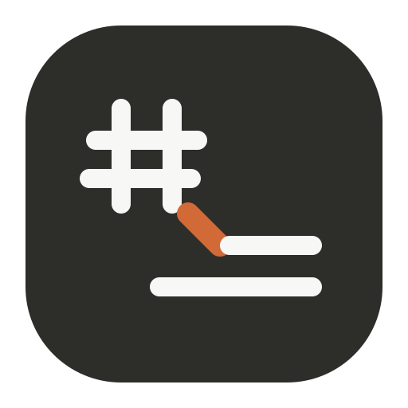
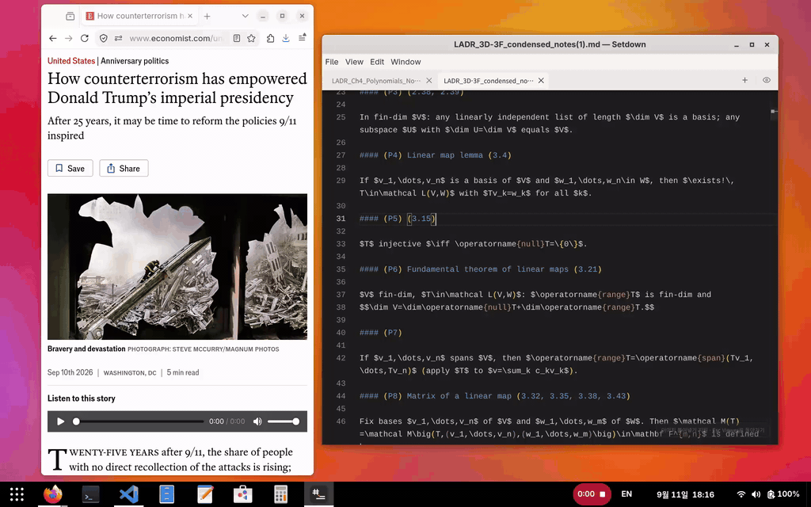
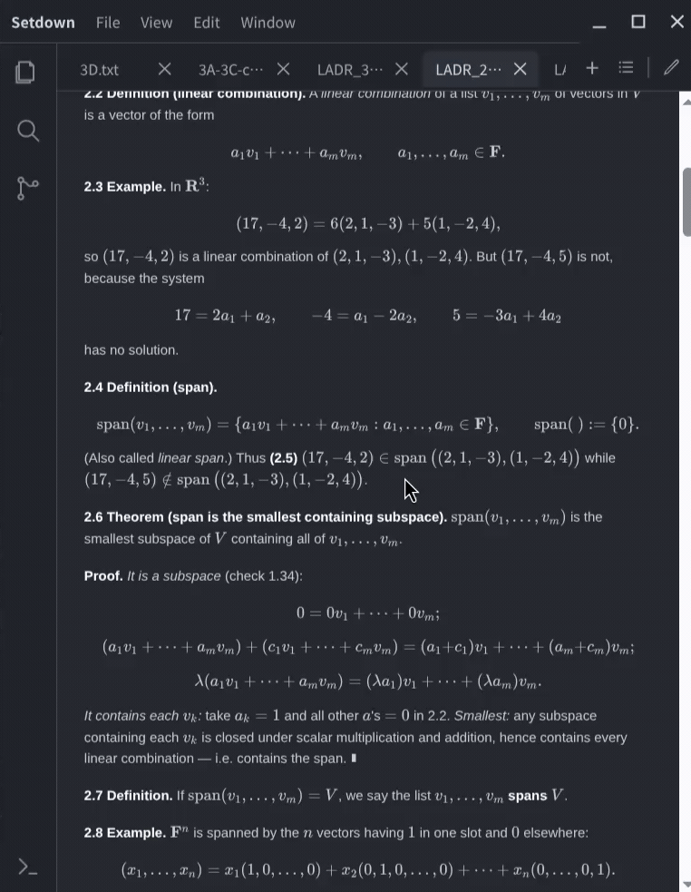
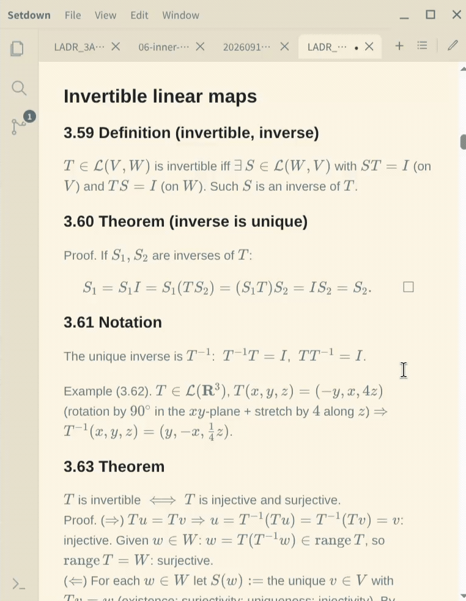
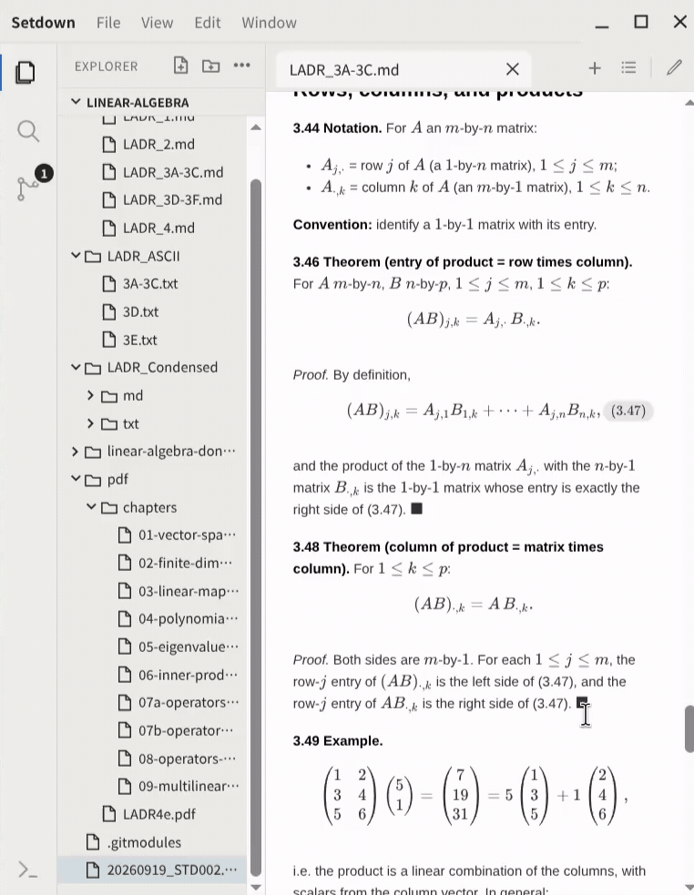
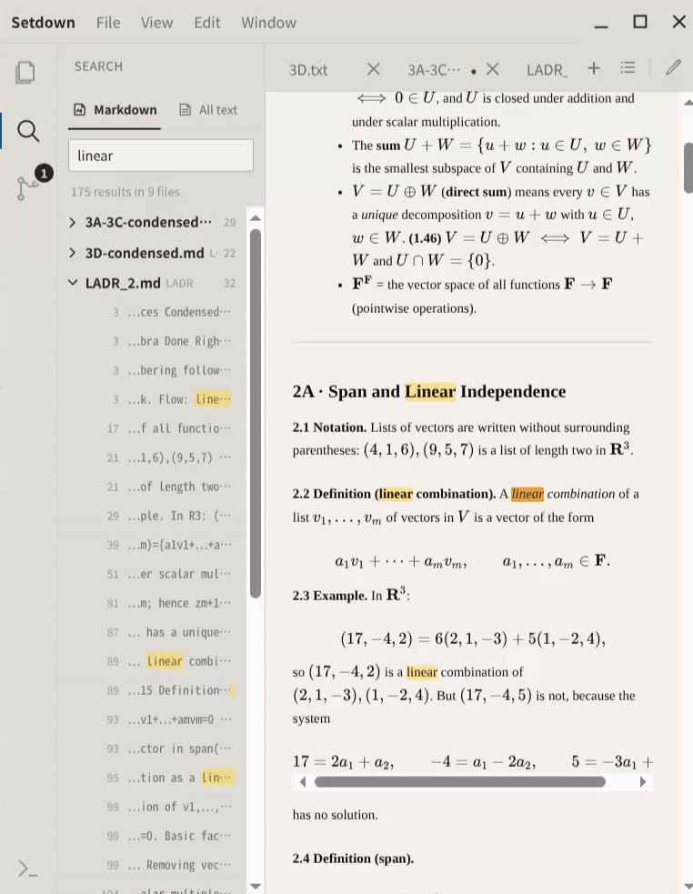
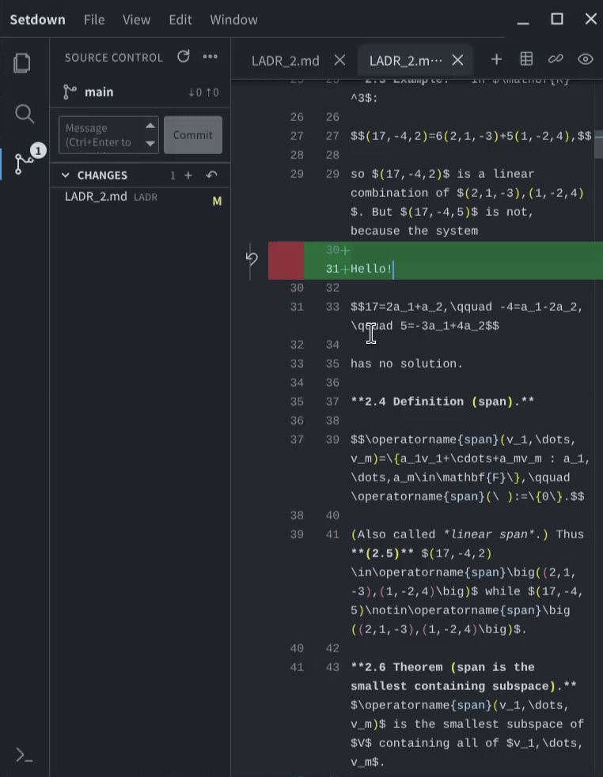
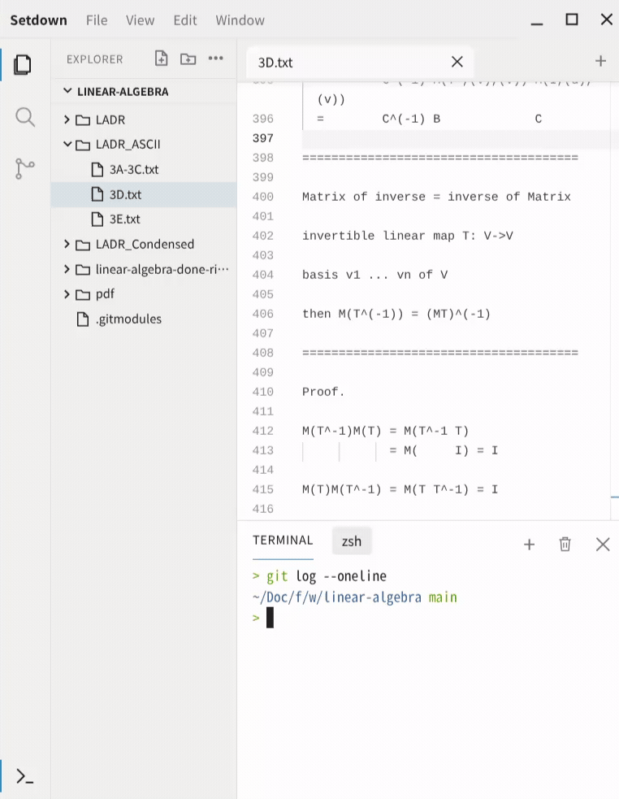
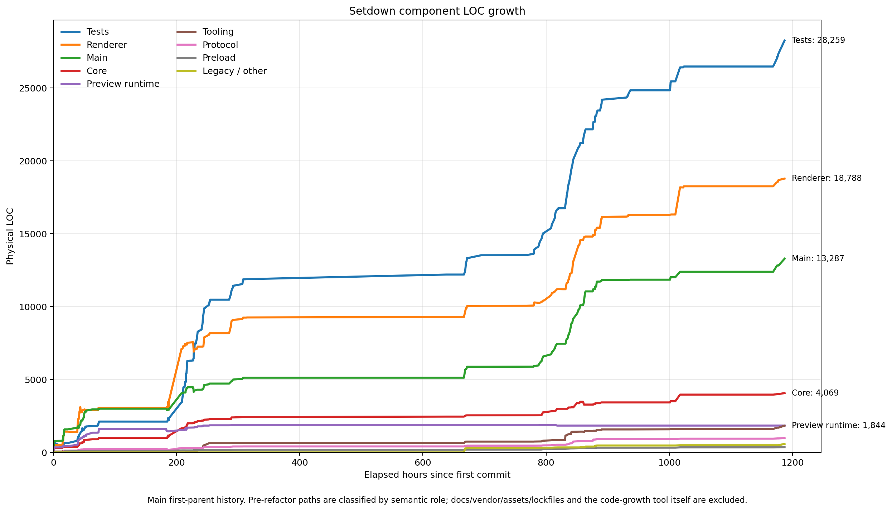

<p align="center">
  
</p>

<h1 align="center">Setdown</h1>

<p align="center">Write plain. Read beautifully.</p>

Setdown is a desktop Markdown reader and editor for local files. Read a typeset
document, double-click the passage you want to change, and edit its Markdown
source. Press `Esc` to return to reading with your place preserved.

[Download stable](https://github.com/yabsed/setdown/releases/latest) ·
[Development builds](https://github.com/yabsed/setdown/releases?q=dev.&expanded=true) ·
[CI](https://github.com/yabsed/setdown/actions/workflows/ci.yml)

<p align="center">
  
</p>

## Read and edit in place

The Viewer renders Markdown with equations, tables, code blocks, and images.
Double-click a paragraph, equation, image, or nearby whitespace to open the Editor
at the corresponding source position. Switch back with `Esc` or toggle either
view with `Ctrl/Cmd+E`.

- Navigate headings through the document outline and search with `Ctrl/Cmd+F`.
- Export Markdown through **File → Export as PDF…**.
- Reorder tabs, drag them into another Setdown window, or detach them into a new one.
- Reopen saved files at their last reading or editing position, including after an
  application restart.
- Choose Paper, GitHub, One Dark, Dracula, Nord, Sepia, or Solarized Dark. Themes
  apply to the reader, editor, and application chrome across windows.

The Monaco-based Editor includes a table-size picker, TSV-to-table conversion,
link insertion, and URL pasting over selected text. Pasted images use ordinary
Markdown links: web images retain their URLs, copied image files retain their
format, and screenshots become PNG assets. Local assets go in
`<document name>.assets/`; untitled documents keep them in a draft bundle until
Save As succeeds.

## Feature demos

Keep related text files, PDFs, and images in the same window. Open a folder when
you need file navigation, search, Git review, or a terminal.

<table width="100%">
  <tr>
    <th width="33%">Editing</th>
    <th width="33%">Table Insertion</th>
    <th width="33%">PDF and Images</th>
  </tr>
  <tr>
    <td></td>
    <td></td>
    <td></td>
  </tr>
  <tr>
    <th width="33%">Search</th>
    <th width="33%">Git Diff Editing</th>
    <th width="33%">Terminal</th>
  </tr>
  <tr>
    <td></td>
    <td></td>
    <td></td>
  </tr>
</table>

## Work with more than Markdown

| File type | Experience |
| --- | --- |
| Markdown | Typeset Viewer and source Editor, including rendered Git comparisons |
| Text, source, and configuration files | Source editing with Monaco syntax highlighting and text Git diffs |
| PDF | Read-only viewer with continuous scrolling, page navigation, outline, text search and selection, zoom, rotation, and password entry |
| PNG, JPEG, WebP, GIF, AVIF, SVG | Read-only image viewer with fit, zoom, rotation, and drag-to-pan controls |
| HTTP and HTTPS pages | Browser tabs with back/forward navigation, bookmarks, history, search, and uBlock Origin |

Open a web tab with `Ctrl/Cmd+T`, or enter a URL with `Ctrl/Cmd+L`. Every editor
group has an address/file-path bar. Web links in documents open inside Setdown;
web pages can sit beside documents in split groups. The star saves a bookmark in
the left **Browser** panel. The **uBO** button opens the current site's controls.
Browser cookies, bookmarks and history use a separate local profile, and saved
web tabs restore lazily after a restart.

Press `Esc` on a readable web article to open Reader mode; double-click a passage
to return to that place on the live page. `Ctrl/Cmd+F` searches the visible reading
text. Right-click rendered Markdown or a web Reader for Copy, Search Google,
link actions, Select All and Find. Web Reader's right-click menu also offers
**Export to Markdown** and **Export to PDF**, saving the article with its source
URL; **File → Export as PDF…** also works there. Markdown exports preserve linked images rather than
downloading an offline image archive.

In **Browser → Extensions → Install from Chrome Web Store…**, paste an extension's
store link or ID and confirm its name and permissions. Installed extensions can
be disabled, removed, or updated with **Update from Web Store**. Updates require
confirmation. Folder and `.zip`/`.crx` installation also remain available.
Extension compatibility depends on the APIs it uses; installing from the store
does not guarantee full Chrome compatibility. See [Web Store installation](docs/chrome-web-store-installation.md).

The browser adapts [Min](https://github.com/minbrowser/min)'s native-view lifecycle
and reuses its Places search/ranking code (Apache-2.0). It bundles the complete
[uBlock Origin](https://github.com/gorhill/uBlock) extension and
`electron-chrome-extensions` compatibility layer (GPL-3.0), with their license
notices. This includes network filtering, cosmetic filtering and scriptlets.
Store downloads reuse `electron-chrome-web-store` (MIT).

Non-Markdown text editing supports UTF-8, with or without a BOM, up to 16 MiB.
It preserves uniform LF or CRLF line endings and the final-newline state.
Unsupported encodings, binary content, and mixed line endings are rejected.
Unknown text languages fall back to plain text. Saved `.py` and `.pyi` files use
bundled Pyright for completion (`Ctrl+Space`), hover, signature help, diagnostics,
definition (`F12`), references (`Shift+F12`), symbols and rename (`F2`). Other
languages currently have syntax highlighting without language-server support;
Python itself and compilers are not bundled.

Open a project folder to give Python analysis the correct workspace root.
Without one, the file's containing directory is used. Pyright reads the project's
`pyrightconfig.json` or `[tool.pyright]` configuration. Language changes use the
same document and Undo history as ordinary editing and Working Tree review.
Multi-file rename opens affected files as unsaved tabs; normal save/auto-save
rules still apply, and Undo is per file. Save As reconnects analysis at the new
path without replacing the model.

Python analysis starts only when a saved Python document gets an editor model.
Windows have separate servers so unsaved text cannot leak between windows.
Closing the last Python document in a root stops its server. If analysis stops,
use **Restart Python Language Server** in the editor context menu or command
palette (`F1`); the document stays editable. Formatting, code actions, arbitrary
server commands and filesystem operations from language servers are not enabled.

PDF search uses the document's embedded text; scanned pages need an existing OCR
text layer. Image files can be up to 64 MiB. PDF and image positions, zoom, and
rotation persist across restarts. The three most recently visited PDF/image
surfaces stay in memory per window; older surfaces reload at their saved position.

### Three zoom controls

| Scope | Control | Effect |
| --- | --- | --- |
| Application | `Ctrl/Cmd++`, `Ctrl/Cmd+-`, `Ctrl/Cmd+0` | Resize the application across windows; `0` resets app zoom |
| Text | `Ctrl+wheel` over Markdown or text | Change the shared reader/editor text size, including Git review |
| PDF or image | `Ctrl+wheel` over the file, or its toolbar | Zoom that file independently |

App zoom and text size persist across restarts. Use **View → Reset Text Size** to
reset text size. Media toolbars provide their own fit and 100% controls; new PDFs
start at fit width.

## Optional folder tools

Opening a file does not automatically open its parent folder as a project.
Choose **File → Open Folder…** for a sidebar with:

- **Explorer:** browse, create, rename, move, and trash files and folders.
- **Search:** search Markdown by default, or opt into all text files.
- **Source control:** inspect changes, stage, unstage, discard, commit, fetch,
  pull, push, and sync using Git.

Markdown changes can be reviewed as rendered documents or source diffs. Staged
review compares **HEAD → Index**; unstaged review compares **Index → the current
document**, including unsaved edits. The ordinary document tab and editable Git
review share the same text and undo history. Staging saves the selected open
documents before running `git add`. Staged and unstaged reviews can remain open
in separate tabs.

The **Graph** below Changes shows branches and commit history. Drag its divider
to resize it, or collapse its header. Select a commit and then a changed file to
open a read-only source or rendered Markdown comparison. Historical reviews stay
independent of current edits. The graph uses Web Git Graph's renderer and local
Git backend; see [the integration notes](docs/git-history.md).

Clean documents reload external file changes. Documents with unsaved edits keep
those edits and ask before replacing them.

Click the Setdown wordmark to toggle folder tools. The sidebar and document
outline are resizable, and their layout is restored on window reload. Closing
folder tools leaves document tabs open.

### Integrated terminal

Press **Ctrl+`**, choose **View → Toggle Terminal**, or use the terminal button at
the bottom of the activity bar. The resizable panel supports multiple shell
sessions, scrollback, ANSI colors, and interactive programs.

New sessions start in the open project folder, the active document's folder, or
your home directory, in that order. Hiding the panel preserves sessions; closing
or reloading the window terminates them. Sessions do not survive an app restart.
Use `Ctrl+Shift+C/V` to copy and paste on Linux and Windows, or `Cmd+C/V` on macOS.

## Run from source

Use Node.js 22.12 or later in the Node 22 series and npm. CI uses Node 22. Git must
be available on `PATH` for source-control operations. Native dependencies may
require platform build tools when a suitable prebuilt binary is unavailable.

From the repository root:

```bash
npm ci
npm start
```

`npm start` builds the application before launching Electron. To open a file at
launch:

```bash
npm start -- /absolute/path/to/document.md
```

The browser build initializes `vendor/ublock-origin` and its nested submodules if
needed, then fetches the uAssets revisions pinned in
`apps/desktop/scripts/build-browser.mjs`. The first build needs network access;
subsequent builds reuse `node_modules/.cache/setdown-browser`. Packaged apps
include the extension and initial filter lists. Restart Electron after changing
main-process code or browser preloads; Vite's renderer refresh cannot apply them.

For development with the Vite server:

```bash
npm run dev
```

The development command builds Electron before starting Vite, then waits for an
HTTP response on port 5173 before launching the app. If that port is already in
use, it exits instead of attaching Electron to another server. Generated files
in `dist-electron` do not trigger renderer reloads.

If your environment sets `ELECTRON_RUN_AS_NODE=1`, unset it for commands that
launch Electron.

## Install and package

### Linux

After installing dependencies, build and install for the current user:

```bash
npm run install:linux
```

The installer places the application under
`${XDG_DATA_HOME:-~/.local/share}/setdown`, registers a desktop entry and icon, and
sets Setdown as the default Markdown application. It uses
`update-desktop-database` and `xdg-mime` and does not require administrator access.

To produce AppImage, deb, and rpm packages instead (requires `rpmbuild`, provided
by `rpm` on Ubuntu/Debian or `rpm-build` on Fedora; the bundled FPM tool also
requires `libcrypt.so.1`, supplied by `libcrypt1` on Ubuntu):

```bash
npm run package:linux
```

### Windows

Build the x64 NSIS installer on Windows after installing dependencies:

```powershell
npm run package:win
```

The installer supports per-user installation, a selectable install directory,
shortcuts, and Markdown, PDF, and image file associations.

Both packaging commands write their output to `apps/desktop/release/`.
The repository currently defines packaging targets for Linux and Windows.

### GitHub Releases

The **CI** workflow validates changes and then builds Windows x64 on Windows 2022
and Linux x64 on Ubuntu 22.04. Choose the
[latest stable release](https://github.com/yabsed/setdown/releases/latest) or the
newest entry in [development builds](https://github.com/yabsed/setdown/releases?q=dev.&expanded=true).

| Environment | Download |
| --- | --- |
| Windows x64 | `Setdown-<version>-win-x64.exe` |
| Ubuntu / Debian x64 | `Setdown-<version>-linux-amd64.deb` |
| Fedora / RPM-based Linux x64 | `Setdown-<version>-linux-x86_64.rpm` |
| Other compatible Linux x64 desktops | `Setdown-<version>-linux-x86_64.AppImage` |

AppImage files need executable permission (`chmod +x <file>.AppImage`). Linux
runtime requirements still depend on the distribution; producing a package does
not establish compatibility with every distribution or release. ARM64 and macOS
are not part of this release workflow. Windows installers are currently unsigned
and may trigger Windows security warnings. Git features require Git on `PATH`.

Every application change pushed to `main` produces a development pre-release
after the same commit passes all unit tests, typechecking, the production build,
and the real Electron preview contract. Both OS packages must also launch,
render Markdown and open the editor before publication. A failed check prevents
publication; a documentation-only push does not produce installers.

Development versions use the next patch and the unique Actions run ID, for
example `1.0.1-dev.38694878620` when the desktop version is `1.0.0`. If the desktop
version already has a prerelease suffix, its target major/minor/patch is retained.
The version is applied to the packaged app without committing version bumps.
Each build gets its own tag and files; it never replaces the stable **Latest**
release. Re-running a workflow keeps its version and preserves an already
published release. Each release includes `build-info.json` (source commit and
workflow run) and `SHA256SUMS` alongside all four installers. Uploads are staged
in a draft and published only after every file has been verified.

For a build without publishing, select **Actions → CI → Run workflow**. This
always runs the checks and creates `*-test.<run-id>` installers as workflow
artifacts, retained for 14 days, even when selecting a tag.

To publish a stable version, update the desktop version and lockfile, commit and
push, then push the matching tag. For example, the next patch after `1.0.0` is:

```bash
npm version 1.0.1 --workspace @setdown/desktop --no-git-tag-version
git add apps/desktop/package.json package-lock.json
git commit -m "Release Setdown 1.0.1"
git push origin main
git tag -a v1.0.1 -m "Setdown 1.0.1"
git push origin v1.0.1
```

Tag builds run the same checks even when the last commit only changes documents.
The tag must match `apps/desktop/package.json` and its lockfile entry; the workspace
root version is independent. Versions such as `1.1.0-beta.1` remain pre-releases.
Published tags and assets are preserved; use a new version for a subsequent
release. An interrupted draft for the same commit can be completed by rerunning
the failed jobs.

Only the publish job receives `contents: write`; checks and packaging use read
permissions. The automatically supplied `GITHUB_TOKEN` is sufficient. Code
signing and in-app automatic updates require separate setup; publishing a new
download does not update an installed app.

## Keyboard reference

`Ctrl/Cmd` means `Ctrl` on Linux/Windows and `Cmd` on macOS.

| Action | Shortcut |
| --- | --- |
| Edit at a location in the Markdown Viewer | Double-click |
| Return from Markdown Editor to Viewer | `Esc` |
| Toggle Markdown Viewer / Editor | `Ctrl/Cmd+E` |
| Find | `Ctrl/Cmd+F` |
| New document | `Ctrl/Cmd+N` |
| New window | `Ctrl/Cmd+Shift+N` |
| Open file | `Ctrl/Cmd+O` |
| Save / Save As | `Ctrl/Cmd+S` / `Ctrl/Cmd+Shift+S` |
| Insert a Markdown link | `Ctrl/Cmd+K` |
| Close tab | `Ctrl/Cmd+W` |
| Next / previous tab | `Ctrl+Tab` / `Ctrl+Shift+Tab` |
| Toggle terminal | **Ctrl+`** |

The in-window **File · View · Edit · Window** menus also expose folder tools,
themes, PDF export, zoom, and window commands.

## Architecture

Setdown uses Electron, Svelte, TypeScript, Monaco, and Crossnote. Markdown
rendering and math typesetting run in Electron utility processes. Isolated native
`WebContentsView` instances host Markdown previews; PDF.js handles PDFs, and
xterm.js with node-pty provides the terminal.

```text
apps/
├── desktop/
│   ├── src/
│   │   ├── core/             Domain rules and document algorithms
│   │   ├── protocol/         Serializable IPC contracts
│   │   ├── main/             Files, windows, rendering, Git, and PTYs
│   │   ├── preload/          Typed renderer IPC bridge
│   │   ├── preview-runtime/  Markdown reader interactions and rendering updates
│   │   └── renderer/         Svelte UI, Monaco, folder tools, and media viewers
│   ├── scripts/              Build, installation, and benchmark tools
│   └── test/                 Electron end-to-end tests and fixtures
└── code-growth/              Repository code-growth chart generator
```

Core code is independent of Electron and UI frameworks. Process entry points wire
services to adapters, and architecture tests enforce dependency boundaries.
Preview results carry revision identity so obsolete work cannot replace newer
content or appear in another tab.

Open Markdown tabs keep their rendered views and editor state alive. While you
edit, Setdown prepares updated content in the background and keeps the last
completed preview available until the replacement is ready. Source anchors help
preserve your place when switching views or changing the window width.

Markdown previews use a separate `marktex-preview:` origin with local resources
restricted to the document directory and required rendering assets. Executable
code chunks, document-local Crossnote scripts/configuration, and HTML5 embeds
are disabled. PDF scripts are disabled, and SVG files are loaded as images.

Upstream reference sources live in `vendor/` as submodules. Normal builds use npm
packages and do not require those checkouts. Fetch them when needed with:

```bash
git submodule update --init --recursive
```

## Development checks

Run commands from the repository root:

```bash
npm run typecheck           # TypeScript and Svelte checks
npm test                    # Unit and integration tests
npm run build               # Typecheck and production build
npm run test:e2e             # Build and run Electron end-to-end tests
npm run test:preview-contract
```

Before running browser checks, install Chromium with
`npx playwright install chromium`. Linux GUI npm scripts create an isolated Xvfb
display, runtime directory and D-Bus session automatically.

Read the [preview performance contract](docs/preview-performance-contract.md)
before changing preview preparation or presentation, native bounds, zoom,
source/reader transitions, hydration, source-position lookup, themes/CSS, or
Electron/Crossnote dependencies. Those changes require the contract suite and a
comparison against a separate baseline checkout with installed dependencies:

```bash
npm run bench:preview -- --baseline /absolute/path/to/installed-baseline
```

The contract explains baseline setup and reporting. Report first, second, and
warm cycles separately for ordinary Markdown and Git review, with and without
edits and preparation time. Incomplete runs, stale-content captures, and failed
checks are not successful benchmarks.

GitHub Actions policy:

| Event | Checks | Delivery |
| --- | --- | --- |
| Pull request | Full unit suite, benchmark comparator tests, typecheck/build, Electron contract | No publication |
| Application change on `main` | Same checks, then Windows/Linux packaging and packaged-app smoke checks | Unique development pre-release |
| `v*` tag push | Same checks and packaging, with version/tag validation | Versioned release; prerelease suffixes remain pre-releases |
| Manual **CI** run | Same checks and packaging regardless of changed paths | Downloadable artifacts only |
| Documentation-only PR or main push | CI policy tests and an explicit successful result | No installers |

Only known documentation paths are exempt: root README/AGENTS/CONTRIBUTING/
CHANGELOG/LICENSE files, `live_demo.gif`, `docs/`, and `reports/`. Markdown test
fixtures, CSS, dependencies, workflows, submodules and unknown paths still run
the desktop checks. Missing comparison history also runs all checks.
The stable required-check name is **CI result**, including documentation-only
changes. Configure that check in the repository's branch rules to enforce it;
workflow files alone do not change repository rules.

New application pushes cancel obsolete runs for the same PR or main branch.
Documentation pushes do not cancel an app build in progress. Tags, manual builds
and benchmarks are independent. Failure reports are retained for 14 days.

For the full comparative benchmark, select **Actions → Preview latency benchmark
→ Run workflow**. Supply a baseline commit/tag, or leave it empty to compare with
the selected ref's parent. All eight scenarios and five repetitions per version
run on the same isolated display; results and logs are retained for 30 days.
Performance-path changes still require this comparison locally or manually;
timing noise is not an automatic PR gate. The CI policy itself can be checked
with `node --test scripts/ci/*.test.mjs`.

Further documentation:

- [Preview guarantees, ownership, and benchmark procedure](docs/preview-performance-contract.md)
- [Min source audit: small improvements to Setdown's web visits](docs/min-browser-details-audit-2026-10-14.md)
- [Min-inspired browser details: implementation and validation](reports/2026_10_14_min_browser_details_implementation.md)
- [Reading-position persistence, PDF and image viewers](docs/reading-positions-and-pdf.md)
- [Integrated terminal behavior and implementation](docs/integrated-terminal.md)
- [Text workspace support and acceptance scenarios](apps/desktop/test/TEXT-WORKSPACE.md)
- [Design and implementation records](reports/)

Regenerate the repository growth charts with `npm run plot:code-growth`:

The component chart shows how code in each part of Setdown grew over the
repository's history:

<p align="center">
  
</p>
