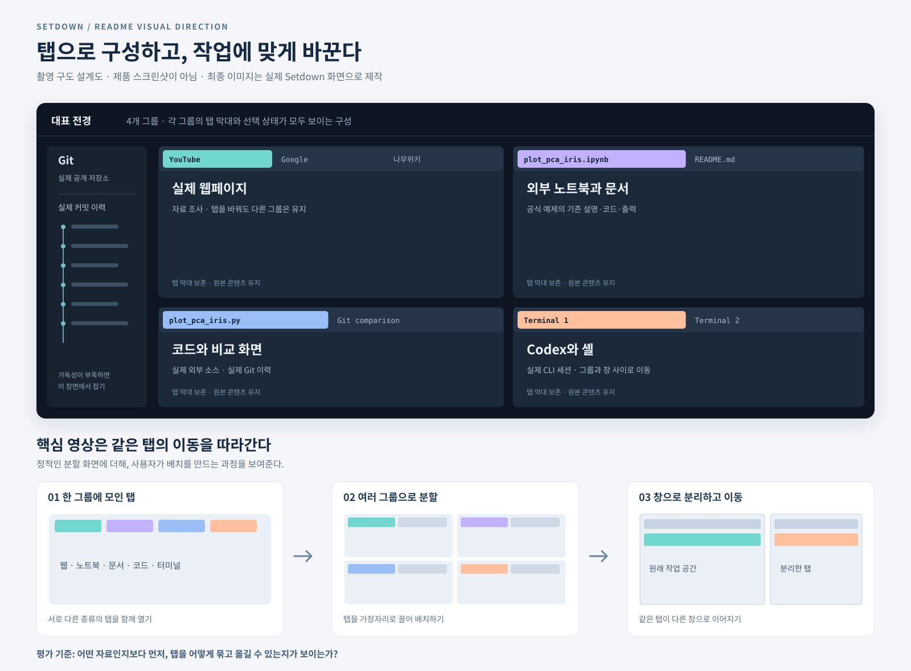

# 탭 관리 중심의 Setdown README 제작 보고서

작성일: 2026년 10월 31일

**Setdown의 중심은 다양한 종류의 탭을 여러 그룹과 창에 배치하고, 작업 중에도 그 구성을 자유롭게 바꿀 수 있다는 점이다.** 새 README는 이 능력을 첫 화면과 첫 동작에서 전달해야 한다. 웹·노트북·Markdown·코드·터미널·Git은 실제로 복잡한 작업을 구성할 수 있음을 보여주는 콘텐츠다.

대표 문구는 **“Your tabs. Your layout. Your workspace.”**로 제안한다. 그 아래에는 “Arrange web pages, notebooks, documents, code, and terminals across split groups and windows.”를 둔다. 한국어로는 “탭을 나누고, 옮기고, 연결하며 나만의 작업 공간을 구성하세요”라는 뜻이다.

권장 결과물은 **탭 관리 중심의 이미지 7장과 실제 조작 영상 1개**다. README 앞부분에서 여러 그룹의 탭, 배치 변경, 창 사이 이동을 충분히 보여준다. 모든 예제 콘텐츠는 외부 원본에서 가져온다. 노트북과 그래프를 새로 작성하는 제작 단계는 두지 않는다.

## 전달해야 할 제품의 구조

독자가 이해해야 하는 순서는 **탭 → 그룹 → 창 → 작업 중 재배치**다.

| 단위 | 보여줄 것 | 이미지에서 반드시 드러날 요소 |
| --- | --- | --- |
| 탭 | 웹페이지, 파일, 노트북, 터미널, 비교 화면을 연다 | 실제 탭 제목과 콘텐츠의 연결 |
| 그룹 | 관련된 탭을 함께 두고 하나를 선택한다 | 그룹마다 독립된 탭 막대와 선택 상태 |
| 분할 | 여러 그룹을 동시에 보고 크기를 조절한다 | 서로 다른 분할 비율, 수직·수평 경계 |
| 창 | 작업 일부를 새 창이나 다른 창으로 옮긴다 | 같은 탭의 이동 전후와 두 실제 창 |
| 재구성 | 읽기, 비교, 실행에 맞춰 배치를 바꾼다 | 동일한 자료가 다른 배치로 이어지는 과정 |

한 화면에 패널이 많다는 사실만으로는 충분하지 않다. **각 패널에 여러 탭이 있고, 그 탭을 다른 그룹과 창으로 옮길 수 있다는 점**이 보여야 한다. 최종 캡처에서는 탭 막대와 분할 경계를 잘라내지 않는다.

여기서 그룹은 Setdown의 실제 편집기 그룹을 뜻한다. 아래 설계도의 “자료 조사”, “노트북”, “코드”, “터미널”은 촬영 목적을 설명하는 이름이다. 앱에 없는 그룹 이름 지정 기능이나 색상별 브라우저 탭 그룹 UI를 만들어 넣지 않는다.

## 대표 화면과 재배치 과정의 시각 설계

아래는 **촬영 구도 설계도**다. 제품 스크린샷이 아니며 최종 README에는 실제 Setdown 화면으로 교체한다. 위쪽은 대표 전경의 탭 구조, 아래쪽은 영상에서 보여줄 배치 변화다.

### 대표 화면의 구성

대표 전경은 **4개 그룹, 총 9~12개 탭**을 출발점으로 한다. 탭 수는 지원 한도가 아니라 사진의 정보량을 조절하기 위한 제안이다. 각 그룹에는 읽을 수 있는 탭 제목 2~3개가 나타나도록 한다.

| 위치 | 내용 | 활성 화면과 주변 탭 |
| --- | --- | --- |
| 왼쪽 위 | 실제 웹 자료 | YouTube 활성, Google·나무위키 탭 함께 표시 |
| 오른쪽 위 | 외부 노트북과 문서 | 외부 `.ipynb` 활성, 외부 Markdown 파일을 같은 그룹에 배치 |
| 왼쪽 아래 | 실제 소스와 비교 | 외부 `.py` 활성, 관련 파일 또는 Git 비교 탭 |
| 오른쪽 아래 | 터미널 | 실제 Codex 세션 활성, 두 번째 터미널 탭 |
| 왼쪽 사이드바 | Git | 실제 공개 저장소 이름과 이력 일부 |

상단 그룹에 높이 약 60%, 하단에 약 40%를 배분하고, 두 열의 너비도 내용에 맞춰 조금 다르게 둔다. 창 전체는 약 1440~1600 × 960~1000 논리 픽셀에서 검토한다. 사이드바 때문에 본문이 과도하게 좁아지면 대표 장면에서는 사이드바를 접고 Git 전용 비교 장면에서 충분히 보여준다.

대표 화면은 탭 관리의 전체 구조를 보여준다. 모든 코드와 문서 본문을 한 번에 읽게 할 필요는 없지만, **무엇을 어디에 열어 두었는지**는 축소해도 이해할 수 있어야 한다. 긴 파일명은 원래 이름을 유지하고 캡션에서 보완한다. 보기 좋게 만들기 위해 외부 노트북의 이름이나 내용을 임의로 다시 쓰지 않는다.

같은 레이아웃의 두 번째 상태도 찍는다. 웹 그룹만 Google로 전환하고, 노트북 그룹만 Markdown으로 전환한다. 다른 그룹은 그대로 둔다. 이 두 상태의 비교는 “네 개의 고정 패널”이 아니라 **각자 독립적으로 움직이는 탭 그룹**임을 보여준다.

## README의 배치 순서

[Firefox 한국어 페이지](https://www.firefox.com/ko/)에서 참고할 것은 짧은 첫 메시지, 큰 시각 자료, 구역마다 하나의 이점을 설명하는 순서다. Setdown에서는 이 구역들을 탭을 다루는 행동으로 구성한다.

| 순서 | 문구 초안 | 전달할 내용 | 시각 자료 |
| --- | --- | --- | --- |
| 1 | Your tabs. Your layout. Your workspace. | 여러 작업을 탭과 그룹으로 구성하는 앱 | 01 대표 전경 |
| 2 | Arrange your work as you go. | 드래그로 분할·이동·재배치 | 02 연속 장면과 핵심 영상 |
| 3 | Every group keeps its own tabs. | 그룹별 독립적인 탭 전환 | 03 같은 배치의 두 상태 |
| 4 | Give a task its own window. | 탭을 창으로 분리하고 다른 창으로 이동 | 04 두 창의 실제 화면 |
| 5 | Keep the right views side by side. | 원문·Reader·코드·Git 비교를 나란히 보기 | 05 비교 작업 구성 |
| 6 | Focus, then return to the whole picture. | 한 그룹 확대와 원래 배치 복귀 | 06 전후 비교 |
| 7 | Make the whole workspace yours. | 같은 복잡한 배치에 적용되는 여러 테마 | 07 테마 비교 |
| 8 | Get Setdown | 다운로드, 최소 시작 방법, 상세 문서 | 짧은 링크 영역 |

첫 세 구역이 README의 중심이다. “브라우저 기능”, “노트북 기능”, “터미널 기능”을 각각 같은 크기의 독립 홍보 섹션으로 늘어놓지 않는다. 각 기능은 그룹 구성과 재배치 장면 속에 등장하고, 필요한 설명만 해당 장면 아래에 덧붙인다.

## 촬영 목록

### 01 여러 작업을 조직한 대표 전경

최종 파일: `01-tabbed-workspace.png`

위 설계도의 4개 그룹을 실제 한 창 안에 구성한다. 각 그룹의 탭 막대, 선택된 탭, 주소·경로 표시줄, 분할선이 모두 보이게 촬영한다. YouTube, 외부 노트북, 실제 코드, Codex가 서로 인접한 것이 첫인상이다.

읽을 수 없는 탭을 수십 개 늘어놓기보다, 서로 다른 탭을 어디에 묶었는지가 보이게 한다. 원본 확대 링크를 제공하고, README 아래에는 웹·노트북·코드·터미널의 배치를 한 문장으로 설명한다.

### 02 탭을 끌어 작업 공간을 바꾸는 과정

최종 파일: `02-arrange-tabs.png`

동일한 자료를 사용한 세 상태를 촬영한다.

1. 한 그룹의 탭 막대에 웹·문서·노트북·코드가 함께 열려 있다.
2. 탭을 가장자리로 끌 때 실제 분할 안내가 나타난다.
3. 놓은 뒤 두 그룹이 되고, 추가 탭을 아래로 옮겨 세 번째 그룹을 만든다.

세 장을 순서대로 배치하고 각 장 아래에 “Open”, “Drag”, “Arrange”처럼 짧게 표시한다. 화살표와 번호는 캡처 바깥에서만 사용한다. 탭이 움직이는 방향과 새 그룹의 위치가 일치해야 한다.

### 03 그룹별 탭 전환과 웹 미리보기

최종 파일: `03-independent-tabs.png`

같은 4개 그룹의 배치에서 한 그룹의 탭만 바꾼 전후를 보여준다. 웹 그룹은 Google에서 나무위키로, 문서 그룹은 외부 노트북에서 외부 Markdown으로 각각 독립적으로 바꾼다. 코드와 터미널은 같은 위치와 내용으로 남는다.

보조 장면에서는 나무위키 원문에서 `Esc`로 웹 Reader에 들어간다. **Reader도 해당 그룹 안에서 전환되고 주변 작업 배치는 유지된다**는 점을 강조한다. Reader 원문 비교는 실제 같은 문단을 사용한다.

이 문서에서 “웹 미리보기”는 웹 Reader를 뜻한다. Explorer의 임시 미리보기 탭과는 구분한다. [웹 Reader 범위](../../docs/contracts/reading-surfaces.md)

### 04 창 사이에서 이어지는 탭 이동

최종 파일: `04-tabs-across-windows.png`

기존 창의 웹 탭을 창 밖으로 끌어 새 창으로 분리한 뒤, 두 창을 나란히 촬영한다. 다음에는 터미널 또는 웹 탭을 다른 창의 그룹으로 옮기는 장면을 녹화한다. 두 창 모두 Setdown임을 알아볼 수 있도록 제목과 탭 막대를 남긴다.

한 화면에 들어가는 두 창의 크기를 충분히 확보한다. 영상에서는 드래그한 탭과 도착한 탭을 식별할 수 있어야 한다. 이동한 웹페이지의 스크롤이나 입력 상태, 터미널의 실제 세션이 이어지는 모습을 보여준다. 움직이지 않은 작업들은 원래 창에 남긴다.

창 이동의 대표 대상은 웹과 터미널로 한다. 노트북의 실행 중 커널이 창 이동 후 그대로 유지되는 장면을 약속하지 않는다. [창 사이 탭 이동 기록](../../docs/validation/2026-10-23-cross-window-tab-drag.md), [터미널 수명](../../docs/integrated-terminal.md), [노트북 실행 조건](../../docs/notebooks.md)

### 05 같은 작업의 여러 화면을 나란히 보기

최종 파일: `05-views-side-by-side.png`

외부 Markdown 파일의 소스와 읽기 화면을 두 그룹에 배치한다. 이어서 실제 공개 저장소의 과거 변경을 Git 비교 탭으로 열고, 현재 파일과 나란히 둔다. Git 이력은 해당 저장소의 실제 커밋을 사용한다.

이 장면의 주제는 Markdown이나 Git의 기능 목록보다 **필요한 관점을 탭으로 골라 옆에 둘 수 있다는 것**이다. 원문과 읽기 화면의 문단을 맞추고, 비교 내용이 실제 커밋과 연결되도록 한다. Git 사이드바는 이 장면에서 충분히 넓게 펼친다.

텍스트와 지원되는 비교 화면의 그룹 내 복사 기능을 사용한다. 웹·노트북·터미널까지 같은 방식으로 복제할 수 있다는 인상을 주지 않는다. [그룹과 콘텐츠 소유 관계](../../docs/editor-groups-design.md)

### 06 한 그룹에 집중하고 배치로 돌아오기

최종 파일: `06-focus-and-restore.png`

4개 그룹의 작업 공간에서 코드 그룹을 최대화한다. 코드와 현재 탭을 크게 확인한 뒤 원래 분할 배치로 돌아간다. “Workspace → Focus → Workspace”의 세 상태를 짧은 영상 또는 비교 이미지로 보여준다.

최대화 후 원래 그룹 비율과 탭 선택이 복귀한 것이 보이도록 같은 카메라 크기를 유지한다. 단순히 다른 크기의 창 두 개를 편집해 이 기능을 흉내 내지 않는다. [그룹 최대화와 복귀](../../docs/contracts/workspace.md#editor-groups)

### 07 같은 작업 공간의 여러 테마

최종 파일: `07-workspace-themes.png`

대표 화면과 같은 탭·그룹·스크롤 위치를 유지하고 테마만 바꾼다. README에는 Paper, GitHub Light, VS Code Dark 2026, Solarized Dark를 2 × 2로 비교한다. 사진 아래에 실제 테마 이름을 표시한다.

별도 갤러리에는 GitHub Light, Paper, Medium, Solarized Light, GitHub Dark, Night, One Dark, Solarized Dark, VS Code Dark 2026의 9종을 모두 싣는다. 비교의 대상은 문서 한 장이 아니라 **여러 탭과 그룹으로 구성된 전체 작업 공간**이다. [테마 카탈로그](../desktop/src/core/theme/theme-catalog.ts)

## 핵심 영상의 구성

탭 관리는 행동으로 이해되는 기능이므로, 첫 정지 이미지 바로 다음에 **약 25~35초의 실제 조작 영상**을 배치한다. 아래 시간은 편집 목표이며 성능 수치가 아니다.

| 구간 | 행동 | 시청자가 확인할 변화 |
| --- | --- | --- |
| 처음 3초 | 완성된 여러 그룹의 화면을 보여준다 | 어떤 작업 공간을 만들 수 있는지 |
| 다음 6초 | 탭을 오른쪽, 아래로 끌어 분할한다 | 고정된 패널이 아니라 직접 구성한 배치 |
| 다음 5초 | 다른 그룹으로 옮기고 탭 순서를 바꾼다 | 탭의 소속과 순서가 바뀜 |
| 다음 6초 | 웹 탭을 새 창으로 분리하고 다른 창으로 옮긴다 | 창을 넘는 재배치 |
| 다음 5초 | 한 그룹 최대화 후 복귀한다 | 집중 화면과 전체 화면의 연결 |
| 마지막 3초 | 최종 배치를 잠시 유지한다 | 원래 작업이 이어지는 완성 화면 |

핵심 이동 구간은 끊지 않고 보여준다. 드래그 시작·안내·놓기·결과가 한 흐름 안에 남아야 한다. 준비 과정은 편집할 수 있지만 이동 중 대기나 오류를 잘라 성공한 것처럼 만들지 않는다. README 기본 표시는 정지 포스터와 영상 링크로 하고, 자동 재생이 필요한 짧은 루프는 한 곳에만 사용한다.

## 외부 원본으로 구성할 콘텐츠

**노트북·샘플 코드·학습 문서·그래프를 새로 만들지 않는다.** 촬영의 준비 작업은 원본 선택, 다운로드, 실행 환경 구성, 앱 안의 배치와 스크롤 조정이다. 파일명·셀 순서·본문·그래프 색을 홍보용으로 다시 쓰는 과정은 제외한다.

| 용도 | 우선 사용할 외부 원본 | 촬영에서 보여줄 부분 |
| --- | --- | --- |
| Jupyter 노트북 | [scikit-learn 공식 PCA 예제](https://scikit-learn.org/stable/auto_examples/decomposition/plot_pca_iris.html)의 `Download Jupyter notebook` | 실제 `.ipynb`의 설명·코드와 PCA 또는 산점도 출력 |
| Python 코드 | 같은 예제 페이지의 `Download Python source code` | 같은 예제의 `plot_pca_iris.py` |
| Markdown | [NumPy tutorials의 README.md](https://github.com/numpy/numpy-tutorials/blob/main/README.md)와 저장소의 실제 문서 | 원문·읽기 화면·링크와 문서 구조 |
| Git | [NumPy tutorials 저장소](https://github.com/numpy/numpy-tutorials) 또는 [scikit-learn 저장소](https://github.com/scikit-learn/scikit-learn) | 실제 브랜치, 커밋, 선택한 파일의 이력 비교 |
| YouTube | [3Blue1Brown 고유값 강의](https://www.youtube.com/watch?v=e50Bj7jn9IQ) | 실제 영상의 도해, 영상 제목과 탭 |
| Google | `PCA iris scikit-learn` 같은 실제 검색 | 로고·검색어·결과가 보이는 웹 탭 |
| 나무위키 | [주성분 분석](https://namu.wiki/w/%EC%A3%BC%EC%84%B1%EB%B6%84%20%EB%B6%84%EC%84%9D) 또는 [선형대수학](https://namu.wiki/w/%EC%84%A0%ED%98%95%EB%8C%80%EC%88%98%ED%95%99) | 정상 로딩을 확인한 원문과 Reader |
| Codex | 위에서 가져온 실제 소스에 대한 CLI 세션 | 코드 설명 요청과 실제 응답 |

scikit-learn 예제 페이지는 노트북과 Python 파일을 함께 제공하므로 같은 내용을 서로 다른 탭에서 보여주기 좋다. 다운로드는 **같은 문서 버전의 두 파일**을 사용한다. 웹 문서의 stable 버전과 저장소 main 브랜치의 파일을 같은 버전인 것처럼 섞지 않는다.

대체 노트북 후보는 [Jake VanderPlas의 PCA 노트북](https://github.com/jakevdp/PythonDataScienceHandbook/blob/master/notebooks/05.09-Principal-Component-Analysis.ipynb)이다. 여기에도 기존 설명·코드·출력이 있으므로 자체 실험을 작성할 필요가 없다. 원본에 적힌 저자와 출처를 보존한다. [원본 설명 페이지](https://jakevdp.github.io/PythonDataScienceHandbook/05.09-principal-component-analysis.html)

원본을 내려받은 뒤에는 출처 URL, 프로젝트·저자, 버전 또는 커밋, 원래 경로, 파일 해시, 라이선스 파일 위치를 기록한다. 코드와 본문에 서로 다른 조건이 적힌 자료는 그 구분도 그대로 기록한다. 최종 이미지의 출처는 별도 credits 문서로 연결한다.

노트북을 실제 실행하는 장면이라면 외부 원본 코드를 지원 환경에서 실행한다. 저장된 기존 출력을 보여주는 장면은 실행 성공의 증거로 사용하지 않는다. 실행 호환성이 맞지 않으면 다른 외부 원본이나 호환 환경을 선택하며, 노트북을 새로 쓰거나 출력을 꾸며 넣지 않는다.

Codex에는 “이 외부 예제에서 PCA가 데이터를 어떻게 변환하는지 설명해 줘. 파일은 변경하지 마”처럼 실제 코드 설명을 요청할 수 있다. 외부 예제를 대신 만들어 달라고 요청하지 않는다. 빈 터미널이나 문자열로 만든 가짜 응답도 사용하지 않는다.

## 빠짐없이 보여야 할 콘텐츠

| 사용자에게 보여줄 항목 | 대표 장면 | 추가 확인 장면 |
| --- | --- | --- |
| 복잡한 탭 관리 | 01, 02, 03 | 핵심 영상 전체 |
| 여러 창 사이 이동 | 04 | 웹 상태와 터미널 세션의 연속성 |
| YouTube | 01의 웹 그룹 | 영상 제목과 실제 플레이어 |
| Google·나무위키 | 03의 탭 전환 | 로고·주소·본문 |
| 웹 미리보기 | 03의 Reader 전환 | 같은 그룹 안의 원문 복귀 |
| 외부 Jupyter 노트북 | 01의 노트북 그룹 | 원래 파일과 출력의 출처 |
| 터미널 Codex | 01, 04 | 실제 세션과 외부 코드에 대한 응답 |
| Markdown | 03, 05 | 소스와 읽기 화면 |
| 코드 편집 | 01, 05, 06 | 실제 외부 소스와 코드 분석 UI |
| Git 관리 | 05 | 실제 이력과 변경 비교 탭 |
| 다양한 테마 | 07 | 같은 배치의 9종 갤러리 |

## 실제 구현에 맞춰 설명할 범위

현재 구현은 탭 순서 변경, 탭 막대 스크롤, 네 방향 분할, 그룹 간 이동, 분할 비율 조절, 그룹 최대화·복귀를 제공한다. 탭 막대를 휠로 스크롤하는 동작은 탭 선택을 바꾸지 않는다. 그룹의 마지막 탭을 옮기거나 닫으면 빈 그룹은 정리된다. [편집기 그룹 설계](../../docs/editor-groups-design.md), [그룹 명령 구현](../desktop/src/renderer/app/editor-tools-controller.ts)

| 구분 | 정확히 보여줄 범위 |
| --- | --- |
| 그룹 이동과 복사 | 이동과 분할 배치는 여러 종류의 탭으로 보여준다. 동일 콘텐츠의 뷰 복사는 지원되는 텍스트·비교 화면에서만 시연한다 |
| 웹과 터미널의 창 이동 | 실제 페이지와 PTY가 이어지는 지원 경로를 사용한다 |
| 노트북 창 이동 | 파일 내용과 실행 중인 커널의 수명을 구분한다. 커널은 창 이동 시 종료될 수 있다 |
| Git 비교 | 같은 창의 그룹에서 비교한다. 창 사이 비교 탭 이동을 일반 지원처럼 소개하지 않는다 |
| 스냅샷 복원 | 명시적으로 저장·복원하는 파일·그룹 기능이다. 모든 웹 탭, 터미널, 실행 중 커널의 자동 복원으로 설명하지 않는다 |
| 테마 | 실제 9종으로 비교하고 사이트 원래 색상 유지 설정을 존중한다 |

이 범위는 촬영·문구를 정확하게 만들기 위한 제작 기준이다. README 본문에는 기능을 이해하는 데 필요한 조건만 간단히 쓴다. [그룹과 세션](../../docs/editor-tools.md#groups-sessions-and-recovery), [워크스페이스 계약](../../docs/contracts/workspace.md#editor-groups)

## 이미지 품질 기준

- **탭 막대가 주인공이어야 한다.** 전체 화면의 탭과 그룹 구조를 보존하고, 상세 컷에서 활성 탭과 옆 탭을 읽을 수 있게 한다.
- **같은 작업의 연속성을 유지한다.** 이동 전후에 파일명·웹페이지·터미널 세션이 연결되어야 한다. 관련 없는 화면들을 동작의 전후처럼 붙이지 않는다.
- **실제 UI를 사용한다.** 분할 안내, 선택 표시, 포커스, 창 경계는 앱의 실제 화면을 캡처한다. 없는 그룹 이름·탭 색상·버튼을 합성하지 않는다.
- **원본 콘텐츠의 완성도를 이용한다.** 좋은 외부 노트북과 문서를 골라 적절한 위치로 스크롤한다. 그래프를 다시 그리거나 셀을 새로 작성하지 않는다.
- **고해상도와 실제 표시 폭을 함께 본다.** 가능하면 실제 2배 렌더링으로 촬영하고 900~1000px 표시 폭에서 검수한다. 작은 캡처의 확대 저장은 사용하지 않는다.
- **본문 밀도를 통제한다.** 대표 전경은 구조, 상세 컷은 탭 이름과 내용의 가독성을 맡긴다. 모바일에는 확대 링크 또는 별도 크롭을 제공한다.
- **효과는 절제한다.** 균일한 크롭·축소, 작은 여백·그림자, 이미지 밖 캡션만 사용한다. 원근 변형으로 탭 제목을 눌러 보이게 하지 않는다.

정지 이미지는 PNG를 기본으로 하고, 초기 표시 이미지 합계는 약 12 MiB 이내를 목표로 편집한다. 원본과 9종 테마 갤러리는 별도 링크로 제공한다. 대표 영상은 GIF 여러 개로 분산하지 않는다.

## 촬영 환경과 검수

GUI는 [기존 격리 디스플레이 래퍼](../desktop/scripts/with-isolated-display.sh)를 사용한다. 실제 촬영은 별도 앱 프로필과 외부 자료의 작업 복사본으로 진행한다. 사용자 데스크톱에는 창을 띄우지 않는다.

브라우저 테스트 fixture에는 Google 응답을 테스트 HTML로 대체하는 경로가 있으므로 홍보 촬영에 그대로 사용하지 않는다. 실제 YouTube·Google·나무위키에 접속한다. 사이트 차단이나 오류를 다른 화면으로 가려 성공 장면처럼 만들지 않는다.

웹과 Markdown은 native view이므로 앱 renderer만 캡처했을 때 빠지는 영역이 없는지 먼저 확인한다. 창 이동 영상은 실제 포인터 입력으로 촬영하고, 최종 PNG·영상 파일을 직접 열어 탭·분할 안내·두 창의 내용이 정상인지 검사한다.

앱의 테마 CSS, 미리보기, 확대·native bounds 등을 사진을 위해 수정하지 않는다. 해당 동작을 고쳐야 하는 경우에는 [preview 성능 계약](../../docs/preview-performance-contract.md)의 검사와 비교 기준을 따른다.

## 다음 제작 단계

1. **외부 콘텐츠를 선정한다.** 공식 노트북과 같은 버전의 Python 파일, 외부 Markdown, 실제 Git 저장소, 실제 웹페이지를 확보하고 출처를 기록한다.
2. **대표 탭 구성을 먼저 만든다.** 4개 그룹과 9~12개 탭의 제목·밀도·활성 화면을 조정한다. 자체 콘텐츠를 만들지 않는다.
3. **핵심 재배치 영상을 먼저 찍는다.** 분할, 그룹 이동, 새 창 분리와 창 간 이동, 최대화·복귀가 연속해서 전달되는지 확인한다.
4. **같은 세션에서 정지 이미지를 확보한다.** 01~07을 촬영하고 웹 Reader, Markdown 비교, 실제 Git 이력을 보완한다.
5. **마지막에 테마를 촬영한다.** 확정된 배치 그대로 9종을 비교한다.
6. **이미지의 순서에 맞춰 README를 쓴다.** 각 구역은 탭을 다루는 행동, 짧은 설명, 시각 자료로 구성한다.

완료 판단의 첫 질문은 **“이 README를 본 사람이 Setdown을 복잡한 탭 작업을 구성하고 재배치하는 앱으로 이해하는가?”**다. 노트북이나 문서의 내용이 인상적이어도, 탭을 어떻게 조직하고 움직이는지 전달되지 않으면 대표 장면을 다시 잡는다.
