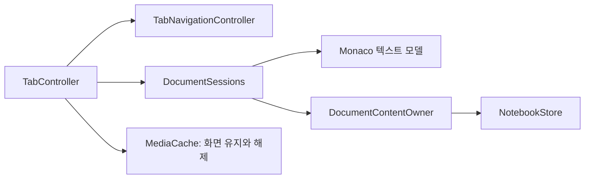

# Setdown 코드 구조와 변경 경로

Setdown은 하나의 데스크톱 앱으로 배포한다. 최상위 소스 디렉토리는 실행 환경을,
그 아래 디렉토리는 기능의 책임을 나타낸다. 새 기능을 위해 별도 npm package나
공용 프레임워크를 먼저 만들지 않는다. 실제로 공유하는 규칙과 수명 경계를 먼저 정한다.

## 실행 환경

경로는 별도 표시가 없으면 `apps/desktop/src` 기준이다.

| 경로 | 책임 | 참조할 수 있는 내부 경계 |
| --- | --- | --- |
| `core/` | 문서·워크스페이스·읽기·preview의 순수 규칙 | core. Node와 Electron에 의존하지 않음 |
| `protocol/` | 프로세스 사이 메시지·API·검증 계약 | core, protocol |
| `main/` | 파일·창·네이티브 뷰·외부 프로세스·IPC 권한 | core, protocol, main의 서비스 |
| `renderer/app/` | 기능 생성·연결·앱 이벤트 조립 | renderer 기능의 공개 연결부 |
| `renderer/workspace/` | 탭·그룹·탐색·저장 조정·공통 위치 UI | core, protocol, renderer의 공개 포트 |
| `renderer/{browser,language,notebook,image,video,...}/` | 기능별 상태·동작·화면 | 필요한 포트와 순수 규칙 |
| `preload/` | 앱 shell에 노출하는 Electron bridge | protocol과 main에서 호출할 IPC 계약 |
| `preview-runtime/`, `browser-runtime/` | 문서·웹·확장 컨텍스트에서 실행하는 코드 | 해당 컨텍스트의 protocol/core. main·shell 구현을 가져오지 않음 |

[architecture-boundaries.test.ts](../../apps/desktop/src/architecture-boundaries.test.ts)는
실제 import 경로를 해석한다. 타입 전용 import, dynamic import, 경로 별칭도 같은
계층 규칙을 따른다. renderer의 `window.marktex` 접근은
`renderer/adapters/electron-desktop.ts`에만 둔다.

## 자주 바꾸는 동작의 소유자

| 동작 | 진입점과 책임 |
| --- | --- |
| 앱 조립 | `renderer/app/workspace-controller.ts`. UI에 전달할 액션과 기능 사이 callback 연결 |
| 탭 활성화·닫기·전송 | `renderer/workspace/tab-controller.ts`. 선택·저장 확인·표시 순서를 조정 |
| 주소 이동·Back/Forward | `renderer/workspace/tab-navigation-controller.ts`. 탭별 요청 세대와 직렬 처리, 실패·취소 시 기존 자원 보존 |
| 문서 내용 수명 | `renderer/workspace/document-sessions.ts`. 텍스트 편집기와 기능별 `DocumentContentOwner`에 내용 작업 위임 |
| Notebook 내용 | `renderer/notebook/document-content.ts`. NotebookStore의 편집·dirty·저장·해제 및 표시용 세션 발행 |
| 공통 탭 UI | `renderer/workspace/tabs/`, `groups/`, `location/` |
| 웹 명령·Reader 전환 | `renderer/browser/browser-actions.ts`. 네이티브 소유권은 여전히 main/browser가 검증 |
| LSP provider와 표시 | `renderer/language/`. 텍스트 편집 동작은 `renderer/editor/` |
| 네이티브 미리보기 | `main/preview/`, `preview-runtime/`, `renderer/reader/`. 성능 계약 확인 필수 |
| 확장 ZIP/CRX 해석 | `main/browser/extension-package.ts`. Node crypto/zlib을 사용하는 main 전용 코드 |
| 외부 확장 빌드 | `scripts/browser/build-ublock.mjs`, `extension-preload.mjs`. 패치 실패 조건·pins 보존 |

`renderer/workspace/workspace-view.svelte.ts`에는 표시 상태를 둔다. UI 액션의 최종
조립 타입은 `renderer/ports/ui-actions.ts`, 텍스트 편집 자료형은
`core/document/text-edit.ts`에 있다. 타입만 필요한 코드가 반응형 view 모듈을
가져오지 않도록 한다.

## 문서 세션과 화면 캐시는 다르다

현재 `DocumentContentOwner`는 이미 존재하는 **직렬화 가능한 문서 내용**의 포트다.
파일 I/O·저장 확인·탭 전송은 workspace와 main에 남아 있다. NotebookStore를
화면 mount/unmount에 종속시키거나 별도의 복제 상태 저장소를 만들지 않는다.
저장 응답이 왔을 때 더 최신인 편집을 dirty 상태로 유지해야 한다.

`MediaCache`는 현재 읽기 전용 PDF·이미지·영상 화면의 캐시다. 기본 용량, 보이는
화면 보호, 버전별 무효화와 자원 해제 정책은 유지한다. 앞으로 이미지 편집 기능을
만들 때 편집 이력을 이 화면 캐시에 넣지 않는다. 바이너리 편집·영상 엔진의 계약은
실제 요구사항이 생길 때 정하며 이번 정리에는 빈 엔진 구현을 추가하지 않았다.

## 공개 연결부와 어댑터

단일 preload 조립 계약인 `DesktopPort`는 앱 진입점에서 사용할 수 있다. 기능 화면은
필요한 API만 받는다. 현재 ImagePort·VideoPort·PdfPort·LocationSuggestionsPort와
기존 LanguageApi·NotebookApi·TerminalApi가 그 경계다. wire format과 IPC 채널을
변경하지 않고 소비 범위를 좁혔다.

언어 기능 외부에서 사용할 연결부는 `language-client.ts`, `language-conversion.ts`,
`language-feature-context.ts`, `LanguageSupport.svelte`다. Notebook의 외부 연결부는
`document-content.ts`와 `NotebookSurface.svelte`다. 구조 검사는 이 두 기능의 내부
파일을 다른 기능에서 직접 참조하는 것도 차단한다. 다른 기능 전체에 대한 공개
진입점 검사를 도입한 것은 아니며, 실제 경계를 정한 기능부터 확대한다.

renderer 기능이 `renderer/app`을 역참조하지 않는다. 기능 간 연결이 필요하면
작은 callback이나 포트를 앱 진입점에서 전달한다. 모든 기능에 crop·재생·LSP 등
서로 다른 명령을 포함하는 하나의 거대한 인터페이스를 강제하지 않는다.

## 테스트와 문서

- 구현 옆 `*.test.ts`: 단위 및 서비스 검증. 기본 Vitest가 자동 수집한다.
- `test/e2e/<기능>/`: 실제 Electron/Chromium 시나리오.
- `test/support/<기능>/`: 앱·native input·서버·fixture 준비와 정리.
- `test/fixtures/`: 문서·영상 등 테스트 입력. 이동해도 내용을 바꾸지 않는다.
- `test/language-servers/`, `test/notebook-tools/`, `test/notebook/`: 별도 도구가 필요한 검증.
- [test/suites.json](../../apps/desktop/test/suites.json): E2E 분류, preview 계약 목록,
  외부 도구 suite와 benchmark 입력의 단일 목록.

새 E2E는 `test/suites.json`에도 소유 경로와 계약 포함 여부를 등록한다. 수집 전에
미분류·삭제된 경로·계약 목록 중복을 검사한다. 기존 계약을 줄이는 변경은 단순한
테스트 정리가 아니므로 보장 사항과 실제 시나리오의 대응을 검토해야 한다.

루트에서 `npm test`, `npm run test:tooling`, `npm run test:preview-contract`를 실행한다.
전체 E2E는 `npm run test:e2e`다. GUI npm script는 모두 격리 디스플레이를 사용한다.
일반 PR CI는 단위·구조·도구 테스트와 typecheck/build를 실행한다. 실제 GUI와
성능 비교는 현재 계약에 따라 별도로 실행한다.

단위 테스트에도 실제 외부 프로세스가 있다. Pyright/basedpyright는 npm 설치본을
사용하고, clangd 서비스 테스트는 `clangd` 또는 `SETDOWN_CLANGD_PATH`가 필요하다.
분석 준비 테스트는 실제 CMake와 Meson으로 C++ 프로젝트를 구성하므로 `cmake`,
`meson`, `ninja`와 C/C++ 컴파일러·Make도 필요하다. 일반 CI에서 `build-essential`,
`clangd`, `cmake`, `meson`, `ninja-build`를 명시적으로 설치한다. Rust/Fortran GUI suite와
notebook 외부 도구 suite의 설치 조건은 manifest에 따로 기록하며 미설치를 성공으로 세지 않는다.

현재 보장 사항은 [성능 계약 진입점](../preview-performance-contract.md)과
[기능별 계약](../contracts/)에서, 날짜별 실행 근거는 [검증 기록](../validation/)에서
찾는다. `reports/`는 당시 코드에 대한 분석과 제안이므로 과거 경로를 현재 경로로
자동 치환하지 않는다. 외부 소스 사용 방식은 [외부 코드 지도](external-code.md)를 따른다.

이번 구조 정리의 범위, 변경 전후 테스트 결과와 알려진 실패는
[구현·검증 기록](../validation/2026-10-16-architecture-cleanup.md)에 남겼다.
