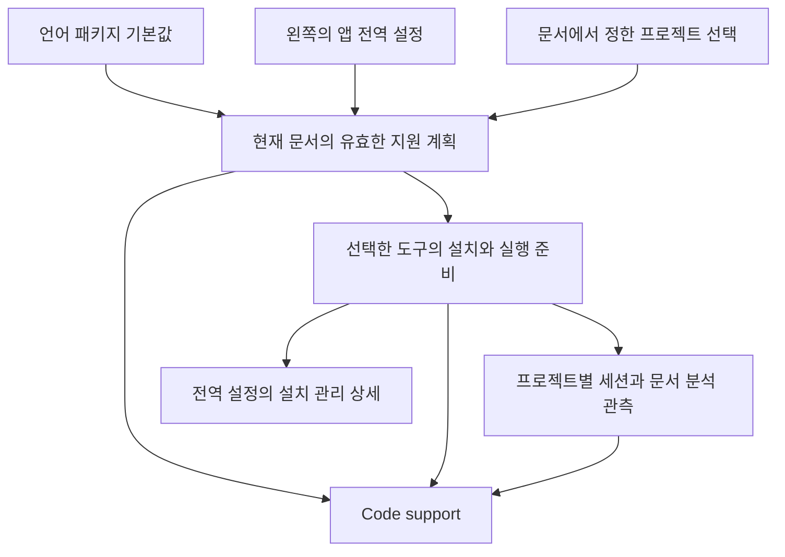

# Zed 도입 이후 언어 지원과 전역 설정 설계

후속 구현과 검증: [언어 지원 전역 설정 구현](../reports/language-global-settings-implementation-2026-11-10/README.md). 아래 본문은 변경 전 관찰과 설계 판단을 보존한다.

2026년 11월 10일 · 설계 제안 · 소스 기준 `b8373c586e578a6a316743d0515f78044fe95f7d`

**왼쪽 Language Support를 Setdown 전체의 언어 지원 설정으로 한정하는 구도를 권한다.** 여기서는 자동 준비 정책, 언어별 기본 도구, 사용자가 등록한 연결을 설정한다. 현재 파일의 지원 상태, 적용된 프로젝트 설정, 오류와 복구는 그 문서의 Code support에서 다룬다. 지원되는 파일을 여는 정상 경로에는 왼쪽 패널 방문이나 Detect 조작이 필요하지 않아야 한다.

기존 설계는 사용자가 설치한 서버를 Setdown이 발견하고 연결해 주는 역할에 맞았다. Zed 기반 자동 준비가 들어온 지금은 Setdown이 필요한 도구를 마련하는 책임까지 맡는다. 그 책임을 맡고도 사용자에게 설치 목록의 해석과 재탐색을 기본 과제로 남기면, 자동화의 효과가 UI에서 사라진다.

다만 현재도 왼쪽 패널의 설정 소유권은 대체로 전역이다. 바꿔야 할 핵심은 **전역 화면의 내용을 설치 탐색 목록에서 앱의 기본 정책으로 바꾸고, 두 화면이 동일한 지원 상태를 설명하도록 만드는 것**이다. 아래는 현재 동작의 분석과 변경안이며, 제품 코드에 적용된 결과를 뜻하지 않는다.

## 두 화면이 사용자에게 요구하는 일

사용자가 제공한 [왼쪽 Language Support 화면](validation/language-support-global-settings-2026-11-10/sidebar.png)에는 `Detected` 그룹, `Detected Detected`, `Disabled Detected`, `Detected Included`가 함께 나온다. [Makefile의 Code support 화면](validation/language-support-global-settings-2026-11-10/code-support.png)에는 `Python environment`, `Project analysis is off.`, `Choose analysis tool…`이 나온다.

첫 이미지에서 `Detected`는 그룹과 상태의 이름이다. 상단 새로고침의 실제 동작은 `Rescan installed servers`다. 따라서 이미지 자체가 “Detect를 눌러야만 자동 지원이 시작된다”는 사실을 증명하지는 않는다. 문제는 **자동 지원을 확인하러 온 사용자가 실행 파일 목록과 연결 설정을 해석해야 한다는 것**이다.

| 화면의 표현 | 사용자가 자연스럽게 갖게 되는 의문 | 표현에 빠진 정보 |
| --- | --- | --- |
| `Detected Detected` | 찾았다는 것 외에 무엇이 되는가 | 자동 관리 여부, 필요한 때 사용할 준비가 되었는지 |
| `Disabled Detected` | 내가 끄지 않았는데 왜 꺼져 있는가 | 앱 기본값인지, 사용자의 선택인지, 다른 도구가 기본인지 |
| `Detected Included` | 포함된 도구를 왜 다시 탐지하는가 | 앱에 포함된 지원과 현재 문서의 연결 상태의 구분 |
| Makefile의 `Python environment` | Make 편집에 왜 Python을 정해야 하는가 | 실제 선택한 분석기가 요구하는 환경인지 |
| `Project analysis is off.` | 내가 껐나, 설치가 안 됐나, Make 지원이 없나 | 명시적 중지와 분석기 미제공의 구분 |
| `Choose analysis tool…` | 프로그램이 정할 수 없는 선택이 정말 있는가 | 선택의 필요성과 선택 가능한 주 분석기의 존재 |

이 표현들은 서로 다른 종류의 사실을 짧은 상태 하나로 압축한다. 상태 단어를 줄이거나 버튼을 숨기는 것만으로는 그 사실 관계가 바로잡히지 않는다.

## 왼쪽 패널을 전역 설정으로 한정할 때의 변화

[기존 UI 계약](language-support.md#current-file-support)은 이미 왼쪽을 전역 도구 관리, 문서 팝업을 현재 파일과 프로젝트의 검사 화면으로 구분한다. 이 소유권 분리는 유지할 가치가 있다. 사용자 제안은 여기서 더 나아가 **왼쪽의 첫 화면을 기본 동작의 설정으로 정리하자**는 방향으로 해석할 수 있다.

그렇게 하면 사용자는 두 화면의 질문을 구별할 수 있다.

| 위치 | 답해야 하는 질문 | 내용 |
| --- | --- | --- |
| 왼쪽 언어 지원 설정 | Setdown은 기본적으로 어떻게 동작하는가 | 자동 준비 정책, 언어별 기본 선택, 직접 추가한 연결 |
| 문서의 Code support | 이 파일에는 지금 무엇이 적용되는가 | 문법 지원, 분석 도구와 결과, 유효한 설정의 출처 |
| 문서에서 연 프로젝트 설정 | 이 프로젝트에서는 무엇을 다르게 쓸 것인가 | 환경, 분석기 선택, 분석 중지, 프로젝트별 도구 옵션 |
| 필요할 때 여는 상세 | 이 도구가 왜 준비되거나 실행되지 않는가 | 실패 단계, 실행 파일, 설치 출처, 로그, 재시도 |

문서와 프로젝트 화면은 기존 Code support의 단계 안에 둘 수 있다. 이를 위해 새로운 상시 패널을 여러 개 만들 필요는 없다.

왼쪽의 기본 화면에서 설치 후보와 실행 세션을 치우면 현재 서버의 활동을 한눈에 보는 기능은 줄어든다. 그 정보는 문서 상세에서 프로젝트와 함께 확인한다. 앱이 관리하는 다운로드·설치 정보는 전역 설정의 관리 상세로 접근할 수 있다. 특정 프로젝트의 연결 실패는 그 프로젝트의 문서에서 표시하고, 앱 전체의 자동 준비 기능에 영향을 주는 문제만 전역 설정에서도 설명한다.

이 구도에서 Explorer의 `chess` 폴더 선택은 왼쪽 설정의 적용 범위를 바꾸지 않는다. 폴더 선택기가 위에 있어도 패널에는 `Setdown 전체`라는 범위를 명시한다. 열린 문서가 없어도 설정은 완전하게 사용할 수 있다.

### 전역 설정에는 무엇을 남기는가

왼쪽 첫 화면의 구성 예시는 다음과 같다. 실제 문구와 배치는 구현 단계에서 다듬되, 각각의 소유권은 유지한다.

```text
언어 지원 설정
Setdown 전체 · 프로젝트에서 별도로 정한 선택은 유지됩니다

필요한 도구 자동 다운로드                 켬
  지원되는 파일을 열면 필요한 도구를 준비합니다

언어별 기본값                             ›
  Python · 자동
  TypeScript · 자동
  ...

직접 추가한 연결                          ›
  사용자 지정 서버 추가…

고급 관리                                ›
  관리형 설치와 외부 실행 파일
  설치 상태 다시 확인
```

`자동`은 파일을 열 때 어떤 기본 도구를 사용할지 앱이 결정한다는 설정이다. 관리형 설치가 없다면 필요한 때 준비한다. 아직 사용하지 않은 모든 언어의 도구를 미리 설치한다는 뜻은 아니다.

현재 자동 다운로드 선택은 서버별 연결 설정에 있다. 위 스위치는 이를 상속할 앱 전체 기본값을 추가하는 제안이다. 도구별·프로젝트별로 저장한 선택은 유지하고, 별도 선택이 없는 경우에 이 기본값을 적용한다. 다운로드를 꺼도 이미 제공되는 문법이나 사용할 수 있는 서버까지 끄지는 않는다.

언어별 상세에서는 현재 기본 도구와 그 기능을 설명하고 대체 도구를 선택할 수 있게 한다. Python 환경, 현재 프로젝트의 분석 완료 여부, 특정 세션의 재시작 버튼은 이 목록의 행에 넣지 않는다. 문법만 지원하는 언어에는 그 지원 범위를 표시하며 분석기 선택을 필수 항목으로 만들지 않는다.

직접 추가한 연결은 사용자가 등록한 경우에만 항목으로 생긴다. 자동으로 준비한 서버를 수동 연결처럼 만들어 사용자에게 소유권을 떠넘기지 않는다. 도구의 고급 설정과 JSON 가져오기는 유지할 수 있다.

`설치 상태 다시 확인`은 사용자가 외부에서 설치를 바꿨을 때 쓰는 유지보수 동작이다. 첫 화면의 대표 행동이나 정상적인 지원 시작 절차가 될 이유는 없다. `Use automatic detection`도 실제 의미가 수동 실행 경로 해제라면 `실행 파일 자동 선택으로 되돌리기`처럼 변경 대상을 밝혀야 한다. 이것은 프로젝트의 분석기 선택을 자동으로 되돌리는 동작과 별개다.

### 전역 설정을 바꾸면 어디까지 바뀌는가

**전역은 모든 프로젝트의 설정을 덮어쓰는 명령이 아니라, 별도 선택이 없는 프로젝트가 상속하는 기본값이어야 한다.** 예를 들어 앱의 기본 Python 분석기를 바꾸면 기본값을 따르는 프로젝트는 새 도구를 사용한다. 특정 도구를 직접 선택한 프로젝트와 분석을 명시적으로 끈 프로젝트는 그 선택을 유지한다.

설정의 기본 순서는 `문서가 속한 프로젝트의 명시적 선택 → 앱의 명시적 기본값 → 언어 패키지의 기본값`이다. 이는 언어 모드, 인터프리터 경로, 서버별 JSON을 하나로 합치는 규칙이 아니다. 각 설정은 자신의 범위에서 같은 원칙으로 출처를 설명해야 한다. 문서 언어 모드는 공유 문서 모델에, 노트북의 명시적 환경 선택은 기존 노트북 소유권에 남는다.

| 사용자의 행동 | 변경안의 결과 |
| --- | --- |
| 앱의 언어별 기본 분석기 변경 | 앱 기본값을 상속하는 프로젝트에 적용. 해당 도구의 영향받는 세션만 재연결 |
| 프로젝트 A에서 분석 끄기 | A의 명시적 선택으로 저장. 프로젝트 B와 앱 기본값은 그대로 유지 |
| 프로젝트에서 `앱 기본값 사용` 선택 | 그 선택 범위의 override를 제거하고 현재 앱 기본값을 상속 |
| 앱의 자동 다운로드 끄기 | 이 기본값을 따르는 경우 새 다운로드를 제한. 이미 사용할 수 있는 설치와 연결은 유지 |
| 앱의 자동 다운로드 다시 켜기 | 필요한 다운로드를 허용. 프로젝트의 분석 중지나 명시적 경로를 해제하지 않음 |

현재 열려 있는 문서에도 유효한 설정 변경은 적용하되, 적용 범위를 행동 옆에 설명한다. 모델·미저장 내용·Undo를 보존하고 관련 없는 서버와 노트북 실행 커널은 재시작하지 않는다. 파일 하나를 고치려는 사용자가 전역 기본값을 바꾸게 되는 경로도 피한다.

현재 [ZedProjectSettings](../apps/desktop/src/main/language/zed-project-settings.ts)가 읽는 것은 `lsp` 아래의 `settings`와 `initialization_options`다. Zed의 모든 `languages.*` 선택 정책까지 상속한다고 UI에서 약속해서는 안 된다. 변경안에서도 읽어들이는 설정 종류와 출처를 명확히 하며, Setdown의 명시적 설정이 우선하는 기존 동작을 보존한다.

## 자동 준비가 바꾼 책임

[10월의 탐색 설계](../reports/2026_10_16_00_09_lsp_discovery_and_connection_design.md)는 설치를 사용자가 수행하고, 설치된 서버의 발견과 연결을 Setdown이 맡는다는 전제를 명시했다. 그 전제에서는 PATH 탐색, 설치 후보 표시, 수동 실행 파일 선택, 재탐색이 유용한 중심 기능이었다. 당시에도 알려진 파일의 정상 연결은 자동으로 이루어지는 것이 목표였다.

[Zed 통합 기록](../reports/zed-language-platform-implementation-2026-11-10/README.md)과 현재 코드는 그 경계를 넓혔다. 언어 인식과 문법은 서버 설치와 독립적이고, 필요한 서버는 Zed의 내장 어댑터·확장 또는 제공 가능한 설치 경로로 준비한다. 준비한 실행 정보와 파일 검증 결과는 재사용한다. Zed 공식 문서도 해당 파일을 열 때 서버를 자동 다운로드하는 흐름, 별도의 서버 선택 설정, 프로젝트 toolchain 선택을 구분한다. 확장이 먼저 필요한 경우에는 확장 설치 제안이 있을 수 있다. [Zed 언어 설정](https://zed.dev/docs/configuring-languages#managing-language-servers)

Setdown이 재사용하는 범위도 정확히 구분해야 한다. 실제 Zed 언어 레지스트리와 설치·확장 호스트를 쓰지만, 문서 소유권, 프로젝트 분석 선택, LSP 연결과 현재 UI는 Setdown 코드가 담당한다. Zed를 도입했다고 기존 화면의 상태 모델까지 자동으로 바뀌지는 않는다.

| 책임 | 이전 중심 동작 | 변경안의 기본 경험 |
| --- | --- | --- |
| 언어와 문법 알아내기 | 편집기·연결 프로필의 정보 이용 | 서버 유무와 독립적으로 파일을 인식하고 편집 지원 제공 |
| 분석 도구 마련하기 | 사용자의 설치를 발견 | 선택한 도구의 기존 설치나 관리형 설치를 자동 이용 |
| 사용할 분석기 정하기 | 발견한 후보와 사용자 선택 | 앱의 언어별 기본 정책을 적용하고 명시적 선택을 존중 |
| 프로젝트 환경 정하기 | 별도 프로젝트 제어 | 실제 도구에 필요한 환경만 자동 해석하거나 선택 요청 |
| 사용자에게 조치 요청하기 | 탐지·연결·선택 화면 중심 | 자동으로 해결하지 못한 구체적인 원인과 조치 제시 |

자동 준비가 모든 언어에 분석기를 만들어 주지는 않는다. 문법만 제공하는 언어는 그 범위에서 정상 지원이다. 서버가 실행되어도 프로젝트 의존성이나 빌드 구성이 없으면 분석 범위가 제한될 수 있다. 이런 한계는 현재 문서에서 정확하게 설명해야 한다.

## 자동 선택과 사용자 선택의 경계

자동 지원을 제공하려면 앱이 기본 도구를 정할 책임도 가져야 한다. 같은 언어를 지원하는 실행 파일이 두 개 있다는 사실만으로 매번 사용자에게 분석기를 고르게 해서는 기본 경험이 안정되지 않는다.

먼저 **어떤 분석기를 쓸지** 결정하고, 그다음 **그 분석기를 어디서 실행할지** 해결한다. 기본 도구는 언어 패키지의 선언과 Setdown의 검토된 정책으로 정한다. 이미 문서를 분석 중인 유효한 선택은 유지한다. 새 대체 서버를 발견하거나 카탈로그에 추가했다는 이유로 기존 선택을 바꾸지 않는다. 현재 `rank`가 있다는 사실만으로 이 정책이 완성된 것은 아니다. 현재 실행 경로는 여러 설치를 발견한 경우 자동 준비의 순위 선택에 도달하기 전에 사용자 선택을 요구할 수 있다.

선택된 도구의 실행 파일은 명시적 경로, 그 도구가 지원하는 프로젝트 설치, 재사용 가능한 관리형 설치 등 자신의 실행 정책으로 해석한다. 버전과 실행 문맥상 안전한 선택이 정의되지 않은 경우에만 후보를 설명하고 선택을 요청한다. 명시적 경로가 사라졌다면 그 사실을 알리고 자동 선택으로 되돌리는 행동을 제공한다. 임의의 다른 설치로 교체하지 않는다.

프로젝트 인터프리터와 빌드 설정은 다른 종류의 선택이다. Python의 서로 다른 가상환경이나 C/C++의 여러 빌드 구성은 실제 분석 의미를 바꾼다. 유일하고 유효한 경우에는 자동 선택할 수 있지만, 필요한 구분을 Zed가 있다는 이유로 없앨 수는 없다. 서버 실행용 Node·Python·JDK와 사용자 프로젝트의 환경도 구별해야 한다.

보조 도구는 선택한 주 분석기와 별도로 취급한다. 많은 언어를 선언한 보조 확장을 모든 문서에서 자동 활성화하거나, 그 프로필의 언어 목록만 보고 환경을 결정하지 않는다. 기본 비활성 도구를 발견한 사실은 사용자의 조치가 필요한 문제가 아니다.

## 문서 화면이 설명해야 하는 상태

Code support는 해당 문서의 실제 기능과 필요한 행동을 중심으로 표시한다. `서버 없음` 하나에서 모든 문구와 버튼을 파생하지 않는다.

| 실제 상태 | 요약 문구 예시 | 기본 행동 |
| --- | --- | --- |
| 문법과 편집 규칙 제공, 기본 주 분석기 없음 | `문법 강조와 편집 지원 사용 중` · `이 언어의 기본 지원에는 프로젝트 분석이 포함되지 않습니다` | 강제 선택 없음. 고급 연결은 상세에서 접근 |
| 필요한 도구를 자동 준비 중 | `YAML 분석 도구를 준비하는 중…` | 편집 유지, 진행 상세 |
| 연결됐지만 결과를 아직 받지 않음 | `YAML 분석 도구 연결됨` · `분석 결과 대기 중` | 필요할 때 상세 |
| 현재 문서의 결과 수신 | `현재 파일의 분석 결과를 받았습니다` | Problems 또는 상세 |
| 사용자가 이 프로젝트의 분석을 끔 | `이 프로젝트에서 분석을 사용하지 않도록 설정했습니다` | `앱 기본값 사용` 또는 명시적 선택 변경 |
| 앱 기본값에서 분석을 끔 | `앱 기본 설정에 따라 분석을 사용하지 않습니다` | 프로젝트에서 사용하도록 설정하거나 앱 기본값 보기 |
| 최초 준비에 다운로드가 필요하지만 불가능 | `분석 도구를 아직 준비하지 못했습니다`와 실제 원인 | 원인에 맞는 재시도 또는 다운로드 정책 보기 |
| 사용할 프로젝트 환경이 불명확 | `분석에 사용할 Python 환경을 선택하세요` | 이 프로젝트의 환경 선택 |
| 주 분석기는 정상이고 선택한 보조 도구만 실패 | `기본 분석은 사용 중이며 일부 추가 기능을 사용할 수 없습니다` | 실패한 도구의 상세와 복구 |

Makefile의 기본 화면 예시는 다음과 같다.

```text
Code support

문서 언어        Makefile
프로젝트         projects / chess

문법 강조와 탭 들여쓰기를 지원합니다.
기본 지원에는 프로젝트 분석이 포함되지 않습니다.

상세…
```

이 상태에서는 Python 환경 행, 꺼진 분석이라는 설명, 필수 선택처럼 보이는 도구 선택 버튼이 필요하지 않다. 사용자가 Make용 분석기를 별도로 연결했다면 그 도구의 상태와 요구 환경을 표시한다. 서버가 실제로 시작되어도 곧바로 “검사 완료”로 표시하지 않으며, 빈 Problems도 전체 프로젝트의 정확성을 보증하지 않는다.

## 현재 코드에서 확인한 불일치

### 자동 준비와 왼쪽 목록의 설치 판정이 분리되어 있다

[LanguageManager.open](../apps/desktop/src/main/language/language-manager.ts)은 기존 설치를 찾고, 설치가 없고 후보가 모호하지 않으면 자동 준비 가능한 서버를 고른다. 자동 설치를 끈 설정, 사용자 정의 연결, 명시적 절대 경로 등은 존중한다. [LanguageProvisioner](../apps/desktop/src/main/language/language-provisioner.ts)는 관리형 설치와 검증된 실행 기록을 재사용한다.

반면 같은 manager의 `catalogFor`는 별도의 실행 파일 탐색으로 `available`과 후보 목록을 만든다. 준비된 실행 기록을 설치 상태로 합치지 않는다. [language-presentation.ts](../apps/desktop/src/renderer/language/language-presentation.ts)의 `installed`는 `bundled`, `available`, 탐색 후보만 본다. `serverStatus`는 이 판정을 실행 중인 `ready` 세션보다 먼저 적용한다.

현재 표시 함수를 직접 실행해 다음 두 경우를 확인했다. 첫 행은 관리형 서버가 전역 탐색에 잡히지 않는 상황을 구성한 입력이며, 사용자 앱의 실제 세션을 관측한 결과는 아니다.

| 함수에 준 상태 | 실제 반환 |
| --- | --- |
| `sessions: ready`, `available: false`, 번들·탐색 후보 없음 | `Not detected`, 출처 `Auto-detect supported`, 그룹 `Available servers` |
| 실행 파일 발견, 기본으로 선택됨, 실행 세션 없음 | 상태 `Detected`, 출처 `Detected` |

첫 경우는 연결이 된 사실과 목록의 설명이 충돌한다. 두 번째는 실행 상태와 발견 경로가 같은 단어로 표시되어 정보가 중복된다. 새로고침을 더 자주 하도록 만들어도 자동 준비와 목록의 정보원이 다른 문제는 남는다.

또한 현재 `managed` 필드는 사용자 설정이나 명시적 경로가 존재하는지도 뜻한다. 이를 새 UI에서 곧바로 “Setdown이 설치하고 관리함”으로 번역하면 안 된다. 관리형 설치의 소유권은 별도 근거가 필요하다.

### Makefile의 Python 환경은 기본 데이터만으로 설명된다

현재 [언어 카탈로그](../apps/desktop/src/core/document/catalog/languages.json)의 `make`는 문법과 실제 탭 들여쓰기 정보를 가지며 `servers`는 빈 배열이다. 그런데 서버 정의에서 Make와 일치하는 항목을 찾으면 [Zed 프로필](../apps/desktop/src/main/language/catalog/zed-profiles.json)의 보조 도구 12개가 나온다. 기본 데이터에서 주 분석기는 0개이고, 12개 모두 기본 비활성이다.

`documentEnvironment`는 실행 중이거나 선택된 분석기가 없을 때 마지막으로 `definitions[0]`을 사용한다. 현재 Make의 첫 항목은 `zed.discord-presence.discord-presence`다. 이 항목은 여러 언어를 선언하며 Python도 포함한다. [AnalysisContextService.build](../apps/desktop/src/main/language/analysis-context.ts)는 해당 프로필의 언어 목록에 Python이 하나라도 있으면 Python 환경을 구성한다.

따라서 기본 데이터에서는 다음 경로가 성립한다.

```text
Makefile
  → 대응하는 주 분석기 없음
  → 비활성 보조 도구 중 첫 항목을 환경 계산에 사용
  → 그 프로필이 Python도 선언함
  → Makefile 화면에 Python environment 표시 가능
```

이는 Make에 Python 환경이 필요하다는 근거가 아니다. 선택하지 않은 보조 도구의 지원 언어 목록이 현재 문서의 환경 요구사항으로 취급되는 문제다. 사용자 화면의 실행 버전과 저장 설정을 특정하지 않아도, 현재 소스의 기본 경로에서 같은 유형의 표시가 가능한 것을 확인할 수 있다.

### 비활성 기본값을 사용자가 끈 상태로 설명한다

[presentSupport](../apps/desktop/src/renderer/language/document-presentation.ts)의 `projectOff`는 대응 서버가 하나 이상 있고 모두 `enabled: false`이면 참이다. 실제로 프로젝트 분석을 끈 기록이 있는지는 확인하지 않는다. 위 Make의 기본 프로필 목록을 이 함수에 전달하면 `Project analysis is off.`가 반환된다.

이 조건은 “사용자가 분석을 껐다”, “이 언어에 기본 주 분석기가 없다”, “선택하지 않은 보조 도구만 있다”를 구분하지 못한다. 문법 지원이 정상이어도 꺼진 기능을 복구해야 하는 것처럼 읽힌다.

[DocumentAnalysisPanel](../apps/desktop/src/renderer/language/DocumentAnalysisPanel.svelte)의 요약은 활성 주 서버가 없으면 `Choose analysis tool…`을 보여준다. 선택 화면은 주 분석기가 있을 때만 선택 목록을 만든다. 따라서 선택할 주 분석기가 없는 경우에도 그 화면으로 유도할 수 있다. 준비 중이거나 문법만 지원하는 경우 역시 “활성 서버 없음”이라는 동일 조건에 들어간다.

## 화면들이 공유해야 할 정보

왼쪽을 전역 설정으로 바꾸더라도 내부의 탐색 기능은 필요하다. 정상 경로에서 그 세부 절차를 앱이 처리하고, 화면은 같은 실행 결과를 사용해야 한다. 카탈로그 표시를 위해 별도의 연결 가능 여부를 다시 추정하는 구조를 줄인다.



지원 계획에는 최소한 다음 구분이 필요하다. 아래는 추가할 정보의 의미이며 확정된 API 이름은 아니다.

| 구분 | 설명해야 하는 사실 |
| --- | --- |
| 지원 기능 | 문법, 편집 규칙, 기본 분석기, 선택 가능한 보조 도구 |
| 선택과 출처 | 자동, 명시적 분석기, 명시적 중지 및 그것을 정한 범위 |
| 설치 소유권 | 앱에 포함됨, Setdown이 관리함, 외부 설치 이용, 사용자 지정 경로 |
| 준비 상태 | 필요할 때 준비 가능, 준비 중, 준비됨, 준비 실패와 원인 |
| 세션 상태 | 해당 프로젝트와 창에서 미사용, 시작 중, 연결됨, 실패 |
| 결과 관측 | 받은 결과의 범위, 최신 편집 이후 대기, 버전 없는 결과의 한계 |

앱이 관리하는 설치는 여러 프로젝트가 공유할 수 있지만 실행 환경과 세션은 프로젝트·설정·창의 문맥을 가진다. 따라서 전역 행 하나의 `Connected`로 전체 프로젝트의 동작을 대표하지 않는다. 프로젝트 설정도 Explorer의 현재 선택으로 추정하지 않고 해당 문서에서 얻은 실제 분석 root에 묶는다.

현재 `DocumentAnalysis.servers[].enabled`만으로는 명시적 중지의 출처를 복원할 수 없다. 프로젝트 설정을 적용하는 계층에서 그 근거를 전달해야 한다. 환경 요구사항은 실제로 선택된 도구와 현재 언어에서 계산하고, 보조 도구 목록의 첫 항목을 대신 쓰는 fallback은 제거한다.

전역 설정을 열거나 검색하는 일은 전체 서버 설치와 시작을 유발하지 않아야 한다. 문서를 닫거나 언어·root·설정을 바꾼 뒤 도착한 준비 결과도 그 문서에 붙지 않아야 한다. 여러 문서가 공유하는 다운로드는 한 문서가 닫혔다고 다른 문서의 작업까지 실패시키지 않도록 소유권을 구분한다. 관리형 설치 기록이 유효하면 오프라인 재사용하고, 무효라면 구체적인 준비 실패로 설명한다.

## 선택지와 권고 범위

| 선택지 | 얻는 것 | 남는 문제 |
| --- | --- | --- |
| 기존 목록에서 Detect 관련 문구만 변경 | 작은 화면 변경 | 설치·선택·실행 상태의 정보원이 분리된 채 남음. Make 환경 문제도 지속 |
| 왼쪽 언어 지원 화면 제거 | 상시 UI 감소 | 앱 기본값과 사용자 연결을 둘 별도 설정 위치 필요. 문서 없는 상태의 관리 접근도 마련해야 함 |
| 왼쪽을 앱 전역 설정으로 정리 | 앱 기본 정책과 문서의 실제 상태가 구분됨 | 설정 출처와 준비 상태를 전달하는 내부 모델 정비 필요 |

세 번째를 권한다. 기존의 문서·프로젝트·앱 소유권을 보존하면서 사용자에게 묻는 질문을 줄일 수 있다. 왼쪽에 설치와 세션 정보를 다시 주 목록으로 쌓으면 같은 문제가 재발한다. 상세에 정보를 보존하더라도 첫 화면은 설정의 적용 범위와 기본 동작을 중심으로 유지한다.

## 구현 순서와 기존 설정의 보존

1. **잘못된 설명부터 고친다.** Make처럼 주 분석기가 없는 상태, 명시적 분석 중지, 준비 중, 실제 선택 필요를 분리한다. 비활성 보조 도구가 환경을 결정하는 경로를 없애고, 선택할 대상이 없는데 도구 선택을 요구하는 화면을 바로잡는다.
2. **선택과 상태의 공통 정보를 마련한다.** 자동 준비의 설치 소유권과 진행·실패를 노출하고, 문서와 관리 상세가 동일한 결과를 보게 한다. 서버 선택과 실행 파일 선택을 분리한다. 연결된 세션을 `Not detected`로 표시하는 모순도 이 단계에서 제거한다.
3. **왼쪽을 전역 설정으로 바꾼다.** 앱 자동 준비 정책과 언어별 기본값을 앞에 두고, 외부 설치 재확인·실행 파일·로그는 해당 상세로 옮긴다. 프로젝트 변경은 계속 문서에서 진입한다.
4. **기존 계약과 검증을 함께 갱신한다.** 현재 동작을 설명하는 `docs/language-support.md`와 상태 테스트를 실제 구현에 맞춰 바꾼다. 이전 검증 기록은 당시 결과로 보존한다.

설정 이전에서는 사용자가 저장한 서버 ID, 명시적 실행 경로, 프로젝트별 선택, 비활성 선택, JSON 옵션을 보존한다. 현재 저장값으로 명시적 비활성은 확인되지만 그것을 과거에 선택한 이유까지 알 수 없다면 그대로 유지하고 적용 범위만 정확히 표시한다. 새 자동화의 기본값을 적용하려고 저장된 `enabled: false`를 지우지 않는다.

`앱 기본값 사용`은 해당 선택의 override를 제거하는 동작이어야 한다. 무관한 서버 옵션이나 실행 경로까지 초기화하지 않는다. 현재 `Use automatic detection`은 실행 경로 선택을 해제하는 기능이므로 이를 그대로 재사용해서 모든 종류의 “자동”을 표현하지 않는다. 수동 연결 제거와 앱 관리형 설치 제거 역시 서로 다른 행동으로 남긴다.

## 완료를 판단할 검증 시나리오

완료 기준은 왼쪽에서 `Detected`라는 단어가 사라졌는지가 아니다. 사용자가 직접 연결을 만들지 않은 정상 상황에서 파일 열기만으로 선언된 지원을 받고, 필요한 선택만 정확한 범위에서 요구받는지 확인해야 한다.

| 시나리오 | 확인할 결과 |
| --- | --- |
| 깨끗한 설정에서 지원되는 YAML 파일 열기 | 왼쪽 방문·Rescan 없이 자동 준비와 실제 분석 연결. 준비 중 입력과 Undo 유지 |
| Makefile 열기 | 문법과 탭 동작 유지. 불필요한 Python 환경, 분석 중지 문구, 필수 분석기 선택 없음 |
| Make에 사용자 분석기를 연결 | 해당 연결의 실제 상태와 필요한 환경만 표시 |
| 관리형 서버가 PATH에 없지만 연결됨 | 문서와 설치 관리 상세가 실행 사실 및 설치 출처와 일치 |
| 관리형 설치를 가진 상태에서 오프라인으로 다시 열기 | 유효한 캐시 이용. 새 설치가 필요하면 실제 원인과 복구 행동 표시 |
| 언어별 대체 도구가 추가되거나 외부 설치가 발견됨 | 유효한 기존 선택 유지. 단순 후보 증가로 선택 강요나 자동 전환 없음 |
| 명시적 실행 경로가 사라짐 | 지정 경로의 문제를 설명. 사용자 선택을 몰래 대체하지 않음 |
| 앱 기본값 변경 중 프로젝트 A는 override, B는 상속 | A는 유지하고 B에만 해당 기본값 적용. 다른 창에서도 같은 설정 범위 유지 |
| 사용자가 프로젝트 분석을 끈 뒤 앱 업데이트·재탐색 | 꺼 둔 선택 유지. 새 프로필의 기본 비활성과 구별 |
| 선택한 보조 도구만 실패 | 주 분석기의 정상 기능 유지. 실제 실패한 보조 도구만 복구 대상으로 표시 |
| 두 프로젝트를 다른 그룹에서 검사 | 처음 연 문서와 root를 유지. 다른 그룹 포커스가 설정 대상을 바꾸지 않음 |
| 마지막 문서 닫기와 전역 설정 열기 | 전역 설정은 정상 사용 가능. 닫힌 문서 안내나 불필요한 서버 시작 없음 |
| 준비 중 문서 닫기·언어 변경·설정 변경 | 오래된 결과가 새 문서나 다른 설정에 적용되지 않음 |
| 정상 편집, 한글 IME, Escape로 단계 이동 | 포커스·미저장 내용·Undo 및 기존 단계 이동 보존 |

초기 표시 함수 검사는 이번 문서의 코드 분석을 위한 소규모 실행이다. 전체 앱의 GUI 회귀 검증이나 성능 검증을 수행한 것으로 취급하지 않는다. 실제 구현에서는 관련 단위 검사와 실제 Electron 시나리오를 추가·갱신한다. GUI는 `apps/desktop/scripts/with-isolated-display.sh`를 통해 Xvfb, 별도 runtime 디렉터리와 D-Bus에서 실행한다.

UI·CSS와 편집 경로를 변경하는 구현은 [미리보기 성능 계약](preview-performance-contract.md)을 따라 `npm run test:preview-contract`를 통과해야 한다. 해당 성능 경로를 바꾸면 `npm run bench:preview -- --baseline /absolute/path/to/installed-baseline`도 실행한다. 일반 Markdown과 Git review, 편집 유무와 준비 시간 유무, 첫 번째·두 번째·반복 cycle을 각각 보고하며, 준비를 입력 경로로 옮기거나 실패·누락·오래된 내용 캡처를 성공으로 처리하지 않는다.
