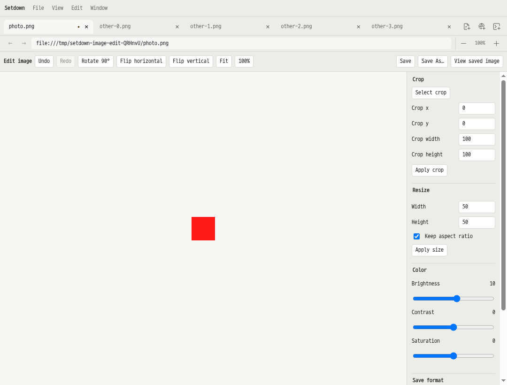

# 사진 편집 구현 검증

2026년 10월 17일, 정적 PNG·JPEG·WebP 사진 편집을 구현했다. 이미지 탭의 **Edit image**에서 자르기, 90도 회전, 좌우·상하 뒤집기, 크기 변경, 밝기·대비·채도를 조절하고 Undo/Redo, Save, Save As를 사용할 수 있다. 이 범위는 [구현 연구 보고서](../../reports/2026_10_17_16_05_photo_editing_implementation_research.md)의 첫 제품 범위에 해당한다.

## 구현과 사용 범위

Svelte가 도구 화면을 담당하고 npm `fabric@7.4.0`을 지연 로드한다. [공유 렌더링 어댑터](../../apps/desktop/src/image-runtime/fabric-adapter.ts)는 화면 미리보기와 내보내기에 같은 좌표 변환·필터를 적용한다. svelte-chop-chop의 편집 도구 구성과 filerobot의 상태 분리 방식을 참고하되, 파일 저장과 편집 기록은 앱에서 관리한다.

[편집 세션](../../apps/desktop/src/renderer/image/image-edit-sessions.ts)은 화면 캐시와 분리되어 탭 이동·캐시 퇴출에도 편집 내용과 Undo를 보존한다. 저장은 캡처한 recipe만 확인하므로 저장 중 추가한 수정은 계속 미저장 상태로 남는다. 키보드와 메뉴, 탭·창 닫기, 주소 이동, Git 스테이징 전 저장도 문서 소유자의 저장 경로를 사용한다.

[이미지 파일 서비스](../../apps/desktop/src/main/documents/image-edit-ipc.ts)는 원본을 메인 프로세스에 보존하고, 전체 크기 내보내기를 별도의 숨김·샌드박스 렌더러에서 수행한다. 원본을 해제하면 실행 중이거나 대기 중인 작업을 취소한다. 저장은 경로별 직렬화, 내용 해시·파일 버전 비교, 임시 파일과 rename을 사용하며 실패한 임시 파일을 정리한다. 외부 프로세스의 마지막 확인과 rename 사이 경쟁까지 막는 원자적 CAS는 아니다.

편집 한도는 24MP·한 변 8192px·파일 64MiB이며, 보관하는 원본의 합계는 256MiB로 제한한다. 일반 미리보기는 최대 2048px이고 100% 등 상세 확대에서는 전체 크기 렌더로 전환한다. PNG/WebP는 투명도를 보존하고 JPEG는 흰 배경을 사용한다. 출력은 8비트이며 메타데이터·원래 ICC 프로필은 보존하지 않는다. 애니메이션·GIF·AVIF·SVG는 뷰어로 이용한다. 미저장 이미지의 그룹·창 간 드래그는 저장 후 허용한다. 주석·텍스트·모자이크, 편집 세션 전송, 비정상 종료 후 복구는 후속 범위다.

## 검증 결과

모든 GUI 검사는 Xvfb, 독립 런타임 디렉터리와 D-Bus 세션에서 실행했다. 사용자 데스크톱에 테스트 창을 표시하지 않았으며 재시도나 기존 단언·성능 허용치 변경은 없다.

| 검사 | 결과 |
| --- | --- |
| 미리보기 계약 단위 검사 | 73개 파일, 482개 테스트 통과 |
| 빌드 도구 검사 | 11개 통과 |
| 타입 검사와 Svelte 검사 | 오류 0개, 경고 0개 |
| 전체 미리보기 계약 Electron 검사 | 138개 통과 |
| 최종 사진 편집 Electron 검사 | 7개 통과 |

전체 명령은 `npm run test:preview-contract`이다. 전체 검사 이후 숨김 내보내기의 취소와 마지막 출력 버퍼 해제를 보완하고, 최종 타입 검사·메인 빌드·사진 편집 7개 검사를 다시 통과했다. 아래 성능 측정은 이 최종 빌드를 사용했다.

사진 편집 검사는 실제 파일의 크기와 픽셀, 캐시 퇴출 후 복원, 저장 체크포인트 Undo/Redo, 저장 중 추가 수정, 외부 변경 충돌, 취소된 Save As, 자르기 후 창 크기 변경, 탭 닫기 저장을 확인한다. JPEG EXIF 방향 1~8을 upright 기준 픽셀과 비교했고 PNG/WebP 알파와 JPEG 흰 배경을 검사했다. 1·6·24MP의 실제 전체 해상도 확대와 48MP 편집 거부도 통과했다. 멈춘 내보내기를 원본 해제로 취소하면 숨김 창이 즉시 제거된다.

한글 조합 검사는 실제 Chromium의 `Input.imeSetComposition`으로 미완성 조합을 유지한 채 숨김 렌더링을 실행해 blur 0회와 조합 유지 여부를 확인했다. 물리 키보드·운영체제 IME 전달 자체를 검증한 결과는 아니다.

초기 제한 샌드박스 실행에서는 기존 언어 서버·git 자식 프로세스가 EPERM으로 실패해, 승인된 실행 환경에서 전체 검사를 진행했다. 초기 이미지 검사에서 외부 변경 안내를 선택하지 않은 클릭과 동일 프레임을 합친 애니메이션 fixture를 수정했다. 중간 전체 검사는 구현 변경으로 중단했으며 통과 결과에 포함하지 않았다. 초기 로그도 함께 보관했다.

[전체 계약 로그](../../reports/photo-editing-validation-2026-10-17/preview-contract.log.txt), [최종 사진 편집 검사](../../reports/photo-editing-validation-2026-10-17/image-editor-e2e.log.txt), [최종 타입 검사](../../reports/photo-editing-validation-2026-10-17/final-typecheck.log.txt), [구현 파일 해시](../../reports/photo-editing-validation-2026-10-17/implementation-sha256.json)



## 미리보기 전환 성능

기준 커밋은 `8755d9971e6d41b390515d97306ec03ab66284b2`이다. `/tmp/setdown-photo-baseline-8755d99`에 별도 체크아웃과 자체 의존성을 설치해 빌드했다. 기준과 후보 모두 Electron 44.7.2를 사용했고, 같은 격리 디스플레이에서 AB/BA 순서로 각 버전을 5회씩 실행했다. 각 반복의 8개 시나리오는 새 앱과 프로필을 사용한다.

```sh
npm run bench:preview -- \
  --baseline /tmp/setdown-photo-baseline-8755d99 --skip-build \
  --output /home/yabsed/Documents/fall26/work/projects/better-markdown-viewer/test-results/photo-editing-20261017
```

80개 앱 실행과 48개 비교 항목을 완료했고 기존 기준인 **25%와 50ms를 모두 초과하는 회귀는 0개**였다. 일부 항목의 증가는 아래 수치에 포함되어 있다. 첫 회·두 번째 회는 반복 간 중앙값, warm은 각 앱의 3~5회 중앙값을 다시 반복 간 집계한 값이다. Esc 측정에는 최신 DOM 확인과 네이티브 캡처 readback이 포함되며 모니터 표시 시각을 의미하지 않는다. 수치는 ms, `기준 → 수정`이다.

| 문서 | 편집 | 준비 시간 | 측정 | 첫 회 | 두 번째 | warm |
| --- | --- | --- | --- | --- | --- | --- |
| Markdown | 없음 | 0ms | Esc → 캡처 | 35.0 → 27.0 | 21.0 → 26.0 | 25.0 → 22.0 |
| Markdown | 없음 | 0ms | 더블클릭 → 편집 | 18.0 → 24.0 | 36.0 → 32.0 | 11.0 → 12.0 |
| Markdown | 있음 | 0ms | Esc → 캡처 | 442.0 → 447.0 | 97.0 → 99.0 | 94.0 → 92.0 |
| Markdown | 있음 | 0ms | 더블클릭 → 편집 | 20.0 → 20.0 | 16.0 → 15.0 | 13.0 → 15.0 |
| Markdown | 없음 | 3000ms | Esc → 캡처 | 43.0 → 38.0 | 20.0 → 24.0 | 23.0 → 20.0 |
| Markdown | 없음 | 3000ms | 더블클릭 → 편집 | 17.0 → 17.0 | 11.0 → 12.0 | 11.0 → 11.0 |
| Markdown | 있음 | 3000ms | Esc → 캡처 | 100.0 → 119.0 | 99.0 → 111.0 | 92.0 → 92.0 |
| Markdown | 있음 | 3000ms | 더블클릭 → 편집 | 20.0 → 21.0 | 13.0 → 17.0 | 14.0 → 14.0 |
| Git 검토 | 없음 | 0ms | Esc → 캡처 | 934.0 → 1023.0 | 19.0 → 23.0 | 29.0 → 27.0 |
| Git 검토 | 없음 | 0ms | 더블클릭 → 편집 | 23.0 → 26.0 | 12.0 → 12.0 | 12.0 → 13.0 |
| Git 검토 | 있음 | 0ms | Esc → 캡처 | 1014.0 → 1037.0 | 1444.0 → 1544.0 | 178.0 → 176.0 |
| Git 검토 | 있음 | 0ms | 더블클릭 → 편집 | 23.0 → 22.0 | 19.0 → 13.0 | 18.0 → 18.0 |
| Git 검토 | 없음 | 3000ms | Esc → 캡처 | 25.0 → 25.0 | 22.0 → 23.0 | 17.0 → 18.0 |
| Git 검토 | 없음 | 3000ms | 더블클릭 → 편집 | 23.0 → 23.0 | 12.0 → 12.0 | 18.0 → 17.0 |
| Git 검토 | 있음 | 3000ms | Esc → 캡처 | 230.0 → 231.0 | 186.0 → 189.0 | 176.0 → 177.0 |
| Git 검토 | 있음 | 3000ms | 더블클릭 → 편집 | 22.0 → 21.0 | 18.0 → 20.0 | 17.0 → 17.0 |

[전체 비교 JSON](../../reports/photo-editing-validation-2026-10-17/preview-comparison.json), [성능 검사 로그](../../reports/photo-editing-validation-2026-10-17/preview-benchmark.log.txt)
