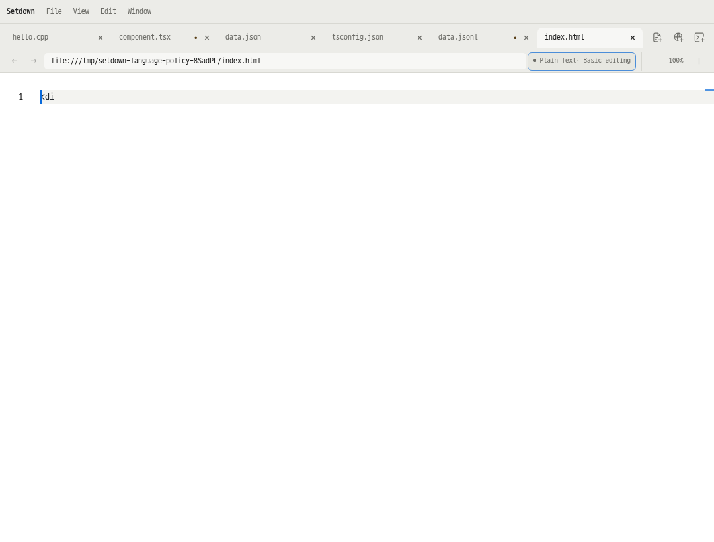
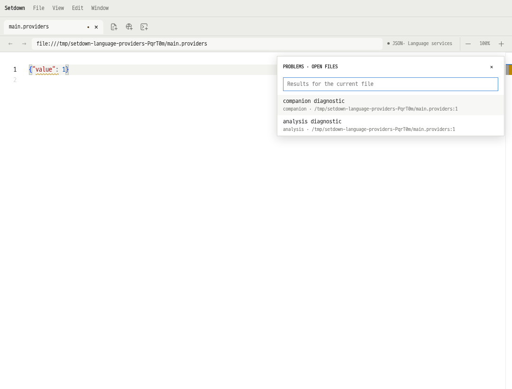
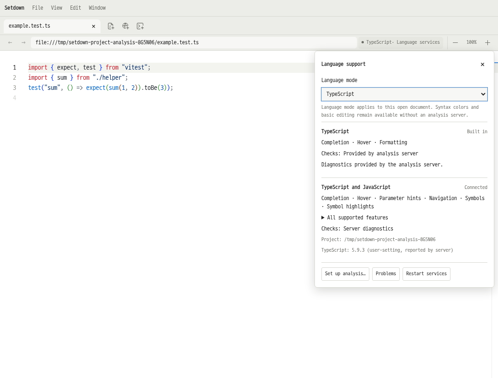

# 언어 지원 시스템 구현 검증 — 2026-10-18

기준 설계: [언어 공통 지원 정책](../../reports/2026_10_18_language_support_system_design.md).
현재 사용법과 지원 경계: [Language support](../language-support.md).
변경 전 기준은 `d48b482063de64149c04d49a17a1dfc3c3ef2ae2`다.

## 구현한 동작

언어 인식, 내장 편집/검사 기능, 외부 분석 제공자를 분리했다. 비활성화된
서버의 연결 metadata는 언어 인식에 사용할 수 있지만 서버 실행 후보에는
포함하지 않는다. C/C++ 기본 모드는 서버 route와 독립적으로 존재한다.
현재 파일의 언어 모드를 바꿔도 모델·미저장 내용·Undo는 유지된다.

| 현재 문서에 적용 가능한 제공자 | 동작 |
| --- | --- |
| 없음 | 색상과 기본 편집 유지. Basic editing으로 표시하며 진단을 만들어내지 않음 |
| HTML 내장 서비스 | 완성·hover·포맷 제공. 진단 미지원 표시 |
| JSON 내장 서비스 | 문법·확보된 schema 검사. schema 로딩 실패는 서비스 상태로 분리 |
| JSONC / JSON Lines | 파일 dialect에 맞춰 검사. 일반 JSON 검사는 완화하지 않음 |
| CSS/SCSS/Less 내장 서비스 | 문법과 설정된 CSS 지식 기반 lint 유지 |
| JS/TS 내장 서비스 | 문법 검사. 파일 시스템을 읽을 수 없는 worker의 프로젝트 의미 검사 중단 |
| 외부 분석 서비스 | 실제 협상된 기능 등록. 진짜 import·타입 오류를 보존 |
| 분석 서비스 + 보조 도구 | 별도 연결·진단·code action 소유권. rename/semantic tokens는 주 제공자, 포맷은 선택한 제공자 |

`DiagnosticStore`가 밑줄과 Problems의 공통 원본이다. provider·session epoch·
push/pull channel별 결과를 분리하고 다른 제공자의 결과를 지우지 않는다.
문서 변경, 설정 변경, 해제, 실패에서 이전 결과를 철회한다. version이 있는
결과는 현재 버전과 일치해야 한다. version 없는 push는 best-effort로 유지하며
현재 버전을 분석했다고 꾸미지 않는다.

로컬 검사 중복 방지는 동작을 아는 adapter만 수행한다. 해당 서버가 진단을
게시하거나 pull 기능을 제공하기 전에는 독립적인 내장 검사를 유지한다.
formatter만 연결됐다고 로컬 오류가 사라지지 않는다. 서버가 종료돼도
제한된 worker의 프로젝트 의미 검사가 다시 켜지지 않는다.

현재 파일의 location bar에서 언어 모드, 내장 기능, 연결 서비스, 검사 범위,
프로젝트·서버가 보고한 환경, 설정·Problems·재시작을 확인할 수 있다.
상태 갱신은 입력 포커스를 가져오지 않으며 Escape와 조합 입력을 구분한다.
Language Support에는 프로젝트/전역 범위, 분석 역할, 포맷 선택, Python
인터프리터, clangd compilation database, analysis root의 입력을 추가했다.
원시 JSON은 Advanced로 유지한다.

프로젝트 설정은 문서의 실제 경로로 해석하며 인접한 이름의 디렉터리에
누출되지 않는다. 더 구체적인 경로가 우선한다. 서버의 `workspace/configuration`
요청도 resource scope를 반영한다. 환경이 다른 세션은 공유하지 않으며 설정
변경 시 기존 세션을 종료해 늦게 도착한 이전 환경 결과를 차단한다.

JS/TS 프로젝트 지원은 이 구조를 사용하는 한 adapter다. TypeScript 5.9.3과
TypeScript Language Server 6.0.2를 고정해 포함했다. 프로젝트 설정과 설치된
의존성을 읽으며 automatic typings acquisition은 끈다. JSON/CSS/HTML과
분석 서비스가 없는 언어에도 공통 정책이 적용된다.

## 실제 화면

실제 Electron 테스트의 캡처이며 디자인 시안이 아니다.





두 서버의 실제 document/format 요청:
[multiple-providers-rpc.jsonl](language-support-2026-10-18/multiple-providers-rpc.jsonl).



## 검증 범위

`language-policy.spec.ts`와 기존 `language-reform.spec.ts`는 실제 Electron과
Monaco worker에서 다음을 검사한다.

- 모든 서버를 비활성화한 C++, TSX, JSON, JSONC, JSON Lines, HTML과 언어 모드 변경.
- 정상 import를 가짜 오류로 표시하지 않으면서 TS/JSON/CSS의 실제 문법 오류 보존.
- schema를 읽을 수 없는 상태와 실제 문법 오류 분리.
- 주 분석기 + 보조 포맷터 + 내장 JSON 검사의 진단 출처와 Problems 일치.
- 선택한 외부 포맷터만 실행하며 다른 제공자의 진단이 유지됨.
- 주 제공자만 지원하는 call hierarchy와 보조 제공자만 지원하는 workspace
  symbols 명령이 각각 올바른 서버로 전달됨. 다른 제공자의 `false` capability가
  사용 가능한 기능을 비활성화하지 않음.
- 두 제공자의 `willSave`, `willSaveWaitUntil`, `didSave` 전달과 실제 저장 결과.
- 번들 프로젝트 서버가 실제 설치된 `vitest`와 상대 import를 해석함.
  의도적으로 추가한 타입 오류와 실제 없는 모듈 오류는 그대로 검출함.

단위 테스트는 schema 로딩 오류를 옮길 때 실제 schema 위반이 보존되는 정책,
진단 epoch·channel·버전·해제, 느린 worker 응답과 설정 변경,
서버 없는 언어 인식, 중첩/인접 프로젝트 경로, Windows 형식 경로, 설정 상속과
재시작 전후 일치를 포함한다. Windows 형식 경로 테스트가 Windows 실행 검증을
뜻하지는 않는다.

기존 실제 Pyright·basedpyright·clangd 테스트, discovery, dynamic registration,
pull diagnostics, cancellation, 파일 작업, Save As, rename/Undo, notebook 분석과
한글 IME 회귀를 유지했다. GUI는 모두 격리된 Xvfb·runtime·D-Bus 환경에서
실행한다. desktop 화면이나 포커스를 사용하지 않는다.

## 최종 테스트 결과

| 실행 | 결과 | 근거 |
| --- | --- | --- |
| `npm test --workspace @setdown/desktop` | 135개 파일, **907개 테스트 통과** | [전체 로그](language-support-2026-10-18/unit-final.log.txt) |
| `npm run test:preview-contract` | 단위 **496개**, tooling **11개**, 실제 Electron **149개 통과** | [전체 로그](language-support-2026-10-18/contract-final.log.txt) |
| TypeScript / Svelte / production build | 통과, Svelte 오류·경고 0개 | 위 contract 로그 |
| `npm run check:language-profiles --workspace @setdown/desktop` | 195개 생성 profile 일치 | 생성기 `--check` 성공 |
| `git diff --check` | 통과 | 작업 트리 검사 |

contract GUI는 retries 없이 전체 실행했다. 앞선 집중 GUI 검사의 실패 2개는
번들 TS 서버 추가로 바뀐 Detected 수와 Advanced 설정 UI의 변경된 진입점에
관한 기존 기대값이었다. 기존 동작 assertion은 유지하고 해당 UI 기대값만
수정했다. [집중 검사 로그](language-support-2026-10-18/focused-e2e-before-ui-fixture-update.log.txt).
첫 전체 GUI 149개 통과 후 설정 상속의 재시작 전후 차이를 발견해 수정하고,
회귀 테스트를 추가한 뒤 위 최종 전체 검사를 다시 실행했다.
[수정 전 전체 검사](language-support-2026-10-18/contract-before-inheritance-fix.log.txt).

변경한 구현·테스트·의존성 파일 46개의 해시를
[source-sha256.json](language-support-2026-10-18/source-sha256.json)에 기록했다.

## 미리보기 성능 비교

별도 checkout `test-results/language-baseline`을 변경 전 커밋에서 만들었다.
이미 설치된 dependency tree를 별도 경로에 복사하여 각 앱이 자체 Electron과
의존성을 사용하도록 했다. 공유 node_modules symlink는 사용하지 않았다.
두 쪽의 Electron 44.7.2, Monaco 0.56.0, Crossnote 0.9.35, TypeScript 5.9.3이
같음을 확인했다. baseline의 복사본에는 새 TLS 패키지도 설치되어 있으나
baseline 제품 코드와 벤치마크 Markdown 시나리오에서는 이를 사용하지 않는다.
baseline vendor 코드는 현재의 동일한 pinned checkout에서 로컬로 준비했다.

두 production build를 완료한 뒤 `--skip-build`로 측정했다. 동일한 격리
display에서 AB/BA 순서를 번갈아 5회씩 실행했다. 일반 Markdown / Git review ×
편집 없음 / 있음 × 준비 시간 0 / 3000ms의 8개 시나리오를 빠짐없이 사용한다.
각 앱의 5회 전환 중 첫 번째, 두 번째, 3–5번째의 중앙값을 분리한다.
기존 판정은 증가율 25%와 절대 증가 50ms를 **모두** 넘을 때 실패하며 변경하지
않았다. Esc 측정은 최신 내용의 실제 native capture까지 포함하는 값으로
모니터 표시 시각이나 타이핑 지연을 뜻하지 않는다.

**최종 결과: 80개 앱 실행, 48개 비교 항목 모두 통과, 허용 기준을 넘는 회귀 0개.**

[전체 원시 측정·빌드/fixture/harness 해시](language-support-2026-10-18/preview-comparison.json),
[실행 로그](language-support-2026-10-18/preview-benchmark.log.txt).

아래 값은 ms 단위의 **기준 → 변경**이다. 각 구간은 5회 실행의 중앙값이며,
warm은 각 앱에서 3–5번째 전환의 중앙값을 먼저 계산한다. 모든 편집 시나리오는
최신 내용과 비어 있지 않은 native capture 검사를 통과했다.

### Esc → 최신 내용 native capture

| 대상 | 편집 | 준비 시간 | 첫 번째 | 두 번째 | Warm |
| --- | --- | --- | ---: | ---: | ---: |
| Markdown | 없음 | 0ms | 41 → 42 | 28 → 27 | 23 → 25 |
| Markdown | 있음 | 0ms | 399 → 432 | 99 → 97 | 92 → 92 |
| Markdown | 없음 | 3000ms | 42 → 40 | 23 → 20 | 21 → 19 |
| Markdown | 있음 | 3000ms | 101 → 110 | 93 → 100 | 89 → 93 |
| Git review | 없음 | 0ms | 941 → 949 | 25 → 28 | 29 → 26 |
| Git review | 있음 | 0ms | 1005 → 985 | 1493 → 1485 | 175 → 172 |
| Git review | 없음 | 3000ms | 30 → 27 | 21 → 22 | 17 → 18 |
| Git review | 있음 | 3000ms | 232 → 229 | 184 → 186 | 173 → 179 |

### 실제 double-click → 편집기

| 대상 | 편집 | 준비 시간 | 첫 번째 | 두 번째 | Warm |
| --- | --- | --- | ---: | ---: | ---: |
| Markdown | 없음 | 0ms | 18 → 17 | 34 → 34 | 11 → 11 |
| Markdown | 있음 | 0ms | 16 → 16 | 17 → 16 | 13 → 15 |
| Markdown | 없음 | 3000ms | 16 → 16 | 11 → 11 | 11 → 11 |
| Markdown | 있음 | 3000ms | 15 → 19 | 13 → 13 | 12 → 13 |
| Git review | 없음 | 0ms | 23 → 23 | 12 → 12 | 12 → 13 |
| Git review | 있음 | 0ms | 21 → 22 | 20 → 21 | 18 → 18 |
| Git review | 없음 | 3000ms | 24 → 23 | 10 → 12 | 17 → 17 |
| Git review | 있음 | 3000ms | 22 → 22 | 18 → 18 | 18 → 19 |

최종 실행 명령:

```sh
npm run bench:preview -- \
  --baseline /home/yabsed/Documents/fall26/work/projects/better-markdown-viewer/test-results/language-baseline \
  --runs 5 --skip-build \
  --output /home/yabsed/Documents/fall26/work/projects/better-markdown-viewer/test-results/language-preview-comparison-2026-10-18-final
```

개별 실행의 JSON·로그·capture artifact도 위 output 디렉터리에 보존했다.

## 지원 경계

- 외부 분석기의 모든 버그를 판별하는 엔진은 아니다. import 오류 메시지를
  일괄 숨기는 규칙은 없으며 서버의 실제 진단을 유지한다.
- 일반 saved-file LSP와 notebook cell 분석의 수명은 분리되어 있다. 임의의
  embedded code, untitled 문서, immutable Git snapshot을 일반 파일로 위장해
  연결하지 않는다. notebook에 새 복수 제공자 UI를 이식하지 않았다.
- 현재 파일의 모드 선택은 열린 문서에 적용된다. 영구 확장자 연결 편집기는
  추가하지 않았다.
- 프로젝트 범위는 connection settings의 환경·역할·포맷에 적용한다.
  enable/disable, 실행 파일 선택, preferred primary는 전역 설정이다.
- 서버 실패 시 해당 진단과 기능을 철회하며 명시적인 재시작/재탐색으로
  복구한다. 자동 crash-loop 재시작 기능은 추가하지 않았다.
- 내장 JSON에는 filesystem schema resolver가 없다. 해당 schema를 읽을 수
  없음을 서비스 상태로 설명하며 지원하는 외부 서버를 연결할 수 있다.
- CSS custom data 설정 UI, build-output problem matcher, VS Code extension host는
  이번 구현에 포함하지 않았다. 카탈로그의 195개 profile 전체를 실제 서버로
  실행해 검증했다는 의미도 아니다.
- Linux 개발 빌드와 실제 번들 서버 경로를 검증했다. Windows 실행 및 설치
  패키지 전체 smoke test는 별도로 필요하다.
