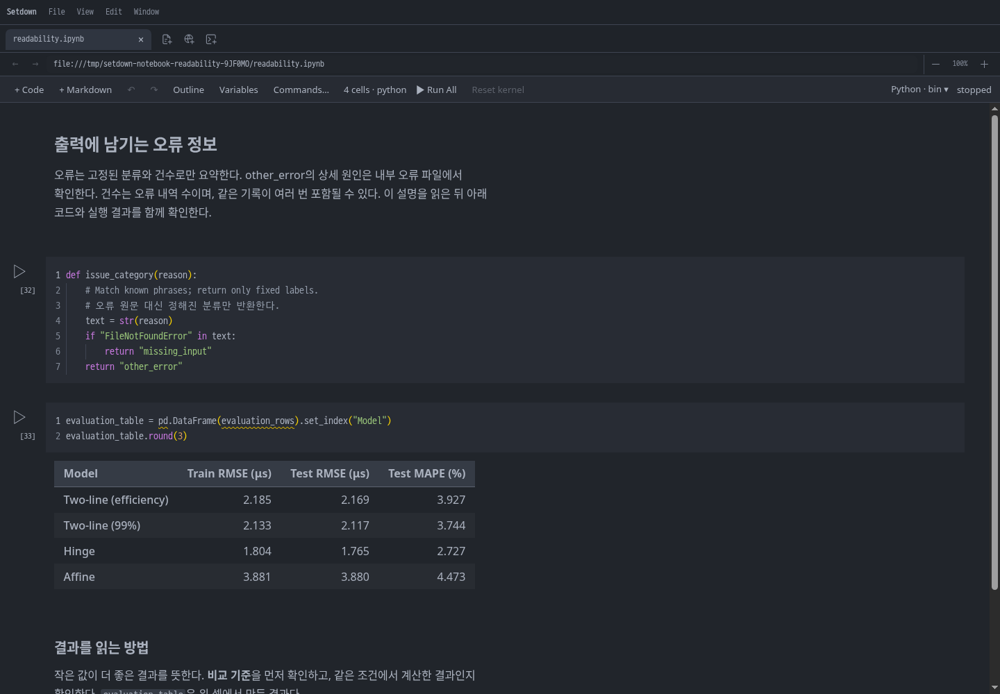
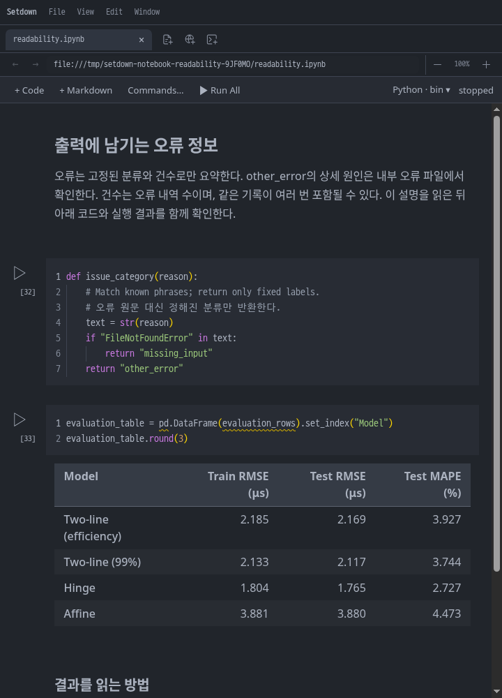
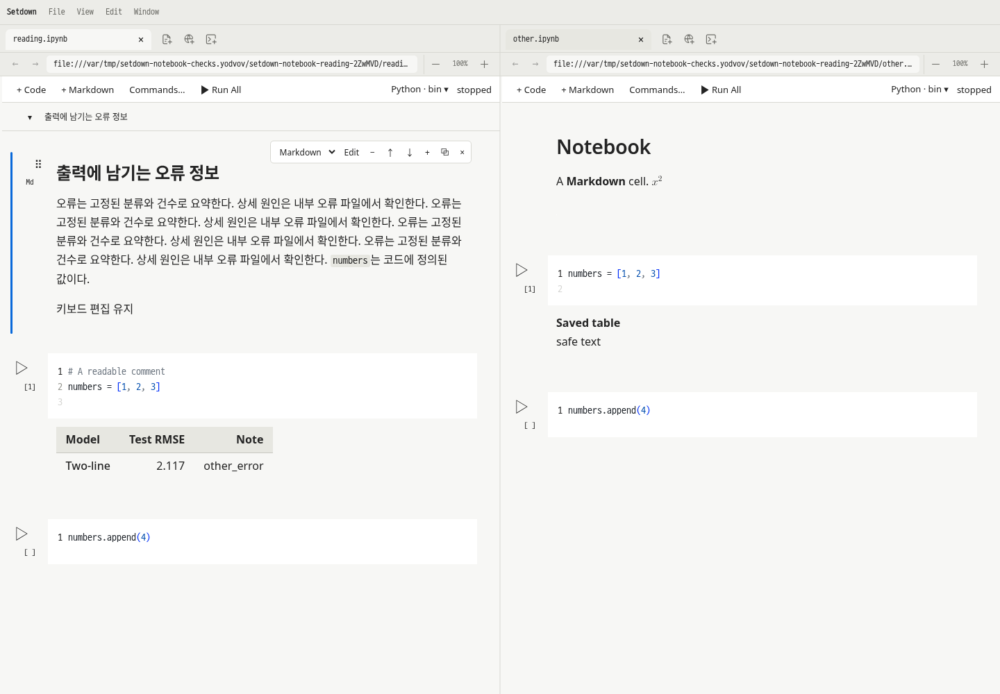

# 노트북 가독성 개편 검증

2026-10-19 · [연구 보고서](../../reports/2026_10_19_notebook_readability_research.md)의 후속 구현.

## 변경한 동작

읽는 Markdown의 카드 테두리와 상시 헤더를 제거했다. 본문·UI·HTML 표에는 시스템 본문 글꼴을 사용하고, 코드·inline code·로그·traceback에는 D2Coding을 유지한다. 문장 폭은 40em으로 제한하며 한글 어절 안의 불필요한 줄바꿈을 줄였다. 코드와 표는 사용 가능한 폭을 사용한다.

실행과 실행 번호, 드래그 핸들은 왼쪽에 두었다. 종류 변경·이동·복제·삭제 등의 조작은 셀 경계의 도구막대에 표시하며 hover·선택·키보드 포커스로 접근할 수 있다. 표시 전후 셀의 높이는 바뀌지 않는다. 코드와 출력 사이의 별도 조작 줄을 제거하고, 복사·형식 선택·이미지 조작을 결과 뒤의 한 줄에 묶었다. 실행·오류·이전 셀 소스의 출력이라는 표시는 hover와 관계없이 남는다.

현재 줄 강조는 입력 포커스가 있는 Monaco에만 나타난다. 셀 선택은 왼쪽 표시로 구분한다. 버튼에 키보드 포커스가 있을 때 Enter가 다른 선택 셀의 편집 명령에 가로채이지 않도록 했다. 셀 선택 버튼의 명령 모드와 기존 편집 단축키는 유지한다.

표는 헤더·행 구분과 숫자의 오른쪽 정렬을 제공한다. HTML 정화는 유지하며, 값과 저장되는 원본 출력은 변경하지 않는다. 좁은 pane에서는 보조 명령을 Commands에서 제공하고, 환경 선택의 전체 경로는 선택 목록과 툴팁에 유지한다.

6개 테마의 주석 색과 Solarized Light의 기본 코드 글자를 조정했다. 공통 Monaco 테마를 사용하므로 일반/Git 편집기의 같은 색상 토큰에도 적용된다. 노트북 글꼴 예외는 다른 문서·터미널의 공통 글꼴을 변경하지 않는다.

## 화면과 실측

측정 fixture·창 크기·배율은 연구 보고서와 동일하다. 실제 커널을 실행하는 분석 성능 측정이 아니라, 저장된 결과가 있는 합성 문서의 DOM 및 글꼴 관찰이다.





최종 수치는 [측정 집계](../../reports/notebook-readability-implementation-2026-10-19/summary.json)와 [원자료](../../reports/notebook-readability-implementation-2026-10-19/evidence.json)에 보관한다. 실제 분할은 별도의 Electron 회귀 시나리오로 검증하며, 위 720px 캡처와 구분한다.



| 항목 | 변경 전 → 변경 후 |
|---|---|
| 1440px 창의 설명 단락 폭 | 1263.8 → 640.0px |
| 720px 창의 상단 도구막대 높이 | 64 → 38px |
| 표본 결과 셀에서 문서 높이를 차지하는 조작 줄의 합계 | 104 → 30px |
| One Dark 주석 대비 | 2.32 → 4.99:1 |
| 포커스 없는 코드 셀의 현재 줄 배경 | 두 셀에서 관측 → 0개 |
| 실제 본문 글꼴 | D2Coding → Noto Sans CJK KR / Noto Sans |

표의 글꼴과 패딩을 키웠으므로 결과 셀 전체가 모든 폭에서 작아지는 것은 아니다. 같은 표본 셀은 넓은 창에서 322 → 298.9px, 좁은 창에서 322 → 346.9px였다. 조작 공간을 줄여 내용의 읽기 공간을 확보한 변경이며, 이를 읽기 시간의 개선 퍼센트로 해석하지 않는다. 다른 운영체제에서는 시스템 글꼴 대체에 따라 실제 서체와 줄바꿈이 달라질 수 있다.

## 검증 과정에서 수정한 문제

첫 노트북 검사에서는 새 키보드 편집 시나리오가 실패했다. 노트북의 capture 단계가 Edit 버튼의 Enter를 명령 모드의 Enter로 처리해 이전 선택 셀로 보내고 있었다. 활성화할 버튼의 기본 동작을 보존하도록 수정했다.

초기 반응형 기준은 1080px 기본 창에서도 Undo·Outline·Variables를 숨겼다. 보조 명령을 숨기는 기준을 900px로 조정하고, 1100px 이하에서는 셀 수 요약만 줄였다. 실제 좁은 분할에서 Commands를 통해 Outline을 여는 검증을 추가했다. 출력 복사의 상태는 hover와 무관하게 읽히도록 별도 feedback 영역으로 옮겼으며, 기존 검사는 새 위치에서 동일한 `Copied` 내용·가시성·실제 클립보드를 확인한다.

첫 전체 단위 검사에서는 기존 `/tmp/.git` 디렉터리 때문에 Python 프로젝트 경계 검사가 `/tmp`를 발견했다. 관련 제품 코드나 기대값을 바꾸지 않고, `/var/tmp` 아래의 별도 임시 디렉터리를 지정해 같은 검사를 실행했다. GUI는 모든 경우 저장소의 Xvfb·런타임·D-Bus 격리 래퍼를 사용한다. 최초 실패 로그는 [initial-validation](../../reports/notebook-readability-implementation-2026-10-19/initial-validation)에 보관한다.

이후 전체 검사에서 기존 Electron 시나리오 165개는 통과했으나, 새 분할 검사가 노트북을 `.editor-group`의 자식으로 찾으려 해 실패했다. 노트북은 모델과 편집 상태를 유지하도록 별도의 형제 surface로 보존되는 구조다. 검사 대상을 `data-notebook-tab`으로 연결하고 실제 활성 노트북 두 개와 750px 미만의 pane 폭을 추가로 검증했다. 수정한 분할 시나리오는 통과했다. 제품 코드와 분할 요구사항을 바꾸거나 대기시간·재시도를 추가하지 않았다.

## 기능 검사

`npm run test:preview-contract`의 단위 검사 **82개 파일 / 515개 테스트**, 빌드·벤치마크 도구 검사 **11개**, production build 및 typecheck가 통과했다. Svelte 오류와 경고는 모두 0개다. 위 분할 검사 선택자 수정은 테스트 파일만 바꾸므로, 동일한 제품 빌드에 전체 Electron 단계를 다시 실행했다.

최종 전체 Electron 실행은 **165개 통과 / 1개 실패**다. **노트북 9개는 모두 통과**했고, 검색창 X·툴팁 안정성·드래그 가이드 배치 검사도 통과했다. 실패는 기존 `browser/zoom.spec.ts:49`에서 합성 pinch 이후 웹 페이지 배율이 1보다 커지지 않은 경우다. 앞선 전체 실행에서는 이 항목이 통과했다. 따라서 전체 contract가 완전히 통과했다고 주장하지 않는다.

별도 진단에서는 같은 최종 빌드와 변경 전 baseline 모두 원래의 zoom 시나리오를 통과했다(각 4.4초 / 4.6초). 핀치 위치는 iframe 내부였으며, 배율은 각각 약 1.26566 / 1.26541로 바뀌었다. 진단은 입력 전 상태·이벤트 관찰을 추가했으므로 실행 타이밍에 영향을 줄 수 있다. 간헐 실패의 원인이나 이번 변경과의 인과관계는 확정하지 못했다. 이 결과로 실패한 전체 실행을 통과로 대체하지 않으며, 기능 기대값·재시도 설정·성능 허용 기준을 바꾸지 않았다.

[최종 전체 Electron 로그](../../reports/notebook-readability-implementation-2026-10-19/electron-full.txt), [단위 검사·빌드 및 최초 전체 실행 로그](../../reports/notebook-readability-implementation-2026-10-19/contract-full-first.txt), [candidate 핀치 진단](../../reports/notebook-readability-implementation-2026-10-19/pinch-candidate.txt), [baseline 핀치 진단](../../reports/notebook-readability-implementation-2026-10-19/pinch-baseline.txt)을 보관한다.

재현 명령은 다음과 같다. `TMPDIR` 지정은 위에서 발견한 이 머신의 `/tmp/.git` 간섭을 피하기 위한 것으로, 검사 시나리오나 제품 설정을 바꾸지 않는다.

```sh
setdown_check_tmp=$(mktemp -d /var/tmp/setdown-notebook-checks.XXXXXX)
TMPDIR="$setdown_check_tmp" npm run test:preview-contract
# 이미 통과한 단위 검사와 빌드를 유지하고 테스트 선택자만 수정한 뒤:
TMPDIR="$setdown_check_tmp" npm run test:preview-contract:e2e --workspace @setdown/desktop
```

## 성능 비교의 기준

baseline은 변경 전 `b88f34cf869faf15fa3ce217e247a90f7aa03e6b`의 별도 체크아웃 `/tmp/setdown-notebook-readability-base`다. 자체 `npm ci`로 의존성을 설치하고 자체 Electron 실행 파일과 빌드를 사용한다. RHWP의 전체 이력 다운로드는 중단하고, 같은 고정 commit의 로컬 Git 객체를 별도로 복사해 체크아웃했다. baseline의 작업 트리는 깨끗하며 candidate의 node_modules·빌드와 공유하지 않는다.

기능 검사와 성능 비교는 결과를 나누어 기록한다. 성능 비교는 일반 Markdown/Git review의 source↔reader 전환을 검증하며, 노트북의 읽기 속도·커널 기동·대형 문서 메모리 개선량을 의미하지 않는다.

## 전환 성능 결과

**PASS: 48개 비교 항목에서 회귀 0개.** 기본 5회씩, 총 80회 앱 실행과 400회 전환 주기를 완료했다. 모든 시나리오의 최신 내용 확인과 native capture, 실제 double-click 입력이 통과했다. 반복 순서는 AB / BA로 번갈았으며, 양쪽 Electron은 44.7.2다. 허용 기준은 기존의 **25%와 50ms를 동시에 초과할 때 실패**를 그대로 사용했다.

아래 값은 중앙값의 **baseline → candidate**, 단위 ms다. warm은 각 앱의 3–5번째 주기의 중앙값을 구한 뒤 5회 실행 간 중앙값을 구한다. Esc는 최신 내용 확인·IPC·native capture readback을 포함하며 물리 모니터의 표시 시간이 아니다. 이 표는 준비 대기 시간을 제외한다.

| 화면 | 소스 준비 대기 | 수정 | Esc 첫 번째 | Esc 두 번째 | Esc warm | Double-click 첫 번째 | Double-click 두 번째 | Double-click warm |
|---|---:|---|---:|---:|---:|---:|---:|---:|
| Markdown | 0ms | 없음 | 38 → 41 | 32 → 25 | 20 → 26 | 25 → 41 | 35 → 37 | 12 → 12 |
| Markdown | 0ms | 있음 | 457 → 466 | 99 → 97 | 94 → 93 | 22 → 17 | 13 → 18 | 14 → 15 |
| Markdown | 3000ms | 없음 | 43 → 43 | 19 → 19 | 21 → 20 | 18 → 17 | 11 → 12 | 12 → 12 |
| Markdown | 3000ms | 있음 | 111 → 114 | 103 → 115 | 93 → 94 | 19 → 21 | 14 → 13 | 13 → 13 |
| Git review | 0ms | 없음 | 976 → 946 | 21 → 22 | 29 → 29 | 23 → 23 | 13 → 12 | 13 → 13 |
| Git review | 0ms | 있음 | 1041 → 1054 | 1511 → 1545 | 187 → 178 | 23 → 23 | 22 → 21 | 20 → 21 |
| Git review | 3000ms | 없음 | 28 → 27 | 22 → 21 | 19 → 17 | 24 → 25 | 12 → 12 | 18 → 18 |
| Git review | 3000ms | 있음 | 232 → 234 | 202 → 194 | 179 → 182 | 25 → 23 | 20 → 19 | 19 → 19 |

**설정한 3000ms 준비 대기까지 포함한 첫 Esc 총 시간**은 다음과 같다. 준비에 실제 사용한 CPU 시간을 뜻하지 않는다. 준비 대기는 첫 주기 전에만 적용하므로 두 번째·warm·double-click은 위 표와 같고, 0ms 시나리오의 포함 값도 위 표와 같다.

| 화면 | 수정 | 준비 대기 포함 첫 Esc |
|---|---|---:|
| Markdown | 없음 | 3043 → 3043 |
| Markdown | 있음 | 3111 → 3114 |
| Git review | 없음 | 3028 → 3027 |
| Git review | 있음 | 3232 → 3234 |

[전체 측정·빌드 식별자·해시·48개 비교 항목](../../reports/notebook-readability-implementation-2026-10-19/preview-performance.json). 원시 per-run JSON과 로그는 `test-results/notebook-readability-performance-2026-10-19/`에 있다. 비교 명령은 다음과 같다. `--skip-build`는 이미 완료된 양쪽 독립 빌드를 사용하며, 측정기는 시작·종료 시 빌드 해시와 측정 중 harness 해시를 확인한다.

```sh
npm run bench:preview -- --baseline /tmp/setdown-notebook-readability-base --skip-build --output "$PWD/test-results/notebook-readability-performance-2026-10-19"
```

재실행할 때는 새 output 경로를 사용해야 한다. 기존 결과를 덮어쓰는 것은 허용되지 않는다.
