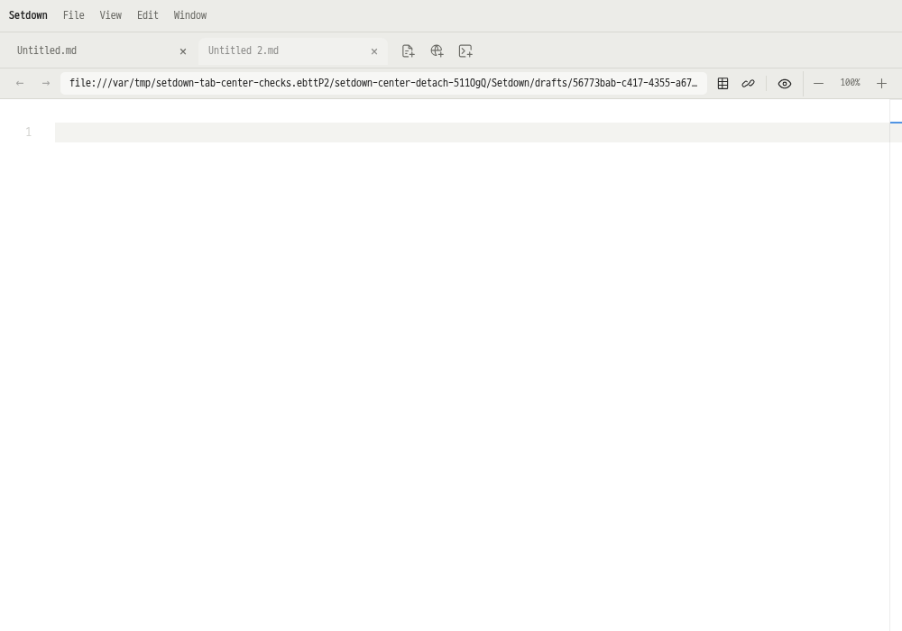

# 탭 드래그의 새 창 분리 영역 복구

2026-10-20. [현재 동작 계약](../contracts/workspace.md#editor-groups).

## 문제와 변경

파란 가이드와 실제 드롭 결과를 일치시키는 과정에서 원래 그룹의 본문 중앙까지 병합 대상으로 표시했다. 같은 그룹으로 돌아오는 동작이므로 실제 이동은 없지만, 화면 대부분이 이 가이드에 덮여 새 창을 만들기 어려웠다. 최대화된 창에서도 접근할 수 있는 분리 영역이 필요했다.

| 드래그 위치 | 표시 | 놓았을 때 |
|---|---|---|
| 원래 그룹의 본문 중앙 | 파란 가이드 없음 | 새 창으로 분리 |
| 본문 가장자리의 기존 10% 분할 영역 | 파란 분할 가이드 | 표시된 방향으로 분할 |
| 탭 막대 | 파란 삽입선 | 표시된 위치로 탭 이동 |
| 다른 그룹의 본문 중앙 | 파란 병합 가이드 | 해당 그룹으로 이동 |

원래 그룹에 탭이 하나뿐이면 자기 자신을 분할할 수 없으므로 본문 전체를 새 창 분리 영역으로 쓴다. 주소창과 관련 없는 shell 영역은 드롭 대상이 아니다. 중앙에서 탭 막대나 가장자리로 돌아가면 새 가이드가 이전 분리 의도를 대체한다. Escape는 이동과 창 생성을 취소한다.



중앙 드래그 중에도 기존 native surface 캡처 수명을 유지한다. native 완료 이벤트가 좌표를 `(0, 0)`으로 보고하면 마지막으로 수락한 중앙의 화면 좌표를 사용한다. 명시적인 중앙 분리는 main에서 원래 창의 범위로 검증하며, 뒤에 겹쳐 있는 다른 창이 요청을 막지 않는다. 창 밖으로 놓을 때는 기존의 다른 창으로 이동하는 절차를 유지한다.

창 밖으로 나갈 때 Chromium이 `dragleave` 좌표를 `(0, 0)`으로 보고해 이전 가이드가 남을 수 있었다. 실제 `dragend`의 창 밖 좌표가 그 가이드보다 우선하도록 한다. OS 드래그는 Escape keydown을 소비할 수 있어 main에서 native keyup도 취소로 처리한다. 취소 후 늦게 도착한 창 분리 요청은 준비된 창을 되살릴 수 없다.

## 재현과 검사 방식

변경 전 실제 OS 포인터로 탭을 가장자리에서 중앙으로 끌었다. 마우스를 누른 상태에서도 파란 가이드가 남아 `toBeHidden()`이 실패했다. [수정 전 로그](../../reports/tab-tear-off-2026-10-20/before.txt).

새 중앙 영역 검사는 실제 X11 입력으로 분리·취소·탭 막대로 복귀·분할 영역으로 복귀·단독 탭을 실행한다. 파란 가이드가 사라지는 시점은 마우스를 놓기 **전**에 확인한다. 기존 네 방향의 창 밖 분리, 취소, 창 밖에서 돌아오기, 다른 그룹 병합과 native preview 이전도 유지한다. 모든 GUI 실행은 Xvfb·별도 runtime 디렉터리·D-Bus 세션을 사용하는 저장소 래퍼 안에서 이루어진다.

초기 집중 검사에서 다음 경계를 확인하고 수정했다.

- 창 밖 Escape: native 로그에서 DOM keydown 없이 main의 keyup을 확인했다. main에서 전송을 취소해 늦은 detach 요청을 차단했다.
- 창 밖에서 복귀: 포인터를 한 번에 순간 이동시키면 삽입선은 나타나도 OS 드래그의 최종 `dropEffect`가 `none`이었다. 같은 경로에 중간 포인터 좌표 네 개를 넣어 연속 이동하도록 했다. 최종 삽입선 위치도 검증한다. 재시도는 추가하지 않았다.
- 기존 포인터 검사: CDP 입력은 창 원점이 0이 아닌 상태에서도 화면 좌표를 클라이언트 좌표와 같게 보고했다. 실제 화면 좌표를 사용하는 OS 입력으로 변경하고 기존 이동·취소 기대값을 유지했다.
- 단독 탭: 성공적으로 이동하면 빈 원래 창은 닫히는 기존 동작을 검사한다.
- 전체 타입 검사: 새 테스트의 로컬 `window` 핸들이 브라우저 전역 이름을 가렸다. 핸들 이름을 바꿨으며 동작이나 기대값은 바꾸지 않았다.

[집중 검사 로그](../../reports/tab-tear-off-2026-10-20/focused.txt), [입력 진단 로그](../../reports/tab-tear-off-2026-10-20/diagnostic.txt), [복귀 경로 수정 전 검사](../../reports/tab-tear-off-2026-10-20/focused-final.txt), [수정한 복귀 경로 검사](../../reports/tab-tear-off-2026-10-20/return-path.txt), [최초 전체 타입 검사 로그](../../reports/tab-tear-off-2026-10-20/contract.txt)를 보존한다. native 입력·drag 이벤트 JSON은 같은 보고서 디렉터리에 있다. 실패 기록을 통과 결과로 대체하지 않는다.

## 최종 기능 및 성능 검사

최종 `npm run test:preview-contract`에서 **82개 파일의 단위 검사 519개**, 빌드·벤치마크 도구 검사 **11개**, production build와 typecheck가 통과했다. Svelte 오류·경고는 0개다. Electron은 **184개 통과 / 1개 실패**, 8.5분이었다. 탭 분리와 편집기 그룹 검사 **39개는 모두 통과**했다. 전체 계약 실행을 완전 통과로 보고하지 않는다. [전체 최종 로그](../../reports/tab-tear-off-2026-10-20/contract-final.txt), [변경 소스 해시](../../reports/tab-tear-off-2026-10-20/source-sha256.json), `final-inputs/`의 native 입력 기록을 보관한다.

전체 Electron 실행의 `browser/zoom.spec.ts:49`에서 합성 pinch 이후 배율이 1보다 커지지 않는 실패가 발생했다. [이전 개편 검증](2026-10-19-notebook-readability.md#기능-검사)에도 같은 지점의 간헐 실패와 baseline/candidate 진단이 기록되어 있다. 이번 실패는 탭 드래그가 시작되기 전에 발생했지만, 이것만으로 원인이나 변경과의 인과관계를 확정하지 않는다. 재시도로 통과 결과를 만들거나 기대값·허용 시간을 변경하지 않았다. [실패 당시 화면 구조](../../reports/tab-tear-off-2026-10-20/browser-pinch-error-context.md)를 보존한다.

성능 baseline은 변경 전 `ae886d0acde647dbc07f5e90b72dacc26261e726`의 깨끗한 별도 체크아웃 `/tmp/setdown-notebook-readability-base`다. baseline은 독립 설치된 의존성·Electron·빌드를 사용한다. candidate는 같은 commit에 위 수정을 적용한 작업 트리다. 성능 비교는 일반 Markdown과 Git review의 전환을 대상으로 하며 드래그 지연 시간 측정과는 구분한다.

```sh
setdown_check_tmp=$(mktemp -d /var/tmp/setdown-tab-center-checks.XXXXXX)
TMPDIR="$setdown_check_tmp" npm run test:preview-contract
npm run bench:preview -- --baseline /tmp/setdown-notebook-readability-base --skip-build --output "$PWD/test-results/tab-tear-off-performance-2026-10-20"
```

이 머신의 기존 `/tmp/.git`이 Python 프로젝트 경계 검사에 간섭하므로 테스트 임시 디렉터리만 `/var/tmp`에 생성했다. 기존 디렉터리나 제품의 프로젝트 탐색 규칙은 바꾸지 않는다. `--skip-build`는 양쪽 빌드가 이미 완료된 상태에만 사용한다. 재실행 시에는 새 성능 output 경로를 사용해야 한다.

## 전환 성능 결과

**PASS: 기본 5회씩 총 80회 앱 실행, 400회 전환 주기, 48개 비교 항목에서 회귀 0개.** 양쪽 Electron은 44.7.2이며 같은 격리 display에서 AB / BA 순서로 번갈아 측정했다. 기존의 **25%와 50ms를 동시에 초과할 때 실패**하는 기준을 그대로 적용했다. 최신 수정 내용 확인·비어 있지 않은 native capture·실제 double-click 입력이 모두 통과했다.

아래 값은 준비 대기를 제외한 중앙값의 **baseline → candidate**, 단위 ms다. warm은 각 앱의 3–5번째 주기 중앙값을 구한 뒤 5회 실행 간 중앙값을 구한다. Esc는 최신 내용 확인·IPC·capture readback을 포함하며 물리 모니터 표시 시간이 아니다.

| 화면 | 준비 대기 | 수정 | Esc 첫 번째 | Esc 두 번째 | Esc warm | Double-click 첫 번째 | Double-click 두 번째 | Double-click warm |
|---|---:|---|---:|---:|---:|---:|---:|---:|
| Markdown | 0ms | 없음 | 38 → 47 | 22 → 34 | 21 → 27 | 23 → 30 | 36 → 34 | 12 → 12 |
| Markdown | 0ms | 있음 | 453 → 465 | 106 → 103 | 91 → 94 | 20 → 19 | 14 → 15 | 17 → 14 |
| Markdown | 3000ms | 없음 | 48 → 43 | 19 → 23 | 22 → 20 | 17 → 18 | 12 → 12 | 12 → 11 |
| Markdown | 3000ms | 있음 | 115 → 97 | 103 → 96 | 90 → 93 | 20 → 16 | 16 → 12 | 16 → 15 |
| Git review | 0ms | 없음 | 979 → 989 | 24 → 26 | 30 → 30 | 23 → 23 | 12 → 12 | 13 → 12 |
| Git review | 0ms | 있음 | 1050 → 992 | 1497 → 1500 | 190 → 187 | 23 → 23 | 22 → 22 | 20 → 20 |
| Git review | 3000ms | 없음 | 24 → 28 | 22 → 20 | 28 → 18 | 25 → 25 | 12 → 12 | 18 → 18 |
| Git review | 3000ms | 있음 | 233 → 232 | 182 → 191 | 184 → 185 | 23 → 24 | 20 → 18 | 18 → 17 |

**설정한 준비 대기를 포함한 첫 Esc 총 시간**은 다음과 같다. 준비 대기는 첫 주기 전에만 적용하므로 두 번째·warm·double-click은 위 표와 같고, 0ms 시나리오의 포함 값도 위 표와 같다. 이 합계는 준비 작업의 CPU 사용 시간이 아니다.

| 화면 | 수정 | 3000ms 준비 대기 포함 첫 Esc |
|---|---|---:|
| Markdown | 없음 | 3048 → 3043 |
| Markdown | 있음 | 3115 → 3097 |
| Git review | 없음 | 3024 → 3028 |
| Git review | 있음 | 3233 → 3232 |

[전체 측정·빌드 식별자·해시·48개 비교](../../reports/tab-tear-off-2026-10-20/preview-performance.json), [실행 로그](../../reports/tab-tear-off-2026-10-20/preview-performance.txt). 원시 per-run JSON과 로그는 `test-results/tab-tear-off-performance-2026-10-20/`에 보존한다. 성능 비교 통과가 위 기능 검사의 웹 pinch 실패를 해소하는 것은 아니다.
