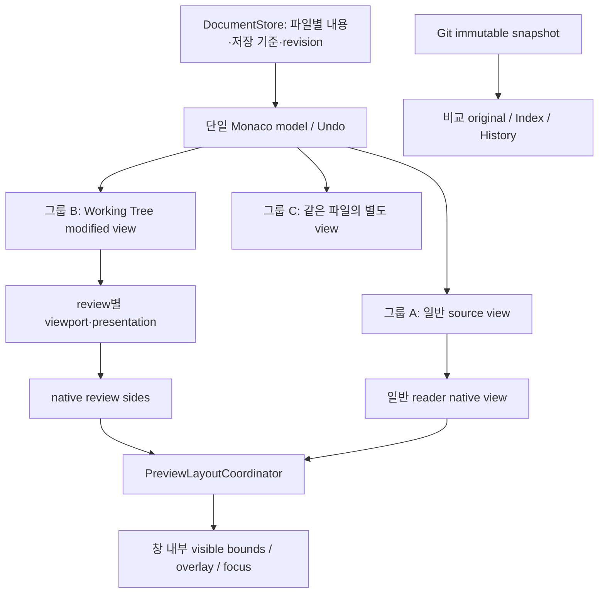

# ebcc57f 보고서 도입 항목 구현 대조표

기준: `ebcc57f9d9366762bcde052e795415e139a3dbd4`의 네 보고서와 사용자 확정 범위
“모든 보고서의 도입 대상 구현, 명시적 제외 항목은 제외”. 원본 보고서는 당시의 분석·계획으로
보존한다. 이 문서는 현재 구현과 제외 경계를 대응시키며 Vim 키/엔진의 완전한 parity를 주장하지 않는다.

## 주요 진입점

- 사용자 명령: File → Commands… (`Ctrl/Cmd+Shift+P`). [사용 안내](../../docs/editor-tools.md).
- 공통 명령/선택/검색/복사/위치: `src/renderer/editor/tools/`, `src/core/editor/`.
- 환경: `src/main/editor/editor-policy.ts`, `src/main/language/python-project-settings.ts`.
- session/recovery: `src/renderer/app/workspace-snapshots.ts`, `src/main/editor/snapshot-store.ts`.
- 공유 content/group: `src/core/workspace/document-store.ts`, `editor-groups.ts`, `src/renderer/workspace/tab-controller.ts`.
- 독립 비교: `src/renderer/project/source-control/review-workspace.ts`, `review-state.svelte.ts`.
- native geometry: `src/renderer/reader/preview-layout-coordinator.ts`.

위 코드 경로는 `apps/desktop/` 기준이다. Vim C/runtime 파일을 제품에 복사하지 않았으며 dependency/pin 교체도 없다.

## Vim 인벤토리 125개 대응

“기존 기반 활용”도 도입 범위다. 이미 있는 Monaco/LSP/xterm 동작을 새 엔진으로 재작성하지
않고 명령 노출·공통 모델·수명 검사에 연결한다. “신규/확장”은 표에 적힌 Setdown 의미를 뜻한다.
보고서 9절 8단계 및 11절의 별도 결정/명시적 보류는 이번 승인에서 제외되었다.

| ID | 처리 | 구현된 동작 또는 제외 이유 |
| --- | --- | --- |
| A01 | 신규/확장 | 공통 target 계산과 select/copy/delete/replace 명령을 분리했다. |
| A02 | 신규/확장 | Repeat count 1–100. Vim 숫자 prefix 문법은 제외. |
| A03 | 신규/확장 | word/chunk target + Monaco word/subword 이동. |
| A04 | 신규/확장 | 줄 안의 문자/문자열 앞뒤 찾기, 직전 찾기·반대 방향 반복. |
| A05 | 신규/확장 | inside word, around word의 뒤 공백 우선·없으면 앞 공백 규칙. |
| A06 | 신규/확장 | 한 줄 quote, escape·빈 문자열·Unicode 검증. |
| A07 | 기존 기반 활용 | Monaco bracket matching / semantic selection 확장 재사용. |
| A08 | 기존 기반 활용 | 설치된 언어 selection provider의 smart selection 재사용. JSX 자체 파서를 추가하지 않았다. |
| A09 | 신규/확장 | Intl sentence segmentation, 빈 줄로 구분한 paragraph; 구조적인 Markdown은 별도 target. |
| A10 | 신규/확장 | decoration 기반 마지막 선택 복원, 선택 방향 뒤집기. |
| A11 | 기존 기반 활용 | Monaco column selection / multi-cursor; 복사 조각의 커서 순서 유지. |
| A12 | 기존 기반 활용 | Monaco 화면 줄 이동과 실제 줄 이동 재사용; 파일 개행 변경 없음. |
| B01 | 신규/확장 | Monaco Join Lines + 공백 없는 행 결합. |
| B02 | 기존 기반 활용 | Monaco indent/outdent/format 명령 및 현재 provider 지원 조건. |
| B03 | 신규/확장 | 폭 지정 prose reflow; 구조 행·hard break는 보존을 위해 거절. |
| B04 | 기존 기반 활용 | Monaco Unicode case 변환 명령. |
| B05 | 신규/확장 | Monaco 기본 sort + 명시적 숫자 정렬. |
| B06 | 신규/확장 | 정렬 후 unique / 원래 순서 unique를 별도 제공. |
| B07 | 신규/확장 | BigInt 정수 증감: 부호·진법·padding 보존, 식별자 내부 숫자 제외. |
| B08 | 신규/확장 | 여러 선택에 증가하는 번호 부여. |
| B09 | 기존 기반 활용 | Monaco move/copy line actions. |
| B10 | 기존 기반 활용 | Monaco indentation conversion; EditorConfig와 파일-local tab/space 설정. |
| B11 | 기존 기반 활용 | 현재 언어의 Monaco line/block comment provider. |
| B12 | 기존 기반 활용 | Monaco 선택 교체·overtype 동작 재사용. Vim virtual replace 엔진은 제외. |
| C01 | 신규/확장 | 성공한 의미 명령의 target/인수 recipe만 반복. |
| C02 | 신규/확장 | 횟수는 새 실행 수로 해석. 완료한 실행별 Undo. |
| C03 | 명시적 제외 | 보고서 9절 8단계의 별도 결정: 매크로 기록/재생 제외. |
| C04 | 명시적 제외 | 보고서 9절 8단계의 별도 결정: 다중 파일 배치 실행 제외. |
| C05 | 신규/확장 | literal 조건의 행을 먼저 수집·미리보기한 뒤 단일 Undo로 변환. |
| C06 | 기존 기반 활용 | Monaco executeEdits / pushUndoStop; 모든 공유 view가 같은 Undo를 사용. |
| C07 | 명시적 제외 | 명시적 보류: 분기 Undo 엔진 제외. |
| C08 | 명시적 제외 | 명시적 보류: 시간 여행 Undo 제외. 별도 내용 checkpoint 제공. |
| C09 | 명시적 제외 | 명시적 보류: 영구 Undo / undofile 호환 제외. |
| C10 | 기존 기반 활용 | 의미 명령 경계와 편집 view 전환에서 Undo 그룹 분리. |
| D01 | 신규/확장 | 이름·미리보기·pin을 갖는 CopyStore. |
| D02 | 신규/확장 | 같은 선택 형태와 조각 수에서만 append. |
| D03 | 신규/확장 | explicit copy를 cut/ordinary Delete와 분리. |
| D04 | 신규/확장 | cut 및 구조적 delete의 유한 기록. 모든 삭제 키를 기록하지 않음. |
| D05 | 기존 기반 활용 | ordinary Delete는 저장소를 바꾸지 않음; 배치 삭제는 제외. |
| D06 | 신규/확장 | characters/lines/block 조각, CRLF와 다중 커서 대응; combined paste는 명시적. |
| D07 | 신규/확장 | 검색·name·pin·remove·선택 paste. |
| D08 | 신규/확장 | 650ms decoration; reduced-motion 및 view 해제 존중. |
| E01 | 신규/확장 | Smart search 입력 미리보기, Escape 시 view state 복구. |
| E02 | 신규/확장 | query를 유지하는 highlight 숨기기. |
| E03 | 신규/확장 | 현재 단어의 literal whole-word 다음/이전 찾기. |
| E04 | 신규/확장 | 대문자 포함 query의 smart case; 프로젝트 검색 정책과 분리. |
| E05 | 기존 기반 활용 | Monaco 검색 count + 공통 결과 목록 count; smart next/previous wrap. |
| E06 | 기존 기반 활용 | Monaco 파일 내 history / 명령 인수 history / 결과 snapshot을 분리. |
| E07 | 신규/확장 | 다음 smart match 선택·교체 및 의미 반복. |
| E08 | 기존 기반 활용 | Monaco replace / replace all; 새 명령은 단일 대상 교체·확인 가능한 행 변환. |
| E09 | 기존 기반 활용 | Monaco find in selection 및 선택 행 범위 변환. |
| E10 | 기존 기반 활용 | Monaco JS regex/capture/multiline 재사용. Vim regex·eval 호환은 제외. |
| F01 | 신규/확장 | 검색·LSP·task·spelling의 ResultLocation/ResultEntry. |
| F02 | 신규/확장 | 독립 list ID, 이전/다음 list, 선택 위치 유지. |
| F03 | 신규/확장 | provider/query/root/time/version/stale/truncated/pin. |
| F04 | 신규/확장 | 결과 집합의 요청 시점 group ownership. |
| F05 | 신규/확장 | 이전/다음 항목 및 이전/다음 파일 명령. |
| F06 | 신규/확장 | 원본을 보존하는 derived filter, 파싱 실패 출력 별도 표시. |
| F07 | 명시적 제외 | 보고서 9절 8단계의 별도 결정: 다중 파일 배치 편집 제외. |
| F08 | 신규/확장 | 기존 terminal output의 GCC형 위치·Python traceback 수집; 실행하지 않음. |
| G01 | 신규/확장 | 100개 navigation history, back/forward; URL history와 독립. |
| G02 | 신규/확장 | 타이핑 묶음과 의미 편집의 changelist. |
| G03 | 신규/확장 | 이름 있는 live decoration bookmark. |
| G04 | 신규/확장 | 파일/cell/group/view 위치를 갖는 bookmark. |
| G05 | 신규/확장 | 마지막 edit 이동 및 마지막 선택 범위 복원. |
| G06 | 신규/확장 | LSP 정의·결과 이동 전 출발점 기록. |
| G07 | 신규/확장 | user/internal/repeat/history origin과 내부 이동 기록 억제. |
| G08 | 신규/확장 | live decoration 보정, rename retarget, 닫힌 문서 문맥 재확인. |
| H01 | 신규/확장 | 직전 다른 파일과 alternate 왕복. |
| H02 | 신규/확장 | dirty/group 정보를 가진 열린 tab 검색. |
| H03 | 신규/확장 | DocumentStore + 공유 Monaco model + 그룹별 view identity. |
| H04 | 신규/확장 | 네 방향 split, group focus, copy/move, equalize, maximize/restore. |
| H05 | 신규/확장 | 일반 source view의 논리 행 scroll link. 커서·포커스는 독립 유지. |
| H06 | 신규/확장 | 고정한 결과 snapshot으로 별도 작업 대상 집합 보관. |
| H07 | 신규/확장 | 커서 경로와 선택 문자열, :line:column, 파일 기준 상대 경로 후보. |
| H08 | 신규/확장 | 모듈 이름의 프로젝트/extraPaths 후보. 정적 분석 진단을 대체하지 않음. |
| H09 | 신규/확장 | resource/group/root와 terminal explicit base; process.cwd 변경 없음. |
| I01 | 신규/확장 | Monaco word suggestion의 범위 선택·표시. |
| I02 | 신규/확장 | 미저장 현재 모델의 최대 1,000개 고유 행 completion. |
| I03 | 신규/확장 | 문서 기준 상대 경로 completion, Unicode/공백 유지. |
| I04 | 신규/확장 | 이름 있는 copy와 명시적 template로 보관 문구 재사용. 대형 사전/동의어 엔진은 도입하지 않음. |
| I05 | 기존 기반 활용 | 기존 LSP completion/provider 수명 유지. |
| I06 | 신규/확장 | view별 quick suggestions on/off·delay, workspace word scope. |
| I07 | 신규/확장 | LSP function/class symbol 이동. notebook cell은 기존 outline 사용. |
| I08 | 신규/확장 | parsed Markdown heading 이동, 기존 outline/folding. |
| I09 | 기존 기반 활용 | 기존 Monaco/LSP hover와 open-link. 외부 keyword shell 실행 제외. |
| I10 | 신규/확장 | bounded English spell check·suggestion·개인 사전·위치 목록. 미로딩 사전은 오류로 표시. |
| I11 | 신규/확장 | 명시적 symbol picker/template, IME 중 자동 치환 없음. |
| J01 | 신규/확장 | buffer indentation, view display, workspace completion scope 구분. |
| J02 | 신규/확장 | 현재 buffer 임시 indentation override. |
| J03 | 기존 기반 활용 | 기존 선언형 language profiles와 Monaco/provider 설정 유지. |
| J04 | 신규/확장 | 모델/view 전환·언어 변경·retarget의 policy 재적용과 dispose. |
| J05 | 신규/확장 | 실제 값·EditorConfig 출처·local override·language client context. |
| J06 | 신규/확장 | bounded EditorConfig subset. EOL/charset/공백 정리는 보고/명시적 변환. |
| J07 | 명시적 제외 | 명시적 보류: modeline/코드 실행 제외. |
| J08 | 신규/확장 | file override 해제 및 inherited/default 재적용. |
| K01 | 신규/확장 | 5초 주기의 atomic recovery artifact, 강제 종료 뒤 명시적 복구. |
| K02 | 신규/확장 | 기존 atomic write 유지; 사용자 내용 checkpoint를 별도 보관. |
| K03 | 기존 기반 활용 | 공유 content 전체의 외부 변경·충돌 및 기존 save guard. |
| K04 | 신규/확장 | versioned JSON session, content identity/group tree/dirty snapshot. |
| K05 | 신규/확장 | Monaco view state/fold/scroll/anchor와 비교 viewport/mode snapshot. |
| K06 | 신규/확장 | copy/search/mark/command는 window memory, recovery/session은 명시적 artifact; 보존 정책 문서화. |
| K07 | 신규/확장 | 현 UTF-8/BOM/EOL 표시·보존, 명시적 LF/CRLF 변환. 새 인코딩 엔진 없음. |
| K08 | 신규/확장 | command metadata·실행 시 readOnly/version/IME 검사. |
| L01 | 기존 기반 활용 | Monaco fold/unfold/all/level 명령 팔레트 노출. |
| L02 | 기존 기반 활용 | 기존 Markdown/언어 folding provider. 모든 Vim fold 방식은 제외. |
| L03 | 기존 기반 활용 | Monaco folded range/hover/기존 diagnostic 표시 재사용. |
| L04 | 신규/확장 | cursor center/top/bottom 명령과 기존 reveal 정책. |
| L05 | 신규/확장 | view별 line number/relative number/ruler; Monaco cursor 표시. |
| L06 | 신규/확장 | selection/all whitespace 표시 전환. |
| L07 | 기존 기반 활용 | 기존 Git diff 이동·부분 적용·동기 스크롤 유지, 독립 review group 확장. |
| L08 | 신규/확장 | 명령 prompt/비활성 사유·error/message 표시. modal/macro 상태는 범위 제외. |
| M01 | 신규/확장 | Setdown + 설치된 Monaco actions의 공통 검색 팔레트. |
| M02 | 신규/확장 | 숫자 범위·enum·후보 선택 등 typed prompts. |
| M03 | 신규/확장 | 성공한 명령과 primitive 인수 100개; 재실행 시 수정 가능한 prompt. |
| M04 | 신규/확장 | prefix→substring→fuzzy, 성공 MRU, 최대 1,000개 표시. |
| M05 | 신규/확장 | 실제 app menu의 accelerator/enabled와 scope 설명, 명령 disable 사유. Monaco 내부 resolver를 별도 복제하지 않음. |
| M06 | 신규/확장 | command metadata 기반 help/examples와 searchable details. |
| M07 | 신규/확장 | 명령·설정·결과 수집 실패 message 조회; 기존 language logs 유지. |
| N01 | 기존 기반 활용 | typed model/language/file events, generation guard와 listener dispose. |
| N02 | 기존 기반 활용 | 기존 language/terminal process host·취소·종료 계약 유지. |
| N03 | 명시적 제외 | 11절 명시적 후순위: 외부 shell/filter 실행은 별도 계약으로 제외. |
| N04 | 기존 기반 활용 | 기존 xterm 검색/선택/링크 + terminal 결과 수집. |
| N05 | 기존 기반 활용 | 설치된 language provider의 semantic selection/matching 재사용; Vim matchit runtime 제외. |
| N06 | 명시적 제외 | 명시적 보류: netrw/termdebug/OSC52 별도 이식 제외. |

## 공유 내용과 독립 화면

## Working Tree / editor groups 두 보고서

| 계획 단계 | 현재 구현과 검증 연결 |
| --- | --- |
| 1 content와 view 분리 | DocumentStore의 단일 mutable record/refcount, content ID 기반 Monaco owner. 문서 없는 WT 첫 열기·동시 획득 단위 검사. |
| 2 group별 input 열기 | 파일/WT/Index/commit selection을 분리한 group-local dedup, side/split/copy/move, 요청 generation 및 읽기 실패 cleanup. |
| 3 독립 비교 session | review별 source controller, viewport/presentation/theme/native IDs. Index/history immutable, WT만 shared model. |
| 4 동시 표시 | 일반+WT, WT+WT, 여러 native reader. 공통 layout 집계, drag/overlay freeze, focus/IME와 per-view zoom. |
| 5 명령·수명 경계 | SCM 네 가지 열기, 비교 toolbar 옆 파일 열기, 독립 close, unique-content save/autosave/stage/quit, rename/Save As·외부 변경·폴더 닫기. |
| 6 계약·검증 | workspace/notebook/preview 계약과 그룹 설계 문서, 단위·Electron·48 bucket benchmark 결과를 아래 실행 기록에 연결. |

동일 창의 공유 모델과 서로 다른 Electron 창의 모델은 구분한다. diff tear-off와 창 사이의
실시간 shared Undo는 계획의 명시적 제외다. 지원하지 않는 전송은 원본을 닫지 않는다.
기존 일반 tab transfer는 acknowledgment 뒤 해제하고, 목적지에 같은 path의 live content가
있으면 양쪽을 유지하며 전송을 거절한다. 새 프로세스는 빈 workspace로 시작한다.

## Notebook import 보고서

- root 소유 JSONC `.vscode/settings.json`의 Python/basedpyright extraPaths 호환 읽기.
- `${workspaceFolder}`와 상대 경로, basedpyright 우선, explicit empty 및 삭제, 명시적 connection override.
- pyrightconfig/pyproject의 native server precedence와 executionEnvironment를 그대로 유지.
- 설정 변경 시 해당 root/session만 재시작하고, 진단·hover·completion/definition은 기존 server 경로 사용.
- Language Support에 interpreter/root/client path/source와 server 설정 파일 표시.
- `sys.path` 셀을 실행하거나 정적 분석 경로를 추측하지 않는다. 커널 실행 환경은 사용자가 선택한 환경을 유지한다.

실제 basedpyright notebook 검사에서 Unicode source 경로 설정 후 missing import가 사라지고
module hover가 나타나는지, negative control이 남는지, 빈 경로 목록으로 다시 경고가 생기는지 확인한다.

## 실행 기록

최종 검증 기록과 비교 수치는 [실행 결과](2026-10-23-editor-tools-validation.md)에 기록한다.
검증 중 발견한 실패를 지우거나, timeout/허용 오차/시나리오를 완화하여 통과 처리하지 않는다.
