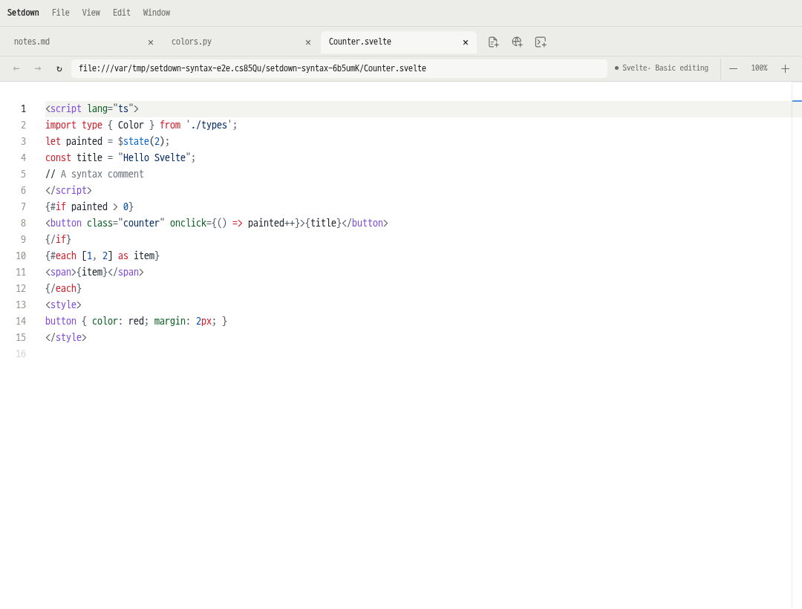
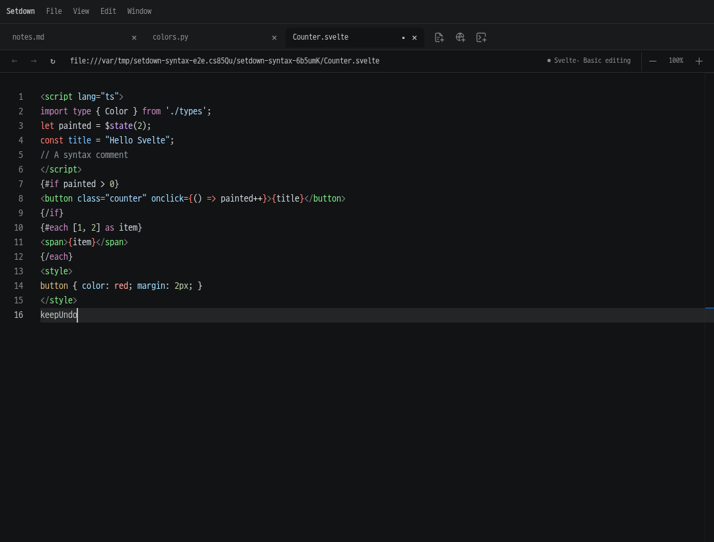

# Svelte 문법 강조 구현과 검증

Svelte 파일의 기본 문법 강조를 공통 TextMate 엔진으로 구현했다. 언어 서버 없이도
키워드·문자열·주석·태그·속성·템플릿 블록·내부 TypeScript와 CSS가 구분된다.
LSP의 semantic tokens는 이 기본 색상 위에 적용된다. Python 등 Monaco가 이미
지원하는 언어의 토크나이저는 유지한다.

변경 기준은 `109c9bcd966ccc5e3cfb93b2fcd8328f5e65d47c`이다. 아래 파일은 이 기준에
추가한 구현이며, 편집 내용을 다시 쓰거나 새로운 문서 모델을 만들지 않는다.

## 구조와 확장

| 책임 | 구현 | 동작 |
| --- | --- | --- |
| 언어 인식과 지연 로딩 | [syntax-runtime.ts](../../apps/desktop/src/renderer/language/syntax-runtime.ts) | 언어 ID·확장자·별칭·grammar import를 한곳에 선언하고 첫 사용 시 로드 |
| TextMate 실행과 상태 | [textmate-runtime.ts](../../apps/desktop/src/renderer/language/textmate-runtime.ts) | 하나의 Shiki/Oniguruma 엔진, 언어별 provider, 요청 병합, 줄 사이 문법 상태 보존 |
| 테마 변환 | [syntax-themes.ts](../../apps/desktop/src/renderer/language/syntax-themes.ts) | 기존 9개 테마 팔레트와 원본 VS Code Dark 2026 규칙을 사용 |
| 공통 연결 | [monaco-runtime.ts](../../apps/desktop/src/renderer/editor/monaco-runtime.ts), [theme.ts](../../apps/desktop/src/renderer/theme.ts) | 일반·분할·Git·노트북 편집기의 공통 Monaco 로더와 테마 적용 경로 사용 |

`@shikijs/core`, `@shikijs/langs`, `@shikijs/monaco`,
`@shikijs/engine-oniguruma`는 모두 **4.5.0**으로 고정했다. 엔진·WASM·문법 파일은
앱과 함께 빌드되는 로컬 자산이다. CDN이나 사용자의 프로젝트 의존성을 다운로드하지
않는다. [Shiki의 세분화된 번들](https://shiki.style/guide/bundles)과
[언어별 로딩](https://shiki.style/guide/load-lang)을 사용한다.

Svelte 문법 번들은 JavaScript·TypeScript·CSS·PostCSS 의존 문법을 포함한다.
`<script lang="ts">`, `$state`, `{#if}`, `{#each}`, 이벤트 속성, HTML 태그,
`<style>`을 실제 문법으로 처리한다. Pug·SCSS 같은 추가 전처리 문법은 이번 등록에
포함하지 않았다. 다른 언어를 추가할 때에는 같은 registry에 문법과 파일 연결을
등록하고, 해당 문법의 embedded language 의존성과 테스트를 추가하면 된다.
LSP 프로필만 가져온다고 문법이 자동으로 설치되는 것은 아니다.

## 기존 Monaco와 함께 동작하는 방식

[공식 Monaco 어댑터](https://shiki.style/packages/monaco)는 로드한 모든 언어의
provider를 등록하고 `editor.create`와 `editor.setTheme`를 감싼다. Setdown은
어댑터에 별도 facade를 넘겨 **요청한 Svelte provider만** 실제 Monaco에 등록한다.
따라서 Svelte 내부 분석용으로 로드한 TypeScript/CSS 문법이 독립 `.ts`·`.css`
편집기의 기존 provider를 교체하지 않는다.

문법 토큰에는 `setdown.syntax` 이름공간을 붙인다. 같은 색상에서 scope를 역으로
찾는 어댑터의 동작이 기존 Monarch/LSP 규칙과 충돌하지 않도록 분리한 것이다.
테마 변경 시 provider를 다시 등록해 캐시된 문법 색상만 무효화한다. 문서 모델,
텍스트, 커서, Undo history는 유지한다. LSP의
[semantic highlighting](https://code.visualstudio.com/api/language-extensions/semantic-highlight-guide)은
별도 provider로 계속 겹쳐 적용된다.

고정 버전 어댑터의 state equality는 wrapper identity를 비교한다. 이를 TextMate
rule stack의 값 비교로 감싸, 편집 후 다음 줄의 문법 상태가 원래 상태로 돌아오면
Monaco가 뒤쪽 전체 문서를 불필요하게 다시 토큰화하지 않도록 했다.

원본 어댑터의 20,000자 이상 줄 건너뛰기와 500 ms soft budget을 사용한다.
매우 긴 줄을 건너뛰면 진입 시 문법 상태를 유지하므로 다음 줄의 색상에도 영향을
줄 수 있다. 이 제한은 문서 내용이나 편집 가능 여부를 바꾸지 않는다.

## 실제 화면과 회귀 검사

검증 로그와 캡처는 [실행 산출물](../../reports/svelte-syntax-2026-10-30/)에 보관한다.
GUI는 모두 Xvfb·독립 runtime directory·독립 D-Bus session에서 실행했다.

새 [단위 검사](../../apps/desktop/src/renderer/language/textmate-runtime.test.ts)는 실제
상류 문법과 엔진을 사용해 embedded syntax, 여러 줄 주석, 동등 상태 판정, 긴 줄,
9개 테마, 기존 provider 보존, 동시 로딩 병합과 실패 후 재등록을 확인한다.

새 [Electron 검사](../../apps/desktop/test/e2e/language/syntax-highlighting.spec.ts)는 다음
세 시나리오를 검사하며, 집중 실행에서 **3개 모두 통과**했다.

1. 모든 서버를 끄고 Markdown → Python → Svelte 순서로 연다. Chromium의 실제
   로드된 script 목록에서 엔진과 문법이 Svelte 사용 전에는 없고 사용 후에는 있는지
   확인한다. 키워드·문자열·주석·숫자·태그·속성·블록·CSS의 실제 DOM 색상, 테마
   변경 후 편집기 identity와 Undo/Redo, 저장, Python 색상 유지를 검사한다.
2. 별도 JSON-RPC fixture 서버가 Svelte의 한 식별자에 semantic token을 보낸다.
   실제 LSP 연결과 Monaco provider를 통해 lexical 색상과 semantic 색상이 공존하고
   테마 변경을 따라가는지 검사한다. 이는 외부 `svelte-language-server` 설치 검사가
   아니라 두 강조 계층의 통합 검사다.
3. Git 저장소의 Svelte 변경을 옆에 열어 원본·수정본의 실제 문법 색상과 일반 편집기
   색상을 비교하고, 공유 문서의 수정·Undo·Redo를 확인한다.

초기 시험에서는 `file://` 모듈이 Resource Timing 목록에 나타나지 않아 로딩 관찰을
CDP `Debugger.scriptParsed`로 수정했다. 분할 workspace의 숨은 주 편집기 대신
실제로 보이는 그룹을 대상으로 지정했다. Undo 검사의 입력은 Chromium 입력 경로에서
여러 Undo 단위로 나뉘는 긴 문자열 대신 단일 단어를 사용했다. 색상·로딩·Undo 검사의
의미와 assertion은 유지하며, 수정 전 로그도 산출물에 남겼다.

전체 계약 실행 중 기존 검사 두 곳도 보강했다. 메뉴 검사는 Escape 뒤 명령 팔레트의
닫힘을 명시적으로 확인하고, 명령 입력창까지 함께 매치하던 선택자를 편집 입력창의
정확한 이름으로 바꿨다. 관련 일반/노트북 시나리오 **2개가 통과**했다.

언어 서버 목록 검사는 비어 있는 PATH와 임시 HOME만으로 환경을 격리했으나 npm이
주입한 설치 prefix가 남아 외부 서버를 한 개 더 감지했다. 이 실패는 독립 기준 버전에서도
같이 재현됐다. fixture의 두 npm prefix를 비워 원래 의도한 격리를 완성한 뒤 **1개가
통과**했다. 예상 서버 수 3개를 포함한 기존 assertion은 그대로 유지했다.
각각 `menu.log`, `registry.log`, `baseline-registry.log`에 결과가 있다.

## 최종 검증 결과

기능 검사는 2026년 10월 30일, 중단 후 재개한 성능 비교는 10월 31일 KST에 완료했다.
전체 GUI 실행 뒤 변경한 것은 위 두 테스트의 관찰·격리 방식이다. 제품 코드는
그대로이며, 해당 테스트의 보강된 assertion으로 별도 실행한 결과를 구분해 기록한다.

| 검사 | 결과 | 실행 근거 |
| --- | --- | --- |
| 계약 단위 검사 | 96개 파일, 698개 통과 | `preview-contract.log` |
| 검사 도구 | 14개 통과 | `preview-contract.log` |
| 전체 Electron 계약 | 231개 실행, 229개 통과, 위 테스트 문제 2개 실패 | `preview-contract.log` |
| 보강된 메뉴 검사 | 일반·노트북 2개 통과 | `menu.log` |
| 격리된 서버 목록 검사 | 1개 통과, 예상 서버 수 유지 | `registry.log` |
| 새 Svelte Electron 검사 | 집중 실행 3개 통과, 전체 계약에서도 3개 통과 | `setdown-syntax-e2e-3.log`, `preview-contract.log` |
| 최종 기준·변경 버전 빌드 | 모두 성공, 타입/Svelte 오류·경고 0 | `benchmark-2026-10-31/baseline-build.log`, `candidate-build.log` |
| 최종 성능 비교 | 80개 새 앱, 400개 왕복 cycle, 48개 비교 항목 통과 | [comparison.json](../../reports/svelte-syntax-2026-10-30/benchmark-2026-10-31/comparison.json) |

전체 GUI를 보강된 테스트로 다시 모두 실행한 것으로 합산하지 않는다. 실패를
자동 retry하거나 예상 개수·색상·focus/IME·성능 assertion을 완화하지 않았다.

## 성능 비교

독립 checkout `/tmp/setdown-syntax-baseline-109c9bc`의 기준 커밋과 변경 버전을
각각 설치·빌드했다. 양쪽 모두 같은 Electron 버전과 기본 sourcemap 설정을 사용했다.
한 Xvfb 화면에서 기준→변경 / 변경→기준 순서를 교대로 배치해 5회 반복했다.
빌드 산출물·harness hash, fixture hash, 실행 순서와 원본 측정치는 위 JSON에 있다.

중단된 첫 실행의 `benchmark/`는 빌드 중 멈췄으며 측정 기록이 없다.
10월 31일의 `benchmark-2026-10-31/`에서 새로 수행한 완전한 실행만 최종 결과로
사용했다. 기존 판정 기준인 **25%와 50 ms를 모두 초과한 증가**를 유지했고,
해당하는 항목은 0개였다. 예를 들어 준비 대기 없이 수정한 Git 문서의 첫 캡처는
983→1046 ms로 63 ms 늘었으나 약 6.4% 증가로 기존 허용 범위 안이었다.

아래 값은 **기준 → 변경**, 단위는 **ms**다. 첫 번째와 두 번째 cycle은 별도로
집계한다. warm은 각 앱의 3~5번째 cycle 중앙값을 구한 뒤 5회 실행 중앙값으로
집계한다. 준비 대기 0은 추가 대기 없음, 3000은 첫 전환 전 편집기에서 3초의
준비 시간을 허용한 조건이다. 이 대기 시간 자체는 전환 시간에 더하지 않는다.
캡처 시간에는 입력·polling·IPC·readback이 포함되며, 수정 조건은 최신 내용이
담긴 비어 있지 않은 native capture까지 확인한다.

### Esc 입력부터 최신 native 캡처까지

| 화면 | 준비 대기 | 수정 | 첫 번째 | 두 번째 | warm |
| --- | ---: | --- | ---: | ---: | ---: |
| 일반 Markdown | 0 | 없음 | 38 → 33 | 22 → 31 | 24 → 23 |
| 일반 Markdown | 0 | 있음 | 299 → 287 | 93 → 88 | 96 → 91 |
| 일반 Markdown | 3000 | 없음 | 27 → 28 | 22 → 17 | 19 → 24 |
| 일반 Markdown | 3000 | 있음 | 104 → 110 | 96 → 93 | 93 → 90 |
| Git 비교 | 0 | 없음 | 952 → 952 | 24 → 27 | 29 → 27 |
| Git 비교 | 0 | 있음 | 983 → 1046 | 1545 → 1529 | 173 → 180 |
| Git 비교 | 3000 | 없음 | 32 → 32 | 21 → 21 | 18 → 18 |
| Git 비교 | 3000 | 있음 | 230 → 232 | 186 → 184 | 177 → 179 |

### 실제 더블클릭부터 편집기 복귀까지

| 화면 | 준비 대기 | 수정 | 첫 번째 | 두 번째 | warm |
| --- | ---: | --- | ---: | ---: | ---: |
| 일반 Markdown | 0 | 없음 | 17 → 18 | 37 → 34 | 12 → 12 |
| 일반 Markdown | 0 | 있음 | 17 → 21 | 15 → 16 | 13 → 14 |
| 일반 Markdown | 3000 | 없음 | 17 → 17 | 11 → 11 | 11 → 11 |
| 일반 Markdown | 3000 | 있음 | 15 → 15 | 16 → 14 | 13 → 13 |
| Git 비교 | 0 | 없음 | 24 → 26 | 12 → 12 | 13 → 13 |
| Git 비교 | 0 | 있음 | 24 → 24 | 21 → 21 | 19 → 21 |
| Git 비교 | 3000 | 없음 | 25 → 26 | 12 → 12 | 17 → 17 |
| Git 비교 | 3000 | 있음 | 24 → 23 | 19 → 19 | 19 → 19 |
