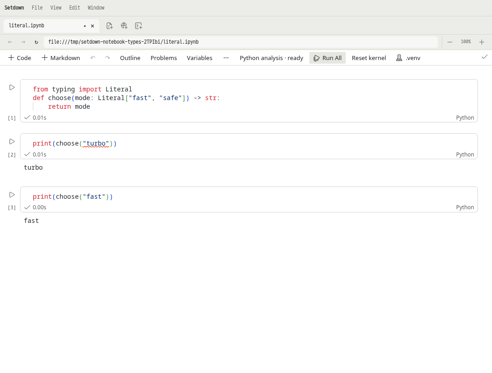

# Python·노트북 LSP 적용 검증 — 2026-11-08

[Helix·VS Code 비교 보고서](../../reports/2026_11_08_lsp_vision_helix_vscode.md)의 우선 구현 사항을 적용했다.
설정 없는 Python 파일과 노트북에서 명확한 타입 오류를 찾고, 사용자가 환경과 검사 정책을
설계하지 않아도 시작할 수 있게 하는 변경이다. 기준 코드는 `cd6b98d7d8fd4b1b898d47a094155d60bc1db3e2`다.

## 구현한 사용자 계약

- Python 파일과 노트북의 기본값은 `basic`이다. 잘못된 `Literal` 인자와 대입은 error이며,
  annotation 없는 함수에 strict 수준의 검사를 강요하지 않는다. 기존 `off` 기대 테스트는
  오류·정상 코드의 쌍과 수정 후 진단 제거를 검사하도록 바꿨다.
- generated catalog만 바꾸지 않고 Helix catalog용 override와 생성물을 함께 갱신했다.
  노트북도 이 기본 정책을 사용한다. 일반 파일은 번들 Pyright, 노트북은 번들 basedpyright다.
- 프로젝트 화면과 노트북 화면에서 Basic/Standard/Strict/Off를 선택할 수 있다.
  Setdown 프로젝트 선택, 연결 설정, 호환 `.vscode` 설정, 기본값 순서로 client policy를 정한다.
  native `pyrightconfig.json`/`pyproject.toml`은 서버가 계속 해석한다. 따라서 client policy와
  native 설정의 우선권을 화면에 구분해 표시한다. 설정 파일을 덮어쓰지 않는다.
- 가장 가까운 `.venv`/`venv`가 하나이면 자동 선택한다. 동률이면 선택을 요구하며 Git 경계를
  넘어서 탐색하지 않는다. 명시 선택이 사라져도 다른 Python으로 조용히 바꾸지 않는다.
  실행 중인 커널은 기존 환경과 변수를 유지한다.
- 셀 진단은 Monaco model이 아닌 문서 URI와 revision에 속한다. 셀 marker와 Problems는
  동일 저장소를 읽는다. 비활성 탭·아직 mount되지 않은 셀에서도 진단을 보존하고, 결과를 누르면
  노트북과 해당 셀로 이동한다. 일반 파일 Problems에서도 노트북 오류를 확인할 수 있다.
- 분석 연결 상태와 진단 수신 상태를 구분한다. 편집 후 이전 snapshot을 현재 결과로 재사용하지
  않으며, 연결 성공이나 오류 0개를 프로젝트 전체 검사 완료라고 표시하지 않는다.
- 같은 창·root·Python·client 설정의 서로 다른 노트북은 분석 프로세스를 공유한다. 동일 URI의
  중복 소유자와 다른 환경은 분리한다. 마지막 문서 이후 최대 30초, 전체 최대 4개 idle process를
  유지하며 창 종료 시 정리한다. 열린 비활성 노트북은 여전히 열린 문서로 취급한다.
- crash는 60초 동안 최대 세 번, 1/3/5초 지연으로 재연결한다. 실패한 프로세스는 재사용하지 않고,
  명시적 재시작은 예산을 초기화한다. 재연결은 최신 소스만 전송하며 kernel 실행·편집 명령을 재생하지 않는다.
- 연결·구조 변경마다 wire cell URI epoch를 새로 만든다. 공유 서버의 늦은 진단이 새 연결에 붙지 않는다.
  닫기와 구조 변경이 겹쳐도 닫힌 문서를 다시 열지 않는다. 버전 있는 workspace edit는 셀의
  로컬 revision 대신 서버에 전송한 notebook snapshot 버전을 검사한다.

## 실제 검증

설정 없는 3셀 노트북에서 `choose("turbo")`의 인자에 빨간 줄이 생기고, `choose("fast")`에는
생기지 않는다. Run All은 실제 Jupyter 커널에서 `turbo`, `fast`를 출력하고 정상 종료하지만
타입 오류는 유지된다. 다른 `.py` 탭의 Problems에서 그 오류를 누르면 원래 셀로 이동한다.
Off/Basic 전환은 커널을 재시작하지 않는다. 인자를 `safe`로 고치면 marker와 Problems에서 사라진다.

실제 basedpyright 프로세스 하나에 두 native notebook을 열어, 한 노트북의 함수가 다른 노트북에
누출되지 않는 것을 검사했다. 앞 셀의 Literal signature를 바꾸면 뒤 셀의 진단도 새 snapshot으로
갱신된다. Pyright와 basedpyright 모두 native `off`와 `strict`가 기본 `basic`보다 우선하는 것을
실제 stdio로 검사했다. 별도 Electron 시나리오는 100셀 노트북, 20회 탭 왕복, 같은 analyzer PID,
정상/오류 교대 수정과 최신 진단 수신을 검사한다.

| 검사 | 결과 | 근거 |
| --- | --- | --- |
| 전체 단위 테스트 | 162개 파일, 1,253개 통과 | [unit.log](../../reports/lsp-implementation-2026-11-08/unit.log.txt) |
| 실제 Jupyter kernel bridge | 4개 통과 | [kernel.log](../../reports/lsp-implementation-2026-11-08/kernel.log.txt) |
| 실제 Literal·IPython Electron | 2개 통과 | [literal-e2e.log](../../reports/lsp-implementation-2026-11-08/literal-e2e.log.txt) |
| 100셀·프로세스 공유 Electron 선행 검사 | 통과 | [pool-e2e-initial.log](../../reports/lsp-implementation-2026-11-08/pool-e2e-initial.log.txt) |
| 계약 단위 검사 | 110개 파일, 880개 통과 | [전체 계약 로그](../../reports/lsp-implementation-2026-11-08/preview-contract.log.txt) |
| 빌드 도구 검사 | 14개 통과 | 같은 로그 |
| 타입·Svelte 검사 및 양쪽 production build | 통과, Svelte 오류·경고 0개 | 같은 로그와 benchmark의 build 로그 |
| 전체 격리 Electron 계약 | 305/307 통과 | 같은 로그 |
| 실패한 2개 시나리오 후속 검증 | 둘 다 통과, trace 보존 | [후속 로그](../../reports/lsp-implementation-2026-11-08/followup-e2e.log.txt) |
| 변경 전 브라우저 대조 실행 | 통과 | [baseline 로그](../../reports/lsp-implementation-2026-11-08/baseline-focus.log.txt) |
| 미리보기 성능 | 80회 실행, 48개 비교 모두 통과 | [comparison.json](../../reports/lsp-implementation-2026-11-08/benchmark/comparison.json) |

**전체 계약 명령이 한 번에 모두 통과한 것은 아니다.** notebook extraPaths 테스트는 예전 warning
기대값을 새 error 정책에 맞춘 뒤 동일한 2→1→2 진단 수·Unicode 경로·hover·설정 재적용 검사를
통과했다. 브라우저 테스트는 Google 제목을 기다리는 5초 assertion에서 실패했다. 당시 새 탭은
선택됐지만 로딩 중이었다. 코드·timeout·assertion 변경 없이 추적 실행에서 통과했고, 변경 전 코드의
같은 시나리오도 통과했다. 최초 실패의 원인은 확정하지 않았으며 flaky 가능성은 남는다.
[후속 추적 자료](../../reports/lsp-implementation-2026-11-08/followup-traces/)와 실패 화면 상태를 보존했다.
307개 시나리오의 개별 통과를 확인했지만 이를 단일 full-gate 성공으로 표현하지 않는다.

모든 GUI는 Xvfb, 분리된 runtime와 D-Bus에서 실행한다. 사용자 데스크톱은 사용하지 않는다.
기존 assertion·IME·최신 내용 확인·성능 허용치를 줄이지 않았고 Playwright retry는 0이다.
중간에 발견한 Problems의 notebook 탐색 실패는 제품 수정 후 재검증했다.
예전 off 정책의 warning과 수동 환경 선택을 기대하던 GUI fixture는 기본 error 정책 및 명시적으로
잘못 선택한 Python의 복구 시나리오로 바꿨다. 이전 GUI 실행은 중단하고 최종 코드로 전체 gate를 다시 시작했다. 새 네이티브 테스트의
`didChange` payload와 test profile 타입 오류도 수정했고, 실패 로그는 원자료에 별도로 보존했다.

## 100셀 노트북 관측

[측정 원자료](../../reports/lsp-implementation-2026-11-08/notebook-analysis-measurements.json)에서
2셀 노트북에 이어 같은 context의 100셀 노트북을 열고 20회 왕복한 뒤에도 analyzer PID는
`240211` 하나였다. RSS는 153.5 → 156.1 MiB였다. 커널은 실행하지 않았다. 이는 서버 공유와
이 사례의 자원 관측이며, 다른 프로젝트·라이브러리의 메모리 상한을 뜻하지 않는다.

100셀의 현재 진단을 모두 받은 시점까지 6회 편집 관측값은 890, 346, 349, 354, 349, 346ms다.
첫 측정 이후 다섯 번은 346–354ms였고, 전체 중앙값은 약 349ms다. CDP 입력, 150ms debounce,
IPC, 분석과 화면·assertion polling을 포함한다. 표본 6개로 P95나 completion 지연을 주장하지 않는다.

[정책·현재 진단 수신 화면](../../reports/lsp-implementation-2026-11-08/notebook-analysis-settings.png)에서도
커널 실행 상태와 정적 분석 결과를 별도로 확인할 수 있다.

## 동일 조건 미리보기 비교

기준은 `cd6b98d7d8fd4b1b898d47a094155d60bc1db3e2`의 별도 worktree이며 `npm ci --offline`으로
자체 의존성을 설치했다. 두 앱을 각각 production build했다. Linux x64, AMD Ryzen 7 8845HS,
Node 22.23.1, Electron 44.7.2, 같은 Xvfb `:99`에서 각 버전을 5회씩 AB/BA 순서로 교대했다.
기존 `/tmp/.git`의 영향을 피하기 위해 양쪽 fixture에 동일하게 `TMPDIR=/var/tmp`를 지정했다.
잠금 파일, fixture, harness, build 해시와 원래 source identity가 comparison.json에 있다.

8개 시나리오 × 두 버전 × 5회로 80번 새 앱을 실행하고 400개 왕복 cycle을 확인했다.
기존 **25%와 50ms를 모두 초과하면 회귀**라는 판정식을 유지했고, 48개 항목의 회귀는 0개다.
가장 큰 증가는 Git 리뷰/준비 0ms/편집 없음의 첫 capture에서 965→986ms(+21ms)였다.

표는 **기준 → 변경, ms**다. 첫 번째·두 번째는 별도로 비교하며, 반복은 각 앱의 3–5회차 중앙값을
구한 뒤 5회 실행의 중앙값을 취한다. 사전 준비는 source 상태의 대기 시간이며 3000ms를 입력 지연에
더하지 않는다. 전환 때 남은 작업은 측정에 포함한다. capture는 최신 내용의 비어 있지 않은 native
화면 readback까지로, 모니터 표시 시각은 아니다. 편집이 있는 모든 capture는 최신 내용을 확인한다.

### Escape → 최신 미리보기 capture

| 문서 | 사전 준비 | 편집 | 첫 번째 | 두 번째 | 반복 |
| --- | --- | --- | --- | --- | --- |
| Markdown | 0ms | 없음 | 49 → 51 | 31 → 43 | 29 → 24 |
| Markdown | 0ms | 있음 | 324 → 317 | 91 → 101 | 90 → 90 |
| Markdown | 3000ms | 없음 | 21 → 22 | 22 → 21 | 21 → 19 |
| Markdown | 3000ms | 있음 | 105 → 106 | 88 → 83 | 87 → 86 |
| Git 리뷰 | 0ms | 없음 | 965 → 986 | 21 → 22 | 19 → 17 |
| Git 리뷰 | 0ms | 있음 | 1025 → 1030 | 1497 → 1450 | 175 → 171 |
| Git 리뷰 | 3000ms | 없음 | 29 → 26 | 24 → 25 | 20 → 19 |
| Git 리뷰 | 3000ms | 있음 | 227 → 234 | 201 → 191 | 177 → 176 |

### 실제 더블클릭 → 편집기

| 문서 | 사전 준비 | 편집 | 첫 번째 | 두 번째 | 반복 |
| --- | --- | --- | --- | --- | --- |
| Markdown | 0ms | 없음 | 18 → 19 | 16 → 26 | 15 → 15 |
| Markdown | 0ms | 있음 | 17 → 18 | 15 → 17 | 14 → 14 |
| Markdown | 3000ms | 없음 | 19 → 19 | 16 → 14 | 15 → 15 |
| Markdown | 3000ms | 있음 | 18 → 17 | 16 → 15 | 14 → 14 |
| Git 리뷰 | 0ms | 없음 | 22 → 23 | 11 → 11 | 11 → 12 |
| Git 리뷰 | 0ms | 있음 | 21 → 20 | 17 → 15 | 14 → 15 |
| Git 리뷰 | 3000ms | 없음 | 21 → 21 | 11 → 12 | 16 → 15 |
| Git 리뷰 | 3000ms | 있음 | 20 → 20 | 16 → 16 | 15 → 14 |

## 범위와 남은 비교 실험

보고서가 gate 뒤에 두었던 일반 `.py`의 basedpyright 전환, PET 환경 탐색기 도입, 범용 LSP adapter
교체는 이번 변경에 포함하지 않았다. 기존 파일 분석기의 다중 파일 rename과 환경 호환성을 유지하고,
이미 번들된 두 엔진에 공통 정책을 적용했다. 타입 provider와 보조 lint/format 역할을 구분하는 기존
registry와 feature plan은 유지한다. 사용자에게 모든 서버를 설치하게 하는 새 관리 계층은 추가하지 않았다.

이번 검증은 지정한 오류·정상 코드와 notebook workflow의 계약을 입증한다. 모든 pandas/numpy API와
stub 조합의 오탐이 없어졌다는 의미는 아니다. VS Code/Pylance 대비 메모리·CPU 우위를 주장하지 않으며,
100셀 관측치를 1,000셀 또는 모든 프로젝트의 P95 보장으로 일반화하지 않는다.

현재 유지 계약은 [노트북](../contracts/notebook.md), 사용자 설명은
[Notebook](../notebooks.md)과 [Language support](../language-support.md)에 있다.
