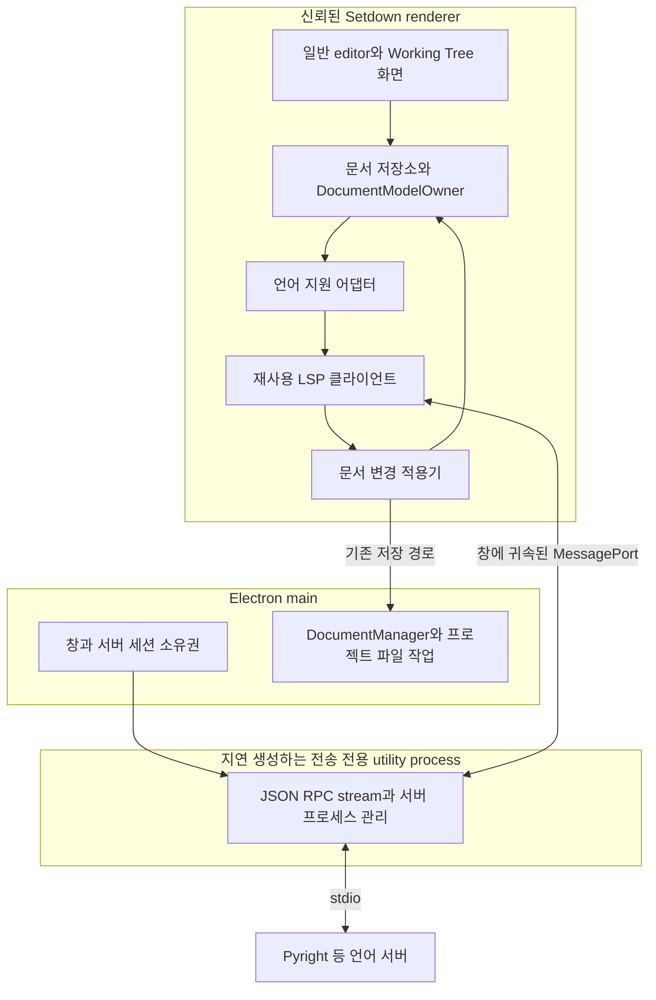
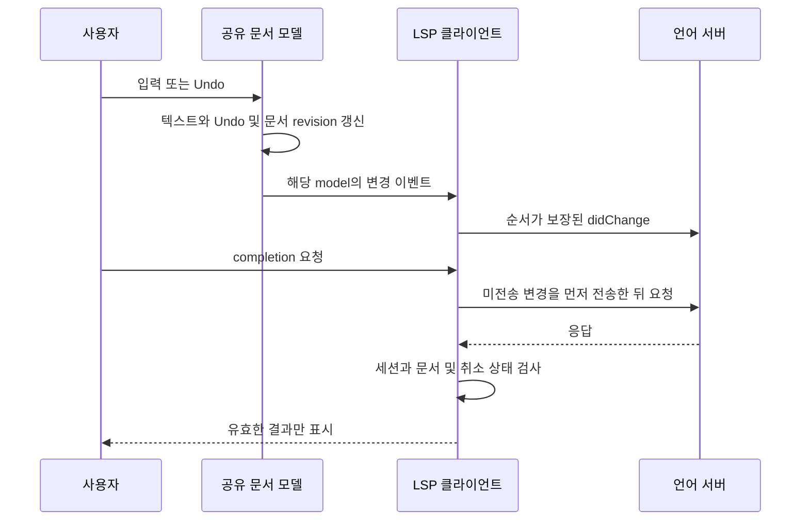

# Setdown의 LSP 도입과 문서 소유권 설계

작성일: 2026년 10월 15일. 분석 기준: Setdown `a5f27c64ca0de84ba46efdd6a7f88b5a202465a5`와 이 커밋에 고정된 참조 서브모듈. 이 보고서는 구현 방향과 채택 조건을 정한다. 아래의 새 모듈 이름, 상태 기계와 성능 목표는 제안이며, 현재 제품에 이미 구현된 기능과 구분한다.

## 먼저 결정할 것

**Setdown의 편집기와 문서 관리 구조를 유지하고, 그 옆에 교체 가능한 언어 지원 계층을 붙이는 것이 가장 유리하다.** 언어 분석은 기존 서버에 맡기고, 프로토콜 처리는 검증된 클라이언트를 최대한 재사용한다. Setdown은 어떤 문서를 분석할지, 서버를 언제 실행할지, 제안된 변경을 어떻게 문서와 Undo에 반영할지를 책임진다. 이 세 가지는 라이브러리를 바꿔도 남는 제품의 책임이다.

런타임의 첫 후보는 `monaco-languageclient`의 **classic 설정과 EditorService만 사용하는 구성**이다. VS Code의 화면 전체를 가져오지 않고 공식 언어 클라이언트의 동기화·요청 취소·기능 변환을 재사용하기 위해서다. 다만 이 후보의 채택은 조건부다. 현재 Setdown의 모델 수명, 경로 변경, 저장과 Undo를 보존하는지 먼저 작은 통합 실험으로 증명해야 한다. 단순히 자동완성이 뜨는 것은 통과 조건이 아니다.

이 조건은 형식적인 주의사항이 아니다. 실제 코드를 읽으면 `monaco-languageclient`는 독립 Monaco에 함수 몇 개를 등록하는 패키지가 아니다. `vscode-languageclient`와 VS Code API 호환 계층을 함께 사용한다. 공식 설치 방법에는 Monaco 패키지의 alias도 등장한다. 따라서 “기존 Monaco는 그대로이고 LSP만 꽂는다”는 설명으로는 이 변경의 범위를 충분히 표현하지 못한다.

추천하는 순서는 **문서와 프로세스의 경계를 먼저 정하고 → 라이브러리 접합 가능성을 검증하고 → Python 한 언어로 완결된 경험을 만들고 → 여러 파일 편집을 안정화한 뒤 → 언어를 늘리는 것**이다. 이 순서라면 첫 선택이 실패해도 문서 경계, 테스트, 서버 관리 코드를 재사용할 수 있다.

| 결정 | 권고 | 이유 |
| --- | --- | --- |
| 제품 구조 | Electron·Svelte·Monaco와 기존 문서 중심 UI 유지 | 현재의 읽기, Git review, 분할 창을 다시 만들 이유가 없다 |
| 구현 언어 | 기존 TypeScript 계층에 통합 | Node 프로세스·Monaco·IPC와 바로 연결되며 새 FFI 경계를 만들지 않는다 |
| 분석 엔진 | Pyright 등 기존 언어 서버 사용 | 언어의 문법·타입·프로젝트 해석을 직접 유지하지 않는다 |
| LSP 클라이언트 | `monaco-languageclient`의 제한된 구성을 먼저 검증 | 공식 클라이언트의 복잡한 동작을 재사용할 가치가 크다 |
| 문서·저장·Undo | Setdown이 계속 소유 | 읽기와 Git review가 이미 이 소유권을 전제로 동작한다 |
| 서버 세션 | 창·프로젝트·서버 설정 단위 | 서로 다른 창의 미저장 버퍼를 한 서버 문서로 섞지 않는다 |
| 시작 방식 | 해당 언어의 실제 편집이 필요할 때 실행 | Markdown 읽기나 웹 방문만 하는 사용자는 서버 비용을 지불하지 않는다 |
| 첫 공개 범위 | 한 언어의 완성도 높은 기본 기능 | 많은 서버를 연결했다는 숫자보다 저장 전 정확성이 중요하다 |
| 의존성 관리 | 참조 소스는 서브모듈, 런타임은 검증한 npm 버전 고정 | 참조 HEAD와 제품 실행 버전을 분리한다 |

가장 중요한 판단 기준은 직접 쓴 줄 수 하나가 아니다. **제품의 책임을 해결하는 코드, 다른 라이브러리와 맞추기 위한 코드, 버전 변경 때 다시 검증해야 하는 행동을 합친 비용**을 줄여야 한다. 큰 패키지를 가져오면서 문서 상태를 두 벌 유지한다면 코드 재사용의 이득이 빠르게 사라진다. 반대로 모든 LSP 기능을 작은 자체 클라이언트로 시작하면 시간이 지나면서 공식 클라이언트를 다시 구현하게 된다.

## 현재 코드에서 지켜야 할 자산

### 문서는 이미 화면과 분리되어 있다

현재 [Monaco 어댑터](../apps/desktop/src/renderer/adapters/monaco-editor.ts)는 그룹별 editor와 탭별 model을 따로 관리한다. [DocumentModelOwner](../apps/desktop/src/renderer/editor/live-document-model.ts)는 model과 Undo 기록의 수명을 소유하고, 다른 화면에는 lease를 빌려준다. Working Tree의 [GitDiffEditor](../apps/desktop/src/renderer/project/source-control/GitDiffEditor.svelte)는 수정 가능한 오른쪽 모델을 새로 복제하지 않고 이 lease를 받는다.

이 덕분에 일반 탭에서 수정한 내용이 Working Tree에 보이고, 그쪽에서 Undo한 결과도 같은 문서에 남는다. LSP가 또 다른 텍스트 모델을 만들어 양방향으로 내용을 복사하면 이 성질을 잃는다. LSP 연동에서 가장 먼저 보존할 것은 model 객체의 동일성과 편집 이력이다.

현재 코드의 핵심은 다음과 같다. 읽기 쉽게 일부만 발췌했다.

```ts
// monaco-editor.ts — 현재 구현
const uri = api.Uri.file(tab.document.path).with({ query: tab.id });
const model = api.editor.createModel(tab.text, language, uri);
const listener = model.onDidChangeContent(() => {
  if (this.replacing.has(tab.id) || this.models.get(tab.id) !== model) return;
  const text = model.getValue();
  this.options.changed(tab, text);
  liveDocumentModels.publish({ type: 'changed', path: tab.document.path, text });
});
```

이 listener는 일반 타이핑뿐 아니라 Git review, Undo·Redo와 IME 편집에서도 문서 변경을 알리는 기준점이다. 새 LSP 코드가 같은 변경에 대해 `tabs.editorChanged()`까지 다시 호출하면 revision이 두 번 증가하거나 미리보기가 중복 예약될 수 있다. **LSP로 편집하더라도 원래 모델을 수정하고, 기존 변경 통지가 한 번 일어나게 해야 한다.**

### main은 모든 미저장 문서를 가지고 있지 않다

[WindowState](../apps/desktop/src/main/windows/window-state.ts)의 `currentDocument`는 창의 현재 문서다. 전체 탭의 미저장 텍스트를 담는 저장소가 아니다. [TabController.editorChanged](../apps/desktop/src/renderer/workspace/tab-controller.ts)는 활성 문서일 때만 `desktop.updateText()`를 보낸다. 비활성 문서의 현재 텍스트는 renderer의 탭과 모델에 남는다.

따라서 main에서 `currentDocument`만 읽어 LSP 동기화를 구현하면 뒤쪽 탭이나 Working Tree의 미저장 내용을 놓친다. 서버 프로세스는 main 측이 관리해도, **열린 문서의 내용과 변경 순서는 renderer의 문서 계층에서 나와야 한다.** main에 모든 텍스트를 복제하는 새 저장소를 만드는 것도 첫 선택으로 삼지 않는다.

### 저장은 단순한 파일 쓰기가 아니다

[DocumentActions](../apps/desktop/src/renderer/workspace/document-actions.ts), [AutoSaveController](../apps/desktop/src/renderer/workspace/auto-save.ts), [DocumentManager.saveSnapshot](../apps/desktop/src/main/documents/document-manager.ts)는 저장 중의 새 입력, 외부 파일 변경, Untitled의 Save As, Markdown 첨부 자산을 처리한다. 일반 소스 파일은 [text-file](../apps/desktop/src/main/documents/text-file.ts)과 [text-codec](../apps/desktop/src/core/document/text-codec.ts)를 통해 UTF-8·BOM·개행 정책을 적용한다.

LSP의 Rename이나 Quick Fix가 `fs.writeFile()`을 직접 호출하면 이 저장 정책과 Dirty 표시를 우회한다. VS Code 호환 파일 시스템을 도입할 때도 같은 문제가 생긴다. 그 파일 시스템의 메모리에 저장했을 뿐인데 Setdown에서 실제 파일이 저장된 것처럼 보이면 안 된다. 저장의 최종 실행 경로는 기존 DocumentManager로 이어져야 한다.

### 경로가 바뀌어도 모델은 살아 있다

현재 `MonacoEditor.retarget()`은 문서의 경로와 언어를 갱신하면서 모델과 Undo 기록을 유지한다. 이미 만들어진 `model.uri`는 바꾸지 않는다. 이는 UI 관점에서는 좋은 선택이지만, 서버가 실제 파일 경로를 기준으로 분석하는 순간 명시적으로 해결해야 하는 문제가 된다.

예를 들어 `a.py`를 `b.py`로 바꿨는데 서버에 계속 `file:///project/a.py?tab-id`를 보내면, 서버는 사용자가 보고 있는 파일과 다른 파일을 분석한다. 단순히 URI의 query를 제거하는 것만으로는 이전 경로까지 해결되지 않는다. 현재 문서 경로와 모델 식별자를 연결하는 별도 매핑이 필요하다.

### 프로젝트 감시는 의미 있는 변경 정보를 아직 전달하지 않는다

[ProjectWatcher](../apps/desktop/src/main/project/engines/project-watcher.ts)는 창마다 `@parcel/watcher` 구독을 만들지만, callback에서 이벤트 목록을 사용하지 않고 `{ root }`만 renderer로 보낸다. Explorer와 Git을 새로 읽는 용도에는 충분하다. LSP의 `workspace/didChangeWatchedFiles`에는 어떤 URI가 생성·변경·삭제됐는지가 필요하다.

그러므로 현재 이벤트를 그대로 LSP에 연결할 수 없다. 기존 구독에서 구체적인 파일 이벤트를 보존하는 방향으로 확장해야 한다. 다만 현재 무시하는 `node_modules` 등의 정책이 언어 서버의 동적 감시 요청과 충돌할 수 있으므로, 필요한 경우 제한된 추가 구독을 지원해야 한다. “감시기는 하나니까 모든 용도에 충분하다”는 가정도 피해야 한다.

### 키 입력과 시작 경로도 공유 자원이다

`MonacoEditor.installBindings()`는 suggestion·find·rename·composition 상태를 확인하고 Escape를 처리한다. 그러나 [installWorkspaceEvents](../apps/desktop/src/renderer/application/workspace-events.ts)는 capture 단계에서 키를 받고, [workspace-controller](../apps/desktop/src/renderer/workspace/workspace-controller.ts)의 Markdown·Git 경로에도 별도의 Escape 처리가 있다. LSP가 suggestion이나 rename 입력을 추가하면 editor 내부 조건만으로는 충분하지 않다. 이는 코드에서 확인한 충돌 가능성이며, 현재 재현 완료된 LSP 버그라는 뜻은 아니다.

또한 Monaco는 일반 편집기뿐 아니라 Git diff에서도 만들어진다. 첫 모델과 첫 editor를 만드는 모든 진입점이 같은 초기화 경로를 사용해야 한다. 한쪽에서 독립 Monaco를 먼저 만들고, 다른 쪽에서 VS Code 서비스를 나중에 초기화하는 구성은 첫 사용 순서에 따라 달라지는 장애를 낳는다.

## 서브모듈에서 가져올 것

### Monaco Language Client의 작은 입구 뒤에는 큰 구현이 있다

현재 고정한 [MonacoLanguageClient 클래스](../vendor/monaco-languageclient/packages/client/src/index.ts)는 `vscode-languageclient/browser`의 `BaseLanguageClient`를 상속하고 `MessageTransports`를 공급한다. 입구가 작은 이유는 필요한 기능이 없어서가 아니라, 공식 클라이언트가 그 아래에서 동작하기 때문이다.

공식 클라이언트는 [textSynchronization](../vendor/vscode-languageserver-node/client/src/common/textSynchronization.ts)에서 문서 동기화를, [protocolConverter](../vendor/vscode-languageserver-node/client/src/common/protocolConverter.ts)에서 completion·range·workspace edit 변환을, [diagnostic](../vendor/vscode-languageserver-node/client/src/common/diagnostic.ts)에서 진단 요청과 상태를 처리한다. 취소와 서버 재시작, 초기화 전후의 문서 처리, 동적 기능 등록도 있다. “completion 요청을 보내고 목록을 표시한다”는 자체 데모와 유지보수 범위가 다르다.

반면 [VS Code API wrapper](../vendor/monaco-languageclient/packages/client/src/vscode/apiWrapper.ts)는 모델·설정·로그·확장 서비스 등을 준비한다. `classic`은 이 계층을 없애는 옵션이 아니다. Monarch 기반의 구성을 선택하는 옵션이며, `extended`는 TextMate·테마·언어 서비스를 더 가져온다. [설정 문서](../vendor/monaco-languageclient/docs/guides/configuration.md)도 두 모드 모두 API 초기화를 먼저 하도록 설명한다.

따라서 기본 실험은 `classic + EditorService`로 제한한다. Python 예제의 ViewsService, Explorer, Debugger, 자체 workbench DOM을 그대로 가져오지 않는다. 그 예제는 Python 서버 연결보다 훨씬 넓은 제품을 보여준다. Setdown에서는 기존 문서 탐색과 화면 배치를 유지하고, 필요성이 확인된 서비스만 활성화한다.

### 모델 호환성은 타입 호환성과 다르다

CodinGame의 [공식 README](https://github.com/CodinGame/monaco-vscode-api#model-creation)는 일반 `createModel()`과 VS Code 서비스에서 사용하는 model reference를 구분하고, 파일 시스템에 연결된 `createModelReference()`를 설명한다. [초기화 규칙](https://github.com/CodinGame/monaco-vscode-api#monaco-service-override)은 첫 editor 생성 전에 한 번 초기화하도록 요구한다.

이 두 사실이 통합의 실제 비용을 결정한다. Setdown의 `DocumentModelOwner`와 호환 계층의 reference counting이 같은 텍스트 모델을 바라보는지, 마지막 lease가 사라질 때 정확히 해제되는지 확인해야 한다. Save As를 위해 모델을 재생성해서 Undo가 사라진다면 API 호출에 성공했더라도 제품 통합은 실패다.

여기서 중요한 추가 참조는 `@codingame/monaco-vscode-api`의 실제 채택 버전 소스다. 지금 등록한 다섯 저장소만으로 그 패키지의 모든 동작을 설명할 수는 없다. 이 조사에서는 공식 공개 문서와 model service 구현을 확인했지만, 첫 실험에서는 npm 배포 버전에 대응하는 file resolver·text file service·bulk edit 확장 지점을 함께 읽어야 한다. 특히 현재 `vendor/vscode`의 내부 구현을 호환 패키지의 동일 버전 구현이라고 간주하지 않는다. 이 저장소를 참조에 추가할 가치는 있으나, 보고서 작성 중 서브모듈이나 런타임 의존성을 추가하지는 않았다.

호환 계층을 채택해도 문서당 editable model은 하나여야 한다. Setdown의 owner가 호환 계층의 reference를 보유하고 review가 그 모델을 빌리는 방식은 후보가 될 수 있다. **실제로 하나의 모델로 연결된다는 증거 없이 두 모델 사이의 텍스트 복사를 대안으로 삼지 않는다.** 필요한 공개 확장 지점이 없으면 이 후보를 중단할 이유가 된다.

### VS Code 저장소는 동작의 기준으로 읽는다

[mainThreadBulkEdits](../vendor/vscode/src/vs/workbench/api/browser/mainThreadBulkEdits.ts)와 [BulkEditService](../vendor/vscode/src/vs/workbench/contrib/bulkEdit/browser/bulkEditService.ts)는 여러 파일의 편집을 editor 서비스, 파일 서비스, Undo 그룹과 연결한다. 이 코드는 모델과 파일의 경계가 왜 중요한지 보여준다.

그러나 이 파일만 복사해서 Setdown에 붙일 수는 없다. 서비스와 Undo 모델에 의존하기 때문이다. 가져올 것은 버전 검증, 변경 순서, 자원 수명, 실패 결과와 사용자가 되돌릴 수 있는 편집의 의미다. VS Code 내부 경로를 제품에서 직접 import하거나 저장소 전체를 빌드 입력으로 삼지 않는다.

실제로 설치된 Monaco 0.56.0의 `StandaloneBulkEditService`도 확인했다. 이것은 이미 존재하는 model의 텍스트 편집과 version 검증을 처리하지만, model을 찾지 못하거나 파일 생성·삭제 같은 변경이 들어오면 거부한다. **Monaco Rename UI가 있다는 것과 프로젝트 전체 Rename이 완성됐다는 것은 다른 상태다.**

### Sublime LSP에서는 가벼운 제품의 상태 관리를 배운다

[SessionBuffer](../vendor/sublime-lsp/plugin/session_buffer.py)는 서버 세션과 실제 버퍼에 연결되고, 여러 SessionView에 결과를 보여준다. 하나의 버퍼가 여러 화면에 보여도 문서 동기화의 주인이 늘어나지 않는다. 이 구조는 Setdown의 일반 탭과 Working Tree가 모델을 공유하는 방식에 잘 맞는다.

같은 파일에는 변경 전송, pending request 취소, 마지막 동기화 버전, URI 변경과 진단 표시 지연이 함께 나타난다. [sessions.py의 workspace edit 적용](../vendor/sublime-lsp/plugin/core/sessions.py)은 버전 확인, 텍스트 변경과 파일 작업, 선택된 화면 복원을 연결한다. [windows.py](../vendor/sublime-lsp/plugin/core/windows.py)는 창별 서버 시작과 종료를 관리한다.

이 Python 코드를 TypeScript로 옮기는 것은 재사용의 목적에 맞지 않는다. 대신 “서버가 잠깐 실패해도 편집은 계속된다”, “진단이 입력을 방해하지 않는다”, “분할 화면이 서버 연결을 중복 생성하지 않는다”는 행동을 테스트 기준으로 가져온다. 예제의 modal 오류창이나 모든 옵션까지 제품 정책으로 복제할 필요는 없다.

### 참조 버전과 실행 버전을 구분한다

| 참조 | 고정 커밋 | 이번 설계에서의 용도 |
| --- | --- | --- |
| monaco-languageclient | `c52125a809e5993509d53f10f5b478c989b18f5d` | 공식 클라이언트를 Monaco에 연결하는 경계, 서비스 초기화 |
| vscode-languageserver-node | `b8c8db0b6a5c1a257d224cda3f0c21ce0a8a3203` | JSON-RPC·LSP, 동기화, 변환과 취소 |
| Sublime LSP | `c65e2bc62882d876ec55035185ce63c51963f4ef` | 창·버퍼·화면의 수명과 가벼운 UX |
| Monaco Editor | `fdf1ee75a63b85433a591db4e1184022cad8483b` | model·provider·worker 개념 |
| VS Code | `d3d31f62268b169a2dfab62ffb2d7d38158a5b7c` | bulk edit, 파일 서비스, Undo의 의미 |

Setdown의 실제 의존성은 Monaco `0.56.0`, Electron `44.7.2`다. 참조 `monaco-languageclient`의 HEAD는 `11.0.3-next.0`이며, 해당 문서의 정렬 대상은 API `37.3.8`과 Monaco `0.57.0`이다. 하지만 같은 [호환성 표](../vendor/monaco-languageclient/docs/versions-and-history.md)는 정식 `11.0.2`를 API `37.1.0`, Monaco `0.56.0`과 연결한다.

따라서 첫 실험의 버전 후보는 **11.0.2 계열의 검증된 조합**으로 좁힐 수 있다. 현재 소스 HEAD를 그대로 제품에 넣거나, 무조건 Monaco를 올려야 한다고 결론 내릴 이유는 없다. 실제 npm 배포물의 exports·의존성·서비스 API를 확인해 한 세트로 고정해야 하며, 같은 0.56.0 정렬이라는 사실만으로 호환 계층의 행동까지 같다고 보장할 수는 없다. 웹상의 [공식 호환성 표](https://github.com/TypeFox/monaco-languageclient/blob/main/docs/versions-and-history.md)도 변경될 수 있으므로 채택 기록에는 정확한 lockfile을 남긴다.

## 선택지의 비용을 비교하면

| 방향 | 얻는 것 | Setdown이 추가로 책임지는 것 | 판단 |
| --- | --- | --- | --- |
| 독립 Monaco의 내장 언어 기능만 사용 | 적은 통합 코드, JSON·TS 등 일부 기능 | 프로젝트 파일 해석의 한계, Python 등 별도 언어 부재 | 유용한 기반이지만 목표 전체를 충족하지 못함 |
| 공식 JSON-RPC와 LSP 타입 위에 Monaco provider 직접 구현 | 현행 model·UI·수명 유지가 쉬움 | 동기화, capability, completion 변환, 취소, diagnostics, 여러 파일 편집 | 제한된 대안으로 유지 |
| monaco-languageclient와 최소 API 호환 계층 | 공식 클라이언트의 넓은 행동 재사용 | 기존 model·파일·Undo·설정·탐색 경계의 접합 | 첫 검증 후보 |
| VS Code workbench 또는 대형 IDE 플랫폼을 제품 중심으로 채택 | 확장 플랫폼과 많은 IDE 기능 | 기존 UI·읽기·탭·Git·브라우저를 새 구조에 다시 통합 | 현재 목표에 비해 변경 범위가 큼 |
| 과거 monaco-languageclient 버전을 장기 고정 | 예전의 간단한 연결 방식 활용 가능 | 오래된 의존성과 새 서버·Monaco의 차이를 직접 유지 | 초기 코드량을 줄이기 위한 기본 전략으로 부적합 |

직접 provider를 만드는 대안을 무시해서는 안 된다. 기존 문서 구조에 대한 간섭은 가장 작다. 다만 이 길을 고르면 `vscode-jsonrpc`가 해결하는 것은 통신 계층이고, `vscode-languageserver-protocol`이 제공하는 타입은 작동하는 클라이언트 자체가 아니라는 점을 받아들여야 한다. 공식 `vscode-languageclient`의 converter도 VS Code 객체를 사용하므로 standalone Monaco용 변환기처럼 그대로 떼어 쓸 수 없다.

**권고는 재사용 후보를 먼저 짧고 엄격하게 검증하는 것이다.** 검증에 실패하면 두 호환 모델을 유지하거나 private API를 계속 덧대지 말고, 범위를 제한한 자체 provider 방향으로 전환한다. 이때도 언어 분석과 JSON-RPC framing은 기존 구현을 사용한다. 반대로 요구가 향후 확장 마켓·디버거·노트북·원격 개발까지 커진다면 대형 플랫폼 선택을 다시 평가한다. 현재의 문서 중심 목표에서 그 비용을 미리 지불하지 않는다.

## 제안하는 소유권과 프로세스 구조



이 그림에서 utility process는 새로운 언어 엔진이 아니다. 서버 프로세스 실행과 stream 처리를 UI·main의 이벤트 루프에서 분리하는 작은 호스트다. 초기 제안은 앱 전체에 호스트 하나를 필요할 때 만들되, 그 안의 서버 연결은 창별로 분리하는 것이다. 호스트 공유와 언어 서버 세션 공유는 다른 결정이다.

[PreviewRenderer](../apps/desktop/src/main/preview/preview-renderer.ts)가 이미 utility process를 사용하므로 패키징과 프로세스 관리 방식에는 참고할 기반이 있다. 그러나 LSP 작업을 기존 Crossnote 렌더링 프로세스에 섞지는 않는다. 대규모 진단이나 색인 작업이 읽기 전환과 같은 큐를 차지하게 만들 이유가 없다.

utility host를 추가하면 프로세스 하나의 기본 메모리 비용도 발생한다. 이 비용은 실제로 측정한다. 측정 결과 main에서 가벼운 연결 관리만으로 충분하고 전송 부하가 무시할 수준이라면 호스트를 제거할 수 있도록 transport 경계를 유지한다. 어느 경우에도 언어 분석 자체를 main이나 shell renderer에서 실행하지 않는다.

### renderer의 책임

renderer는 현재 문서 모델, 미저장 변경, editor의 선택과 위치, 결과 표시와 사용자 편집을 안다. LSP client는 여기서 동작시키는 것을 첫 후보로 한다. `vscode-languageclient/browser`와 Monaco provider가 자연스럽게 연결되고, 문서 이벤트를 다른 프로세스에서 재구성할 필요가 줄기 때문이다.

새 `LanguageController`는 어떤 문서가 어떤 session에 붙는지 조정한다. 기존 workspace composition root에는 연결 코드를 두되, 서버 설정·재시작·메시지 변환을 그 파일에 계속 추가하지 않는다. `core`에는 URI 정책이나 편집 검증처럼 UI와 무관한 규칙을 두고, Electron·Monaco 구현은 adapter에 둔다. 이는 기존 [아키텍처 경계 검사](../apps/desktop/src/architecture-boundaries.test.ts)와도 맞는다.

### main의 책임

main은 창의 실제 `webContentsId`, 프로젝트 폴더, 실행 설정과 프로세스 수명을 안다. renderer가 임의 command 문자열과 임의 owner ID를 전달해 실행시키는 API 대신, 검증된 서버 설정 ID로 세션을 요청하게 한다. 소유자는 `WindowIpc`의 실제 sender에서 결정한다. 새로운 민감한 채널에서는 해당 shell의 main frame인지도 확인한다.

파일 접근은 기존 경로 정규화·문서 읽기·저장 정책을 사용한다. 이때 “프로젝트 안의 파일”과 “이미 사용자가 연 단일 파일”은 구분해야 한다. 정의 이동이 프로젝트 밖의 SDK 파일을 가리키는 것도 정상이다. 읽기 탐색을 허용하는 범위와 서버가 파일을 수정할 수 있는 범위를 같은 조건으로 처리하지 않는다.

### 데이터 전송의 책임

Electron은 이미 renderer와 main 사이의 IPC를 제공한다. 로컬 서버 연결을 위해 localhost WebSocket 서버부터 열 필요는 없다. main이 세션을 검증한 후 MessagePort를 연결하고, LSP 데이터는 그 연결로 주고받는다. 포트를 넘기는 preload 경로도 임의 웹 페이지나 preview에 노출되지 않도록 shell에 한정한다.

[공식 JSON-RPC 구현](../vendor/vscode-languageserver-node/jsonrpc/src/browser/main.ts)은 browser `MessagePort`용 reader/writer를 제공하고, [Node 구현](../vendor/vscode-languageserver-node/jsonrpc/src/node/main.ts)은 stream reader/writer를 제공한다. 이 둘을 연결할 때 host는 framing과 전달만 담당한다. renderer와 host가 각각 같은 요청을 소유하는 별도 JSON-RPC 클라이언트가 되지 않게 한다. request ID와 취소의 주인은 한쪽이어야 한다.

MessagePort는 도입한다고 자동으로 backpressure가 생기는 큐가 아니다. queued bytes·pending requests·stderr 로그의 상한과 장애 처리를 정해야 한다. 증분 변경 하나를 임의로 버리면 서버 문서가 어긋난다. 밀린 경우에는 대기를 조절하거나 세션을 재동기화해야 하며, UI의 입력 처리를 전송 완료에 묶지 않는다. 대량 진단은 표시 단계에서 묶어 갱신하고 원본 로그는 제한된 ring buffer에 남긴다.

포트의 전달 종료도 프로토콜 종료와 동일하지 않다. browser MessagePort의 연결 상태만 기다리지 말고 main의 owner 회수와 host의 server-exit 제어 메시지가 client dispose로 이어지게 한다. payload의 최대 크기와 로그 보존 한도는 trace에서 관찰한 실제 응답을 기준으로 정하되, 초과한 JSON-RPC 메시지의 일부를 잘라 정상 메시지처럼 전달하지 않는다. 프로세스 분리는 분석 부하를 격리하는 수단이며, 외부 서버의 파일 접근을 막는 OS sandbox라는 뜻은 아니다.

또 하나의 구체적인 제약이 있다. Electron의 [utilityProcess API](https://www.electronjs.org/docs/latest/api/utility-process)는 일반 child process와 달리 `stdin: pipe`를 지원하지 않는다. 따라서 `utilityProcess.fork(pyrightEntry, ['--stdio'])`만으로 표준 stdio 서버를 연결할 수 있다고 설계해서는 안 된다. 첫 구현에서는 호스트 안에서 적절한 Node 실행 파일 또는 native 서버를 `child_process.spawn()`하고 stdin/stdout을 연결한다. 번들 Node 서버를 utility process에 직접 올리는 방식은 별도 transport adapter를 검증할 때 채택한다.

## 문서 식별자와 버전

### 화면 주소와 서버 주소를 분리한다

한 문서는 다음 네 가지 식별 정보를 갖는다.

| 값 | 의미 | 바뀌는 경우 |
| --- | --- | --- |
| document ID | Setdown이 열린 문서를 식별하는 값 | 문서를 닫고 새로 열 때 |
| model URI | Monaco가 model 객체를 식별하는 값 | 현재 구조에서는 model 재생성 시 |
| canonical file URI | 언어 서버가 실제 파일을 식별하는 주소 | Save As·이름 변경·이동 시 |
| binding generation | 현재 URI·session 연결의 세대 | retarget·재연결·소유 창 변경 시 |

처음부터 model URI를 억지로 실제 파일 URI와 동일하게 만들고, Save As 때마다 model을 교체하는 설계는 권하지 않는다. 현재 안정적인 모델 수명을 보존하면서 양방향 매핑을 둔다. Setdown 내부의 tab query가 서버에 누출되지 않아야 하고, 서버에서 돌아온 definition·diagnostic·edit URI는 다시 기존 문서와 모델로 연결돼야 한다.

공식 클라이언트의 `clientOptions.uriConverters`는 이 매핑의 한 후보다. 그러나 converter 하나를 설정하면 호환 계층의 file resolver·diagnostic collection·bulk edit까지 모두 맞춰진다고 가정하지 않는다. **외부 URI가 들어오는 모든 경로가 기존 model을 찾는지** 첫 실험에서 검증한다. 닫힌 파일은 모델이 없으므로 문서 열기 경로까지 이어져야 한다.

main에서 [canonicalPath](../apps/desktop/src/main/documents/file-system.ts)와 OS의 file URL 변환을 사용한다. `%`, `#`, 공백, 한글, Windows drive·UNC 경로를 문자열 이어 붙이기로 처리하지 않는다. symlink와 존재하지 않는 새 경로도 별도로 다룬다. 경로의 대소문자를 일괄 소문자로 만드는 방법은 플랫폼에 따라 다른 파일을 합칠 수 있다.

### 세 종류의 버전을 섞지 않는다

Setdown의 `tab.revision`은 저장·preview 준비의 정합성을 위해 존재한다. model의 version은 editor 변경을 나타낸다. LSP 연결의 generation은 서버가 재시작했는지 알려준다. 이 셋을 하나의 숫자로 대체하지 않는다. 특히 파일 reload 시 문서 snapshot의 revision이 새로 시작할 수 있으므로 그대로 LSP의 단조 증가 버전으로 쓰는 것은 위험하다.

revision의 숫자를 합칠 필요는 없지만, 마지막으로 성공한 저장이 어느 LSP 문서 내용에 해당하는지는 연결해야 한다. 저장 요청 뒤 사용자가 더 입력했다면 `didSave`의 optional text에 현재 model 전체를 넣는 것은 디스크에 저장된 내용과 다를 수 있다. 서버가 저장 텍스트를 요구할 때는 실제 저장 snapshot을 사용하고, 그보다 최신인 열린 버퍼가 보존되도록 변경·저장 통지의 순서 또는 후속 재동기화를 명시적으로 처리해야 한다. 이미 최신 `didChange`를 보낸 뒤 과거의 저장 텍스트를 보내는 경우까지 fixture로 검증한다. 저장 이벤트 adapter가 이 구분을 표현할 수 있는지도 채택 조건이다.

재사용 클라이언트를 채택하면 실제 전송에 쓰이는 문서 version과 model version의 대응을 관찰하고, 별도의 중복 동기화기를 만들지 않는다. 자체 provider 대안을 택할 때는 document binding마다 명시적인 LSP version을 관리한다. 어느 길이든 “현재 revision이 같으니 지난 서버의 응답도 유효하다”는 판단은 금지한다.

요청이 시작될 때 최소한 `{ sessionGeneration, bindingGeneration, documentVersion }`을 기록한다. 응답 도착 시 세션·문서가 아직 같은지 확인한다. hover·completion처럼 위치에 민감한 기능에는 request ID와 현재 요청의 취소 여부도 포함한다. 정의 이동은 사용자가 다른 탭으로 넘어간 뒤 도착했다고 무조건 현재 탭을 바꾸지 않도록 별도의 사용자 탐색 의도를 확인한다.

### 서버에는 실제 편집 가능한 문서만 연다

| 대상 | 초기 LSP 정책 |
| --- | --- |
| 일반 코드 문서 | 활성화된 언어 설정과 root에 연결 |
| Working Tree 수정 모델 | 일반 문서와 같은 binding 사용 |
| Git original·staged·commit snapshot | 실제 파일 URI로 동기화하지 않음 |
| Untitled | 해당 서버의 untitled 지원을 검증한 경우만 연결, 그 외 저장 후 시작 |
| Markdown 읽기·웹 Reader·PDF·이미지 | 언어 서버를 시작하지 않음 |
| 지원 언어의 비활성 탭 | 열려 있는 문서의 동기화는 유지, 화면용 추가 요청만 줄임 |

Git 과거 버전에 프로젝트의 현재 Python 서버를 연결하면 과거 코드와 현재 import 환경이 섞인다. 초기에는 구문 강조만 제공한다. 역사적 소스에 정확한 프로젝트 분석을 제공하려면 별도 checkout과 분석 환경이 필요하며, 단순히 readOnly editor에 provider를 붙이는 문제가 아니다.

Save As·이름 변경은 기존 URI에 대해 필요한 변경을 마무리한 뒤 `didClose(old)`와 `didOpen(new)`로 연결을 바꾸는 기본 절차를 갖는다. 서버가 지원하는 file operation 통지는 그 위에 추가한다. 같은 model과 Undo를 유지하되 old URI로 도착한 진단과 edit는 제거하거나 거부한다. 실패한 파일 이동에는 new URI의 성공 통지를 보내지 않는다.

## 입력부터 서버 응답까지의 시간 순서

LSP가 편집기를 느리게 만드는 흔한 원인은 분석 엔진의 속도보다, 입력 이벤트에서 일을 너무 많이 하는 데 있다. 기존 `onDidChangeContent`는 전체 텍스트를 읽어 문서 상태에 전달한다. LSP 때문에 같은 문자열을 한 번 더 만들고 모든 프로세스에 보내는 구조는 피한다.

공식 클라이언트의 동기화 기능을 재사용한다면 그것이 model 이벤트에서 증분 정보를 얻도록 접합한다. 자체 adapter라면 Monaco의 변경 범위와 삽입 텍스트를 사용한다. 여러 cursor의 한 transaction에 포함된 edit를 LSP 순차 변경으로 변환할 때는 range가 어느 버전 기준인지 지켜야 한다. 같은 이전 snapshot 기준의 변경을 순서 없이 그대로 연속 적용하면 오프셋이 어긋난다.



변경 전송의 batching은 가능하지만, completion·hover·rename 전에 해당 문서의 pending change가 같은 연결에서 먼저 전달돼야 한다. 키 입력은 서버의 확인 응답을 기다리지 않는다. 최신 입력을 서버가 아직 모르는 상태에서 completion을 요청하면 “가끔 한 글자 늦는 자동완성”이 된다.

Full sync만 받는 서버도 지원할 수 있지만 매 키마다 거대한 문서를 직렬화하지 않도록 batching과 크기 정책이 필요하다. 저장 통지는 디스크 저장이 성공한 뒤 보낸다. `willSaveWaitUntil`과 format-on-save는 저장 경로에 서버 응답을 끼워 넣으므로 초기 범위에서 제외한다.

### 위치 단위는 UTF 16으로 고정해서 시작한다

Monaco의 line·column은 1부터 시작하고 LSP position은 0부터 시작한다. 기본 구현에서는 UTF-16을 협상하고 이 차이를 변환한다. 이모지처럼 UTF-16 두 단위를 사용하는 글자, 결합 문자, 한글과 CRLF가 섞인 fixture로 검증한다. 지원하지 않는 position encoding을 서버가 선택하면 이를 묵인하지 않고 세션 연결을 실패시킨다.

UTF-8·UTF-32를 함께 광고하면 모든 range·진단·rename·completion edit에 변환 책임이 생긴다. 첫 제품에 필요하지 않다. 공식 클라이언트의 현재 소스도 초기 capability에서 UTF-16을 제시한다. [LSP 문서 동기화와 위치 규약](https://microsoft.github.io/language-server-protocol/specifications/lsp/3.17/specification/)에 맞춰 실제 메시지로 검증한다.

### IME는 전송 정책과 UI 정책을 구분한다

조합 중인 텍스트를 model과 서버가 알도록 유지하는 것과, 조합 중 자동완성 창을 표시하거나 편집을 적용하는 것은 다르다. 첫 정책은 기존 Monaco의 composition 처리에 맡기면서 정확한 동기화를 보존한다. 두 번째 정책은 조합 중의 자동 popup·자동 format·서버 edit가 입력을 끊지 못하도록 제한한다.

Escape의 우선순위는 IME → 현재 editor의 suggestion·rename·signature·find widget → Setdown의 화면 명령이다. 이 우선순위가 DOM capture, native command, 일반 editor와 Git editor에 일관되게 적용되어야 한다. editor DOM의 우연한 class 이름을 곳곳에서 조회하는 대신, editor adapter에 명령 소비 여부를 묻는 한 경계를 둔다.

## 여러 파일 편집은 별도의 제품 기능이다

가장 위험한 기능은 Hover가 아니라 Rename이다. `calculate_total`을 바꾸면 서버는 현재 파일 외에 열리지 않은 파일에도 edit를 반환할 수 있다. 이것을 제대로 적용하려면 파일 열기, 버전, Undo, Dirty, 저장, 실패 결과를 모두 연결해야 한다.

새 **DocumentEditCoordinator**를 제안한다. 이것은 범용 IDE 프레임워크가 아니라, 외부에서 제안된 문서 변경이 기존 문서 소유권을 거치도록 하는 작은 경계다. LSP 전용 텍스트 저장소를 만들지 않는다.

### 하나의 입구로 모아야 하는 네 경로

1. 서버가 보내는 `workspace/applyEdit` 요청.
2. `textDocument/rename`의 응답으로 돌아오는 WorkspaceEdit.
3. Code Action이 직접 포함하는 edit와 command 실행 뒤 발생하는 edit.
4. completion의 추가 import edit, formatting 등 editor가 적용하는 텍스트 변경.

공식 client의 `middleware.workspace.handleApplyEdit`만 연결하면 첫 번째만 가로챈다. 실제 [rename provider](../vendor/vscode-languageserver-node/client/src/common/rename.ts)는 WorkspaceEdit를 변환해 반환하며, 적용은 editor 서비스 쪽으로 이어진다. 따라서 “applyEdit middleware를 넣었으니 모든 변경을 보호했다”는 주장은 성립하지 않는다.

첫 통합 실험에서는 이 네 경로가 어느 서비스에서 model을 수정하는지 추적해야 한다. 이미 열린 한 모델의 completion은 Monaco의 정상 Undo 경로를 활용한다. 여러 파일·filesystem을 건드리는 변경은 coordinator로 연결하거나, 그 범위가 완성될 때까지 명확하게 거부한다. 적용 경로를 가로채기 위해 upstream private 필드를 monkey patch해야 한다면 채택 조건을 다시 검토한다.

### 적용 절차

| 단계 | 수행할 일 | 실패할 때 |
| --- | --- | --- |
| 해석 | URI·operation·version·annotation을 읽고 지원 범위를 확인 | 지원하지 않는 변경을 누락하지 말고 전체 요청을 거부 |
| 준비 | 대상 문서를 기존 문서 경로로 읽고 모델 lease 확보 | 아직 어떤 텍스트도 변경하지 않음 |
| 검증 | 현재 버전, 닫힌 파일의 disk snapshot, range, 중첩 edit, 읽기 전용 상태 확인 | 오래된 응답으로 설명하고 다시 요청 가능하게 함 |
| 적용 | 원래 모델에 Undo 가능한 transaction 적용 | 적용 범위를 기록하고 실제 실패 결과 반환 |
| 반영 | 기존 listener로 Dirty·revision·Git·preview 갱신 | 별도의 변경 통지를 중복 생성하지 않음 |
| 저장 | 기존 사용자 저장·자동 저장 정책을 따름 | 저장 실패를 편집 성공과 구분 |

준비 중에는 await가 필요하다. 검증 후 적용까지 사용자 입력이 끼어들 수 있으므로, **모든 대상 준비가 끝난 다음 최종 버전을 다시 확인**한다. 오래전에 검증한 version으로 마지막 파일까지 순차 편집하면 안 된다. 열린 문서의 version 없는 edit에는 요청 당시 snapshot을 기준으로 보수적으로 검사한다.

닫힌 파일의 version 없는 응답에는 더 큰 한계가 있다. 서버가 어느 디스크 내용을 기준으로 계산했는지 클라이언트가 확실히 알 수 없다. 준비 때 읽은 내용이 적용 직전에도 같은지 확인하는 것은 가능하지만, 요청 시점 이후 변경되지 않았음을 그것만으로 증명하지는 못한다. 알려진 파일 변경이 있으면 재요청하고, multi-file refactor에는 변경 미리보기와 명시적 적용을 제공한다. 이 한계를 숨기고 모든 refactor가 완전한 낙관적 동시성 제어를 갖췄다고 주장하지 않는다.

첫 multi-file 버전은 **기존 텍스트 파일만** 지원한다. 아직 열리지 않은 파일은 기존 loader로 읽어 같은 문서 소유권 아래에서 변경하고, 변경된 문서를 저장되지 않은 탭으로 노출한다. 이 방식은 새 배치 디스크 저장기를 만들지 않고 기존 Dirty·닫기 확인을 재사용한다. 많은 파일을 갑자기 여는 문제를 피하려면 적용 전 파일 수와 변경량을 표시한다. 큰 refactor는 다음 단계의 별도 미리보기 UX가 필요하다.

파일 생성·삭제·이동은 나중에 지원한다. `changes`와 `documentChanges`의 차이를 보존하고, `documentChanges`의 파일 작업 순서를 임의로 URI별 정렬하지 않는다. 준비하지 않은 resource operation이 포함되면 텍스트 부분만 먼저 적용하지 않는다.

### Undo와 원자성을 과장하지 않는다

한 파일에서는 `pushStackElement()`와 모델 edit를 이용해 한 번의 Undo로 되돌릴 수 있다. 여러 파일에 각각 Undo 경계를 넣는 것만으로 프로젝트 전체가 한 번에 되돌아가는 것은 아니다. 그런 UX를 약속하려면 실제 공유 Undo group 또는 별도의 검증된 transaction 정책이 있어야 한다.

첫 multi-file 버전은 파일별 Undo를 분명하게 제공하고, 통합 Undo는 확인된 서비스가 있을 때 확장한다. 이전 텍스트를 통째로 덮어써서 “모두 되돌리기”를 흉내 내면 그 후의 사용자 입력을 지울 수 있다. private Monaco Undo stack을 직접 수정하지 않는다.

마찬가지로 준비 단계에서 모두 검증했다는 것과 실패 시 자동 rollback이 있다는 것은 다르다. 적용 도중 예외가 나면 부분 변경이 있을 수 있다. 검증된 rollback이 없는 단계에서는 `transactional` capability를 광고하지 않는다. 특히 공식 [BaseLanguageClient의 기본 capability](../vendor/vscode-languageserver-node/client/src/common/client.ts)는 resource operations와 `TextOnlyTransactional` 등을 활성화하므로, 그대로 쓰기 전에 실제 제품 구현에 맞게 좁혀야 한다.

## 서버의 수명과 프로젝트 경계

### 서버는 탭마다 만들지 않는다

세션의 제안 키는 `{ ownerWindow, ownerGeneration, workspaceRoot, serverId, configurationHash }`다. 한 프로젝트의 Python 파일 여러 개와 Working Tree는 같은 서버를 이용한다. 다른 언어와 다른 설정의 서버는 별도로 둔다. 같은 언어의 여러 workspace를 무조건 하나로 합치는 것은 서버의 multi-root 지원을 확인한 뒤 고려한다.

서로 다른 Setdown 창이 같은 파일을 열고 각각 다른 미저장 텍스트를 가질 수 있다. LSP 서버 하나는 같은 URI의 서로 다른 두 버전을 독립 문서로 처리해 주지 않는다. 현재 제품에 창 간 단일 문서 authority가 없으므로 **창 간 서버 공유를 먼저 도입하지 않는다.** 메모리 일부를 절약하려다 미저장 내용의 의미를 바꾸는 비용이 더 크다.

탭을 다른 창으로 옮길 때는 기존 [tab transfer](../apps/desktop/src/main/tabs/tab-transfer-manager.ts)의 승인·인계 흐름에 맞춘다. 수신 창은 전달받은 미저장 텍스트로 새 binding을 만들고, 원래 창은 인계 완료 후 binding을 닫는다. 두 창에 잠시 존재하는 동안에도 서버 세션은 분리되어 있으므로 같은 연결에 두 `didOpen`을 보내지 않는다. 실패한 transfer는 원래 binding을 유지한다.

### root 선택은 분석 범위를 결정한다

Setdown은 파일 하나를 열었다고 부모 폴더를 자동으로 프로젝트로 만들지 않는다. LSP 때문에 이 제품 원칙을 바꾸면 홈 폴더의 파일 하나를 열었는데 거대한 디렉터리 색인이 시작될 수 있다.

첫 버전은 사용자가 연 프로젝트 폴더를 root로 사용한다. 단일 파일은 해당 서버의 single-file 지원을 검증한 경우에만 별도 session으로 다룬다. 지원이 없으면 폴더를 여는 선택을 제공한다. `cwd = activeRoot`라는 기존 값만으로 프로젝트 root를 자동 결정하지 않는다.

그다음 단계에서 언어별 root marker를 도입할 수 있다. Python의 프로젝트 설정, TypeScript의 tsconfig, Rust의 Cargo workspace는 의미가 다르다. `.git`이 있다는 이유만으로 항상 그곳이 언어 프로젝트의 최적 root는 아니다. monorepo에서는 열어 둔 폴더 경계 안에서 서버별 규칙을 적용하고, root 변경 시 기존 session을 명시적으로 전환한다.

### 상태 기계는 재시작 루프를 막아야 한다

```text
disabled → resolving → starting → initializing → ready
                         ↓             ↓          ↓
                       failed ←────── stopped ← stopping
                         │
                         └── 제한된 backoff 후 새 generation으로 시작
```

프로세스 생성 완료는 `ready`가 아니다. initialize·initialized와 필요한 문서 동기화가 완료되어야 기능 요청을 보낸다. 실패한 서버는 해당 기능만 내려놓고 문서 편집은 유지한다. 경로 오류·실행 파일 없음·설정 오류는 자동 재시작으로 해결되지 않으므로 crash loop와 구분한다.

restart의 주인은 하나다. 공식 클라이언트의 재시작 정책과 host의 재시작 정책을 동시에 켜면 서로 새 프로세스를 만들 수 있다. Setdown의 session controller가 재시작을 결정하고, transport close를 클라이언트에 전달하며, 새 연결에서는 새 generation과 현재 미저장 문서로 초기화하는 방향을 권한다. 재시작 횟수와 유예 시간은 설정값과 계측 대상으로 남긴다.

탭이 비활성이라는 이유로 즉시 `didClose`하거나 서버를 죽이지 않는다. 다른 파일의 분석이 그 미저장 문서를 참조할 수 있고, 다시 켜는 비용도 크다. 기본 절전 단위는 탭이 아니라 서버 세션이다. 관련 열린 문서가 모두 없어지고 pending 요청이 없을 때 idle 종료를 예약한다. 전체 앱이 오래 유휴일 때 서버를 내리는 정책은 미저장 버퍼를 그대로 보존하고 재연결 시 다시 `didOpen`할 수 있을 때 추가한다.

종료 시에는 새 요청을 먼저 차단하고, 가능한 정상 종료인 `shutdown → exit`를 시도한 뒤 제한 시간 후 프로세스를 종료한다. renderer reload·crash·창 파괴에서는 main이 owner lease를 회수해야 한다. 취소될 수 있는 `before-quit` 이벤트만 보고 즉시 모든 언어 상태를 파괴하지 않는다. 직접 실행한 프로세스의 하위 프로세스까지 남지 않는지는 Linux와 Windows에서 각각 검증한다. 부모 PID 하나의 `kill()` 성공만으로 전체 정리를 주장할 수 없다.

## 파일 감시와 설정도 클라이언트 기능이다

서버는 열린 문서의 `didChange`뿐 아니라 tsconfig, pyproject, 생성된 타입 파일, 닫힌 소스 파일의 변경을 필요로 할 수 있다. 기존 ProjectWatcher의 원시 이벤트를 새로운 좁은 포트로 전달하고, client가 요청한 glob과 이벤트 종류로 필터링한다. rename이 native watcher에서 delete+create로 표현될 수 있음을 반영한다.

`workspace/didChangeWatchedFiles`의 동적 등록을 광고하면 등록 ID별 구독·해제·root 변경·창 종료를 처리해야 한다. glob을 직접 임의 정규식으로 바꾸지 말고 검증된 matcher나 라이브러리의 기능을 사용한다. 이벤트 폭주를 debounce할 수는 있지만 삭제나 생성의 최종 상태가 사라지지 않아야 한다. 앱의 실제 파일 이동에 대한 `didRenameFiles`와 디스크 감시 통지는 의미가 다르므로 중복과 누락을 서버별 fixture로 확인한다.

`workspace/configuration`은 이름만 반환하는 성공 stub으로 끝내지 않는다. section과 scope URI에 맞는 설정을 돌려줘야 Python interpreter나 타입 검사 수준을 사용할 수 있다. 초기 설정 UI는 사용자 설정의 서버 실행 경로·arguments·환경·언어별 옵션 정도로 제한한다. 저장소 안의 설정 파일을 읽었다고 자동으로 그 안의 command를 실행하지 않는다. 프로젝트에 들어 있는 실행 도구를 선택하는 것은 사용자 설정에 명시된 경우로 한정한다.

이것은 읽기 기능과 코딩 기능 사이의 실제 경계다. Setdown은 지금 Markdown 안의 실행 코드와 문서 로컬 스크립트를 제한한다. LSP 도입 후에도 단순 문서 열기가 프로젝트 프로그램의 자동 실행으로 바뀌지 않아야 한다. 특히 분석 서버와 빌드 도구가 어떤 프로젝트 코드를 실행할 수 있는지는 서버별 활성화 정책에 포함한다.

## 기능은 작게 보이되 의미는 완성한다

| 기능 | 처음 제공할 경험 | 구현에서 놓치기 쉬운 부분 |
| --- | --- | --- |
| 진단 | 밑줄과 hover 설명, 다음·이전 문제 이동 | 오래된 version, 소유 서버 종료, 다른 진단 owner와 충돌 |
| Hover | 현재 심볼의 타입과 문서 | Markdown 링크·HTML·command 실행 경로 |
| Completion | 기존 Monaco suggestion UI | snippet, resolve, 추가 import, insert/replace range, 취소 |
| Signature help | 입력 중 매개변수 안내 | trigger/retrigger와 IME, Esc 소유권 |
| Definition | 기존 탭을 찾아 정확한 위치로 이동 | 닫힌 파일, 외부 SDK, 여러 결과, 이동 기록 |
| References | 작은 결과 목록과 위치 탐색 | 기존 검색 결과와 다른 좌표·수명, 대량 결과 |
| Rename | 준비된 범위의 변경을 설명하고 적용 | 여러 파일과 버전, Dirty·Undo, resource operations |
| Quick Fix | 진단 위치의 해결안 | edit와 command의 순서, 추가 applyEdit 요청 |
| Format document | 사용자가 실행하는 명령 | CRLF·최종 newline, 현재 revision, 한 번의 Undo |

첫 화면에 Problems·Outline·Debug·Output 패널을 한꺼번에 추가할 필요는 없다. 기존 editor의 밑줄, hover, suggestion, context menu와 키보드 명령으로 대부분의 가치가 나온다. 실패 원인과 서버 상태는 필요할 때 여는 작은 상태·로그 화면에 둔다. 설정 오류로 매번 modal을 열지 않는다.

정의 이동은 Monaco의 기본 opener가 새 모델을 임의로 만드는 대신 Setdown의 문서 열기와 그룹 선택으로 이어져야 한다. 이미 열려 있는 파일은 그 미저장 모델을 사용하고, 새로 여는 코드는 source surface로 연다. 코드 파일의 정의 이동을 Markdown preview 생성이나 프로젝트 검색용 강조 경로에 억지로 태우지 않는다. 이를 위해 `openDocumentAt(path, range, intent)` 정도의 좁은 탐색 포트를 추출하는 것이 유용하다.

Hover의 Markdown은 기존 article Reader나 Crossnote로 렌더링하지 않는다. editor의 hover 렌더러를 사용하되 서버 제공 문구를 신뢰된 command로 취급하지 않는다. 웹 링크를 누르면 기존 브라우저 열기 정책으로 전달하고, 서버가 제공한 `command:` 링크나 임의 editor command는 허용된 것만 처리한다. 경고 문구를 늘리는 대신 제품의 권한 경로를 하나로 유지한다.

### 진단의 최신성은 한계까지 정확하게 말한다

version이 포함된 publishDiagnostics는 현재 문서와 맞지 않으면 버린다. 연결 종료·문서 retarget·model dispose 시 해당 서버의 marker를 지운다. 원래 Monaco 진단이나 다른 서버의 marker까지 지우지 않도록 owner를 구분한다.

version 없는 push 진단은 도착 시점만으로 어떤 입력을 분석한 것인지 완전히 알 수 없다. 현재 revision을 임의로 붙여 최신 결과처럼 간주하면 안 된다. session·binding generation을 검사하고, 입력 직후 낡은 표시를 제거하거나 갱신을 기다리는 정책을 둔다. 서버가 pull diagnostics를 지원하면 요청 snapshot과 result ID를 이용할 수 있다. 첫 서버의 실제 방식에 맞춰 구현하되, 지원하지 않는 진단 방식을 capability에 광고하지 않는다.

### 기능의 중복 공급자를 정리한다

Monaco는 일부 언어의 내장 language service를 제공한다. 현재 `MonacoEnvironment.getWorker`는 모든 label에 기본 editor worker를 돌려주므로, 내장 TS·JSON·CSS·HTML의 기능이 정상 연결돼 있다고 단정할 수 없다. worker routing은 별도로 확인하고 바로잡아야 한다.

동일 파일에 내장 TS 진단과 외부 TS 서버를 동시에 켜면 서로 다른 설정을 해석한 오류와 completion이 중복될 수 있다. 언어마다 syntax tokenizer와 semantic provider의 소유자를 구분한다. 가벼운 내장 기능을 사용할지 프로젝트 분석 서버를 사용할지 정책을 정하고, 한 기능의 주 공급자는 하나로 유지한다. JSON·CSS처럼 작은 내장 worker를 활용하는 것은 유용하지만, 프로젝트 전체 타입 분석과 같은 수준이라고 설명하지 않는다.

## 서버 선택과 배포 범위

첫 실제 서버는 Pyright를 권한다. Python은 현재 Monaco의 구문 강조와 LSP 분석의 차이를 분명하게 확인할 수 있고, 제공할 가치가 명확하다. [Pyright 공식 설치 안내](https://github.com/microsoft/pyright/blob/main/docs/installation.md)를 기준으로 독립 language server를 사용한다. Pylance 확장 전체를 Setdown에 설치한다는 뜻은 아니다.

| 순서 | 언어 또는 구성 | 선택 이유와 전제 |
| --- | --- | --- |
| 기반 점검 | Monaco 내장 JSON·HTML·CSS·TS worker | 기본 worker 구성을 확인하고 중복 공급자 정책을 세움 |
| 첫 LSP | Python과 Pyright | 실제 디스크 프로젝트·미저장 import·설정 요청·이름 변경 검증 |
| 다음 | TypeScript·JavaScript 프로젝트 분석 | 내부 Monaco 기능만으로 채우지 못하는 import·tsconfig 범위를 검증하고 외부 서버 선택 |
| 다음 | Svelte | 이 저장소 자체를 편집하는 경험 개선, TS와 혼합 파일의 공급자 경계 검증 |
| 이후 | Rust·C/C++·Go 등 | 서버 설치와 toolchain, root 규칙을 각각 검증한 뒤 추가 |

서버를 많이 지원하는 것과 런타임을 사용자에게 쉽게 전달하는 것은 다른 작업이다. 첫 개발 검증은 사용자가 지정한 설치된 서버를 실행하는 방식으로 충분하다. 첫 배포에서는 실행 파일이 없을 때 일반 편집을 유지하고, 필요한 설정을 구체적으로 보여줘야 한다. `npx`로 최신 패키지를 실행하면서 자동 다운로드를 숨기는 방식은 재현성과 오프라인 동작을 해친다.

Pyright의 Node runtime은 Python 프로젝트의 interpreter와도 구분한다. Node는 서버를 실행하고, 선택된 Python 환경은 import·타입 분석에 영향을 준다. GUI에서 시작한 앱의 PATH가 터미널과 다를 수 있으므로 실행 경로를 명시적으로 저장할 수 있어야 한다. Windows의 `.cmd` shim을 POSIX executable처럼 취급하거나, 현재 Electron의 `process.execPath`를 일반 Node라고 가정하지 않는다.

자동 설치를 추가한다면 서버별 버전·플랫폼·아키텍처·checksum·license 기록, 다운로드 중단과 원자적 교체, 이전 버전 복구를 별도 기능으로 설계한다. 첫 LSP 연결 구현과 섞지 않는다. 앱 installer가 언어 compiler나 모든 runtime까지 포함한다는 약속도 하지 않는다.

브라우저의 Chrome 확장 지원과 VS Code 언어 확장 지원은 별개다. 현재 `electron-chrome-extensions`를 설치했다고 editor 확장을 실행할 수 있는 것은 아니다. 이 설계의 우선 목표는 LSP 서버 연결이며, 확장 마켓 호환성은 범위에 포함하지 않는다.

## 첫 통합 실험의 합격 조건

이 실험은 구현을 미루기 위한 절차가 아니다. 비용이 큰 선택을 작은 변경으로 시험하는 첫 구현이다. **이 결과가 나오기 전에는 호환 계층을 모든 editor 경로에 확정 도입하지 않는다.** 실험용 의존성·기능 플래그는 격리된 변경에서 다루고 성공한 경로만 본 구현에 옮긴다.

| 검증 | 반드시 보여야 하는 결과 | 실패의 의미 |
| --- | --- | --- |
| 단일 runtime | 일반 editor와 Git diff의 import·worker·서비스가 같은 Monaco를 사용 | 중복 runtime으로 채택 불가 |
| 기존 모델 인식 | 호환 client가 현재 미저장 텍스트를 보고, review와 같은 model을 수정 | shadow model이 필요하면 구조 재검토 |
| 모델 수명 | 문서·review의 lease 해제 순서가 바뀌어도 조기 dispose·누수 없음 | 소유권 접합 실패 |
| Save As·rename | 같은 Undo 이력 유지, 서버 URI만 현재 경로로 전환 | model 재생성 또는 낡은 URI 문제가 남음 |
| 파일 열기 | definition이 기존 탭과 문서 loader로 연결 | 호환 계층이 다른 문서 저장소를 만듦 |
| edit 적용 경로 | applyEdit·rename·code action·completion을 각각 추적 | 한 middleware로 모든 변경을 보호한다고 볼 수 없음 |
| 기능 광고 | 실제로 구현한 capability만 initialize에 나타남 | 지원하지 않는 편집을 서버가 합법적으로 요청할 수 있음 |
| 시작 비용 | Markdown 최초 source 진입과 Git first-open의 기존 성능 기준 유지 | 코딩 기능 비용이 일반 읽기 경험에 누출 |
| 키 입력 | suggestion·rename·find·한글 조합의 Escape가 화면 전환보다 먼저 소비 | editor와 전역 입력 소유권 충돌 |
| 패키지 실행 | Vite 개발 서버 없이 설치형 Linux·Windows 앱에서 worker·IPC·서버 시작 | 개발환경 전용 통합 |

설치 조합은 TypeFox의 호환성 표를 기준으로 고정한다. `@codingame` 패키지들은 동일 계열로 정렬하고, `monaco-editor`와 `vscode`의 중복 모듈이 없는지 lockfile과 실제 번들로 확인한다. 의존성 개수만 세어 RAM이나 시작 시간을 추정하지 않는다. 설치 크기, 실제 로드된 chunk, worker 수, 프로세스 RSS는 서로 다른 지표다.

첫 editor 생성 전에 API를 초기화해야 하므로, “Python 파일을 처음 열 때만 호환 계층 전체를 초기화한다”는 계획은 이미 Markdown editor를 사용한 창에서 성립하지 않을 수 있다. **공통 editor bootstrap 비용과 실제 서버 지연 시작을 분리해서 측정한다.** 호환 계층의 초기화가 이미 만들어진 model을 안전하게 받아들인다는 보장은 이번 코드 조사만으로 얻지 못했다.

기능 제한은 initialize payload와 실제 provider 등록 양쪽에서 적용한다. capability를 지웠는데 서버의 `renameProvider`를 받아 editor에 Rename이 등록되면 초기 범위가 다시 넓어진다. 반대로 버튼만 숨기고 resource operation 지원을 광고하면 서버 요청은 계속 들어올 수 있다. 공개 feature·middleware·service 확장 지점으로 이 둘을 제어할 수 있는지 확인하고, wire에 기록된 실제 초기화 메시지와 editor의 사용 가능한 기능을 함께 검사한다.

| 초기 범위 | 협상과 실행의 일치 조건 |
| --- | --- |
| 문서 위치와 동기화 | UTF-16만 광고하고 서버의 Full·Incremental·None 선택을 정확히 처리 |
| completion | 실제 지원하는 snippet·resolve·추가 edit 필드를 기준으로 광고, 필요한 필드를 버리지 않음 |
| 진단 | 채택 서버가 쓰는 push 또는 pull 경로를 검증한 뒤 활성화 |
| applyEdit·rename·code action | 적용기가 완성한 범위만 노출, 미지원 요청은 명시적인 실패 |
| 파일 생성·이동·삭제 | 초기에는 resource operation capability를 광고하지 않음 |
| 동적 file watcher | 구독·해제·이벤트 경로를 구현한 단계부터 광고 |
| semantic tokens·inlay hints·notebook sync | 초기 제품 범위에서 비활성화 |

실험 기간보다 더 중요한 중단 기준은 수정의 성질이다. 기존 모델을 복제해야 하거나, Save As에서 Undo를 버려야 하거나, upstream private 서비스 여러 곳을 패치해야 하거나, 공통 source 진입이 성능 계약을 넘으면 그 조합을 중단한다. 패키지를 선택했다는 이유로 이미 쓴 연결 코드를 지키려 하지 않는다. 반면 공개 adapter 한두 개로 기존 소유권이 유지된다면, 라이브러리의 의존성 수가 많다는 이유만으로 직접 클라이언트를 만드는 것도 합리적이지 않다.

실험이 통과하면 공식 클라이언트 재사용안을 진행한다. 실패하면 standalone Monaco와 공식 JSON-RPC·LSP protocol을 사용하는 좁은 provider adapter로 전환한다. 그 경우 첫 범위를 diagnostics·hover·completion·definition으로 제한하고, 문서 동기화·취소·서버 수명 검증을 함께 완성한다. 여러 파일 rename과 동적 기능 확장은 별도의 단계로 남긴다. 두 구현을 동시에 장기 유지하는 플랫폼을 만들지는 않는다.

## 실제 구현의 순서

### 첫 단계는 editor 경계와 실험이다

공통 Monaco bootstrap, 문서 식별자 매핑, 문서 lease, 위치로 파일 열기, 서버 transport의 좁은 포트를 준비한다. 기존 함수가 이미 제공하는 동작은 새 추상화로 둘러싸기 전에 그대로 재사용할 수 있는지 확인한다. 이어서 위의 호환성 실험을 수행한다.

이 단계의 산출물은 “후보 라이브러리로 보이는 editor”가 아니라 **어떤 모델을 누가 만들고 저장하고 해제하는지, 모든 edit 경로가 어디를 통과하는지, 첫 사용 비용이 얼마인지**를 담은 검증 기록이다. 호환성을 위해 필요한 커스텀 서비스가 공식 client를 직접 만드는 비용보다 커지는지 여기서 판단한다.

### 두 번째 단계는 한 언어의 읽기 중심 기능이다

가짜 서버와 실제 Pyright에 대해 initialize·open/change/close·configuration·cancellation·restart를 완성한다. Hover·diagnostics·definition을 먼저 연결하고, completion은 snippet과 추가 import edit까지 확인한 뒤 공개한다. 첫 버전에서 completion의 중요한 필드를 조용히 버려 가짜로 단순화하지 않는다. 구현하지 않은 capability는 광고하지 않는다.

이 단계부터 서버가 꺼지거나 실행 파일이 없더라도 문서를 즉시 편집할 수 있어야 한다. 실패와 회복, 창 종료, 비활성 탭의 미저장 내용은 나중에 붙일 부가 기능이 아니다.

### 세 번째 단계는 문서 변경 적용이다

DocumentEditCoordinator로 현재 문서의 format·quick fix부터 연결하고, 기존 Undo·Dirty·저장·외부 변경 보호를 검증한다. 그다음 아직 열리지 않은 파일을 포함한 text-only rename을 구현한다. resource operations와 전체 작업 Undo는 지원 범위를 명시한 후 확장한다.

이 단계가 끝나면 사용자 관점에서 “읽어 주는 분석기”를 넘어 “안심하고 코드를 바꿀 수 있는 편집기”가 된다. 기능 수보다 실패했을 때 원래 내용과 입력을 잃지 않는지가 완료 기준이다.

### 네 번째 단계는 감시와 프로젝트 품질이다

구체적인 파일 이벤트, 동적 watcher 등록, 설정 변경, 프로젝트 전환, 여러 창과 탭 인계를 완성한다. TypeScript 또는 Svelte를 추가하여 Python 특유의 동작을 공통 규칙으로 잘못 일반화하지 않았는지 확인한다. 서버 실행 파일과 환경 진단도 이때 제품 흐름에 정리한다.

### 다섯 번째 단계는 비용 측정과 배포다

실제 중간·큰 프로젝트에서 시작·index·입력·diagnostics·탭 전환·종료를 측정한다. 서버가 일하는 동안 Markdown과 Git preview, 브라우저 영상과 주소 입력도 함께 검증한다. 서버 설치 자동화, semantic tokens·inlay hints·workspace symbols는 이 기반 위에서 선택한다.

현재 작업에서는 위 단계의 런타임 구현이나 설치 변경을 수행하지 않았다. 이 보고서의 채택 조건을 실제 결과로 채우는 것이 다음 개발 작업이다.

## 제안 모듈과 기존 코드의 접점

처음부터 거대한 plugin framework를 만들 필요는 없다. 다음 트리는 책임을 설명하는 설계안이며, 각 파일을 반드시 처음부터 독립 구현해야 한다는 뜻은 아니다. 실제 코드가 작다면 묶고, 수명이나 프로세스가 다른 경계는 유지한다.

<details>
<summary>제안 디렉터리와 각 모듈의 책임</summary>

```text
apps/desktop/src/
├── core/language/
│   ├── document-binding.ts       식별자·세대·지원 범위의 순수 규칙
│   ├── workspace-edit-plan.ts    버전·범위·operation 사전 검증
│   └── server-policy.ts          root·시작·idle·재시작 정책
├── protocol/language.ts          IPC 설정·상태·연결 계약
├── main/language/
│   ├── language-manager.ts       창 소유권·설정·host 관리
│   ├── language-ipc.ts           신뢰된 shell의 요청 검증
│   ├── language-host.ts          utility process 진입점
│   └── server-process.ts         stdio·종료·제한된 로그
├── renderer/language/
│   ├── language-controller.ts    문서와 session 연결
│   ├── language-client.ts        채택한 외부 client와의 adapter
│   └── document-bridge.ts        model·URI·탐색·편집 접합
└── renderer/editor/
    ├── monaco-runtime.ts          모든 source surface의 공통 초기화
    └── document-edit-coordinator.ts
```

기존 `DocumentModelOwner`를 다른 저장소로 교체하는 디렉터리는 없다. `document-bridge`는 그 소유권에 연결한다. 별도 core model에 텍스트 전체를 또 보유하는 것도 목표가 아니다.

</details>

| 기존 접점 | 필요한 변경 | 유지할 동작 |
| --- | --- | --- |
| `renderer/adapters/monaco-editor.ts` | 공통 bootstrap·binding·editor 명령 소비 경계 | model 공유, Undo, 기존 editor 옵션 |
| `renderer/editor/live-document-model.ts` | 필요하면 버전·수명 관찰 포트 확장 | 원본 owner와 review lease |
| `renderer/workspace/tab-controller.ts` | open·retarget·close·transfer를 binding에 전달 | 탭 선택과 preview 예약 정책 |
| `GitDiffEditor.svelte` | 공통 runtime과 editable 모델 선택 | original·staged·history의 독립 읽기 전용 모델 |
| `workspace-events.ts`와 workspace composition root | editor widget의 명령 소비 순서 통일 | IME 보호와 기존 읽기 전환 |
| `DocumentActions`·`AutoSaveController`·`DocumentManager` | 성공한 저장의 통지, 기존 저장 포트 재사용 | 외부 변경·BOM·EOL·저장 중 새 입력 보호 |
| `ProjectWatcher` | 원시 파일 이벤트와 구독 범위 보존 | 기존 Explorer·Git 갱신 |
| `WindowIpc`·preload·DesktopPort | 언어 연결과 상태의 제한된 API | Node 비노출, 창 소유권 |
| `main.ts`와 창 수명 경로 | manager 조립과 owner 회수 | 취소 가능한 닫기와 실제 종료 구분 |
| `vite.config.ts`·`build-electron.mjs`·패키지 설정 | 단일 Monaco와 새 host 산출물 | 설치형 실행과 기존 reader runtime |

## 검증은 성공 화면보다 실패 순서를 중심으로 한다

### 결정적 프로토콜 검사

저장소 안에 작은 fixture server를 둔다. 이것은 제품 언어 서버를 만드는 작업이 아니라, 응답을 의도적으로 늦추고 순서를 기록하는 테스트 장치다. completion 응답을 보내기 전에 문서를 바꾸거나, rename 준비 중 외부 파일을 바꾸는 상황은 실제 서버만으로 재현하기 어렵다.

| 상황 | 통과 기준 |
| --- | --- |
| 서버 초기화가 느린 동안 입력 | editor는 즉시 반응하고, ready 후 현재 내용으로 한 번 연결 |
| didChange 직후 completion | 서버가 관찰한 텍스트에 방금 입력이 포함됨 |
| 취소한 요청의 늦은 응답 | 새 completion·hover를 덮어쓰지 않음 |
| 한글·이모지·CRLF와 다중 cursor | edit 범위와 결과가 정확하고 Undo로 복원 |
| 일반 탭과 Working Tree 동시 사용 | 한 모델, 중복 didOpen 없음, 변경당 한 번 동기화 |
| Save As 직후 old URI 진단 | old marker가 새 문서에 보이지 않음 |
| format 응답 전 새 입력 | 오래된 edit를 거부하고 입력 보존 |
| 다중 파일 중 하나의 버전 충돌 | 사전 검증 단계에서는 어떤 파일도 변경하지 않음 |
| 미지원 파일 작업이 섞인 edit | 일부 텍스트만 적용하지 않고 실패 이유 반환 |
| apply 도중 주입한 예외 | 실제 적용 범위와 실패 결과가 일치, rollback 약속을 과장하지 않음 |
| 서버 crash·restart | 이전 세대 응답 폐기, 현재 미저장 내용으로 복구 |
| 창 reload·닫기 취소·실제 종료 | 취소 시 사용 가능, 실제 종료 후 프로세스와 포트 정리 |
| 같은 파일을 서로 다른 창에서 수정 | 각 서버가 각 창의 내용을 분석 |
| 설정·root 변경 도중 서버 시작 완료 | 오래된 세션이 재등장하지 않음 |
| watcher 등록·해제·폭주 | 구독 누수 없이 정확한 파일 사건 전달 |

기존 [shared-document-history 검사](../apps/desktop/src/renderer/adapters/shared-document-history.test.ts)를 확장하면 LSP edit도 일반 탭과 Working Tree에서 같은 Undo 기록을 갖는지 확인할 수 있다. 새로운 테스트가 단순히 adapter 함수가 호출됐는지만 검사해서는 안 된다. 실제 model의 텍스트, version, history, Dirty와 서버가 받은 메시지를 확인해야 한다.

### 실제 Electron과 실제 서버 검사

fixture server 검사 위에 고정한 Pyright 버전으로 작은 실제 프로젝트를 연다. 저장하지 않은 다른 파일의 변경이 completion과 definition에 반영되는지, 서버 재시작 후 동일한 결과를 얻는지 확인한다. 그런 다음 Linux와 Windows 설치형 앱에서 실행 경로·stdio·worker·파일 URI를 검증한다.

GUI 검사는 [AGENTS.md](../AGENTS.md)에 따라 `with-isolated-display.sh`의 Xvfb·격리된 runtime·D-Bus에서 실행한다. 화면을 숨겼다는 이유로 실제 Electron 입력, native focus·IME, split view, 캡처 검증을 생략하지 않는다. 사용자의 데스크톱으로 fallback하지 않는다.

기존 `text-workspace.spec.ts`, `editor-groups.spec.ts`, `git-review-first-open.spec.ts`, `git-review-ime.spec.ts`, 편집·탭 전송 검사를 함께 사용한다. LSP 때문에 새로 통과해야 하는 항목에는 suggestion을 Escape로 닫아도 읽기 화면으로 넘어가지 않는 것, 다른 split의 영상이 서버 응답 폭주 중에도 진행되는 것, 창을 닫으면 서버 자식 프로세스가 남지 않는 것이 포함된다.

## 성능 기준

최초 구현의 성능 목표는 추정치를 홍보하는 데 있지 않다. 어느 비용이 추가됐는지 분리해 관찰하고, 기존 읽기 성능을 잃지 않는 데 있다. 다음 값들은 새 측정 항목이며 지금 통과한 수치가 아니다.

| 조건 | 측정할 것 | 설계상 기대 |
| --- | --- | --- |
| Markdown 읽기·웹 방문만 수행 | LSP host·서버·추가 worker 수 | 언어 서버와 LSP host가 생성되지 않음 |
| 첫 Markdown source 진입 | bootstrap·chunk load·editor ready | 호환 계층의 공통 초기화 비용을 별도 공개 |
| 첫 Python source 진입 | 편집 가능 시점 / 서버 ready / 첫 진단 | 서버 ready가 편집 가능 시점을 막지 않음 |
| 서버 warm 상태 | 입력 → paint, completion 요청 → 표시 | 요청 대기 중에도 입력이 계속 처리됨 |
| 큰 프로젝트 색인 | main·renderer·host·server CPU와 메모리 | 분석 부하와 UI 부하가 구분됨 |
| 탭 1·10·50개 | model 수, server 수, pending queue, RSS | 같은 scope의 탭 수만큼 서버가 늘지 않음 |
| 탭 반복 열기·닫기·transfer | listener·provider·port·model·process 잔존 | 수명 종료 뒤 누적 증가가 없음 |
| idle 후 재진입 | 종료 전 메모리와 재분석 시간 | 절약량과 사용자 대기 비용을 함께 평가 |

입력 성능은 기준 앱과 같은 기계·프로젝트·전원 조건에서 비교한다. 초기 제안으로 editor 입력 경로의 추가 동기 작업을 60Hz 한 프레임보다 작게 유지하는 목표를 둘 수 있지만, 이를 서버 응답 지연의 보장으로 설명하지 않는다. completion latency는 cold·warm·indexing 중을 분리하고, 충분한 입력 표본을 확보한 뒤 분포를 보고한다. 적은 반복 수로 P95를 주장하지 않는다.

16 MiB 소스 파일을 열 수 있다는 현재 정책과 16 MiB 전부를 언어 서버에 실시간 동기화한다는 정책은 같지 않다. 큰 파일에서 LSP를 제한하더라도 일반 편집은 유지한다. 임계값은 파일 크기·한 줄 길이·서버 특성으로 측정해 정하고, 내용 일부만 서버에 보낸 뒤 정확한 분석인 것처럼 표시하지 않는다.

### 기존 preview 계약은 별도의 합격 조건이다

Monaco bootstrap·테마·source 전환에 영향을 주는 통합은 [preview performance contract](../docs/preview-performance-contract.md)의 대상이다. 그 경로를 바꾸는 단계마다 다음 검사를 적용한다.

```sh
npm run test:preview-contract
npm run bench:preview -- --baseline /absolute/path/to/independently-installed-baseline
```

ordinary Markdown과 Git review, 편집 유무, 준비 시간 0ms·3000ms의 8가지 scenario를 유지한다. 첫 cycle·두 번째 cycle·warm cycle을 별도로 보고하고, Esc→최신 캡처와 double-click→editor를 구분한다. 같은 격리 display에서 독립 설치된 기준 앱과 비교하며, 48개 비교 구간의 기존 25%와 50ms 동시 초과 기준을 바꾸지 않는다. 기본 5회, 계약상 최소 3회의 matched repetition을 충족한다.

새 LSP 부하 테스트가 이 비교를 대신하지 않고, 반대로 기존 preview benchmark가 LSP의 입력 지연이나 서버 메모리까지 증명하지도 않는다. 두 결과를 나란히 제시해야 한다.

## 첫 방향을 잘 잡았는지 판단하는 기준

좋은 첫 구현은 Python 자동완성이 한 번 뜨는 구현보다 좁고 단단한 책임 경계를 남긴다. 문서가 닫혀도 서버가 살아야 하는 경우와, 서버가 죽어도 문서가 살아야 하는 경우를 구분한다. 화면의 개수와 텍스트 버퍼의 개수, 텍스트 버퍼의 수명과 분석 세션의 수명을 구분한다. 이 구분이 있으면 언어 하나를 더 넣을 때 저장과 Undo를 다시 고칠 필요가 줄어든다.

따라서 다음 개발의 우선순위는 분명하다. **공통 editor bootstrap과 문서 접합부를 먼저 검증하고, 공식 클라이언트가 그 경계를 존중할 수 있으면 채택한다.** 검증되지 않은 호환 계층을 넓게 배포하거나, 반대로 처음부터 범용 LSP client를 직접 만드는 선택을 피한다. 제품의 소유권을 먼저 결정하면 라이브러리 선택이 바뀌어도 Setdown의 핵심은 유지된다.

최종적으로 사용자가 느껴야 할 변화는 작다. 문서를 열면 그대로 편집할 수 있고, 필요할 때 코드의 의미를 알려 주며, 변경 제안은 원래 문서와 Undo에 자연스럽게 남는다. 서버 설치·상태·프로토콜의 복잡함이 읽기 화면과 브라우저 사용까지 따라 나오지 않는 것이 이 설계의 완료 조건이다.

## 코드 근거를 다시 찾는 경로

아래는 이번 판단의 핵심 근거다. 전체 저장소를 순서대로 읽기보다 각 항목의 함수와 해당 호출 경계를 함께 보는 편이 빠르다.

| 질문 | 우선 읽을 파일과 식별자 |
| --- | --- |
| 누가 editable model을 소유하는가 | [monaco-editor.ts](../apps/desktop/src/renderer/adapters/monaco-editor.ts) `ensureModel`, `replace`, `retarget`, `dispose`; [live-document-model.ts](../apps/desktop/src/renderer/editor/live-document-model.ts) `DocumentModelOwner` |
| review는 모델을 복제하는가 | [GitDiffEditor.svelte](../apps/desktop/src/renderer/project/source-control/GitDiffEditor.svelte) `createModels`, `disposeModels` |
| 미저장 내용은 어디에 있는가 | [tab-controller.ts](../apps/desktop/src/renderer/workspace/tab-controller.ts) `editorChanged`, `documentBuffer`, `acceptSaved`, `relocatePath` |
| 저장 중 새 입력은 어떻게 보호하는가 | [document-save.ts](../apps/desktop/src/core/document/document-save.ts) `retainUnsavedRevision`; [document-manager.ts](../apps/desktop/src/main/documents/document-manager.ts) `saveSnapshot` |
| 원래 GUI 입력은 누가 가로채는가 | [workspace-events.ts](../apps/desktop/src/renderer/application/workspace-events.ts), [workspace-controller.ts](../apps/desktop/src/renderer/workspace/workspace-controller.ts) `command`, `keydown` handlers |
| 창과 프로세스 수명의 기반은 무엇인가 | [window-ipc.ts](../apps/desktop/src/main/ipc/window-ipc.ts), [terminal-ipc.ts](../apps/desktop/src/main/terminal/terminal-ipc.ts), [preview-renderer.ts](../apps/desktop/src/main/preview/preview-renderer.ts) |
| monaco-languageclient가 재사용하는 것은 무엇인가 | [client index](../vendor/monaco-languageclient/packages/client/src/index.ts), [API wrapper](../vendor/monaco-languageclient/packages/client/src/vscode/apiWrapper.ts), [installation](../vendor/monaco-languageclient/docs/installation.md) |
| 공식 client의 기본 약속은 얼마나 넓은가 | [client.ts](../vendor/vscode-languageserver-node/client/src/common/client.ts) `computeClientCapabilities`, `handleApplyWorkspaceEdit`; [textSynchronization.ts](../vendor/vscode-languageserver-node/client/src/common/textSynchronization.ts) |
| rename이 applyEdit middleware를 통과하는가 | [rename.ts](../vendor/vscode-languageserver-node/client/src/common/rename.ts) `provideRenameEdits`; [mainThreadBulkEdits](../vendor/vscode/src/vs/workbench/api/browser/mainThreadBulkEdits.ts) |
| 가벼운 편집기는 버퍼와 화면을 어떻게 나누는가 | [Sublime SessionBuffer](../vendor/sublime-lsp/plugin/session_buffer.py), [SessionView](../vendor/sublime-lsp/plugin/session_view.py), [sessions.py](../vendor/sublime-lsp/plugin/core/sessions.py) `apply_workspace_edit_async` |

서브모듈은 위 동작의 근거와 비교 대상으로 사용한다. 런타임 빌드가 그 저장소의 최신 HEAD나 개발 도구 설치에 의존하게 만들지 않는다. 실제 코드를 가져오는 경우에는 해당 저장소의 라이선스와 저작권 표시를 함께 유지한다. 원본 코드의 존재가 통합 테스트를 대신하지는 않는다.
