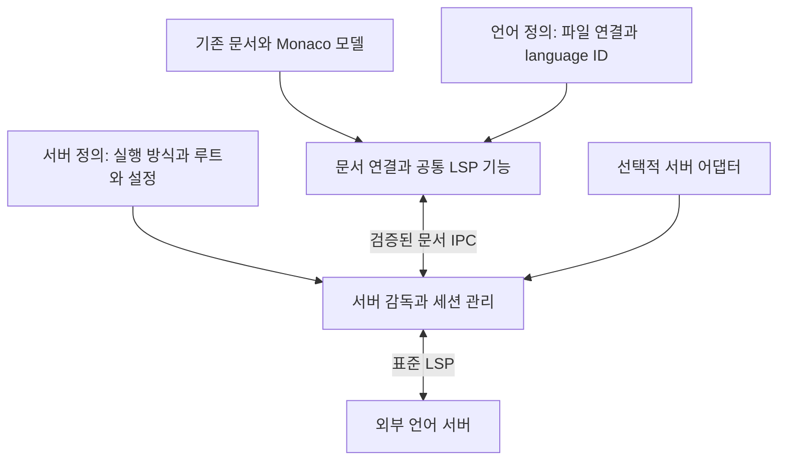

# Setdown 언어 지원 확장의 지속가능성 조사

작성: 2026-10-15. 분석 기준: `8831961d30c6ddec0cb47982d3228031b6765a3e`.

현재 Python/Pyright·C/C++/clangd 구현, 고정된 참조 서브모듈, 다른 편집기의 공식 문서와 공개 소스를 조사했다. 아래에서 **현재 동작**, **확장할 때 드러나는 제약**, **제안**을 구분한다. 새 서버 연결이나 성능 실험을 수행한 보고서는 아니다. 온라인 문서와 `main`/`master` 링크는 조사 시점의 내용이며, 로컬 참조의 정확한 커밋은 마지막에 기록했다.

## 1. 결론: 언어마다 남는 일은 있지만, 기능을 언어마다 구현하면 안 된다

**지금 구현을 폐기할 필요는 없다. 다만 세 번째 서버부터도 같은 방식으로 분기를 늘리는 것은 권하지 않는다.**

현재 Setdown은 이미 Python용 자동완성과 C++용 자동완성을 각각 작성하는 구조를 피했다. `LanguageClient`가 공통 Monaco provider를 등록하고, Pyright와 clangd가 분석을 담당한다. 이 중심 방향은 맞다. 문제는 파일 연결, 서버 실행, 루트 탐색, 설정과 명령에 두 서버를 전제로 한 분기가 흩어져 있다는 것이다.

다음 단계의 목표는 다음과 같아야 한다.

> 일반적인 서버 하나를 추가할 때는 서버 정의·기본 설정·실제 연결 검증을 추가한다. 공통 클라이언트와 편집기의 저장·Undo·IPC 구현은 수정하지 않는다. 새로운 LSP 기능이 필요하면 공통 기능으로 한 번 구현하고, 서버 전용 동작만 작은 어댑터로 격리한다.

이것이 언어별 작업을 없애지는 않는다. 실행 파일과 런타임, 프로젝트 설정, 특수 프로토콜, 버전별 동작을 확인하는 일은 남는다. 줄여야 할 것은 **같은 편집 기능을 반복 구현하는 비용과, 서버 하나의 변경이 제품 전체에 퍼지는 비용**이다.

Setdown에는 **Helix의 언어/서버 설정 분리, Neovim의 공통 클라이언트와 서버 설정 모음 분리, Sublime LSP의 설정 + 선택적 helper 구조**를 조합하는 것이 적합하다. VS Code의 전체 확장 플랫폼은 언어 수를 늘린다는 이유만으로 도입하기에는 책임 범위가 크다. 이 판단의 근거는 아래 비교와 현재 코드 분석에 있다.

## 2. 무엇을 ‘언어 지원’이라고 부르는지 먼저 나누어야 한다

| 층 | 하는 일 | Setdown의 현재 상태 | 언어가 추가될 때 필요한 일 |
| --- | --- | --- | --- |
| 문서·편집 | 텍스트, 경로, dirty, 저장, Undo, 여러 화면의 모델 공유 | 기존 문서 계층과 Monaco 모델이 소유 | 원칙적으로 변경 없음 |
| 문법 표시 | 언어 식별, 색상, 주석·괄호 등 | Monaco에 등록된 언어와 파일 판별 사용 | 파일 연결/문법이 없으면 별도 추가 |
| 의미 분석 | 타입, 정의, 참조, 진단 계산 | 외부 Pyright·clangd | 기존 서버 선택 및 프로젝트 환경 확인 |
| LSP 클라이언트 | 동기화, capability, 취소, 결과를 편집기 기능으로 변환 | Setdown 공통 클라이언트 + 공식 JSON-RPC | 지원하는 프로토콜 범위 안이면 재사용 |
| 서버 통합·배포 | 실행 파일, 인자, 환경, 루트, 설정, 설치/업데이트 | Pyright 번들, clangd 경로 선택 | 서버별 정의와 필요한 실행 어댑터 |

문법 색상이 나오는 것과 프로젝트의 타입을 이해하는 것은 다르다. 언어 서버가 있다고 문법 표시가 자동으로 설치되는 것도 아니다. 현재 [document-profile.ts](../apps/desktop/src/core/document/document-profile.ts)의 `documentLanguage()`는 등록된 Monaco 언어를 판별하고, [language-support.ts](../apps/desktop/src/core/document/language-support.ts)는 LSP 연결 가능 여부를 판별한다. 두 책임이 일부 결합되어 있지만 서로 대체 관계는 아니다.

실제로 [Monaco 초기화 코드](../apps/desktop/src/renderer/adapters/monaco-editor.ts)는 공통 editor worker를 연결한다. 이를 근거로 TypeScript 등의 전용 language worker나 VS Code 확장 기능까지 모두 작동한다고 간주할 수 없다. Monaco 자체도 VS Code 확장을 그대로 실행하는 환경이 아니라고 설명한다. [Monaco 공식 FAQ](https://github.com/microsoft/monaco-editor#faq)

따라서 ‘모든 언어 지원’은 너무 큰 약속이다. **문법 표시 가능**, **사용자 서버 연결 가능**, **특정 서버 버전으로 기본 기능 검증 완료**, **전용 고급 기능 지원**을 구분해야 유지할 수 있다.

## 3. 현재 Setdown: 좋은 공통 기반과 두 서버에 맞춘 부분

### 3.1 그대로 유지할 가치가 있는 구조

[language-client.ts](../apps/desktop/src/renderer/editor/language-client.ts)의 `installProviders()`는 서버 capability에 따라 completion, hover, signature help, definition, references, document symbols, rename을 연결한다. 여기에는 Python 전용 hover 구현이나 clangd 전용 completion 구현이 없다. `language-conversion.ts`도 공통 변환을 담당한다.

[language-manager.ts](../apps/desktop/src/main/language/language-manager.ts)는 창별 문서 소유권을 검사하고 서버 수명을 관리한다. [server-session.ts](../apps/desktop/src/main/language/server-session.ts)는 별도 자식 프로세스와 공식 `vscode-jsonrpc`를 사용한다. 분석 서버가 실패해도 일반 편집은 계속 가능하다.

다음 보장은 범용화 과정에서도 보존해야 한다.

- LSP 때문에 문서 모델을 새로 만들지 않는다. 기존 모델·Undo·dirty·저장 경로를 사용한다.
- Working Tree는 기존 문서 모델을 공유하고, 과거 revision의 읽기 전용 모델과 구분한다.
- Save As 때 LSP 문서 경로를 다시 연결하되 편집 모델과 Undo는 유지한다.
- 응답의 문서 버전, 연결 generation, 취소 여부를 검사한다.
- 다른 창의 미저장 내용을 같은 서버 문서에 덮어쓰지 않는다.
- 서버는 필요한 문서가 있을 때 시작하고, 마지막 문서·창·앱 종료 때 정리한다.
- renderer에 임의 실행 파일이나 임의 LSP method 실행 권한을 주지 않는다.

이 부분을 추상화라는 이름으로 다시 작성하면 회귀 비용이 크다. 이미 있는 책임 경계를 확장하는 편이 낫다.

### 3.2 언어를 추가할 때 수정이 번지는 지점

아래 위치는 분석 기준 커밋의 코드다. 이후에도 찾기 쉽도록 파일과 함수/타입 이름을 함께 기록한다.

| 위치 | 현재 전제 | 서버가 늘어날 때의 문제 |
| --- | --- | --- |
| [language-support.ts](../apps/desktop/src/core/document/language-support.ts), `LanguageServerKind`, `languageSupport()` | `'pyright' \| 'clangd'`, `'python' \| 'c' \| 'cpp'`, 확장자 분기 | 새 서버마다 공통 타입과 라우팅 함수 수정 |
| [server-definitions.ts](../apps/desktop/src/main/language/server-definitions.ts), `ServerProfile` | 이름·설정·watch 함수만 공통화 | 실행/루트/설정 경로가 프로필 밖에 남음 |
| 같은 파일, `standaloneLanguageRoot()` | clangd만 조상 marker 탐색 | 다른 프로젝트 체계를 조건문으로 추가하기 쉬움 |
| [language-manager.ts](../apps/desktop/src/main/language/language-manager.ts), `open()` | clangd이면 native 실행, 아니면 Pyright 실행 | 타입만 늘리면 새 서버가 잘못된 실행 경로로 빠질 수 있음 |
| [clangd-settings.ts](../apps/desktop/src/main/language/clangd-settings.ts) | clangd만 executable 저장·환경 변수 지원 | 서버마다 설정 저장소와 선택기를 만들게 됨 |
| [protocol/language.ts](../apps/desktop/src/protocol/language.ts), [preload/index.ts](../apps/desktop/src/preload/index.ts) | `chooseClangd()`, `language:choose-clangd` | 서버별 IPC 메서드 증가 |
| [monaco-editor.ts](../apps/desktop/src/renderer/adapters/monaco-editor.ts), `installBindings()` | Python/C/C++ precondition, clangd 전용 메뉴 | 새 언어마다 편집기 UI 어댑터 수정 |

`ServerProfile`이 이미 있다는 점은 좋은 출발점이다. 이 구조를 버리고 플러그인 프레임워크부터 만들기보다, **프로필 밖에 흩어진 서버별 지식을 한곳으로 모으는 작업**이 먼저다.

### 3.3 더 중요한 제약: 서버 목록만 JSON으로 옮기면 해결되지 않는다

현재 공통 클라이언트는 검증한 두 서버에 맞춘 제한된 LSP 구현이다. 다른 표준 서버와 연결될 때 확인해야 할 차이가 있다.

| 항목 | 현재 코드에서 확인한 동작 | 범용화할 때 필요한 처리 |
| --- | --- | --- |
| 문서 동기화 | 일반 편집은 incremental change를 전송. `textDocumentSync`에 따른 분기 없음 | 서버가 요청한 None/Full/Incremental 및 open/close 옵션 해석 |
| 저장 통지 | `didSave`를 text 없이 전송 | 서버의 save 등록과 `includeText` 해석. 실제 저장 snapshot과 이후 입력 구분 |
| push 진단 | `params.version === binding.version`일 때만 전달 | 버전이 선택 사항인 서버의 지원 정책을 명시 |
| 설정 요청 | `configuration[section] ?? {}` 반환, `scopeUri` 사용 안 함 | section 해석, 문서별 설정, 값 부재 시 응답 정책 |
| 초기화 설정 | 공통 initialize에 서버별 `initializationOptions` 없음 | 실행 인자·초기화 옵션·런타임 설정을 구분 |
| 문서 symbol | `DocumentSymbol[]`만 변환 | 합법적인 `SymbolInformation[]` 응답도 변환 |
| 동적 기능·감시 | 초기 capability 사용, 프로필의 고정 watcher | 필요할 때 registration/unregistration을 공통 구현. 미지원 기능은 광고하지 않음 |
| 진단 방식 | push 처리만 있음 | pull diagnostics가 필요한 서버를 지원하려면 별도 공통 기능 필요 |
| 여러 서버 | 모델 하나의 binding, `setdown-language` marker owner 하나 | 다중 서버를 켜기 전 결과 소유권과 기능 선택 규칙 필요 |

이는 두 서버의 현재 동작이 모두 잘못되었다는 뜻이 아니다. **검증된 두 서버의 가정과 범용 프로토콜 계약이 다르다**는 뜻이다. 예를 들어 저장된 경로를 변경한다고 모든 서버가 바로 호환되지는 않는다.

공식 클라이언트의 [textSynchronization.ts](../vendor/vscode-languageserver-node/client/src/common/textSynchronization.ts)는 서버의 sync 종류와 save 옵션을 읽어 처리한다. [diagnostic.ts](../vendor/vscode-languageserver-node/client/src/common/diagnostic.ts)는 pull 진단 상태를 별도로 관리한다. 우리가 재사용한 JSON-RPC 라이브러리는 이러한 편집기 차원의 LSP 동작까지 대신 구현하지 않는다.

규격과 대조해 확인한 근거는 다음과 같다.

- `didChange`의 여러 변경은 순서대로 적용하며, 기능 요청 전에 문서 상태를 동기화해야 한다. 현재 내림차순 offset 변환과 요청 전 큐 대기는 유지할 가치가 있다. [LSP 문서 변경 규격](https://github.com/microsoft/language-server-protocol/blob/gh-pages/_specifications/lsp/3.17/textDocument/didChange.md)
- push 진단의 `version`은 선택 사항이다. `versionSupport: true`는 서버가 반드시 버전을 보낸다는 보장이 아니다. [LSP 진단 규격](https://github.com/microsoft/language-server-protocol/blob/gh-pages/_specifications/lsp/3.17/language/publishDiagnostics.md)
- 문서 symbol은 계층형과 평면형을 모두 반환할 수 있다. [LSP document symbol 규격](https://github.com/microsoft/language-server-protocol/blob/gh-pages/_specifications/lsp/3.17/language/documentSymbol.md)
- 설정 요청은 section과 resource scope를 포함할 수 있고, 제공할 값이 없을 때는 `null`을 반환하도록 정한다. [LSP configuration 규격](https://github.com/microsoft/language-server-protocol/blob/gh-pages/_specifications/lsp/3.17/workspace/configuration.md)

### 3.4 진단 버전은 특히 정직하게 다뤄야 한다

현재 버전 없는 진단을 버리는 것은 오래된 오류 표시를 막기 위한 명시적인 선택이다. 범용화한다고 이 검사를 단순 삭제하거나, 수신한 진단에 현재 버전을 붙여서는 안 된다. **서버가 분석한 revision을 보내지 않으면 클라이언트는 그것을 확실하게 복원할 수 없다.** 큐를 비웠다는 사실이나 일정 시간 기다렸다는 사실도 증명이 되지 않는다.

권고는 다음과 같다.

1. Pyright·clangd의 기존 버전 검증은 유지한다.
2. pull 진단을 지원한다면 요청 당시 버전과 응답 시점을 묶고, 중간 편집이 있으면 폐기한다. 이것도 서버가 최신 동기화 내용을 분석한다는 전제에서 검증해야 한다.
3. 버전 없는 push만 제공하는 사용자 서버는 진단을 기본 비활성화하거나, 별도의 명시적인 best-effort 정책을 사용한다. 후자를 선택하면 정확한 revision 일치 보장이 없음을 지원 범위에 기록한다.
4. 진단에 버전이 없어도 completion·hover 등 사용 가능한 기능까지 모두 연결 실패로 처리하지 않는다.

여기는 ‘서버가 추가되면 그냥 작동한다’고 약속할 수 없는 경계다. 기존 보장을 낮추는 선택은 별도 제품 결정과 회귀 검증을 거쳐야 한다.

## 4. 다른 편집기들은 어떻게 풀었는가

### 4.1 VS Code: 확장 API와 확장 생태계가 언어 통합을 분담한다

VS Code의 LSP 연동은 보통 확장의 client가 서버를 시작하고 `vscode-languageclient`를 사용해 VS Code API에 기능을 연결하는 형태다. 언어 기능을 확장 API로 직접 등록하는 경로도 있다. 따라서 VS Code의 모든 언어 지원을 하나의 LSP 설정 파일로 설명하면 부정확하다. [공식 Language Server Extension Guide](https://code.visualstudio.com/api/language-extensions/language-server-extension-guide)

로컬의 [TypeScript languageProvider.ts](../vendor/vscode/extensions/typescript-language-features/src/languageProvider.ts)는 자동완성·정의·rename 등 provider 모듈을 등록하고 `TypeScriptServiceClient`를 전달한다. 해당 경로의 TypeScript 지원은 `tsserver`의 전용 API에 기반한다. 외부 편집기용 `typescript-language-server`는 이 계열 기능에 LSP 인터페이스를 제공하는 별도 프로젝트다. 조사한 README에는 native TypeScript 7 LSP로의 변화도 언급되어 있으므로, 장기 서버 선택을 과거 `tsserver` 구조에 고정해서는 안 된다. [TypeScript Language Server 설명](https://github.com/typescript-language-server/typescript-language-server#what-is-it-exactly)

**배울 점:** 언어 분석과 공통 편집기 기능의 계약을 분리하고, 언어별 통합의 책임을 확장 쪽에 둔다. **그대로 가져오기 어려운 점:** Setdown에는 VS Code extension host와 API 서비스가 없다. 확장 생태계의 이득은 그 호환성·설정·수명 관리의 비용과 함께 온다.

### 4.2 Sublime Text + LSP: 공통 패키지, 서버 설정, 필요한 경우 helper

여기서 분석한 것은 Sublime Text의 비공개 편집기 코어가 아니라 공개된 **LSP 패키지**다.

[LanguageServers.sublime-settings](../vendor/sublime-lsp/LanguageServers.sublime-settings)는 command, selector, settings, initialization options, 환경 변수 등을 정의한다. [ClientConfig](../vendor/sublime-lsp/plugin/core/types.py)는 이 정보를 다루고, [WindowConfigManager](../vendor/sublime-lsp/plugin/core/configurations.py)는 창·프로젝트별 설정을 합치고 해당 view와 매칭한다. 새 서버가 표준 설정으로 충분하면 공통 completion 구현을 수정할 이유가 없다.

설정만으로 부족하면 helper 패키지가 들어간다. 현재 고정한 [plugin/api.py](../vendor/sublime-lsp/plugin/api.py)에는 `LspPlugin`과 기존 `AbstractPlugin`이 모두 있다. `LspPlugin.on_pre_start_async()`는 서버 설치·경로 탐색·작업 디렉터리 같은 준비를 맡을 수 있다. 공식 문서도 설정만으로 연결하는 방식과 helper 패키지를 구분한다. [서버 설정](https://lsp.sublimetext.io/client_configuration/), [현재 helper API와 이전 API의 관계](https://lsp.sublimetext.io/migrating_to_lsp_plugin/)

**Setdown과 가장 가까운 교훈:** 작은 편집기에서도 공통 클라이언트를 유지하고, 선언형 설정으로 끝나지 않는 부분만 좁은 실행 코드로 보완할 수 있다. helper가 문서 저장과 Undo를 다시 소유하게 해서는 안 된다.

### 4.3 Neovim: 클라이언트, 서버 설정 모음, 설치 관리자를 분리한다

현재 Neovim 문서는 `vim.lsp.config()`로 설정을 정의하고 `vim.lsp.enable()`로 해당 파일에 자동 연결하도록 설명한다. `nvim-lspconfig`는 서버 설정 모음이며 서버를 설치하는 패키지가 아니다. 예전 `require('lspconfig').…setup()` 중심 설명과 현재 API를 구분해야 한다. [Neovim LSP 문서](https://neovim.io/doc/user/lsp), [nvim-lspconfig README](https://github.com/neovim/nvim-lspconfig)

설정 파일도 반드시 순수 데이터만 있는 것은 아니다. [clangd 설정](https://github.com/neovim/nvim-lspconfig/blob/master/lsp/clangd.lua)에는 실행·파일형식·루트와 함께 헤더 전환 등의 전용 연결이 있다. [jdtls 설정](https://github.com/neovim/nvim-lspconfig/blob/master/lsp/jdtls.lua)은 JVM 인자와 데이터 디렉터리 계산을 포함한다. 서버별 지식이 사라진 것이 아니라 모듈로 모였다.

클라이언트의 시작/재사용은 [Neovim core의 lsp.lua](https://github.com/neovim/neovim/blob/master/runtime/lua/vim/lsp.lua)가 담당한다. 설치를 편하게 하려면 Mason 같은 별도 도구를 사용할 수 있다. Mason은 전용 데이터 디렉터리에 패키지를 설치하고 실행 파일 경로를 제공하며, 필요한 경우 npm·cargo 같은 외부 도구를 이용한다. 즉 설치 편의성은 별도의 책임이다. [Mason 공식 README](https://github.com/mason-org/mason.nvim)

**Setdown에 적용할 점:** 서버 설치 성공, 서버를 찾음, LSP 초기화 성공, 문서 연결 성공을 서로 다른 상태로 다룬다. `Select clangd Executable`을 언어마다 복제하는 대신 공통 상태 조회·실행 파일 선택·재시작 기능을 만든다. Mason의 Lua 실행 환경 전체를 Electron에 이식할 필요는 없다.

### 4.4 Helix: 언어와 언어 서버를 따로 선언한다

Helix는 `languages.toml`에서 언어 정의와 서버 정의를 분리하고, 언어가 사용할 서버 목록을 지정한다. 서버에는 command, args, config 등의 정보가 있다. 기본값에 사용자·프로젝트 설정을 겹칠 수 있으며, 같은 서버를 여러 언어가 사용할 수 있다. [공식 언어 설정 문서](https://docs.helix-editor.com/languages.html), [실제 languages.toml](https://github.com/helix-editor/helix/blob/master/languages.toml)

공통 [helix-lsp Registry](https://github.com/helix-editor/helix/blob/master/helix-lsp/src/lib.rs)는 서버 이름과 인스턴스를 관리한다. 언어의 수와 프로세스의 수가 같은 개념이 아님을 코드에서도 확인할 수 있다.

또한 여러 서버를 붙일 경우 기능별 선택·결합 규칙이 있다. 설정 순서와 `only-features`/`except-features`를 사용하고, 일부 기능은 서버 하나를 선택하며 diagnostics·completion 등은 결과를 모은다. 이는 여러 서버의 provider를 무작정 모두 등록하는 것과 다르다. [기능별 서버 선택 규칙](https://docs.helix-editor.com/languages.html#configuring-language-servers-for-a-language)

**Setdown에 적용할 점:** `languageId → server 하나`를 영구적인 모델로 삼지 않는다. 다만 초기 실행은 primary server 하나로 제한해도 된다. 메타데이터에 배열을 둔다고 다중 서버 결과 결합까지 구현한 것은 아니다.

### 4.5 Zed: 선언형 정보와 실행 가능한 어댑터를 함께 둔다

Zed의 공식 언어 확장 문서는 언어 메타데이터·문법·queries·language server를 구분한다. 서버와 언어의 연결은 manifest에 적고, Rust 확장의 `language_server_command()`가 command·args·env를 반환한다. completion 표시 등을 보완하는 선택적 API도 제공한다. [Zed Language Extensions](https://zed.dev/docs/extensions/languages#language-servers)

**Setdown에 적용할 점:** 데이터로 표현되지 않는 부분을 인정하고 작은 어댑터 경계를 둔다. 여기서 얻을 것은 책임 분리다. 같은 목적을 위해 Setdown에 Rust 확장 런타임을 새로 넣어야 한다는 근거는 아니다.

### 4.6 비교에서 나온 공통 원리

| 편집기/구성 | 언어별 정보가 모이는 곳 | 공통으로 처리하는 곳 | Setdown에 필요한 부분 |
| --- | --- | --- | --- |
| VS Code | 언어 확장과 서버 client | 확장 API, 공식 LSP client, 편집기 서비스 | 기능 계약과 언어별 통합의 분리 |
| Sublime LSP | 서버 설정 + helper | LSP 패키지의 세션·버퍼·기능 구현 | 작은 제품에 맞는 확장 경계 |
| Neovim | 서버 config + 선택적 전용 모듈 | 내장 LSP client | 설정·실행·설치의 분리 |
| Helix | 언어/서버 TOML 정의 | 공통 LSP client와 registry | 선언형 서버 목록과 기능 선택 |
| Zed | manifest + 실행 어댑터 | 편집기 공통 LSP 계층 | 특수 서버 처리를 가두는 hook |

다섯 사례에서 얻는 결론은 ‘언어별 코드를 전혀 작성하지 않는다’가 아니다. **언어별 지식이 들어갈 자리를 정하고, 공통 프로토콜과 편집 동작을 그 밖으로 유지한다**는 것이다. 커뮤니티가 서버 설정을 보태기 쉽게 만드는 것도 이 분리 이후에 가능하다.

## 5. Setdown에 권하는 구조

### 5.1 작은 registry를 먼저 만든다

다음 그림은 제안이며 현재 구현 완료 상태가 아니다.



구조의 중심은 네 가지다.

1. **LanguageDefinition**: 파일 식별, Monaco 언어 ID, LSP language ID, 사용할 서버 참조. 서버 설치와 무관하게 문법 표시를 유지한다.
2. **ServerDefinition**: 서버 ID, 실행 방식, 루트 규칙, 초기화 옵션, 설정, 필요한 파일 감시 정보. serializable한 메타데이터를 기본으로 한다.
3. **공통 client/session**: 문서 동기화, capability, 취소, 진단 정책, provider 변환, 프로세스 수명. 언어 이름에 따라 분기하지 않는다.
4. **선택적 ServerAdapter**: 정의만으로 처리할 수 없는 실행 준비·특수 메시지·설정 변환. 당장은 제품이 관리하는 TypeScript 모듈로 충분하다.

등록 ID를 문자열로 바꾸는 것만으로 끝내지 않는다. main에서 registry 존재 여부와 정의의 schema를 검증한다. 코드 상수의 union이 제공하던 검증을 없애는 대신 데이터 경계에서 명시적으로 수행해야 한다.

### 5.2 현재 clangd를 표현한다면

다음은 **제안 스키마의 예시**다. 지금 Setdown이 읽는 설정 파일이 아니며, 그대로 저장해도 적용되지 않는다. 현재 제품의 `.h`·대문자 `.C` 정책과 standalone 루트 규칙을 보존하는 예다.

```json
{
  "schemaVersion": 1,
  "languages": [
    {
      "id": "c",
      "monacoLanguageId": "c",
      "lspLanguageId": "c",
      "files": { "extensions": [".c", ".h"] },
      "servers": ["clangd"]
    },
    {
      "id": "cpp",
      "monacoLanguageId": "cpp",
      "lspLanguageId": "cpp",
      "files": {
        "caseSensitiveExtensions": [".C"],
        "extensions": [".cc", ".cpp", ".cxx", ".c++", ".hh", ".hpp", ".hxx", ".h++", ".ipp", ".inl", ".tpp", ".ixx", ".cppm"]
      },
      "servers": ["clangd"]
    }
  ],
  "servers": {
    "clangd": {
      "displayName": "C/C++ (clangd)",
      "launch": {
        "kind": "native",
        "command": "clangd",
        "args": ["--background-index", "--pch-storage=disk", "-j=2", "--log=error"]
      },
      "root": {
        "preferOpenProject": true,
        "nearestMarkers": [".clangd", "compile_commands.json", "compile_flags.txt", ".git", "CMakeLists.txt"],
        "fallback": "fileDirectory"
      },
      "initializationOptions": {},
      "settings": {},
      "diagnosticsPolicy": "requireVersion"
    }
  }
}
```

대소문자를 구분하는 일치를 먼저 검사해야 `.C`를 C++로 처리하는 현재 동작이 보존된다. 구현할 때 이 우선순위를 schema 설명과 테스트에 포함한다. 파일 감시 규칙과 실행 파일의 사용자 지정값은 별도 항목으로 붙일 수 있다.

### 5.3 실행 방식과 예외 처리를 분리한다

Pyright의 `launch.kind`는 예를 들어 `bundledNode`, clangd는 `native`가 된다. 공통 launcher는 실행 방식을 해석하고, 특정 서버 ID를 보고 분기하지 않는다. Pyright의 ASAR 밖 배치는 이미 검증한 실행 경로를 해당 방식으로 옮긴다.

일반 서버는 실행 파일·인자·설정으로 충분하면 거기서 끝낸다. Java처럼 workspace용 데이터 디렉터리나 런타임 준비가 필요하면 어댑터를 사용한다. JDT LS 공식 README도 `-data`에 workspace별 정보를 저장한다고 설명한다. Setdown에서 도입한다면 같은 root라도 다른 창의 세션이 충돌하지 않도록 데이터 영역을 정해야 한다. [JDT LS 실행 방법](https://github.com/eclipse-jdtls/eclipse.jdt.ls#running-from-the-command-line)

어댑터에는 문서 모델 생성, 저장, Undo의 소유권을 주지 않는다. 예외 처리가 공통 문서 관리를 우회할 수 있으면 언어를 늘릴 때마다 검증 범위가 다시 커진다.

### 5.4 설정의 수명과 세션의 수명을 맞춘다

현재 서버 공유 키는 창 안에서 `server kind + root`다. 설정 가능한 서버를 늘린다면 같은 ID와 root라도 실행 파일·인자·초기화 옵션이 다른 세션을 같다고 취급해서는 안 된다.

제안하는 식별 기준은 개념적으로 다음과 같다.

```text
window owner + server ID + canonical root + launch/initialization fingerprint
```

fingerprint에는 정규화한 실행 경로, args, 실행에 영향을 주는 env, initialization options, 정의 revision 등을 포함한다. 환경 변수의 원문을 로그에 노출하기 위한 값은 아니다. 실행 때 고정되는 항목이 바뀌면 해당 세션을 다시 만들고, 변경 통지로 반영할 수 있는 settings는 공통 경로로 갱신한다. 구분이 불확실한 항목은 재시작하는 정책을 둘 수 있다.

루트 탐색도 가장 가까운 marker, 우선순위가 있는 marker 묶음, 명시한 프로젝트 root, 단독 파일의 fallback을 구분한다. 모든 언어를 가장 가까운 `.git`으로 통일하면 되는 문제가 아니다. 현재 Python/clangd의 기본 동작은 첫 이행에서 보존하고, 필요한 서버에 별도 루트 전략을 추가한다.

### 5.5 설정·설치는 공통 UX로 제공한다

`chooseClangd()`는 등록된 서버 ID를 받는 `chooseExecutable(serverId)`로 일반화할 수 있다. main이 ID를 검증하고 native chooser를 열어 사용자 설정에 저장한다. renderer가 임의의 command 문자열을 실행하는 API로 만들지 않는다.

초기 배포 방침은 현재 구현을 활용할 수 있다.

| 단계 | 방침 | 이점과 남는 책임 |
| --- | --- | --- |
| 처음 | Pyright는 기존 번들, native 서버는 PATH/선택한 경로 | registry와 프로토콜 정리에 집중. 서버 설치는 사용자 몫 |
| 다음 | 사용자 설정에서 서버 정의 추가 | 제품 출시를 기다리지 않고 연결 시도 가능. 검증된 서버와 구분 필요 |
| 필요해졌을 때 | 대상이 제한된 managed install | OS/CPU별 배포물, 버전 고정, 검증, 갱신 실패 시 복구를 설치 계층이 담당 |

사용자가 작성하는 서버 정의는 앱의 사용자 설정 영역에서 관리한다. 프로젝트 파일이 새로운 실행 명령을 조용히 추가하는 구조로 만들지는 않는다. 기존 서버 자체가 읽는 `.clangd` 등의 설정과는 별개의 경계다.

평소 화면은 늘리지 않고, command palette의 ‘Language Servers’에서 현재 문서의 서버, root, 실행 경로, 상태, 실패 이유를 확인하고 재시작·비활성화할 수 있으면 된다. 언어별로 별도 설정 창을 만들 필요가 없다.

## 6. 여러 언어 지원과 여러 서버 동시 사용은 다른 단계다

clangd 하나가 C/C++을 처리하듯 언어와 서버는 일대일이 아니다. 반대로 한 문서에 타입 분석 서버와 lint/format 서버를 함께 붙일 수도 있다.

현재 Setdown을 그대로 이중 연결하면 공통 marker owner에서 진단을 덮어쓰거나, completion이 중복되거나, 어느 rename을 사용할지 모호해질 수 있다. 먼저 다음 정책을 정해야 한다.

| 기능 | 향후 기본 정책 제안 |
| --- | --- |
| diagnostics | 세션별 owner로 유지. 서버가 빈 배열을 보내면 그 서버의 진단만 삭제 |
| completion | 우선 primary만 사용. 여러 서버를 켜려면 출처·순서·중복 처리 규칙 정의 |
| hover/definition/references | 사용할 서버의 우선순위와 여러 결과의 처리 방식 명시 |
| formatting | 사용자가 선택한 하나를 사용. 여러 formatter를 순차 실행하지 않음 |
| rename | 한 서버가 반환한 하나의 WorkspaceEdit로 검증·적용 |
| code actions | 구현 시 결과의 출처와 command 실행 대상 유지 |

이것은 후속 단계의 제안이다. **처음에는 한 문서에 primary 서버 하나를 연결하고, 언어와 서버 정의만 독립시키는 것**이 적절하다.

HTML의 script, Vue/Svelte, Markdown 코드 블록은 또 다른 문제다. 문서 일부를 가상 파일로 잘라 보내면 위치 변환과 workspace edit의 역변환까지 필요하다. Setdown이 직접 문서를 잘라 분석하는 체계를 만들기 전에 해당 문서를 처리하는 기존 서버를 활용해야 한다. 읽기용 Markdown에 LSP만을 위한 별도 편집 모델을 만드는 것은 이번 목표에 포함하지 않는다.

## 7. `monaco-languageclient`로 바꿔야 하는가

registry 도입과 client 라이브러리 선택은 별개다. registry가 있어도 자체 client의 프로토콜 차이는 남고, 성숙한 client를 쓰더라도 서버 실행·root·배포 정의는 필요하다.

현재 [MonacoLanguageClient](../vendor/monaco-languageclient/packages/client/src/index.ts)는 `vscode-languageclient/browser`의 `BaseLanguageClient`를 상속한다. 작은 클래스가 많은 기능을 제공하는 이유는 공식 client와 VS Code API 호환 서비스에 의존하기 때문이다. [설치 문서](../vendor/monaco-languageclient/docs/installation.md)에는 Monaco API 패키지의 alias가 있고, [설정 문서](../vendor/monaco-languageclient/docs/guides/configuration.md)는 classic/extended 모두 API wrapper를 먼저 시작하도록 설명한다.

이전 [설계·구현 보고서](2026_10_15_15_59_lsp_architecture_and_integration_strategy.md#2026-10-15-구현-결과-python부터-연결)에는 기존 모델을 만든 뒤 호환 서비스를 초기화하는 실험이 `Services are already initialized`로 실패한 기록이 있다. 이번에 재실행한 결과는 아니다. 또한 모델보다 먼저 서비스를 초기화하는 구성까지 불가능하다고 증명한 것도 아니다.

| 선택 | 얻는 것 | 맡게 되는 일 | 현재 판단 |
| --- | --- | --- | --- |
| 현행 client 정리와 지원 범위 명시 | 모델/Undo/지연 실행 보존이 용이 | 필요한 LSP 기능과 호환성 검증 | **바로 다음 단계로 권고** |
| `monaco-languageclient` + 최소 VS Code API 호환 계층 | 넓은 프로토콜 처리 재사용 | 공통 editor 초기화와 model/file/settings 서비스 접합 | 지원 범위가 넓어질 때 비교 후보 |
| VS Code 호환 확장 플랫폼 도입 | 확장에 구현된 언어 통합을 이용할 가능성 | 확장 host/API/설정/배포와 호환성 전체 | 현재 제품 목표보다 범위가 큼 |
| 언어별 provider 개별 구현 | 초기의 국소적인 구현 편의 | 기능마다 중복·동작 차이 증가 | 채택하지 않음 |

**자체 client를 영원히 키우겠다고 결정하는 것도 아니다.** 다음 상황에서는 라이브러리 이행의 비교 실험을 다시 시작한다.

- 서버를 추가할 때마다 dynamic registration·pull 진단·workspace edit 같은 공통 문제를 개별 수정한다.
- 공식 client의 큰 기능 모듈을 복사해 유지하기 시작한다.
- 사용자 요구가 넓은 code actions, 복잡한 refactoring, 가상 문서, 여러 서버로 확장된다.

다시 실험한다면 모델 생성 전에 서비스를 초기화하는 설계를 시험하고, 저장/Save As/Undo/Working Tree 공유/시작 비용을 채택 기준으로 삼는다. 기존 Monaco와 호환 계층에 두 개의 편집 가능한 모델을 유지하며 맞추는 방식은 피한다. 채택하지 않더라도 이유와 제한할 기능 범위를 갱신한다.

판단에 필요한 것은 언어의 개수뿐만 아니라 **부족한 공통 프로토콜 기능의 양과 접합 계층의 유지 비용을 비교하는 것**이다.

## 8. 유지 비용을 낮추는 구현 순서

### 단계 A: 현재 두 서버를 registry 경로로 옮긴다

주요 변경 대상은 `language-support.ts`, `server-definitions.ts`, launcher/settings, `LanguageManager`, 서버 선택 IPC, 공통 명령이다.

완료 조건은 Python/C/C++의 지원 범위와 편집 동작을 보존하면서 manager와 Monaco adapter에서 서버 이름에 따른 분기를 제거하는 것이다. `SETDOWN_CLANGD_PATH`와 기존 `clangd.json` 설정을 읽어 이어받는다. 설정 형식을 바꾼다는 이유로 사용자의 실행 경로를 잃어서는 안 된다.

이 단계에는 자동 설치, 여러 서버의 동시 연결, 범용 plugin SDK가 필요하지 않다. 작은 schema와 registry로 충분하다.

### 단계 B: 공통 client의 기본 호환성을 보완한다

기능 수보다 기본 연결 계약을 우선한다.

1. `textDocumentSync`의 숫자/옵션 형식, Full/Incremental, open/close/save를 정규화한다.
2. 서버별 initialization options와 section/scope별 configuration을 처리한다.
3. 버전 있음/없음/pull 진단의 정책을 정한다. 기존 버전 검증은 유지한다.
4. document symbol처럼 이미 제공하는 기능의 표준 응답 차이를 처리한다.
5. 연결 상태, stderr, 선택된 root/path, 제공 기능을 공통 경로에서 확인할 수 있게 한다.

dynamic registration, pull 진단, 추가 position encoding은 필요한 서버와 지원 범위에 따라 공통 기능으로 추가한다. 지원하지 않으면 capability를 광고하지 않는다. 모든 선택적 기능을 구현할 때까지 registry 도입을 미룰 필요도 없다.

### 단계 C: 세 번째 서버로 구조를 검증한다

Go/gopls나 Rust/rust-analyzer처럼 기존 native 서버를 후보로 삼을 수 있다. 어느 쪽인지는 사용자의 용도를 우선하고, 고정한 서버 버전의 요구를 확인해 결정한다. 이번 조사에서 해당 서버의 Setdown 연결 성공을 확인한 것은 아니다.

성공 기준은 다음과 같다.

- 기본 연결의 추가 변경이 언어/서버 정의, 필요한 서버 어댑터, fixture, 사용 설명에 모인다.
- 공통 LSP 기능의 부족을 발견하면 서버 이름으로 우회하지 않고 공통 client에서 해결한다.
- 실제 서버로 completion·hover·진단 정책·정의 이동·rename/Undo·재시작을 검증한다.
- **코어에 이름이 하드코딩되지 않은 fixture 서버도 새 정의를 등록하면 연결된다.** 등록 자체를 생략하거나 알 수 없는 ID를 허용한다는 뜻은 아니다.

세 번째 서버에서 core 변경이 한 줄이라도 있으면 실패라는 기준은 아니다. **처음 발견한 공통 기능 부족을 한 번 해결하고, 다음 서버에서 재구현하지 않는 것**이 중요하다.

### 단계 D: 수요에 맞춰 기능과 배포를 넓힌다

formatting과 code actions는 언어마다 구현하지 않고 기존 문서 편집 경로를 사용하는 공통 기능으로 추가한다. 여러 서버 동시 사용, managed installer, 특수 가상 URI는 각각 별도의 추가 판단으로 다룬다.

현재 공수 추정에 필요한 실측은 없으므로 일수나 효율 배수를 제시하지 않는다. 상대적으로는 정의 정리보다 프로토콜 호환성 보완, 그보다 공통 editor 초기화 교체가 더 넓은 회귀 검증을 요구한다.

## 9. 메모리·응답 시간·검증

언어 정의가 많아져도 모든 서버를 시작할 필요는 없다. 현재의 지연 연결과 창별 소유권을 유지한다. 다른 창의 같은 root를 하나의 서버로 합쳐 메모리를 줄이려면, 서로 다른 미저장 버퍼를 같은 URI로 보내는 문제부터 해결해야 한다.

여러 언어 서버의 메모리를 동일한 옵션으로 통제할 수 있다고 가정하지도 않는다. 현재 clangd의 `-j=2`와 disk preamble은 병렬 처리 등을 조절하는 설정이고 RAM 상한이 아니다. 세션 공유·종료 정책과 서버별 실제 설정을 구분한다.

우선 마지막 문서를 닫으면 서버를 종료하는 현재 정책을 보존한다. 닫은 문서를 곧 다시 열 때의 초기 색인 비용이 실제 문제로 측정되면 제한적인 idle 유지를 검토한다. 비활성 화면으로 전환했다는 이유만으로 미저장 문서의 분석 세션을 폐기하지 않는다.

검증은 ‘모든 언어 × 모든 UI 조작’의 중복을 줄이고 두 층으로 구성한다.

| 검증 층 | 대상 |
| --- | --- |
| 공통 client/문서 계약 | Full/Incremental, 저장 snapshot, CRLF/UTF-16/다중 cursor, 늦은 응답, 취소, 재시작, 이전 generation, 설정 scope, 모델 공유, Save As, rename과 Undo |
| 서버별 실제 연결 | 실행 파일 탐색, 런타임, 초기화, root, 설정, 대표 기능, 배포물에서의 실행, 버전 차이 |

fixture 서버로 프로토콜 차이를 재현하고, 실제 서버에서는 해당 통합의 고유한 문제를 확인한다. 설정 필드의 값만 검사하는 테스트로는 실행 파일이 시작되지 않거나 서버 응답이 다른 문제를 잡을 수 없다.

앞으로 측정할 항목은 서버 시작 전의 Markdown 이용 비용, 초기화·첫 분석, warm request, 취소 후 잔여 처리, 관련 문서를 닫은 뒤 PID/RSS, 여러 언어가 섞인 프로젝트에서 main의 응답성이다. 이번 조사에서는 새 성능 수치를 측정하지 않았다.

editor 초기화나 preview 관련 경로를 변경하는 단계에는 기존 [preview performance contract](../docs/preview-performance-contract.md)를 적용한다. `npm run test:preview-contract`, 해당 baseline 비교, first/second/warm 구분, 일반 Markdown과 Git review, 편집 유무, 준비 시간 포함/제외, focus/IME 검증을 유지한다. GUI는 격리한 Xvfb에서 실행하고 무거운 검증을 동시에 시작하지 않는다.

## 10. 어떤 참고 코드를 유지할 것인가

기존 참조만으로도 공통 client와 Monaco의 접합을 조사할 자료는 충분하다. 추가 참조의 가치는 서버 설정의 수가 늘었을 때를 보여주는 사례에 있다.

| 참조 | 읽을 곳 | 용도 |
| --- | --- | --- |
| 기존 `vscode-languageserver-node` | client/common의 동기화·진단·각 기능 | 프로토콜 처리와 차이를 검증하는 기준 |
| 기존 `sublime-lsp` | `ClientConfig`, configurations, `LspPlugin`, SessionBuffer | 설정과 작은 서버 어댑터의 경계 |
| 기존 `monaco-languageclient` | client 상속, API wrapper, 버전 정렬 | 재사용을 재평가할 때의 접합 범위 |
| 기존 `vscode` | 언어 확장, 문서/편집 service | 큰 플랫폼이 맡고 있는 책임 |
| 추가 참조 후보 `neovim/nvim-lspconfig` | `lsp/*.lua` | 서버별 root·실행·설정·예외의 실제 사례 |
| 추가 참조 후보 `helix-editor/helix` | `languages.toml`, `helix-lsp` | 선언형 registry와 여러 서버의 책임 분리 |

Mason의 registry도 향후 설치 관리 조사에는 유용하지만, 이번 registry 정리를 위해 패키지 관리자 전체를 도입할 필요는 없다. 참고 코드를 보유하는 것과 런타임 의존성 추가는 별개다. 이번에는 새 submodule을 추가하지 않았다.

로컬 참조의 고정 커밋:

| submodule | commit |
| --- | --- |
| `vendor/monaco-languageclient` | `c52125a809e5993509d53f10f5b478c989b18f5d` |
| `vendor/sublime-lsp` | `c65e2bc62882d876ec55035185ce63c51963f4ef` |
| `vendor/vscode` | `d3d31f62268b169a2dfab62ffb2d7d38158a5b7c` |
| `vendor/vscode-languageserver-node` | `b8c8db0b6a5c1a257d224cda3f0c21ce0a8a3203` |

이 vendor HEAD와 Setdown이 실제 사용하는 npm 런타임 의존성 버전은 별개다. 비교한 편집기를 모두 실행해 호환성을 측정한 것이 아니라, 소스와 공식 문서에서 책임 분담을 조사했다.

## 11. 채택할 판단

**다음 작업은 기존 두 서버를 범용 등록 경로로 옮기는 것이다.** 세 번째 언어를 추가할 때 이 경계를 검증한다.

Setdown이 유지할 중심은 문서와 편집 기능을 서버에 정확히 연결하는 공통 기반이다. 언어 분석은 기존 서버에 맡기고, 서버별 지식은 정의와 작은 어댑터에 모은다. 설정 가능한 범위와 검증한 범위를 구분하며, 넓은 프로토콜 지원이 필요해지면 성숙한 client를 재사용하는 이익을 다시 평가한다.

이번 변경은 본 보고서뿐이다. 제품 코드·의존성·설정·기존 성능 계약은 변경하지 않았고 런타임 테스트를 재실행하지 않았다.
