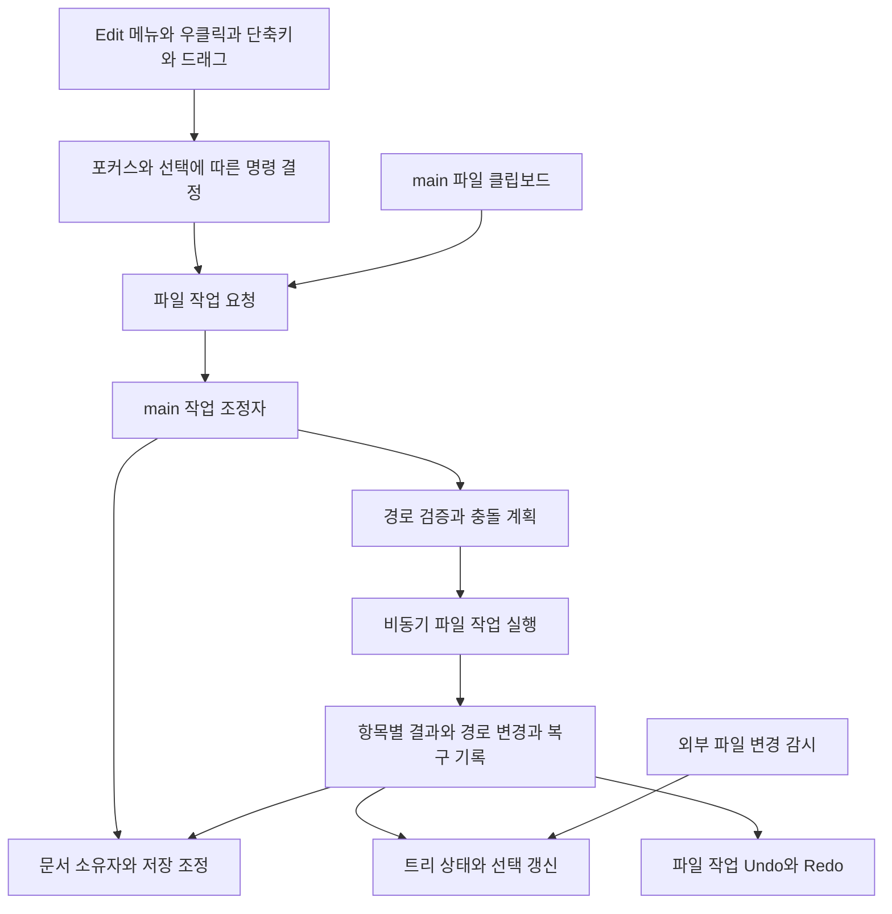

# Setdown 파일 탐색기 강화 설계와 구현 우선순위

작성일: 2026년 10월 15일

Setdown의 파일 탐색기를 일상적인 파일 작업에 충분한 수준으로 만들고, 이후 기능을 추가할 때 같은 예외 처리를 반복하지 않도록 하는 설계다. 현재 Setdown, 새로 등록한 Pulsar와 Dolphin, 기존 VS Code 참조의 파일 작업 코드를 비교했다.

**가장 먼저 구현할 것은 파일 복사·잘라내기·붙여넣기·복제다. 이 기능을 구현하면서 파일 작업의 결과, 문서 경로 변경, 선택 상태를 관리하는 공통 경로를 만들어야 한다.** 그 위에 충돌 처리, 실행 취소, 외부 파일 관리자와의 연동, 일괄 이름 변경을 올리는 것이 이득이다.

사용자가 지적한 병목은 타당하다. 작은 기능을 떠올리는 데에는 한계가 없지만, 기능마다 파일시스템·열린 문서·선택·클립보드·오류 처리를 따로 연결하면 하나를 추가할 때 확인해야 할 조합이 계속 늘어난다. 기능 목록과 함께 **각 기능이 완료되었다고 판단할 조건**을 관리해야 한다.

1–14절은 아래 고정 커밋에 대한 최초 설계와 정적 분석이다. 해당 절의 ‘현재’는 구현 전 상태를 의미한다. 이후 적용한 코드와 실제 검증 결과는 **15절 구현 기록**에 따로 정리한다.

## 1 구현 방향

Setdown에는 다음 조합이 적합하다.

- **Pulsar에서 조작의 세부사항을 가져온다.** 선택한 파일의 부모에 붙여넣기, 확장자를 제외한 이름 선택, 복제 이름, 활성 파일 찾기, 트리와 편집기 사이의 포커스, 다중 선택 우클릭 같은 규칙이다.
- **Dolphin에서 파일 작업의 수명과 결과 관리 방식을 가져온다.** 작업 객체, 실제 성공한 항목의 기록, 결과 도착 후 선택 복원, 잘라낸 항목 표시, 모델 변경에 따른 선택 보정이다.
- **VS Code에서 편집 중인 문서와 파일 작업의 연결을 확인한다.** 파일 이동은 디스크뿐 아니라 미저장 버퍼·Undo·문서 URI도 바꾸는 작업이다.
- **Setdown의 기존 탐색기와 문서 계층을 확장한다.** Svelte UI, Electron, `ProjectWatcher`, `TabController.relocatePath()`, 읽기 위치 저장소를 유지하고 책임이 섞인 부분을 분리한다.

목표는 지금의 좁은 Explorer 안에서 자주 하는 일이 자연스럽게 되는 것이다. 상시 버튼을 대량으로 늘릴 필요는 없다. 우클릭, 기존 Edit 메뉴, 익숙한 단축키, 작업이 진행될 때만 나타나는 상태 표시가 주된 진입점이다.

완성도를 평가할 기준도 정해야 한다. **메뉴에 Copy가 있는지보다, 여러 파일을 복사하다 충돌하거나 취소했을 때 무엇이 남는지 사용자가 알 수 있는지**가 더 중요하다. 아래의 기능 표는 구현 범위이고, 뒤의 동작 규칙과 검증 표는 완료 기준이다.

## 2 현재 Setdown에서 유지할 것과 빠진 것

### 2.1 이미 갖춘 기반

| 영역 | 현재 확인된 동작 | 근거 |
| --- | --- | --- |
| 트리 탐색 | 폴더를 펼칠 때 자식을 읽고, 펼친 경로를 저장한다. 디렉터리 우선 자연 정렬을 한다. | [SD1], [SD2], [SD4] |
| 선택 | Ctrl/Meta 토글, Shift 범위, Ctrl+A, 방향키, Home/End, 포커스와 선택의 부분 분리가 있다. | [SD1], [SD3] |
| 열기 | 단일 클릭으로 임시 탭, 더블클릭·가운데 클릭으로 고정 탭을 연다. 선택 파일을 여러 개 열 수도 있다. | [SD1], [SD9] |
| 생성과 이름 변경 | 인라인 입력으로 파일·폴더 생성과 단일 이름 변경을 한다. 실패한 이름은 수정할 수 있게 입력을 남긴다. | [SD1], [SD2], [SD4] |
| 이동 | 여러 항목 드래그 이동, 부모·자식 중복 제거, 자기 하위로 이동 금지, 충돌 사전 검사가 있다. | [SD3], [SD4] |
| 부분 실패 | `moveMany()`는 성공한 `moves`와 오류를 함께 반환한다. 성공한 경로만 문서에 반영할 수 있다. | [SD4] |
| 휴지통 | 시스템 휴지통을 사용한다. 미저장 문서에 저장·버리기·취소 절차가 있다. | [SD2], [SD4], [SD8] |
| 경로 복사 | 여러 파일의 절대 경로·프로젝트 상대 경로를 텍스트로 복사할 수 있다. | [SD1] |
| 문서 연동 | 이동한 폴더 아래의 열린 문서 경로도 갱신한다. main에서 읽기 위치 저장 경로를 변경한다. | [SD6], [SD8] |
| 감시 | 창별 재귀 `@parcel/watcher` 구독과 generation 검사가 있다. renderer는 120ms debounce 후 갱신한다. | [SD5] |
| 실제 화면 검증 | 다중 선택, dirty 파일 드래그, 충돌 시 원본 유지, 탭 영역 드롭, native 미리보기 위 우클릭·이름 변경 포커스 검증이 있다. | [SD9] |

이 기반을 폐기할 이유는 없다. 특히 `moveMany()`의 **성공한 경로를 명시적으로 반환하는 방식**은 일반 파일 작업 결과로 확장할 가치가 있다.

### 2.2 복붙이 없는 직접적인 이유

파일 내용이나 경로 문자열을 복사하는 것과 파일 자체를 복사하는 것은 별도 기능이다.

현재 `ExplorerView.svelte`의 `copy()`는 `navigator.clipboard.writeText()`로 경로만 쓴다. `ExplorerService`에는 `create`, `rename`, `move`, `moveMany`, `trashEntry`가 있고 복사 메서드는 없다. IPC와 preload에도 파일 클립보드·복사·붙여넣기 계약이 없다. [SD1], [SD4], [SD6]

더 중요한 연결 지점은 **기존 Edit 메뉴**다. `application-menu.ts`의 Copy/Cut/Paste/Undo는 창의 `webContents.copy()/cut()/paste()/undo()`를 직접 호출한다. 탐색기에서 선택한 파일은 이 경로가 다루는 편집 대상이 아니다. 따라서 Explorer의 `keydown`에 Ctrl+C/V만 추가해서는 메뉴 클릭과 native accelerator까지 일관되게 해결했다고 볼 수 없다. [SD7]

필요한 것은 다음 세 가지를 한 번에 연결하는 작업이다.

1. 포커스에 따라 텍스트 편집 명령과 파일 명령을 구분한다.
2. main이 파일 목록과 copy/cut 의도를 관리한다.
3. 붙여넣기와 드래그·복제가 같은 파일 작업 서비스를 사용한다.

### 2.3 현재 코드에서 드러나는 구조적 빈틈

아래 항목은 코드 경로에서 확인한 제약 또는 재현 검증이 필요한 실패 가능성이다.

| 문제 | 코드상 원인 | 기능을 늘리기 전에 필요한 조치 |
| --- | --- | --- |
| 삭제 실패 때 탭이 먼저 사라질 수 있음 | `ExplorerController.trash()`가 `prepareRemove()`를 먼저 호출하고, 이 함수가 탭을 닫은 다음 `shell.trashItem()`을 실행한다. | 미저장 처리와 탭 종료를 나눈다. 실제 삭제 성공 후 종료하고 실패 시 문서를 유지한다. |
| 이름 변경 후 선택·포커스의 경로가 오래됨 | `submitEdit()`는 입력만 닫는다. controller는 expanded와 문서 경로를 바꾸지만 View의 `selection`, `focused`, `anchor`를 바꾸지 않는다. | 하나의 경로 변경 결과를 트리 상태에도 적용한다. 새 정렬 위치까지 보이게 한다. |
| Explorer에서 다른 사이드바로 갔다 돌아오면 선택을 잃음 | `ProjectSidebar`가 뷰를 조건부 생성한다. 선택과 focused는 `ExplorerView`의 지역 상태이고 저장 대상은 expanded 등뿐이다. | 선택·포커스·스크롤을 프로젝트별 상태로 옮긴다. |
| 작은 변경에도 펼친 폴더를 전부 다시 읽음 | watcher는 원래 변경 목록을 사용하지 않고 `{ root }`만 보낸다. `reload()`는 자식 캐시를 비우고 루트와 expanded를 순서대로 읽는다. | 변경된 부모 디렉터리만 무효화하고 기존 목록을 유지하면서 교체한다. |
| 늦은 읽기 결과의 역전 가능성 | `ExplorerController.load()`에는 루트 generation이나 요청 revision 검사가 없다. watcher 쪽 generation만으로 renderer의 겹친 읽기는 해결되지 않는다. | 루트·디렉터리별 요청 세대를 검증한다. |
| 성공한 작업의 상태 동기화가 창 내부에 한정됨 | 경로 변경 결과는 호출한 renderer의 `relocatePath()`로 전달된다. 다른 창에는 일반 폴더 변경 알림만 있다. | 명시적 Setdown 파일 작업의 경로 변경을 관련 창에 방송하고 문서 소유자에게 반영한다. |
| 링크가 통째로 보이지 않음 | `readDirectory()`가 모든 symbolic link를 제거한다. | 링크 자체와 링크 대상의 정체성을 나눈 후 표시·조작을 지원한다. 필터만 제거하면 안 된다. |
| 이동이 다른 파일시스템을 건너지 못함 | 실행이 `fs.rename()`에 한정돼 있고 `EXDEV` 대체 경로가 없다. | 복사 완료 후 원본 삭제라는 별도 단계와 실패 결과를 설계한다. |
| 충돌이 작업 전체 중단으로 끝남 | 같은 이름이 있으면 `ensureMissing()`에서 오류가 난다. | 건너뛰기·둘 다 유지·명시적 교체를 선택할 수 있게 한다. |
| 충돌 사전 검사가 실행 순간까지의 보장은 아님 | `lstat`으로 부재 확인 후 `rename`한다. 그 사이 다른 작업이 대상을 만들 수 있다. | 실행 순간의 덮어쓰기 정책을 adapter가 보장해야 한다. 앱 내부 직렬화만으로 외부 프로세스와의 경쟁까지 막았다고 하지 않는다. |
| 모든 펼친 항목을 DOM으로 만듦 | 평탄화한 `project.entries` 전체에 Svelte `{#each}`를 사용한다. 선택 판정도 배열 검색에 의존한다. | 가상화와 membership index를 준비한다. 현재 대규모 성능을 측정한 것은 아니다. |

경로 처리도 범위 확장 전에 정리해야 한다. `ProjectPaths.inside()`는 `canonicalPath()`를 사용하고, 기존 경로는 `realpathSync()`로 링크를 따라간다. 파일을 여는 데 필요한 실제 대상 경로와 링크 자체를 이름 변경·휴지통 처리할 경로를 같은 값으로 취급하면 안 된다. 새 경로는 실제 경로가 아직 없으므로 기존 부모의 경계 검사도 필요하다. 또한 `isInside()`의 `relative.startsWith('..')`는 정상 이름인 `..notes`도 거부하는 과도한 검사다. [SD10]

이 문제들은 복사와 링크 지원을 막는 근거가 아니라, 현재의 단순한 경로 모델을 어디까지 확장해야 하는지 보여주는 근거다.

## 3 Pulsar에서 배울 것

### 3.1 조작 규칙이 축적된 파일 트리

Pulsar의 `packages/tree-view`는 Setdown과 가장 직접적으로 비교할 수 있는 참조다. 다음을 코드에서 확인했다.

| 동작 | 구현과 참고점 | Setdown 적용 |
| --- | --- | --- |
| 명령의 공통 진입점 | `tree-view.js`에서 명령을 등록하고 keymap·context menu가 같은 명령 이름을 사용한다. | 메뉴·단축키·우클릭의 실행/활성화 조건 공유 |
| 붙여넣기 위치 | `pasteEntries()`가 파일 선택이면 그 부모, 폴더 선택이면 해당 폴더를 대상으로 삼는다. | 현재 `createParent()`와 유사한 공통 대상 결정 함수 |
| 복제 이름 | `copyEntry()`가 충돌 시 숫자를 붙이며 확장자를 유지한다. | Copy/Paste와 Duplicate가 같은 이름 생성 정책 사용 |
| 이름 부분 선택 | `Dialog`가 basename과 확장자를 계산해 초기 선택 범위를 정한다. | F2에서 확장자를 실수로 지우지 않게 함 |
| 대소문자만 변경 | `MoveDialog.isNewPathValid()`가 파일의 dev/ino와 이름을 비교한다. | 파일시스템의 대소문자 규칙에 맞게 처리 |
| 활성 파일 찾기 | `revealActiveFile()`이 조상 폴더를 펼치며, `show`, `focus`를 구분한다. | 편집기 포커스를 빼앗지 않는 reveal |
| 분할 열기 | 같은 파일 열기 동작을 좌·우·상·하 pane 명령으로 노출한다. | Setdown의 기존 editor group을 활용 |
| 상태 복원 | 선택, 확장 상태, 스크롤을 serialize한다. 스크롤은 표시 가능한 시점에 복원한다. | 사이드바 전환·새로고침에도 문맥 유지 |
| 삭제 실패 | 성공·실패 이벤트를 구분하고 실패 경로를 모아 보여준다. | 파일별 결과 표시와 성공 후 탭 닫기 |
| 드래그 | 내부/OS 드롭을 구분하고 modifier에 따라 copy/move를 정한다. | 모든 입력을 동일한 파일 작업 요청으로 변환 |

근거: [PS1]–[PS5].

Pulsar의 테스트도 기능 목록만큼 중요하다. `tree-view-spec.js`는 복원된 스크롤, 루트 갱신 후 선택, 다중 선택을 유지하는 우클릭을 검사한다. 큰 `tree-view-package-spec.js`에는 자기 하위·자기 자신을 가리키는 링크로 붙여넣기 금지, 링크 자체 이동, 프로젝트 외부 경로, 사라진 복사 원본 등의 경우가 들어 있다. **함수만 참고하기보다 그 함수 주변의 실패 사례를 함께 옮기는 편이 더 유용하다.** [PS6]

### 3.2 그대로 가져오면 안 되는 부분

Pulsar의 파일 Copy/Cut은 시스템 클립보드가 아니라 `localStorage['tree-view:copyPath']`, `cutPath`에 경로를 기록한다. 경로 문자열 복사는 별도로 `atom.clipboard`를 사용한다. 이 구현만 이식하면 Setdown 내부에서는 붙여넣기가 되어도 Dolphin에서 복사한 파일을 붙여넣는 데까지 연결되지 않는다. [PS1]

또한 트리 코드에 `copySync`, `copyFileSync`, `moveSync`, `readdirSync`가 있고 UI와 파일 작업이 강하게 결합돼 있다. Setdown에는 이 실행 위치를 그대로 옮기지 않는다. UI는 요청하고 main의 작업 서비스가 비동기적으로 실행해야 한다.

Pulsar의 `getFullExtension()`은 첫 번째 점 이후를 모두 확장자로 본다. `.gitconfig`는 예외로 다루지만 `report.v2.md`의 `.v2.md`까지 확장자가 된다. Setdown에서는 `.tar.gz`처럼 합리적인 복합 확장자와 일반 이름의 점을 구분하는 작은 정책이 필요하다. 행동을 참고한다는 것이 구현상의 모든 선택을 답습한다는 뜻은 아니다. [PS2], [PS5], [PS6]

## 4 Dolphin에서 배울 것

### 4.1 화면과 파일 작업을 분리한다

`DolphinView::copySelectedItems()`와 `moveSelectedItems()`는 직접 파일을 순회해 복사하지 않는다. `KIO::copy()/move()`로 job을 만들고 결과·생성된 항목·경고에 연결한다. `KIO::FileUndoManager::recordCopyJob()`에 같은 job을 기록한다. 복제도 `copyAs()`와 자동 이름 변경을 사용한다. [DF1]

따라서 **Dolphin 저장소만 있으면 모든 파일 작업 엔진을 갖춘 것은 아니다.** 실제 전송·충돌·Undo의 상당 부분은 별도 KDE Frameworks인 KIO가 담당한다. 공식 API도 CopyJob의 copy/move/link, 자동 이름 변경·건너뛰기·기존 폴더 처리, FileUndoManager의 비동기 Undo/Redo와 작업 기록을 명시한다. [KIO CopyJob](https://api.kde.org/kio-copyjob.html), [KIO FileUndoManager](https://api.kde.org/kio-fileundomanager.html)

Setdown에서 KIO를 직접 사용할 수도 있지만, Qt/KDE 의존성, 배포, 별도 UI 연결을 함께 책임져야 한다. 지금은 **로컬 파일에 한정한 공통 작업 계약을 만들고 Node/Electron을 뒤에 두는 방향**을 권한다. 기존 코드와 가깝고, 필요한 경우 나중에 플랫폼 adapter를 교체할 수 있다. 네트워크 파일시스템·휴지통 복원까지 직접 넓히기로 결정할 때 KIO 기반 helper를 별도로 평가할 수 있다.

### 4.2 복사 완료와 화면 반영 완료를 구분한다

`slotJobResult()`는 오류를 표시하고 새 항목을 선택한다. 그러나 디렉터리 모델이 아직 항목을 받지 못했으면 `directoryLoadingCompleted`를 기다린 뒤 `onDirectoryLoadingCompletedAfterJob()`에서 다시 화면 상태를 맞춘다. [DF1]

이것은 Setdown에 특히 중요하다. 파일 작업 IPC 완료와 watcher 통지, 비동기 디렉터리 읽기는 서로 다른 시점이다. `await copy()` 직후 현재 DOM에서 파일을 찾아 선택하는 방식은 불안정하다. **선택할 경로를 상태로 보관하고, 해당 경로가 모델에 나타났을 때 선택·스크롤을 적용해야 한다.** 사용자가 그 사이 다른 곳을 선택했다면 이전 작업이 새 선택을 빼앗지 않도록 사용자 조작 세대도 확인한다.

### 4.3 작은 기능을 지탱하는 독립된 상태

| Dolphin의 구성 | 의미 | Setdown에 필요한 대응 |
| --- | --- | --- |
| `KItemListSelectionManager` | 현재 항목, 선택 집합, 범위 기준점을 따로 관리하며 삽입·삭제·이동에 보정한다. | DOM 밖의 선택 상태와 일관된 갱신 함수 |
| `KFileItemClipboard` | 시스템 클립보드 변화에 따라 잘라낸 URL 집합을 갱신한다. | 잘라낸 항목의 흐린 표시와 클립보드 교체 시 해제 |
| `scrollToItemOnceResorted()` | 이름 변경으로 정렬 위치가 달라진 다음 항목을 화면에 보이게 한다. | rename 후 새 경로 선택과 스크롤 복원 |
| `KItemListKeyboardSearchManager` | 입력 간격과 반복 글자를 고려해 이름으로 이동한다. | 별도 검색창 없이 파일명 앞부분을 타이핑해 이동 |
| `KFileItemModelFilter` | 일반 문자열·glob·정규식과 MIME 필터를 모델에 적용한다. | 처음에는 단순 파일명 필터, 고급 필터는 이후 확장 |
| `KItemListController` | 드래그 대상 변경 시 타이머를 정리하고 지연 후 폴더를 펼친다. | hover 확장·취소와 정확한 drop 대상 |
| `KItemListView` | 보이는 항목 widget을 재사용하며 자동 스크롤을 처리한다. | 큰 트리의 가상화와 드래그 가장자리 스크롤 |

근거: [DF2]–[DF7].

Dolphin의 인라인 이름 변경 테스트는 **다른 창으로 포커스가 옮겨가는 경우**, **메뉴가 포커스를 가져가는 경우**, **같은 창 안에서 다른 항목으로 이동하는 경우**를 구별한다. Setdown도 blur 한 번에 저장·취소를 결정하면 IME나 메뉴 사용 중 입력을 잃기 쉽다. 이미 native overlay와 포커스 검증이 있는 만큼 그 경로를 확장해야 한다. [DF8], [SD9]

## 5 구현할 기능 목록

총 44개 항목이다. 우선순위는 **P0 기본 사용에 필수**, **P1 일상 작업의 신뢰성과 효율**, **P2 대규모·고급 사용**, **P3 제품 특화 확장**으로 나눈다. 현재 상태의 ‘없음’은 해당 Explorer 경로에 없다는 뜻이다. 다른 화면에 있는 기능을 앱 전체에서 없다고 판단한 것이 아니다.

### 5.1 파일 조작

| ID | 기능 | 현재 | 우선순위 | 구현 완료 조건과 참조 |
| --- | --- | --- | --- | --- |
| A01 | 파일·폴더 복사와 붙여넣기 | 없음 | P0 | 다중 선택, 빈 폴더, 바이너리, 동일 폴더 복제가 동작. 파일이면 부모에 붙여넣음. [PS1], [VC1] |
| A02 | 잘라내기와 붙여넣기 | 없음 | P0 | Cut 시 디스크 변경 없음. 성공한 항목만 cut 집합에서 제거. Esc 취소와 흐린 표시. [PS1], [DF2] |
| A03 | Duplicate | 없음 | P0 | 클립보드를 바꾸지 않고 같은 부모에 복제. 확장자 유지, 반복 실행 시 충돌 없는 이름. [PS1], [DF1] |
| A04 | 메뉴·단축키·우클릭 통일 | 없음 | P0 | 세 경로가 같은 대상·활성화 조건·작업 결과 사용. 인라인 텍스트 편집은 예외. [SD7], [PS3] |
| A05 | 이름 충돌 선택 | 오류만 있음 | P0/P1 | P0에서 둘 다 유지·건너뛰기·취소. P1에서 복구 가능한 명시적 파일 교체. [DF1], [VC1] |
| A06 | 파일 작업 Undo/Redo | 없음 | P1 | Rename/Move/Create/Copy부터 지원. 실제 성공 결과에 역작업 기록. 변경된 대상은 재검사. [DF1], [VC2] |
| A07 | 진행·취소·실패 목록·재시도 | 일부 오류 문자열 | P0/P1 | P0부터 성공/실패/미실행 구별. P1에서 진행·취소 UI, 실패 항목만 재시도. [DF1] |
| A08 | 다른 파일시스템으로 이동 | 없음 | P1 | `EXDEV`에서 복사 완료 검증 후 삭제. 원본 삭제 실패를 양쪽 존재 상태로 보고. |
| A09 | 외부 파일 관리자와 복붙 | 없음 | P1 | Dolphin 등 실제 파일 관리자와 양방향 파일 전송. 앱 내부 클립보드와 구별해 검증. [DF2] |
| A10 | 폴더 합치기 | 없음 | P2 | 파일 충돌과 폴더 병합을 구분. 내부 항목별 성공·건너뜀·실패 기록. [PS1] |
| A11 | 인라인 이름 변경 개선 | 기본만 있음 | P0/P1 | basename 선택, IME 중 Enter 무시, 확장자/숨김 변화, Tab 연속 이름 변경, 오류 위치 표시. [PS2], [DF1], [DF8] |
| A12 | 경로를 입력해 중첩 생성 | 없음 | P1 | `notes/week1/idea.md` 생성. 기존 부모 보존, 실패·Undo 시 이번에 만든 빈 부모만 정리. [PS2] |
| A13 | 일괄 이름 변경 | 없음 | P2 | 변경 전후 미리보기, 번호·치환, 중복·이름 교환 감지, 하나의 작업으로 실행 취소. [DF1] |
| A14 | 링크 표시와 링크 자체 조작 | 제외됨 | P1 | 깨진 링크도 보임. copy/move/trash는 링크 자체 처리. 링크 대상 자동 재귀 복사 없음. [PS4], [SD10] |

### 5.2 탐색과 선택

| ID | 기능 | 현재 | 우선순위 | 구현 완료 조건과 참조 |
| --- | --- | --- | --- | --- |
| B01 | 선택·포커스·스크롤 유지 | expanded 중심 | P0 | 갱신·이름 변경·사이드바 전환 후 같은 문맥 유지. 사라진 항목은 다음/이전/부모로 보정. [PS6], [DF3] |
| B02 | 활성 파일 Reveal | 없음 | P1 | 탭 메뉴·Explorer 메뉴에서 현재 파일의 조상 확장. 자동 reveal은 편집기 포커스 유지. [PS1] |
| B03 | 파일명 타이핑 이동 | 없음 | P1 | 반복 문자 순환·입력 시간 간격·한글 조합 구분. 숨은 항목을 잘못 선택하지 않음. [DF5] |
| B04 | 파일명 필터 | 없음 | P1 | 필요한 때만 입력 표시, 일치 경로의 조상 표시, 해제 시 기존 확장·선택 복원. [DF6] |
| B05 | 숨김·무시 파일 보기 | 고정 정책 | P1 | dotfile, VCS 내부, gitignore, 사용자 exclude를 구분. `.env`는 현재도 보이는 상태임. [PS4], [VC3] |
| B06 | 정렬 선택 | 폴더 우선 이름 정렬 | P1 | 이름·타입·수정 시각, 오름/내림, 프로젝트별 기억. 시각 정렬의 stat 비용 관리. [DF4], [VC3] |
| B07 | PageUp/Down와 메뉴 키보드 탐색 | 일부만 있음 | P1 | 트리 페이지 이동, Shift+F10, 메뉴 방향키·Esc·포커스 복귀, 적절한 ARIA 계층. [PS3], [DF3] |
| B08 | 재귀 접기·펼치기 | 전체 접기만 있음 | P2 | 선택 폴더 아래만 처리, 중단 가능, 큰 폴더에서 무제한 읽기 금지. [PS1] |
| B09 | 한 자식 폴더 경로 압축 | 없음 | P2 | 압축된 각 경로 구간의 클릭·rename·drop 대상을 구분. [PS4], [VC3] |
| B10 | 파일 중첩 표시 | 없음 | P2 | 소스·생성물 또는 문서·보조파일을 규칙으로 묶음. 표시상 중첩과 실제 폴더 자식을 구분. [VC3] |

### 5.3 드래그와 기존 도구 연결

| ID | 기능 | 현재 | 우선순위 | 구현 완료 조건과 참조 |
| --- | --- | --- | --- | --- |
| C01 | modifier로 드래그 복사 | 이동만 | P1 | 커서 효과와 실제 동작 일치. Cut/Paste와 동일한 작업 엔진. [PS1] |
| C02 | 드래그 hover 폴더 확장 | 없음 | P1 | 대상 이탈·Esc·드롭 후 타이머 정리. 선택·편집기 포커스를 바꾸지 않음. [DF7] |
| C03 | 드래그 가장자리 자동 스크롤 | 없음 | P1 | 끝에서 멈춤, 포인터가 나가면 정지, 빠른 스크롤 중 drop 대상 정확. [DF7] |
| C04 | 외부 파일 드롭과 내보내기 | 트리 내 이동만 | P1/P2 | 외부→트리는 파일 복사, 탭→열기를 구분. 밖으로 드래그는 OS 전송 경로로 구현. [PS1], [DF7] |
| C05 | 시스템 파일 관리자에서 보기 | Explorer에 없음 | P0 | 현재 선택을 시스템 파일 관리자에서 찾음. 기존 Electron 기능 사용. [PS3] |
| C06 | 선택 폴더에서 터미널 열기 | Explorer에 없음 | P1 | 기존 Terminal 세션을 `cwd`로 시작. 문자열 `cd` 명령 조합 불필요. [SD11] |
| C07 | 분할·다른 그룹·새 창에서 열기 | 일부 탭 동작만 | P1 | 기존 editor group과 임시/고정 탭 규칙 재사용. [PS1], [PS3] |
| C08 | 외부 앱으로 열기와 정보 보기 | Explorer에 없음 | P1/P2 | 미지원 파일도 명시적으로 열기. 크기·수정 시각·종류·링크 대상 정보는 요청 시 조회. [DF4] |

### 5.4 일관성과 성능

| ID | 기능 | 현재 | 우선순위 | 구현 완료 조건과 참조 |
| --- | --- | --- | --- | --- |
| D01 | 변경 폴더만 갱신 | 전체 재조회 | P0/P1 | watcher 변경 경로 전달, 겹친 요청 병합, 실패한 폴더만 재시도. [SD5] |
| D02 | 오래된 응답 무효화 | renderer에 없음 | P0 | 다른 루트·최신 디렉터리 결과를 늦은 응답이 덮지 못함. [SD2] |
| D03 | 큰 트리 가상화 | 없음 | P2 | 화면 크기에 비례한 행 수. 포커스·인라인 편집·드롭·접근성 유지. [DF7] |
| D04 | 항목별 Git·dirty 표시 | 별도 SCM에 있음 | P1 | 기존 상태를 재사용. 행마다 Git 실행 금지. 색만으로 상태를 전달하지 않음. [SD12], [PS4] |
| D05 | 여러 창의 파일 작업 동기화 | 트리 감시만 | P1 | 이동 결과를 모든 소유 문서에 적용. 다른 창의 dirty 파일도 삭제·교체 전에 보호. [SD5], [SD8] |
| D06 | 작업과 자동 저장의 순서 보장 | 별도 흐름 | P0/P1 | 이동 중 옛 경로에 저장하거나 교체 중 dirty 버퍼로 다시 덮지 않음. [SD8], [SD13] |
| D07 | 중단된 작업의 복구 기록 | 없음 | P2 | 앱 종료·비정상 중단 후 완료/미완료/복구 가능 상태를 재검사. 무조건 자동 재실행하지 않음. |

### 5.5 Setdown의 문서 작업에 특화할 기능

| ID | 기능 | 현재 | 우선순위 | 적용 방향 |
| --- | --- | --- | --- | --- |
| E01 | 선택 문서들 나란히 읽기 | 기존 분할 기반 | P2 | 선택한 Markdown/PDF/텍스트를 기존 그룹에 배치. 대량 일괄 로딩은 제한. |
| E02 | Markdown과 참조 자산 함께 복제 | 일반 Explorer에 없음 | P3 | 일반 Copy와 별도 명령. 참조 이미지·상대 링크를 분석하고 범위를 미리 보여줌. |
| E03 | 파일 이동 시 문서 링크 갱신 | 없음 | P3 | 변경될 참조를 미리 제시하고 선택 적용. 경로 변경과 텍스트 수정의 Undo를 연결. |
| E04 | 선택 파일 비교·폴더 범위 검색 | 도구 일부 있음 | P2 | 기존 비교·검색 기능으로 연결하되 문서 종류와 검색 범위를 명시. |
| E05 | 문서 템플릿으로 새 파일 | 없음 | P2 | 반복 작성하는 노트·문서 템플릿을 New File에 연결. 실행 스크립트 없는 데이터부터 시작. |

P3까지 당장 착수할 필요는 없다. P0와 P1이 자연스럽게 작동하면 현재 체감 부족의 상당 부분을 해결한다. ‘VS Code 이상’은 모든 설정을 동일하게 갖춘다는 선언보다, **문서·브라우저·PDF가 함께 있는 작업 공간에서도 파일 조작이 문맥을 보존한다**는 목표로 구체화하는 것이 좋다.

## 6 확장을 위한 구조

### 6.1 공통 흐름



이 구조를 위해 범용 플러그인 프레임워크나 원격 파일시스템부터 만들 필요는 없다. 다음 책임을 기존 코드에 분명히 배치하면 된다.

| 책임 | 위치 제안 | 기존 코드와 관계 |
| --- | --- | --- |
| 파일 명령과 활성 조건 | `renderer/project/explorer/explorer-commands.ts` | `ExplorerView`의 핸들러가 명령을 호출. application menu도 같은 문맥 사용 |
| 트리의 지속 상태 | `renderer/project/explorer/explorer-state.svelte.ts` | 선택·focus·anchor·scroll·edit 상태를 View 밖으로 이동. `ExplorerController`의 캐시와 협력 |
| 작업 타입과 이벤트 | `protocol/file-operations.ts` | 기존 per-method IPC를 한 번에 없애지 않고 결과 타입부터 공유 |
| 작업 계획·실행·기록 | `main/project/file-operations/` | 현재 `ExplorerService`의 변경 작업을 점진적으로 이동. 디렉터리 읽기는 별도 유지 |
| 파일 클립보드 | `main/project/file-clipboard.ts` | 앱 창 사이 공유와 OS 클립보드 변환. renderer에 raw 파일 권한을 추가하지 않음 |
| 문서 변경 연계 | 기존 `tab-controller.ts`, 문서 main 계층, IPC | `relocatePath`·읽기 위치·모델 재연결을 재사용. 준비와 성공 후 반영을 분리 |
| 변경 감시 | 기존 `ProjectWatcher`와 `ProjectController` | 원래 변경 경로를 전달하고 캐시를 부분 무효화 |

첫 구현에서 이 디렉터리의 모든 파일을 미리 만들 필요도 없다. **복사·이동이 실제로 공유하는 책임부터 추출한다.** 충돌 정책을 바꾸는 데 `ExplorerView`, menu, drag handler, backend를 각각 고쳐야 한다면 분리가 부족한 것이다.

### 6.2 요청과 결과를 분리한다

요청에는 사용자 의도인 copy/move/rename/create/trash, 원본 목록, 대상, 호출 창, 요청 ID가 들어간다. main은 현재 프로젝트 경계와 파일 상태를 검증하고 실행 계획을 만든다. renderer가 미리 계산한 `validated: true` 같은 값을 신뢰하지 않는다.

결과에는 다음 정보가 필요하다.

| 정보 | 쓰임 |
| --- | --- |
| `operationId`, 소유 창, 요청 순서 | 중복 실행 방지, 상태 조회, 다른 창과의 연결 |
| 항목별 `completed / skipped / failed / notStarted` | 부분 성공·취소·재시도 표시 |
| 실제 `from`, `to`, 동작 종류 | 탭·읽기 위치·선택·cut 집합 갱신 |
| 실패 코드와 설명 | 권한 없음, 디스크 공간 부족, 원본 없음, 충돌 등을 구분 |
| 완료된 단계 | 다른 볼륨 이동의 ‘복사 완료, 원본 삭제 실패’ 구분 |
| 복구 가능성 | Undo 가능, 조건부 가능, 불가능을 UI에 정확히 표시 |
| 변경된 디렉터리 목록 | 전체 Explorer 재조회 방지 |

작업 전체 상태는 `queued → planning → running → completed`를 기본으로 하고, `awaitingDecision`, `canceling`, `canceled`, `partial`, `failed`를 구별한다. **Cancel은 남은 실행을 멈추는 것이고 Undo는 이미 끝난 결과를 되돌리는 것이다.** 취소를 눌렀다고 모든 파일이 자동 원복됐다고 표시하지 않는다.

현재 `moveMany()` 결과를 이 계약으로 넓히면 된다. 단순한 Promise의 성공/예외만으로는 폴더 복사·일괄 작업을 충분히 표현할 수 없다.

### 6.3 문서 변경을 작업의 일부로 다룬다

파일 작업 전 준비는 영향받는 문서 목록과 revision, dirty 결정, 진행 중 저장을 확인한다. 이때 문서를 닫거나 버리지 않는다. 영향을 받는 경로의 저장을 일시 조정하고, 이미 시작된 저장은 완료 여부를 확인한 뒤 이동한다.

성공한 경로만 `relocatePath()`·읽기 위치·언어 연결에 반영한다. 삭제된 파일의 탭은 성공 결과를 받은 뒤 닫는다. 실패한 파일의 탭·dirty 내용·Undo·읽기 위치는 남긴다. 작업 도중 다시 편집된 revision을 이전 확인 결과로 버리지 않도록 검증한다.

다른 창에도 같은 파일이 열려 있으면 그 창 역시 문서 소유자다. 새 파일의 단순 복사는 다른 창의 버퍼를 바꿀 필요가 없지만, 이동·삭제·교체는 창 사이 조정이 필요하다. 이 단계가 없으면 ‘앱 창 사이 Cut/Paste 지원’까지 완료했다고 볼 수 없다.

Setdown이 수행한 move는 명확한 `from → to`를 방송할 수 있다. 외부 프로그램의 unlink/create 이벤트를 이름이 비슷하다는 이유로 rename으로 추정해서는 안 된다. 불확실한 외부 변경은 디스크 상태 변경으로 처리한다.

### 6.4 실행 순서와 창 종료

초기 구현에서는 앱이 수행하는 파일 변경 작업을 main의 한 큐로 직렬화한다. 이후 병렬성이 실제로 필요해질 때 겹치는 원본·대상 경로만 잠그는 방식으로 넓힌다. 문서 저장은 별도 큐이므로 파일 작업 큐를 만들었다고 자동으로 직렬화되는 것은 아니다. 같은 경로의 저장과 파일 작업이 참여하는 조정 경계가 필요하다.

계획 단계에서는 원본과 대상 상태를 기록하고, 충돌 대화상자에서 돌아온 뒤 실행 직전에 다시 검증한다. 이미 처리된 요청 ID가 재전송되면 동일 작업의 상태를 반환한다. 전체 작업의 진행 상태와 실제 완료 항목 기록은 분리해, 화면 progress 통지를 줄여도 결과 기록을 잃지 않게 한다.

소유 창이 사라지면 그 창에서 결정을 기다리던 작업은 남은 실행을 취소한다. 진행 중인 파일 I/O는 지원되는 경계에서 멈추고 결과를 main에 남긴다. 앱 종료 중 완료 여부가 불명확한 단계를 성공으로 기록하지 않는다. 재시작 후 복구까지 지원하는 D07에서는 실행 전 의도와 실행 후 결과를 디스크에 남기고 실제 경로를 대조해야 한다. 최초의 메모리 내 작업 목록만으로 crash 복구를 제공했다고 간주하지 않는다.

## 7 복붙의 구체적인 동작 규칙

### 7.1 대상과 내용

- 폴더 하나를 선택했으면 그 폴더 안에 붙여넣는다. 파일 하나면 그 부모, 빈 영역·루트 메뉴면 프로젝트 루트다.
- 여러 항목이 선택된 상태에서 여러 폴더에 동시에 붙여넣지 않는다. 포커스된 항목의 폴더 문맥을 한 곳으로 결정하고 메뉴에 대상 이름을 보여준다. 문맥을 정할 수 없으면 Paste를 비활성화한다.
- 폴더와 그 하위 파일이 함께 선택됐으면 최상위 선택만 작업한다. 현재 `topLevelPaths()` 규칙을 main에서도 검증한다.
- 파일 Copy는 저장된 디스크 내용을 복사한다. 미저장 버퍼를 복사본에 몰래 섞지 않는다. 현재 편집 내용을 다른 문서로 만들려면 기존 Save As 또는 별도 명령을 사용한다.
- 같은 부모에 Copy/Paste하면 복제한다. 같은 부모에 Cut/Paste하면 파일 변경 없는 결과로 처리한다.
- Rename과 Move는 미저장 텍스트와 Monaco Undo를 유지한다. 복사본은 새 파일이며 원본의 편집 히스토리를 공유하지 않는다.
- 성공한 복사본을 선택하되 수십 개의 새 탭을 자동으로 열지 않는다. 문서 열기는 기존 Enter·클릭 규칙을 따른다.

P0에서 링크 자체 조작 UI를 아직 제공하지 않더라도, 폴더 복사 중 발견한 링크의 처리 정책은 필요하다. 링크를 그대로 복제할 수 있는 adapter이면 보존하고, 지원하지 않는 종류는 해당 항목을 명시적으로 실패 처리한다. 링크를 몰래 따라가거나, 누락한 채 폴더 전체 복사 성공으로 표시하지 않는다. 특수 파일도 지원 여부를 판별해 동일하게 처리한다.

### 7.2 클립보드

P0에서는 main의 파일 클립보드와 현재 시스템 클립보드의 소유 토큰을 연결한다. 내용은 operation, source paths, generation으로 관리하고, 일반 텍스트를 새로 복사했으면 과거의 파일 Cut 상태가 다시 살아나지 않아야 한다. 앱 재시작 뒤 예전 `localStorage`의 cut 경로를 그대로 실행하지 않는다.

P1에서는 플랫폼 파일 클립보드로 연결한다. Dolphin은 URL MIME 데이터와 cut 표시를 사용하고 클립보드 변경 신호를 구독한다. Setdown도 내부 데이터만 저장하는 구현과 OS 상호운용을 구분해야 한다. [DF1], [DF2]

프로젝트가 고정한 Electron은 44.7.2다. 해당 버전의 공식 clipboard 문서는 main의 비동기 `read()/write()`와 MIME·raw OS 형식을 설명한다. 구현은 이 버전의 API와 타입을 기준으로 하고, 오래된 동기 `readBuffer/writeBuffer` 예제를 그대로 가져오지 않는다. 형식을 쓸 수 있다는 것만으로 Dolphin·Windows Explorer와의 파일 복붙 호환성이 검증되는 것은 아니다. [Electron 44.7.2 clipboard](https://raw.githubusercontent.com/electron/electron/v44.7.2/docs/api/clipboard.md)

외부 원본은 현재 `ProjectPaths.inside()`가 허용하는 범위 밖에 있을 수 있다. 이를 위해 모든 IPC의 프로젝트 제한을 해제하지 않는다. main이 OS 클립보드·드롭·파일 선택에서 받은 항목을 특정 작업에 허용하는 경로를 추가한다. 단순 텍스트에 적힌 `/home/...`를 파일 Cut 요청으로 해석하지 않는다.

P0의 앱 내부 복붙과 P1의 OS 복붙은 각각 출시 가능한 단위지만, 사용자에게 ‘시스템 파일 복붙 지원’이라고 안내할 시점은 실제 OS 연동까지 완료한 뒤다.

### 7.3 충돌과 실행

충돌 결정은 실행 전에 가능한 범위에서 모아 보여주되, 실제 쓰기 순간에도 검사해야 한다. 기본은 기존 파일 보존이다. 같은 폴더의 복제는 `name copy.ext`, `name copy 2.ext`처럼 예측 가능한 이름을 사용한다. 이 명명 방식은 Setdown 제안이며 특정 upstream의 문자열을 그대로 재현하려는 요구는 아니다.

첫 단계에서는 둘 다 유지·건너뛰기·취소를 제공하고, 기존 파일 교체는 이전 내용을 복구할 수 있는 구조와 함께 추가한다. 폴더 병합은 같은 이름의 파일 교체와 별도 기능으로 다룬다. ‘모두 적용’은 동일 작업 내의 같은 종류 충돌에만 적용한다.

복사는 비동기 파일 I/O와 제한된 동시 실행으로 처리한다. 취소 가능한 청크 복사 또는 항목 경계 취소를 구분하고 UI에서 가능한 취소 단위를 정확히 표현한다. 큰 파일 전체를 메모리로 읽거나 renderer에 전송하지 않는다. 복사 중 원본이 바뀌면 완료 전 메타데이터를 다시 확인하고 재시도·실패로 알린다. 엄격한 파일시스템 snapshot을 제공한다고 약속하지 않는다.

원자적인 덮어쓰기 금지 이동은 플랫폼별 실행 기능 확인이 필요한 지점이다. `ensureMissing()` 재호출과 main 큐는 앱 내부 충돌을 줄이지만 외부 생성과의 경쟁까지 해결하지 않는다. adapter에 이를 명시하고, 보장할 수 없는 경로는 기존 대상이 생기면 중단하는 정책과 검증을 갖춘다.

## 8 Undo와 휴지통의 범위

파일 작업 Undo는 `fs.rename(to, from)` 몇 줄로 끝나지 않는다. 복사 후 복사본을 사용자가 고쳤거나, 원래 이름에 다른 파일이 생겼거나, 폴더 안에 새 파일이 추가됐을 수 있다.

| 작업 | Undo 방식 제안 | 다시 확인할 조건 |
| --- | --- | --- |
| Rename/동일 볼륨 Move | 완료된 경로를 반대로 이동 | 현재 파일의 정체성, 옛 경로 점유, 열린 문서와 저장 |
| Create | 이번 작업이 만든 항목 제거 | 파일 내용 변경 여부, 폴더가 비었는지 |
| Copy/Duplicate | 생성한 복사본 제거 | 복사 후 편집·추가된 파일 여부. 변경됐으면 확인 또는 거부 |
| Replace | 보관한 이전 대상으로 복원 | 현재 대상의 변경과 백업 사용 가능 여부 |
| 다른 볼륨 Move | 원본 복구와 대상 정리 단계 | 원본/대상 중 무엇이 남았는지, 추가 변경 여부 |
| Trash | OS 복원 기능이나 별도 복구 계층 필요 | 실제 복원 식별자·위치·동명이인 처리 |

기록에는 요청 당시 경로뿐 아니라 **성공한 단계와 생성·변경된 항목의 증거**가 필요하다. mtime/size만으로 완전한 정체성을 보장하지 않는다. 일반 파일의 식별 정보와 필요한 경우 내용 검증, 폴더의 이후 변경을 함께 고려하고, 애매하면 파괴적인 역작업을 자동 실행하지 않는다. 디스크 백업은 용량 상한과 정리 정책을 가져야 한다.

현재 사용하는 Electron `shell.trashItem()`은 성공 시 `Promise<void>`를 반환한다. 휴지통 이동과 Setdown의 Undo 복원은 별도 과제다. 초기에는 **생성·이름 변경·이동·복사의 Undo**를 완성하고, 휴지통은 시스템에서 복원할 수 있다는 현재 안내를 유지한다. 복원 토큰이 없는 상태에서 Delete Undo까지 지원한다고 표시하면 안 된다. [Electron shell](https://www.electronjs.org/docs/latest/api/shell#shelltrashitempath)

Undo의 단축키도 포커스 범위에 따라 나눈다. Explorer에서는 파일 작업, Monaco에서는 텍스트 작업, 이름 입력 중에는 입력 텍스트의 Undo가 우선이다. 메뉴를 열기 직전의 대상도 기억해야 한다. 여러 창의 파일 작업 히스토리는 작업 소유 창과 관련 경로를 기록해 이름과 범위를 보여주고, 다른 창에서 수행한 작업이 조용히 되돌아가는 동작을 피한다.

## 9 탐색기 상태와 성능

### 9.1 DOM 수명과 사용자 상태를 분리한다

현재의 `selection.paths`, `anchor`, `focused`는 좋은 출발점이다. 이를 다음 상태로 확장한다.

- 선택 집합과 범위 기준점.
- 키보드 포커스 경로와 활성 문서 경로. 둘은 다를 수 있다.
- expanded 경로 집합.
- 맨 위에 보이는 항목과 그 항목 안의 scroll offset.
- 인라인 편집 대상·입력값·오류·composition 여부.
- 사용자 조작 generation과 작업 후 선택할 경로.

새 목록이 도착하면 기존 상태를 목록에 맞춰 reconcile한다. rename은 경로 매핑으로 상태를 옮기고, 삭제는 남은 이웃이나 부모를 선택한다. 외부 파일 하나가 추가됐다는 이유로 현재 다중 선택이나 이름 입력을 지우지 않는다. 자동 Reveal은 사용자가 복사할 파일을 고르는 중에는 선택을 덮어쓰지 않도록 억제한다.

### 9.2 감시 데이터와 화면 갱신을 분리한다

`@parcel/watcher` callback의 변경 경로를 `ProjectFilesChanged`에 담는다. renderer는 변경된 부모 디렉터리만 다시 읽고, 닫힌 폴더는 stale 표시만 남겨 펼칠 때 읽는다. 탐색기에 보이는 항목의 삭제·이동은 선택 보정에 반영한다.

모든 변경을 끝없이 합치거나 요청마다 모두 취소하면 갱신이 영원히 밀릴 수 있다. 짧은 debounce에 최대 대기시간을 두고, 이미 읽는 디렉터리는 완료 뒤 한 번 더 갱신하는 방식으로 합친다. 경로 정보가 불완전한 overflow/복구 상황은 전체 재스캔으로 돌아갈 수 있어야 한다.

현재 watcher는 `node_modules`를 제외하지만 Explorer는 그 폴더를 표시한다. **표시 필터와 감시 제외를 같은 의미로 취급하면 안 된다.** 감시 제외 폴더를 사용자가 열었을 때 수동 갱신 또는 별도 제한된 구독 정책이 필요하다. Git ignore, 사용자 표시 제외, 검색 제외도 목적에 맞게 분리한다. [SD4], [SD5]

### 9.3 큰 트리를 지원하는 순서

먼저 전체 재조회와 stale 응답을 줄이고, 선택 membership을 `Set` 등으로 관리한다. 그다음 가상화를 넣는다. 가상화 때문에 선택 데이터가 보이는 DOM에만 한정되거나, 편집 중인 행이 스크롤과 함께 사라지면 실패다.

크기·수정 시각·Git 상태는 처음에 모든 파일을 stat하고 계산하는 방식 대신 요청한 정렬/표시와 가시 범위에 따라 구한다. 장시간 작업의 progress 이벤트도 묶어서 전달한다. `await fs.*`를 쓴다는 사실만으로 main과 renderer의 응답성이 보장되는 것은 아니다. 대량 메타데이터 처리·정렬이 병목이면 해당 부분을 worker로 옮긴다.

새 성능 기준은 1천/1만/10만 항목의 폴더와 깊은 트리로 먼저 측정하고 결정한다. 냉시작·재방문, 메모리·행 수, 입력 지연, watch 폭주를 따로 기록한다. 측정 없이 ‘Dolphin 수준’이나 ‘가상화하면 해결’이라고 단정하지 않는다.

## 10 화면에 적용할 방식

기본 우클릭 메뉴는 다음 정도로 시작한다. 선택 종류와 개수에 따라 불가능한 항목을 숨기거나 비활성화한다.

```text
Open / Open to the Side
New File / New Folder                 폴더 문맥
────────────────────
Cut                 Ctrl+X
Copy                Ctrl+C
Paste into …        Ctrl+V
Duplicate
Rename              F2
Move to Trash       Delete
────────────────────
Copy Path / Copy Relative Path
Reveal in File Manager
Open in Terminal
```

macOS를 지원하는 빌드에서는 Cmd를 사용하되, 이번 우선 검증 대상은 현재 사용 환경인 Linux다. 플랫폼별 동작은 검증된 범위만 지원 표에 표시한다.

Explorer의 기존 `…`에는 Refresh, Collapse, Sort, Filter, 표시 옵션을 둔다. 단축키만 외워야 사용할 수 있는 구조로 만들지 않는다. 붙여넣기 대상 이름, 잘라낸 항목의 표시, 진행 중인 항목 수만으로도 사용자는 동작을 이해할 수 있다.

충돌은 그때 나타나는 작은 대화상자로 다루고, 오래 걸리는 작업은 Explorer 하단의 접을 수 있는 상태 영역에서 진행·취소·실패 상세를 제공한다. 빠른 작업마다 완료 모달을 띄우지 않는다.

새 메뉴가 브라우저/Markdown native view 위로 나오는 경우 기존 `NativeOverlay`의 가림·복원 경로를 따른다. 이미 테스트가 있는 창·뷰 정체성 보존과 포커스 복귀를 유지해야 한다. 메뉴 선택 때문에 옆의 동영상이 멈추거나 이름 입력 중 포커스를 잃는 회귀는 허용하지 않는다. [SD9]

## 11 단계별 구현 묶음

### 첫 번째 묶음은 복붙을 실제로 쓸 수 있게 한다

**목표:** 같은 프로젝트 안에서 파일·폴더 Copy/Cut/Paste/Duplicate가 메뉴·단축키·우클릭으로 일관되게 동작한다.

함께 구현할 것은 파일 작업 결과 타입, 최소 main 조정자, 상태별 명령 라우팅, 선택 상태의 View 밖 이동, 실패 전 탭을 닫지 않는 삭제 순서다. 기존 이동도 같은 결과 반영 경로에 연결한다. 생성·이름 변경 입력의 basename 선택과 IME 처리, 시스템 파일 관리자에서 보기를 포함한다.

이 단계에서 복구 가능한 교체·폴더 병합·원격 파일 시스템까지 만들지 않는다. 대신 첫 API부터 성공/실패 항목과 Undo 지원 여부를 표현한다. 복사 기능을 내놓기 전에 거대한 프레임워크를 완성하느라 시간을 쓰지 않도록 범위를 제한한다.

### 두 번째 묶음은 파일 작업을 믿고 쓸 수 있게 한다

**목표:** Undo/Redo, 충돌 해결, 진행/취소, OS 파일 복붙, 창 사이 문서 갱신이 하나의 작업 모델 위에서 동작한다.

다른 볼륨 이동, 링크 자체 처리, 기존 파일 교체의 복구, dirty 대상 보호를 이 단계에 연결한다. copy/move/trash의 파일시스템 adapter와 clipboard adapter는 플랫폼별 능력을 명시한다. 앱 내부 복붙만 성공한 상태를 OS 연동 완료로 취급하지 않는다.

### 세 번째 묶음은 탐색 비용을 줄인다

**목표:** 활성 파일 찾기, 타이핑 이동, 필터·정렬, Git 표시, 터미널 연결, 드래그 hover 확장·자동 스크롤을 제공한다.

watcher의 경로별 무효화와 요청 세대 검증은 첫 묶음부터 시작하고 여기서 완성한다. 새 기능은 같은 command와 tree state를 사용한다. 활성 문서가 바뀔 때 자동 reveal이 다중 선택을 깨뜨리는지 등 기능 사이의 충돌을 확인한다.

### 네 번째 묶음은 큰 프로젝트와 반복 작업을 다룬다

**목표:** 가상화, 중단 복구 기록, 일괄 이름 변경, 압축 폴더·파일 중첩, 문서 전용 작업을 검증된 단위로 추가한다.

이름 교환 `a → b`, `b → a`는 임시 이름 단계를 포함하는 실행 계획이 필요하다. 일괄 rename의 미리보기와 실행이 같은 계획을 사용해야 한다. Markdown 상대 링크 수정은 파일 rename과 별도의 콘텐츠 편집이며, 사용자에게 변경 목록을 보여준 뒤 적용하는 기능으로 취급한다.

각 묶음의 완료 여부는 기능 수가 아니라 아래 검증을 통과했는지로 결정한다. 기본 기능의 구현을 고급 확장과 같은 출시 단위로 묶지 않는다.

공수는 메뉴 항목 수와 비례하지 않는다. 상대적인 난도를 다음처럼 보는 것이 현실적이다.

| 범위 | 상대 공수 | 이유 |
| --- | --- | --- |
| 시스템 파일 관리자에서 보기, basename 선택, 기존 터미널·분할 열기 연결 | 작음 | 기존 기능에 대상과 명령을 연결하는 작업 |
| 앱 내부 Copy/Cut/Paste, 선택 지속, Reveal, 필터·정렬, hover 확장 | 중간 | UI와 모델·작업 결과의 연결 및 상호작용 검증 필요 |
| 충돌 교체와 Undo, OS 클립보드, 다른 볼륨 이동, 여러 창 조정 | 큼 | 실패·복구·플랫폼·미저장 문서가 결합됨 |
| 폴더 병합, crash 복구, 일괄 rename의 이름 교환, 문서 링크 갱신 | 큼 | 여러 단계의 결과와 역작업을 일관되게 기록해야 함 |

작은 기능을 먼저 추가해 사용성을 개선하면서, 큰 항목은 동일한 작업 계약 아래에서 단계별로 완성한다. 일정 숫자는 플랫폼별 실험 전에는 정하지 않는다.

## 12 검증 계획

### 12.1 파일시스템과 문서 상태

| 시나리오 | 확인할 결과 |
| --- | --- |
| 파일·빈 폴더·중첩 폴더·바이너리 복사 | 내용 일치, 정해진 mode/mtime 보존, 원본 불변. ACL·확장 속성 보존은 별도 지원 범위 |
| 동일 폴더 반복 붙여넣기 | 기존 내용 보존, 충돌 없는 이름, 복합 확장자와 dotfile 처리 |
| 부모+자식 선택 | 한 번만 복사·이동·삭제 |
| 대상 파일이 실행 직전에 생김 | 원하지 않은 덮어쓰기 없음 |
| 디스크 공간·권한·원본 소멸 오류 | 성공/실패/미실행 목록이 실제 디스크와 일치 |
| 다른 볼륨 이동 중 원본 삭제 실패 | 양쪽 존재 상태를 명시하고 완료된 move로 오인하지 않음 |
| 링크·깨진 링크·순환 링크 | 링크 자체 조작, 의도치 않은 대상 삭제나 재귀 없음 |
| 작업 취소 | 완료 항목 보존, 나머지 중단, 임시 파일 정리, ‘원복됨’ 오표시 없음 |
| Undo 전에 복사본 편집/원래 경로 재사용 | 새 작업·새 내용을 손실시키지 않음 |
| dirty 문서·분할 편집 중 rename/move | 텍스트, Monaco 모델·Undo, 읽기 위치, LSP 경로 유지 |
| 휴지통 실패 또는 dirty 확인 취소 | 실패한 문서의 탭·내용·선택 유지 |
| 자동 저장과 이동 동시 실행 | 옛 경로 재생성·새 내용 유실 없음 |
| 두 창에서 같은 파일 열기 | 명시적 작업의 경로 갱신과 dirty 보호가 양쪽에 적용 |
| 루트 교체 중 이전 읽기 완료 | 새 프로젝트 목록을 오래된 응답이 덮지 않음 |

파일 작업 계획/명명/선택 보정은 unit test로, 실제 디스크와 실패 주입은 integration test로 검사한다. 다른 볼륨 동작은 서로 다른 실제 mount에서도 확인해야 하며, `EXDEV` mock만으로 운영체제 동작 검증을 대체하지 않는다.

### 12.2 실제 GUI에서만 확인할 수 있는 것

- Explorer, 이름 입력, Monaco, 터미널, 브라우저, PDF 각각에서 Ctrl+C/X/V/Z의 대상이 맞는지 확인한다. 메뉴 클릭과 키보드 입력을 모두 검사한다.
- 한글 composition 중 Enter/Escape, 메뉴·다른 창으로 포커스 이동, 인라인 입력 중 외부 폴더 갱신을 검사한다.
- rename 후 정렬 이동, 삭제 후 이웃 선택, Explorer→Search→Explorer의 선택·스크롤 복원을 검사한다.
- hover 확장, edge auto scroll, modifier copy, 다른 창 및 OS 파일 드롭은 실제 pointer로 검사한다.
- Dolphin↔Setdown 파일 복붙은 파일 내용을 검증한다. 경로 텍스트만 복사된 것을 성공으로 세지 않는다.
- 기존 native overlay 회귀 시나리오와 옆 패널의 미디어 재생·문서 identity 보존을 확인한다.

GUI 테스트는 프로젝트 지침대로 `with-isolated-display.sh`를 통해 Xvfb, 격리된 런타임·D-Bus에서 실행한다. CSS, preview, native bounds, source/reader 전환에 영향을 주는 구현에서는 [preview performance contract](../docs/preview-performance-contract.md)에 따라 `npm run test:preview-contract`와 독립 baseline 비교 benchmark를 수행한다. 첫 번째·두 번째·warm, 일반 Markdown/Git, 편집 유무, 준비 시간 유무를 분리해 보고한다.

현재 이 보고서에서는 구현과 테스트 실행을 하지 않았다. 기존 테스트 파일은 보존할 기준과 새 테스트 위치를 정하기 위해 분석했다.

## 13 참고 코드 지도

다음 식별자는 기능 표의 근거다. 파일 링크와 함수 이름으로 찾을 수 있게 했으며 줄 번호는 변경에 따라 달라질 수 있다.

### Setdown

| ID | 파일과 확인 지점 |
| --- | --- |
| SD1 | [ExplorerView.svelte](../apps/desktop/src/renderer/project/explorer/ExplorerView.svelte): `selection`, `submitEdit`, `keyTree`, `keyEntry`, `startDrag`, `copy`, `drop`, context menu. [ExplorerEditRow.svelte](../apps/desktop/src/renderer/project/explorer/ExplorerEditRow.svelte): 전체 이름 선택과 Enter/blur 처리 |
| SD2 | [explorer-controller.ts](../apps/desktop/src/renderer/project/explorer/explorer-controller.ts): `rename`, `moveMany`, `trash`, `reload`, `load`, `remapExpanded` |
| SD3 | [explorer-selection.ts](../apps/desktop/src/renderer/project/explorer/explorer-selection.ts): `selectEntry`, `topLevelPaths`, `draggedPaths` |
| SD4 | [explorer-service.ts](../apps/desktop/src/main/project/explorer-service.ts): `readDirectory`, `create`, `rename`, `moveMany`, `ensureMissing` |
| SD5 | [project-watcher.ts](../apps/desktop/src/main/project/engines/project-watcher.ts): `watch`; [project-controller.ts](../apps/desktop/src/renderer/project/project-controller.ts): `filesChanged`, `refreshChangedProject`; [project-state.svelte.ts](../apps/desktop/src/renderer/project/project-state.svelte.ts); [ProjectSidebar.svelte](../apps/desktop/src/renderer/project/ProjectSidebar.svelte) |
| SD6 | [desktop-api.ts](../apps/desktop/src/protocol/desktop-api.ts): `ProjectEntry`, `ProjectFilesChanged`; [install-ipc.ts](../apps/desktop/src/main/ipc/install-ipc.ts): `project:rename-entry`, `project:move-entries`; [preload/index.ts](../apps/desktop/src/preload/index.ts); [window-ipc.ts](../apps/desktop/src/main/ipc/window-ipc.ts) |
| SD7 | [application-menu.ts](../apps/desktop/src/main/menu/application-menu.ts): `application-menu-edit`와 `menu-copy/cut/paste/undo` |
| SD8 | [tab-controller.ts](../apps/desktop/src/renderer/workspace/tab-controller.ts): `prepareRemove`, `retarget`, `relocatePath`; [workspace-controller.ts](../apps/desktop/src/renderer/workspace/workspace-controller.ts): ProjectController와 TabController 연결 |
| SD9 | [explorer-service.test.ts](../apps/desktop/src/main/project/explorer-service.test.ts); [explorer-selection.spec.ts](../apps/desktop/test/e2e/explorer-selection.spec.ts); [browser.spec.ts](../apps/desktop/test/e2e/browser.spec.ts): Explorer context menu와 native view 복원 |
| SD10 | [project-paths.ts](../apps/desktop/src/main/project/project-paths.ts); [file-system.ts](../apps/desktop/src/main/documents/file-system.ts): `canonicalPath`, `isInside` |
| SD11 | [terminal-manager.ts](../apps/desktop/src/main/terminal/terminal-manager.ts): `create`의 cwd; [terminal.ts](../apps/desktop/src/protocol/terminal.ts) |
| SD12 | [project-state.svelte.ts](../apps/desktop/src/renderer/project/project-state.svelte.ts): `git`; [ProjectSidebar.svelte](../apps/desktop/src/renderer/project/ProjectSidebar.svelte): 기존 Git 표시 |
| SD13 | [auto-save.ts](../apps/desktop/src/renderer/workspace/auto-save.ts): 저장 큐와 `saveTabDocument` 호출 |

### Pulsar

| ID | 파일과 확인 지점 |
| --- | --- |
| PS1 | [tree-view.js](../vendor/pulsar/packages/tree-view/lib/tree-view.js): command 등록, `copySelectedEntries`, `cutSelectedEntries`, `pasteEntries`, `copyEntry`, `moveEntry`, `moveConflictingEntry`, `removeSelectedEntries`, `revealActiveFile`, `onDrop` |
| PS2 | [dialog.js](../vendor/pulsar/packages/tree-view/lib/dialog.js); [copy-dialog.js](../vendor/pulsar/packages/tree-view/lib/copy-dialog.js); [move-dialog.js](../vendor/pulsar/packages/tree-view/lib/move-dialog.js); [add-dialog.js](../vendor/pulsar/packages/tree-view/lib/add-dialog.js) |
| PS3 | [keymaps/tree-view.cson](../vendor/pulsar/packages/tree-view/keymaps/tree-view.cson); [menus/tree-view.cson](../vendor/pulsar/packages/tree-view/menus/tree-view.cson) |
| PS4 | [directory.js](../vendor/pulsar/packages/tree-view/lib/directory.js): `getEntries`, `watch`, `expand`, `collapse`, `squashDirectoryNames`; [directory-view.js](../vendor/pulsar/packages/tree-view/lib/directory-view.js); [package.json](../vendor/pulsar/packages/tree-view/package.json) |
| PS5 | [helpers.js](../vendor/pulsar/packages/tree-view/lib/helpers.js): `getFullExtension` |
| PS6 | [tree-view-spec.js](../vendor/pulsar/packages/tree-view/spec/tree-view-spec.js); [tree-view-package-spec.js](../vendor/pulsar/packages/tree-view/spec/tree-view-package-spec.js): file modification과 drag/drop; [helpers-spec.js](../vendor/pulsar/packages/tree-view/spec/helpers-spec.js) |

### Dolphin

| ID | 파일과 확인 지점 |
| --- | --- |
| DF1 | [dolphinview.cpp](../vendor/dolphin/src/views/dolphinview.cpp): `copySelectedItems`, `moveSelectedItems`, `duplicateSelectedItems`, `pasteToUrl`, `slotJobResult`, `scrollToItemOnceResorted`, `renameSelectedItems`, `slotRoleEditingFinished` |
| DF2 | [kfileitemclipboard.cpp](../vendor/dolphin/src/kitemviews/private/kfileitemclipboard.cpp): cut MIME·URL 상태 갱신; DF1의 `cutSelectedItemsToClipboard` |
| DF3 | [kitemlistselectionmanager.h](../vendor/dolphin/src/kitemviews/kitemlistselectionmanager.h): current/selected/anchor와 itemsInserted/Removed/Moved |
| DF4 | [dolphinviewactionhandler.cpp](../vendor/dolphin/src/views/dolphinviewactionhandler.cpp): 생성·복제·정보·정렬·숨김 action; [dolphinmainwindow.cpp](../vendor/dolphin/src/dolphinmainwindow.cpp): FileUndoManager 연결 |
| DF5 | [kitemlistkeyboardsearchmanager.cpp](../vendor/dolphin/src/kitemviews/private/kitemlistkeyboardsearchmanager.cpp): 타임아웃·반복 입력 |
| DF6 | [kfileitemmodelfilter.cpp](../vendor/dolphin/src/kitemviews/private/kfileitemmodelfilter.cpp): 문자열/glob/regex/MIME 필터 |
| DF7 | [kitemlistcontroller.cpp](../vendor/dolphin/src/kitemviews/kitemlistcontroller.cpp): `dragMoveEvent`, `slotAutoActivationTimeout`; [kitemlistview.cpp](../vendor/dolphin/src/kitemviews/kitemlistview.cpp): `triggerAutoScrolling`, `recycleInvisibleItems`; [draganddrophelper.cpp](../vendor/dolphin/src/views/draganddrophelper.cpp) |
| DF8 | [kitemlistroleeditortest.cpp](../vendor/dolphin/src/tests/kitemlistroleeditortest.cpp); [dolphinviewtest.cpp](../vendor/dolphin/src/tests/dolphinviewtest.cpp): background context menu의 선택 통지 순서; [kitemlistselectionmanagertest.cpp](../vendor/dolphin/src/tests/kitemlistselectionmanagertest.cpp) |

### VS Code 보조 대조

| ID | 파일과 확인 지점 |
| --- | --- |
| VC1 | [fileActions.ts](../vendor/vscode/src/vs/workbench/contrib/files/browser/fileActions.ts): `pasteFileHandler`, `findValidPasteFileTarget`, `incrementFileName`, `applyBulkEdit` 사용 |
| VC2 | [bulkFileEdits.ts](../vendor/vscode/src/vs/workbench/contrib/bulkEdit/browser/bulkFileEdits.ts): Rename/Copy/Create/Delete operation과 역작업 생성 |
| VC3 | [files.contribution.ts](../vendor/vscode/src/vs/workbench/contrib/files/browser/files.contribution.ts): autoReveal, enableUndo, sortOrder, incrementalNaming, compactFolders, excludeGitIgnore, fileNesting |

## 14 분석 기준

| 저장소 | 고정 커밋 |
| --- | --- |
| Setdown | `12a234033dc62019be3c8ef15067d40a4e907218` |
| Pulsar | `f2adc8a024db80be77dbc18bb11fceab2bf7bd56` |
| Dolphin | `a1f3b2f6d9e1aecba5d20407341e3652b4df3492` |
| VS Code | `d3d31f62268b169a2dfab62ffb2d7d38158a5b7c` |

KIO와 Electron 공식 API 문서는 2026년 10월 15일 확인했다. KIO의 실제 전송·충돌 구현 전체는 현재 두 신규 서브모듈에 포함되지 않는다. 해당 내부 구현을 직접 참조할 단계에서는 별도 소스를 확인해야 한다.

**첫 구현의 성공 기준은 사용자가 Explorer에서 파일을 선택하고 Ctrl+C/X/V를 눌렀을 때 기대한 결과가 나오며, 실패해도 문서와 작업 문맥을 잃지 않는 것이다.** 이후 기능은 그때 만든 명령·작업 결과·선택 상태를 공유하면서 확장한다.

## 15 구현 기록

11절의 첫 번째 묶음을 구현하고, 같은 상태와 작업 경로를 사용할 수 있는 탐색 편의 기능을 함께 적용했다. 44개 전체 로드맵의 완료를 뜻하지 않는다. 기존 Explorer의 외형을 유지하면서 우클릭·Edit 메뉴·단축키와 `…` 메뉴를 확장했다.

### 15.1 실제 제공하는 동작

| 영역 | 적용 내용 | 현재 범위 |
| --- | --- | --- |
| A01–A04 파일 클립보드 | 파일·폴더 다중 Copy/Cut/Paste, Duplicate, Ctrl+C/X/V/D, Edit 메뉴와 우클릭 연결 | 같은 프로젝트 안에서 동작. 파일을 선택한 상태의 Paste는 그 부모 폴더가 대상이다. 복사는 저장된 디스크 내용을 복제한다. |
| A02 Cut 표시 | 잘라낸 경로와 하위 항목을 흐리게 표시, Esc 취소, 성공한 이동만 소비 | 텍스트나 다른 클립보드 내용으로 교체하면 이전 파일 선택을 무효화한다. Copy 상태에서 Esc는 클립보드를 유지한다. |
| A05 충돌 | 사전 검사 후 Cancel / Skip Existing / Keep Both | 자동 덮어쓰기·파일 교체·폴더 병합은 없다. 같은 폴더 복사와 Duplicate는 `name copy.ext`, `name copy 2.ext`를 할당한다. |
| A07 작업 결과 | 완료·건너뜀·실패·미실행 항목을 구분하는 응답, 실행 중 표시와 중복 입력 차단 | 장시간 작업의 바이트별 진행·취소·실패 항목 재시도 UI는 아직 없다. |
| A11 이름 입력 | 확장자를 제외한 초기 선택, IME 조합 중 Enter/Escape 무시, 실패 시 입력 유지 | Tab 연속 이름 변경, 일괄 이름 변경은 별도 단계다. |
| B01 상태 | 선택·기준점·포커스·스크롤을 View 밖에서 유지, 이동·이름 변경 후 경로 보정 | 사이드바 전환과 갱신을 지원한다. 전체 앱 재시작의 스크롤 복원 완료까지 검증한 것은 아니다. |
| B02–B07 탐색 | 활성 파일 찾기, 파일명 타이핑 이동, 숨김 파일 표시, 이름/타입 정렬, 메뉴 키보드 탐색 | 필터는 **이미 읽은 항목**과 그 조상에 한정한다. VCS 내부 폴더 정책은 유지하며 gitignore 필터·수정 시각 정렬·PageUp/Down은 미구현이다. |
| C01–C03 드래그 | Ctrl/Alt 드래그 복사, 폴더 위 지연 확장, 가장자리 스크롤 | 내부 드래그가 대상이다. 기존 다중 파일 이동과 탭 영역에 드롭해 열기는 유지한다. |
| C05–C06 도구 연결 | Reveal in File Manager, Open in Terminal | 선택 파일의 부모 또는 선택 폴더를 기존 터미널의 cwd로 사용한다. |
| D01–D02 갱신 | 변경 경로를 전달하고 해당 부모 캐시 갱신, 루트/디렉터리 읽기 세대 검증 | 늦게 도착한 읽기가 최신 결과를 덮지 못한다. 명시적 Refresh와 작업 후 정합성 갱신은 전체 재조회를 허용한다. |
| D05–D06 문서 보호 | 자동 저장을 배출·정지하고 수동 저장과 파일 변경을 순서대로 처리 | 다른 창에 해당 파일이 열려 있으면 이동·이름 변경·휴지통을 막는다. 여러 창의 문서를 자동 retarget하는 기능은 아직 없다. |

### 15.2 구현의 책임 분리

- [protocol/explorer.ts](../apps/desktop/src/protocol/explorer.ts)는 요청, 항목별 결과와 `undoable: false`를 명시한다. [ExplorerService](../apps/desktop/src/main/project/explorer-service.ts)는 경로 검증·사전 계획·변경 작업 직렬화를 담당한다.
- [file-transfer.ts](../apps/desktop/src/main/project/file-transfer.ts)는 목적지 볼륨의 임시 디렉터리에 복사한 뒤 공개한다. 파일은 독점 생성 조건으로 복사하고, 이동은 기존 목적지를 덮어쓰지 않도록 예약한다. 중첩 링크는 링크 자체로 복사하며 따라가지 않는다. 소켓 등 지원하지 않는 종류는 실패로 반환한다. 프로세스 중단 시의 복구 저널이나 파일시스템 전체 트랜잭션을 보장하는 설계는 아니다.
- [explorer-clipboard.ts](../apps/desktop/src/main/project/explorer-clipboard.ts)는 main에 파일 경로와 의도를 보관하고 OS 클립보드에는 nonce를 기록한다. 작업 시작 당시 nonce와 현재 nonce가 같을 때만 Cut을 소비한다. 비동기 검증 도중 새 Copy/Cut이 들어오는 경우도 보호한다. Electron 44의 `web application/x-setdown-file-selection` 형식을 실제 Xvfb 클립보드에서 확인했다. [Electron ClipboardItem 공식 API](https://github.com/electron/electron/blob/v44.7.2/docs/api/clipboard-item.md)
- [explorer-controller.ts](../apps/desktop/src/renderer/project/explorer/explorer-controller.ts)는 성공 결과만 문서·트리에 적용한 다음 watcher 갱신을 받는다. 기존 드래그 이동도 같은 결과 반영 함수를 사용한다. [explorer-tree-state.svelte.ts](../apps/desktop/src/renderer/project/explorer/explorer-tree-state.svelte.ts)는 선택과 탐색 상태를, [explorer-presentation.ts](../apps/desktop/src/renderer/project/explorer/explorer-presentation.ts)는 계층을 유지하는 필터·정렬을 담당한다.
- 네이티브 키 입력, 상단 Edit 메뉴와 별도 native 메뉴 overlay가 Explorer의 파일 명령 대상을 공유한다. 이름 입력·Monaco·터미널의 텍스트 복붙은 각 편집 대상이 담당한다. 파일 Undo가 없는 상태에서 Ctrl+Z가 뒤의 편집기를 되돌리지 않도록 Explorer 대상일 때 Undo/Redo를 비활성화한다.
- 휴지통은 **미저장 처리 결정 → 실제 OS 휴지통 성공 → 승인한 revision만 탭 종료** 순서다. 실패하면 모델·텍스트·선택을 유지한다. 작업 도중 새로 편집한 revision도 유지하며, 자동 저장은 사라진 파일을 재생성하지 않는다.

### 15.3 다음 단계에 남긴 범위

파일 작업 Undo/Redo, 기존 파일 교체와 복원, Dolphin 등 외부 파일 관리자와 파일 자체 복붙, 다른 볼륨으로 이동, 폴더 병합, 바이트별 진행·취소, 여러 창의 열린 문서 자동 갱신은 두 번째 묶음으로 남긴다. 현재는 `EXDEV`를 오류로 처리하고 원본을 보존한다. Copy Path의 텍스트 클립보드를 OS 파일 전송 지원으로 세지 않는다.

중첩 링크를 안전하게 복사할 수 있지만 트리의 링크 표시 제한은 유지한다. 큰 트리 가상화, Git/dirty 행 장식, 일괄 이름 변경과 Markdown 링크 수정도 별도 작업이다. 주 검증 환경은 Linux/Xvfb이며 Windows·macOS 파일시스템 동작을 검증했다고 주장하지 않는다.

### 15.4 기능 검증

- 최종 전체 단위 테스트: **109개 파일, 744개 테스트 통과**.
- 최종 `npm run test:preview-contract`: **56개 파일, 353개 단위 테스트**, 비교기 테스트 3개, 빌드·타입 검사와 **실제 Electron 시나리오 111개 통과**. Svelte 검사 오류·경고는 0개다.
- 새 Explorer E2E 4개와 기존 3개를 함께 통과했다. 실제 파일 내용, 키보드/우클릭/상단 Edit 메뉴, 텍스트 복사로 파일 클립보드 무효화, Cut 소비, Duplicate 후 클립보드 유지, 충돌 시 Keep Both, basename 선택과 composition, 사이드바 전환과 watcher 후 선택 유지, 휴지통 실패 시 dirty 모델 보존을 검사했다.
- 파일시스템 단위 테스트는 빈 폴더·바이너리·중첩/깨진 링크, 반복/경합 복제 이름, 사전 충돌 검사, 실행 순간 목적지 충돌, 복사 중 오류와 미실행 결과, 프로젝트 경계·자기 하위 이동을 다룬다. 저장·문서 테스트는 진행 중 저장 배출, 실패한 삭제와 삭제 진행 중 새 편집, 삭제된 파일의 자동 저장 억제를 확인한다.
- GUI는 `with-isolated-display.sh`의 Xvfb·런타임·D-Bus 격리 환경에서만 실행했다. 무거운 검사는 `MemoryMax=4G`, `MemorySwapMax=512M`, Node heap 2304MiB로 순차 실행했다. 자동 재시도·assertion 완화·시나리오 제외는 추가하지 않았다.

첫 전체 화면 실행은 **110 통과 / 1 실패**였다. 실패는 기존 `website draggable CSS cannot consume home navigation input in web tab frames`에서 iframe의 `-webkit-app-region`이 `drag`로 남은 경우다. 수정 전 기준 버전의 해당 단일 검사는 통과했고, 현재 버전의 독립 프로세스 5회 진단 실행도 모두 통과했다. 클립보드 경합 수정 후 수행한 최종 전체 실행에서는 111개가 통과했다. 이 결과만으로 최초 간헐적 iframe 실패의 원인이 해결되었다고 단정하지 않는다. 브라우저 정책 코드와 해당 assertion은 변경하지 않았다.

최초 실패와 최종 실행 로그, 별도 iframe 진단 로그, 메뉴 캡처, 새 파일을 포함한 소스 SHA-256 목록은 [검증 자료](../test-results/explorer-validation/)에 보존했다. 이 디렉터리는 로컬 검증 산출물이며 Git 추적 대상은 아니다.


### 15.5 전환 성능 검증

독립 설치한 기준 커밋 `12a234033dc62019be3c8ef15067d40a4e907218`과 비교했다. 처음에는 세 번씩 교차 실행했고, **두 비교 항목이 실패**했다. 준비 시간 0ms에서 편집한 Markdown의 첫 Esc는 326→440ms, 편집하지 않은 Git 읽기의 첫 Esc는 973→1225ms였다. 이 결과는 지우거나 통과로 바꾸지 않았다.

별도 Chromium 추적에서 일반 문서의 show 요청은 두 버전 모두 거의 즉시 전달됐고, 초기 렌더링·레이아웃·캡처가 지연의 주된 구간이었다. 추적 실행은 진단용이며 성능 판정에 섞지 않았다. 같은 빌드로 **추가 다섯 번**을 비교하기로 먼저 정한 뒤 실행했다. 추가 실행은 48개 비교를 모두 통과했다. 이후 최초 실패 표본을 포함한 **전체 여덟 번**을 동일 비교기로 평가해도 **48개 비교 통과, 회귀 0개**였다. 기준인 25%와 50ms 동시 초과 조건, 시나리오, assertion은 바꾸지 않았다.

전체 여덟 번의 중앙값은 다음과 같다. 단위는 ms, `기준 → 구현 버전`이다. warm은 각 프로세스의 3–5번째 전환 중앙값을 다시 실행 간 비교한 값이다.

| Surface | Source wait | Edit | Esc first | Esc second | Esc warm | Double-click first | Double-click second | Double-click warm |
| --- | ---: | --- | ---: | ---: | ---: | ---: | ---: | ---: |
| Markdown | 0ms | no | 39.5 → 35.5 | 19 → 20 | 20.5 → 21.5 | 17.5 → 17 | 35.5 → 33 | 11 → 12 |
| Markdown | 0ms | yes | 429.5 → 437.5 | 101 → 105.5 | 91 → 93.5 | 18.5 → 19.5 | 14.5 → 14 | 15 → 13 |
| Markdown | 3000ms | no | 42.5 → 40 | 20.5 → 20 | 24.5 → 25.5 | 17.5 → 16.5 | 11 → 11 | 11 → 11 |
| Markdown | 3000ms | yes | 108 → 108.5 | 94.5 → 102 | 90.5 → 92 | 17.5 → 17.5 | 15.5 → 15.5 | 14.5 → 14.5 |
| Git review | 0ms | no | 942 → 939 | 21.5 → 19.5 | 28 → 24.5 | 24 → 22 | 11 → 11 | 12.5 → 12 |
| Git review | 0ms | yes | 1013.5 → 1042.5 | 1497.5 → 1565.5 | 175 → 181 | 25.5 → 22.5 | 19.5 → 20.5 | 18.5 → 19 |
| Git review | 3000ms | no | 28 → 24.5 | 21.5 → 22 | 18 → 17.5 | 23.5 → 24 | 11 → 11.5 | 17.5 → 17.5 |
| Git review | 3000ms | yes | 229.5 → 229 | 188 → 187 | 176.5 → 177 | 21.5 → 22.5 | 18 → 19 | 18 → 17 |

두 실행 묶음의 최초 판정과 표본, 빌드·fixture·harness 식별자는 [검증 JSON](../docs/explorer-preview-benchmark-2026-10-15.json)에 남겼다. [성능 계약의 검증 기록](../docs/preview-performance-contract.md#explorer-file-operations-validation-2026-10-15)에 명령 조건과 원시 자료 위치가 있다. 마지막 소스 해시 확인에서 기능 검사 이후 앱 코드가 바뀌지 않았음을 확인했다.

이 결과는 이번 파일 관리자 변경에 대한 Markdown/Git 전환 검증이다. 첫 세 번의 변동 원인을 확정하거나 초기 지연이 앞으로 재발하지 않는다고 보장하지 않으며, 대규모 트리·복사 작업의 처리량을 검증한 결과도 아니다.
