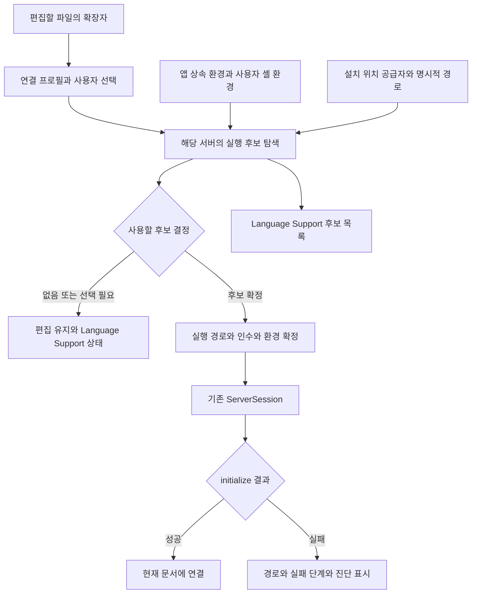

# 설치된 LSP 서버 자동 탐색과 연결 설계

작성일: 2026-10-16  
분석 기준: Setdown `6b0db3c3ce0b7c18383e4292f57b8dba24849a39`  
상태: 아래 현황 분석은 설계 당시 기준이다. 첫 연결 흐름의 후속 구현은 [자동 탐색 구현 기록](2026_10_16_00_45_lsp_automatic_discovery_implementation.md)에 정리했다. 설치는 사용자가 수행하고, 설치된 서버의 발견과 연결을 Setdown이 맡는다.

Setdown에 가장 이득이 되는 방향은 **기존 LSP 관리자 앞에 공통 실행 환경 탐색기를 두고, 검증된 서버 연결 프로필을 함께 제공하는 것**이다. 사용자는 `pip install fortls` 후 Fortran 파일을 열면 된다. 일반적인 설치에서는 실행 파일 선택, 확장자 등록, 언어 ID 입력, JSON 작성을 요구하지 않는다. 설치 위치가 여러 개이거나 프로젝트 전용 환경을 쓰는 경우에만 기존 Language Support 화면에서 선택한다.

지금의 어려움은 파일 선택 창 하나의 문제가 아니다. 현재 코드는 상속받은 PATH만 검색하며, 연결 정의가 없는 카탈로그 항목은 검색하지 않는다. 파일과 서버를 연결하는 경로도 활성화된 정의에만 열려 있다. 따라서 PATH 탐색만 개선하면 clangd 같은 기존 정의에는 도움이 되지만, 카탈로그에만 있는 fortls를 자동으로 연결하는 목표에는 도달하지 못한다.

이 설계는 [언어 지원 확장성 보고서](2026_10_15_20_12_language_support_scalability_research.md)의 후속이다. 당시 제안한 공통 클라이언트와 서버 레지스트리는 이미 구현되었다. 여기서는 그 구조를 유지하면서 **발견 → 선택 → 실행 → 연결 확인 → 재탐색**을 완성한다. 현재 제공되는 기능은 [사용자 문서](../docs/language-support.md)에 구분되어 있다.

## 사용자가 경험해야 하는 동작

| 상황 | 목표 동작 |
| --- | --- |
| 사용자 환경에 fortls를 설치하고 `.f90` 열기 | 기본 프로필과 설치 경로를 찾아 자동 연결 |
| Setdown 실행 중 서버 설치 | 새로 여는 해당 언어 문서에서 재확인하거나 Language Support의 **Rescan**으로 연결 |
| 데스크톱 아이콘으로 실행하여 터미널과 PATH가 다름 | 사용자 셸 환경을 비동기로 읽어 같은 도구를 발견 |
| 같은 서버가 PATH에 여러 개 있음 | 사용자 PATH 순서를 따르고 실제 선택 경로를 표시 |
| PATH 밖의 동등한 후보가 여러 개 있음 | 기존 화면에서 후보 선택. 언어 ID나 인수는 다시 입력하지 않음 |
| 예전에 특정 실행 파일을 직접 선택함 | 그 선택 유지. 파일이 사라져도 다른 버전으로 몰래 전환하지 않음 |
| 서버를 명시적으로 비활성화함 | 재탐색이나 앱 업데이트가 다시 활성화하지 않음 |
| clangd 파일은 있지만 `libc++.so.1`을 못 읽음 | 발견된 경로와 실행 실패 원인을 함께 표시 |
| 서버가 없는 언어 파일 열기 | 편집은 즉시 가능. 반복되는 오류 버튼이나 설치 팝업을 띄우지 않음 |
| Markdown 읽기, PDF, 웹 방문 | LSP 환경 탐색이나 서버 실행을 새로 유발하지 않음 |

자동 탐색의 성공 기준은 목록에 이름이 나타나는 데 그치지 않는다. **사용자가 입력을 계속할 수 있고, 실제 서버가 현재 문서에 연결되며, 연결이 안 되면 다음 행동을 알 수 있어야 한다.**

## 현재 구현에서 막히는 지점

### 카탈로그와 연결 정의의 차이

[Mason 스냅샷](../apps/desktop/src/main/language/catalog/mason.json)은 `2026-10-15-sedate-sheep`의 LSP 패키지 331개를 담는다. 실행 정의는 [language-definition.ts](../apps/desktop/src/core/document/language-definition.ts)의 Pyright, clangd, gopls, rust-analyzer 네 개와 사용자 정의뿐이다. Pyright와 clangd는 기본 활성화이며 나머지 둘은 기본 비활성화다. fortls는 기본 연결 정의가 없다.

[카탈로그 변환기](../apps/desktop/scripts/update-language-catalog.mjs)는 표시용 언어명, 설명, 설치 출처, `bin`의 이름을 가져온다. 다음 정보는 제공하지 않는다.

- 문서에 보낼 정확한 LSP `languageId`와 파일 확장자 연결.
- stdio 서버로 실행하기 위한 인수와 런타임 조합.
- 프로젝트 루트, 초기화 옵션, 서버 설정, 파일 감시 규칙.
- Setdown이 구현한 프로토콜 기능과의 실제 호환성.

예를 들어 카탈로그의 `Fortran`은 표시명이며 연결에 쓸 `fortran`과 역할이 다르다. 모든 표시명을 소문자로 바꾸거나 모든 명령에 `--stdio`를 붙이는 방식으로 연결 정의를 생성하면 안 된다.

스냅샷의 설치 출처는 GitHub 160개, npm 85개, PyPI 29개, Cargo 21개, Go 9개, 기타 27개다. 실행 파일 이름이 비어 있는 항목도 6개다. 이는 로컬 설치 현황이 아니라 **카탈로그 메타데이터의 분포**다. 특히 npm 항목이 많아, 네이티브 바이너리만 찾는 구현으로 전체 목록을 자동 연결한다고 약속할 수 없다.

### 탐색 결과와 실제 실행이 분리되어 있다

[server-registry.ts](../apps/desktop/src/main/language/server-registry.ts)의 `findExecutable()`은 절대 경로 또는 `process.env.PATH`를 확인하고, 파일 존재와 실행 권한만 검사한다. 로그인 셸 환경, Python 설치 환경, Cargo와 Go의 설치 디렉터리, 여러 후보를 다루지 않는다. Windows에서는 확장자 없는 명령에 `.exe`와 `.com`을 붙이며 `.cmd`와 `.bat` 실행은 별도로 거부한다.

`LanguageManager.catalogFor()`는 정의가 있는 항목에만 이 검사를 한다. 반면 `ServerRegistry.launch()`는 별도로 명령과 상속 환경을 조립한다. 명령이 `clangd`라면 표시 단계에서 찾은 절대 경로를 실행 단계에 넘기는 구조가 아니다. 탐색 환경을 확장하면서 이 분리를 남기면 **목록에서는 찾았는데 실행 때는 다른 PATH를 사용하는 오류**가 생긴다.

`fingerprint()`도 정의와 설정, 명령 문자열만 포함한다. 실제로 선택된 실행 경로와 환경을 반영하지 않으므로, 자동 탐색 결과가 바뀌었을 때 세션을 구분할 기준으로는 부족하다.

### 실행 전에 이미 언어 연결이 차단된다

[Monaco 어댑터](../apps/desktop/src/renderer/adapters/monaco-editor.ts)의 `connectLanguage()`는 `configuration()`에서 받은 `LanguageRoute[]`를 먼저 확인한다. 대응하는 route가 없으면 LSP 클라이언트를 로드하지 않는다. [LanguageClient.bind()](../apps/desktop/src/renderer/editor/language-client.ts)도 route가 없으면 `open()`을 호출하지 않는다.

따라서 `LanguageManager.open()` 안에만 자동 탐색을 넣으면 fortls는 그 함수까지 도달하지 못한다. **파일을 연결할 수 있다는 정적 정보와, 실행 파일을 지금 사용할 수 있다는 동적 정보를 분리해야 한다.**

### 재탐색을 설정 변경으로 처리하면 전체가 재시작된다

[LanguageManager.changed()](../apps/desktop/src/main/language/language-manager.ts)는 모든 owner의 세션을 종료한 뒤 `configuration` 이벤트를 보낸다. 렌더러도 이 이벤트를 받으면 LanguageClient 전체를 dispose한다. 현재 설정 변경에는 단순하고 일관된 방식이지만, 자주 일어나는 설치 탐색에 그대로 사용하면 관련 없는 Python과 C++ 세션까지 종료된다.

자동 탐색에는 별도의 결과 갱신 이벤트와 영향 범위 계산이 필요하다. **목록 갱신 자체는 실행 중인 세션을 바꾸지 않아야 한다.**

### 실행 상태 확인은 이미 활용할 기반이 있다

[ServerSession](../apps/desktop/src/main/language/server-session.ts)은 `shell: false`로 프로세스를 만들고 실제 `initialize`를 수행한다. 초기화 제한 시간은 20초이며 크기가 제한된 stderr 끝부분과 종료 원인을 보존한다. 프로세스 종료, 요청 취소, 마지막 문서 해제도 관리한다.

이 기반을 재사용한다. 모든 후보를 별도 프로세스로 먼저 실행해 보고 다시 본 서버를 띄우는 방식은 필요하지 않다. 실제 문서에 연결할 세션의 초기화 결과를 건강 상태의 근거로 삼는다.

## 참고 구현에서 가져올 설계

| 참고 대상 | 확인한 구조 | Setdown에 적용할 부분 |
| --- | --- | --- |
| VS Code | 사용자 셸을 실행해 환경을 얻고 Promise를 캐시하며 제한 시간을 적용 | GUI 실행 환경 보완, 탐색 공유, 중단 가능한 비동기 처리 |
| Helix | 언어 연결과 서버의 command·args·environment를 선언형 설정으로 관리 | 서버별 차이는 연결 데이터로 유지 |
| nvim-lspconfig | fortls의 명령 인수, filetype, root marker를 서버 프로필로 제공 | 검증된 기본값의 참고 원천 |
| Sublime LSP | 공통 세션 앞에 시작 준비 훅과 command·env 설정이 존재 | 실행 준비와 LSP 통신의 책임 분리 |
| JupyterLab Desktop | 사용자 지정 환경과 자동 발견 환경을 구분하고 PATH·Conda·Windows 경로를 모음 | 환경 공급자, 캐시, 명시적 선택의 우선권 |

VS Code의 [공식 환경 설명](https://code.visualstudio.com/docs/terminal/advanced#_environment-inheritance)은 셸 시작 파일에 추가된 개발 도구 경로를 얻기 위해 로그인 셸을 사용한다고 설명한다. 로컬의 [shellEnv.ts](../vendor/vscode/src/vs/platform/shell/node/shellEnv.ts)는 Linux/macOS 환경 조회를 한 번의 Promise로 공유하며 기본 10초 제한을 둔다. Windows와 CLI에서 이미 환경을 물려받은 경우에는 별도 분기가 있다. **Setdown에도 셸 실행은 드문 환경 준비 작업이어야 한다. 서버별·탭별 작업으로 반복하면 안 된다.**

[Helix 언어 설정](https://docs.helix-editor.com/languages.html)은 언어별 파일 형식과 루트, 사용할 서버를 선언하고, 서버에는 command·args·environment를 지정한다. [지원 상태 확인](https://docs.helix-editor.com/lang-support.html)은 `hx --health`로 드러낸다. Setdown은 이 구분을 기존 Language Support 화면에 표현하면 된다.

[nvim-lspconfig의 fortls 정의](https://github.com/neovim/nvim-lspconfig/blob/master/lsp/fortls.lua)는 Fortran filetype, `.fortls` 계열 루트 표시 파일, hover와 signature 관련 인수를 함께 제공한다. 설치 패키지 이름만으로는 얻을 수 없는 연결 지식이다. 다만 Lua 코드를 실행하거나 각 편집기의 설정을 그대로 번역하지 않고, Setdown이 지원하는 기능에 맞는 데이터만 검토해서 가져온다.

로컬 [Sublime LSP API](../vendor/sublime-lsp/plugin/api.py)의 `OnPreStartContext`와 `on_pre_start_async()`는 시작 전 실행 설정·작업 디렉터리·변수를 조정할 경계를 제공한다. Setdown에는 범용 플러그인 실행 환경을 도입하기보다, 같은 책임을 담당하는 작은 내부 resolver가 적합하다.

로컬 [JupyterLab Desktop 레지스트리](../vendor/jupyterlab-desktop/src/main/registry.ts)는 자동 발견 환경과 사용자 지정 환경을 별도로 보관한다. 이 구분은 가져오되, Python 환경 전체를 앱 시작 시 검증하는 범위까지 따라가지는 않는다. Setdown은 문서를 읽기만 하는 사용자도 있으므로 필요한 언어와 런타임에만 작업을 한정한다.

로컬 참고 소스 버전은 VS Code `d3d31f62268b169a2dfab62ffb2d7d38158a5b7c`, Sublime LSP `c65e2bc62882d876ec55035185ce63c51963f4ef`, JupyterLab Desktop `0e46b48fedc0777fa33946ffe9bc3a16ee0d74a2`이다. 웹 설정을 실제 데이터로 가져올 때에는 그 시점의 upstream commit과 라이선스도 함께 기록한다.

## 권장 구조



역할은 다섯 가지로 나눈다. **프로필**은 서버를 어떻게 연결하는지, **환경 조회**는 어떤 실행 환경을 쓸지, **탐색**은 후보가 어디 있는지, **선택**은 어떤 후보를 사용할지, **세션**은 실제 통신과 수명을 담당한다. 후보 목록과 세션은 같은 실행 해석 결과를 공유한다.

### 연결 프로필은 기존 정의를 확장한다

현재 `LanguageServerDefinition`을 출발점으로 삼는다. 다른 구조에 같은 command·args·언어 연결을 중복 저장하지 않는다. 추가할 정보는 기본 사용 정책, 탐색에 사용할 명령 이름 또는 런타임 종류, 프로필 개정 번호와 출처 정도다.

Mason은 설치 안내와 검색용 카탈로그로 유지한다. 검증된 연결 프로필은 앱에 함께 배포한다. 자동 연결 가능한 항목에는 **Automatic connection supported**, 실행 후보만 발견했지만 프로필이 없는 항목에는 **Found · Connection setup needed**를 표시할 수 있다. 후자의 발견을 작동 보장으로 표현하지 않는다.

새 서버 추가 작업의 정상적인 단위는 **프로필 데이터 추가와 연결 계약 검증**이다. completion·hover·rename 공급자를 언어마다 다시 작성하지 않는다. 특수 런타임도 우선 Python·Node·네이티브 같은 공통 실행 유형으로 해결하고, 데이터로 표현하기 어려운 서버만 작은 준비 함수를 검토한다.

### 실행 계획을 한 번 확정한다

아래는 구현 시 도입할 내부 타입의 예시다. 현재 API가 아니다.

```ts
type ServerCandidate = {
  id: string;
  serverId: string;
  invocationPath: string;
  origin: 'explicit' | 'path' | 'known-directory' | 'runtime' | 'project';
  environmentId: string;
  scopeRoot?: string;
  rank: number;
};

type ResolvedLaunch = {
  serverId: string;
  candidateId: string;
  executable: string;              // 실행에 사용할 절대 경로
  args: string[];
  cwd: string;
  env: NodeJS.ProcessEnv;           // main 내부에서만 보관
  fingerprint: string;
};

type Resolution =
  | { kind: 'resolved'; launch: ResolvedLaunch }
  | { kind: 'missing'; searchedSources: string[] }
  | { kind: 'selection-needed'; candidates: ServerCandidate[] }
  | { kind: 'blocked'; reason: string };
```

`executable`은 실제 spawn에 넘길 경로다. 심볼릭 링크의 realpath는 중복 판별의 보조 자료로만 쓴다. rustup처럼 호출 이름과 작업 디렉터리에 의미가 있는 실행기를 무조건 realpath로 치환하면 다른 프로그램처럼 동작할 수 있다.

세션 키는 기존의 창·서버·루트에 더해 확정된 실행 계획의 fingerprint를 사용한다. 프로필 개정, 선택 경로, 인수, 서버 설정, 실행 환경의 식별 정보, 필요한 도구 체인 문맥을 반영한다. 재탐색 횟수나 확인 시각은 fingerprint에 넣지 않는다. 동일한 결과를 다시 찾았다는 이유로 세션이 바뀌면 안 된다. 민감한 환경값은 로그나 렌더러에 전달하지 않는다.

실행 직전 경로를 재확인하고 spawn 실패도 처리한다. 존재 확인과 실행 사이에 파일이 삭제되거나 교체될 수 있으므로 캐시를 실행 성공의 보증으로 취급하지 않는다.

## 사용자 실행 환경을 얻는 방법

### 상속 환경과 셸 환경을 함께 다룬다

셸에서 실행한 Setdown은 활성화된 venv나 Conda 환경을 물려받을 수 있다. 데스크톱 아이콘으로 실행한 Setdown은 그렇지 않을 수 있다. 어느 쪽인지 고려하지 않고 로그인 셸 결과로 항상 덮어쓰면, 사용자가 활성화해 둔 환경을 잃을 수 있다.

권장 정책은 다음과 같다.

1. 앱 시작 시의 상속 환경을 별도 스냅샷으로 보관한다.
2. 명확한 CLI 실행 표식 또는 명시적으로 선택한 환경이 있으면 그 환경을 우선한다. 기존 실행 진입점에서 표식을 전달할 수 있는지 구현 시 확인한다.
3. GUI 실행에서는 첫 LSP 사용 또는 Language Support 진입 시 사용자 셸 환경을 비동기로 조회한다. 사용자 계정의 셸을 사용하며 bash로 고정하지 않는다.
4. 조회 실패 시 상속 환경과 알려진 설치 위치로 계속 탐색하고, 환경 조회 실패 사실을 상세 화면에 남긴다.
5. 결과는 공유하고 Rescan에서 갱신할 수 있게 한다. `process.env` 전체를 변경하지 않고 LSP 자식 프로세스에만 적용한다.

POSIX 셸에 공통 옵션을 무조건 넘기지 않는다. VS Code처럼 셸별 인수 차이를 명시하고, 처음에는 검증한 셸부터 지원한다. 환경 출력은 고정된 helper와 임의 구분자로 구조화해 읽는다. 시작 메시지, 색상 코드, 여러 줄 값, 비정상 종료, 과다 출력을 처리해야 한다. 셸 설정을 텍스트로 파싱하거나 사용자의 서버 경로를 셸 명령 문자열에 끼워 넣지 않는다.

조회는 사용자 홈처럼 고정된 디렉터리에서 수행하고 stdin을 닫는다. 사용자 셸 시작 파일이 실행되는 작업이므로 제한 시간, 출력 상한, 취소와 자식 프로세스 정리가 필요하다. 사용자 설정 때문에 외부 프로그램이 실행될 수 있다는 점까지 포함해 **환경 조회는 단순 파일 검사와 구분된 작업**으로 계측한다.

PATH만 복사해서는 부족하다. Python launcher, Node 실행기, 네이티브 라이브러리는 주변 환경의 영향을 받는다. 다만 현재 `launch()`가 제거하는 `NODE_OPTIONS`, `NODE_PATH`, `ELECTRON_RUN_AS_NODE` 같은 앱 실행 변수의 정리 규칙은 유지한다. 내장 Pyright에 필요한 Electron Node 실행 모드는 그 실행 계획에만 다시 설정한다.

### 환경 조회 라이브러리의 재사용 범위

[shell-env](https://github.com/sindresorhus/shell-env)도 Electron 환경 조회의 후보로 검토했다. 다만 확인한 [현재 구현](https://raw.githubusercontent.com/sindresorhus/shell-env/main/index.js)은 줄 단위로 환경 출력을 파싱하고, 공개 호출 인자로 timeout·취소 신호를 받지 않는다. 기본 셸 실패 시 다른 POSIX 셸로 대체하기도 한다. 여러 줄 환경값 보존, 취소 시 프로세스 종료, 어떤 환경을 선택했는지 설명하는 이번 계약을 그대로 충족하지는 않는다.

따라서 최초 구현은 VS Code의 구조를 참고한 작은 환경 조회 어댑터를 권장한다. 셸별 지원 범위를 명시하고, 프로세스 제어와 직렬화만 그 모듈에서 맡긴다. 향후 같은 계약을 만족하는 라이브러리가 있으면 이 모듈 뒤에서 교체할 수 있다. 단순히 라이브러리 호출에 `Promise.race`를 붙여 반환만 중단하는 것은 자식 프로세스 종료를 보장하지 않으므로 대안이 되지 않는다.

### 탐색 공급자의 범위를 제한한다

| 공급자 | 읽을 위치 또는 조회 방식 | 적용 원칙 |
| --- | --- | --- |
| 명시적 선택 | 현재 설정, 기존 clangd 설정, 명시적 환경변수 | 기존 우선순위 보존. 실패해도 자동 후보로 몰래 교체하지 않음 |
| PATH | 선택한 환경의 PATH 디렉터리와 명령 이름 | 순서 보존. 빈 항목과 상대 경로는 자동 실행 후보에서 제외 |
| 사용자 bin | Linux의 `~/.local/bin`, 명시된 사용자 도구 디렉터리 | PATH 밖의 보조 후보로 취급 |
| Cargo | `CARGO_HOME/bin`, 기본 Cargo 홈의 bin | 프록시 존재와 서버 사용 가능 여부를 구분 |
| Go | GOBIN, 유효 GOPATH의 bin | 환경값이 없으면 필요한 경우에 한해 `go env` 조회 |
| Python | 이미 발견하거나 선택한 Python의 scripts 경로와 사용자 scripts 경로 | 모든 Python 환경을 일괄 실행하지 않음 |
| pipx | `PIPX_BIN_DIR`, 필요 시 `pipx environment --value PIPX_BIN_DIR` | 노출된 app 링크부터 검색 |
| uv | `UV_TOOL_BIN_DIR` 등 설정, 필요 시 `uv tool dir --bin` | 도구 환경 내부 전체 순회 대신 실행 링크 경로 사용 |
| npm | 선택한 Node 환경의 global prefix와 설치된 package의 bin 메타데이터 | 런타임과 서버 스크립트를 함께 해석 |
| 프로젝트 환경 | 사용자가 선택한 `.venv`, `node_modules` 등 | 발견과 실행 선택을 분리. 최초 버전에서는 자동 우선 실행하지 않음 |

Python은 플랫폼과 설치 scheme에 따라 scripts 디렉터리가 다르다. [sysconfig 공식 문서](https://docs.python.org/3/library/sysconfig.html#installation-path-functions)의 `get_path('scripts')`와 사용자 scheme을 이용해 **선택된 인터프리터의 위치**를 묻는다. `~/.local/bin`은 유용한 Linux 기본 후보지만 `pip install`의 모든 결과를 대표하지 않는다.

Cargo 홈은 `CARGO_HOME`으로 바뀔 수 있다. Go 설치 명령은 GOBIN 또는 GOPATH의 bin을 사용한다. 따라서 홈 디렉터리의 하드코딩만으로 해결하지 않는다. ([Cargo 홈](https://doc.rust-lang.org/cargo/guide/cargo-home.html), [Go 설치 경로](https://go.dev/ref/mod#go-install))

pipx와 uv는 설치 환경 디렉터리와 실행 파일 노출 디렉터리를 구분한다. 해당 도구의 경로 조회 기능을 사용하면 내부 디렉터리 형식을 추정할 필요가 줄어든다. ([pipx 경로 설정](https://pipx.pypa.io/stable/how-to/configure-paths.html), [uv tool dir](https://docs.astral.sh/uv/reference/cli/#uv-tool-dir))

npm의 전역 실행 파일은 Unix에서 prefix의 `bin`, Windows에서 prefix 자체에 놓인다. 프로젝트 설치는 `node_modules/.bin`을 사용한다. [npm 디렉터리 문서](https://docs.npmjs.com/cli/v11/configuring-npm/folders/#executables)에 따라 플랫폼별로 해석하고, Windows wrapper를 발견했다고 `shell: true`로 전환하지 않는다. 검증된 Node 프로필에는 설치된 `package.json`의 bin과 외부 Node 실행 파일을 조합하는 launch 유형을 추가한다. 내장 Electron의 Node 버전이 모든 외부 서버에 적합하다고 가정하지 않는다.

패키지 도구 조회는 필요한 공급자당 공유하고 제한 시간과 결과 크기를 둔다. `npm install`, `npx`, `uvx`, `pip install`을 탐색 수단으로 사용하지 않는다. Go 조회처럼 프로젝트 문맥에서 도구 체인 다운로드를 유발할 수 있는 명령은 조회용 환경과 작업 디렉터리, 오프라인 동작을 검증한 뒤 허용한다.

`/home`·`/opt` 전체 재귀 검색, 모든 Conda 환경 실행, 다른 편집기의 확장 디렉터리 탐색을 기본 경로에 넣지 않는다. 임의 위치는 기존 파일 선택과 향후 **검색할 폴더 추가**로 해결한다. 자동 탐색의 목적은 일반적인 설치를 편하게 만드는 것이며, 사용자의 모든 파일을 뒤지는 것이 아니다.

## 후보 선택과 사용자 의도

서버 종류 선택과 설치본 선택은 별개다. Python에서 Pyright와 다른 서버 중 하나를 고르는 것과, 같은 fortls의 전역 설치본과 venv 설치본 중 하나를 고르는 것은 다른 결정이다.

서버 종류는 현재 `preferred` 선택을 유지한다. 기본 Pyright를 다른 Python 서버가 발견되었다는 이유로 바꾸지 않는다. 신규 프로필도 자동 사용 가능한 대표 서버를 명시해야 한다. 발견 순서나 문자열 정렬로 언어의 서버 종류를 고르면 안 된다.

같은 서버의 설치본 우선순위는 다음과 같이 정한다.

1. 사용자가 이 연결에 지정한 경로와 기존 호환 설정.
2. 사용자가 해당 프로젝트에 명시적으로 선택한 환경. 이 기능은 후속 단계에서 도입한다.
3. 선택된 사용자 환경의 PATH 순서.
4. 검증된 추가 설치 위치의 후보.

PATH에 여러 후보가 있다는 사실만으로 질문하지 않는다. PATH 순서는 이미 사용자의 선택을 담고 있다. 반면 서로 다른 venv 같은 동등한 보조 후보에는 우선권 근거가 없으므로 한 번 선택하게 한다. 버전 문자열이 가장 크다는 이유로 고르지 않는다.

실행 실패 후 다른 후보를 차례로 자동 실행하는 정책은 채택하지 않는다. 도구 체인이나 설정이 다른 서버로 바뀌면 성공한 것처럼 보이면서 결과가 달라질 수 있다. 현재 선택의 실패 원인과 다른 후보를 같은 화면에서 제공한다.

프로젝트의 `.venv/bin/fortls`나 `node_modules/.bin`을 발견하는 것만으로 실행하지 않는다. 현재 LSP 구성 경로에는 작업공간 실행 신뢰를 관리하는 별도 기능이 없으므로, 최초 구현은 사용자 환경과 사용자 선택 경로를 대상으로 한다. 프로젝트 실행기를 지원할 때에는 기존 Language Support 안에서 프로젝트별 선택을 저장한다. 문서를 열었다는 사실을 프로젝트 안의 임의 실행 파일에 대한 선택으로 해석하지 않는다.

## 자동 연결의 시작 지점을 바꾼다

### route는 설치 상태와 독립적으로 제공한다

첫 단계에서는 기존 `LanguageRoute`의 언어당 대표 서버 구조를 유지하는 것이 유리하다. `routes()`가 명시적으로 꺼진 프로필을 제외한 자동 연결 대상도 반환하도록 한다. 이 호출에서는 셸이나 파일 시스템 탐색을 하지 않는다. `.f90`를 fortls에 연결할 수 있다는 정보만 전달한다.

실행 가능 여부는 main의 비동기 resolver가 판단한다. 기본 프로필이 없는 항목은 계속 수동 연결 대상이며, 331개 전체를 무조건 route에 넣지 않는다.

현재 `open()`은 성공 또는 예외만 표현한다. 자동 모드에서는 다음과 같은 정상적인 미연결 결과도 필요하다.

```ts
type LanguageOpenResult =
  | { kind: 'connected'; connection: LanguageConnection }
  | { kind: 'unavailable'; reason: 'missing' | 'selection-needed' };
```

이는 제안 API다. `LanguageClient.bind()`는 unavailable일 때 편집을 실패로 처리하지 않고, 연결되지 않은 문서의 변경 내용을 끝없이 큐에 쌓지도 않아야 한다. 재탐색 후 다시 연결할 때는 현재 모델의 최신 텍스트와 version을 한 번 보낸다. 연결을 시도했으나 실제 초기화가 실패한 경우에는 현재의 실패 상태와 구체적 진단을 제공한다.

### 느린 탐색 중에도 문서 소유권을 확인한다

현재 `open()`은 문서가 호출한 창에 실제로 열려 있는지 검사한다. 새로 추가되는 환경 조회와 실행 해석의 `await` 전후에도 이 보장을 유지해야 한다. 그동안 탭이 닫히거나 창이 종료되거나 설정이 변경되면 오래된 작업이 서버를 띄우면 안 된다.

문서 generation, 설정 revision, 환경 snapshot 식별자를 함께 확인한다. 동일한 서버·환경의 동시 탐색은 공유하되 한 탭의 취소가 다른 탭의 조회를 취소하지 않게 한다. 실행 직전에는 현재 owner와 선택이 여전히 유효한지 다시 검사한다.

### 재탐색과 세션 재설정을 분리한다

`rescan()`은 후보 캐시와 UI를 갱신한다. 기존 `changed()`를 호출하지 않는다. 결과가 같으면 프로세스 ID와 연결도 그대로 유지한다.

새로 사용 가능해진 서버는 해당 언어의 미연결 모델만 연결한다. 사용자 선택 또는 적용된 실행 계획이 바뀌면 영향을 받는 창·서버·루트만 재연결한다. 실행 중인 정상 세션은 단순히 다른 후보가 추가되었다는 이유로 교체하지 않는다. 바뀐 자동 선택을 실행 중인 문서에도 적용할지는 사용자가 **Restart**로 결정할 수 있다.

기존 `configuration` 이벤트와 별도로 후보 상태 변경 이벤트를 두고, 설정 변경 이벤트에는 영향받는 server ID나 route revision을 전달한다. Monaco 어댑터도 전체 LanguageClient 폐기 대신 대상 binding만 해제할 수 있어야 한다. **main만 부분 재시작하도록 바꾸고 렌더러의 전체 dispose를 남기는 수정은 불완전하다.**

재연결은 기존 모델을 보존한다. 미저장 내용, Undo, 커서, IME, Git Working Tree에서 공유하는 모델의 소유권을 유지하며 저장을 유발하지 않는다. 현재 문서 버전보다 오래된 진단을 버리는 정책도 그대로 둔다.

## 기존 화면에서 제공할 조작

새 사이드바나 설치 전용 화면을 추가하지 않는다. **Edit → Language Support…**에 다음을 넣는다.

- 상단 **Rescan installed servers**. 진행 중에도 기존 목록과 선택 내용을 유지한다.
- 검색 결과는 현재 문서의 서버, 실행 중 또는 발견된 서버, 설정된 서버, 나머지 카탈로그 순서로 정리한다.
- 프로필이 있는 항목은 경로·출처·연결 상태를 기본으로 보여준다. 언어 ID와 JSON 편집은 고급 설정에 둔다.
- 경로 선택에는 자동 탐색 결과와 **Choose executable…**를 함께 제공한다. 수동 선택 후 **Use automatic detection**으로 되돌릴 수 있게 한다.
- 같은 서버의 각 프로젝트 세션을 구분한다. 한 프로젝트의 실패로 모든 프로젝트가 실패한 것처럼 표시하지 않는다.

다음은 목표 표시 예시다.

```text
fortls                                  Running
Fortran · User installation
/home/user/.local/bin/fortls

Automatic detection       [Choose executable…]
Project: /home/user/work/simulation

Connection details ▸
```

파일을 발견했지만 아직 시작하지 않았다면 `Found · Starts when needed`로 표시한다. `Ready`라는 단어만으로 실제 실행 검증까지 된 것처럼 보이게 하지 않는다. `Checking`, `Not found`, `Needs selection`, `Starting`, `Running`, `Failed`, `Disabled`를 구분하되 내부 환경 변수나 fingerprint를 기본 화면에 노출하지 않는다.

프로필이 없는 카탈로그 항목은 설치 안내와 고급 수동 연결을 유지한다. 발견된 명령은 입력을 도울 수 있지만, 모르는 language ID와 launch 인수를 추측해서 실행하지 않는다.

현재 [LanguageSupport.svelte](../apps/desktop/src/renderer/editor/LanguageSupport.svelte)는 이벤트마다 카탈로그를 다시 읽는다. 재탐색 결과를 반영하면서 사용자가 편집 중인 인수·설정 텍스트나 선택 항목을 덮어쓰지 않도록 dirty 상태를 구분해야 한다.

## 실패를 정확하게 설명하는 방법

| 실패 단계 | 표시할 사실 | 다음 행동 |
| --- | --- | --- |
| 환경 조회 | 셸 조회 실패 또는 시간 초과, 사용한 대체 환경 | Rescan, 환경 상세 확인 |
| 탐색 | 검색한 범위에서 해당 명령을 찾지 못함 | 설치 안내, 실행 파일 또는 환경 선택 |
| 실행 | 선택 경로, 권한 오류, 없는 인터프리터, 로더 메시지 | 경로·런타임 확인, 다른 후보 선택 |
| 초기화 | 프로세스는 시작했지만 LSP 응답 실패 | 인수·stdio 모드·서버 호환성 확인 |
| 연결 이후 | 서버가 종료되거나 통신이 끊김 | 해당 세션 재시작과 진단 확인 |

이전 clangd 사례의 `error while loading shared libraries: libc++.so.1`은 파일 탐색 다음 단계의 실패다. 셸에서 올바른 라이브러리 경로를 제공하는 환경이라면 환경 복원이 도움이 될 수 있다. 실제 라이브러리가 없다면 설치된 clangd의 의존성을 해결하거나 다른 설치본을 선택해야 한다. 탐색기가 임의 디렉터리를 `LD_LIBRARY_PATH`에 추가하거나 시스템 라이브러리를 설치해서 해결하려고 해서는 안 된다.

종료 코드 127만으로 같은 원인을 단정하지 않는다. spawn error code, 종료 코드·signal, 제한된 stderr, 초기화 단계 정보를 함께 보존하고, 알려진 패턴에만 설명을 붙인다. stderr는 서버가 제공한 텍스트이므로 UI에서는 텍스트로 표시한다.

rustup 프록시는 또 다른 사례다. 공식 [rust-analyzer 설명](https://rust-analyzer.github.io/book/vs_code.html#building-from-source)도 PATH 순서와 rustup의 동명 프록시를 구분한다. 프록시가 발견되었다는 사실을 사용 가능한 서버 구성요소가 확인되었다는 뜻으로 쓰지 않는다. 프로젝트 도구 체인 문맥에서 실제 초기화 결과를 확인한다.

모든 서버에 `--version`을 실행하는 건강 검사는 채택하지 않는다. 그런 공통 CLI 계약은 없고 버전 출력 성공도 LSP 연결을 증명하지 않는다. 버전 확인이 필요하면 해당 프로필이 검증한 명령으로만 수행한다. 실제 연결 판정은 기존 `ServerSession.ready`를 사용한다.

**Copy diagnostics**에는 서버 ID, 앱과 프로필 버전, 선택 경로, 작업 루트, 실패 단계, 종료 정보, 제한된 stderr를 담는다. 환경 전체나 인증 값은 담지 않으며, 인수와 stderr에 민감한 값이 포함될 수 있어 복사 전 표시·마스킹 규칙을 둔다.

## fortls로 완성할 첫 사용 흐름

첫 프로필 추가는 fortls가 적합하다. 사용자가 실제로 설치했고, 현재 수동 연결의 마찰을 드러냈기 때문이다.

1. Fortran용 기본 연결 정의를 추가한다. LSP 언어 ID는 `fortran`, 확장자는 `.f`, `.for`, `.f77`, `.f90`, `.f95`, `.f03`, `.f08` 등 검증한 범위로 명시한다. 원본 경로의 대소문자는 바꾸지 않는다.
2. 실행 명령은 `fortls`, 사용자 환경과 Python 설치 경로에서 후보를 찾는다. Fortran 파일 분석에는 Python으로 구현된 서버를 실행하는 환경이 필요하다는 점을 프로필이 맡는다.
3. `.fortlsrc`, `.fortls.json`, `.fortls`, `.git` 같은 루트 표시 파일을 기본값으로 제공한다. 최초 구현에서는 현재의 열린 프로젝트 루트 우선 정책을 유지한다.
4. hover·signature 인수는 Setdown의 실제 지원 범위와 대조한다. 초기화 알림이나 특정 편집기 전용 설정을 다른 프로젝트에서 그대로 복사하지 않는다.
5. 문서가 열릴 때 초기화하고, completion·hover·definition 등 실제 광고된 기능으로 연결을 검증한다. 누락된 진단 기능을 성공으로 꾸미기 위해 버전 검증을 완화하지 않는다.

[fortls 공식 편집기 연결 설명](https://fortls.fortran-lang.org/editor_integration.html)은 PATH와 명시적 경로를 사용하며, 편집기별 연결 설정이 별도로 필요함을 보여준다. Setdown이 이 기본값을 제공하면 사용자가 채울 값이 크게 줄어든다.

특히 fortls에는 기본 자동 업데이트 기능이 있고 `--disable_autoupdate`로 끌 수 있다. 권장 기본 프로필에는 이 옵션을 포함한다. 다만 `.fortls` 설정이 CLI보다 우선하므로 이것을 모든 프로젝트에서의 네트워크 차단 보장이라고 표현하지 않는다. 설정 충돌과 실제 실행 버전을 통합 테스트에서 확인한다. ([fortls 옵션과 우선순위](https://fortls.fortran-lang.org/options.html))

LSP 연결과 문법 색상도 구분한다. Fortran 서버가 연결되어 hover를 반환해도 Monaco의 문법 등록이 없으면 코드 색상이 자동으로 해결되지는 않는다. 이번 작업의 성공 기준은 자동 연결이며, 색상 지원 상태는 별도 정보로 유지한다.

## 설정 호환성과 데이터 관리

### 자동 사용과 명시적 비활성화를 구분한다

설정에는 최소한 `auto`, `enabled`, `disabled`의 의미가 필요하다. `auto`는 검증된 프로필의 서버를 발견했을 때 해당 문서에서 사용한다는 뜻이다. `enabled`는 사용자가 명시적으로 선택한 연결이며 경로가 잘못되면 원인을 보여준다. `disabled`는 재탐색에도 실행하지 않는다. UI의 자동 탐색 여부와 사용 여부를 혼동하지 않게 한다.

기존 `enabled: false`는 사용자의 명시적 비활성화로 보존한다. 기존 `enabled: true`와 preferred 서버, 직접 선택한 executable, 인수·설정 override도 보존한다. 설정이 없어서 기본 비활성화였던 gopls·rust-analyzer는 새 정책에서 auto 후보가 될 수 있지만, 이를 명시적 비활성화와 구분해야 한다. 새 프로필을 전부 기본 자동 실행 대상으로 승격하지 않고 검증된 항목만 지정한다.

### 사용자 fortls 정의와 새 기본 정의가 충돌할 수 있다

현재 생성자는 builtin과 custom에 같은 ID가 있으면 `Duplicate language server ID`로 실패한다. 이미 사용자가 `fortls`라는 ID로 수동 연결했다면, 기본 배열에 fortls를 추가하는 것만으로 설정 로드가 깨질 수 있다.

이를 피하려면 설정 읽기 과정에서 ID 중복 검사 전에 호환 처리를 넣는다. 같은 ID의 기존 사용자 정의는 사용자 override로 보존하고 새 기본 정의를 가리는 정책을 권장한다. 사용자 이름을 임의로 바꾸거나 기존 args를 새 기본값으로 덮지 않는다. 향후 **Reset to defaults**를 명시적으로 선택했을 때만 기본 프로필로 돌아간다. 동일한 규칙을 다른 신규 프로필에도 적용한다.

설정 버전을 올릴 때는 기존 파일을 백업하고 현재의 원자적 저장 방식을 유지한다. 알 수 없는 버전이나 잘못된 파일을 빈 설정으로 덮어쓰지 않는다.

### 발견 결과는 사용자 설정과 분리한다

자동 탐색으로 얻은 절대 경로를 매번 `language-servers.json`에 executable 선택으로 기록하지 않는다. 그러면 자동 상태가 첫 실행 경로에 영구 고정된다. 사용자의 선택과 일시적인 탐색 캐시를 분리하고, 자동 모드에서는 새 앱 실행 또는 재탐색 시 다시 해석한다.

초기 버전은 메모리 캐시로 충분하다. 디스크 캐시가 필요해지면 경로·출처·확인 시각 같은 제한된 정보만 저장한다. 환경 스냅샷 전체를 디스크에 기록하지 않는다.

## 성능과 수명에 대한 조건

탐색은 문서 편집과 미리보기의 입력 경로를 막지 않아야 한다. 파일을 열고 타이핑하는 데 셸 조회나 패키지 도구 응답을 기다리게 하지 않는다.

| 작업 | 실행 시점과 제한 |
| --- | --- |
| 정적 route 조회 | 작은 데이터만 반환. 셸·패키지 도구·카탈로그 전체 로드 없음 |
| 사용자 셸 환경 | 첫 LSP 필요 또는 관리 화면 요청 시 공유 Promise로 조회 |
| 특정 서버 탐색 | 해당 언어의 첫 연결, 캐시 만료 후 새 연결, 명시적 Rescan |
| 전체 목록 탐색 | 사용자가 관리 화면에서 요청할 때 비동기로 수행 |
| 설치 위치 조회 | 필요한 공급자에 한정해 공유. 서버마다 같은 명령 반복 금지 |
| 실제 서버 시작 | 해당 서버를 사용할 문서가 있을 때만 실행 |
| 서버 없음 | 미발견 결과를 잠시 캐시. 키 입력·hover마다 탐색하지 않음 |
| 실패한 세션 | 자동 무한 재시작 금지. 환경 갱신 또는 사용자 재시도에서 다시 검사 |

최초 구현의 조정 시작값으로 셸 조회 5초, 공급자 명령 3초, 출력 1MiB, 외부 조회 동시 실행 2개, 미발견 캐시 30초를 제안한다. 이는 측정 결과가 아니라 구현 후 검증할 제한값이다. 기존 LSP 초기화 20초와 혼동하지 않는다. 느린 셸 때문에 정상 환경을 자주 놓치는지 기록하고 조정한다.

PATH의 후보를 직접 stat하는 방법과 디렉터리를 한 번 읽어 명령 이름을 대조하는 방법을 비교한다. 어느 쪽이든 비동기 I/O의 동시성을 제한한다. 네트워크 마운트의 느린 경로가 전체 탐색을 막지 않도록 부분 결과를 반환하고 취소된 결과를 버린다. 단순 Promise timeout이 이미 시작한 파일 시스템 I/O 자체를 취소한다고 가정하지 않는다.

성능 기록에는 환경 조회 시간, 공급자별 시간, 확인한 경로 수, 시작한 외부 프로세스 수, 실제 LSP 준비 시간, 취소 시 잔존 프로세스를 포함한다. 서버가 원래 수행하는 프로젝트 인덱싱 시간과 Setdown 탐색 시간을 분리한다.

현재의 한 창·한 서버·한 루트에서 세션 공유, 창 사이 미저장 버퍼 격리, 마지막 연결 해제 후 종료를 유지한다. 명시적 재탐색 한 번으로 열려 있지 않은 331개 서버를 실행하는 구현은 허용하지 않는다.

## 구현할 모듈과 순서

다음 신규 파일명은 책임을 설명하기 위한 제안이며 구현 시 조정할 수 있다.

| 위치 | 변경 책임 |
| --- | --- |
| `core/document/language-definition.ts` | 기존 정의 확장, fortls 프로필, 자동 사용 정책, 프로필 provenance |
| `main/language/server-registry.ts` | 사용자 의도·호환 마이그레이션·정적 route 담당. 환경 탐색 분리 |
| `main/language/server-environment.ts` 신규 | 상속·셸 환경 스냅샷, 캐시, 취소, 출력 제한 |
| `main/language/server-discovery.ts` 신규 | 탐색 공급자, 후보 수집·중복 처리·선택 규칙 |
| `main/language/server-launch.ts` 신규 | 후보를 실제 실행 계획으로 변환, 런타임 조합과 fingerprint |
| `main/language/language-manager.ts` | 비동기 해석, 문서 소유권 재검사, 재탐색, 영향 범위별 갱신 |
| `main/language/server-session.ts` | 기존 통신과 종료 재사용, 실패 단계를 구조화 |
| `protocol/language.ts`, `preload/index.ts` | unavailable 결과, Rescan, 후보 선택, 부분 갱신 이벤트 |
| `renderer/adapters/monaco-editor.ts` | route 준비와 편집 독립, 전체 dispose 대신 대상 갱신 |
| `renderer/editor/language-client.ts` | 미연결 정상 상태, 최신 모델로 재연결, 대상 binding 교체 |
| `renderer/editor/LanguageSupport.svelte` | 발견 상태·후보 선택·Rescan·진단, 편집 중 설정 보존 |
| `docs/language-support.md` | 실제 구현 완료 범위와 설치 후 사용 절차 반영 |

### 첫 단계는 fortls 연결을 끝까지 완성한다

먼저 설정 호환성과 자동 사용 정책을 만든다. 이어서 사용자 셸 환경, PATH와 사용자 bin, 필요한 Python scripts 경로 탐색, 확정 실행 계획, unavailable 상태를 연결한다. 기존 Pyright·clangd·gopls·rust-analyzer 경로도 같은 resolver를 통과시켜 실행 방식이 둘로 갈라지지 않게 한다.

이 단계에는 Rescan과 대상 문서 재연결도 포함한다. 앱을 껐다 켜야만 설치를 인식하거나, 다른 서버까지 끊기는 기능을 완성으로 보지 않는다. Linux에서 `pip install fortls` 후 실제 `.f90`를 열어 별도 등록 없이 사용하는 흐름이 첫 완료 조건이다. 임의 venv에 설치한 경우에는 환경 선택이 필요할 수 있음을 명확히 구분한다.

### 다음 단계는 설치 경로와 프로필 범위를 넓힌다

pipx·uv·Cargo·Go의 명시적 설치 위치와 Node 패키지 실행 유형을 보강한다. 한 공급자가 여러 서버를 처리하도록 구성하며, 프로필별 실제 실행 테스트를 추가한다. Windows 네이티브와 npm wrapper 처리도 별도로 검증한다. Linux에서 통과한 결과를 Windows 자동 지원으로 계산하지 않는다.

현재 사용자 우선순위에 맞춰 macOS 배포 작업은 이 설계의 선행 조건으로 삼지 않는다. 다만 환경 조회와 플랫폼 경로를 분리해 후속 구현이 가능하게 한다.

### 프로젝트 환경과 특수 서버는 이후 확장한다

사용자가 선택한 프로젝트 Python·Node 환경, 여러 설치본의 프로젝트별 선택, JVM 등 특수 launch 준비를 확장한다. 프로젝트 디렉터리에서 발견한 실행기 선택은 사용자 설정으로 보관한다. 서버 설치 관리자나 VS Code 확장 호스트까지 도입하는 것은 별도 결정으로 남긴다.

## 검증 계획과 완료 기준

테스트는 사용자의 실제 셸 설정과 설치 환경을 변경하지 않는 임시 HOME·PATH·실행 파일로 구성한다. 환경 조회와 파일 시스템은 주입 가능하게 만들어 순서·캐시·취소를 검증한다. 실서버 검증은 이미 준비한 고정 버전을 사용하며 테스트 실행 중 설치를 수행하지 않는다.

| 검증 사례 | 확인할 결과 |
| --- | --- |
| 얇은 GUI PATH와 가짜 로그인 셸 | 셸에서만 노출된 실행 파일 발견, 실제 spawn도 같은 환경 사용 |
| CLI에서 활성화한 Python 환경 | 로그인 셸이 명시적 환경을 덮지 않음 |
| PATH 안 중복 후보, 공백·비ASCII 경로 | 선택 순서 일치, 문자열 셸 실행 없이 성공 |
| 셸 잡음·시간 초과·과다 출력 | 편집 가능, 제한 적용, 자식 정리, 대체 탐색 |
| 선택한 경로 삭제·실행 권한 제거 | 구체적 실패, 다른 설치본으로 무단 전환 없음 |
| fortls 수동 정의가 이미 있는 설정 | 새 기본 프로필 추가 후 정상 로드, args와 경로 유지 |
| 명시적 disabled와 기본값만 비활성화 | 사용자의 disabled 유지, 정책 마이그레이션 구분 |
| 앱 실행 중 설치·제거 후 Rescan | 최신 상태, 이미 열린 해당 언어 문서 연결, 무관한 세션 PID 유지 |
| 미저장 문서가 탐색 도중 수정됨 | 연결 시 최신 버전, Undo와 커서 유지 |
| 탐색 도중 탭 닫기·창 종료·설정 변경 | 늦은 결과로 서버 실행 또는 오래된 binding 생성 없음 |
| clangd 로더 실패 또는 없는 Python interpreter | 발견과 실행 실패 구분, stderr 보존 |
| rustup 프록시만 있고 해당 구성요소 없음 | Found와 Running 구분, 프로젝트별 결과 유지 |
| Windows `.exe`, `.cmd`, Node 패키지 | 지원 경로 명확, 임의 shell fallback 없음 |
| 관리 화면에서 설정 JSON 편집 중 결과 도착 | 작성 중 텍스트와 선택 유지 |
| Markdown·PDF·브라우저만 사용하는 창 | 탐색 프로세스와 LSP 프로세스가 생기지 않음 |
| 실 fortls·clangd·rust-analyzer·gopls·내장 Pyright | 해당 범위의 초기화와 편집 기능, 종료 수명 검증 |

기존 `server-registry.test.ts`, `language-manager.test.ts`, `language-client.test.ts`, `language-registry.spec.ts`와 실서버 테스트를 확장한다. 후보 탐색 함수의 구현 형태를 그대로 복제하는 테스트보다, 설정이 없어도 파일을 열어 실제 연결되는지와 재탐색이 정상 세션을 보존하는지를 우선한다.

GUI/Electron 테스트는 [AGENTS.md](../AGENTS.md)의 격리된 Xvfb·runtime·D-Bus 조건을 지킨다. 구현이 Monaco 연결 경로나 UI·미리보기 경계에 영향을 주면 [미리보기 성능 계약](../docs/preview-performance-contract.md)에 따라 `npm run test:preview-contract`를 수행하고, 성능 경로 변경에는 설치 기준본과 `npm run bench:preview -- --baseline /absolute/path/to/installed-baseline` 비교도 수행한다. 첫 번째·두 번째·warm 주기와 수정 유무, 준비 시간 포함 여부를 구분한다. 이는 후속 구현의 검증 조건이며, 이 설계 문서가 해당 테스트 통과를 의미하지 않는다.

최종 인수 기준은 세 가지다. **일반적인 설치에서는 등록 입력이 사라지고, 발견 실패는 편집을 방해하지 않으며, 재탐색은 정상 작동 중인 연결을 보존한다.** 이를 먼저 만족시킨 뒤 검증된 프로필 수를 늘리는 순서가 유지보수 비용과 사용자 편의 모두에 유리하다.
