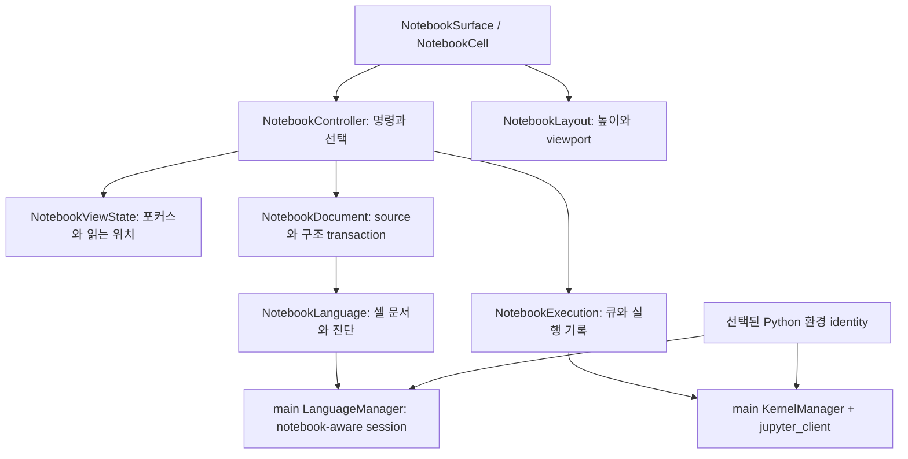

# Setdown 노트북 개선 설계: VS Code의 셀 편집 구조와 LSP 진단 비교

작성: 2026-10-16, Asia/Seoul. 후속 요청인 “LSP가 이상한 빨간줄을 긋는 문제”를 포함한다.

## 1. 결론

현재 Setdown은 노트북을 저장하고, Markdown을 읽고, Python 셀을 실행할 기반을 갖췄다. 그러나 **노트북 전체의 선택·포커스·편집 명령·레이아웃을 관리하는 계층**이 부족하다. 그 결과 셀 안의 Monaco는 익숙하지만, 셀을 오가며 작업하는 경험은 아직 거칠다.

LSP에도 같은 문제가 있다. 셀별 입력을 하나의 일반 Python 파일로 합치는 구현은 기본적인 자동완성을 가능하게 했지만, **셀 경계와 IPython 문법을 이해하는 노트북 분석**을 대체하지 못한다. 실제 Pyright로 잘못된 진단을 재현했다.

권고하는 방향은 다음과 같다.

1. 출력 높이와 입력 포커스가 스크롤 중 유지되도록 레이아웃부터 고친다.
2. 셀 선택 상태와 공통 명령 계층을 만들어 Shift+Enter, 셀 복사·붙여넣기, 다중 선택, Undo를 일관되게 연결한다.
3. 실행 중에도 다음 셀을 예약할 수 있는 실행 큐와 알아보기 쉬운 Python 환경 선택을 제공한다.
4. 노트북을 지원하는 LSP 연결을 도입하고, 실행 환경과 분석 환경을 일치시킨다.
5. 출력 조작, 읽기 상태를 유지하는 검색, Outline을 그 위에 붙인다.

기존 JSON 보존 codec, Monaco 모델 소유권, Crossnote 렌더링, 공식 `jupyter_client`는 유지할 가치가 크다. VS Code의 workbench나 Jupyter 확장 전체를 이식하기보다, 지금 빠진 책임을 작게 도입하는 편이 이득이다.

## 2. 조사 기준과 확인 범위

| 대상 | 조사 기준 |
|---|---|
| Setdown | `600f9aeb4380d5895d980f57b291dc1316a97774` |
| `vendor/vscode` | `d3d31f62268b169a2dfab62ffb2d7d38158a5b7c` |
| `vendor/vscode-jupyter` | `29e57a1eec77bc66c287321d3b1c41459d4458ed` |
| `vendor/vscode-languageserver-node` | `b8c8db0b6a5c1a257d224cda3f0c21ce0a8a3203` |
| 실제 실행한 언어 서버 | 설치된 Pyright `1.1.414` |
| 추가 공개 소스 조사 | basedpyright `v1.40.2`의 `languageServerBase.ts` |

이 문서는 [최초 통합 설계](2026_10_16_05_02_jupyter_notebook_integration_design.md)의 후속 감사다. 당시의 미구현 목록 대신 현재 구현과 비교했다.

증거를 세 종류로 구분한다.

- **재현:** 실제 Electron 또는 실제 언어 서버에서 관측한 결과.
- **코드 확인:** 구현 경로로 확인했지만 해당 사용자 시나리오 전체를 실행하지 않은 결과.
- **제안:** 앞으로 구현하고 검증해야 할 동작.

실측 자료는 [감사 결과 JSON](notebook-vscode-audit-evidence-2026-10-16.json)에 저장했다. Electron 검사는 격리된 Xvfb에서 실행했다. Python 비교는 IPython `InteractiveShell`을 사용했으며, 전체 커널 IPC 통합 테스트와 구분한다. 사용자에게 발생한 특정 빨간줄의 코드·진단 메시지는 제공되지 않았으므로, 아래 재현이 그 사례와 완전히 같다고 단정하지 않는다.

## 3. 이미 잘 만든 기반

| 현재 기반 | 유지해야 하는 이유 |
|---|---|
| [NotebookDocument](../apps/desktop/src/core/notebook/notebook-document.ts) | 원본 JSON span으로 수정해 metadata, attachments, 알 수 없는 필드와 숫자 표현을 보존한다. 변경 없는 저장은 원본 bytes를 유지한다. |
| [NotebookEntry](../apps/desktop/src/renderer/notebook/notebook-store.ts) | 편집기 DOM과 문서 모델의 수명이 분리되어 있다. 셀 편집기를 내렸다 올려도 모델과 텍스트 Undo를 유지할 수 있다. |
| [NotebookExecution](../apps/desktop/src/renderer/notebook/notebook-execution.ts) | 실행이 셀 컴포넌트 수명에 종속되지 않는다. 커널 generation과 실행한 source를 추적한다. |
| [kernel-bridge.py](../apps/desktop/src/main/notebook/kernel-bridge.py) | Jupyter 메시지와 채널을 직접 재구현하지 않고 공식 클라이언트를 사용한다. |
| [notebook-content.ts](../apps/desktop/src/renderer/notebook/notebook-content.ts) | 보존되는 output과 표시하는 output의 한도를 구분하고, shell에 들어오는 HTML을 정화한다. |
| [NotebookLanguage](../apps/desktop/src/renderer/notebook/notebook-language.ts) | 요청 취소, 버전 확인, UTF-16 좌표 변환과 셀 경계를 넘는 수정의 거부가 이미 있다. |

VS Code의 [ipynb serializer](../vendor/vscode/extensions/ipynb/src/notebookSerializer.ts)를 그대로 가져와 Setdown codec을 대체할 이유는 없다. 우리가 보존하는 원본 정보의 계약을 먼저 지켜야 한다.

## 4. 우선 고쳐야 할 실제 결함

### 4.1 화면 밖 출력이 사라지면서 문서 높이가 줄어든다 — 재현

[NotebookCell.svelte](../apps/desktop/src/renderer/notebook/NotebookCell.svelte)는 `nearby`일 때만 출력을 렌더링한다. 화면 밖으로 나가면 출력 DOM을 제거하지만 그 출력의 높이를 대신하는 공간은 남기지 않는다.

35개 코드 셀과 첫 셀의 100줄 출력을 가진 노트북에서 첫 셀 편집기에 포커스를 준 뒤 아래로 스크롤했다.

| 관측값 | 스크롤 전 | 스크롤 후 |
|---|---:|---:|
| 첫 셀 높이 | 1,736px | 115px |
| 노트북 전체 scrollHeight | 7,413px | 5,450px |
| 첫 셀 출력 DOM | 있음 | 없음 |
| 첫 셀 편집기 DOM | 있음 | 없음 |
| 포커스된 셀 | `cell0` | 없음 |

요청한 scrollTop은 2,158px인데 안정화 후에는 501px였다. 전체 높이 감소에는 다른 셀의 추정 높이 보정도 섞여 있다. 전부 출력 제거 때문이라고 계산해서는 안 된다. 다만 첫 셀 출력 영역의 붕괴와 포커스 해제는 직접 확인했다.

**수정:** 입력과 출력 각각의 측정 높이를 저장하고, DOM을 해제해도 셀의 논리 높이는 유지한다. 현재 읽는 셀 ID와 셀 내부 offset을 anchor로 삼아 위쪽 셀의 높이가 바뀌어도 위치를 보정한다. 사용자가 위쪽 내용을 읽는 동안 새 출력이 생겼다고 무조건 맨 아래로 따라가지 않는다.

참고: VS Code [NotebookCellAnchor](../vendor/vscode/src/vs/workbench/contrib/notebook/browser/view/notebookCellAnchor.ts), [NotebookCellLayoutManager](../vendor/vscode/src/vs/workbench/contrib/notebook/browser/notebookCellLayoutManager.ts).

### 4.2 화면 밖으로 이동한 입력 편집기를 무조건 해제한다 — 재현 및 위험 확인

`active && nearby && sourceMode`가 false가 되면 Monaco view를 dispose한다. 여기의 `active`는 활성 탭 여부다. 실제 입력 중인 셀, IME 조합 중인 셀, 마우스로 텍스트를 선택 중인 셀을 보호하는 조건이 아니다.

이번 검사에서는 포커스 해제를 재현했다. IME 조합 중 데이터 손실까지 재현한 것은 아니다. `composing` 플래그가 단축키와 커서 처리에만 쓰이고 view 수명에는 연결되지 않는다는 점은 코드에서 확인했다.

**수정:** 편집 포커스·조합·드래그 선택 중인 view는 잠시 고정한다. 다른 패널로 포커스를 옮긴 경우에는 다시 빼앗지 않는다. 셀의 선택 상태는 DOM 포커스와 별도로 유지한다.

### 4.3 셀 높이를 전부 펼치는 것만으로는 긴 셀 성능이 해결되지 않는다 — 코드 확인

이전 수정은 Python 박스 내부의 별도 스크롤을 없앴다. 이 사용자 경험은 유지해야 한다. 그러나 현재는 Monaco의 실제 viewport도 `getContentHeight()` 전체 높이로 설정한다. 매우 긴 단일 셀에서는 Monaco에 화면 전체보다 훨씬 큰 렌더링 영역을 제공한다. 이번 감사에서는 그 성능 비용을 수치로 측정하지 않았다.

VS Code의 [CodeCellLayout](../vendor/vscode/src/vs/workbench/contrib/notebook/browser/view/cellParts/codeCell.ts)은 **셀 전체의 논리 높이**와 **Monaco가 실제로 그리는 viewport 높이**를 구분한다. 노트북 스크롤에 맞춰 편집기의 위치와 내부 offset을 프로그램으로 맞추고, 사용자는 바깥 문서 하나를 스크롤한다. 드래그 선택 중에는 offset 조작도 제한한다.

Setdown에도 이 구분이 필요하다. 임의의 600px 제한이나 사용자용 내부 스크롤바를 다시 넣는 방식은 요구와 맞지 않는다. 먼저 높이 보존과 포커스 고정을 고치고, 긴 셀용 viewport 동기화는 별도 단계로 검증한다.

### 4.4 종료를 취소했는데 커널은 종료될 수 있다 — 코드 확인

[notebook-ipc.ts](../apps/desktop/src/main/notebook/notebook-ipc.ts)는 `before-quit`에서 커널 manager를 dispose한다. [WindowManager](../apps/desktop/src/main/windows/window-manager.ts)는 dirty 문서가 있으면 창 닫기를 막고 사용자 확인을 요청한다.

Electron의 `before-quit`은 창들이 닫히기 전에 발생한다. 따라서 앱 종료 요청 후 저장 확인에서 취소하면, 창은 남았는데 Python 변수 상태는 잃을 수 있는 순서다. 이번에는 이 시나리오를 GUI로 재현하지 않았다. [Electron 수명주기 문서](https://www.electronjs.org/docs/latest/api/app#event-before-quit).

**수정:** 소유 창/문서의 확정된 해제와 커널 종료를 연결한다. 최종 앱 종료에서는 정리를 기다리되, 취소 가능한 종료 시도만으로 살아 있는 문서의 커널을 파괴하지 않는다. 시간 지연을 임의로 넣는 해결은 피한다.

## 5. LSP의 이상한 빨간줄: 원인을 분리해야 한다

### 5.1 현재 데이터 경로

```text
셀별 Monaco model
  → NotebookProjection: 코드 셀을 빈 줄로 연결
  → .setdown-notebook-<uuid>.py라는 논리 파일
  → 일반 Python LSP의 textDocument/didOpen·didChange
  → 일반 Python 파일 진단
  → projection 범위를 셀의 Monaco marker로 변환
```

논리 `.py`는 디스크에 쓰지 않고 노트북과 같은 디렉터리에 둔다. 이것은 로컬 import와 기본적인 셀 간 자동완성에는 도움이 된다. 그러나 서버가 보는 것은 셀 목록이 아니라 하나의 Python 모듈이다.

현재 [projection](../apps/desktop/src/core/notebook/notebook-projection.ts)은 magic/shell 문법이 포함된 셀 전체를 빈 줄로 바꾼다. [LanguageManager](../apps/desktop/src/main/language/language-manager.ts)는 노트북을 `notebook.py` 지원 서버로 연결한다. [clientCapabilities](../apps/desktop/src/protocol/language-features.ts)에는 notebook synchronization 협상이 없다.

### 5.2 실제 Pyright 1.1.414로 확인한 사례

실제 Setdown `NotebookProjection`을 번들해, 임시 workspace의 Pyright에 stdio LSP로 전달했다. 기본 `basic` 검사 모드와 push diagnostics를 사용했다. 응답 진단은 모두 version 1을 포함했다. 이 검사에서 아래 오진은 버전 누락이나 좌표 stale 문제로 설명되지 않는다.

| 사례 | 실제 분석 결과 | 판단 |
|---|---|---|
| 셀 1 `import math`, 셀 2 `print(math.sqrt(4))` | 진단 없음 | 정상적인 셀 간 참조의 대조군 |
| 셀 1 `%who` 다음 줄 `import math`, 셀 2 `print(math.sqrt(4))` | 셀 2의 `math`가 정의되지 않았다고 표시 | **오진 재현.** 첫 셀 전체를 제외해 import까지 사라졌다. IPython에서는 두 셀 모두 정상 실행 |
| `import asyncio` 다음 줄 `await asyncio.sleep(0)` | await는 async 함수 안에서만 가능하다고 표시 | **노트북 문법 오진 재현.** IPython에서는 정상 실행 |
| `display(42)`와 `get_ipython()` | 두 이름이 정의되지 않았다고 표시 | **IPython 기본 환경과 분석 환경의 차이 재현.** IPython에서는 실행 가능 |
| 셀 1 `values = [1, 2`, 셀 2 `result = 42` / `print(result)` | 첫 셀의 괄호 오류 외에 다음 셀 끝에도 문장 구분 오류 | **셀 간 파싱 오류 전파 재현.** 다음 셀 자체는 정상 Python |
| 셀 1 `if True:`, 셀 2 들여쓴 `print(42)` | 진단 없음 | **오류 누락 재현.** 합친 파일은 문법적으로 맞지만 첫 셀 단독 실행은 incomplete input |
| 셀 1 값 대입, 셀 2 `from __future__ import annotations` | 파일 시작에 있어야 한다고 표시 | 합친 모듈에서 나온 제한. 실제 커널의 future 처리와 비교할 추가 통합 fixture 필요 |
| `count: int = "wrong"` | 타입 불일치 진단 | 유지해야 하는 유효한 타입 진단 |
| 위 셀 `print(later)`, 아래 셀 `later = 42` | 정의되지 않았다는 진단 | 문서 순서에 따른 정적 분석. 아래 셀을 먼저 실행했다고 자동으로 오진이 되는 것은 아님 |

즉, **빨간줄을 그리는 CSS나 Monaco 색상 문제보다 분석에 주는 문서의 의미가 먼저 잘못된다.** 범위를 정확히 셀로 돌려줘도, 서버가 잘못된 문맥에서 만든 진단은 정확해지지 않는다.

### 5.3 실행 Python과 분석 Python이 다를 수 있다 — 코드 확인

실행 환경은 [kernel-manager.ts](../apps/desktop/src/main/notebook/kernel-manager.ts)의 선택된 Python으로 정한다. 하지만 `NotebookLanguage.port.open()`에는 해당 환경 식별자가 없다. `ServerSession`의 `workspace/configuration`도 profile 설정만 반환하며 요청의 notebook별 scope를 이용하지 않는다.

따라서 `.venv`에서 실행하면 import가 성공하는데, LSP는 다른 Python의 package 경로를 분석해 missing import를 표시할 수 있다. 사용자 환경에서 이 사례까지 재현한 것은 아니지만 연결 부재는 명확하다.

VS Code Jupyter의 [NotebookPythonPathService](../vendor/vscode-jupyter/src/standalone/intellisense/notebookPythonPathService.node.ts)는 선택된 notebook controller의 interpreter를 Python 확장에 제공한다. Setdown은 이 책임을 기존 kernel manager와 language manager 사이에 직접 구현해야 한다.

수정은 `pythonPath` 한 값을 전역 설정에 넣는 것으로 끝나지 않는다. 같은 프로젝트의 노트북 A와 B가 서로 다른 환경을 사용할 수 있기 때문이다. 현재의 서버 재사용 판단과 세션 key에 **분석 환경 identity**를 포함하거나, 지원하는 서버에서 문서 scope별 환경을 안전하게 분리해야 한다. 환경 변경 시 기존 진단을 비우고 관련 연결만 다시 분석한다.

### 5.4 버전·좌표·marker 수명도 별도 점검 대상이다 — 코드 확인

현재 코드에는 요청 버전과 generation 검사가 이미 있다. “모든 진단이 무버전으로 뒤섞인다”는 설명은 틀리다. 다만 다음 빈틈이 남아 있다.

- `LanguageManager`는 버전 없는 push diagnostics를 현재 binding version과 `unversioned` 표시로 전달한다. 노트북 클라이언트는 그 표시를 별도로 처리하지 않는다. 셀 이동 전 좌표가 뒤늦게 도착하면 현재 projection과 맞는지 증명할 수 없다. 이번 Pyright 재현의 원인은 아니며 다른 서버까지 고려한 위험이다.
- `NotebookLanguage`는 실패·재연결·dispose 시 모든 소유 marker를 확실하게 지우는 경로가 부족하다. 살아 있는 모델에 이전 서버의 빨간줄이 남는 상황을 검증해야 한다.
- 진단의 `relatedInformation`을 버린다. 다른 셀의 선언과 관련된 이유를 사용자가 추적하기 어렵다.
- 셀 경계를 넘는 range는 버린다. 편집 거부에는 필요한 보수성이지만, 진단 표시까지 모두 같은 방식으로 처리하면 유효한 오류가 사라질 수 있다.
- 일반 파일용 pull diagnostics와 capability refresh 구현은 노트북 클라이언트에 연결되어 있지 않다. 서버를 바꾸면 “잘못된 빨간줄”뿐 아니라 “아무 진단도 없음”도 시험해야 한다.

진단 저장소는 `server / generation / notebook / cellId / cellVersion / structureRevision / analysisEnvironment`를 구분해야 한다. 현재 projection fallback에서는 응답 버전의 source map을 사용하고, 다른 셀로 range를 억지로 clamp하지 않는다. 버전 없는 응답에는 완전한 최신성 보장이 없음을 인정하고, 구조 변경 후에는 새 분석 확인이나 지원되는 pull 요청을 우선한다.

### 5.5 VS Code에서 실제로 참고할 세 가지

**노트북 문서 동기화.** VS Code용 [NotebookDocumentSyncFeature](../vendor/vscode-languageserver-node/client/src/common/notebook.ts)는 서버의 notebook selector와 capability를 확인한 뒤 셀 문서와 구조 변경을 동기화한다. 일반 text document 이벤트를 중복 발행하지 않도록 소유권도 나눈다. LSP에는 notebook open/change/save/close와 셀 목록·텍스트를 전달하는 표준이 있다. [LSP notebook synchronization](https://microsoft.github.io/language-server-protocol/specifications/lsp/3.17/specification/#notebookDocument_synchronization).

**노트북별 interpreter 연결.** 앞의 `NotebookPythonPathService`가 그 책임을 명시적으로 수행한다. 파일 분석과 실행의 환경이 저절로 일치한다고 가정하지 않는다.

**정적 분석과 실행 중 보완 기능의 분리.** [KernelCompletionProvider](../vendor/vscode-jupyter/src/standalone/intellisense/kernelCompletionProvider.ts)는 별도 커널 completion provider를 두고 다른 provider와 중복을 줄인다. [DiagnosticsProvider](../vendor/vscode-jupyter/src/standalone/intellisense/diagnosticsProvider.ts)는 `!pip` 같은 노트북 사용상의 경고를 담당한다. 이 작은 provider가 Python 타입 검사를 대신하는 것은 아니다.

VS Code/Pylance도 실행 순서를 완벽히 추적하는 분석기는 아니다. 공식 문제 해결 문서는 문서의 위→아래 순서, 선택 환경, magic이 주입하는 이름을 구분해 확인하도록 설명한다. “실행됐으니 모든 빨간줄은 잘못됐다”는 정책은 피해야 한다. [Pylance notebook troubleshooting](https://github.com/microsoft/pylance-release/blob/main/docs/howto/notebook-troubleshooting.md).

2022년 [Jupyter IntelliSense 설계 설명](https://github.com/microsoft/vscode-jupyter/wiki/Intellisense-for-notebooks)은 구조를 이해하는 보조 자료로 읽었다. 그 문서의 과거 실험 설정이나 completion 중복 제거 상태를 현재 동작으로 옮기지 않고, 위의 실제 submodule 코드를 기준으로 판단했다.

### 5.6 현실적인 서버 선택: capability만 추가해서는 해결되지 않는다

실제 초기화 검사에서 **Pyright 1.1.414는 `notebookDocumentSync`를 제공하지 않았다.** 클라이언트가 notebook synchronization 지원을 알린 상태에서도 같았다. 따라서 현재 서버에 `notebookDocument/didOpen`만 보내는 수정은 해결책이 아니다.

유력한 대안은 **표준 notebook synchronization을 지원하는 서버를 노트북 연결에 사용하는 것**이다. basedpyright `v1.40.2` 공개 구현에는 notebook selector, open/change/close 처리, 셀별 `IPythonMode.CellDocs`와 이전 셀 연결이 있다. 또한 `vscode-notebook-cell` URI에 대한 특별 처리가 있어, Setdown의 `setdown-cell` URI를 그대로 보내면 된다고 가정할 수 없다. [확인한 서버 소스](https://github.com/DetachHead/basedpyright/blob/v1.40.2/packages/pyright-internal/src/languageServerBase.ts).

이 서버를 Setdown에서 실행한 비교 시험은 아직 하지 않았다. 권고는 **노트북 전용 연결 prototype의 1순위 후보**라는 뜻이며, 모든 오진이 해결됐다는 뜻이 아니다.

구현 판단 순서는 다음과 같다.

1. 현재 language registry에 있는 basedpyright profile을 활용해 notebook-native 연결을 시험한다. 일반 `.py`에 대한 사용자의 서버 선택은 유지한다.
2. main이 발급한 안정적인 notebook/cell URI와 서버용 wire URI 사이에 registry를 둔다. 노트북 경로, 셀 ID, 구조 변경, Save As를 함께 관리한다. 서버가 요구하는 URI 표현은 이 adapter에서 처리한다.
3. 서버 capability와 selector가 맞을 때만 native notebook 경로를 사용한다. 셀 수정과 재배열을 한 구조 revision에 맞춰 보내고, 진단은 셀 URI로 받는다.
4. 현재의 `basic` 수준과 프로젝트 설정을 존중한다. 서버 교체로 검사 강도가 갑자기 높아지는 것을 UX 개선으로 착각하지 않는다.
5. 아래 진단 fixture와 환경 분리 시험이 통과한 뒤 기본 제공 서버 변경 또는 추가 여부를 결정한다. 중복 번들 비용도 확인한다.

`display()` 같은 기본 심볼은 native 접속만으로 모두 해결된다고 가정하지 않는다. 선택한 IPython 환경에서 보장하는 심볼을 notebook 범위의 타입 정보로 제공할지, 명시적 import를 제안할지 따로 정한다. 실제로 정의되지 않은 이름까지 전부 `Any`로 선언하거나 undefined-variable 검사를 통째로 끄는 처리는 하지 않는다. 실행 이력에서만 남아 있는 변수와 notebook이 기본 제공하는 이름을 구별해야 한다.

일반 Python LSP만 가능한 경우에는 projection을 제한적 호환 경로로 남길 수 있다. 다만 완전한 notebook 지원으로 표시하면 안 된다. magic 줄 일부를 보존형으로 바꾸는 완화책은 import 누락을 줄일 수 있지만, `%time`, `%%bash`, shell 대입, 미완성 괄호와 셀별 문법을 해결하는 자체 Python 변환기를 키우는 방향은 유지비가 크다. **native 연결을 먼저 검증하고, fallback의 한계를 명확히 관리하는 편이 낫다.**

서버 이름만 Pylance로 바꾸거나 VS Code Jupyter 확장을 Monaco에 직접 설치하는 것도 계획이 아니다. 조사한 VS Code 확장 API와 Setdown의 standalone Monaco 사이에는 workbench와 확장 호스트가 없다.

## 6. 일상적인 편집에서 부족한 것

| 사용자 동작 | 현재 Setdown | 개선 방향 / 참고 코드 |
|---|---|---|
| 셀 선택과 텍스트 편집 구분 | DOM focus와 개별 `editing` 상태 위주 | active cell, 선택 범위, focus target 분리. VS Code `cellSelectionCollection.ts` |
| Shift+Enter | 없음 | 실행/Markdown 확정 후 다음 셀로 이동. `executeActions.ts` |
| Ctrl/Cmd+Enter | 코드 셀 실행 | 현재 셀 유지, 실행 중이면 큐에 예약 |
| Alt+Enter | 없음 | 실행 후 아래 셀 생성과 이동 |
| Esc | Markdown 편집→미리보기 있음 | 기존 동작 보존, completion/IME 우선, 셀 선택 모드로 연결 |
| 셀 복사·잘라내기·붙여넣기 | 텍스트 복사는 가능, notebook cell clipboard 없음 | 선택 셀 payload, source fallback, 새 셀 ID, 단일 Undo |
| 여러 셀 선택/삭제/이동 | 개별 셀 중심 | 연속·복수 선택과 batch transaction |
| 셀 합치기/나누기 | 없음 | 같은 종류 합치기, 커서 위치 나누기, metadata 정책 명시 |
| Undo | 텍스트 모델과 구조 toolbar 분리 | 포커스 문맥에 맞는 공통 Undo 명령 |
| 드래그 이동 | 단일 셀 이동 있음 | 가장자리 자동 스크롤, 선택 묶음 이동, 키보드 대안 |
| 실행 중 다음 셀 실행 | 전역 busy로 막음 | 순차 실행 큐에 추가, 셀별 상태 표시 |
| Python 선택 | 실행 파일 dialog | 발견한 환경·최근 선택·직접 지정, 분석 환경 동기화 |
| 출력 조작 | 정적 표시와 셀 clear | 복사, 이미지 저장, 전체 텍스트 열기, 접기, MIME 선택 |
| 노트북 검색 | 소스 문자열 검색 | 읽기 상태 유지, source/preview/output 범위, 첫 결과부터 이동 |
| 읽던 위치 복원 | 일반 reading-position 경로에서 notebook 제외 | 셀 ID + offset, 접힘·선택 상태 저장 |
| Outline | 없음 | Markdown heading부터 시작, 코드 symbol은 제한적으로 추가 |
| Git 비교 | read-only JSON diff | 셀 단위 소스 비교, output/metadata는 접어서 표시 |

관련 Setdown UI는 [NotebookSurface](../apps/desktop/src/renderer/notebook/NotebookSurface.svelte)와 [NotebookCell](../apps/desktop/src/renderer/notebook/NotebookCell.svelte)에 모여 있다. 표의 기능을 여기에 계속 조건문으로 붙이면 상태 간 충돌이 커진다.

### 6.1 셀 상태와 명령을 먼저 만든다

문서 소유자인 `NotebookEntry`와 별도로 view별 상태를 둔다.

```ts
type NotebookViewState = {
  activeCellId: string | null;
  selectedCellIds: string[];
  focusTarget: 'cell' | 'editor' | 'output' | 'toolbar';
  editingMarkdownIds: Set<string>;
  collapsedInputIds: Set<string>;
  collapsedOutputIds: Set<string>;
  scrollAnchor: { cellId: string; offset: number } | null;
};
```

실제 타입과 저장 형식은 구현 때 다듬되, selection과 DOM focus를 동일한 값으로 만들지 않는다. 같은 문서의 view 상태와 파일에 저장할 데이터도 구분한다.

`NotebookController`의 명령을 버튼·단축키·메뉴·우클릭이 공유하도록 한다. 예: `runCell`, `runAndSelectNext`, `insertBelow`, `copyCells`, `pasteCells`, `splitCell`, `joinCells`, `clearOutputs`, `undo`.

키 입력의 우선순위는 IME/completion 등 편집기 내부 상태 → 텍스트 편집 → 셀 선택 → 노트북이다. 텍스트를 선택했을 때 Ctrl+C가 셀 전체를 복사하면 안 된다. 셀 선택 모드에서는 같은 키가 셀을 복사해야 한다.

참고: VS Code [editActions](../vendor/vscode/src/vs/workbench/contrib/notebook/browser/controller/editActions.ts), [clipboard](../vendor/vscode/src/vs/workbench/contrib/notebook/browser/contrib/clipboard/notebookClipboard.ts), [cellOperations](../vendor/vscode/src/vs/workbench/contrib/notebook/browser/controller/cellOperations.ts), [Undo/Redo routing](../vendor/vscode/src/vs/workbench/contrib/notebook/browser/contrib/undoRedo/notebookUndoRedo.ts).

### 6.2 구조 변경은 하나의 작업으로 되돌릴 수 있어야 한다

`remove()`를 선택 셀 수만큼 호출하는 것으로 다중 삭제를 구현하면 Undo도 그만큼 필요하다. 복사·붙여넣기, 합치기, 분할, 여러 셀 이동은 before/after selection을 포함한 한 transaction으로 실행한다.

텍스트 변경은 Monaco public edit API를 사용하고, 구조 transaction은 기존 NotebookDocument history를 확장한다. 제거된 셀을 Undo할 때 metadata, attachments, output과 원래 ID가 복원되어야 한다. 다른 노트북에 붙일 때는 충돌 없는 새 ID를 발급한다. VS Code 내부 undo service 전체를 가져올 필요는 없다.

## 7. 화면은 더 조용하게, 동작은 더 풍부하게

현재 각 셀은 유형 선택, 이동, 추가, 복제, 삭제, 출력 삭제 등을 항상 보여준다. 문서가 길어질수록 같은 toolbar가 반복되고 읽는 내용보다 조작 요소가 강조된다.

제안하는 구성:

- 노트북 상단: `Run All`, 실행 중 `Stop`, 현재 Python 환경 이름, 짧은 상태. 나머지는 `…`.
- 코드 셀 왼쪽: Run, 실행 번호, 실행 중 표시. 오른쪽 보조 도구는 hover/focus/선택 시 노출.
- 셀 사이: hover 또는 키보드 포커스에서 `+ Code / + Markdown`.
- 셀 아래: 필요할 때만 실행 시간·실패·이전 source의 output 표시.
- 출력: 선택과 복사가 자연스럽고, 추가 작업은 작은 메뉴에 배치.

VS Code의 [cell toolbar CSS](../vendor/vscode/src/vs/workbench/contrib/notebook/browser/media/notebookCellTitleToolbar.css), [run toolbar](../vendor/vscode/src/vs/workbench/contrib/notebook/browser/view/cellParts/codeCellRunToolbar.ts)를 참고한다. hover 전용으로 기능을 숨기지 않고, keyboard focus와 메뉴가 열린 상태에서도 유지한다. Setdown의 기존 색상 token, 아이콘과 메뉴 컴포넌트를 재사용한다.

읽기 모드의 Markdown을 찾았다고 편집 모드로 바꾸지 않는다. 현재 `showCell → reveal`은 `editing = true`로 이어진다. 또한 초기 matchIndex가 0인데 Enter가 `find(1)`을 호출해 여러 결과일 때 첫 결과를 건너뛸 수 있다. 둘 다 코드에서 확인했으며 전용 GUI fixture가 필요하다.

검색은 우선 source와 rendered Markdown을 안정적으로 지원하고, output 검색을 선택 옵션으로 확장한다. VS Code [findFilters](../vendor/vscode/src/vs/workbench/contrib/notebook/browser/contrib/find/findFilters.ts)는 이 범위를 구분한다. Outline은 [NotebookOutlineDataSource](../vendor/vscode/src/vs/workbench/contrib/notebook/browser/viewModel/notebookOutlineDataSource.ts)처럼 heading과 코드 symbol을 나누되, 처음에는 가벼운 heading 탐색부터 제공한다.

## 8. 실행 경험을 바꾸는 핵심은 큐다

현재 Run All은 선택한 batch를 차례로 실행한다. 하지만 busy 동안 `NotebookExecution.run()`과 main manager가 새 요청을 막으므로, 오래 걸리는 셀을 실행하고 다음 셀을 작성해 Shift+Enter로 예약하는 흐름은 없다.

VS Code Jupyter의 [CellExecutionQueue](../vendor/vscode-jupyter/src/kernels/execution/cellExecutionQueue.ts)는 실행 중인 커널과 대기 셀을 별도로 관리한다. Setdown도 커널당 하나의 순차 큐를 둔다.

- 요청 시 `runId`, `cellId`, source snapshot, source version, kernel generation을 저장한다. 같은 source version을 다시 실행할 수 있으므로 runId가 필요하다.
- Shift+Enter는 바로 다음 셀로 포커스를 옮기고, 실행은 큐에서 처리한다.
- 이미 대기 중인 같은 셀의 중복 예약 정책을 정한다. 권장 초기값은 pending 항목 하나를 최신 명시 요청으로 갱신하고, 현재 실행 중인 항목은 바꾸지 않는 것이다.
- 상태는 queued/running/succeeded/failed/canceled/skipped로 구분한다. 커널 idle만으로 모든 결과를 지우지 않는다.
- Stop은 현재 실행을 interrupt하고 대기를 취소한다. Restart는 변수 상태를 지우는 별도 명령이다.
- 실행 후 source가 바뀌면 output의 과거 버전 표시를 유지한다. 현재의 display_id 갱신과 clear_output 동작도 보존한다.

실행 번호, 성공/실패, 경과 시간은 [VS Code execution status bar](../vendor/vscode/src/vs/workbench/contrib/notebook/browser/contrib/cellStatusBar/executionStatusBarItemController.ts)를 참고한다. 데이터는 controller가 소유하고 표시 컴포넌트는 이를 읽는다.

Python picker는 [Jupyter 환경 탐색](../vendor/vscode-jupyter/src/kernels/raw/finder/localPythonAndRelatedNonPythonKernelSpecFinder.node.ts)과 [preferred kernel 선택](../vendor/vscode-jupyter/src/notebooks/controllers/preferredKernelConnectionService.ts)의 책임 구분을 따른다. 기존 ServerEnvironment/Discovery를 재사용하면서 `.venv`, 알려진 Python 환경, 최근 선택, 직접 경로 지정을 보여준다. 실행 파일 선택 dialog는 fallback으로 남긴다.

환경 발견만으로 임의의 notebook metadata/kernelspec 명령을 실행하지 않는다. 사용자가 선택한 환경의 실행 가능 여부와 `ipykernel` 유무를 확인하고, 문제가 있으면 해당 환경에 필요한 설치 명령을 안내한다. 개인의 절대 경로는 `.ipynb`에 불필요하게 기록하지 않는다.

## 9. 출력과 LSP의 다음 확장

### 출력에서 먼저 할 일

[NotebookOutputs](../apps/desktop/src/renderer/notebook/NotebookOutputs.svelte)는 이미 raster image, HTML, Markdown, LaTeX 등의 정적 표시를 제공한다. 다음은 renderer를 많이 늘리는 것보다 조작을 완성하는 편이 낫다.

1. 전체 텍스트 복사, 선택 복사, 이미지 저장/복사, 전체 텍스트 별도 보기.
2. source/output 접기와 복원, 명시적인 긴 출력 펼치기.
3. stdout/stderr의 ANSI 및 carriage return 갱신 처리. progress 출력이 계속 긴 문자열로 쌓이는 문제를 줄인다.
4. 복수 MIME이 있을 때 표시 형식 선택. 원본 bundle은 유지한다.
5. traceback에서 해당 셀과 줄로 이동.

사용자가 싫다고 한 박스 내부의 별도 세로 스크롤을 기본값으로 되살리지 않는다. 긴 출력은 접기/전체 보기로 조절하고, 노트북의 바깥 스크롤을 유지한다.

참고: [VS Code output actions](../vendor/vscode/src/vs/workbench/contrib/notebook/browser/controller/cellOutputActions.ts), [Jupyter output message handler](../vendor/vscode-jupyter/src/kernels/execution/cellExecutionMessageHandler.ts).

widgets, Plotly의 active HTML, SVG, JavaScript 출력을 지원하려면 별도 격리 renderer와 제한된 메시지 경계를 먼저 설계해야 한다. VS Code의 [notebook renderers](../vendor/vscode/extensions/notebook-renderers/src/index.ts)는 그 제품의 webview 환경을 전제로 한다. Setdown shell의 sanitizer를 느슨하게 만드는 것으로 가져올 수 없다.

### LSP는 정확도를 먼저, 수정 기능은 transaction 이후

native notebook 연결과 환경 일치가 안정화되면 기존 공통 LSP 변환 코드를 활용해 references, document highlights, semantic tokens, inlay hints 등을 셀에 연결한다. 색상과 힌트도 같은 셀/버전 수명 규칙을 따라야 한다.

rename, code action, formatting, auto-import는 여러 셀 또는 일반 파일을 바꿀 수 있다. 먼저 URI registry와 atomic edit transaction을 만든 뒤 활성화한다. 현재의 교차 셀 수정 거부를 먼저 제거하면 안 된다. Problems 목록도 셀 번호/제목과 진단 source를 표시하고 해당 셀로 이동하도록 연결한다.

Kernel completion은 `%run`이나 런타임 객체를 보완하는 후속 기능이다. 커널이 시작되지 않았는데 자동완성을 위해 실행 환경을 자동 시작하거나, 사용자 코드를 분석 목적으로 실행하는 정책은 넣지 않는다. 정적 진단과 실행 오류도 별개의 표시로 둔다.

## 10. 책임을 어떻게 배치할 것인가



위 상자마다 거대한 framework를 만들 필요는 없다. 처음에는 controller와 view state를 한 작은 모듈로 두고, layout과 native notebook language adapter를 책임상 분리하면 된다.

추가로 document event를 source/structure/output/metadata/checkpoint로 나눠야 한다. 지금은 output flush도 일반 문서 변경을 발생시킨다. `NotebookLanguage`는 매번 전체 projection을 만든 다음 문자열이 같은지 확인하고, [TabController](../apps/desktop/src/renderer/workspace/tab-controller.ts)의 `entry.changed`는 전체 chrome 갱신과 autosave 예약까지 실행한다.

출력 변경에 LSP 요청을 보내지는 않도록 이미 방어되어 있다. 그러나 projection 생성과 전체 UI 갱신 비용까지 사라진 것은 아니다. 이 비용은 코드에서 확인한 성능 위험이며 이번 감사에서 latency 수치를 측정한 것은 아니다.

**변경 분리:** source/structure만 언어 동기화, 해당 셀 output만 출력 갱신, dirty 전환 때만 필요한 chrome 갱신, 저장 시 일관된 snapshot 직렬화. 이것이 streaming output이 편집 반응성에 영향을 주는 범위를 줄인다.

## 11. 구현 순서와 완료 기준

| 단계 | 변경할 중심 모듈 | 완료 기준 |
|---|---|---|
| 1. 신뢰 회복 | NotebookCell, layout, notebook-ipc | 화면 밖 출력 높이 보존, focus/IME 보호, 종료 취소 시 커널 유지 |
| 2. 진단 정확도 | notebook language adapter, LanguageManager, Python 환경 연결 | native notebook prototype에서 오진 fixture 검증, 환경별 import 일치, 구조 변경 후 stale marker 차단 |
| 3. 편집 흐름 | NotebookController/ViewState, NotebookDocument transactions | Shift+Enter/Alt+Enter, 셀 clipboard, 다중 선택, 한 번의 Undo, context menu |
| 4. 실행·선택 UX | NotebookExecution, kernel manager, picker | busy 중 예약, 명확한 셀별 상태, 최근 Python 선택 복원, Stop/Restart 구분 |
| 5. 읽기·출력 | NotebookOutputs, find/outline/position | 읽기 검색 유지, 출력 복사·저장, 접기, 읽던 위치 복원, contextual toolbar |
| 6. 고급 기능 | LSP workspace edits, notebook diff/export | 원자적 다중 셀 수정, 셀 Git diff, 메뉴에서 명시적 export |

변수 탐색기, debugger, remote kernel, widgets는 그 다음이다. `input()`은 interactive request와 취소·커널 종료 수명을 설계한 후 추가할 수 있다. 지금은 `allow_stdin=False`이므로 UI만 붙여서는 작동하지 않는다.

1~4단계를 작게 나누어 진행하는 것이 우선이다. 시각적 polish만 먼저 하면 실행과 진단의 불신이 남고, 모든 고급 기능부터 추가하면 기본 편집 동작을 다듬기 어려워진다.

## 12. 검증 계획

### 이번 감사에서 수행한 것

- 격리된 실제 Electron에서 35셀/긴 출력 fixture로 높이 변화와 focused editor dispose를 측정했다.
- 현재 projection과 실제 Pyright 1.1.414로 9개 진단 시나리오를 실행했다. 정상·진짜 오류 대조군을 포함한다.
- IPython에서 magic/import, top-level await, injected builtins, 셀을 가로지르는 block 사례를 비교했다.
- basedpyright는 고정 tag의 소스를 검토했으며 Setdown 통합 실행을 검증하지 않았다.
- 제품 코드는 변경하지 않았다. 문서 작업이므로 전체 build/preview gate를 다시 실행하지 않았다.

재현 도구와 로그는 로컬 `test-results/notebook-vscode-audit-2026-10-16/`에 있다. 영구 보존할 주요 입력과 결과는 위의 감사 JSON에 포함했다. Pyright는 샌드박스 내부에서 초기 종료되어, 별도 허용된 실행으로 실제 응답을 수집했다. 이것을 제품 서버의 실패로 계산하지 않았다.

### 구현 때 필요한 regression fixture

| 범위 | 반드시 통과할 사용자 시나리오 |
|---|---|
| 레이아웃 | 긴 출력 셀을 벗어났다 돌아와도 읽는 셀이 유지됨. 위쪽 출력이 늘어나도 anchor 유지 |
| 입력 | IME 조합·마우스 텍스트 선택 중 스크롤해도 editor 수명/selection 유지. 다른 패널 focus를 빼앗지 않음 |
| 규모 | 100/1,000셀과 매우 긴 단일 셀에서 mounted editor 수, DOM, long task, 닫은 뒤 자원 회수 측정 |
| 명령 | Shift+Enter로 연속 3셀 실행 예약, Markdown Esc/Shift+Enter, 문맥별 Ctrl+C/Undo |
| 구조 | 다중 이동·복사·붙이기·삭제 후 한 번의 Undo. metadata/attachments/output와 ID 정책 검증 |
| 실행 | interrupt와 restart 차이, 실패 뒤 batch 중단, 실행 중 source 수정, 종료 취소 후 변수 유지 |
| 진단 | 위 9개 fixture, 정상 코드 다음의 미완성 셀, magic/문자열/주석 구분, 한글·emoji·CRLF 좌표 |
| stale 진단 | 셀 이동·삭제·kind 변경 중 늦은 push/pull 응답, 서버 restart/disable 후 marker 청소 |
| Python 환경 | 같은 프로젝트의 두 notebook이 다른 venv 사용, kernel과 LSP import 결과 일치 |
| native protocol | open/change/move/save/close, text 이벤트 중복 없음, selector와 URI 호환, 일반 `.py` 회귀 없음 |
| 읽기 | 검색 첫 결과, Markdown preview 상태 유지, output 검색 범위, 탭 재방문·재시작 위치 복원 |

기존 [성능 계약](../docs/preview-performance-contract.md)의 통과 기록은 기존 시나리오의 근거다. ordinary Markdown/Git preview benchmark가 통과했다고 긴 노트북과 output streaming 성능까지 증명되는 것은 아니다.

향후 실제 UI/CSS/preview 경로를 바꾸면 계약대로 `npm run test:preview-contract`와 동일 격리 display에서의 baseline/candidate benchmark를 수행한다. 노트북에는 별도로 셀 수·긴 셀·출력 증가·환경 변경을 측정하는 시나리오를 추가한다. 오류를 없애기 위해 타입 검사 전체를 끄거나, 실패하는 시나리오를 제외하는 방식은 완료 기준이 아니다.


## 후속 구현 — 2026-10-16

이 문서 위의 감사 결과는 `600f9ae` 기준이다. 후속 변경은 노트북의 기반과
핵심 편집 흐름에 적용했다. 실제 사용법과 현재 범위는
[notebooks.md](../docs/notebooks.md), 검증 결과와 성능 수치는
[preview performance contract](../docs/preview-performance-contract.md)에 기록한다.

- joined `.py` projection과 magic 셀 전체 제거를 삭제했다. 고정된 basedpyright
  1.40.2에 native notebook/cell 문서를 전달한다. 일반 `.py` 연결은 그대로다.
- 셀별 URI와 source revision, 노트북 dependency revision을 별도로 검증한다.
  구조 변경은 같은 분석 프로세스에서 새 URI epoch로 문서를 다시 열어 늦은
  진단이 다른 셀에 붙지 않게 한다. 실제 환경 두 개의 import 차이도 검증한다.
- Python 선택을 파일별로 저장하고 분석과 실행에 함께 사용한다. 발견한
  프로젝트 Python을 자동 실행하지 않는다. 없는 saved 환경도 조용히 대체하지 않는다.
- 셀의 논리 높이와 Monaco의 렌더 viewport를 분리했다. 출력 높이 예약,
  화면 밖 focus/IME 유지, textarea 기반 입력으로 가상 셀 제거 후 일반 입력이
  막히는 EditContext 문제를 처리했다.
- 셀 선택·범위 선택·복사·잘라내기·붙이기·다중 드래그·단일 구조 Undo를 연결했다.
  Shift+Enter/Alt+Enter, 실행 중 예약, 중복 예약 갱신, runId 기반 결과 소유권,
  상태와 실행 시간을 추가했다. 종료 취소는 커널 변수를 유지한다.
- 읽기 모드 검색의 첫 결과와 focus를 보존하고, 출력 복사·접기·MIME 선택과
  ANSI/CR 표시를 추가했다. 출력 이벤트는 LSP 동기화에서 즉시 제외한다.

고급 편집을 모두 포팅한 것은 아니다. 셀 split/merge, 전용 우클릭 메뉴,
이미지 출력 저장, traceback 링크, output 범위 검색과 outline, 실행 후 변수
탐색, 노트북 diff와 cross-cell workspace edits는 후속 범위다. 1,000셀의
전체 DOM·메모리·streaming 처리량은 일반 Markdown/Git 벤치마크 수치로
대신 주장하지 않는다. 이번 GUI 회귀는 35셀/긴 출력과 긴 단일 셀을 검사한다.

최종 기능 검증은 단위 검사 67파일/441개, benchmark comparator 3개,
실제 Electron 123개 시나리오와 IPython 통합 검사 3개를 통과했다.
빌드·타입 검사도 통과했으며 Svelte 오류/경고는 0개다. 새 bundled 서버
항목의 목록·상세 화면 검사도 반영했다. 원래 감사 단계의 미검증 사항과
이번 구현 후 검증 결과를 구분하기 위해 위 감사 기록은 그대로 보존한다.
독립 설치한 `600f9ae` 기준과 수정본의 5회 비교도 기존 허용 기준에서
48개 항목 모두 회귀 없이 통과했다. 첫·두 번째·warm 전환 및 준비 시간
포함 수치는 위 성능 계약의 “Notebook reform validation” 절에 기록했다.
