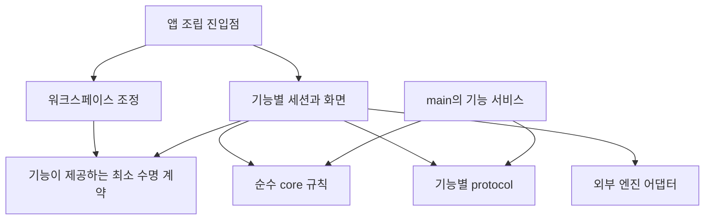

# Setdown의 다음 확장을 위한 디렉토리 구조 평가

작성: 2026-10-16 KST. 분석 기준: `ab08e8ccb9a02bb247a88f7f784c210b1a30117b`.

사진 편집기, 고급 동영상 재생, Chrome 확장 호환성, LSP 검증을 앞으로의 요구사항으로 놓고 현재 코드·의존 관계·변경 이력·테스트 실행 경로를 조사했다. 이 문서는 구조 평가와 실행 제안이다. 애플리케이션을 재구성하거나 전체 테스트를 실행한 결과 보고서는 아니다. 테스트 수는 실제 runner의 목록 수집으로 확인했다.

## 1. 판단: 큰 틀은 유지하고, 기능이 자라는 경계를 바꿔야 한다

**지금 구조는 출발점으로 타당하지만, 그대로 확장하는 것이 최선은 아니다.** `main`, `renderer`, `preload`, `core`, `protocol`의 구분은 Electron의 실행 환경과 권한 차이를 반영한다. 이 경계를 없애고 모든 파일을 최상위 `features/` 아래로 옮길 이유는 약하다. 반면 기능이 늘 때마다 공통 탭 제어부, 공통 문서 모델, 공통 액션 목록까지 세부 구현을 알아야 하는 방식은 손봐야 한다.

권장하는 방향은 **프로세스별 구조 안에서 기능별 책임을 강화하는 단일 애플리케이션 구조**다. 이미지 기능은 이미지 편집 상태와 저장을, 동영상 기능은 재생 세션과 엔진을 책임진다. 워크스페이스는 어떤 탭이 열리고 활성화되고 닫히는지를 조정한다. 기능 구현을 연결하는 진입점은 여전히 필요하지만, 그 진입점이 각 기능의 내부 상태까지 관리하지 않도록 한다.

테스트가 늘어난 것은 이 전환에 유리하다. 줄여야 할 것은 테스트 수가 아니라, 테스트의 실행 조건을 알아내기 위해 읽어야 하는 설정과 문서의 양이다. 현재 일반 PR의 자동 검증은 빌드까지다. 테스트 자산의 성장과 자동 검증의 성장이 아직 일치하지 않는다.

로드맵 전에 우선할 일은 다음 세 가지다.

1. **검증 경로를 정리한다.** 전체 테스트 목록, 기능별 분류, 실행 환경, CI 실행 여부를 연결한다.
2. **워크스페이스와 기능 세션의 책임을 나눈다.** 특히 이미지의 미저장 편집 상태가 화면 캐시의 수명에 종속되지 않게 한다.
3. **외부 엔진을 연결하는 경계를 만든다.** 라이브러리 교체가 탭 모델과 공통 제어부의 재작성으로 번지지 않게 한다.

전면적인 폴더 이사보다 이 세 작업의 효과가 크다. 아래에서 그 판단의 근거와 실제 디렉토리 변경안을 설명한다.

## 2. 얼마나 커졌고, 무엇이 커졌는가

우선 저장 공간, 제품 코드, 테스트를 구분해야 한다. 이들을 한 숫자로 합치면 문제가 어디에 있는지 흐려진다.

| 조사 항목 | 현재 상태 | 해석 |
| --- | ---: | --- |
| desktop 운영 소스 | 290개 파일, 31,419줄 | TS·Svelte·CSS·Python·JS, 단위 테스트 제외. 선언 파일과 Min에서 가져온 JS 145줄 포함 |
| 소스 옆 단위 테스트 | 121개 파일, 10,769줄 | Vitest 기본 설정에서 847개 테스트 수집 |
| `test/` 아래 테스트·지원 코드 | 61개 파일, 10,134줄 | TS·Python·CJS·MJS 기준. fixture와 실행 도우미 포함 |
| 기본 Electron E2E | 49개 spec, 163개 테스트 | Playwright 기본 설정에서 수집. 별도 언어 서버·notebook-tools suite 제외 |
| Git 서브모듈 | 26개 | 외부 구현을 조사하는 참조 저장소와 빌드에 사용하는 저장소가 함께 있음 |
| preview 계약 문서 | 1,839줄 | 현재 보장 사항, 여러 기능의 계약, 날짜별 검증 기록이 함께 있음 |

운영 소스 중 `main`은 10,112줄, `renderer`는 14,558줄이다. `core`는 3,475줄이며, 나머지는 protocol·preload·별도 runtime 등이다. 아직 기능마다 npm 패키지를 만들어야 할 규모라는 근거는 없다. 같은 배포물 안에서 책임을 명확히 나누는 편이 비용이 낮다.

디스크에서 보이는 큰 숫자는 다른 문제를 나타낸다. 조사 당시 `node_modules`는 약 4.6G, `vendor`는 2.3G, `.git`은 3.5G였다. `.git/modules`만 약 3.0G이므로 `.git` 전체를 Setdown 자체의 변경 이력 크기로 해석해서는 안 된다. `apps/desktop/release`도 약 1.4G였다. 반면 `src`는 약 3.6M, `test`는 약 908K다. 이 값은 `du -sh`의 로컬 할당 공간이며 설치·빌드 상태에 따라 달라진다.

상위 저장소가 추적하는 일반 파일의 현재 크기를 합하면 약 153.3MB다. 서브모듈 내부는 제외한 값이고 Git 이력 전체의 크기도 아니다. 그중 루트 `live_demo.gif` 하나가 약 40.8MB이며, `docs/assets/`에도 큰 GIF가 있다. 따라서 체크아웃과 검색 비용을 줄이는 일은 필요하지만, 소스 폴더를 옮기는 것만으로 해결되지는 않는다.

## 3. 지금 구조에서 보존할 가치가 있는 것

### 실행 환경을 드러내는 최상위 분리

`main`은 파일과 창·프로세스·네이티브 뷰를 관리하고, `renderer`는 사용자의 작업 화면을 구성한다. `preload`와 `protocol`은 두 환경을 연결한다. `preview-runtime`과 `browser-runtime`이 따로 있는 것도 의미가 있다. 앱 화면, 문서 미리보기, 웹 페이지와 확장 기능은 동일한 실행 환경이 아니다.

사진 편집기나 동영상 엔진을 도입해도 이 구분은 유효하다. 어떤 코드를 renderer에 둘 수 있고, 어떤 자원을 main이나 별도 worker가 소유해야 하는지 경로에서 읽을 수 있기 때문이다. 기능 이름만으로 모든 파일을 묶으면 이 정보가 한 단계 안쪽으로 숨는다.

### `core`가 실제로 독립적이다

운영 TS와 Svelte script의 상대 import를 분석한 범위에서 `core`가 다른 내부 계층을 참조하는 연결은 발견되지 않았다. 이미 [architecture-boundaries.test.ts](../apps/desktop/src/architecture-boundaries.test.ts)는 core의 Electron·UI·IPC 의존, renderer의 직접 전역 API 접근, main의 UI 구현 역참조를 검사한다.

이것은 디렉토리 이름만 깔끔한 상태보다 낫다. 이후에도 순수한 문서 규칙과 워크스페이스 상태는 Electron 없이 검증할 수 있어야 한다. 이미지 편집의 명령 이력 같은 순수 모델을 추가할 때도 보존할 장점이다.

### 기능별 분리가 이미 상당 부분 진행됐다

`main/browser`, `main/language`, `main/notebook`, `main/terminal`, `renderer/image`, `renderer/video`, `renderer/notebook`은 이미 기능 단위다. `protocol/language.ts`, `protocol/notebook.ts`처럼 기능별 API도 있다. 따라서 “현재는 전부 계층별이고 앞으로 기능별로 바꾼다”는 설명은 부정확하다. **이미 존재하는 혼합 구조에서 잘 나뉜 부분을 기준으로 나머지를 정렬하는 작업**이 적절하다.

단위 테스트를 구현 옆에 두는 방식도 유지할 만하다. 구현을 고칠 때 대응하는 테스트를 찾기 쉽다. Electron E2E를 별도 `test/`에 둔 것도 합리적이다. 실행 비용과 검증 대상이 다르기 때문이다.

### 전체가 순환 참조로 얽힌 상태는 아니다

분석 대상 278개 TS·Svelte 모듈에서 해석된 내부 import 참조는 924개였다. 이 중 405개는 타입 전용이다. 런타임 참조만 보면 발견된 순환 묶음은 `language-results.ts`와 `LanguageResults.svelte` 한 쌍이었다. 전자가 컴포넌트를 동적으로 로드하고 후자가 취소 토큰 구현을 가져오는 작은 순환이다.

이 결과를 시스템 전체의 무결성 증명으로 해석할 수는 없다. IPC와 이벤트, 전역 상태를 통한 연결은 이 그래프 밖에 있다. 다만 현재 코드가 전면 재작성 없이는 다룰 수 없는 상태라는 주장도 근거가 없다.

## 4. 지속가능성을 약하게 만드는 구체적인 지점

### 4.1 공통 제어부가 연결과 기능 구현을 함께 담당한다

파일 길이만으로 설계를 판단할 수는 없다. 여러 기능을 조립하는 진입점에는 import가 많을 수밖에 없다. 문제는 그 파일을 고치는 이유가 얼마나 다양한가다.

| 파일 | 현재 크기 | 확인한 책임과 압력 |
| --- | ---: | --- |
| [tab-controller.ts](../apps/desktop/src/renderer/workspace/tab-controller.ts) | 851줄 | 탭 활성화·탐색·저장·전송·해제와 함께 notebook dirty 판단, 미디어 캐시, terminal 세션, 웹 포커스까지 다룸 |
| [workspace-controller.ts](../apps/desktop/src/renderer/workspace/workspace-controller.ts) | 570줄 | 앱 조립 외에도 액션 구현과 여러 기능의 이벤트 연결을 담당. 내부 37개 모듈을 참조 |
| [view-state.svelte.ts](../apps/desktop/src/renderer/view-state.svelte.ts) | 165줄 | 전역 표시 상태와 브라우저·Git·탐색기·편집 액션 계약이 한 파일에 있음 |
| [desktop-api.ts](../apps/desktop/src/protocol/desktop-api.ts) | 383줄 | 여러 기능의 IPC API와 타입을 모으는 중심 계약 |

변경 이력도 같은 지점을 가리킨다. `src` 또는 `test`를 변경한 최근 100개 커밋, 즉 2026-09-20부터 10-16까지의 표본에서 `workspace-controller.ts`는 32번, `desktop-api.ts`는 26번, `tab-controller.ts`는 24번, `view-state.svelte.ts`는 21번 바뀌었다. 네 파일 중 하나 이상을 수정한 커밋은 42개였다. `preload/index.ts`는 33번 바뀌었다.

빠른 기능 개발 자체가 이 빈도의 일부를 설명한다. 모든 변경을 결함으로 볼 수는 없다. 그러나 앞으로 네 가지 큰 기능을 더 넣을 때 같은 중심부에 계속 책임을 더하는 방식은 충돌과 회귀 위험을 키운다는 판단을 뒷받침한다.

예를 들어 `TabController`의 현재 dirty 판정은 다음과 같다.

```ts
dirty = (tab: WorkspaceTab): boolean => isDocumentTab(tab)
  && (isNotebookDocument(tab.document.path)
    ? notebooks.get(tab).document.dirty
    : hasUnsavedText(tab.document, this.text(tab)));
```

이미 notebook에 대해서는 특별한 경로가 필요하다. 여기에 이미지 편집 이력을 추가하면 또 다른 분기를 넣기 쉽다. 이 시점에 필요한 것은 `TabController`를 여러 파일로 잘게 자르는 것보다, **각 기능이 자기 세션의 dirty·save·release를 책임지고 탭 제어부가 그 결과를 사용하는 구조**다.

### 4.2 포트가 존재하지만 소비자에게 너무 넓다

현재 [desktop-port.ts](../apps/desktop/src/renderer/ports/desktop-port.ts)는 다음 전체 API의 별칭이다.

```ts
import type { MarkTexApi } from '../../protocol/desktop-api';
export type DesktopPort = MarkTexApi;
```

전역 접근을 어댑터 한 곳에 모았다는 점은 좋다. 하지만 이미지 화면도 브라우저 설치·프로젝트 작업 등을 포함하는 전체 계약을 타입으로 받는다. 해당 별칭을 참조하는 운영 모듈은 31개이며, `desktop-api.ts`를 직접 참조하는 모듈은 48개다. 후자의 import는 분석 범위에서 모두 타입 전용이므로 이를 런타임 번들 결합이라고 부르면 안 된다. 문제는 소비자가 요구하는 범위와 계약의 변경 범위가 일치하지 않는다는 데 있다.

`LanguageClient`가 이미 `LanguageApi`를 받는 방식이 좋은 내부 선례다. 이미지·동영상도 자기 기능에 필요한 API를 받도록 좁힐 수 있다. 첫 단계에서는 `Pick<DesktopPort, ...>`만으로 소비 범위를 드러내고, 실제 기능이 커지면 `protocol/image.ts` 같은 계약으로 정리해도 된다. 기존 preload의 최종 조립 API까지 즉시 없앨 필요는 없다.

### 4.3 문서와 탭 모델에 Markdown 중심의 가정이 남아 있다

[DocumentSnapshot](../apps/desktop/src/core/document/document.ts)의 일부를 보면 문제의 성격이 분명하다.

```ts
export type DocumentSnapshot = {
  // PDF, image, video는 metadata만 갖는다.
  kind?: 'pdf' | 'image' | 'video';
  path: string;
  text: string;
  savedText: string;
  revision: number;
  savedRevision: number;
  // ...
};
```

바이너리 파일에도 텍스트 문서의 저장·수정 필드가 있다. [DocumentTab](../apps/desktop/src/core/workspace/workspace-state.ts)에는 preview URL·revision·theme, 목차, heading, anchor 상태까지 함께 있다. 지금처럼 이미지와 영상을 읽기 전용으로 열 때는 실용적인 타협이다. 그러나 이미지 편집의 원본·작업 결과·명령 이력을 이 구조에 텍스트처럼 끼워 넣으면 저장과 닫기 규칙이 모호해진다.

현재 `document-profile.ts`는 이미지와 동영상을 명시적으로 읽기 전용으로 판정한다. 사진 편집기 강화는 이미지 폴더의 UI 확장만으로 끝나는 일이 아니다. 문서의 종류, 편집 세션, 화면 상태를 분리하는 첫 적용 대상이어야 한다.

### 4.4 화면이 사라지는 것과 작업이 끝나는 것이 아직 가깝다

[MediaCache](../apps/desktop/src/renderer/workspace/media-cache.ts)는 기본 용량 3으로 미디어 화면을 유지하고, 캐시에서 빠진 화면의 리소스를 해제한다. 보이는 화면은 보호하므로 동시에 보이는 수에 따라 기본 용량을 넘길 수 있다. 현재 이미지 화면은 mount 시 bytes를 읽고 object URL을 만들며, unmount 시 이를 해제한다. 간단한 뷰어에는 자연스러운 설계다.

편집기가 되면 탭을 잠깐 떠났다는 이유로 미저장 결과가 사라져서는 안 된다. 영상도 재생을 계속할지 일시정지할지, 디코더를 유지할지 해제할지 제품 정책이 필요하다. 따라서 **탭 수명, 편집·재생 세션 수명, 화면 캐시 수명은 구분해야 한다.** 현재 캐시가 잘못됐다는 의미가 아니라, 새로운 상태를 캐시 안에 넣어서는 안 된다는 의미다.

### 4.5 여러 기능이 쓰는 UI의 위치와 이름이 기능 범위를 좁게 설명한다

[EditorGroups.svelte](../apps/desktop/src/renderer/groups/EditorGroups.svelte)는 모든 그룹에 `browser/LocationBar.svelte`를 렌더링한다. 주소창은 이미 웹 URL 외에 파일·탭 이동을 다루는 워크스페이스 UI다. `tabs`, `groups`, `workspace`, `shell`, `application`에 워크스페이스 책임이 나뉘어 있어, 동작 하나의 소유자를 찾을 때 여러 위치를 확인해야 한다.

최근의 창 사이 탭 이동과 주소창 포커스 문제는 이 경계를 검토할 좋은 사례다. 드롭 표시, 전송 완료, 활성 탭, 실제 키보드 포커스는 서로 다른 상태다. 폴더를 합친다고 문제가 해결되지는 않는다. 워크스페이스의 활성화 의도와 main의 네이티브 뷰 소유권·포커스 적용을 명시적으로 연결해야 한다. 브라우저의 `activate`와 `focus`를 구분하는 현재 구현도 이 방향과 맞는다.

## 5. 로드맵을 실제로 대입하면 필요한 경계가 보인다

### 사진 편집기: 먼저 편집 세션을 독립시킨다

현재 [ImageSurface.svelte](../apps/desktop/src/renderer/image/ImageSurface.svelte)는 읽기, 배율, 화면 회전, 위치 복원을 담당한다. 회전 버튼은 표시 각도를 바꾸며 파일에 편집 결과를 저장하는 기능이 아니다. 외부 편집기를 이 컴포넌트에 붙이는 것만으로는 미저장 상태, 실행 취소, 저장 충돌, 다른 창으로 이동하는 경우를 해결하지 못한다.

권장 소유권은 다음과 같다.

| 책임 | 위치와 원칙 |
| --- | --- |
| 편집 연산·명령 이력·dirty 규칙 | 순수 로직이 분리되는 만큼 `core/image/`. 실제 라이브러리 객체와 구분 |
| 열린 이미지의 편집 세션 | `renderer/image/image-session.ts` 등. 화면 unmount와 독립적으로 수명 관리 |
| 편집 엔진 연결 | `renderer/image/adapters/` 등 실제 실행 환경에 맞는 위치. 외부 타입이 workspace까지 퍼지지 않도록 함 |
| 파일 읽기·저장·disk version 검증 | main의 이미지 서비스. 기존 document I/O의 공통 규칙 재사용 |
| 화면·도구·키보드 입력 | `renderer/image/` |
| 탭 닫기와 전송 조정 | workspace. 이미지의 내부 명령 이력 대신 세션이 제공하는 저장·해제·전송 계약 사용 |

구체적인 라이브러리 선택에 앞서 “탭을 여러 번 바꿔도 편집이 유지되는가”, “저장 중 외부 파일이 바뀌면 어떻게 하는가”, “닫기 취소 후 작업을 계속할 수 있는가”를 첫 수직 구현으로 검증하는 것이 좋다. 이 작은 구현이 새 구조가 실제로 유용한지 보여준다.

### 동영상: 플레이어 UI와 재생 엔진을 구분한다

현재 [VideoSurface.svelte](../apps/desktop/src/renderer/video/VideoSurface.svelte)는 HTML `<video controls>`와 재생 위치 저장을 사용한다. 문서 확장자 목록은 `mp4`, `webm`이다. 이는 현재 입력 경로의 범위이며, 그 파일 안의 모든 코덱을 재생한다는 보장은 아니다.

“VLC 수준”이라는 목표는 코덱, 자막, 오디오 트랙, 탐색, 재생 목록 등 구체적인 요구로 나눠야 한다. 구현 구조는 `VideoSurface → PlaybackSession → PlaybackBackend`처럼 UI, 사용자 재생 상태, 실제 엔진을 구분하는 것이 적절하다. 엔진이 DOM 기반인지, worker인지, native process인지는 선택한 기술에 따라 결정한다. 현재 단계에서 무조건 별도 프로세스를 만들 필요는 없다.

엔진에 접근할 때는 지원 기능, 재생 상태 이벤트, 오류, 종료 절차를 명시한다. 네이티브 엔진을 택한다면 창 종료·탭 이동·엔진 장애와 패키징을 같은 설계 안에서 다뤄야 한다. 디렉토리에 `video/`를 추가하는 것보다, 이 세션을 누가 생성하고 누가 정확히 한 번 종료하는지가 중요하다.

### Chrome 확장: 흩어진 실행 지점에 공통 소유권을 부여한다

확장 기능은 [main/browser/browser-extensions.ts](../apps/desktop/src/main/browser/browser-extensions.ts), [browser-runtime/extension-preload.ts](../apps/desktop/src/browser-runtime/extension-preload.ts), protocol, renderer, [build-browser.mjs](../apps/desktop/scripts/build-browser.mjs)에 걸쳐 있다. 프로세스가 다르므로 한 디렉토리로 물리적으로 합칠 수 없는 부분이다. 대신 이 파일들이 한 기능을 구성한다는 지도와 검증 목록이 필요하다.

특히 빌드 스크립트는 외부 확장 호환 라이브러리의 preload 문자열을 수정하고, 예상 문자열의 출현 횟수가 달라지면 실패한다. 무방비한 패치가 아니라 변경을 감지하는 장치가 있는 상태다. 다만 빌드 orchestration과 호환성 정책이 한 파일에 있으므로, 패치 recipe를 별도 모듈과 테스트로 분리할 가치가 크다.

지원 API·이벤트 순서·background 수명·권한·설치·업데이트를 작은 fixture 확장으로 검증하고, 실제 대상으로 삼는 확장도 별도로 검증해야 한다. “설치 성공”과 “사용하는 API 조합이 정상 동작”을 구분하는 호환성 표가 파일을 더 세분화하는 것보다 유용하다.

### LSP: 선언된 지원 범위와 실행 검증 범위를 연결한다

이미 main의 서버 관리와 renderer의 provider·변환 로직이 분리돼 있다. 다만 renderer의 언어 관련 구현 다수가 `editor/`에 있고 notebook에서도 언어 서비스를 사용한다. 공통 언어 기능을 `renderer/language/`로 모으고 일반 편집기·notebook 연결부를 분리하면 책임을 찾기 쉬워진다. notebook 셀 좌표 변환처럼 고유한 규칙까지 억지로 공통화해서는 안 된다.

검증에는 세 층이 필요하다. 프로토콜·좌표·버전·취소 규칙, 실제 서버 연결과 요청, 실제 편집 화면에서의 사용이다. 현재 기본 E2E 외에 `test/language-servers/`의 fortls·rust-analyzer 테스트와 별도 실행 설정이 존재한다. 이들을 하나의 거대한 E2E 목록으로 합치기보다, 필요한 서버·toolchain·OS를 명시한 검증 행렬로 연결하는 편이 낫다.

프로필 등록 수, 발견 가능한 서버 수, 실제 검증한 기능 수는 서로 다르다. “검증됨”에는 서버 버전과 환경, 기능, 재시작·취소·오래된 응답 처리 결과가 따라야 한다. 이번 보고서는 현재 모든 서버의 동작을 검증했다는 주장을 하지 않는다.

## 6. 어떤 디렉토리 방식이 가장 적합한가

| 선택지 | 장점 | 이 프로젝트에서의 비용 | 판단 |
| --- | --- | --- | --- |
| 현재 경로에 기능을 계속 추가 | 당장 이동 비용이 없음 | 공통 제어부와 모델의 분기, 테스트 설정 부담이 누적 | 단기 유지에는 가능하나 로드맵 전체의 기준으로는 부족 |
| 최상위 `features/image/{main,renderer,...}` | 기능의 전체 코드를 한곳에서 찾기 쉬움 | 실행 환경별 import·번들 규칙이 복잡해지고 기존 경로 대부분을 이동 | 현시점에서는 비용이 이익보다 큼 |
| **프로세스별 구조 + 내부 기능별 경계** | 기존 장점을 보존하며 세션·API 책임을 정리 | 기능이 여러 실행 환경에 걸친다는 사실을 문서·검사로 보완해야 함 | **권장** |
| 기능마다 npm package로 분리 | 독립 빌드·소비·배포가 실제로 필요할 때 유리 | package exports, 버전, 테스트·번들 설정을 관리해야 함 | 독립 소비자나 배포 요구가 생긴 모듈에 한정 |

현재 디렉토리마다 다시 `features/` 한 층을 넣을 필요도 없다. `main/browser`와 `renderer/image`는 이미 명확하다. `shared`, `utils`, `services`, `managers`처럼 소유권을 설명하지 못하는 공용 폴더를 크게 만드는 것도 피한다. 공통화는 이름이 비슷해서가 아니라 실제로 같은 규칙을 공유할 때 한다.

예를 들어 notebook kernel이 `main/language/server-discovery.ts`를 참조하는 현재 연결은 Python 환경 탐색을 재사용하기 위한 것이다. 향후 동영상 엔진도 외부 실행 파일 탐색이 필요해지면 공통 기초 부분을 추출할 수 있다. 하지만 LSP 특유의 서버 catalog와 실행 파일 탐색 전체를 하나의 범용 플랫폼으로 합칠 필요는 없다.

<details>
<summary>권장하는 점진적 목표 구조 — 생략된 기존 기능은 유지</summary>

```text
apps/desktop/
  src/
    core/
      document/                 # 문서 식별·파일 종류·순수 저장 규칙
      workspace/                # 탭·그룹·탐색의 공통 규칙
      image/                    # 필요해진 순수 편집 모델
      preview/ ...              # 기존 기능 유지
    protocol/
      desktop-api.ts            # preload 최종 조립 계약, 과도기 facade
      image.ts                  # 실제 이미지 I/O 계약이 생길 때 추가
      video.ts                  # 실제 프로세스 경계가 필요할 때 추가
      language.ts
      browser.ts ...
    main/
      main.ts                   # 기능 조립
      windows/ tabs/ ipc/        # 창·전송·IPC 연결 책임 유지
      documents/                # 공통 파일 열기·저장
      image/                    # 이미지 저장 서비스가 성장할 때
      video/                    # 선택한 엔진의 실행·자원 관리가 필요할 때
      browser/ language/ notebook/ ...
    renderer/
      app/                      # 앱 조립과 기능 연결
      workspace/
        tabs/ groups/ location/ # 모든 탭에 공통인 UI·동작
        focus/                  # 포커스 의도와 활성화 조정
      shell/                    # 앱 외곽·메뉴·레이아웃
      image/
        image-session.ts
        engine-port.ts
        adapters/
        ImageSurface.svelte
        *.test.ts
      video/                    # 재생 세션·화면·엔진 연결
      language/                 # 언어 기능과 editor/notebook 연결
      editor/                   # 텍스트 모델·편집 상호작용
      reader/ browser/ notebook/ pdf/ terminal/ project/ ...
      adapters/                 # 실제 공통 외부 연결부만 유지
    preload/
    preview-runtime/
    browser-runtime/
  test/
    e2e/
      workspace/ browser/ preview/ image/ video/ language/ notebook/ ...
    support/
      electron/                 # 앱 시작·정리·native input
      browser/                  # HTTP 서버·확장 fixture 생성
      preview/                  # preview 관찰 도우미
    fixtures/
    language-servers/           # 별도 toolchain 필요
    notebook-tools/             # 별도 Python 환경 필요
    notebook/                  # Python bridge 테스트
  scripts/
    build-electron.mjs
    build-browser.mjs
    browser/                    # 외부 호환성 패치·asset recipe
    with-isolated-display.sh
```

새 디렉토리는 실제 책임이 생길 때 만든다. 이 트리 전체를 한 번에 생성하거나 모든 현재 파일을 이동하는 계획은 아니다. 특히 main에 작업이 없는 renderer 전용 기능에 빈 main 폴더를 만들지 않는다.

</details>

실제 이동 후보는 좁게 잡는 편이 좋다.

| 현재 | 권장 변화 | 이동보다 먼저 명확히 할 책임 |
| --- | --- | --- |
| `renderer/browser/LocationBar.svelte` | `renderer/workspace/location/` | 공통 위치·탐색 UI와 브라우저 전용 액션 구분 |
| `renderer/tabs/`, `renderer/groups/` | `renderer/workspace/` 아래 | 탭·그룹 활성화와 네이티브 포커스 요청의 관계 |
| `workspace/workspace-controller.ts` | 조립 부분을 `renderer/app/`로 | 기능 내부 동작을 기능 세션에 위임 |
| `renderer/editor/language-*` | `renderer/language/` | 텍스트 편집 모델과 언어 서비스 연결 구분 |
| 전체 `DesktopPort`를 받는 기능 | 기능별 API 또는 좁힌 타입 | 실제 필요한 명령·이벤트만 공개 |
| `test/e2e`의 실행 도우미 | `test/support/` | 환경 준비·정리의 단일 책임과 fixture 소유권 |
| `build-browser.mjs` 내부 패치 | `scripts/browser/` | 버전·원본·패치 검증과 빌드 조립 구분 |

디렉토리를 옮기는 커밋과 동작을 바꾸는 커밋은 분리한다. 한 번에 모두 이동하면 import·테스트 경로·문서 링크·번들 entry가 함께 바뀌어, 실제 설계 개선을 검토하기 어려워진다.

## 7. 경계는 폴더 이름보다 import와 상태 소유권으로 지킨다

권장 의존 방향은 다음과 같다. 여기서 protocol은 전달할 메시지와 데이터 계약이고, 기능의 내부 세션은 아니다.



워크스페이스가 알아야 하는 것은 탭이 활성화될 때 무엇을 요청하고, 닫기 전에 저장이 필요한지, 자원을 어떻게 해제하는지다. 이미지 편집 명령 배열이나 영상 디코더 객체까지 알아야 할 이유는 없다. 다만 모든 기능을 하나의 거대한 `FeaturePlugin` 인터페이스로 강제하는 것도 과하다. 공통화할 수명 동작만 추출하고, crop·subtitle·LSP request 같은 기능 고유 명령은 각각의 API에 남긴다.

프로세스 사이에서도 책임은 유지한다. renderer가 활성화 의도를 보내더라도 main이 가진 창·WebContents 소유권 검증을 우회하지 않는다. 탭 이동 중 늦게 도착한 응답을 버리는 세대·소유권 규칙은 새 추상화 아래에서도 보존해야 한다.

현재 architecture test는 문자열 정규식 기반이다. 작고 유용하지만, 별칭 경로·간접 참조·기능 내부 파일 접근까지 충분히 표현하지는 못한다. 다음 단계에서는 실제 import 경로를 해석해 다음을 검사하는 편이 좋다.

- core는 Electron·renderer·main·protocol 구현을 참조하지 않는다.
- renderer가 Electron/Node 전용 구현으로 직접 넘어가지 않는다.
- 다른 기능은 해당 기능의 지정된 공개 진입점을 사용한다.
- 조립 진입점은 여러 기능을 연결할 수 있으나 기능 구현이 그 진입점을 역참조하지 않는다.
- 타입 참조와 런타임 참조를 구분하고, 기존 예외는 경로와 이유를 명시한다.

이 규칙은 새 아키텍처 테스트 라이브러리 도입을 전제하지 않는다. 현재 TypeScript 도구를 이용한 작은 검사로 시작할 수 있다. 모든 파일에 `index.ts`를 자동으로 만들면 오히려 불필요한 재노출이 생기므로 기능의 외부 소비가 실제로 있는 곳부터 적용한다.

## 8. 테스트는 유지하고, 분류와 실행을 성장시킨다

### 기본 배치는 유지하되 거대한 시나리오 파일은 나눈다

단위 테스트를 구현 옆에 유지하고, E2E는 기능별 하위 폴더로 나누는 것이 적절하다. `browser.spec.ts`는 1,975줄로 `test/e2e` TS 코드 약 20%를 차지하며 HTTP fixture와 여러 브라우저·네이티브 입력 시나리오를 함께 가진다. 탐색, 포커스, 줌, 창 간 전송처럼 실패 원인을 구분할 수 있는 묶음으로 나누고, 공통 서버·앱 준비는 support로 옮길 수 있다.

파일 분할이 앱 실행 횟수나 fixture 수명을 바꾸면 테스트 시간과 격리 조건도 바뀐다. 따라서 “파일 수가 늘었지만 테스트 수는 같다”만으로 검증을 끝내지 말고, setup/teardown과 실제 native 입력 경로가 유지되는지 확인해야 한다. 테스트 수 감소를 목표로 삼을 이유는 없다.

### `preview-contract`가 여러 기능의 검증 통로가 됐다

[Vitest 계약 설정](../apps/desktop/vitest.preview-contract.config.ts)은 경로 69개, 중복을 제외하면 68개 테스트 파일을 명시한다. `explorer-service.test.ts`가 두 번 적혀 있다. [Playwright 계약 설정](../apps/desktop/playwright.preview-contract.config.ts)은 29개 spec을 명시한다. 여기에 notebook·LSP·브라우저·terminal·탐색기 검증까지 포함돼 있다.

중복 경로 하나의 비용보다 더 큰 문제는 이름과 실제 범위의 차이다. 기능을 추가하는 사람이 어느 목록을 갱신해야 하는지 놓치기 쉽다. 현재 파일 목록만으로 실제 누락이 발생했다고 단정할 수는 없지만, 향후 누락을 자동으로 감지하는 구조는 부족하다.

권장하는 방식은 **테스트의 기본 분류와 실행 묶음을 분리하는 것**이다. 각 spec에는 소유 기능과 필요한 환경을 하나의 기준으로 기록하고, `preview-contract` 같은 실행 묶음은 그 위에서 구성한다. 하나의 spec이 여러 계약을 검증하는 것은 허용하되, 기본 분류가 없는 새 spec은 검사에서 실패하도록 한다. 설정 파일과 문서에 동일한 목록을 따로 복사하지 않는다.

현재 `npm run test:preview-contract`는 기존 보장 사항을 모두 실행하는 호환 진입점으로 유지한다. 새 분류로 전환할 때 이전·이후 runner 수집 결과를 비교하고, 각 시나리오의 대응 관계를 확인한다. 폴더 이동을 이유로 IME·최신 revision·native bounds·실제 Chromium 검증을 빼면 구조 개선이 아니다.

### 가장 시급한 차이는 테스트의 존재와 CI 실행 사이에 있다

[desktop.yml](../.github/workflows/desktop.yml)의 일반 PR/main 경로는 `npm ci`와 `npm run build`를 실행한다. build는 TypeScript·Svelte 검사와 번들 생성을 포함하지만 단위 테스트나 Electron E2E를 실행하지 않는다. 이 사실은 [성능 계약의 CI 설명](../docs/preview-performance-contract.md#ci-and-merge-protection)에도 명시돼 있다. 현재 GitHub의 실제 branch rules나 외부 CI 서비스 설정을 별도로 조회한 결과는 아니다.

따라서 우선 추가할 자동 검증은 전체 단위 테스트와 구조 검사, CI 정책·벤치마크 비교기 자체의 테스트다. 실제 Pyright를 사용하는 단위 테스트처럼 외부 실행 의존성이 있는 항목은 runner에 그 환경을 명시해야 한다. 디렉토리가 `src`라는 이유로 전부 순수 함수 테스트라고 가정해서는 안 된다.

Electron 계약 테스트는 필요한 환경과 소요 시간을 측정한 뒤 자동 검증 경로를 연결한다. 그동안 해당 변경의 로컬 계약 검증 의무는 유지한다. 별도 도구가 필요한 언어 서버·notebook suite도 미설치를 조용한 성공으로 처리하지 않고 준비 상태와 결과를 구분해야 한다.

성능 벤치마크는 다른 문제다. 현재 수동 workflow에는 과거 Electron 평가 실패로 측정이 중단된 [조사 기록](../docs/ci-failure-analysis-2026-09-21.md)이 있다. 원인을 다루지 않고 80회 앱 실행을 모든 PR에 바로 복구하는 제안은 현실적이지 않다. 성능 경로 변경에는 현재 계약대로 비교를 수행하고, 자동화 범위의 확대는 측정 안정성의 근거와 함께 결정한다.

테스트·벤치마크 개편에서도 다음 기존 규칙을 유지한다.

- GUI는 `with-isolated-display.sh`로 Xvfb·runtime directory·D-Bus를 격리한다. 사용자의 데스크톱에 창을 띄우지 않는다.
- native focus·IME 검증을 DOM mock으로 대체하지 않는다.
- retry 추가, assertion 삭제, 허용 오차 확대를 통과 수단으로 사용하지 않는다.
- preview 성능 경로는 일반 Markdown/Git review, 편집 유무, 준비 시간 유무, 첫째·둘째·warm cycle을 구분한다.
- suite 분류나 CI 정책 파일은 `docs/`에 실행 설정으로 두지 않는다. 현재 CI는 `docs/`와 `reports/`를 문서 전용 경로로 취급한다.

## 9. 외부 코드와 문서도 구조의 일부다

### `vendor`는 실제 사용 방식부터 구분한다

26개 서브모듈을 모두 제품 의존성으로 세면 과장이다. 빌드 스크립트는 uBlock Origin과 Readability 소스를 직접 사용하며 Min 라이선스도 참조한다. 반면 Crossnote·Monaco 등은 앱 package에 npm 의존성도 선언돼 있다. 참조 checkout의 위치와 실행에 쓰는 패키지의 출처가 같은 것은 아니다.

새 이미지·영상 라이브러리를 검토하기 전에 외부 의존성의 작은 목록을 유지하는 것이 좋다. 각 항목에 실제 사용 경로, npm/git/복사본 구분, 고정 버전·커밋, 라이선스 파일 위치, 로컬 수정, 빌드 산출물, 대응 테스트를 기록한다. 현재 uBlock 빌드는 uAssets 커밋과 recipe fingerprint까지 기록하므로 이를 확장하는 것이 자연스럽다.

물리적인 `vendor/production`·`vendor/reference` 이동은 후순위다. 먼저 목록과 필요한 submodule만 초기화하는 절차, IDE 검색·watcher 제외를 정리하면 큰 경로 변경 없이도 탐색 비용을 줄일 수 있다. 읽지 않는 checkout을 정리하는 것은 별도 작업으로 다루고, 분석만으로 서브모듈이나 Git 이력을 삭제하지 않는다.

### 현재 계약과 과거 검증 기록의 역할을 나눈다

1,839줄인 `preview-performance-contract.md`에는 preview 외에도 editor groups, browser, LSP, notebook과 날짜별 검증 기록이 들어 있다. 지금 무엇을 지켜야 하는지 찾는 문서와, 특정 시점에 무엇을 확인했는지 남기는 문서의 역할이 겹친다.

권장 문서 구조는 다음 정도면 충분하다.

```text
docs/architecture/overview.md       # 실행 환경·의존 방향·기능별 코드 지도
docs/architecture/decisions/        # 중요한 설계 선택과 이유
docs/contracts/                    # 현재 유효한 기능별 보장·검증 명령
docs/validation/                   # 날짜·커밋·환경을 가진 검증 기록
reports/                           # 조사·대안 비교·제안
```

기존 preview 계약 링크는 유지하고, 내용을 분리할 때도 어떤 보장 사항이 어느 문서와 테스트로 옮겨졌는지 추적해야 한다. 계약을 짧게 만든다는 이유로 이전 회귀를 막는 조건을 삭제해서는 안 된다. `apps/code-growth`를 향후 `tools/`로 옮기는 정도의 이름 정리는 가능하지만, 현재의 핵심 문제를 해결하는 작업은 아니다.

## 10. 실행 순서와 각 단계의 종료 조건

구조 정리 자체가 장기 프로젝트가 되면 로드맵을 막는다. 첫 두 단계를 제한된 변경으로 끝내고 이미지 편집기의 작은 기능을 통해 설계를 검증하는 순서를 권한다.

| 단계 | 수행할 일 | 완료를 판단할 증거 |
| --- | --- | --- |
| 1. 검증 기반 | 테스트 목록·환경·실행 경로 정리, CI에 단위·구조·정책 검사 연결, 현재 코드 지도 작성 | 신규 spec의 미분류를 잡음. PR에서 어떤 테스트가 실행됐는지 보임. 기존 계약 검증 경로 보존 |
| 2. 공통 책임 정리 | 워크스페이스의 활성화·닫기 조정과 기능별 세션 책임 분리, 실제 소비 API 축소, 작은 단위의 경로 정리 | 탭 이동·주소창 포커스·저장 취소·IME 회귀 검증 유지. 소비자가 다른 기능의 내부 상태를 직접 수정하지 않음 |
| 3. 이미지 편집 첫 구현 | 한 가지 편집 연산·undo·저장·닫기·탭 복귀를 세션/엔진 경계로 연결 | 화면 캐시 eviction 후에도 미저장 작업 보존. 외부 변경 충돌 처리. 이미지 내부 변경에 browser/LSP 구현 수정 불필요 |
| 4. 동영상 엔진 검증 | 요구 기능을 정하고 backend 하나를 연결, 수명·패키징·오류 경로 검증 | 엔진 종료·복구·탭 전환·재생 위치 정책을 설명하고 테스트할 수 있음 |
| 5. 확장·LSP 검증 확대 | 호환성 recipe와 fixture, 서버·환경·기능 검증 행렬 정비 | 지원 주장마다 실행 근거가 있고 미검증 범위가 드러남 |

4·5단계의 제품 우선순위는 조정할 수 있다. 특히 LSP 검증 목록 정리는 1단계부터 진행할 수 있다. 모든 폴더가 목표 트리와 같아질 때까지 기능 개발을 멈출 필요는 없다.

각 이동 작업은 먼저 파일 경로만 바꾸고 수집 목록·빌드 entry·문서 링크를 검증한다. 이후 책임을 추출하고 해당 동작 테스트를 실행한다. preview 준비·표시·bounds·zoom·테마·source/reader 전환이나 관련 의존성에 닿으면 기존 AGENTS 지침에 따라 전체 계약 검사와 필요한 baseline 비교를 수행한다.

이후 성공 지표는 “파일당 몇 줄 이하”보다 다음이 적절하다.

- 이미지 내부 기능을 바꿀 때 관계없는 browser·LSP 코드까지 수정하는 일이 줄어드는가.
- 중앙 제어부 수정이 기능 내부 구현보다 연결·조정의 변경에 집중되는가.
- 새 테스트가 어느 suite와 환경에서 실행되는지 자동으로 확인되는가.
- 메모리·프로세스·편집 상태의 소유자와 해제 시점을 한 경로로 설명할 수 있는가.
- 새 엔진을 도입했을 때 외부 타입과 패치가 지정한 어댑터 경계 안에 머무는가.

현재 측정하지 않은 개발 시간 단축률이나 테스트 실행 시간 목표를 임의로 제시하지 않는다. 변경 범위와 실행 시간을 먼저 기록하고, 실제 반복 작업을 기준으로 개선 여부를 판단해야 한다.

## 11. 조사 방법과 판단의 범위

파일 집계는 `git ls-files`로 상위 저장소의 추적 파일을 가져온 뒤 실제 일반 파일을 대상으로 했다. 줄 수는 주석·공백을 포함한 물리적 줄 수다. 운영 소스 집계는 `apps/desktop/src`의 TS·Svelte·CSS·Python·JS에서 `.test.ts`를 제외했다. JSON catalog, 외부 서브모듈 내부, node_modules, 빌드·배포 산출물은 이 소스 줄 수에 넣지 않았다. 선언 파일과 외부에서 가져온 작은 JS 구현은 포함돼 있으므로 전체를 순수 자체 작성 코드라고 부르지는 않는다.

의존 그래프는 TypeScript AST와 Svelte의 script 부분에서 상대 import·export·문자열 dynamic import·import type을 해석했다. `.d.ts`와 테스트를 제외하고, 타입과 런타임 참조를 구분했다. 경로별 참조 수와 서로 다른 소비자 파일 수를 구분해 사용했다. 외부 패키지 내부, 런타임 IPC·이벤트·상태 공유는 그래프의 완전성 범위 밖이다.

테스트는 desktop 디렉토리에서 다음 runner 명령으로 목록을 수집했다. 앱을 실행하거나 테스트의 성공 여부를 확인하는 명령은 아니다.

```sh
node ../../node_modules/vitest/vitest.mjs list \
  --config vitest.config.ts --json /tmp/setdown-unit-inventory.json --maxWorkers 2
node ../../node_modules/@playwright/test/cli.js test --list
```

변경 빈도는 다음 표본에서 커밋별 파일 등장 횟수를 셌다. 특정 파일의 중요도나 결함률을 직접 측정한 값은 아니다.

```sh
git log -100 --format='COMMIT %H' --name-only -- apps/desktop/src apps/desktop/test
```

이 보고서 작성에서는 코드·설정·테스트를 변경하지 않았다. 새 라이브러리의 우열, 모든 LSP 서버의 호환성, 현재 앱의 성능을 실측한 것도 아니다. 확인한 구조를 바탕으로 내리는 최종 판단은 분명하다. **프로세스별 큰 경계와 늘어난 테스트는 보존하고, 기능 세션·공통 워크스페이스·외부 엔진·검증 실행의 소유권을 먼저 정리하는 것이 다음 로드맵에 가장 적합하다.**
