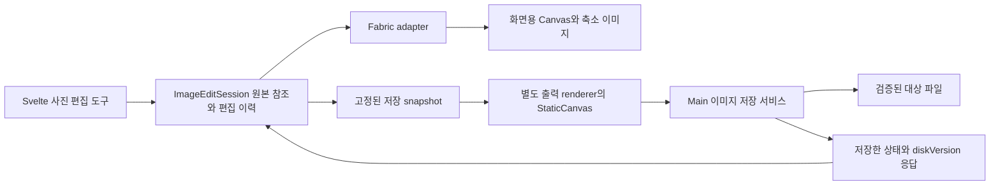

# Setdown 사진 편집 기능 구현 연구

작성일: 2026년 10월 17일, Asia/Seoul

분석 기준: Setdown `dffbe111e59356d255b0fa3466a72e77ca72c007`와 아래 세 서브모듈의 고정 커밋

**사진 편집 화면은 Svelte 5로 만들고, 이미지·도형·텍스트를 그리는 엔진은 Fabric.js를 사용한다. 편집 이력, 저장 여부, 원본 보관과 파일 충돌은 Setdown이 관리해야 한다.** 현재 이미지 뷰어에 편집 도구만 붙이면 저장되지 않은 작업이 화면 캐시와 함께 사라질 수 있다. 먼저 화면보다 오래 사는 이미지 편집 세션을 만들고, 그 위에 도구를 올리는 순서가 적절하다.

세 저장소는 서로 다른 역할로 활용한다. Fabric.js는 실행 의존성 후보, svelte-chop-chop은 Svelte 컴포넌트와 자르기 UI의 참고 자료, Filerobot은 도구 구성과 편집 상태·내보내기 흐름의 참고 자료다. 특히 svelte-chop-chop은 고정 버전의 실제 Electron 실행에서 회전 내보내기, 실행 취소, 화면 크기 변경에 따른 자르기 영역 문제가 재현됐다. 이를 완성된 편집기로 그대로 채택하는 비용은 작지 않다.

첫 제품 범위는 **정적 PNG·JPEG·WebP의 자르기, 90도 회전, 뒤집기, 리사이즈, 밝기·대비·채도, 실행 취소·다시 실행과 파일 저장**으로 잡는다. 다음 단계에 화살표·사각형·한글 텍스트·영역 모자이크를 추가한다. 여러 사진을 합성하는 레이어 편집기, RAW 현상, PSD 호환, AI 기능은 이 기반이 안정된 다음의 별도 제품 범위다.

## 현재 앱에서 먼저 풀어야 할 문제

현재 [ImageSurface.svelte](../apps/desktop/src/renderer/image/ImageSurface.svelte)는 이미지 바이트를 Blob URL로 바꿔 ``에 표시한다. 확대·이동·회전은 보기 상태다. 회전 버튼이 바꾸는 값은 CSS transform과 `ImageReadingPosition`이며 파일의 픽셀은 바뀌지 않는다. 이 구분을 유지해야 기존에 회전해서 보던 파일을 편집 모드로 열기만 해도 원본이 수정되는 일을 막을 수 있다.

이미지 파일을 읽는 기반은 재사용할 만하다. [image-file.ts](../apps/desktop/src/main/documents/image-file.ts)는 일반 파일 여부와 압축된 파일 크기 64 MiB 한도를 검사하고, 읽기 전후의 크기·수정 시간을 확인한다. [reading-ipc.ts](../apps/desktop/src/main/reading/reading-ipc.ts)의 `image:read`는 해당 창에 열린 파일인지 확인한다. 이 읽기 경로 위에 편집용 원본을 확보하는 절차를 추가할 수 있다.

반면 저장·수명 관리에는 다음과 같은 명시적 제한이 있다.

| 현재 코드 | 현재 동작 | 사진 편집을 위한 변경 |
| --- | --- | --- |
| [document-state.ts](../apps/desktop/src/core/document/document-state.ts), [document-profile.ts](../apps/desktop/src/core/document/document-profile.ts) | `kind`가 있는 문서는 텍스트 dirty 판정에서 제외하고, 이미지 확장자를 읽기 전용으로 분류한다 | 이미지 편집 세션의 dirty와 저장 capability를 따로 제공한다 |
| [DocumentActions](../apps/desktop/src/renderer/workspace/document-actions.ts) | 활성 이미지의 Save는 즉시 종료한다. Save All은 문자열 저장 경로를 사용한다 | Save·Save As·Save All이 문서 종류에 맞는 저장 서비스를 호출하도록 한다 |
| [DocumentManager](../apps/desktop/src/main/documents/document-manager.ts), [document-save.ts](../apps/desktop/src/core/document/document-save.ts) | 이미지 snapshot을 저장하려 하면 거부한다 | 이미지 전용 바이너리 저장 경로를 추가한다. 텍스트 검사만 제거해서 통과시키지 않는다 |
| [DocumentSessions](../apps/desktop/src/renderer/workspace/document-sessions.ts), [DocumentContentOwner](../apps/desktop/src/renderer/ports/document-content.ts) | 화면과 분리된 소유자 개념이 있지만 `text(tab): string`을 전제로 한다 | 이미지도 상태 소유권을 공유하되, 저장 입력은 text/image 구분이 있는 타입으로 확장한다 |
| [MediaCache](../apps/desktop/src/renderer/workspace/media-cache.ts), [App.svelte](../apps/desktop/src/renderer/App.svelte) | 기본 용량 3의 방문 화면 캐시다. 보이는 split은 보호하며, 캐시 퇴출·닫기·diskVersion 변경은 화면 해제로 이어진다 | 캐시는 Canvas·GPU·Blob URL만 소유한다. 편집 상태와 Undo는 캐시 밖에 둔다 |
| [workspace-controller.ts](../apps/desktop/src/renderer/app/workspace-controller.ts) | 외부 파일 변경 시 dirty가 아니면 자동으로 다시 읽는다 | 이미지 dirty를 연결해야 편집 중인 사진이 디스크 내용으로 교체되지 않는다 |

현재 dirty 판정의 핵심은 다음 한 줄이다.

```ts
return document.kind === undefined && document.text !== document.savedText;
```

따라서 Canvas에서 변경 이벤트가 발생한다는 사실만으로 탭 닫기·종료 보호가 작동하지 않는다. 저장, dirty 표시, 외부 변경, 탭 이동을 함께 연결해야 사진 편집이 하나의 문서 기능이 된다.

## 세 서브모듈에서 가져올 것

버전 표시는 체크아웃의 manifest를 읽은 값이다. npm 배포물과 동일한 소스라고 간주하지 않으며, 실행 의존성을 도입할 때에는 배포물의 API와 lockfile도 확인해야 한다.

| 저장소 | 고정 커밋 | 소스에서 확인한 버전 | 채택 범위 |
| --- | --- | --- | --- |
| [Fabric.js](../vendor/fabric.js) | `90d2c71ecee44bae1915fed3e9423f53b9cb1889` | `fabric`, `@fabricjs/browser`, `@fabricjs/core` 모두 7.4.0 | 객체 조작·필터·Canvas 렌더링·내보내기 엔진 |
| [svelte-chop-chop](../vendor/svelte-chop-chop) | `855a288b07ed11c9dfe78807a70e04b787275c9f` | 1.1.1 | Svelte UI 분리, 자르기 핸들·오버레이·비율 선택의 참고 |
| [Filerobot Image Editor](../vendor/filerobot-image-editor) | `a7cce3173cb380c4900b9cb9fb8d91f7f33a7a26` | React 패키지 4.9.1, 일반 JS 래퍼 4.8.1 | 문서 상태 추출, 도구 구성, 전체 해상도 출력의 참고 |

### Fabric.js는 엔진으로 사용하되 화면 상태를 파일로 저장하지 않는다

이 체크아웃은 [browser 진입점](../vendor/fabric.js/packages/browser/src/index.ts)과 [core](../vendor/fabric.js/packages/core/src/index.ts)를 분리한다. browser 진입점은 브라우저 환경을 등록하고 core API를 내보낸다. Setdown renderer에서 사용할 후보는 `@fabricjs/browser`이며, Node 전용 Canvas 구현을 Electron main에 함께 끌어들이는 구성을 기본값으로 삼을 이유가 없다.

[FabricImage](../vendor/fabric.js/packages/core/src/shapes/Image.ts)는 `cropX`, `cropY`, 원본 요소, 필터 결과와 GPU 캐시를 관리한다. [cropping-controls](../vendor/fabric.js/packages/cropping-controls/src/croppingControls.ts)에는 실제 자르기 핸들이 있고, [enterCropMode](../vendor/fabric.js/packages/cropping-controls/src/enterCropMode.ts)는 컨트롤을 전환하는 예제다. 다만 이 함수의 주석도 지속적인 자르기 상태가 필요한 제품에서는 별도 조정 함수를 만들도록 설명한다. 개별 이미지 객체의 자르기와, 사진·주석 전체의 출력 영역을 자르는 제품 동작은 Setdown의 문서 모델에서 연결해야 한다.

색상 보정은 [필터 backend](../vendor/fabric.js/packages/core/src/filters/FilterBackend.ts)를 통해 WebGL 또는 Canvas2D로 실행된다. `applyFilters()`는 이미지의 원본 크기로 필터 결과를 계산한다. 사진을 화면에서 작게 표시한다고 계산량까지 자동으로 작아지지는 않는다. 미리보기용 축소 이미지와 저장용 전체 해상도 이미지를 별도로 준비할 이유다.

[StaticCanvas](../vendor/fabric.js/packages/core/src/canvas/StaticCanvas.ts)의 `toBlob()`은 품질, 배율과 Retina 반영 여부를 받지만 현재 viewport transform을 사용하는 `toCanvasElement()`를 거친다. 실제 소스 실험에서는 같은 80×40 장면을 50% 화면 배율로 내보내면 불투명 영역이 800픽셀, 항등 viewport로 내보내면 3,200픽셀이었다. 이는 라이브러리의 동작이지 출력 결함으로 판정한 것이 아니다. **Setdown이 사진 원본 크기와 화면 확대율을 분리해야 한다는 근거**다. [실험 결과](photo-editing-research-2026-10-17/evidence.json)

내보내기는 화면의 Fabric Canvas를 잠시 바꿨다가 복구하는 방식보다, 고정된 편집 snapshot에서 별도 `StaticCanvas`를 만드는 방식이 적합하다. 화면의 선택 핸들·확대율·이동량을 출력에 섞지 않고, 저장 도중 사용자가 다음 수정을 해도 저장할 버전을 고정할 수 있다.

자원 해제도 비동기 경계다. `StaticCanvas.dispose()`는 진행 중인 렌더링이 정리될 때까지 기다리는 Promise를 반환하고, `FabricImage.dispose()`는 texture cache와 요소 참조를 정리한다. Svelte 컴포넌트 해제 시 세션을 삭제하지 말고 adapter를 폐기 상태로 표시한 다음, 지연된 결과를 차단하고 이 정리를 완료해야 한다. 이전 Canvas의 해제가 끝나기 전에 같은 DOM 노드를 새 Canvas에 재사용하지 않는다.

### svelte-chop-chop은 UI 참고용으로 범위를 좁힌다

[ImageEditor.svelte](../vendor/svelte-chop-chop/src/lib/components/ImageEditor.svelte), [create-image-editor.svelte.ts](../vendor/svelte-chop-chop/src/lib/composables/create-image-editor.svelte.ts), [crop-engine.svelte.ts](../vendor/svelte-chop-chop/src/lib/core/crop-engine.svelte.ts)는 화면, 조정 로직, 좌표 계산을 나눈다. Svelte 5의 rune과 UI 없는 API를 결합한 구조는 현재 앱과 잘 맞는다. 비율 프리셋·핸들·오버레이를 어떤 컴포넌트로 나눌지 읽는 데 특히 유용하다.

그러나 이 버전의 편집 상태를 그대로 Setdown의 문서 상태로 사용할 수는 없다. 실제 Electron 44.7.2에서 upstream 소스를 번들링해 다음을 재현했다. 각 행은 전체 앱 테스트가 아니라 해당 모듈을 직접 호출한 결과다.

| 실험 | 기대한 제품 동작 | 관측값과 원인 |
| --- | --- | --- |
| 80×40 불투명 이미지 전체를 90도 회전해 PNG 출력 | 40×80, 불투명 3,200픽셀 | 80×40, 불투명 1,600픽셀. 출력 Canvas 크기를 회전 후의 경계로 바꾸지 않는다 |
| 90도 회전 두 번 → Undo → Redo | 180 → 90 → 180도 | 180 → 0 → 90도. 변경 전 상태를 push하지만 history의 현재 index는 push한 상태를 현재로 취급한다 |
| 새 이미지의 밝기만 50으로 조정 → Undo | 밝기 0 복원 | `canUndo`가 false이고 밝기 50 유지. `setFinetune()`에는 이력 기록이 없다 |
| 800×400 사진의 같은 자르기 선택을 유지하며 viewport를 200×100에서 400×200으로 변경 | 원본 좌표의 선택 영역 유지 | `(200,100,400,200)`이 `(100,50,200,100)`으로 바뀐다. cropRect는 viewport 좌표로 남고 imageRect만 바뀐다 |
| 로드 직후 dirty 확인 | 편집하지 않았으므로 false | `const dirty = $derived(true)`로 항상 true |
| input에서 `isComposing: true`인 R 키 이벤트 전달 | 조합 입력에 전달 | 회전이 90도 증가하고 기본 입력이 취소된다. 입력 대상과 조합 여부를 검사하지 않는다 |

마지막 행은 합성 KeyboardEvent로 **핸들러의 guard 부재**를 확인한 실험이다. 실제 운영체제의 한글 IME 입력을 재현한 결과로 해석해서는 안 된다. 향후 제품 검증에서는 실제 Electron 입력과 composition 상태를 별도로 검사해야 한다. [재현 코드](photo-editing-research-2026-10-17/cases.svelte.ts), [관측 JSON](photo-editing-research-2026-10-17/evidence.json)

실행 취소 문제는 두 함수의 계약이 어긋나는 데서 생긴다. orchestrator는 다음과 같이 변경 전에 저장한다.

```ts
rotate: (degrees: number) => {
  pushHistory(`Rotate ${degrees}°`);
  transform.rotate(degrees);
},
```

하지만 [history-manager.svelte.ts](../vendor/svelte-chop-chop/src/lib/core/history-manager.svelte.ts)의 `undo()`는 index를 먼저 줄이고 그 상태를 반환한다. 처음 0도를 보관한 뒤 두 번 회전하면 저장된 배열은 `[0, 0, 90]`, 실제 화면은 180도가 된다. Undo는 두 번째 원소인 0도를 복원한다. history-manager 단독 검사와 실제 편집기의 command 검사가 함께 필요한 이유다.

추가로 UI는 Google Fonts의 Material Symbols stylesheet를 직접 불러오고, [image-loader.svelte.ts](../vendor/svelte-chop-chop/src/lib/core/image-loader.svelte.ts)는 Blob 입력을 해석할 때 만든 URL과 상태에 보관할 URL을 각각 생성한다. `destroy()`는 보관된 URL만 해제한다. plugin setup의 반환 cleanup도 orchestrator에서 수집하지 않는다. 이 부분들은 정적 소스 관측이며 이번 실험에서 메모리 증가량을 측정한 것은 아니다. Setdown에서는 기존 로컬 아이콘과 명시적인 URL·listener 소유권을 사용하는 편이 맞다.

### Filerobot에서는 상태 분리와 출력 흐름을 참고한다

[일반 JavaScript 래퍼](../vendor/filerobot-image-editor/packages/filerobot-image-editor/src/index.js)는 `react-dom/client`의 `createRoot()`를 호출하고 React 편집기를 mount한다. 이 API로 Svelte에 붙일 수는 있지만 React·ReactDOM·Konva·styled-components가 함께 들어간다. Svelte UI와 React 편집기의 수명·상태를 연결하는 비용을 감수하기보다 기존 Svelte UI에서 필요한 도구를 구현하는 방향을 권한다.

가져올 설계는 [extractCurrentDesignState](../vendor/filerobot-image-editor/packages/react-filerobot-image-editor/src/utils/extractCurrentDesignState.js)다. 전체 UI 상태에서 finetune, filter, adjustments, annotations, resize 등 출력에 필요한 상태를 추출한다. 선택된 도구나 열린 패널까지 사진의 편집 이력에 넣지 않는 기준을 제공한다.

[useAppReducer](../vendor/filerobot-image-editor/packages/react-filerobot-image-editor/src/hooks/useAppReducer.js)는 변경 전 상태를 past에 넣고 변경 후 상태를 present로 유지한다. [undo](../vendor/filerobot-image-editor/packages/react-filerobot-image-editor/src/actions/undo.js)는 present를 future로 옮긴다. 이 계약은 Setdown의 command 이력에 참고할 수 있다. 다만 `haveNotSavedChanges`를 이력 길이 등으로 판단하는 방식까지 옮기지는 않는다. 저장 지점은 이력의 맨 처음과 다를 수 있기 때문이다.

[useTransformedImgData](../vendor/filerobot-image-editor/packages/react-filerobot-image-editor/src/hooks/useTransformedImgData.js)는 표시용 scene을 복제하고 컨트롤 layer를 제거한 다음, 원본 크기로 확대하고 자르기·회전·리사이즈를 적용한다. [getSizeAfterRotation](../vendor/filerobot-image-editor/packages/react-filerobot-image-editor/src/utils/getSizeAfterRotation.js)은 회전 후 출력 폭·높이를 계산한다. 화면에서 보이는 크기와 파일로 나가는 크기를 분리하는 참고 경로다.

저장 완료 처리에는 별도의 제품 경계가 필요하다. 이 함수는 결과를 만들면서 `SET_SAVED`를 dispatch하고, [SaveButton](../vendor/filerobot-image-editor/packages/react-filerobot-image-editor/src/components/Topbar/SaveButton.jsx)이 그다음 `onSave`를 호출한다. Setdown에서는 인코딩 성공 뒤에도 디스크 충돌·대화상자 취소·쓰기 실패가 남아 있으므로, **파일 쓰기 성공 응답을 받은 snapshot만 저장됨으로 표시**해야 한다. 또한 출력 시 전역 `Konva.pixelRatio`를 변경하고 Canvas와 Base64를 함께 만드는 방식은 여러 split과 큰 사진을 다루는 새 저장 경로에 그대로 복사하지 않는다.

## 편집 세션과 렌더링 구조

기존 이미지 toolbar에 ‘편집’을 추가하고 같은 탭에서 자르기·변형과 색상 보정 도구를 연다. 이미지의 문서 surface는 `image`로 유지하고 별도의 보기/편집 모드를 둔다. 현재 `documentSurface()`는 이미지 경로를 항상 `image`로 분류하므로, 공통 문자열 편집기용 `editor` 값으로 전환하는 방식은 맞지 않는다. 파일 메뉴와 단축키는 활성 이미지 편집 세션으로 연결한다.

자르기의 ‘적용’은 이력 한 단계이며 파일 저장은 아니다. Escape는 진행 중인 도구 조작부터 취소하고, 편집 모드 자체를 끝낼 때 미저장 작업이 있으면 기존 저장·버리기·취소 흐름을 사용한다. 다른 탭으로 이동하는 것은 편집 종료가 아니므로 돌아오면 같은 작업을 이어간다.

이미지를 편집하기 시작할 때 `ImageEditSession`을 만든다. 같은 창에서 동일한 파일을 두 split으로 열면 같은 세션을 참조하고, 각 화면은 별도의 확대율·이동량·선택 상태를 가진다. 한 탭의 화면이 캐시에서 빠져도 다른 화면과 이력은 유지한다. 경로 변경은 세션 ID를 바꾸지 않고 대상 경로를 갱신한다.



현재 `App.svelte`는 이미지 surface를 동적으로 import한다. 이 경계를 유지하면서 편집 모드에 처음 들어갈 때만 `ImageEditorSurface.svelte`와 Fabric adapter를 로드한다. 세션의 순수 타입·geometry 코드는 엔진 import 없이 사용하고, 공통 barrel import를 통해 Fabric이 초기 shell bundle에 들어가지 않도록 빌드 산출물을 확인한다. 사진을 보기만 하거나 Markdown만 여는 작업에는 편집 Canvas·필터 backend를 만들지 않는다.

원본은 편집 시작 시점의 바이트를 보관하는 `sourceId`로 식별한다. 경로만 저장해 두면 외부 프로그램이 파일을 바꾸거나 사용자가 덮어쓰기 저장한 뒤 이전 이력을 복원할 수 없다. 압축 원본은 main이 관리하는 임시 자산으로 보관할 수 있고, renderer의 디코딩 결과와 GPU texture는 필요할 때 다시 만든다. 이 저장소는 바이트 예산과 참조 수를 관리하며, 세션이 사용하는 원본을 화면 퇴출만으로 삭제하지 않는다.

문서의 기준 데이터는 앱이 정의한 작은 recipe다. Fabric 객체나 엔진의 JSON 전체를 문서 모델로 삼으면 라이브러리 버전, URL, Canvas cache와 UI 상태가 앱의 저장·이동 규약으로 번진다. Fabric JSON은 adapter 내부의 임시 복원 수단으로 사용할 수 있지만 장기 문서 형식과 구분한다.

아래는 제안하는 핵심 모델이다. `generation`은 비동기 결과의 순서를 구분하고, `savedContentKey`는 실제 저장된 내용을 식별한다. 둘은 다른 역할이다.

```ts
type ImageEditSession = {
  id: string;
  sourceId: string;                 // 세션 동안 불변인 원본 바이트
  targetPath: string;
  expectedDiskVersion: DiskVersion;
  generation: number;                // 편집·Undo·Redo 때마다 증가
  recipe: ImageRecipe;
  savedContentKey: string;           // 쓰기 성공한 recipe와 출력 설정의 키
  history: ImageHistory;
};

type ImageRecipe = {
  schemaVersion: 1;
  geometry: ImageGeometry;           // 정해진 회전·반전 순서와 crop
  adjustments: { brightness: number; contrast: number; saturation: number };
  annotations: ImageAnnotation[];    // 원본 좌표와 객체별 변환
  output: { width: number; height: number; format: 'png' | 'jpeg' | 'webp'; quality: number };
};
```

dirty는 sourceId와 현재 recipe·출력 설정의 정규화된 내용 키를 `savedContentKey`와 비교한다. 선택, 확대, 화면 이동은 키에 포함하지 않는다. 저장한 상태로 Undo하면 clean, 저장한 뒤 이전 상태로 Undo하면 dirty가 된다. 같은 결과를 다시 만든 경우도 내용 비교로 처리한다. hash를 쓴다면 동일 판정에 필요한 정규화 규칙과 충돌 처리도 정의한다.

### 드래그 한 번을 이력 한 번으로 만든다

슬라이더를 움직이는 동안은 preview만 갱신하고, pointerup 또는 키보드 조정 확정 시 한 개의 command를 commit한다. command는 변경 전·후 recipe를 보관한다. Undo 후 새 수정은 redo 가지를 없앤다. 취소한 자르기·객체 이동은 command를 만들지 않는다. 텍스트는 한글 조합 중간마다 별도 항목을 만들지 않고 조합 완료와 편집 확정 경계로 묶는다.

이력은 recipe·객체 속성 위주로 보관하고 매 단계 전체 PNG나 ImageData를 저장하지 않는다. 6,000×4,000 사진의 RGBA 버퍼 하나는 `6000 × 4000 × 4 = 96,000,000`바이트, 약 91.6 MiB다. 네 벌이면 약 366 MiB이며 GPU texture와 압축 원본은 별도다. 이는 산술적 용량 계산으로, 측정한 프로세스 메모리는 아니다. 이력 항목 수와 직렬화 바이트 수에 각각 예산을 두되 현재 상태·저장 상태의 의미는 유지한다.

### 자르기 좌표는 화면 크기에 종속되지 않는다

원본을 올바른 방향으로 디코딩한 뒤의 픽셀 공간을 S라고 정의한다. 주석도 S에 둔다. 사진 전체에 적용할 회전·반전 G, 자르기 원점을 출력 원점으로 옮기는 평행이동 C, 출력 리사이즈 R을 차례로 적용한다. 자르기 경계의 clipping은 별도로 적용한다. 화면에서 보는 확대·이동 V는 그 바깥에 둔다.

```text
출력 픽셀 = R × C × G × 원본 좌표
화면 좌표 = V × R × C × G × 원본 좌표
```

crop은 G를 적용한 공간의 사각형으로 저장한다. 1차에는 90도 단위 회전만 지원하므로 사진과 주석을 함께 회전할 때 기존 crop의 네 모서리도 변환해 새 사각형을 구할 수 있다. 부분 이미지·주석의 객체별 변환은 S 안에서 처리한다. 마우스 좌표를 받을 때는 위 행렬의 역변환을 사용하고, shell의 app zoom·Canvas의 DPR을 원본 좌표에 다시 곱하지 않는다.

창 크기·split·DPR 변경은 V와 화면 backing store만 갱신한다. crop, annotation, output 크기와 이력은 그대로다. 기존 뷰어의 보기용 회전 역시 V에 대응하는 값으로 유지하고, 편집 도구의 회전 G와 섞지 않는다. 미리보기와 저장에서 동일한 geometry 함수를 사용해야 이 경계가 검증 가능하다.

## 저장은 snapshot 단위로 완료한다

현재 [atomicWrite](../apps/desktop/src/main/documents/file-system.ts)는 문자열을 임시 파일에 쓴 뒤 rename한다. 같은 디렉터리의 임시 파일과 교체 구조는 참고하되, 새 이미지 경로에는 바이너리 입력, 고유 임시 이름, 실패 시 정리, 권한 보존과 버전 재검사를 명시적으로 넣어야 한다. 기존 텍스트 저장 API에 Base64 문자열을 전달하지 않는다.

저장은 다음 순서로 수행한다.

1. 진행 중인 도구 조작을 확정하고 `{sessionId, generation, contentKey, recipe, sourceId}`를 고정한다. Save As 대화상자가 길어져도 이 snapshot의 소유자는 변하지 않는다.
2. main은 창·세션 소유권과 대상 파일을 검증하고 저장 job을 만든다. 덮어쓰기는 열린 이미지의 정규화된 경로, Save As는 main의 저장 대화상자가 반환한 경로를 사용한다.
3. 출력 renderer가 고정 recipe와 원본으로 별도 Canvas를 만들고 Blob으로 인코딩한다. 결과는 바이트로 보내며, 임의 경로를 직접 쓰는 API는 제공하지 않는다.
4. main은 출력 MIME·파일 signature·크기·차원·대상 확장자를 검증한다. 파일별 queue에서 예상 diskVersion을 확인하고 임시 파일을 쓴다. 교체 직전 다시 확인한 뒤 rename한다.
5. 완료 응답은 실제 기록한 `contentKey`와 새 diskVersion을 포함한다. 실패·취소는 저장 기준을 바꾸지 않는다. 저장 중 다음 수정이 발생했으면 현재 recipe는 보존하고 dirty를 유지한다.

예를 들어 revision 12를 PNG로 인코딩하는 중 revision 13의 텍스트를 추가했다면, 디스크에는 12가 저장되고 탭에는 13이 남아야 한다. ‘저장 완료’가 현재 revision을 통째로 덮어쓰면 안 된다. 기존 [retainUnsavedRevision](../apps/desktop/src/core/document/document-save.ts)의 목적을 이미지 snapshot에도 적용하되 문자열 병합을 재사용하지 않는다.

파일별 queue는 Setdown 내부의 동시에 열린 창 사이 저장을 직렬화한다. 외부 프로세스와의 경쟁을 완전히 잠그지는 못한다. 크기·mtime 비교는 현재 앱과 같은 낙관적 충돌 탐지이고, 같은 메타데이터로 바뀐 내용을 탐지하려면 마지막으로 읽거나 저장한 디스크 내용의 hash와 비교해야 한다. 이 기준은 저장 성공 때 갱신하며 편집용 불변 원본과 구분한다. 검사와 rename 사이의 외부 경쟁까지 atomic compare-and-swap이라고 설명해서는 안 된다. 충돌을 발견하면 원본을 유지하고 다시 읽기·다른 이름으로 저장·명시적 덮어쓰기를 제공한다.

처음에는 정적 PNG·JPEG·WebP에 일반 Save와 Save As를 제공한다. Save As 성공 시 편집 대상 경로와 저장 기준을 함께 새 파일로 옮기고, 원본 자산은 해당 세션의 Undo가 필요로 하는 동안 유지한다. 사용자가 수정하지 않은 뷰어에서 Ctrl+S를 누르는 동작은 그대로 파일을 바꾸지 않는다.

[AutoSaveController](../apps/desktop/src/renderer/workspace/auto-save.ts)는 현재 이미지를 건너뛴다. 이 제한을 없애 기존 1초 지연 저장을 사진에도 적용하면 조작할 때마다 압축·파일 교체가 일어나고 JPEG 재인코딩 정책까지 암묵적으로 생긴다. 첫 버전의 사진 저장은 명시적으로 수행하고, 자동 복구를 추가할 때에는 원본+recipe 초안을 저장하는 별도 정책으로 만든다. 이는 제품의 사진 자동 저장 범위로 명시해야 한다.

### Save 버튼 밖의 저장 경로도 연결한다

이미지 전용 Save만 만들면 닫기 대화상자에서 ‘저장’을 선택했을 때 기존 텍스트 API로 들어간다. [TabController](../apps/desktop/src/renderer/workspace/tab-controller.ts)의 `close`, `prepareRemove`, [TabNavigationController](../apps/desktop/src/renderer/workspace/tab-navigation-controller.ts)의 파일 전환, `DocumentActions.savePaths`의 Git 작업 전 저장과 Save All을 같은 저장 coordinator로 모아야 한다. 이 coordinator는 문서 종류별 서비스로 dispatch하며 기존 텍스트 구현을 유지한다.

외부 변경은 clean 세션만 자동 새로고침한다. dirty 세션은 원본 snapshot과 사용자의 recipe를 유지한 채 충돌을 표시한다. 저장 이후 diskVersion이 바뀌어 MediaCache key가 교체되어도 동일한 세션을 다시 연결한다. 완료 응답이 이전 파일을 다시 활성화하거나 새 탭의 Canvas를 갱신하지 않도록 세션 ID·generation·대상 경로를 검증한다.

파일 이름 변경·이동·삭제는 이미지 저장 queue와 함께 조정해야 한다. 삭제 성공 뒤 늦게 완료된 저장이 파일을 다시 만들면 안 된다. 창 사이 탭 이동에서는 현재 [TransferableTab 경로](../apps/desktop/src/main/tabs/tab-transfer-manager.ts)에 이미지 recipe·이력·원본 자산 참조를 추가하고, 대상 창이 인수한 뒤에 원래 창의 참조를 해제한다. 이 인수 절차가 준비되기 전에는 dirty 이미지 이동을 저장·취소 흐름으로 보호해야 한다.

## 전체 해상도 출력과 입력 응답성을 분리한다

Fabric의 Canvas2D fallback은 동기 픽셀 루프이고, WebGL backend도 자동으로 모든 크기의 이미지를 타일로 나눠 처리하는 서비스로 볼 수 없다. 이 checkout의 [기본 textureSize](../vendor/fabric.js/packages/core/src/config.ts)는 4,096이며 [WebGLFilterBackend](../vendor/fabric.js/packages/core/src/filters/WebGLFilterBackend.ts)는 원본 크기의 texture를 생성한다. 큰 이미지 지원은 파일 바이트 제한만으로 결정할 수 없다.

화면용 미리보기는 긴 변 2,048픽셀을 초기 실험값으로 삼고 실제 품질·메모리를 측정한다. 조작 중에는 최신 generation만 렌더링하고 변경을 프레임 단위로 합친다. source 기준의 글자 크기, 모자이크 block 크기, 선 두께는 축소율에 맞게 바꿔 보여야 한다. 픽셀 검사를 위한 100% 보기에는 원본 또는 필요한 영역의 상세 렌더링을 제공한다. 축소 미리보기만 크게 늘린 화면을 원본 100%라고 표시하지 않는다.

전체 해상도 출력은 별도의 신뢰된 renderer에서 직렬 실행하는 구성을 권한다. Fabric의 DOM·Canvas API를 재사용하면서 긴 CPU 필터가 shell의 입력·IME를 막는 것을 줄일 수 있다. 이 renderer는 출력 작업만 받고, main이 원본 자산과 결과 쓰기를 중개한다. 창은 `show: false`, sandbox·context isolation을 유지하고 desktop 전체 API를 노출하지 않는다. Markdown PreviewManager의 준비·표시 lifecycle과 섞지 않는다.

출력은 화면 repaint를 기다리는 rAF에 의존하지 않고 고정 recipe를 직접 그린다. 각 작업은 성공·실패·취소 시 Canvas와 임시 bitmap을 정리한다. 동기 필터 실행을 AbortSignal만으로 중간 취소할 수 있다고 가정하지 않는다. renderer 종료로 취소하거나 완료 결과를 폐기하는 정책을 따로 정하고, main이 중단된 job의 dirty를 보존한다.

WebGL preview와 Canvas2D 출력이 반드시 픽셀 단위로 같다고 단정할 수는 없다. 작은 색상 표본과 투명 경계를 두 backend에서 비교해 허용 차이를 먼저 정하고, 그 기준을 제품 테스트에 고정한다. 큰 이미지·GPU context loss·디코더 실패·메모리 예산 초과는 세션을 잃지 않는 오류로 처리한다. 입력·출력 최대 픽셀 수는 1MP·6MP·24MP·48MP 표본의 실제 메모리와 응답성 결과를 보고 결정한다.

## 파일 형식과 사진 품질의 범위

현재 뷰어가 읽는 형식과 새 편집기가 안전하게 다시 쓸 수 있는 형식은 다르다. 세 라이브러리의 Canvas 출력만으로 원본 파일의 메타데이터·애니메이션·색상 프로파일 보존이 해결되지는 않는다.

| 입력 | 첫 구현에서의 정책 | 완료 조건 |
| --- | --- | --- |
| 정적 PNG·JPEG·WebP | 편집, 같은 형식 Save, 세 형식으로 Save As | 파일 signature·확장자·Blob MIME 일치, 원본 좌표와 출력 치수 검사 |
| 투명 PNG·WebP → JPEG | 배경색을 정해 합성하고 미리 보여준다 | 투명 부분이 뜻하지 않게 검게 변하지 않음 |
| GIF·animated WebP·APNG | 첫 버전에서는 편집 제외, 기존 보기 유지 | 확장자가 아니라 실제 애니메이션 여부를 판정. 추후 정지 프레임 추출은 명시적 동작으로 제공 |
| AVIF·SVG | 첫 버전에서는 기존 보기 유지. 이후 PNG 등으로 변환 편집 지원 | SVG를 shell DOM에 삽입하지 않고 이미지로 rasterize, AVIF 인코딩 지원을 가정하지 않음 |
| RAW·HEIC·PSD·고비트 심도/HDR | 첫 제품 범위에서 제외 | 별도 decoder·색관리·문서 형식 검토 |

첫 편집기 정책은 8비트 SDR/sRGB 출력으로 정한다. EXIF 방향은 디코더가 이미 적용했는지 확인하고 한 번만 정규화한다. 그 뒤 모든 crop·annotation 좌표는 정규화된 사진을 기준으로 한다. EXIF orientation 1–8의 실제 fixture와 저장 후 재열기로 이중 회전을 검사한다.

[Svelte export](../vendor/svelte-chop-chop/src/lib/core/export.ts), Fabric `toBlob`, Filerobot 출력 경로에는 원본 EXIF·ICC를 그대로 재삽입하는 저장 파이프라인이 없다. 따라서 원본 메타데이터와 wide-gamut 색 보존을 제품 보장으로 내세우지 않는다. 출력 시 이 차이가 있는 사진에는 사용자가 다른 이름 저장을 선택할 수 있게 한다. 세션 안에서는 불변 원본+recipe에서 매번 출력하므로 저장한 JPEG를 다시 원본으로 삼아 반복 보정하는 누적 재압축을 피한다. 세션을 닫고 JPEG를 다시 여는 경우에는 별도 편집 프로젝트 형식이 없으면 이 원본 이력을 복원할 수 없다.

주석 단계의 영역 모자이크는 원본 좌표에 고정된 block 크기로 preview와 최종 파일을 렌더링해야 한다. 확대율에 따라 가려지는 내용이 달라져서는 안 된다. 최종 이미지의 실제 픽셀을 바꾸고, 숨긴 객체를 다시 표시하거나 별도 source layer로 내보내는 형태를 피한다. 편집 recipe·원본을 담은 프로젝트 파일은 평면 PNG와 다른 산출물로 취급한다.

## 구현 순서와 완료 기준

기간은 현재 코드만으로 산정하지 않는다. 각 단계가 끝났다는 판단은 아래 관찰 가능한 동작으로 한다.

| 단계 | 작업 | 완료 기준 |
| --- | --- | --- |
| 1. 엔진과 좌표 검증 | Fabric adapter, Svelte 최소 편집 화면, 회전·crop·resize 공통 geometry, 전체 해상도 출력 prototype | 80×40 회전은 40×80, window/split/zoom 변경에도 crop 픽셀 동일, 출력 파일 재열기 일치 |
| 2. 저장 가능한 사진 문서 | ImageEditSession, command history, 원본 자산 보관, dirty·Save·Save As·닫기·외부 변경·파일 작업 연결 | 캐시 퇴출 후 수정·Undo 유지, 저장 중 새 수정 유지, 쓰기 실패 시 dirty 유지, 중복 창 저장 충돌 처리 |
| 3. 첫 제품 기능 완성 | 밝기·대비·채도, 포맷·품질·투명 배경 UI, 분리된 출력 실행, 키보드·IME 소유권 | 지원 형식 전체의 실제 파일 round-trip, 대용량 응답성·메모리 예산, 기존 preview 성능 계약 통과 |
| 4. 문서용 주석 | 화살표·사각형·텍스트·영역 모자이크, copy/export 흐름 | 한글 조합·폰트 준비·주석 좌표·모자이크 출력 검사, 한 번의 조작을 한 번의 Undo로 복원 |
| 5. 문서 작성과 연결 | Markdown 이미지에서 편집 열기, 새 자산 저장과 링크 갱신, 초안 복구 | 이미지 쓰기 성공 뒤에만 Markdown 링크 수정, 실패·Undo 시 링크와 파일 소유권 보존 |

첫 단계부터 엔진을 adapter 뒤에 두고 앱의 recipe를 별도로 유지한다. 나중에 특정 필터나 출력 backend를 교체하더라도 저장·이력·창 이동 모델을 다시 만들지 않게 하기 위해서다. 반면 첫 단계에 범용 plugin marketplace나 모든 문서 형식의 저장 시스템 재작성까지 포함할 필요는 없다. 기존 텍스트 저장을 감싸는 작은 dispatch 경계부터 확장한다.

<details>
<summary>제안하는 모듈 배치와 기존 코드 연결점</summary>

아래 이름은 새 구현의 제안 경로다.

```text
apps/desktop/src/
  core/image/
    image-recipe.ts            원본 좌표, 출력 설정, 직렬화 버전
    image-geometry.ts          회전·반전·crop·좌표 역변환
    image-history.ts           transaction과 saved content key
  renderer/image/
    ImageSurface.svelte        기존 보기와 편집 진입
    ImageEditorSurface.svelte  도구 UI와 adapter 연결
    image-edit-sessions.ts     탭 화면보다 오래 사는 세션
    fabric-adapter.ts          Canvas 생성·갱신·폐기
  image-export-runtime/
    index.ts                   고정 snapshot의 전체 해상도 출력
  main/documents/
    image-assets.ts            불변 원본과 참조 수·용량 관리
    image-save.ts              충돌 검사·바이너리 교체
    image-export-manager.ts    출력 renderer 작업·취소·수명
  protocol/image-edit.ts       세션·저장 job의 검증 가능한 계약
```

기존 변경점은 `renderer/app/workspace-controller.ts`, `workspace/document-sessions.ts`, `workspace/document-actions.ts`, `workspace/tab-controller.ts`, `workspace/tab-navigation-controller.ts`, `workspace/media-cache.ts`, `ports/document-content.ts`, `protocol/desktop-api.ts`, preload, main IPC·window close·tab transfer 경로다. 새 파일만으로 끝나는 작업으로 산정하지 않는다.

텍스트 owner의 `text()`에 빈 문자열을 반환해 형식만 맞추는 대신, 저장 입력을 구분한다. 다음은 개념적인 경계다.

```ts
type SaveInput =
  | { kind: 'text'; text: string; revision: number }
  | { kind: 'image'; sessionId: string; generation: number;
      contentKey: string; recipe: ImageRecipe; sourceId: string };

// 실제 디스크 쓰기가 성공한 snapshot만 승인한다.
function acceptImageSave(session: ImageEditSession, result: ImageSaveResult) {
  if (result.sessionId !== session.id) return;
  session.savedContentKey = result.contentKey;
  session.expectedDiskVersion = result.diskVersion;
  // 현재 recipe와 generation을 이전 snapshot으로 되돌리지 않는다.
}
```

실제 구현에서는 세션 교체·창 이동을 구분하는 epoch, 대상 경로 검증, 파일별 저장 직렬화까지 추가한다. 위 코드는 저장 응답이 현재 편집 내용을 덮지 않는다는 핵심만 나타낸다.

</details>

## 검증 계획

현재 [image-reader.spec.ts](../apps/desktop/test/e2e/media/image-reader.spec.ts)는 지원 형식 읽기, 이미지 보기 상태 보존, 읽기 중 Ctrl+S의 무변경, 외부 변경 새로고침, SVG 스크립트 미실행과 열린 파일 소유권을 검사한다. 읽기 전용 상황의 기존 검사는 유지하고, 편집 모드의 새로운 저장 동작을 별도 시나리오로 추가한다.

| 검증 영역 | 필요한 검사 |
| --- | --- |
| 좌표·회전 | 비정사각형·경계 crop·flip 조합, 90/180/270도, 확대·DPR·split 크기 변화 후 동일한 원본 선택 |
| 이력·dirty | 두 번 이상 연속 조작의 Undo/Redo, slider 한 번당 이력 하나, 저장 지점으로 Undo, 실패·취소·저장 중 추가 수정 |
| 세션 수명 | 3개 캐시 범위를 넘기는 탭 순환, 활성 split 보호, 저장 후 diskVersion 교체, 외부 변경, 이름 변경·삭제·창 이동 |
| 파일 저장 | 원본과 다른 이름 저장, 실제 파일 재열기·픽셀 비교, extension/MIME/signature, 권한 오류·임시 파일 정리·두 창 충돌 |
| 포맷·색 | EXIF 1–8, 투명 PNG/WebP, JPEG 배경, 손상 파일, animation 판정, sRGB 기준 필터·모자이크 일치 |
| 포커스·IME | 도구 입력란의 문자 키, Korean composition, 텍스트 객체, 숨은 Canvas의 textarea 비활성화, 다른 split의 입력 유지 |
| 성능·해제 | 편집 최초 진입·재진입·슬라이더 응답·출력 시간과 peak memory, 1/6/24/48MP, WebGL·Canvas2D, 실패/취소 후 bitmap·URL·Canvas 해제 |

Fabric의 [ITextKeyBehavior](../vendor/fabric.js/packages/core/src/shapes/IText/ITextKeyBehavior.ts)는 숨은 textarea를 만들며 `hiddenTextareaContainer`를 제공한다. 활성 편집 surface 아래로 소유권을 제한하고, 비활성화 전에 텍스트 편집을 끝내야 한다. 상위 shortcut handler는 `isComposing`, input·textarea·contenteditable, 활성 탭과 focused group을 확인한다. 라이브러리가 composition 이벤트를 처리한다는 사실만으로 Setdown의 native reader와 함께 사용하는 IME가 검증되지는 않는다.

실제 기능 구현은 테마·CSS, 이미지 표면, zoom, 공유 저장·수명 경로를 건드리므로 [preview performance contract](../docs/preview-performance-contract.md)와 해당 feature contract의 적용 범위를 따라야 한다. 새 테스트는 [test/suites.json](../apps/desktop/test/suites.json)에 등록해 focused gate에서 빠지지 않게 한다.

```sh
npm run test:preview-contract
npm run bench:preview -- --baseline /absolute/path/to/installed-baseline
```

baseline은 변경 전 커밋의 별도 checkout에 그 버전의 의존성을 설치해 준비한다. GUI와 benchmark는 기존 `with-isolated-display.sh`로 Xvfb·개별 runtime directory·D-Bus를 격리하고 Wayland socket 상속을 제거한다. baseline과 candidate는 같은 화면·설정에서 비교한다.

기존 benchmark는 일반 Markdown/Git review × 수정 유무 × preparation 0/3,000ms의 여덟 시나리오다. 각 버전의 첫 cycle, 두 번째 cycle, 3–5회 warm cycle을 따로 보고한다. 기본 다섯 반복과 기존 25%·50ms의 결합 판정을 유지하며, 최소 반복 수·최신 수정 내용·capture의 유효성 검사를 생략하지 않는다. 누락·실패·오래된 내용의 결과는 성공으로 보고하지 않는다. 새 이미지 성능 측정은 이 gate에 추가하는 별도 결과이며 기존 Markdown 지연 회귀를 상쇄하는 수치로 사용하지 않는다.

## 실행 근거와 재현 방법

이번 연구의 런타임 범위는 고정 소스의 작은 기능 실험이다. 실제 제품의 사진 편집 UI나 전체 저장 통합은 아직 구현하지 않았으며, 이 결과로 큰 사진 성능·GPU·운영체제 IME의 품질을 주장하지 않는다. 소스에서 보이는 계약과 재현된 현상을 구분하기 위해 [evidence.json](photo-editing-research-2026-10-17/evidence.json)에 커밋·Electron/Chromium 버전·입력·출력을 함께 기록했다.

- 환경: Electron 44.7.2, Chromium 152.0.7977.149, Svelte 5.57.0. Xvfb 격리, Wayland 환경 제거, private runtime, Chromium sandbox 활성화.
- Svelte: 실제 upstream 모듈을 앱의 Svelte compiler로 번들링했다. 편집 UI 전체 mount 대신 engine/orchestrator/export를 직접 호출했다.
- Fabric: 실제 browser/core 소스를 번들링했다. Canvas2D backend를 명시했고, 항등 viewport의 80×40 출력·PNG 재디코딩과 밝기 필터의 `[100,100,100] → [126,126,126]`을 control assertion으로 확인했다.
- 산출물: [실행 스크립트](photo-editing-research-2026-10-17/probe.mjs), [실험 코드](photo-editing-research-2026-10-17/cases.svelte.ts), [최종 로그](photo-editing-research-2026-10-17/probe.log), [원본 패턴](photo-editing-research-2026-10-17/source.png), [Svelte 회전 출력](photo-editing-research-2026-10-17/svelteRotated.png).

저장소 루트에서 다음 명령으로 재현한다. 스크립트는 격리 display 환경을 확인하며 사용자의 데스크톱으로 대체 실행하지 않는다.

```sh
bash apps/desktop/scripts/with-isolated-display.sh \
  node reports/photo-editing-research-2026-10-17/probe.mjs
```

초기 환경 준비에서 발생한 [sandbox의 D-Bus socket 제한](photo-editing-research-2026-10-17/sandbox-startup.log)과 [about:blank fixture의 secure-context 오류](photo-editing-research-2026-10-17/initial-insecure-fixture.log)도 보존했다. 최종 실행은 격리 환경에서 로컬 파일 fixture를 사용해 완료했다. 라이브러리 소스·제품 코드·기존 테스트 판정은 수정하지 않았다.

세 저장소의 [Fabric LICENSE](../vendor/fabric.js/LICENSE), [svelte-chop-chop LICENSE](../vendor/svelte-chop-chop/LICENSE), [Filerobot LICENSE](../vendor/filerobot-image-editor/LICENSE)는 MIT다. 실제 코드나 배포물을 포함할 때 해당 고지와 출처·버전·로컬 변경을 함께 기록한다. 서브모듈은 참조 소스로 유지하고, 실행 의존성 채택은 [외부 코드와 빌드 입력](../docs/architecture/external-code.md)의 npm/git/복사본 구분에 맞춘다. 특히 현재 Fabric checkout의 `workspace:^` 항목을 그대로 앱의 npm 의존성에 넣지 말고 배포 가능한 패키지와 정확한 버전·integrity를 먼저 확인해야 한다.
