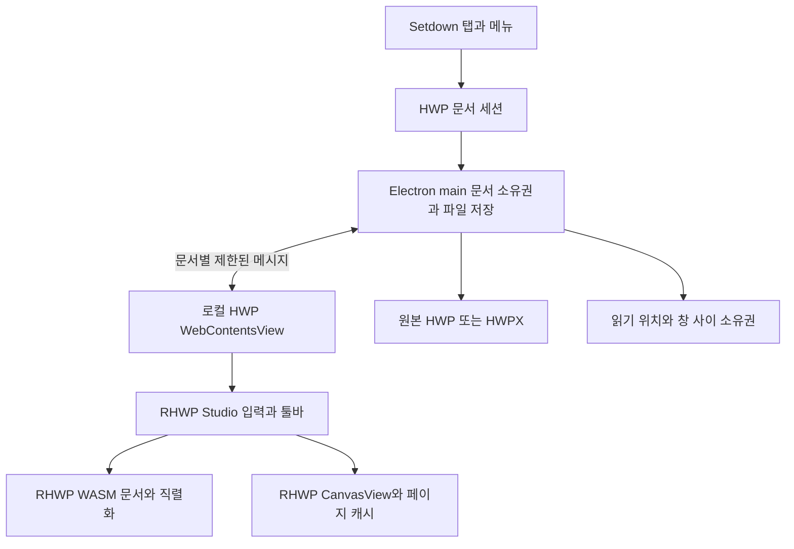

# Setdown의 HOP 및 RHWP 재사용을 통한 HWP 지원 방안

작성일: 2026년 10월 17일

분석 기준: Setdown `214c26a165a58826dce2c70d79c511003723f182`와 이 커밋이 고정한 HOP·RHWP 소스

**Setdown의 HWP 지원은 RHWP의 문서 엔진과 Studio 편집기를 가져오고, HOP의 데스크톱 통합 방식을 참고하는 방향이 적합하다.** 파서, 페이지 조판, 표 편집, 수식 렌더링, Undo를 새로 만들 필요는 없다. Setdown이 맡아야 할 일은 기존 엔진이 내놓는 화면과 바이너리를 자신의 탭·파일 저장·창 수명에 연결하는 것이다.

권장 구성은 **로컬에 번들한 RHWP Studio를 HWP 문서별 독립 실행 화면에 올리고, Electron main이 파일 접근과 저장을 소유하는 방식**이다. Setdown은 기존 Markdown 편집 경험을 유지하면서 HWP 탭 안에서는 RHWP의 문서 편집 경험을 제공한다. HWP를 Markdown으로 변환한 뒤 다시 저장하는 우회 경로는 기본 편집 방식으로 삼지 않는다. 문서의 표, 페이지, 개체 위치를 보존하려면 RHWP 문서 모델을 계속 유지해야 한다.

이 방향의 주요 작업은 엔진 개발이 아니라 통합이다. 다만 `npm install`과 확장자 추가만으로 끝나지는 않는다. 공식 iframe SDK의 origin 제한, 바이너리 저장 경로, 저장 중 새 편집의 보존, 탭 이동과 Undo 수명이 실제 접합부다. 아래의 설계는 이 경계를 구체화한다. 제품 소스나 의존성은 변경하지 않았다.

## 지정한 커밋이 제공하는 기반

해당 커밋의 변경은 `.gitmodules`와 두 gitlink다. 따라서 현재 제품에 HWP 기능이 연결되어 있지는 않지만, 필요한 참조 소스와 WASM 산출물은 이미 확보되어 있다.

| 대상 | 고정 revision | 의미 |
| --- | --- | --- |
| Setdown | `214c26a165a58826dce2c70d79c511003723f182` | 이번 분석의 제품 기준 |
| `vendor/hop` | `80888af2b8c8a18aea16f824d2d92309a290b1ad` | RHWP를 데스크톱 앱에 연결한 구현 |
| `vendor/rhwp` | `1a76570e833917d15817415a53c09ad61ab3203f` | RHWP 0.8.7의 엔진과 Studio |
| HOP 내부 RHWP 기준 | 위 RHWP revision과 동일 | HOP의 host 코드와 Setdown의 RHWP checkout을 같은 기준으로 대조 가능 |

[HOP 기준선](../vendor/hop/config/rhwp-upstream.json), [WASM 출처와 해시](../vendor/hop/apps/studio-host/vendor/rhwp-core/PROVENANCE.json), [Setdown 서브모듈 목록](../.gitmodules)이 서로 일치한다. HOP에 포함된 `rhwp_bg.wasm`은 11,803,733바이트, 약 11.26 MiB다. WASM·JS glue·타입 정의·패키지 메타데이터·LICENSE의 여섯 파일을 읽어 기록된 크기와 SHA-256이 모두 일치함을 확인했다. 이는 체크아웃된 산출물의 무결성 확인이며, Rust 소스에서 동일 바이너리를 다시 만드는 재현 빌드 검증은 아니다.

로컬의 `vendor/hop/third_party/rhwp`에는 아직 소스가 초기화되어 있지 않다. HOP의 Vite·Cargo 설정은 이 내부 경로를 가리킨다. **HOP를 그대로 빌드할 때와, Setdown이 이미 가진 `vendor/rhwp`를 직접 소비할 때의 경로를 구분해야 한다.** Setdown용 host에서는 후자를 단일 소스 기준으로 삼고, 초기 WASM은 같은 revision의 HOP 산출물을 사용할 수 있다. 두 RHWP 복사본을 각자 업데이트할 이유는 없다.

### RHWP 엔진과 Studio와 HOP의 역할

RHWP에는 세 층이 있다. Rust/WASM 엔진이 파일을 읽고 문서 구조를 조작한다. Studio가 입력, 선택, 표 조작, 페이지 표시와 툴바를 제공한다. HOP는 이 둘 위에 Tauri의 파일 대화상자, 저장, 창 관리와 인쇄를 붙인다.

| 재사용할 층 | 실제 코드 | Setdown이 얻는 것 |
| --- | --- | --- |
| 문서 엔진 | [RHWP parser](../vendor/rhwp/src/parser/mod.rs), [WasmBridge](../vendor/rhwp/rhwp-studio/src/core/wasm-bridge.ts) | HWP/HWPX 판독, 편집 가능한 문서, 형식별 직렬화 |
| 페이지 표시 | [CanvasView](../vendor/rhwp/rhwp-studio/src/view/canvas-view.ts), [RendererSession](../vendor/rhwp/rhwp-studio/src/view/renderer-session.ts) | 가상 스크롤, 페이지 canvas 관리, 렌더러 수명 |
| 편집 | [InputHandler](../vendor/rhwp/rhwp-studio/src/engine/input-handler.ts), [CommandHistory](../vendor/rhwp/rhwp-studio/src/engine/history.ts) | 한글 입력 처리, 커서·선택, 편집 명령, Undo/Redo |
| 제품 조립의 참고 구현 | [HOP main](../vendor/hop/apps/studio-host/src/main.ts), [command runtime](../vendor/hop/apps/studio-host/src/host/command-runtime.ts) | upstream 편집 기능과 제품별 명령을 결합하는 방법 |
| 데스크톱 파일 경계의 참고 구현 | [TauriBridge](../vendor/hop/apps/studio-host/src/core/tauri-bridge.ts) | 열기 실패 시 기존 문서 유지, 저장 대상 선택, 외부 변경 확인 |

HOP의 [renderer factory](../vendor/hop/apps/studio-host/src/host/renderer-session.ts)는 새 렌더러를 만들지 않는다. 이미 있는 `RendererSession`에 Canvas2D를 선택하는 제품 정책만 전달한다.

```ts
export function createRendererSession(): RendererSession {
  return new RendererSession(
    { backend: 'canvas2d', source: 'default' },
    { mode: 'default', source: 'default' },
    { preference: 'auto', requested: 'auto' },
    'screen',
    async () => {
      throw new Error('CanvasKit is not enabled by the HOP renderer policy');
    },
  );
}
```

Setdown도 이 수준의 어댑터를 목표로 삼으면 된다. Canvas2D를 초기 기준으로 정하면 CanvasKit 공급과 자동 백엔드 선택까지 첫 통합에 끌어오지 않아도 된다. 페이지 가상화나 표 선택을 Svelte로 다시 만드는 것은 이 재사용의 이점을 없앤다.

HOP의 [upstream 경계 문서](../vendor/hop/docs/architecture/UPSTREAM.md)와 [override 목록](../vendor/hop/config/rhwp-studio-overrides.json)도 유용하다. 공개 API 사용, 얇은 확장, 제품 전용 기능, 필요한 경우의 제한된 fork를 구분하고, 바뀐 upstream 파일의 해시를 검사한다. Setdown 역시 수정한 접점과 이유를 기록해야 한다. HOP의 Tauri 의존 코드와 전체 bootstrap을 통째로 옮기는 것은 피한다.

## 현재 Setdown의 연결 지점과 막히는 곳

### 파일은 열기 후보지만 문서로 해석되지 않는다

[document-profile.ts](../apps/desktop/src/core/document/document-profile.ts)는 Markdown·PDF·이미지·영상을 분류하고, 나머지를 일반 텍스트로 돌린다. HWP와 HWPX는 별도 종류에도, 바이너리 확장자 집합에도 없다. 그래서 Explorer나 명령행에서 열기 후보가 될 수 있지만, [DocumentManager.read](../apps/desktop/src/main/documents/document-manager.ts)는 이를 [readTextFile](../apps/desktop/src/main/documents/text-file.ts)로 보낸다.

그 다음 [text-codec.ts](../apps/desktop/src/core/document/text-codec.ts)의 NUL·제어문자·엄격한 UTF-8 검사가 실제 바이너리 문서를 거부한다. HWP/HWPX 지원을 위해 이 검사를 완화하면 안 된다. 문서 분류에 전용 경로를 추가하고, 원본 바이트는 RHWP에 전달해야 한다.

반대 방향도 함께 막아야 한다. 지금은 일반 텍스트의 Save As 목적지로 `.hwp`나 `.hwpx`를 고르면 [prepareDocumentSave](../apps/desktop/src/core/document/document-save.ts)의 확장자 정책상 텍스트 저장을 허용할 수 있다. HWP 기능 추가 시 **텍스트 후보에서는 두 확장자를 제외하고, 문서 열기 후보에는 전용 형식으로 포함**해야 한다. 열기는 가능하고 텍스트 저장·검색에는 들어가지 않는 구분이 필요하다.

HWP 5 계열은 OLE 복합 파일이고 HWPX는 ZIP/XML 계열이다. HWPX의 XML 구조를 읽을 수 있다는 사실과 페이지를 동일하게 조판할 수 있다는 사실은 다르다. 두 형식 모두 RHWP의 기존 파서에 맡긴다. [한컴의 HWPX 안내](https://www.hancom.com/news/notice/detail/10924), [RHWP 형식 감지 코드](../vendor/rhwp/src/parser/mod.rs).

### 바이너리 편집의 선례는 이미지 기능이다

[DocumentSnapshot](../apps/desktop/src/core/document/document.ts)의 `kind`는 현재 `pdf | image | video`다. [document-state.ts](../apps/desktop/src/core/document/document-state.ts)는 `kind`가 있는 문서를 일반 텍스트 dirty 판정에서 제외한다. [DocumentActions.save](../apps/desktop/src/renderer/workspace/document-actions.ts)도 현재 이미지만 예외로 저장을 허용한다.

```ts
const tab = this.options.active();
if (!tab || (tab.document.kind !== undefined && tab.document.kind !== 'image')) {
  return false;
}
```

따라서 `kind: 'hwp'`와 화면만 추가하면 Ctrl+S가 이 지점에서 끝난다. 파일 저장을 연결하더라도 dirty·종료 확인·Save All이 다른 경로를 타면 편집 내용이 누락된다.

이미 [DocumentSessions](../apps/desktop/src/renderer/workspace/document-sessions.ts)에는 기능별 [DocumentContentOwner](../apps/desktop/src/renderer/ports/document-content.ts)에 `dirty`, `save`, `replace`, `release`를 위임하는 구조가 있다. [image-edit-sessions.ts](../apps/desktop/src/renderer/image/image-edit-sessions.ts)는 실제로 이 포트를 사용하면서 `text()`에는 빈 문자열을 반환하고, 별도 편집 상태와 바이너리 저장을 관리한다. HWP도 이 접점을 활용하면 된다. 문서 전체를 base64 문자열로 만들어 Monaco 모델이나 `savedText`에 넣을 필요가 없다.

단, 현재 [AutoSaveController](../apps/desktop/src/renderer/workspace/auto-save.ts)는 `kind`가 있는 문서를 제외한다. 첫 버전은 수동 저장 범위를 명시하고, 자동 저장·복구를 도입할 때 HWP 세션으로 별도 연결해야 한다. Studio의 IndexedDB 복구와 Setdown의 파일 자동 저장을 서로 모르고 동시에 작동시키지 않는다.

### 화면 캐시를 문서 수명으로 사용하면 Undo가 사라진다

[MediaCache](../apps/desktop/src/renderer/workspace/media-cache.ts)는 방문한 PDF·이미지·영상 화면을 기본 세 개까지 유지한다. 표시 중인 split은 보호하지만, 나머지는 제거하면서 화면 자원을 해제한다. 현재 [App.svelte](../apps/desktop/src/renderer/App.svelte)는 PDF와 영상 이외의 media 종류를 이미지 화면으로 보내기도 한다. HWP 종류를 넣을 때 이 분기 역시 명시적으로 바뀌어야 한다.

HWP 편집 상태와 Undo는 RHWP의 WASM 문서와 Studio 입력 객체에 있다. 네 번째 파일을 열었다는 이유로 앞 문서의 실행 환경을 제거하면 편집 이력도 함께 사라진다. **페이지 canvas는 RHWP가 회수하고, 문서 실행 환경은 열린 탭이 소유한다.** 저장됐다는 이유만으로 실행 환경을 없애도 저장 이전 Undo가 사라질 수 있다. 초기에는 열린 HWP 문서의 실행 환경을 유지하고, 문서 수·메모리 한도를 명시하는 편이 안전하다.

## 가장 적합한 통합 방식

| 방식 | 얻는 것 | 추가로 풀어야 할 것 | 판단 |
| --- | --- | --- | --- |
| `@rhwp/core`만 사용 | 파싱·렌더링·편집 API | 선택, IME, 툴바, Undo 명령 조립 등 상당한 편집기 UI | 읽기 전용 실험에는 가능하나 최종 편집 경로로는 재구현이 많음 |
| 공식 `@rhwp/editor` iframe SDK | Studio 전체 UI와 RPC | HTTP(S) origin, 로컬 번들, 파일 명령, 저장 checkpoint, iframe 이동 | 웹 서비스에는 간편하지만 현재 Setdown에는 그대로 적용 불가 |
| RHWP Studio와 HOP식 host 어댑터 | 기존 편집 UI와 제품별 파일 명령 분리 | Electron IPC, 문서 수명, 저장·포커스·창 이동 | **권장** |
| HOP 앱을 외부 실행 | 기존 독립 앱의 기능 | Setdown 안의 탭·검색·dirty·창 이동과 연결되지 않음 | 외부 앱 열기 기능으로만 유효 |
| RHWP로 PDF 변환 후 PDF.js 표시 | 기존 PDF 읽기 기능 | 변환 시간, 원본과 결과 연결, 편집 불가 | PDF 내보내기나 제한적 미리보기의 보조 경로 |

### 공식 SDK가 바로 붙지 않는 이유

Setdown 개발 화면은 HTTP지만, 배포판은 [window-manager.ts](../apps/desktop/src/main/windows/window-manager.ts)에서 `loadFile()`로 shell을 연다. shell의 [CSP](../apps/desktop/index.html)도 `frame-src marktex-preview:`만 허용한다.

반면 RHWP SDK의 [EditorTransport](../vendor/rhwp/npm/editor/transport.js)는 Studio URL을 HTTP(S)로 제한한다.

```js
const targetUrl = new URL(studioUrl, globalThis.location?.href);
if (targetUrl.protocol !== 'http:' && targetUrl.protocol !== 'https:') {
  throw new Error('studioUrl must use HTTP(S)');
}
```

Studio 쪽 [origin 검사](../vendor/rhwp/rhwp-studio/src/embed/protocol.ts)도 `null` origin과 HTTP(S) 이외의 부모를 거부한다. 자식 Studio만 localhost에서 제공해도 `file:` 부모의 문제가 남는다. SDK 기본 주소는 공개 데모 사이트이므로 로컬 문서 제품의 기본값으로 사용할 수도 없다. 이 origin 검사를 무조건 허용하도록 바꾸는 해결책은 권하지 않는다.

공식 SDK를 그대로 보존하려면 HTTP(S) host 페이지와 Studio를 함께 제공하는 별도 로컬 서비스 구성이 필요하다. 가능하지만 서버 수명과 접근 제한까지 관리해야 한다. Setdown에는 이미 Electron의 로컬 renderer·preload·IPC 경계가 있으므로, 전용 host를 그 경계에 연결하는 쪽이 더 직접적이다.

### 문서별 로컬 WebContentsView를 우선 검토한다

RHWP Studio와 HOP의 bootstrap은 `document.getElementById`, 전역 단축키, 폰트 등록, 현재 문서 객체를 사용하는 하나의 페이지 앱이다. 이를 Setdown의 Svelte DOM 안에 여러 번 mount하면 문서끼리 전역 상태와 이벤트를 공유한다. 문서마다 DOM과 JavaScript 실행 환경을 분리하는 편이 기존 구현을 더 많이 보존한다.

우선안은 **문서별 로컬 `WebContentsView`와 전용 preload**다. RHWP Studio의 기존 UI를 로컬 자산으로 빌드하고, HOP처럼 파일 명령과 host bootstrap을 바꾼다. Tauri API 자리는 Setdown의 좁은 Electron API로 대체한다. HWP 화면에는 shell 전체의 `window.marktex`를 노출하지 않는다.



이는 엔진 내부를 수정하라는 뜻이 아니다. [HOP의 upstream 포트](../vendor/hop/apps/studio-host/src/upstream/core.ts)처럼 import를 한곳에 모으고, 편집 명령·페이지 표시·폰트 측정은 기존 구현을 호출한다. 처음부터 저장소 전체를 범용 문서 플러그인 프레임워크로 바꿀 필요도 없다.

다만 native view에는 실제 통합 비용이 있다. shell 메뉴가 가려지지 않도록 기존 overlay 흐름에 참여해야 하며, split·창 크기·앱 확대에 맞게 bounds를 적용해야 한다. Markdown의 `PreviewManager`에 HWP 렌더링을 섞기보다 별도 HWP 소유자를 두고, 기존 geometry·visibility·transfer 규칙을 참고한다. 공통 경로를 수정한다면 기존 preview 계약 전체가 검증 대상이다.

## 저장과 문서 수명에서 지켜야 할 경계

### 저장은 바이트와 손실 보고서를 함께 받는다

RHWP 0.8.7의 [WasmBridge](../vendor/rhwp/rhwp-studio/src/core/wasm-bridge.ts)는 `exportHwpWithReport()`와 `exportHwpxWithReport()`를 제공한다. HOP 번들 WASM의 [타입 정의](../vendor/hop/apps/studio-host/vendor/rhwp-core/rhwp.d.ts)에도 두 메서드가 있다. 반환 결과는 [export-content-loss.ts](../vendor/rhwp/rhwp-studio/src/core/export-content-loss.ts)의 다음 구조다.

```ts
export interface DocumentExportArtifact {
  bytes: Uint8Array;
  contentLoss: ContentLossReport;
}
```

보고서는 그림·첨부 데이터의 소실, 개체 생략, 필드 속성 축소 등을 표현한다. 바이트와 보고서는 같은 직렬화 결과에서 나온다. Setdown은 이 기능을 재사용하고, 알려진 손실이 있으면 원본 덮어쓰기를 중단한 뒤 사용자가 손실 내역을 확인하고 별도 사본으로 내보내게 하는 정책을 둘 수 있다. 이는 **제안하는 Setdown 정책**이다. 현재 Studio의 공통 helper는 영속화 후 손실을 알리므로, 그 저장 UI를 그대로 채택하면 사전 차단이 되지 않는다.

`count === 0`도 완전한 한컴 호환성을 증명하지 않는다. 알려진 손실 기록이 없다는 의미다. `exportHwpVerify()` 역시 같은 엔진으로 재로드하는 검사이므로 한컴에서의 표시·편집 결과까지 입증하지 않는다. 원본 덮어쓰기를 출시하려면 실제 한컴으로 다시 열어 확인한 문서군이 필요하다.

HOP의 현재 [writeCurrentHwpToPath](../vendor/hop/apps/studio-host/src/core/tauri-bridge.ts)는 `super.exportHwp()`의 바이트만 저장한다. Setdown은 이 부분을 복사하지 말고 reported export를 사용하는 것이 낫다. 공식 iframe SDK의 `exportHwp()`·`exportHwpx()` 응답도 바이트 중심이므로 손실 보고를 host에 전달할 접점을 별도로 확인해야 한다.

### 저장 완료는 저장을 시작한 편집 상태에만 적용한다

예를 들어 10번째 편집 상태를 직렬화한 뒤 디스크 저장 중 11번째 편집이 생겼다면, 저장 완료 후에도 탭은 dirty여야 한다. Setdown의 이미지 편집은 저장할 recipe와 revision을 먼저 잡아 이 문제를 다룬다. HWP도 같은 원칙을 적용해야 한다.

RHWP Studio의 [completeHostSave](../vendor/rhwp/rhwp-studio/src/main.ts)는 현재 상태를 clean으로 만들고 복구 draft를 지운다. 이 API에는 저장 대상 revision 인자가 없다. 따라서 비동기 저장이 끝났다고 `notifySaved()`를 무조건 호출하면 새 편집을 저장된 것으로 오인할 여지가 있다. 이는 코드상 통합 위험이며, 이번 조사에서 실제 데이터 손실을 재현한 결과는 아니다.

host가 소유할 저장 순서는 다음과 같다.

1. 현재 문서 ID·세대·편집 sequence와 목적지를 고정한다. 진행 중인 한글 조합을 확정하고, Studio의 출력 전 지연 pagination 마감 절차를 호출한다.
2. 같은 작업에서 바이트와 손실 보고서를 얻는다. 형식과 저장 정책 검사가 끝난 결과만 main에 넘긴다.
3. main은 해당 창·탭이 그 문서를 소유하는지 확인하고, 목적지별 저장을 직렬화한다. 원본의 디스크 버전과 내용 해시를 확인한 뒤 임시 파일에 쓰고 최종 교체한다.
4. 저장 응답은 캡처한 상태의 checkpoint만 전진시킨다. 더 최신 편집이 있으면 dirty와 복구 내용을 유지한다. clean 확정도 현재 문서 실행 환경 안에서 sequence 비교와 함께 처리해, 확인과 통지 사이에 편집이 끼지 않게 한다.

형식별 바이너리 저장의 선례는 [image-edit-ipc.ts](../apps/desktop/src/main/documents/image-edit-ipc.ts)와 [image-save.ts](../apps/desktop/src/main/documents/image-save.ts)다. 소유권 확인, 목적지별 직렬화, 내용 해시, 임시 파일 교체의 패턴을 재사용한다. 이미지 전용 판독 함수를 HWP에 그대로 호출하는 것은 아니다. 외부 프로세스와의 마지막 검사·rename 사이 경쟁까지 없애는 파일시스템 compare-and-swap은 현재 패턴이 보장하지 않는다.

Undo로 저장 당시 상태에 돌아오면 clean으로 보일지도 별도로 정해야 한다. Studio의 `DocumentDirtyState`는 boolean이고 `CommandHistory`는 편집 이력을 관리한다. 편집 sequence가 증가했다는 사실만으로 두 상태의 내용 동일성을 알 수는 없다. 첫 버전은 보수적인 dirty 표시를 허용하고, 저장점에 돌아온 Undo를 정확히 판정하는 checkpoint 접점은 추가 검증한다. 매 키 입력마다 문서 전체를 직렬화해 비교하는 방식은 피한다.

### 탭과 창 이동은 문서를 다시 여는 작업이 아니다

현재 [TransferableTab](../apps/desktop/src/protocol/desktop-api.ts)과 [tab-controller.ts](../apps/desktop/src/renderer/workspace/tab-controller.ts)는 일반 문서를 문자열 중심으로 전달한다. HWP 세션의 `text()`가 빈 문자열이라면 이 전달 경로만으로는 편집 내용을 옮길 수 없다.

권장 방식은 같은 HWP WebContents를 유지하면서 소유 창과 표시 위치를 옮기는 것이다. [TabTransferManager](../apps/desktop/src/main/tabs/tab-transfer-manager.ts)는 이미 웹·터미널·Markdown에서 소유권 이전을 다룬다. HWP도 세션 식별자와 소유권 이전을 이 흐름에 연결해야 한다. 이전 중인 요청은 기존 창의 권한으로 저장하거나 포커스를 되찾을 수 없어야 한다.

로컬 그룹 이동에서는 native view의 위치만 바꾼다. iframe을 택한다면 [SDK 문서](../vendor/rhwp/npm/editor/README.md)의 경고처럼 DOM 부모 변경이 재로드를 유발할 수 있으므로 안정된 부모 아래에서 CSS로 배치해야 한다. 문서를 export한 뒤 새 editor에 load하는 것은 내용 이전에는 도움이 되지만 JS 명령 이력까지 옮기지는 않는다. 초기 릴리스에서 창 간 이력 보존을 완성하지 못하면 이동 기능을 제한하고 그 범위를 표시해야 한다.

## 기능별 도입 범위

### 읽기와 편집과 원본 저장을 구분한다

RHWP의 기능을 최대한 활용하되, 읽기에 성공한 모든 파일을 곧바로 안전한 원본 저장 대상으로 취급하지 않는다.

| 항목 | 소스에서 확인한 기반 | 초기 Setdown 범위 제안 |
| --- | --- | --- |
| HWP 5 계열 | 파서, Studio 편집, reported HWP export | 열기·편집·사본 저장부터 연결. 검증된 문서군에 원본 저장 확대 |
| HWPX | ZIP 구조 확인, 파서, Studio 편집, reported HWPX export | 함께 열기·편집 지원. HWPX 사본 저장을 검증하고 원본 덮어쓰기는 별도 통과 조건 적용 |
| HWP 3 계열 | RHWP의 형식 감지와 별도 파서 존재 | 구형 파일로 식별. 지원 사례 검증 후 읽기 범위 공개. HWP5 출력은 원래 형식 그대로 저장했다고 표시하지 않음 |
| 암호 문서 | RHWP의 암호 열기와 HWP/HWPX 암호 저장 API | 검증된 암호 방식만 단계적으로 노출. 암호 유지 여부를 파일 저장 결과에 명확히 반영 |
| DRM | Fasoo·SoftCamp 컨테이너 감지와 오류 경로 | 지원 불가 안내 |
| 표·그림·수식·머리말·각주 | RHWP 조판·편집 기능 | 새 구현 없이 사용하되 대표 문서군으로 표시와 저장 검증 |
| 문서 내 찾기 | Studio 편집·검색 명령군 | 활성 HWP 문서의 명령으로 연결 |
| 프로젝트 전체 검색 | Setdown의 텍스트 파일 검색 | 첫 범위에서 제외. 이후 RHWP 추출 결과를 별도 인덱싱 |
| Git | 현재 텍스트/Markdown 비교 경로 | 바이너리 변경으로 취급. 추출 텍스트 diff나 페이지 diff는 후속 기능 |
| Markdown 변환 | 별도 변환·내용 추출 문제 | 사용자가 선택하는 사본 내보내기. HWP 원본 저장 경로로 사용하지 않음 |

HOP는 현재 HWPX 원본 저장과 암호 문서 원본 저장을 명시적으로 제한한다. 이것은 RHWP 엔진에 해당 직렬화 API가 없어서가 아니라 HOP가 선택한 제품 범위다. Setdown이 HOP의 제한을 그대로 물려받을 필요는 없지만, RHWP API의 존재만으로 그 제한을 해제해도 된다는 뜻도 아니다. [HOP 저장 정책](../vendor/hop/apps/studio-host/src/core/tauri-bridge.ts), [RHWP 형식별 저장 명령](../vendor/rhwp/rhwp-studio/src/command/commands/file.ts).

HWP 탭의 Esc는 우선 IME·선택·대화상자 등 Studio 내부 동작을 따른다. Markdown의 Esc → Reader, 더블클릭 → source 위치 이동을 HWP에 기계적으로 적용하지 않는다. HWP에 대응하는 Markdown 소스 행은 없다. 별도 읽기 모드가 필요하면 편집 명령과 입력을 실제로 제한하는 계약부터 정해야 한다.

### 글꼴은 문서 레이아웃의 일부다

Setdown의 D2Coding 중심 문서 테마를 HWP 페이지에 덮어씌우면 줄바꿈과 표 높이가 바뀔 수 있다. HWP 화면은 문서가 지정한 글꼴과 RHWP의 측정·대체 규칙을 사용하고, Setdown 테마는 바깥 UI에 적용한다.

HOP는 [폰트 정책](../vendor/hop/docs/architecture/LOCAL_FONTS.md)과 로컬 폰트 어댑터를 별도로 관리한다. RHWP의 [WasmBridge.initialize](../vendor/rhwp/rhwp-studio/src/core/wasm-bridge.ts)는 텍스트 폭 측정과 폰트 substitution을 초기화한다. raw WASM의 `renderPageSvg()`만 호출하면 이 준비 과정을 직접 책임져야 하므로 Studio 재사용의 가치가 더 크다.

초기 배포에는 재배포 조건을 확인한 fallback 폰트를 함께 넣고, RHWP의 `disableExternalWebFonts` 같은 기존 옵션으로 외부 CDN 의존을 제거한다. 로컬 폰트를 사용하는 경우에도 host가 허용한 폰트만 공급한다. 대체 글꼴 사용과 레이아웃 차이는 표시해야 하며, 모든 HWP가 한컴과 픽셀 단위로 같다고 약속하지 않는다. HOP와 RHWP 본체는 [MIT](../vendor/hop/LICENSE), [MIT](../vendor/rhwp/LICENSE)이지만, 번들 글꼴과 [제삼자 의존성](../vendor/rhwp/THIRD_PARTY_LICENSES.md)의 고지는 따로 유지한다.

### PDF는 내보내기 기능으로 재사용한다

HOP의 [PDF adapter](../vendor/hop/apps/desktop/rhwp-adapter/src/lib.rs)는 RHWP의 `svgs_to_pdf_with_options`를 호출하며 `embed_text: true`를 설정한다. [pdf_export.rs](../vendor/hop/apps/desktop/src-tauri/src/pdf_export.rs)는 문서에서 페이지 SVG를 만들고 이를 검색 가능한 PDF로 조립한다. 이 경로를 활용하면 PDF 구조·글꼴 임베딩·ToUnicode 매핑을 다시 구현할 필요가 없다.

다만 이것은 Rust native 경로다. Setdown의 기존 PDF.js는 PDF를 읽는 도구이며 HWP→PDF 변환기가 아니다. 초기 편집 통합에는 이미 있는 WASM을 쓰고, 이 native PDF 경로는 플랫폼별 helper 실행 파일의 빌드·서명·배포가 준비될 때 도입하는 편이 단순하다. helper는 한 번의 export 결과를 처리하고 종료하게 하며, 편집 중인 원본과 별개로 돌아가는 두 번째 상시 문서 모델을 만들지 않는다.

기존 Electron PDF 인쇄를 이용하는 대안도 있지만, canvas 화면을 출력한 결과가 검색 가능한 텍스트를 유지한다고 가정해서는 안 된다. 어느 경로든 페이지 수·줄 배치·검색·복사를 검증해야 한다. HWPX를 HWP로 임시 변환해 PDF를 만드는 경우에는 중간 변환의 손실도 검사한다.

## Setdown에서 바뀌어야 할 파일과 책임

아래는 구현 착수 시의 변경 지도다. 이번 보고서에서 추가한 제품 파일은 없다.

| 기존 위치 | 필요한 연결 |
| --- | --- |
| [document-profile.ts](../apps/desktop/src/core/document/document-profile.ts), [document.ts](../apps/desktop/src/core/document/document.ts) | HWP 문서 종류와 surface, HWP/HWPX 텍스트 저장 제외, 실제 원본 형식 메타데이터 |
| [document-manager.ts](../apps/desktop/src/main/documents/document-manager.ts) | 전용 바이너리 읽기 분기, 열기 대화상자, 버전 확인과 watcher 연결 |
| [DocumentContentOwner](../apps/desktop/src/renderer/ports/document-content.ts), [DocumentSessions](../apps/desktop/src/renderer/workspace/document-sessions.ts) | HWP 세션의 dirty·저장·교체·해제 위임 |
| [document-actions.ts](../apps/desktop/src/renderer/workspace/document-actions.ts), [auto-save.ts](../apps/desktop/src/renderer/workspace/auto-save.ts) | Ctrl+S·Save As·Save All·종료 확인. 자동 저장 범위 명시 |
| [workspace-state.ts](../apps/desktop/src/core/workspace/workspace-state.ts), [App.svelte](../apps/desktop/src/renderer/App.svelte) | HWP surface와 탭 상태. media의 이미지 fallback으로 보내지 않기 |
| [workspace-controller.ts](../apps/desktop/src/renderer/app/workspace-controller.ts) | 활성 surface에 찾기·Undo·Redo·인쇄 명령 전달. 숨은 문서에 명령 금지 |
| [desktop-api.ts](../apps/desktop/src/protocol/desktop-api.ts), [DesktopPort](../apps/desktop/src/renderer/ports/desktop-port.ts) | 문서 handle, 세대, sequence, 바이트·보고서 응답을 갖는 제한된 HWP API |
| [reading-position.ts](../apps/desktop/src/core/reading/reading-position.ts), [reading-ipc.ts](../apps/desktop/src/main/reading/reading-ipc.ts) | HWP의 쪽·문서 위치·zoom 저장. Markdown 행이나 임시 PDF 경로로 위장하지 않기 |
| [tab-controller.ts](../apps/desktop/src/renderer/workspace/tab-controller.ts), [tab-transfer-manager.ts](../apps/desktop/src/main/tabs/tab-transfer-manager.ts) | 세션 소유권 이전, 이동 실패 복구, 지연 응답 무효화 |
| [build-renderer.mjs](../apps/desktop/scripts/build-renderer.mjs), [build-electron.mjs](../apps/desktop/scripts/build-electron.mjs), [package.json](../apps/desktop/package.json) | Studio 별도 entry와 WASM·폰트·고지 번들, 새 preload, 파일 연결 |
| [Linux desktop entry](../apps/desktop/build/setdown.desktop.in), [installer](../apps/desktop/scripts/install-linux.sh) | HWP/HWPX MIME·파일 연결 경로 검토. 열기 지원과 기본 앱 강제 변경은 구분 |
| [test/suites.json](../apps/desktop/test/suites.json), [외부 코드 지도](../docs/architecture/external-code.md) | HWP 테스트 등록, 소비하는 upstream 파일·버전·산출물·override 범위 기록 |

<details>
<summary>제안하는 작은 기능 경계와 디렉토리 구성</summary>

```text
apps/desktop/
  src/
    core/document/
      document-profile.ts       기존 형식 분류 확장
      document.ts               메타데이터 확장
    protocol/
      hwp.ts                    제안: 소유권과 저장 메시지 계약
    main/hwp/
      hwp-manager.ts            제안: 문서별 native view와 수명
      hwp-ipc.ts                제안: 창·탭 권한 검증
      hwp-file.ts               제안: 제한된 바이너리 읽기와 저장
    renderer/hwp/
      document-content.ts       제안: DocumentContentOwner 연결
      hwp-controller.ts         제안: 탭·메뉴·상태 연결
    hwp-runtime/
      index.html                제안: 로컬 Studio host
      index.ts                  제안: 기존 Studio 구성 요소 조립
      preload.ts                제안: 문서 전용 bridge
      upstream.ts               제안: RHWP import 경계
  scripts/
    build-hwp.mjs               제안: source·WASM·폰트 pin 확인과 조립
```

이 트리는 책임을 설명하기 위한 제안이며 파일별 구현 명세는 아니다. 초기 연결에서 분리할 필요가 없는 작은 모듈은 합쳐도 된다. HWP parser·table layout·equation engine·Undo engine을 Setdown 아래에 새로 만들지 않는다.

</details>

## 도입 순서와 통과 기준

첫 단계는 **고정한 산출물을 제품 빌드에서 로컬로 불러오는 것**이다. 같은 revision의 Studio와 WASM을 묶고, 첫 HWP 탭을 열 때만 로딩한다. 앱 시작이나 Markdown 편집 경로에서 WASM을 초기화하지 않는다. HWP/HWPX 각 한 문서의 페이지 표시, 폰트 준비, 문서 교체 실패 시 기존 탭 유지까지 확인한다. 이 단계에는 native Rust PDF helper가 필요 없다.

두 번째 단계는 **Studio 편집과 Setdown 파일 저장을 하나의 문서 세션으로 연결하는 것**이다. 새 편집 UI를 만드는 대신 기존 InputHandler·명령군·툴바를 사용한다. 우선 사본 저장, dirty 표시, 닫기 취소, Save All, 외부 변경 충돌, 저장 중 추가 편집을 완성한다. 알려진 손실이 있는 결과의 원본 덮어쓰기는 허용하지 않는다.

세 번째 단계는 **Setdown의 다중 탭과 창 동작에 통합하는 것**이다. split, 동일 창 그룹 이동, native view의 포커스, 메뉴 overlay, 앱·문서 zoom, 읽기 위치, 창 사이 소유권을 검증한다. RHWP의 페이지 canvas 회수와 Setdown의 문서 종료를 분리한다. 전체 프로젝트 검색이나 HWP Git diff는 이 단계의 선행 조건이 아니다.

네 번째 단계는 **호환성 검증에 따라 저장 범위를 넓히는 것**이다. 한컴에서 만든 원본과 독립 PDF를 기준으로 표·다단·각주·수식·그림을 비교한다. HWP와 HWPX의 저장을 따로 판정하고, 암호·구형 형식·PDF 출력은 각각 검증된 범위만 공개한다. 버전 업데이트에서는 HOP의 override manifest 방식을 참고해 변경된 접점을 먼저 검토한다.

### 실제 문서 검증

| 시나리오 | 확인할 결과 |
| --- | --- |
| HWP5와 HWPX의 동일 내용 문서 | 페이지 수, 한글 텍스트, 표 구조, 그림·수식 존재와 위치 |
| 병합·중첩 표와 여러 쪽에 걸친 표 | 셀 소속, 읽는 순서, 표 잘림, 수정 후 재조판 |
| 다단·머리말·꼬리말·각주·떠 있는 그림 | 본문과 개체의 배치 관계, 페이지별 누락·중복 |
| 저장 후 한컴 재열기 | 텍스트·서식·개체 보존, 한컴에서 재편집 가능 여부 |
| 저장 중 입력과 취소·실패 | 최신 편집이 dirty로 유지, 실패 시 원본·복구 내용 보존 |
| 네 개 이상 HWP 탭, split, 그룹·창 이동 | 본문·Undo·선택·zoom 유지, 다른 탭에 명령이 적용되지 않음 |
| 한국어 IME 조합 중 탭 전환·메뉴·저장 | 숨은 화면의 focus 탈취 없음, 조합 중 문자 중복·유실 없음 |
| 암호·DRM·손상 파일·다른 ZIP의 확장자 변경 | 구분된 오류, 기존 문서 유지, 원본 수정 없음 |
| 큰 파일과 압축된 대용량 리소스 | 파일 크기·메모리·시간 한도, 닫기·취소, 종료 후 자원 해제 |
| 네트워크 없는 설치본 | Studio·WASM·폰트가 로컬에서 로드, 기본 문서 동작 유지 |

RHWP에는 parser 출력 예산과 각종 회귀 테스트가 있지만, Setdown host의 파일 크기 제한·IPC payload·프로세스 수명까지 대신 검증하지는 않는다. 기존 문서의 script·OLE·외부 리소스를 실행하거나 임의 경로 접근으로 연결하지 않는 host 경계도 함께 확인한다.

GUI 검증은 저장소 규칙대로 **격리 Xvfb·runtime directory·D-Bus**에서 실행하고, Wayland 연결을 제거한다. native view·zoom·preview 공통 경로를 바꾸는 통합에는 [preview 성능 계약](../docs/preview-performance-contract.md)을 적용한다.

```sh
npm run test:preview-contract
npm run bench:preview -- --baseline /absolute/path/to/installed-baseline
```

baseline은 별도 checkout과 설치된 의존성을 갖춰야 한다. ordinary Markdown/Git review × 편집 유무 × 준비 시간 0/3000ms의 여덟 시나리오를 baseline과 candidate에 같은 가상 디스플레이로 실행한다. 첫 번째·두 번째·warm cycle을 나눠 보고하고, stale capture·누락·실패를 성공 측정으로 세지 않는다. HWP 자체는 첫 열기, 두 번째 열기, 탭 복귀, 편집·저장 지연, 메모리 사용을 별도로 측정한다. 두 종류의 측정 결과를 평균 내 기존 Markdown 회귀를 숨기지 않는다.

## 이번 분석에서 확인한 실행 근거

이번 변경은 보고서와 조사 증적뿐이다. 확인한 범위와 제품 검증을 구분하면 다음과 같다.

| 확인 | 결과와 한계 |
| --- | --- |
| Setdown·HOP·RHWP revision 및 작업 트리 | 지정 SHA와 두 gitlink 일치. 조사 시작 시 제품·서브모듈 작업 트리 clean |
| HOP WASM 산출물 무결성 | manifest의 여섯 파일 크기·SHA-256 모두 일치 |
| RHWP SDK 기존 Node 테스트 | `node --test vendor/rhwp/npm/editor/tests/*.test.mjs` 성공. runner는 9개 파일 단위 통과, 실패·skip 0으로 보고 |
| transport 테스트 직접 실행 | `node vendor/rhwp/npm/editor/tests/transport.test.mjs`에서 15개 테스트 통과, 실패·skip 0 |
| SDK의 로컬 URL 제약 | 실제 `EditorTransport` 생성자에 `file:` URL을 전달해 HTTP(S) 요구 오류 확인 |
| GUI·실물 HWP·저장 호환성 | 이번 조사에서는 실행하지 않음. 위 Node 테스트는 mock transport와 API 계약 검사이며 화면·조판·한컴 호환성의 증거가 아님 |
| Setdown preview 계약·비교 benchmark | 제품 코드 변경이 없어 실행하지 않음. 향후 통합의 필수 검증 조건으로 위에 명시 |

집계 옵션을 확인하려고 사용한 `--test-isolation=none`은 설치된 Node 22.23.1에서 지원하지 않아 실행 전 실패했다. 이 시도를 통과 수에 포함하지 않았다. 원본 로그와 hash 확인 결과는 [조사 증적](hwp-support-research-2026-10-17/evidence.json)에 연결했다.

**착수할 작업은 RHWP Studio를 Setdown의 문서 세션에 연결하는 작은 host 통합이다.** HOP가 보여주는 가치도 여기에 있다. 이미 만들어진 엔진과 편집기를 유지하면서 파일·창·제품 정책만 별도 경계에서 소유한다. Setdown의 첫 HWP 기능 역시 이 경계를 지키면, 조판 엔진을 개발하는 프로젝트로 커지지 않고 기존 자산을 활용하는 기능 확장으로 진행할 수 있다.
