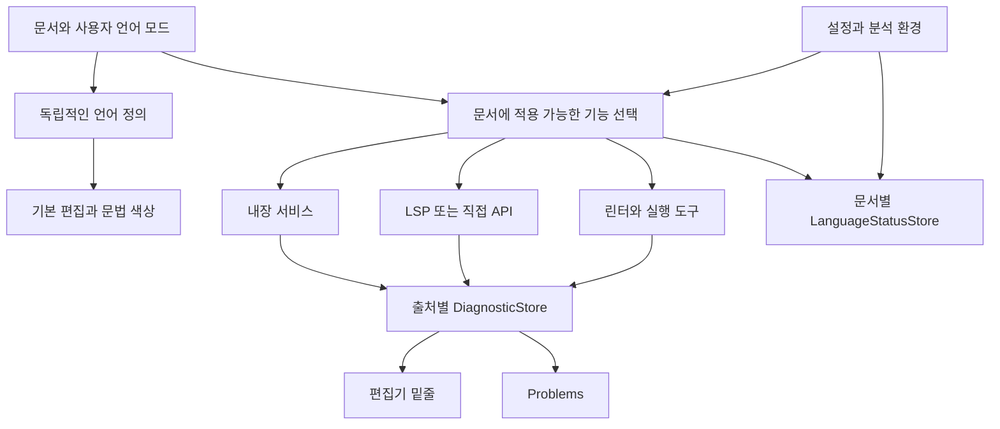
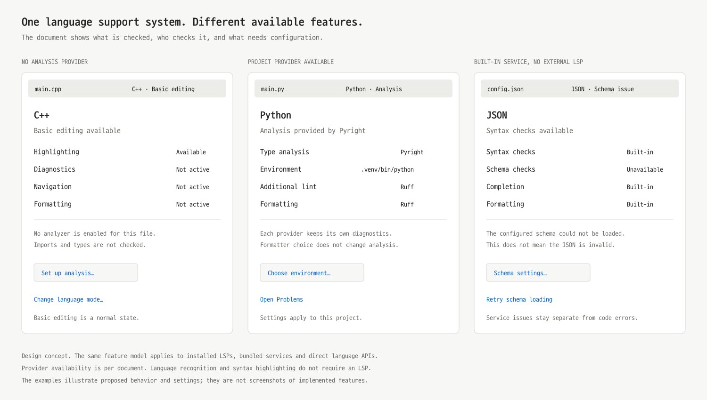

# Setdown 언어 지원 시스템 설계

2026년 10월 18일. VS Code 소스에 근거한 언어 전반의 지원 정책과 구현 계획.

이 문서는 구현 전 조사와 설계를 보존한다. 이후 구현한 동작·실제 화면·검증
결과와 남은 지원 경계는 [구현 검증 기록](../docs/validation/2026-10-18-language-support-system.md)에 정리한다.

## 결정해야 할 시스템의 형태

**Setdown은 언어를 인식하는 기능, 기본 편집 기능, 코드 분석 기능을 분리해야 한다. LSP가 없는 상태도 정상적인 제품 상태로 지원하고, LSP가 있을 때는 현재 문서에 적용되는 기능과 환경을 확인해 연결해야 한다.** 특정 언어 서버를 추가하는 작업은 이 공통 구조 위에서 결정한다.

사용자가 원하는 두 경우의 기본 동작은 다음과 같다.

| 경우 | 기본 동작 | 진단 원칙 |
| --- | --- | --- |
| 적용 가능한 LSP가 없음 | 언어 모드·색상·들여쓰기·괄호·검색 등 기본 편집 유지 | 독립적으로 검증된 내장 분석기나 다른 진단 도구가 있을 때만 그 범위의 진단 제공 |
| 적용 가능한 LSP가 있음 | 현재 문서에 맞는 기능을 연결하고 설정·상태·출처 표시 | 해당 제공자의 결과를 문서·환경·수명과 함께 관리하고, 실제 코드 오류를 보존 |

“LSP가 없다”는 사실만으로 모든 진단을 꺼서는 안 된다. JSON의 로컬 문법 검사, 별도 린터, 사용자가 실행한 컴파일러의 결과는 LSP 없이도 유효할 수 있다. 반대로 LSP가 설치되거나 프로세스가 시작됐다는 사실만으로 타입 검사·탐색·포맷이 모두 가능하다고 표시해서도 안 된다.

**공통 원칙은 현재 문서에서 실제 제공 가능한 기능만 켜고, 분석기가 확보하지 못한 정보를 가정하여 오류를 만들지 않는 것이다.** 서버 실패를 코드 오류로 표시하지 않고, 검사하지 않은 상태를 “오류 없음”으로 표시하지 않는다.

이 보고서를 이후 구현의 기준으로 삼는다. [이전 보고서][PREV]의 TS 재현은 공통 시스템을 검증하는 사례로 유지한다. TypeScript 기본 제공 여부가 이번 설계의 출발점이나 완료 기준은 아니다.

## 가짜 오류를 없앤다는 목표의 정확한 의미

Setdown이 책임지고 제거할 수 있는 오진 원인은 분명하다. 잘못된 언어 모드, 불완전한 가상 파일 시스템, 다른 프로젝트의 설정, 오래된 문서 응답, 중복 제공자의 충돌, 잘못된 URI 변환, 준비되지 않은 분석 결과의 게시가 여기에 해당한다.

외부 서버나 파서 자체의 모든 버그까지 포함한 “오진 0개”는 VS Code도 보장하지 않는다. 공식 LSP 클라이언트의 진단 경로는 서버 결과를 변환하고 collection에 게시한다. 임의 언어의 진단이 사실인지 다시 증명하는 범용 엔진은 아니다. 따라서 목표는 **클라이언트가 만드는 오진을 구조적으로 차단하고, 외부 분석의 출처와 환경을 설명하며, 잘못된 분석을 사용자가 바로 교정할 수 있게 하는 것**이다. [공식 LSP 진단 처리][L1]

특히 다음을 구분한다.

| 현상 | 판단 | 처리 |
| --- | --- | --- |
| 사용 중인 프로젝트에 실제로 없는 모듈·헤더 | 유효한 코드 또는 프로젝트 오류일 수 있음 | 진단 보존, 해당 분석 환경 표시 |
| 파일 접근 능력이 없는 단일 문서 분석기가 import를 못 찾음 | 분석기의 지원 범위 초과 | 그 분석기의 프로젝트 의존 검사 비활성화 |
| 다른 Python 환경이나 C++ 빌드 설정을 선택함 | 환경 선택 불일치 가능 | 현재 환경을 보여주고 선택 경로 제공; 메시지만 보고 일괄 삭제하지 않음 |
| JSON schema를 읽지 못함 | 해당 schema 검사가 불가능한 상태 | 문법 검사와 분리하여 schema 상태·설정·재시도 제공 |
| 이전 리비전이나 이전 세션의 결과 | 현재 문서에 적용할 근거 부족 | 현재 진단으로 게시하지 않음 |
| 진단 제공자가 없음 | 검사를 수행하지 않음 | 기본 편집 유지, 미검사 범위 표시 |

오류 코드별 블랙리스트, 모든 import 오류 숨기기, 모든 언어를 syntax-only로 강등하는 방법은 채택하지 않는다. 의도적으로 오류를 넣은 코드에서 진단이 유지되는 테스트와, 정상 코드에 잘못된 진단이 생기지 않는 테스트가 함께 필요하다.

## VS Code가 실제로 분리하는 계층

### 언어 인식과 문법 색상은 분석 서버 없이 존재한다

VS Code의 `LanguageService`는 등록된 언어, 파일명·확장자·첫 줄에 따른 언어 선택, 기본 기능과 확장 기능 요청을 관리한다. workbench는 확장 기능 요청을 `onLanguage:<id>` 활성화 이벤트에 연결한다. 언어 식별 자체가 서버 실행 성공을 기다리는 구조가 아니다. [언어 서비스][V1] [workbench 활성화][V2]

이를 구체적으로 보여주는 사례가 저장소의 기본 Python·C/C++ 확장이다. 두 패키지는 언어 정의·grammar·language configuration을 제공하지만 `main`이나 `browser` 실행 진입점이 없다. Python이라고 인식하고 색상을 입히는 것만으로 실시간 import 검사까지 수행하는 것은 아니다. C/C++ 패키지에는 별도로 빌드 출력용 problem matcher가 있으므로, “실시간 분석 서버 없음”과 “어떤 경로의 진단도 없음”도 구분해야 한다. [Python 기본 확장][V3] [C/C++ 기본 확장][V4]

이 사실은 VS Code에 별도 설치한 Python·C++ 확장의 기능까지 없다는 뜻이 아니다. 기본 문법 지원과 추가 분석 기능의 배포·활성화 경계가 실제 코드에 존재한다는 뜻이다.

Setdown에서도 언어 목록을 서버 목록에서 파생시키면 안 된다. `C++`이라는 언어 모드는 clangd가 없어도 존재해야 하고, 서버를 끄더라도 색상과 들여쓰기가 유지되어야 한다. 알 수 없는 파일은 plaintext로 열고 언어 모드를 선택하게 한다. VS Code의 언어 모드 선택 UI도 등록 언어 선택, 파일 연결 설정, 언어별 설정, 추가 확장 검색을 구분한다. [언어 모드 UI][V5]

### 분석 기능은 제공자별로 등록된다

`LanguageFeatureRegistry`는 언어·URI scheme·파일 패턴·notebook 유형 등에 맞는 제공자를 선택한다. completion·hover·rename·formatting 등은 각각의 registry와 실행 정책을 사용한다. LSP는 제공자를 구현하는 연결 방식 중 하나다. TS 확장은 tsserver를 직접 사용하고, JSON·CSS 확장은 LSP 클라이언트를 사용한다. [기능 registry][V6] [문서 selector][V7] [JSON 클라이언트][V8] [CSS 클라이언트][V9] [TS 클라이언트][V10]

따라서 Setdown의 상위 모델은 `language → server`보다 `document → available features → providers`에 가까워야 한다. 프로세스가 없는 내장 worker, LSP 서버, 직접 연결한 분석 엔진도 같은 기능 선택 계층에 참여할 수 있어야 한다.

VS Code CSS 확장은 분석 클라이언트와 별개로 formatter를 등록·해제하며 언어별 format 설정을 반영한다. 공통 formatter 선택기는 현재 resource와 언어에 적용되는 default formatter를 찾는다. **포맷터를 선택했다고 타입 검사 제공자가 바뀌지 않는다.** [CSS 기능 등록][V9] [formatter 선택][V11]

### 진단은 서버 연결과 독립적인 소유권을 갖는다

VS Code는 이름 있는 DiagnosticCollection과 marker owner를 사용한다. main thread는 owner와 canonical resource를 기준으로 marker를 전달하고, Problems는 marker service를 읽는다. 실시간 언어 서버·린터·빌드 결과가 같은 Problems에 나타날 수 있는 구조다. [진단 collection][V12] [main thread 진단][V13] [marker service][V14] [Problems][V15]

Setdown도 진단마다 출처를 유지해야 한다. 서버 A가 종료됐다고 린터 B나 빌드 결과까지 지우면 안 되고, built-in 진단을 외부 LSP 전용 Problems 화면이 놓쳐서도 안 된다. 동일한 진단 저장소가 밑줄·Problems·문제 수의 기준이 되어야 한다.

### 분석 환경의 한계는 언어별 어댑터가 다룬다

VS Code에 모든 언어의 환경을 판별하는 단일 “정확성 검사”가 있는 것은 아니다. JSON 확장은 schema 확인·설정·읽기 실패 상태를 다룬다. 다운로드를 비활성화한 경우 특정 schema resolve 진단을 걸러내는 middleware도 있다. 이는 알려진 원인에 대한 정책이며, 모든 진단을 숨기는 규칙이 아니다. [JSON schema 정책][V8] [schema 상태 UI][V16]

TS 확장은 파일별 semantic capability가 없을 때 syntax 이외 진단을 제한하고, 특정 웹·notebook 환경도 별도로 취급한다. 이것 역시 TS 어댑터가 아는 조건에 대한 처리다. 이 분기를 다른 서버에 그대로 적용할 수는 없다. [TS 진단 수신 정책][V17]

공통 계층은 파일·제공자·버전·설정의 소유권을 책임지고, 언어별 어댑터는 schema·interpreter·compilation database·SDK 등의 의미를 해석하는 분업이 적절하다. 서버가 세부 환경 정보를 제공하지 않는 경우에는 그 정보를 “확인 안 됨”으로 표시하되, 정상적인 표준 LSP 진단 전체를 자동 차단하지 않는다.

### 상태와 복구도 문서와 제공자에 연결된다

VS Code의 언어 상태 항목은 selector, severity, label, detail, busy, source, command, 접근성 정보를 가진다. 현재 문서에 해당하는 항목을 모아 보여준다. 전체 서버 목록의 `Running` 표시보다 사용자가 지금 보고 있는 파일의 상태를 설명하기에 적합하다. [언어 상태 모델][V18] [언어 상태 UI][V19]

공식 LSP 클라이언트에는 제한된 재시작과 crash-loop 중단, 연결 종료 시 기능·진단 collection 정리가 있다. 이 경로가 실패한 서버를 다른 부정확한 분석기로 대체하는 규칙은 아니다. [클라이언트 복구와 정리][L1]

## TS 외 언어에서 확인한 실제 차이

설치된 Monaco 0.56.0의 JSON·CSS·HTML worker를 Node에서 직접 실행했다. 외부 LSP와 네트워크는 사용하지 않았다. 다음 결과는 “LSP 없음”이 하나의 기능 집합을 뜻하지 않는다는 것을 보여준다. [재현 스크립트][E1] [결과][E2]

| 사례 | 결과 | 설계에 주는 의미 |
| --- | --- | --- |
| 정상 JSON | 진단 0개 | 내장 서비스만으로 로컬 검사 가능 |
| 값이 없는 JSON | `Value expected`, 오류 516 | 외부 LSP가 없어도 진짜 문법 오류를 보존해야 함 |
| JSON의 로컬 schema 타입 위반 | number를 기대한다는 오류 | 확보된 schema에 대한 검사는 유효 |
| JSON에 schema URI가 있지만 로딩 기능 없음 | schema 로딩 불가 경고 768 | 문서 문법 오류와 검사 환경 실패를 구별해야 함 |
| 정상 CSS | 진단 0개 | 로컬 분석 가능 |
| 콜론이 빠진 CSS | `css-colonexpected` | 로컬 문법 검사가 실질적인 가치가 있음 |
| 테스트용 CSS 속성을 custom data 없이 검사 | `unknownProperties` 경고 | 이름 인식은 분석기의 지식과 설정에 의존 |
| 같은 속성을 custom data에 등록 후 검사 | 해당 경고 사라짐 | 동일 텍스트라도 환경 정보가 진단에 영향을 줌 |
| HTML `<di`의 completion | `div` 제공 | 진단 제공 여부와 완성 제공 여부는 별개 |
| 같은 HTML worker의 validation 메서드 | 없음 | “내장 언어 서비스 있음”을 “검사 완료”로 표시하면 안 됨 |

CSS의 `setdown-token`은 정책 차이를 확인하기 위한 가상 custom data fixture다. 일반 CSS에서 그 경고가 언제나 오진이라는 주장은 아니다. 현재 HTML worker에는 `doValidation`이 없고 실제 mode 등록에도 진단 adapter 등록이 없다. default 옵션의 `diagnostics` 값만 읽어서 지원 기능을 추정하는 것조차 부정확할 수 있다. [HTML 구현][M1] [HTML 기능 등록][M2]

이 실험은 worker/API 수준 검증이다. Electron 화면·실제 네이티브 서버·VS Code 앱을 함께 실행한 통합 비교 결과는 아니다.

## Setdown의 현행 구조에서 바꿀 지점

현행 판단 기준은 구현을 시작하기 전 커밋 `d48b482063de64149c04d49a17a1dfc3c3ef2ae2`다. 중단된 구현의 미검증 변경은 완료된 기능으로 간주하지 않았다.

| 현재 구조 | 언어 전반의 문제 | 변경 방향 |
| --- | --- | --- |
| `documentLanguage`와 서버 route가 함께 언어 모드 결정 | 서버 활성화 정책과 파일 식별 정보의 경계가 흐림 | 독립적인 언어 정의·파일 연결 계층 |
| `hasBuiltinLanguageService`가 언어 ID 목록을 반환 | 내장 완성·문법·schema·프로젝트 분석의 차이를 표현 못 함 | 제공자별 실제 기능과 지원 조건 |
| 외부 연결 시 내장 marker를 일괄 숨기고 해제 시 복원 | formatter-only 연결이나 실패 때 부적절한 대체 발생 가능 | 기능별 소유권과 명시적인 fallback 정책 |
| 언어별 단일 preferred server | 분석·린트·포맷을 독립 선택하기 어려움 | 복수 provider와 기능별 선택 |
| binding의 단일 진단 배열과 외부 marker owner | 출처 충돌, 내장 진단과 Problems 불일치 | 공통 DiagnosticStore |
| `missing`·`selection-needed`가 renderer에서 합쳐짐 | 필요한 조치를 설명하기 어려움 | 이유를 보존하는 상태 모델 |
| 모든 binding을 집계한 상태가 host dataset으로 전달됨 | 다른 파일의 실패와 현재 파일 상태가 섞임 | 문서·편집 그룹별 상태 |
| 설정이 서버별 사용자 설정 중심, `scopeUri` 미사용 | 프로젝트별 환경·도구 선택이 충분히 반영되지 않음 | resource와 언어를 기준으로 설정 해석 |

근거: [문서 언어 식별][S1], [Monaco adapter][S2], [기본 진단 소유권][S3], [registry][S4], [renderer client][S5], [프로토콜][S6], [server session][S7].

기존 기반은 보존한다. 공식 JSON-RPC framing·취소, generation/version 검사, dynamic registration, pull registration별 resultId, 실제 파일 URI로의 연결, 문서 모델과 Undo 소유권은 이미 있다. 이번 작업은 이를 공통 언어 지원 계층으로 정리하는 것이다. [capability 관리][S8] [pull diagnostics][S9] [모델 소유권][S10]

## 제안하는 공통 구조

### 언어 정의와 제공자 정의를 분리한다

언어 정의는 이름·ID·확장자·파일명·첫 줄·dialect·grammar·괄호·들여쓰기·snippets를 다룬다. 서버가 설치됐는지와 무관하게 존재한다. `.h`를 C로 볼지 C++로 볼지, JSON과 JSONC 중 무엇으로 열지 같은 선택도 이 계층에 속한다.

제공자 정의는 어떤 문서에 어떤 기능을 제공하는지, 필요한 환경은 무엇인지, 어떻게 실행하고 종료하는지를 다룬다. 구현은 내장 worker, LSP, 직접 API, 실행한 도구의 결과일 수 있다. `primary`와 `supplementary`는 기본 조합을 위한 힌트로 쓸 수 있지만, 기능별 등록을 대신하는 규칙은 아니다.

| 제공자 정보 | 필요한 내용 |
| --- | --- |
| 대상 | 언어·dialect·URI scheme·파일 패턴·notebook 지원 |
| 기능 | completion, hover, definition, rename, formatting, diagnostics 등 |
| 분석 범위 | 어댑터가 확인 가능한 범위: 문서, schema, 프로젝트 등; 알 수 없으면 서버 관리로 표시 |
| 환경 요구 | 파서 종류, schema, 인터프리터, SDK, 빌드 설정 등 해당 도구의 실제 요구 |
| 소유권 | provider ID, 세션 epoch, 적용 문서, 설정 revision |
| 기본 정책 | 자동 활성화, 명시적 선택, 허용된 로컬 대체, 사용자 비활성화 |

기능명과 실제 동작은 capability 협상·동적 등록·어댑터 검증에서 얻는다. 설치 카탈로그의 설명을 실행 중 capability로 사용하지 않는다. 표준 LSP의 `diagnosticProvider`는 pull 진단에 관한 정보이므로, 그 필드가 없다고 push diagnostics까지 미지원으로 판정해서는 안 된다.

### LSP가 없을 때의 정책

1. 파일을 즉시 열고 기본 편집 기능을 유지한다. 알 수 없는 언어는 plaintext로 열며 언어 모드를 바꿀 수 있다.
2. 해당 문서에 독립적으로 적용 가능한 내장 제공자를 찾는다. 없다면 실시간 분석 기능을 등록하지 않는다.
3. 내장 제공자가 있으면 검증된 기능만 활성화한다. HTML completion이 있다고 HTML 진단을 켜지 않고, 단일 문서 파서에 프로젝트 import 검사를 맡기지 않는다.
4. 다른 검사 경로가 있다면 출처를 유지한다. 린터·컴파일러 실행 결과를 LSP가 없다는 이유로 버리지 않는다.
5. `Basic editing`, `Syntax checks`, `Schema validation`처럼 실제 제공 범위를 표시한다. 미설치는 정상 상태이며 매 파일마다 설치 팝업을 띄우지 않는다.

모든 언어에 문법 검사를 약속하지 않는다. 문법 색상은 파서 검증이 아니며, C/C++ 전처리 조건·Python 문법 버전·템플릿 dialect처럼 “문법” 자체에도 환경이 필요한 경우가 있다. 로컬 분석을 추가하려면 그 입력 조건과 테스트가 먼저 있어야 한다.

설치 방법이나 서버 선택은 사용자가 `Set up analysis…`를 열었을 때 해당 언어와 프로젝트에 맞춰 제시한다. 번들 여부도 공통 구조를 구현한 뒤 언어별로 결정한다. 없는 서버를 자동 설치하거나 임의의 shell 명령으로 실행하는 것이 기본 동작은 아니다.

### LSP가 있을 때의 정책

먼저 현재 문서와 server selector가 일치하는지, 사용자가 활성화했는지, 연결에 필요한 환경이 충족됐는지 확인한다. 프로세스 연결 후에는 서버가 제공하는 기능별로 등록한다. 한 서버가 formatting만 제공한다면 타입 검사와 navigation까지 활성화하지 않는다.

initialize 성공은 프로토콜 연결 준비를 뜻한다. 모든 프로젝트 인덱싱이 끝났다는 뜻은 아니다. 기능마다 준비 시점이 다를 수 있으므로 서버가 제공하는 progress와 언어별 신호를 사용한다. 표준에 없는 범용 `analysisReady`를 가정하거나 모든 서버에서 “첫 진단 = 모든 분석 완료”로 처리하지 않는다.

환경 정보가 필요한 경우에도 서버별로 다룬다. Python 환경, C/C++ compilation database, JSON schema, SQL dialect는 같은 형식의 체크리스트가 아니다. UI에는 파일에서 발견한 정보와 서버가 실제 사용한다고 확인한 정보를 구분한다.

**알려진 결함 때문에 성립하지 않는 검사만 제한한다.** 일반 LSP가 프로젝트 정보를 보고하지 않는다는 이유만으로 정상 진단을 전부 보류하지 않는다. 서버가 관리하는 환경은 그대로 존중하고, 확인하지 못한 세부 사항만 설명한다. 사용자 설정은 원인을 교정하는 경로여야 하며 빨간 밑줄을 없애기 위한 임의의 설정 변경으로 유도해서는 안 된다.

### 연결 실패와 기능 축소를 명시적으로 처리한다

| 상태 변화 | 유지하는 것 | 중단하거나 갱신하는 것 | 표시 |
| --- | --- | --- | --- |
| 제공자 없음 | 기본 편집, 적용 가능한 내장 기능 | 미지원 기능 등록 없음 | Basic editing 또는 실제 로컬 지원 범위 |
| 시작 중 | 기본 편집, 독립적인 로컬 검사 | 준비되지 않은 기능 호출 보류 | Starting analysis |
| 일부 기능 사용 가능 | 해당 기능과 다른 provider | 미제공 기능은 비활성 | 실제 기능 목록 |
| 설정·환경 변경 | live 모델·내용·Undo | 이전 환경 결과를 무효화하고 재분석 | Updating analysis |
| 서버 실패 | 기본 편집, 다른 provider | 실패한 세션의 기능과 live 진단 철회 | Analysis stopped, 재시작·로그 |
| 사용자가 비활성화 | 기본 편집, 명시적으로 남긴 기능 | 해당 provider·자동 재기동 중단 | Analysis off |
| 제한된 자동 복구 성공 | 동일 문서와 UI | 새 epoch에서 기능·진단 재등록 | 복구된 제공 범위 |

fallback은 서버 연결이 해제될 때 예전 Monaco 기본값을 복원하는 이벤트가 되어서는 안 된다. 현재 문서의 정책을 다시 계산한 결과여야 한다. 로컬 validator가 독립적으로 유효하면 계속 사용하고, 그렇지 않으면 분석 없이 편집할 수 있는 상태로 남는다.

## 진단 게시를 위한 공통 계약

### 진단의 사실과 서비스의 상태를 나눈다

진단 저장소는 “이 위치에 어떤 문제가 있다고 제공자가 보고했는가”를 관리한다. 언어 상태 저장소는 “어떤 검사가 실행되고 있으며 무엇이 막혀 있는가”를 관리한다. 두 저장소를 연결하되 같은 오류 목록으로 섞지 않는다.

JSON schema 로딩 실패처럼 서버가 진단 형식으로 보내는 환경 문제도 있다. 이런 변환은 알려진 서버·코드·명확한 의미를 가진 어댑터에서만 한다. 보통의 `cannot find module` 문자열을 환경 문제라고 추측하여 숨기는 공통 필터는 두지 않는다. 필요하면 source 위치의 설명은 유지하면서 Problems의 서비스 상태 영역으로 구분할 수 있다.



### 결과에는 문서와 환경의 identity를 함께 둔다

최소 식별자는 문서 resource, provider ID, session epoch, 설정·환경 revision, 진단 채널이다. 문서 버전이 있으면 반드시 대조한다. **텍스트가 같아도 인터프리터나 schema가 바뀌면 이전 분석 결과는 현재 환경의 결과가 아니다.**

편집 모델 URI와 backend resource는 별도로 매핑한다. 저장 파일·untitled·notebook cell·Git 과거 버전·embedded document를 모두 같은 `file:` 경로로 합치면 안 된다. 같은 파일을 다른 창에서 미저장 편집하는 경우에도 버퍼가 섞이면 안 된다. 이 경계는 TS뿐 아니라 모든 서버와 로컬 분석기에 적용된다.

예시 모델은 다음과 같다. 표준 LSP에 없는 정보를 서버가 반드시 보고한다고 가정하지 않는다.

```ts
type DocumentSupport = {
  documentId: string;
  languageId: string;
  resourceKind: 'file' | 'untitled' | 'cell' | 'snapshot' | 'embedded';
  contextRevision: number;
  features: FeatureAvailability[];
  providers: ProviderState[];
};

type DiagnosticBatch = {
  resource: string;
  providerId: string;
  sessionEpoch: string;
  contextRevision: number;
  channel: string;             // push, pull registration, build run 등
  analyzedContextRevision?: number; // 요청·어댑터 계약으로 확인된 경우에만 기록
  analyzedVersion?: number;
  receivedAtVersion?: number;  // 분석 버전과 다르다
  freshness: 'versioned' | 'best-effort' | 'historical';
  resultId?: string;
  items: Diagnostic[];
};
```

일반 LSP 진단을 공통 계층에서 syntax·semantic으로 정확히 분류할 수는 없다. 구분을 제공하는 어댑터에만 그 정책을 적용한다. 진단의 `source`, `code`, `relatedInformation`, `tags`, `data`를 보존하고 code action은 원래 제공자와 현재 문서에 귀속시킨다.

버전 없는 push는 수신 시점의 버전을 분석 버전으로 바꾸어 기록하지 않는다. 현재 세션의 best-effort 결과로 다루며, 버전이 증명된 결과와 구별한다. 공식 LSP 클라이언트도 조사한 구현에서는 push에 `versionSupport: false`를 광고한다. 라이브러리 교체만으로 이 정보 부족이 없어지지는 않는다. [공식 클라이언트][L1]

환경 revision도 같은 제약이 있다. pull 요청과 로컬 worker 작업은 시작 시점의 revision을 캡처하여 늦은 응답을 폐기할 수 있다. 반면 같은 연결에서 오는 일반 push에 현재 revision을 붙이는 것만으로 새 환경에서 분석됐다고 증명할 수는 없다. 인터프리터·프로젝트 root처럼 분석의 전제가 바뀌는 경우에는 세션을 새 epoch로 재생성하거나, 해당 서버가 제공하는 확인 가능한 전환 절차를 사용한다. 단순 설정 갱신으로 연결을 유지하는 경우에는 이 한계를 상태 모델에 남긴다. `contextRevision`은 클라이언트의 소속 정보이며 `analyzedContextRevision`과 같다고 가정하지 않는다.

### 밑줄과 Problems는 같은 결과를 읽는다

provider별 batch를 보관하고 그 합성 결과를 두 UI에 공급한다. 한 provider의 갱신·종료·등록 해제가 다른 provider의 결과를 지우지 않게 한다. push와 pull이 같은 검사를 중복 제공하면 해당 어댑터의 계약에 따라 선택하거나 결합하고, 단순히 메시지가 같다는 이유로 서로 다른 출처를 삭제하지 않는다.

편집 중에는 updating 상태와 짧은 게시 병합으로 불필요한 깜빡임을 줄일 수 있다. 그러나 이전 결과를 최신 결과처럼 표시하거나 오래된 quick fix를 적용해서는 안 된다. 빌드 결과를 보존한다면 live 분석과 구분하여 어느 실행의 결과인지 표시한다.

Problems에는 진단 source와 검사 범위가 있어야 한다. 결과가 0개인 상태와 검사하지 않은 상태를 함께 표현할 수 있어야 한다. 예를 들어 `No diagnostics reported · Project analysis is off`는 “코드가 올바르다고 검증됐다”는 오해를 줄인다.

### 여러 제공자는 기능별로 조정한다

| 기능 | 제안 정책 |
| --- | --- |
| 문법 색상 | grammar 유지, semantic tokens는 해당 provider 준비 시 추가 |
| 진단 | 출처별 수집과 일관된 게시; 같은 검사의 알려진 중복은 역할 설정으로 방지 |
| Hover | 일치하는 제공자 결과 수집, 불필요한 중복 설명 정리 |
| Completion | selector·우선순위·취소를 사용; 무조건 모든 결과 결합 금지 |
| Rename | 하나의 적합한 제공자가 반환한 편집을 트랜잭션으로 적용 |
| Formatting | 문서·언어에 적용되는 provider 하나 선택 |
| Code actions | 진단·명령의 원래 provider와 현재 버전 유지 |

VS Code도 기능마다 결합 방식이 다르다. hover는 여러 결과를 수집하고, completion은 제공자 그룹을 사용하며, rename과 formatting은 서로 다른 편집을 무차별 합치지 않는다. [Hover][V20] [Completion][V21] [Rename][V22] [Formatting][V11]

Setdown의 사용 예는 Pyright와 Ruff, clangd와 별도 formatter, JSON 내장 검사와 외부 formatter, TS와 Biome 등이다. 특정 조합만 예외 코드로 만들지 않고 같은 선택 모델을 사용한다.

## 사용자에게 보여줄 화면과 설정

### 현재 파일에서 지원 범위를 확인한다

기존 편집 그룹별 `LocationBar`에 언어 모드와 짧은 지원 상태를 표시한다. 언어 모드 선택과 분석 설정을 구분하고, 클릭하면 현재 파일에 해당하는 기능·제공자·환경을 보여준다. 다른 탭의 서버 실패를 이 파일의 실패처럼 표시하지 않는다. [현재 LocationBar][S11]



[SVG 원본](language-support-design-2026-10-18/language-support-states.svg). 제안 화면이며 구현 스크린샷은 아니다. C++ 기본 편집, Python 분석·보조 도구, JSON 내장 검사와 schema 문제를 동일한 UI 모델로 표현한다.

| 상태 | 짧은 표시 예 | 상세에서 필요한 정보 |
| --- | --- | --- |
| 기본 편집만 가능 | `C++ · Basic editing` | 색상 가능, 코드 검사 미사용, 언어 선택·분석 설정 |
| 로컬 일부 기능 | `HTML · Editing support` | 완성·포맷 가능, 진단 제공 여부 별도 표시 |
| 내장 문법 검사 | `JSON · Syntax checks` | schema 검사 여부와 내장 provider |
| 분석 제공자 준비 중 | `Python · Starting analysis` | 준비 중인 provider, 이미 가능한 기능 |
| 프로젝트 분석 가능 | `C++ · Analysis` | provider, 확인 가능한 빌드 설정, 적용 기능 |
| 환경 정보 부족·실패 | `JSON · Schema issue` | 실패한 검사 범위, 설정·재시도 |
| 선택한 서버 종료 | `Python · Analysis stopped` | 현재 유지되는 기능, 해당 provider 재시작·로그 |

기본 편집만 사용하는 상태는 중립색이다. 의도적으로 꺼 둔 분석을 빨간 경고로 취급하지 않는다. 사용자가 선택한 서비스의 실패에는 경고와 조치 버튼을 제공한다. 성공 상태도 초록색 체크 하나로 모든 코드를 검증한 것처럼 표현하지 않는다.

좁은 창에서는 짧은 언어 이름과 상태 아이콘을 유지한다. popup은 키보드 접근과 닫기·포커스 복귀를 지원하고, 배경 상태 갱신이 IME 입력을 방해하지 않아야 한다. 코드 문서의 상태 표시 때문에 Markdown preview·웹·미디어의 native bounds가 바뀌지 않도록 기존 그룹 구조 안에서 구현한다.

### 설정은 실제 문제와 적용 범위를 보여준다

| 필요한 선택 | UI가 보여줄 것 | 자동으로 하지 않을 것 |
| --- | --- | --- |
| 잘못 인식된 언어·dialect | 현재 모드, 이 파일에서 변경, 확장자 연결 규칙 | 서버 교체로 언어 인식을 간접 변경 |
| Python 환경 | 선택한 인터프리터와 적용 프로젝트, 발견된 환경 | 모든 프로젝트를 전역 환경 하나로 변경 |
| C/C++ 분석 설정 | 발견한 compilation database·사용자 지정 경로·서버 확인 정보 | 임의의 빌드 파일 생성 |
| JSON schema | schema URI와 설정 출처, 로딩 상태 | 확보하지 못한 schema로 검증 성공 표시 |
| 여러 formatter | 기능별 후보, 기본값과 적용 언어·프로젝트 | formatter 선택으로 주 분석기 교체 |
| 서버·도구 설치가 필요함 | 검증된 연결 방법과 설치·경로 선택 동작 | 파일을 여는 것만으로 자동 설치나 임의 실행 |

설정 resolver는 사용자·프로젝트·언어·문서 resource를 함께 사용하고 값의 출처를 표시한다. 서버의 `workspace/configuration`에도 같은 해석 결과를 전달한다. 한 프로젝트에서 선택한 도구가 다른 프로젝트까지 바꾸지 않게 한다. 가장 자주 필요한 항목은 타입 있는 필드로 제공하고 원시 JSON은 Advanced에 둔다.

현재 Language Support 화면의 검색·재탐색·수동 연결·로그는 관리 기능으로 유지한다. 첫 화면은 현재 파일의 지원 상태를 설명하고 전체 서버 카탈로그는 관리 영역으로 분리한다. “지원 서버 수”와 “현재 파일에서 사용 가능한 기능”은 다른 정보다. [현재 관리 UI][S12] [현재 상태 표현][S13]

## 구현 순서

### 먼저 언어 공통 정책을 구현한다

| 단계 | 구현 결과 | 주 변경 위치 | 완료 조건 |
| --- | --- | --- | --- |
| 1 언어와 provider 분리 | 서버 없는 언어도 독립적으로 식별·편집 | `core/document`, registry, Monaco adapter | 서버 비활성화가 언어 모드·기본 편집을 바꾸지 않음 |
| 2 기능별 지원 정책 | 내장·외부 provider와 fallback을 같은 모델로 처리 | 공통 provider registry, builtin adapter | JSON·CSS·HTML·기본 편집 전용 언어의 차이를 정확히 표현 |
| 3 진단 소유권 통합 | DiagnosticStore와 Problems·marker 연결 | renderer language, protocol | 출처 격리·버전·환경 변경·실패·restart 시 정합성 |
| 4 상태와 설정 UI | 현재 파일의 범위·환경·조치 표시 | 상태 store, LocationBar, Language Support | 서버 없음·일부 기능·분석 중·실패·꺼짐이 구별됨 |
| 5 복수 제공자와 설정 범위 | 분석·린트·format 독립 선택 | manager, registry, feature routing | Python·JSON 등 서로 다른 조합으로 공통 동작 검증 |
| 6 언어별 어댑터 보강 | 실제 환경·서버 준비 상태·dialect 반영 | 각 언어 adapter와 profile | Python·C/C++·JSON·JS/TS·특수 문서 회귀 통과 |

각 단계의 테스트를 함께 추가한다. 특정 언어 서버의 번들링을 먼저 완료한 뒤 그 사실을 전체 언어 지원 개선으로 간주하지 않는다. 1–4단계가 없으면 TS import 오류가 줄더라도 같은 종류의 문제가 다른 언어·기능에서 반복된다.

### 기존 모듈을 이렇게 바꾼다

- `document-profile.ts`와 서버 route의 언어 metadata를 독립적인 언어 정의로 정리한다. 언어 모드 override는 서버 선택과 분리한다.
- `builtin-diagnostics.ts`의 “외부 연결 여부로 일괄 숨김·복원”을 기능별 활성화 정책으로 대체한다. 목록에 이름이 있다는 사실만으로 validation을 추정하지 않는다.
- `language-client.ts`의 단일 binding 진단 배열을 provider별 저장소와 연결한다. 기존 취소·버전 검사·transaction 경계는 유지한다.
- `language-manager.ts`는 문서·provider·root·환경을 기준으로 세션을 소유한다. 생성·실패·재시작 시 epoch를 갱신하고 다른 창의 버퍼를 공유하지 않는다.
- `server-registry.ts`의 단일 preferred 선택을 분석·추가 진단·formatter 선택으로 확장한다. 생성 프로필의 정책은 생성기와 함께 변경한다.
- `server-session.ts`의 configuration 응답과 상태를 resource에 연결한다. 필요한 server action은 비차단 UI에서 실행할 수 있게 하며, 로그에만 남기고 사라지지 않게 한다.
- notebook·Git snapshot·untitled는 별도의 resource 정책을 사용한다. live 편집 모델과 Undo를 교체하여 분석 identity를 맞추는 방식은 사용하지 않는다.

## 검증은 여러 언어와 두 경우를 모두 통과해야 한다

### 서버가 없는 경우

| 시나리오 | 반드시 성립할 결과 |
| --- | --- |
| C/C++ grammar만 있음 | 기본 편집 정상, 실시간 compiler 진단 생성 안 함, 분석 미사용 표시 |
| Python 서버를 명시적으로 끔 | 색상·편집 유지, 서버 자동 재기동 안 함, 이전 live 진단 철회 |
| 알 수 없는 언어 | plaintext로 즉시 열림, 언어 모드 선택 가능, 임의 분석기 적용 안 함 |
| JSON 내장 서비스만 있음 | 진짜 문법 오류와 확보된 schema 위반은 표시 |
| JSON schema 읽기 실패 | 문법 검사는 유지, schema 검사 실패를 별도로 설명 |
| CSS custom data·dialect 차이 | 실제 선택한 설정으로 검증, 문법 오류와 지식 기반 lint 구분 |
| HTML 내장 완성만 있음 | completion 정상, 미제공 validation을 검사 완료라고 표시하지 않음 |
| 서버 없이 formatter만 있음 | 포맷 가능, 타입·프로젝트 검사 가능이라고 표시하지 않음 |
| 서버 없이 실행한 빌드 결과 | 실행 출처·시점 표시, live 분석과 구분하여 보존 |

### 서버가 있는 경우

| 시나리오 | 반드시 성립할 결과 |
| --- | --- |
| initialize 성공 직후 분석 진행 중 | 가능한 기능만 사용, 전체 인덱스 완료라고 단정 안 함 |
| Python 환경 A→B 전환 | 같은 텍스트여도 이전 환경 결과 무효화, 새 분석으로 갱신 |
| C/C++ 빌드 설정 변경 | root 발견과 실제 설정 적용을 구분, 늦은 이전 설정 응답 폐기 |
| formatting-only LSP | 독립적인 내장 검사는 유지, 없는 navigation 기능은 비활성 |
| Pyright+Ruff 또는 JSON 검사+formatter | 기능별 선택, 진단·code action 출처 유지 |
| 두 개의 formatter | 명시적 기본 선택, 한 번의 명령에서 서로 다른 편집을 중복 적용하지 않음 |
| 서버 crash·restart | 해당 세션만 철회, 다른 provider 유지, 부정확한 fallback 부활 없음 |
| dynamic registration·unregistration | 적용 문서와 기능을 정확히 갱신 |
| version 없는 push | 최신 버전 분석이라고 위장하지 않음 |
| pull full·unchanged·refresh | provider별 resultId와 현재 문서 관계 보존 |
| 여러 창·여러 프로젝트 | 미저장 버퍼·환경·진단 격리 |

### 공통 회귀와 품질 기준

저장·Save As·rename·Undo/Redo·한글 IME·diff 공유 모델·notebook cell·Git 과거 버전·embedded code를 검사한다. 결과가 늦게 도착하거나 문서가 닫혀도 적용하면 안 된다. resource가 지원되지 않는 provider는 오류를 만들기 전에 연결 대상에서 제외한다.

오진 차단 테스트에는 **같은 기능의 실제 오류가 여전히 보이는 대조군**을 넣는다. 정당한 missing import·문법 오류·schema 위반까지 없애서 테스트를 통과시키지 않는다. 비동기 경계는 mock으로 제어하고, 파서·파일 접근·URI 경계는 실제 worker와 서버로 검증한다.

Electron GUI는 저장소의 격리 display wrapper로 실행한다. UI/CSS·공유 runtime·preview 성능 경로에 해당하는 변경에는 기존 preview contract와 baseline 비교를 적용한다. 분석 기동·카탈로그 로딩·디렉터리 스캔을 타이핑이나 Markdown source↔reader 전환 경로에 끼워 넣지 않는다. [성능 계약][S14] [GUI 격리][S15]

VS Code와의 행동 비교를 수행할 때는 설치된 확장과 설정을 고정해야 한다. grammar-only VS Code와 외부 Python 확장이 활성화된 VS Code는 서로 다른 지원 환경이다. “VS Code에서 안 보임”이라는 결과만으로 오진을 확정하지 않고 검사 제공자와 프로젝트 환경을 함께 기록한다.

## TS 사례의 위치와 보고서 작성 당시 작업 상태

이전 재현에서는 실제 프로젝트 tsserver가 정상 import를 해석하는 반면, 제한된 Monaco worker와 탭 query URI에서 import·TSX 오진이 발생했다. 이 사례는 **분석 문맥과 resource mapping이 공통 계약에 들어가야 하는 이유**다. TS 서버 추가만으로 JSON schema, Python 환경, C++ 빌드 설정, formatter-only 연결, provider 없는 언어의 정책까지 해결되지는 않는다. [기존 TS 재현][E3]

사용자 요청에 따라 TS 중심으로 시작했던 구현은 중단했다. 그때 추가한 dependency·profile·worker 관련 변경은 작업 트리에 미완료 상태로 남아 있으며, 이 보고서가 구현 완료나 통합 테스트 통과를 의미하지 않는다. 이번 재작성에서는 앱 구현을 추가로 진행하지 않고 공통 설계와 비TS 재현 자료를 작성했다. 이전 보고서의 28개 테스트 통과 기록 역시 구현 전 스냅샷의 결과다.

이번에 실행한 재현 명령은 다음과 같다.

```sh
node reports/language-support-design-2026-10-18/language-policy-probe.mjs
```

JSON·CSS·HTML worker와 기본 Python·C/C++ 확장 metadata에 대한 assertion은 통과했다. 이 결과로 확인한 것은 기능 차이와 설정 의존성이며, 아직 구현되지 않은 공통 시스템의 완성도는 아니다.

## 소스 기준과 주요 진입점

| 기준 | 버전 또는 커밋 |
| --- | --- |
| Setdown 구현 전 기준 | `d48b482063de64149c04d49a17a1dfc3c3ef2ae2` |
| VS Code 참조 소스 | `d3d31f62268b169a2dfab62ffb2d7d38158a5b7c` |
| vscode-languageserver-node 참조 소스 | `b8c8db0b6a5c1a257d224cda3f0c21ce0a8a3203` |
| 비TS worker 재현 | 설치된 `monaco-editor@0.56.0` |

소스 링크는 로컬 체크아웃을 가리킨다. 미완료 구현이 수정한 Setdown 파일의 현행 구조는 위 커밋의 `git show` 내용으로 확인했다. VS Code 전체 workbench를 이식하거나 참조 checkout을 실행 의존성으로 바꾸는 것을 전제하지 않는다.

| 읽을 순서 | 코드와 확인할 책임 |
| --- | --- |
| 1 | [LanguageService][V1]의 언어 식별·basic/rich 요청, [workbench][V2]의 확장 활성화 |
| 2 | [Python][V3]·[C/C++][V4] package의 grammar-only 기본 지원, [언어 모드 UI][V5] |
| 3 | [LanguageFeatureRegistry][V6]·[selector][V7]의 문서별 제공자 선택 |
| 4 | [CSS client][V9]의 독립적 formatter 등록, [JSON client][V8]의 schema 정책 |
| 5 | [DiagnosticCollection][V12] → [main thread][V13] → [marker service][V14] → [Problems][V15] |
| 6 | [언어 상태 모델][V18]·[UI][V19], [공식 LSP client][L1]의 종료·복구·진단 처리 |
| 7 | [Setdown client][S5]·[registry][S4]·[기본 진단][S3]의 현재 연결 정책 |

[PREV]: 2026_10_18_vscode_language_support_redesign.md
[E1]: language-support-design-2026-10-18/language-policy-probe.mjs
[E2]: language-support-design-2026-10-18/language-policy-results.json
[E3]: language-support-design-2026-10-18/probe-results.json
[V1]: ../vendor/vscode/src/vs/editor/common/services/languageService.ts
[V2]: ../vendor/vscode/src/vs/workbench/services/language/common/languageService.ts
[V3]: ../vendor/vscode/extensions/python/package.json
[V4]: ../vendor/vscode/extensions/cpp/package.json
[V5]: ../vendor/vscode/src/vs/workbench/browser/parts/editor/editorStatus.ts
[V6]: ../vendor/vscode/src/vs/editor/common/languageFeatureRegistry.ts
[V7]: ../vendor/vscode/src/vs/editor/common/languageSelector.ts
[V8]: ../vendor/vscode/extensions/json-language-features/client/src/jsonClient.ts
[V9]: ../vendor/vscode/extensions/css-language-features/client/src/cssClient.ts
[V10]: ../vendor/vscode/extensions/typescript-language-features/src/typescriptServiceClient.ts
[V11]: ../vendor/vscode/src/vs/workbench/contrib/format/browser/formatActionsMultiple.ts
[V12]: ../vendor/vscode/src/vs/workbench/api/common/extHostDiagnostics.ts
[V13]: ../vendor/vscode/src/vs/workbench/api/browser/mainThreadDiagnostics.ts
[V14]: ../vendor/vscode/src/vs/platform/markers/common/markerService.ts
[V15]: ../vendor/vscode/src/vs/workbench/contrib/markers/browser/markersView.ts
[V16]: ../vendor/vscode/extensions/json-language-features/client/src/languageStatus.ts
[V17]: ../vendor/vscode/extensions/typescript-language-features/src/languageProvider.ts
[V18]: ../vendor/vscode/src/vs/workbench/services/languageStatus/common/languageStatusService.ts
[V19]: ../vendor/vscode/src/vs/workbench/contrib/languageStatus/browser/languageStatus.ts
[V20]: ../vendor/vscode/src/vs/editor/contrib/hover/browser/getHover.ts
[V21]: ../vendor/vscode/src/vs/editor/contrib/suggest/browser/suggest.ts
[V22]: ../vendor/vscode/src/vs/editor/contrib/rename/browser/rename.ts
[L1]: ../vendor/vscode-languageserver-node/client/src/common/client.ts
[M1]: ../node_modules/monaco-editor/esm/vs/languages/features/html/htmlWorker.js
[M2]: ../node_modules/monaco-editor/esm/vs/languages/features/html/htmlMode.js
[S1]: ../apps/desktop/src/core/document/document-profile.ts
[S2]: ../apps/desktop/src/renderer/adapters/monaco-editor.ts
[S3]: ../apps/desktop/src/renderer/language/builtin-diagnostics.ts
[S4]: ../apps/desktop/src/main/language/server-registry.ts
[S5]: ../apps/desktop/src/renderer/language/language-client.ts
[S6]: ../apps/desktop/src/protocol/language.ts
[S7]: ../apps/desktop/src/main/language/server-session.ts
[S8]: ../apps/desktop/src/main/language/server-capabilities.ts
[S9]: ../apps/desktop/src/renderer/language/language-diagnostics.ts
[S10]: ../apps/desktop/src/renderer/editor/live-document-model.ts
[S11]: ../apps/desktop/src/renderer/workspace/location/LocationBar.svelte
[S12]: ../apps/desktop/src/renderer/language/LanguageSupport.svelte
[S13]: ../apps/desktop/src/renderer/language/language-presentation.ts
[S14]: ../docs/preview-performance-contract.md
[S15]: ../apps/desktop/scripts/with-isolated-display.sh
