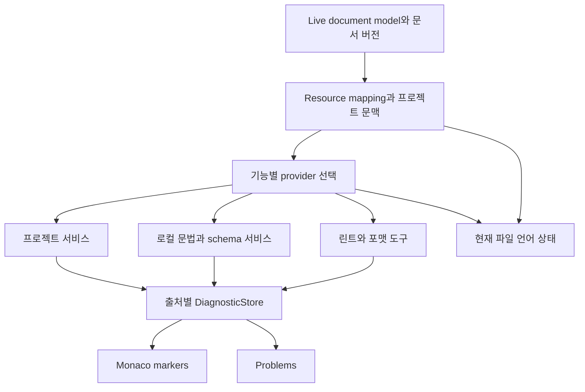
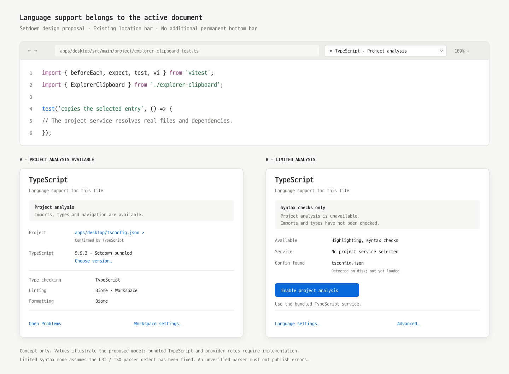

# VS Code 소스에 근거한 Setdown 언어 지원 개선안

작성일: 2026년 10월 18일. 대상: Setdown의 코드 편집, 진단, 언어 서버 선택과 설정 UI.

## 핵심 판단

**제보한 `vitest`와 `./explorer-clipboard` 오류는 현재 체크아웃에서 재현되는 Setdown의 잘못된 분석 결과다.** 실제 TypeScript 서버는 해당 파일을 `apps/desktop/tsconfig.json`에 연결하고 두 import를 정상적으로 해결한다. 같은 내용을 Setdown의 기본 Monaco TypeScript worker 조건으로 검사하면 제보한 TS2792가 나온다. 프로젝트의 `moduleResolution`을 `nodenext`로 바꾸라는 안내를 그대로 따라갈 상황이 아니다.

원인은 두 층이다. 기본 worker가 프로젝트의 설정·파일·의존성을 충분히 보지 못하며, Setdown의 `file:///…/file.ts?탭ID` 형식도 worker의 파일 해석과 맞지 않는다. 후자는 상대 import뿐 아니라 **정상 TSX를 TS로 파싱해 가짜 문법 오류를 만드는 문제**까지 일으킨다. 외부 서버가 없거나 실패했을 때 이 경로가 사용자에게 드러난다. [재현 결과][E1] [모델 생성][S1] [Monaco worker][M1]

LSP는 유지하는 것이 맞다. Setdown에는 이미 공식 JSON-RPC, 요청 취소, 문서 버전 검사, 동적 기능 등록, pull diagnostics, 편집 모델 공유라는 기반이 있다. 필요한 변화는 **현재 파일에 적용되는 분석 환경과 기능을 명시적으로 관리하고, 그 환경에서 성립하는 진단만 표시하는 것**이다. VS Code의 정교함도 이 계층에서 나온다.

우선순위는 다음과 같다.

1. 불완전한 Monaco TypeScript 분석의 오류 게시를 막고, URI와 TSX 파서 선택을 바로잡는다.
2. JS/TS에 기본 제공 프로젝트 서비스를 마련하고, 실제 적용 설정·버전·분석 범위를 현재 파일 중심으로 보여준다.
3. 진단 저장소와 Problems를 통합하고 TypeScript, Biome, 포맷터가 역할별로 함께 동작하게 한다.
4. 언어별 환경 설정, 제한 모드, 재시작과 복구를 일관된 UI로 연결한다.

이 문서는 소스 조사와 재현에 근거한 설계 보고서다. 아래 UI와 자료 구조는 제안이며 앱 구현에는 아직 적용하지 않았다.

## 조사 기준과 재현 범위

| 대상 | 조사 기준 |
| --- | --- |
| Setdown | `e964c93589a9b5e482106121d5685d9c11407409` |
| VS Code 참조 소스 | `vendor/vscode`, `d3d31f62268b169a2dfab62ffb2d7d38158a5b7c` |
| 공식 LSP 클라이언트 참조 소스 | `vendor/vscode-languageserver-node`, `b8c8db0b6a5c1a257d224cda3f0c21ce0a8a3203` |
| 대안 클라이언트 참조 소스 | `vendor/monaco-languageclient`, `c52125a809e5993509d53f10f5b478c989b18f5d` |
| 실제 사용한 Monaco | 설치된 npm 패키지 `monaco-editor@0.56.0` |
| 실제 사용한 TypeScript | 로컬 tsserver 및 Monaco 내장 컴파일러 모두 `5.9.3` |
| 문제 파일 | `apps/desktop/src/main/project/explorer-clipboard.test.ts` |

VS Code의 최신 릴리스 전체에 대한 일반화가 아니라 위 커밋의 구현을 기준으로 한다. `vendor/` 체크아웃과 제품의 npm 실행 의존성은 구별했다. 특히 오류 재현은 vendor Monaco가 아닌 **현재 설치된 Monaco worker**로 수행했다. [외부 코드와 빌드 입력][S20]

### 동일한 소스에 대한 결과

| 실험 | 결과 | 의미 |
| --- | --- | --- |
| 실제 tsconfig로 `vitest` 해석 | `node_modules/vitest/dist/index.d.ts` | 의존성이 존재하고 현재 설정에서 해석 가능 |
| 실제 tsconfig로 상대 import 해석 | `explorer-clipboard.ts` | 인접 파일도 존재하고 해석 가능 |
| 실제 tsserver로 문제 파일 열기 | 설정: `apps/desktop/tsconfig.json`, semantic diagnostics 0개 | 제보한 모듈 오류가 실제 프로젝트 분석에서는 발생하지 않음 |
| Monaco worker에 해당 파일 모델만 제공 | 세 import에서 TS2792 | 프로젝트 문맥 없는 분석에서 제보 문구 재현 |
| `main.ts`와 `sibling.ts`를 정상 URI로 모두 제공 | 오류 0개 | 최소 가상 프로젝트의 상대 import 대조군 |
| 같은 두 모델 URI에 각각 탭 query 추가 | `./sibling`에 TS2792 | 파일을 모두 제공해도 query 때문에 실패하는 별도 원인 |
| 정상 JSX를 `view.tsx`로 파싱 | 문법 오류 0개 | TSX 대조군 |
| 같은 JSX를 `view.tsx?view-tab`으로 파싱 | TS1161, `Unterminated regular expression literal` | 파일 종류 오인으로 생긴 가짜 문법 오류 |
| 잘못된 문법 `export const value = ;` | TS1109 | 문법 오류 검사가 실제로 작동함 |
| 실제 tsserver 버퍼에 없는 import와 잘못된 타입 대입 추가 | TS2307, TS2322 | 정상 오류까지 지워서 얻은 성공이 아님 |

TSX 비교는 양쪽에 동일하게 `jsx: Preserve`를 설정하여 URI의 영향만 분리했다. 의도적으로 오류를 넣은 마지막 대조군은 서버에 전달한 미저장 버퍼만 수정했고 원본 파일에는 쓰지 않았다. [재현 코드][E2] [기계 판독 결과][E1]

이 실험은 Node에서 실제 Monaco worker 클래스를 실행하고 별도의 실제 tsserver 프로세스를 구동한 것이다. **Setdown Electron 화면이나 VS Code 화면에서 수행한 통합 비교는 아니다.** 당시 사용자의 서버 선택·실행 상태를 소급 확정할 수는 없지만, 제보와 일치하는 오진 경로 및 독립적인 URI 결함은 재현했다.

## VS Code에서 가져와야 할 설계

### TypeScript 지원은 프로젝트 서비스까지 포함한다

VS Code의 JS/TS 지원은 `typescript-language-features` 확장이 **tsserver 프로토콜을 직접 사용하는 구조**다. Monaco 편집기와 일반 LSP 클라이언트만 연결해서 얻는 기능이 아니다. 반면 JSON 지원은 `BaseLanguageClient` 기반 LSP를 사용한다. 언어마다 적절한 백엔드를 쓰고, 편집기 위에는 공통 기능 인터페이스를 제공한다. [TS 클라이언트][V1] [JSON 클라이언트][V2]

TS 클라이언트는 서비스 실행·SDK 버전 선택·열린 버퍼 동기화·프로젝트 설정·진단 종류·파일별 기능 범위를 함께 관리한다. `IntellisenseStatus`는 활성 문서에 대해 `projectInfo`를 요청하여 **서버가 실제로 선택한 설정 파일**을 표시한다. 단순히 가장 가까운 `tsconfig.json`을 찾았다는 사실과 구분할 수 있는 이유다. 이전 문서의 요청은 취소하고, 응답이 현재 상태에 속하는지도 검사한다. [파일별 프로젝트 상태][V3]

Setdown도 서버 실행 루트와 파일의 분석 프로젝트를 구분해야 한다. 모노레포에서 하나의 프로세스가 여러 tsconfig 프로젝트를 담당할 수 있고, 가까운 설정에서 제외된 파일은 다른 프로젝트나 inferred project에 들어갈 수 있다. UI에 `Project: tsconfig.json`이라고 쓰려면 어떤 근거로 확인했는지 필요하다.

`projectInfo`는 표준 LSP 메서드가 아니다. Setdown이 TypeScript LSP 래퍼를 계속 사용한다면 그 버전이 제공하는 확장 명령을 검증한 언어 전용 어댑터가 필요하다. 확인 수단이 없다면 `Detected config`라고 표시해야 하며, 임의의 LSP 메서드를 만들어 서버가 지원한다고 가정하면 안 된다.

### 분석 범위가 부족하면 그 범위에 맞춰 동작한다

VS Code의 `languageProvider.diagnosticsReceived`는 해당 리소스에 semantic capability가 없을 때 syntax 이외 진단을 받지 않는다. 웹에서 타입 의존성 확보가 불가능한 특정 조건에도 semantic 진단을 제한한다. notebook cell의 semantic 진단도 별도로 제한한다. 이 코드는 **불완전한 환경의 오류를 전부 코드 문제로 단정하지 않는다**는 직접적인 근거다. [진단 수신 정책][V4]

동시에 `tsconfig.json`이 없다는 이유만으로 의미 분석 전체를 끄지도 않는다. inferred project용 옵션을 구성하고 프로젝트 서비스를 제공한다. 조사한 코드에서는 TS 5.4 이상에 `module: Preserve`, `moduleResolution: Bundler`, `target: ES2022`, JSX 기본값 등을 적용한다. 이는 설정이 없는 프로젝트를 위한 기본값이지, 기존 프로젝트의 compiler options를 덮어쓰라는 지침이 아니다. [inferred project 옵션][V5]

따라서 Setdown의 판단 기준은 “tsconfig 유무”가 아니라 **이 분석기가 이 문서에 필요한 파일·환경·옵션을 다룰 수 있는가**여야 한다. 정상적인 inferred project는 유효한 분석 상태다. 서버가 자기 프로젝트 정보를 UI로 보고하지 못한다고 해서 그 서버의 모든 진단을 무조건 숨기는 정책도 피해야 한다.

### 언어 지원은 여러 기능 제공자의 조합이다

VS Code의 `LanguageFeatureRegistry`는 문서의 언어·URI scheme·패턴 등에 맞는 제공자를 등록하고 정렬한다. “이 언어의 서버 하나”가 모든 기능을 독점하는 자료 구조가 아니다. 기능별 결합 방식도 다르다. [기능 registry][V6]

| 기능 | VS Code의 관련 처리 | Setdown에 적용할 원칙 |
| --- | --- | --- |
| 진단 | 이름 있는 DiagnosticCollection과 marker owner | 타입 검사·린트 결과를 출처별로 보관하고 한 화면에 표시 |
| Hover | 일치하는 제공자의 결과를 수집 | 유용한 결과를 모으되 중복 설명은 줄임 |
| Completion | 점수별 제공자 그룹, 취소와 결과 유무에 따라 진행 | 모든 서버 결과를 무차별 결합하지 않음 |
| Rename | 준비 단계와 제공자 순서에 따라 유효한 결과 선택 | 서로 다른 rename 편집을 합치지 않음 |
| Formatting | 문서 URI와 언어별 default formatter 설정 | 포맷터 하나를 선택하고 선택 범위를 기억 |

근거: [진단 collection][V7], [marker 소유권][V8], [Hover][V9], [Completion][V10], [Rename][V11], [formatter 선택][V12].

Setdown에서 TypeScript는 타입·탐색을, Biome은 린트·포맷을 담당할 수 있어야 한다. 어떤 서버가 제공하는 기능은 실제 capability와 사용자 선택으로 결정해야 한다. 도구 이름만 보고 가능한 기능을 과장하거나, 보조 도구를 활성화했다는 이유로 주 분석기를 교체해서는 안 된다.

### 언어 상태는 현재 파일에 대한 설명이다

`ILanguageStatus`에는 selector, severity, label, detail, busy, source, command, 접근성 정보가 있다. 상태 서비스는 현재 모델과 일치하는 상태들을 골라 UI에 전달한다. TS의 프로젝트 상태·버전 상태, JSON의 schema 상태처럼 **사용자가 판단하거나 바로 조치할 수 있는 정보**를 보여주는 구조다. [상태 서비스][V13] [상태 UI][V14] [TS 버전 상태][V15] [JSON schema 상태][V16]

서버 목록에서 `Running`을 보는 것과 현재 파일이 어떤 설정으로 검사되는지 아는 것은 다르다. Setdown에서는 현재 파일 상태를 기본 화면에 두고, 서버 목록·실행 인자·로그는 상세 관리 화면으로 남기는 편이 적합하다.

### 정확성과 반응성은 함께 설계한다

VS Code는 열린 버퍼 변경을 정리하여 요청 전에 전달하고, 불필요한 진단 요청을 취소·병합한다. TS 진단도 syntax·semantic·suggestion 등의 결과를 따로 관리한 뒤 합쳐 게시한다. 조사한 코드의 진단 표시 지연은 50ms, 일부 geterr 요청 지연은 문서 크기에 따라 300–800ms지만, 이 숫자를 Setdown에 그대로 옮길 근거는 없다. 가져올 것은 **요청 병합, 출처별 상태, 오래된 결과 폐기, 일관된 게시 시점**이다. [버퍼 동기화][V17] [TS 진단 관리][V18]

공식 LSP 클라이언트도 모든 race를 없애주는 것은 아니다. 조사한 `vscode-languageclient`는 push diagnostics에서 `versionSupport: false`를 광고하고 URI별 처리 큐를 사용한다. 버전 없는 push 결과가 어느 문서 리비전을 분석했는지는 프로토콜만으로 확정할 수 없다. Setdown의 기존 버전 검사를 보존하면서 이 한계를 명시적으로 모델링해야 한다. [공식 push 처리][L1] [공식 pull 처리][L2]

## Setdown의 현재 구조와 결함

### 유지할 기반

현재 구조를 전부 버릴 이유는 없다.

- `ServerSession`은 공식 `vscode-jsonrpc`로 framing·취소를 처리하며, 프로세스·timeout·동적 등록·진행 상황을 관리한다.
- renderer와 main 사이에는 문서 generation과 version 검사가 있다. 변경 전달 큐가 편집 요청보다 먼저 진행되도록 구성되어 있다.
- pull diagnostics는 등록별 `resultId`와 결과를 유지하고 `full`/`unchanged`를 처리한다.
- 외부 LSP에 보내는 URI는 main에서 실제 파일 경로로 만든다. 이번 query 결함을 외부 LSP 전체의 URI 오류로 확대하면 안 된다.
- `DocumentModelOwner`가 live Monaco 모델의 소유권을 유지한다. 일반 편집·working tree 등의 모델 공유와 Undo를 훼손하면 안 된다.
- 프로젝트 루트 탐색은 가까운 설정, Git 경계, Rust workspace를 고려한다. 기존 하위 프로젝트 개선을 보존해야 한다.

근거: [세션][S2], [문서 연결][S3], [renderer 클라이언트][S4], [pull diagnostics][S5], [모델 소유권][S6], [루트 탐색][S7].

### 기본 TypeScript worker가 프로젝트를 대표하고 있다

`monaco-runtime.ts`는 필요한 worker를 지연 로딩하지만 TypeScript의 분석 범위를 별도로 구성하지 않는다. 설치된 Monaco의 TS 기본 설정은 semantic validation을 켜 둔다. worker의 파일 호스트는 mirror model·내장 lib·extra lib를 읽으며 디스크의 tsconfig와 node_modules를 자동으로 읽지 않는다. [worker 로딩][S8] [Monaco 기본 설정][M2] [파일 호스트][M1]

`ownLanguageDiagnostics`는 외부 서버가 연결되면 같은 모델의 기본 marker를 지운다. 외부 연결이 해제되면 기본 설정으로 검사를 다시 요청한다. 따라서 정상 외부 서버가 가려 주던 기본 분석이 서버 부재·연결 대기·실패 때 노출된다. 기본 분석의 신뢰 범위를 바꾸지는 않고, worker 계산 자체도 중단하지 않는다. [기본 진단 소유권][S9] [연결 실패 처리][S4]

이 문제를 “TS2792 메시지 숨기기”로 해결하면 실제 빠진 의존성을 놓친다. “moduleResolution만 Bundler로 변경”해도 worker에 없는 파일과 의존성이 생기지는 않는다. 실제 프로젝트 분석과 제한된 단일 문서 분석을 구분해야 한다.

### 탭 URI와 분석 파일명 사이의 계약이 없다

`ensureModel`은 `Uri.file(path).with({ query: tab.id })`로 모델을 만든다. Monaco TS worker는 `getScriptKind(fileName)`에서 마지막 점 뒤 문자열로 확장자를 판별한다. `tsx?tab-id`는 `tsx`가 아니므로 TS로 처리된다. 상대 파일 검색도 query가 포함된 mirror key와 맞지 않을 수 있다. 두 경우 모두 독립 재현했다. [모델 생성][S1] [파서 선택][M1] [재현 결과][E1]

필요한 것은 **UI의 문서 identity와 분석기의 resource identity 사이의 명시적 매핑**이다. 기존 모델을 폐기하고 query 없는 모델을 새로 만드는 방식은 Undo·IME·diff 공유를 위험하게 만든다. 모든 URI에서 query를 무조건 제거하는 것도 Git snapshot이나 notebook cell을 같은 파일로 합칠 수 있어 부적절하다.

파일 문서의 canonical URI, 편집 모델 URI, 문서 버전, 세션 epoch를 연결하고, 분석기에는 올바른 파일 종류와 이름을 제공해야 한다. backend용 mirror는 허용되지만 두 번째 편집 원본이 되어서는 안 된다. Save As·rename 때도 live 모델과 Undo는 유지하면서 매핑과 서버 연결을 갱신해야 한다.

### 연결 상태와 실제 분석 상태가 섞여 있다

main은 initialize와 didOpen을 거쳐 `ready`를 보낸다. 이것만으로 프로젝트 인덱싱 완료나 환경의 적절성을 알 수 없다. TS 버전은 서버의 `$/typescriptVersion`에서 기록하지만 파일별 선택 tsconfig는 추적하지 않는다. bundled Pyright의 rename에만 분석 준비 대기 장치가 있다. 이 장치를 모든 언어의 “첫 diagnostics = 모든 준비 완료” 규칙으로 확장해서는 안 된다. [세션 상태][S3] [서버별 정책][S10]

renderer는 `missing`과 `selection-needed`를 `unavailable`로 합친다. 상태 전달도 여러 binding을 집계하고, adapter는 메시지를 사용자 UI로 전달하는 대신 `host.dataset.languageServer`만 갱신한다. 서버가 왜 없는지, 현재 파일에서 무엇이 가능한지에 대한 설명이 약해진다. [프로토콜][S11] [상태 집계][S4] [adapter][S1]

### 진단과 Problems가 같은 사실을 보여주지 않는다

현재 외부 진단은 binding의 단일 배열과 `setdown-language` marker owner에 게시된다. Problems 액션은 외부 capability가 있는 경우에 활성화되고 외부 binding의 진단을 읽는다. 기본 Monaco가 빨간 밑줄을 표시하는 상황에서도 이 화면이 해당 진단을 설명하지 못할 수 있다. [Problems와 진단 게시][S4] [액션 활성화][S1]

pull 내부에는 등록별 cache가 이미 있지만 최종 게시 배열은 하나다. 여러 진단 출처를 연결하거나 push와 pull이 함께 발생하면 같은 저장 공간에 대한 덮어쓰기를 설계해야 한다. 입력마다 외부 marker를 즉시 비우는 경로도 있다. 시각적 깜빡임의 크기는 실제 UI 측정이 필요하지만, “결과가 사라짐”을 “문제가 해결됨”으로 해석하게 하는 모델은 개선할 필요가 있다.

### 서버 하나를 선택하는 설정이 보조 도구를 어렵게 만든다

registry의 `preferred`는 언어별 단일 server ID다. `setEnabled`는 활성화한 서버를 해당 언어들의 preferred로 지정한다. 프로필 생성기에는 보조 서버가 주 서버를 밀어내지 않도록 일부 도구를 기본 비활성화하는 정책이 있다. 이는 현재 한계를 이미 코드가 인정하고 있다는 의미다. [registry][S12] [프로필 생성기][S13]

Biome을 타입 검사 서비스의 대체재로 취급하면 안 된다. 사용자가 원하는 것은 흔히 “기존 타입·탐색 지원을 유지하면서 Biome 린트·포맷을 쓰기”다. 역할별 제공자 선택과 출처별 진단 저장소를 함께 도입해야 이 요구를 자연스럽게 수용할 수 있다.

### 설정과 발견 범위가 프로젝트 사용 경험에 맞지 않는다

현재 서버 설정은 사용자 데이터의 `language-servers.json`에 있으며, 프로젝트·언어·기능별 설정 계층이 아니다. `workspace/configuration` 응답도 section을 기준으로 읽고 요청의 `scopeUri`별 설정을 해석하지 않는다. 여러 프로젝트를 열었을 때 서로 다른 인터프리터·포맷터·SDK를 쓰는 모델로 확장할 필요가 있다. [registry][S12] [configuration 처리][S2]

자동 발견은 의도적으로 workspace-local node_modules 실행을 피한다. 따라서 프로젝트에서 `npm i -D -E @biomejs/biome`을 실행해도 Setdown이 그 설치를 자동 사용한다고 기대할 수 없다. 개선 방향은 **프로젝트 설치를 메타데이터로 발견하고, 사용자가 선택한 프로젝트 도구를 정해진 범위에서 실행하는 흐름**이다. 자동 `npx`·설치·package script 실행으로 연결할 필요는 없다. [도구 발견 정책][S14]

사용자가 올린 npm 출력은 설치 성공 메시지와 의존성 감사 요약이다. 그 출력만으로 59개 취약점이 Biome 때문에 새로 생겼다고 판단할 수 없으며, 에디터의 TS2792와도 별개다. 이 조사에서는 해당 취약점의 경로와 영향도를 검증하지 않았으므로 보안 결론을 내리지 않는다.

## 권장하는 언어 지원 모델

### LSP 유무 대신 문서별 기능과 분석 범위를 관리한다

언어마다 기본 정책은 필요하지만 “LSP 있는 언어/없는 언어”의 이분법만으로는 부족하다. 같은 TypeScript 파일도 프로젝트 내부, standalone, 미저장 문서, Git 과거 버전에서 환경이 다르다. JSON은 외부 서버 없이도 내장 서비스로 문법·schema 검사와 완성을 제공할 수 있다.

VS Code는 언어 등록·파일명과 첫 줄에 의한 식별을 관리하는 `LanguageService`에서 basic/rich 기능 요청을 구분한다. workbench는 rich 기능 요청을 `onLanguage:<id>` 확장 활성화로 연결한다. 이 분리가 곧 LSP 유무와 같지는 않지만, **언어를 알아보는 일과 무거운 기능을 활성화하는 일을 분리하는 실제 코드 근거**다. [언어 서비스][V21] [확장 활성화 연결][V22]

Setdown도 언어 목록과 파일 연결 규칙은 서버 설치·활성화 상태와 독립적으로 유지해야 한다. 현재 `documentLanguage`의 기본 식별을 보존하고, 서버 route가 보완하는 alias·`monacoId` 정보를 별도의 언어 정의로 정리하는 방향이 좋다. `registry.routes()`는 enabled 서버를 대상으로 하므로 이를 언어 지원 전체의 목록으로 쓰면 안 된다. 사용자가 서버를 끄더라도 언어 모드 선택·색상·들여쓰기는 유지하고, 언어 모드를 수동 지정하는 동작과 서버 선택도 분리한다. [문서 언어 식별][S18] [route 생성][S12]

| 지원 범위 | 제공할 기능 | 사용자가 알아야 할 사실 |
| --- | --- | --- |
| 기본 편집 | 색상·괄호·들여쓰기·검색, 제공 가능한 snippets | 타입·프로젝트 검사는 수행하지 않음 |
| 신뢰 가능한 로컬 분석 | 올바른 파서의 문법 검사, 로컬 schema 등 | 가능한 검사 종류를 구체적으로 표시 |
| 파일 또는 inferred project 분석 | 서버가 구성한 기본 환경의 타입·탐색 | 설정 파일이 없을 수 있으며 기본 환경을 사용 |
| 프로젝트 분석 | 실제 설정·의존성·환경을 사용하는 분석 | 적용 프로젝트와 도구 버전·환경 표시 |
| 추가 도구 | 린트·포맷·특정 도메인 완성 | 도구와 역할, 적용 설정 범위 표시 |

이 표는 단일 단계 점수가 아니다. 로컬 schema 검사와 포맷터처럼 여러 범위가 함께 존재할 수 있다. 문법 색상이 있다고 문법 오류까지 검증했다고 표시해서도 안 된다.

예를 들어 Markdown은 지금처럼 기본 사용에서 LSP를 시작하지 않아도 된다. HTML/CSS/JSON의 내장 기능은 유지하고, 외부 서버가 제공하는 기능만 선택적으로 대체한다. Python은 인터프리터와 분석 환경을 연결하고, C/C++은 compilation database가 발견됐는지와 서버가 실제 사용한다고 확인했는지를 구분한다. notebook cell과 Git의 과거 버전에는 별도 resource 정책을 적용한다. [지연 로딩][S8] [notebook 경로][S19]

### 상태는 세 축으로 나눈다

| 축 | 예시 | 잘못 합쳤을 때 생기는 문제 |
| --- | --- | --- |
| 실행 상태 | disabled, missing, choosing, starting, running, failed | 미설치와 실패를 같은 오류처럼 보여줌 |
| 분석 문맥 | configured, inferred, detected-only, unresolved | 루트 발견을 프로젝트 적용 완료로 오인 |
| 기능별 상태 | available, loading, limited, unavailable | 포맷터 연결을 타입 검사 준비 완료로 오인 |

실행 상태가 running이라고 모든 기능이 available인 것은 아니다. 반대로 상세 프로젝트 정보가 없는 서버도 해당 언어의 유효한 진단을 제공할 수 있다. 표준 LSP에는 범용적인 “인덱싱 완전히 끝남” 신호가 없으므로, 서버별 신호가 없으면 준비 완료를 과장하지 않는다.

내부 모델 예시는 다음과 같다. 표준 LSP 타입을 대체하는 스키마가 아니라 Setdown의 UI와 소유권을 위한 상위 모델이다.

```ts
type DocumentLanguageState = {
  documentId: string;
  modelUri: string;
  backendResource: string;
  languageId: string;
  version: number;
  context: {
    kind: 'configured' | 'inferred' | 'detected-only' | 'unresolved';
    root?: string;
    configFile?: string;
    evidence?: 'server-reported' | 'user-selected' | 'filesystem';
  };
  providers: ProviderBinding[]; // 역할, 기능, 실행 상태, 세션 epoch 포함
};

type DiagnosticBatch = {
  documentId: string;
  providerId: string;
  sessionEpoch: string;
  channel: string; // push 또는 pull 등록 identifier 등
  analyzedVersion?: number; // 없으면 현재 버전으로 꾸미지 않는다
  receivedAtVersion: number;
  freshness: 'versioned' | 'best-effort';
  resultId?: string;
  items: Diagnostic[]; // source, code, tags, relatedInformation, data 보존
};
```

일반 LSP Diagnostic에는 TS처럼 syntax/semantic 분류가 항상 들어 있지 않다. 그 구분은 지원하는 언어 어댑터에서만 사용하고, 메시지 문자열이나 오류 코드 목록으로 임의 추정하지 않는다. push 지원도 `diagnosticProvider` capability 유무로 판정하면 안 된다. 그 필드는 pull 진단 기능과 관련된다.

### 진단은 한 저장소에서 편집기와 Problems로 전달한다



DiagnosticStore의 키는 문서·provider·세션·진단 채널을 포함한다. 한 서버가 종료되면 그 서버의 결과만 철회한다. 같은 서버의 push와 pull이 중복 내용을 제공한다면 지원 계약에 따라 채널을 선택하거나 중복 처리하며, 무조건 이어 붙이지 않는다. 서로 다른 출처의 결과를 메시지 문자열만 같다는 이유로 지워서도 안 된다.

marker와 Problems는 동일한 저장소의 projection이어야 한다. Problems에는 파일 범위와 검사 범위를 표시하고, `TypeScript TS2307`·`Biome …`처럼 출처와 코드를 유지한다. diagnostics가 비어 있어도 검사가 꺼져 있으면 “문제 없음”이 아니라 “타입 검사 안 함” 상태가 설명되어야 한다.

편집 후에는 정확한 리비전의 결과를 우선한다. 버전 있는 오래된 결과는 버리고, 버전 없는 push는 best-effort임을 유지한다. 짧은 게시 병합과 updating 상태로 깜빡임을 줄이되, 이전 리비전의 진단이나 fix를 최신 결과로 사용하지 않는다. quick fix는 원래 provider의 diagnostic data와 현재 문서 버전을 확인해야 한다. 현재 코드의 generation·취소·편집 검사를 약화시키면 안 된다.

### 기능 충돌은 기능별로 해결한다

기본 프로젝트 서비스, 추가 진단 제공자, formatter를 구분한다. rename·semantic tokens처럼 하나의 의미 해석이 필요한 기능은 명시적으로 우선순위를 정한다. formatting은 파일과 언어에 적용되는 default provider 하나를 선택한다. diagnostics와 code actions는 출처를 유지하며 모을 수 있다. hover와 completion에는 기존 Monaco provider 선택 규칙을 고려한 결합 정책을 둔다.

현재 `exclusive` selector는 등록된 해당 기능에 영향을 주는 것이므로 “외부 서버가 모든 기능을 차단한다”고 일반화할 수는 없다. 다만 기본 진단을 통째로 숨기는 `ownLanguageDiagnostics` 정책은 기능별 선택과 분리해야 한다. 포맷만 제공하는 서버 연결 때문에 신뢰 가능한 내장 문법 검사가 사라져서는 안 된다.

## UI와 설정 제안

### 기본 진입점은 현재 파일의 경로 표시줄

Setdown에는 편집 그룹별 `LocationBar`와 zoom control이 있다. 여기에 코드 문서용 작은 언어 상태 버튼을 넣는 편이 새 영구 상태바를 추가하는 것보다 기존 구조에 맞는다. 각 그룹은 자신이 보여주는 문서의 상태를 표시하고, 다른 탭 서버의 실패를 현재 파일의 실패처럼 표시하지 않는다. [LocationBar][S15]



[벡터 원본](language-support-design-2026-10-18/language-status-concept.svg). 위 화면은 실행 스크린샷이 아닌 제안이다. 왼쪽의 bundled TypeScript와 역할별 Biome 선택은 구현이 필요하다. 오른쪽의 syntax-only 상태는 URI·TSX 파서 문제가 해결된 이후의 동작이다.

버튼을 열면 다음 정보를 순서대로 보여준다.

1. **현재 가능한 검사:** Project analysis, Syntax checks only, Highlighting only 등.
2. **적용 문맥:** 실제 설정 파일과 확인 근거, standalone/inferred 여부.
3. **실행 환경:** 실제 TypeScript 버전·출처, Python 인터프리터 등 언어에 필요한 항목.
4. **기능 제공자:** 타입 검사·린트·포맷터와 각각의 선택 동작.
5. **문제 해결 동작:** 설정 열기, 환경 선택, 해당 서비스 재시작, 로그 열기.

정상 상태는 중립색으로 조용히 표시한다. 로딩은 범위가 있는 busy 상태로 보여준다. 사용자가 의도적으로 기본 편집만 쓰는 상태는 빨간 경고가 아니다. 선택한 서비스가 실패했을 때는 경고와 직접적인 복구 동작을 제공한다. 색 외에 텍스트·아이콘·접근성 설명을 사용하고, 자동 상태 갱신으로 입력 포커스를 빼앗지 않는다.

좁은 창에서는 짧은 언어 이름과 상태 아이콘을 유지하고 상세는 popup으로 옮긴다. 키보드로 열기·이동·닫기가 가능해야 하며, 닫을 때 원래 편집기로 돌아가야 한다. 원시 JSON이나 서버 protocol 용어는 첫 화면에 노출하지 않는다.

### 필요한 설정은 해당 파일과 연결해서 요청한다

| 현재 상황 | 표시와 조치 | 설정 범위 |
| --- | --- | --- |
| JS/TS 첫 사용 | 기본 제공 프로젝트 서비스 사용 | 앱 기본값 |
| 프로젝트 TS SDK 발견 | 실제 사용 버전과 `Choose version…` | 프로젝트 선택을 기억 |
| tsconfig 없는 standalone 파일 | inferred/default 환경을 설명, 필요하면 설정 생성 동작 | 사용자 명시 동작으로 생성 |
| config 발견했지만 서버 적용 확인 안 됨 | `Detected config`, `Project config not confirmed` | 사실을 과장하지 않음 |
| Python import 환경 불일치 | 현재 인터프리터·환경 표시, 선택 동작 | 프로젝트 |
| 여러 formatter | 다음 format 실행 때 선택, 설정 화면에서도 변경 가능 | 프로젝트와 언어 |
| 프로젝트 로컬 Biome 발견 | 버전·경로를 보여주고 lint/format 역할 선택 | 프로젝트 |
| 서버 없음 또는 수동 비활성화 | 현재 가능한 기능과 활성화 선택 | 언어 또는 프로젝트 |
| 선택한 서버 실패 | 간단한 원인, 해당 서비스 재시작·로그 | 해당 세션 |

VS Code도 workspace TypeScript를 언제나 자동 채택하지 않는다. 버전 manager는 기본 버전과 workspace 버전을 구분하고 workspace 선택·trust 상태를 반영한다. Setdown도 검증된 기본 버전을 제공한 뒤, 프로젝트 SDK를 선택할 때 출처와 적용 범위를 보여주는 방식이 적절하다. [버전 선택][V19] [버전 발견][V20]

프로젝트 도구 선택은 최초 선택을 기억하여 매 파일마다 질문하지 않게 한다. 실행 권한이 필요한 선택과 단순한 메타데이터 발견은 분리한다. JSON 설정은 Advanced에 유지하되 자주 필요한 SDK·interpreter·formatter·root는 타입 있는 필드로 제공한다. 사용자에게 TS2792를 없애기 위한 임의의 tsconfig 변경을 권하는 흐름은 제거해야 한다.

설정 우선순위도 제품 계약으로 정한다. 제안은 앱 기본값 → 사용자 기본값 → 해당 프로젝트 값 → 해당 프로젝트의 언어별 값이다. 현재 문서에만 적용하는 언어 모드는 임시 선택으로 별도 관리한다. 각 필드에는 최종 값뿐 아니라 `Inherited from user settings`처럼 값의 출처와 초기화 동작을 제공한다. 기존 `language-servers.json`은 사용자 기본값으로 이관하고 수동 연결과 명시적 비활성화를 보존한다. `workspace/configuration`의 `scopeUri`도 같은 resolver를 사용하여 UI와 서버에 다른 값이 전달되지 않게 한다.

### Language Support 관리 화면은 고급 관리에 집중한다

현재 `LanguageSupport.svelte`의 검색·발견·재탐색·수동 연결·로그는 유지할 가치가 있다. 기본 진입 시 현재 파일 요약을 먼저 보여주고, 그 아래에 연결된 제공자와 다른 설치를 배치한다. 전체 카탈로그는 별도 탭이나 펼침 영역으로 둔다. 서버 수가 많아지는 것이 현재 파일의 지원 품질을 설명하지는 못한다. [현재 관리 UI][S16] [표시 상태][S17]

`window/showMessageRequest`는 현재 로그에 남기고 null로 응답한다. 타이핑을 중단하지 않으려는 방향은 좋지만, 서버가 제시한 필요한 조치까지 유실될 수 있다. 상태 popup이나 비차단 알림에서 선택지를 제공하고 실제 선택을 응답하는 경로를 마련한다. 재시작은 기본적으로 현재 세션에 한정하고, 전체 재시작은 고급 동작으로 둔다. 자동 복구를 넣는다면 제한된 재시도와 crash-loop 중단 상태를 함께 설계한다. [서버 메시지 처리][S2]

## 구현 전략과 우선순위

### 기존 bridge를 유지하고 언어별 어댑터를 추가한다

| 선택지 | 장점 | 부담과 판단 |
| --- | --- | --- |
| 현재 JSON-RPC bridge + 문서 상태·provider 계층 | 기존 모델·IPC·검증 재사용, 단계적으로 수정 가능 | 공통 LSP 구현 유지 비용은 남음. 우선 권장 |
| JS/TS 전용 프로젝트 어댑터 | projectInfo·버전·inferred project를 정확히 다룰 수 있음 | LSP 래퍼의 확장 지원 검증 또는 직접 tsserver adapter 필요 |
| monaco-languageclient와 VS Code 서비스 계층 도입 | 공식 클라이언트와 서비스 통합을 활용할 여지 | 파일·설정·모델·서비스 override 의존성을 동반. 별도 실험 후 판단 |
| VS Code workbench 전반 이식 | 넓은 IDE 기능 재사용 가능 | Setdown의 문서·preview 구조와 중복이 큼. 이번 문제의 선행 조건 아님 |

`monaco-languageclient`는 단순한 worker 연결 유틸리티가 아니다. 조사한 패키지는 VS Code API와 여러 서비스 override를 전제로 한다. 도입만 하면 프로젝트 인식이나 URI 오류가 자동 해결된다고 볼 수 없고, 현재 live 모델 소유권과의 충돌을 검증해야 한다. [monaco-languageclient][L3]

JS/TS 기본 서비스는 패키징에 포함된 검증된 TypeScript와 어댑터 조합을 명시적으로 고정한다. 개발용 `typescript` 설치가 배포 앱에서도 실행 가능하다는 보장은 없다. 패키징·라이선스·업데이트 경로와 실제 설치본에서의 실행 검증을 포함해야 한다. 첫 단계에서는 LSP 래퍼를 유지할 수 있고, 필요한 프로젝트 정보가 확보되지 않을 때 직접 tsserver adapter를 비교한다.

### 단계별 작업과 완료 기준

| 단계 | 작업 대상 | 완료 조건 |
| --- | --- | --- |
| P0 진단 정확성 | `monaco-runtime`, `builtin-diagnostics`, 문서 resource mapping | 외부 서버 없이 valid TS imports에 가짜 의미 오류가 없고 TSX가 올바르게 파싱됨. 진짜 syntax 오류는 보존 |
| P0 진단 일관성 | `language-client`, 공통 DiagnosticStore, Problems | 밑줄과 Problems의 출처·내용이 일치. failure/restart 때 잘못된 fallback 재등장 없음 |
| P1 기본 JS/TS 경험 | 서버 packaging, TS adapter, `language-manager` | 별도 전역 설치 없이 실제 프로젝트 설정과 의존성을 사용하는 서비스. SDK 출처·실제 설정 확인 |
| P1 현재 파일 상태 | protocol, renderer 상태, `LocationBar`, 관리 화면 | missing/disabled/loading/failed 구분, 설정의 발견·적용 구분, 직접적인 복구 동작 |
| P2 여러 제공자 | registry, profile 정책, bindings, feature routing | TS+Biome 공존, provider별 marker 소유권, default formatter 범위, 한 provider 종료 시 다른 결과 유지 |
| P2 설정 범위 | 사용자·프로젝트·언어 설정, `scopeUri` 처리 | 서로 다른 프로젝트가 다른 SDK·인터프리터·포맷터 사용 가능 |
| P3 언어별 완성도 | JSON schema, Python, C/C++, notebook, 복구 정책 | 각 언어의 실제 환경과 기능 범위를 정확히 설명하고 회귀 시나리오 통과 |

P0의 의미 진단 제한은 `noSemanticValidation`만 설정하는 작업으로 끝나지 않는다. `noSuggestionDiagnostics`도 프로젝트 정보에 의존하는 결과를 검토해야 하며, TSX의 문법 오류는 semantic 설정으로 해결되지 않는다. **파일 종류를 명시적으로 처리하는 syntax adapter 또는 검증된 worker resource mapping이 먼저 필요하다.** 그 전에는 파서가 잘못된 문서에 대해 문법 검사까지 가능한 것처럼 표시하면 안 된다.

Monaco의 내장 diagnostics adapter를 계속 사용한다면 비동기 결과의 모델 버전을 검사하는 게시 경계도 검토한다. 현재 설치된 adapter는 진단 요청 전후의 모델 폐기 여부를 확인하지만 자체적인 문서 버전 대조는 부족하다. 이는 코드상 점검 항목이며 이번 실험에서 사용자에게 보이는 stale race를 재현한 것은 아니다. [기본 진단 adapter][M3]

worker 확장은 설치된 Monaco와 Vite의 worker 방식에서 지원되는 진입점을 확인해야 한다. `customWorkerPath`의 `importScripts` 기반 경로를 module worker에 그대로 적용하거나 npm 설치물을 임시 패치하는 접근은 제품 설계로 채택하지 않는다. 필요하면 앱 소유의 worker와 얇은 adapter를 만들되 live 편집 원본은 하나로 유지한다. [worker 생성][M1]

프로필의 역할 metadata를 추가할 때는 생성 산출물만 수정하지 말고 생성기·override 입력·검증을 함께 바꾼다. 초기 JS/TS 수정부터 모든 언어의 provider 조합을 완성할 필요는 없지만, 단일 진단 배열과 단일 primary 선택을 더 확장하는 방식은 피한다.

## 검증 계획

### 구현 후 필요한 회귀 시나리오

| 영역 | 반드시 확인할 조건 |
| --- | --- |
| 제보 사례 | 현재 clipboard test의 import가 정상 분석됨. 없는 모듈과 잘못된 타입 대입은 계속 오류 |
| URI·파서 | TS/JS/TSX/JSX, 공백·한글 경로, query가 있는 편집 모델, 서로 import하는 열린 파일 |
| 프로젝트 | nested tsconfig, references, paths alias, 모노레포의 서로 다른 설정, config에서 제외된 파일 |
| 파일 형태 | standalone/inferred, untitled→Save As, rename, Git working tree와 과거 버전, notebook cell |
| 서비스 수명 | missing, 선택 필요, disabled, starting, initialize 성공, 진행 중, 실패, 재시작 |
| 진단 정합성 | 오래된 version, 재시작 전 epoch, 닫힌 문서 응답, versionless push, pull unchanged·refresh·동적 등록 해제 |
| 여러 도구 | TS+Biome 동시 사용, 진단 출처·code action 귀속, formatter 충돌, 한 provider의 실패 |
| 기본 지원 | LSP 없는 언어의 기본 편집, 내장 JSON/CSS/HTML, Markdown에서 불필요한 서버·TS compiler 기동 없음 |
| UI | 편집 그룹별 올바른 상태, Problems 일치, 분석 안 함과 결과 0개의 구분, 키보드·접근성·좁은 창 |
| 편집 안전성 | Undo/Redo, IME 조합, diff 공유 모델, 버전 변경 중 quick fix·rename·format 결과 적용 |
| 배포 환경 | PATH에 TS 서버 없는 설치본, bundled runtime 실행, 프로젝트 SDK 선택과 해당 프로젝트에서만 적용 |
| 성능 | 입력 경로에 프로젝트 스캔·컴파일을 추가하지 않음, 진단 요청 병합, 대형 프로젝트·다중 창 자원 해제 |

진단 내용을 조작하는 mock 테스트만으로 완료 처리하지 않는다. 실제 패키징 환경과 실제 서버, 실제 Monaco worker를 쓰는 Electron 시나리오를 포함해야 한다. 특히 이번 URI 결함은 marker ownership unit test만으로 잡기 어렵다.

UI/CSS·공유 editor runtime·preview 관련 경로를 변경하면 저장소의 [preview 성능 계약][S21] 적용 범위를 확인한다. 해당 범위에서는 `npm run test:preview-contract`와 지정된 설치 baseline을 사용한 benchmark가 필요하다. 일반 Markdown/Git review, 편집 유무, 준비 시간 포함 여부, 첫 번째·두 번째·warm 전환 결과를 구분한다. GUI는 [격리 display wrapper][S22]를 사용하고 Wayland·D-Bus·runtime directory도 격리한다.

### 이번 조사에서 실행한 검증

```sh
node reports/language-support-design-2026-10-18/probe.mjs

npm test --workspace @setdown/desktop -- \
  src/renderer/language/language-client.test.ts \
  src/renderer/language/builtin-diagnostics.test.ts \
  src/main/language/language-root.test.ts \
  src/main/language/server-registry.test.ts
```

worker·실제 tsserver 재현의 assertion은 통과했고, 기존 관련 테스트는 **4개 파일 28개 테스트가 통과**했다. [실행 로그][E3] 기존 테스트가 통과하면서 오진도 재현되므로, 이 영역에는 실제 worker와 프로젝트 문맥을 연결하는 회귀 검증이 필요하다.

이번 변경은 보고서·재현 스크립트·결과·UI 도안으로 한정했다. 앱 소스 수정, Electron GUI 검증, VS Code 앱 실행 비교, preview benchmark는 수행하지 않았다. 따라서 UI 제안의 사용성·성능이나 개선 구현의 성공을 이 결과로 주장하지 않는다.

## 최종 권고

첫 구현 묶음은 **기본 TS 진단 정책과 URI·TSX 문제 수정, 진단 출처 통합, 현재 파일의 제한 상태 표시**로 잡는 것이 좋다. 이어서 기본 제공 JS/TS 프로젝트 서비스와 설정 확인을 연결한다. 사용자에게 서버 설치나 tsconfig 편집을 요구하기 전에 앱이 신뢰 가능한 기본 동작을 제공해야 한다.

VS Code에서 가장 적극적으로 가져올 부분은 프로젝트 서비스와 파일별 상태, 기능별 제공자 선택, 진단 collection의 소유권이다. 이 구조를 Setdown의 기존 모델·IPC·지연 로딩 위에 구현하면 LSP를 유지하면서 오진을 줄이고, 설정이 필요한 경우에도 사용자가 무엇을 바꾸어야 하는지 이해할 수 있다.

## 소스와 증거

본문의 링크는 조사한 체크아웃의 실제 파일을 가리킨다. 다음은 구현 시 먼저 읽을 핵심 진입점이다.

| 영역 | 파일과 핵심 심볼 |
| --- | --- |
| 오진 발생 경로 | [모델 생성][S1] `ensureModel`; [기본 진단][S9] `ownLanguageDiagnostics`; [worker][M1] `getScriptKind`, `_getScriptText` |
| Setdown 진단·수명 | [클라이언트][S4] `bind`, `installProviders`, `diagnostics`; [main][S3] `open`; [세션][S2] `ServerSession` |
| 설정·선택 | [registry][S12] `preferred`, `setEnabled`; [발견][S14]; [프로필 생성][S13] |
| VS Code TS 프로젝트 | [클라이언트][V1] `startService`, `hasCapabilityForResource`; [상태][V3] `updateStatus`; [진단 정책][V4] `diagnosticsReceived` |
| VS Code 기능 조합 | [registry][V6]; [formatter][V12] `_analyzeFormatter`; [진단 collection][V7] |
| VS Code 상태 UX | [상태 모델][V13]; [상태 UI][V14]; [SDK 선택][V19]; [JSON schema][V16] |
| 재현 자료 | [스크립트][E2], [결과 JSON][E1], [기존 테스트 로그][E3], [UI 도안](language-support-design-2026-10-18/language-status-concept.svg) |

[E1]: language-support-design-2026-10-18/probe-results.json
[E2]: language-support-design-2026-10-18/probe.mjs
[E3]: language-support-design-2026-10-18/focused-tests.log
[S1]: ../apps/desktop/src/renderer/adapters/monaco-editor.ts
[S2]: ../apps/desktop/src/main/language/server-session.ts
[S3]: ../apps/desktop/src/main/language/language-manager.ts
[S4]: ../apps/desktop/src/renderer/language/language-client.ts
[S5]: ../apps/desktop/src/renderer/language/language-diagnostics.ts
[S6]: ../apps/desktop/src/renderer/editor/live-document-model.ts
[S7]: ../apps/desktop/src/main/language/language-root.ts
[S8]: ../apps/desktop/src/renderer/editor/monaco-runtime.ts
[S9]: ../apps/desktop/src/renderer/language/builtin-diagnostics.ts
[S10]: ../apps/desktop/src/main/language/server-definitions.ts
[S11]: ../apps/desktop/src/protocol/language.ts
[S12]: ../apps/desktop/src/main/language/server-registry.ts
[S13]: ../apps/desktop/scripts/update-language-profiles.py
[S14]: ../apps/desktop/src/main/language/server-discovery.ts
[S15]: ../apps/desktop/src/renderer/workspace/location/LocationBar.svelte
[S16]: ../apps/desktop/src/renderer/language/LanguageSupport.svelte
[S17]: ../apps/desktop/src/renderer/language/language-presentation.ts
[S18]: ../apps/desktop/src/core/document/document-profile.ts
[S19]: ../apps/desktop/src/renderer/notebook/notebook-language.ts
[S20]: ../docs/architecture/external-code.md
[S21]: ../docs/preview-performance-contract.md
[S22]: ../apps/desktop/scripts/with-isolated-display.sh
[M1]: ../node_modules/monaco-editor/esm/vs/languages/features/typescript/tsWorker.js
[M2]: ../node_modules/monaco-editor/esm/vs/languages/features/typescript/register.js
[M3]: ../node_modules/monaco-editor/esm/vs/languages/features/typescript/languageFeatures.js
[V1]: ../vendor/vscode/extensions/typescript-language-features/src/typescriptServiceClient.ts
[V2]: ../vendor/vscode/extensions/json-language-features/client/src/jsonClient.ts
[V3]: ../vendor/vscode/extensions/typescript-language-features/src/ui/intellisenseStatus.ts
[V4]: ../vendor/vscode/extensions/typescript-language-features/src/languageProvider.ts
[V5]: ../vendor/vscode/extensions/typescript-language-features/src/tsconfig.ts
[V6]: ../vendor/vscode/src/vs/editor/common/languageFeatureRegistry.ts
[V7]: ../vendor/vscode/src/vs/workbench/api/common/extHostDiagnostics.ts
[V8]: ../vendor/vscode/src/vs/platform/markers/common/markerService.ts
[V9]: ../vendor/vscode/src/vs/editor/contrib/hover/browser/getHover.ts
[V10]: ../vendor/vscode/src/vs/editor/contrib/suggest/browser/suggest.ts
[V11]: ../vendor/vscode/src/vs/editor/contrib/rename/browser/rename.ts
[V12]: ../vendor/vscode/src/vs/workbench/contrib/format/browser/formatActionsMultiple.ts
[V13]: ../vendor/vscode/src/vs/workbench/services/languageStatus/common/languageStatusService.ts
[V14]: ../vendor/vscode/src/vs/workbench/contrib/languageStatus/browser/languageStatus.ts
[V15]: ../vendor/vscode/extensions/typescript-language-features/src/ui/versionStatus.ts
[V16]: ../vendor/vscode/extensions/json-language-features/client/src/languageStatus.ts
[V17]: ../vendor/vscode/extensions/typescript-language-features/src/tsServer/bufferSyncSupport.ts
[V18]: ../vendor/vscode/extensions/typescript-language-features/src/languageFeatures/diagnostics.ts
[V19]: ../vendor/vscode/extensions/typescript-language-features/src/tsServer/versionManager.ts
[V20]: ../vendor/vscode/extensions/typescript-language-features/src/tsServer/versionProvider.electron.ts
[V21]: ../vendor/vscode/src/vs/editor/common/services/languageService.ts
[V22]: ../vendor/vscode/src/vs/workbench/services/language/common/languageService.ts
[L1]: ../vendor/vscode-languageserver-node/client/src/common/client.ts
[L2]: ../vendor/vscode-languageserver-node/client/src/common/diagnostic.ts
[L3]: ../vendor/monaco-languageclient/packages/client/package.json
