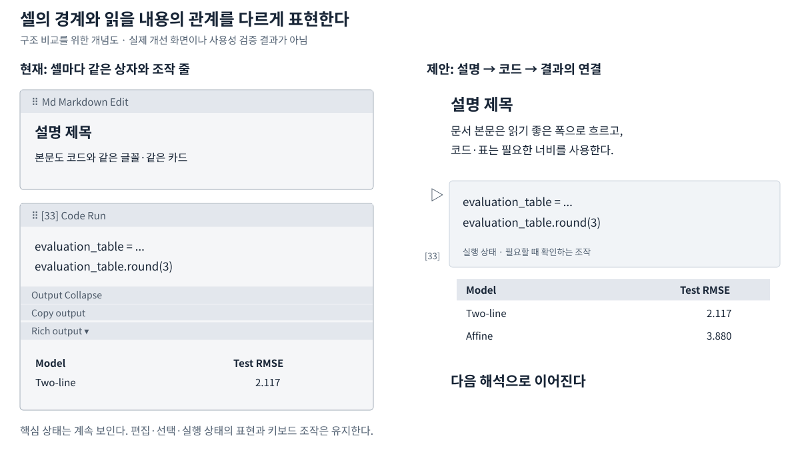
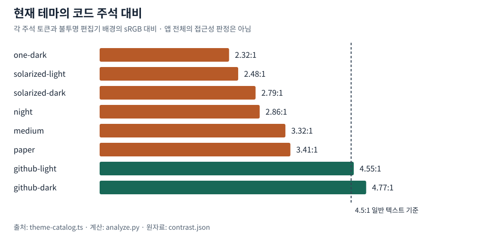
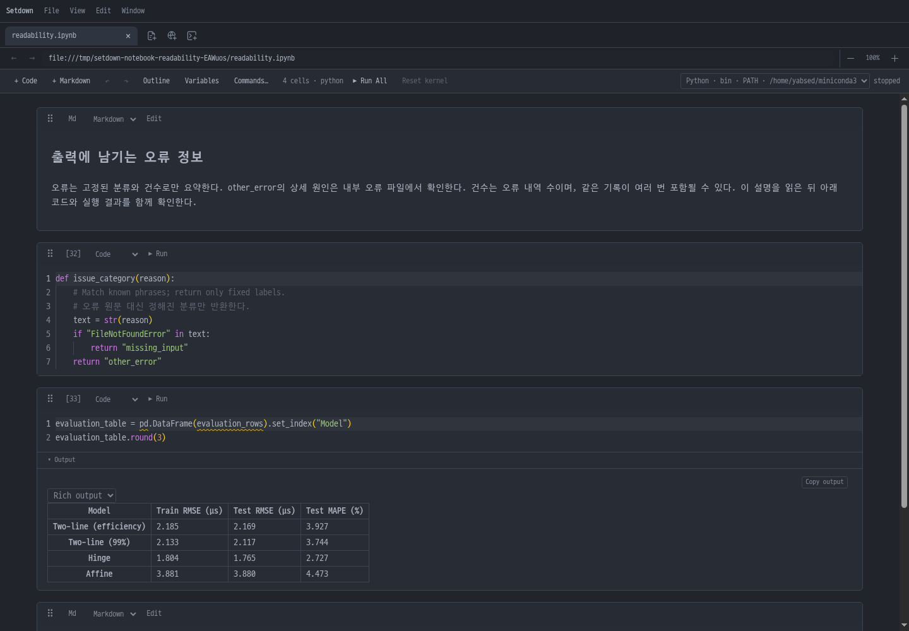

# Setdown 노트북 가독성 연구: 읽을 내용, 조작, 상태를 어떻게 구분할 것인가

작성: 2026-10-19 · 대상: 현재 Setdown 노트북의 시각 설계 · 조사 방식: 소스 감사, 격리된 Electron 실측, 공식 구현 비교, 관련 연구 검토

## 1. 결론: 기존 진단은 방향은 맞지만 원인과 우선순위를 더 구분해야 한다

**우리 노트북은 설명·코드·결과보다 ‘셀이라는 편집 단위’를 먼저 보여준다.** Markdown과 코드에 같은 상자와 조작 줄을 반복하고, 결과를 읽기 전에도 여러 조작 줄을 통과하게 한다. 글꼴까지 비슷해서, 사용자가 내용의 역할과 경계를 알아내는 부담을 떠안는다. 이것이 현재 구현에서 확인되는 가장 큰 구조적 문제다.

다만 **“고정폭 글꼴 때문에 느리게 읽힌다”, “글꼴을 바꾸는 것이 가장 효과가 크다”는 결론은 아직 입증되지 않았다.** 기존 설명은 화면 관찰, 사용성 가설, 개선 우선순위를 한데 섞었다. 이번 조사에서는 다음처럼 구분한다.

| 판단 | 이번 조사에서 내릴 수 있는 결론 |
|---|---|
| 명확하게 확인되는 결함 | 여러 테마의 주석 대비가 낮다. One Dark는 약 **2.32:1**이다. 포커스가 없는 여러 코드 셀에 현재 줄 강조가 동시에 남는다. |
| 가장 유력한 구조적 원인 | 반복되는 셀 조작부와 동일한 카드 표현이 설명→코드→결과의 연결보다 강하다. 출력 조작부까지 포함해서 다뤄야 한다. |
| 효과를 비교해야 할 개선 | 본문·UI·코드의 글꼴 역할 분리, 읽는 Markdown의 프레임 완화, 본문 폭 제한, 조작부 재배치다. 효과의 크기와 순서는 아직 사용자 실험으로 확인하지 않았다. |
| 이 조사로 알 수 없는 것 | 사용자가 덜 쓰게 된 원인 중 시각 설계의 비중, 실제 읽기 속도·피로도 개선량, VS Code와의 작업 성능 차이다. |

**권고는 ‘대비와 잘못된 상태 강조부터 수정하고, 그다음 문서의 흐름을 만드는 레이아웃과 글꼴을 함께 비교하자’이다.** 글꼴만 바꾸는 수정은 반복되는 조작 줄과 출력의 단절을 남긴다. 반대로 도구막대를 무조건 숨기면 실행 상태와 조작 발견 가능성이 나빠질 수 있다.

이 보고서에서는 제품 코드를 변경하지 않았다. 실측 자료와 재현 스크립트, 설계 제안만 추가했다.

## 2. 조사 범위와 증거의 한계

### 2.1 무엇을 비교했는가

| 대상 | 기준 |
|---|---|
| Setdown 소스 | `ec7f447b97719d63582c3ce6fa6774e2c546d199` |
| 실제 화면 | 로컬 Electron 빌드, 합성 노트북, One Dark / GitHub Dark / GitHub Light, 1440×1000 및 720×1000 창 |
| 배율 | 앱·탭 100%, 측정 화면의 devicePixelRatio 1, 수치는 CSS px |
| 실행 격리 | 저장소의 `with-isolated-display.sh`: Xvfb, 별도 런타임 디렉터리와 D-Bus, 데스크톱 Wayland 연결 제거 |
| VS Code 소스 | `vendor/vscode`의 `d3d31f62268b169a2dfab62ffb2d7d38158a5b7c` |
| JupyterLab 소스 | `vendor/jupyterlab`의 `5d3ae70270ffd602eac1be77ca24ed7a88ad518a` |
| 외부 근거 | 공식 문서, W3C 문서, 논문 및 저자·연구기관이 제공한 자료 |

합성 노트북에는 한국어 설명, 한국어·영어 주석이 있는 Python, 짧은 코드와 저장된 HTML 표, 후속 해석을 넣었다. 커널은 실행하지 않았다. 이 자료는 **사용자 파일의 복제나 동일 작업의 성능 비교가 아니다.** 표를 만드는 코드는 렌더링 확인을 위한 것으로, 완결된 분석 프로그램이 아니다.

720px 측정은 좁은 창의 반응형 배치를 확인한 것이다. **실제 분할 화면이나 앞서 보고된 검색창·Escape 문제를 재현한 결과가 아니다.** 실제 분할에서는 포커스와 메뉴·툴팁 소유권을 별도로 확인해야 한다.

사용자가 첨부한 두 화면은 내용, 언어, 테마, 배율, 창 크기가 다르다. 따라서 눈에 띄는 차이를 찾는 자료로는 유용하지만, 글꼴이나 여백 하나의 효과를 분리하는 실험으로 볼 수 없다. VS Code와 JupyterLab은 이번에 GUI로 같은 과제를 실행하지 않았으며, 아래 비교는 공식 문서와 고정된 소스 버전에 근거한다.

### 2.2 증거를 읽는 방법

- **실측:** Electron의 실제 DOM 크기, 계산된 스타일, Chromium이 사용한 글꼴, 캡처로 확인했다.
- **코드 확인:** 현재 구현의 분기·기본값·스타일로 확인했다. 모든 조합의 동작을 실행했다는 뜻은 아니다.
- **연구 근거:** 일반적인 읽기·지각·사용성 연구다. 해당 연구가 Setdown의 개선 효과를 직접 검증한 것은 아니다.
- **설계 제안:** 아직 구현하거나 사용자에게 검증하지 않은 후보안이다.

원자료는 [evidence.json](notebook-readability-2026-10-19/evidence.json), 집계는 [summary.json](notebook-readability-2026-10-19/summary.json), 측정에 사용한 문서는 [fixture.ipynb](notebook-readability-2026-10-19/fixture.ipynb)에 보관했다.

## 3. 앞선 네 가지 진단을 다시 평가한다

| 앞선 진단 | 재검토 | 수정된 해석 |
|---|---|---|
| 설명문까지 코드처럼 보인다 | **구현·실측으로 확인. 원인 설명은 보완 필요.** | 본문, 코드, 셀 UI, 표의 표본에서 실제 D2Coding 사용을 확인했다. 문제는 고정폭이라는 속성 자체보다 역할 구분이 약하다는 점이다. |
| 셀마다 조작 UI가 한 줄을 차지한다 | **확인. 출력까지 보면 영향 범위가 더 크다.** | 셀 헤더뿐 아니라 출력 헤더, 복사, 형식 선택도 별도의 줄이다. 일부 오른쪽 액션은 이미 필요할 때만 보인다. ‘모든 버튼이 항상 보인다’는 설명은 부정확하다. |
| Markdown도 코드와 같은 상자다 | **확인. 가장 중요한 구조적 가설이다.** | 저장·편집상의 경계가 읽는 문서의 의미 구조보다 강하게 드러난다. 읽는 Markdown과 편집 중인 Markdown의 표현을 달리할 필요가 있다. |
| 중요한 글자가 흐리고 문장이 길다 | **둘 다 확인. 각각 다른 처방이 필요하다.** | 대비는 테마별 문제이고, 긴 줄은 본문 폭의 문제다. 기본 코드 글자까지 전부 흐리다는 뜻은 아니다. |

기존 진단에서 빠졌던 것은 **상태의 위계**와 **결과의 표현**이다. 읽는 대상이 구분되어도, 어느 셀이 선택되었고 어디에 입력되며 어떤 결과를 신뢰할 수 있는지 모호하면 작업은 계속 불편하다.

## 4. 실제 화면에서 확인된 여섯 가지 문제

### 4.1 글꼴의 역할 분리가 없다 — 실측

현재 [typography.ts](../apps/desktop/src/core/theme/typography.ts)의 공통 글꼴은 `"D2Coding", ui-monospace, monospace`다. Markdown과 HTML 표는 이를 상속하고, Monaco도 같은 상수를 명시적으로 사용한다. 셀 메뉴도 같은 계열을 사용한다.

CSS 선언만 확인한 것이 아니다. Chromium의 `CSS.getPlatformFontsForNode`로 본문, 코드 토큰, 셀 형식 선택 UI, 표 데이터 셀의 표본을 조사했고, 모두 D2Coding이 실제로 사용되었다.

| 역할 | 이번 화면의 실제 설정 | 읽기에서 기대하는 구분 |
|---|---|---|
| 설명 본문 | D2Coding 14px, 행간 23.8px | 문장·단락·제목의 구조를 읽는다. |
| 코드 | D2Coding 14px, 행간 22px | 기호, 들여쓰기, 줄 위치를 읽는다. |
| 셀 조작 UI | D2Coding 12px | 짧은 명령과 상태를 빠르게 식별한다. |
| HTML 표 | D2Coding 14px, 기본 행간 | 열 제목·행 이름·수치 관계를 비교한다. |

이 네 역할을 동일한 글꼴로 표현하는 것이 항상 잘못은 아니다. 그러나 현재는 카드와 배경도 유사해서, 서체 외의 구분 수단까지 약하다. 제목만 조금 굵어지는 것으로는 본문과 프로그램 텍스트의 차이가 충분히 드러나지 않는다.

### 4.2 조작 줄이 코드와 결과 사이를 크게 차지한다 — 실측

실제 셀 헤더 높이는 **36px**였다. CSS의 `min-height: 32px`만 보고 32px이라고 계산하면 틀린다. 내부 컨트롤과 패딩이 최종 높이에 영향을 준다.

두 줄짜리 코드와 작은 표가 있는 합성 셀을 측정하면 다음과 같다.

| 영역 | 높이 |
|---|---:|
| 셀 조작 헤더 | 36px |
| 코드 영역 | 65px |
| 출력 헤더 | 26px |
| 출력 복사 조작 줄 | 19px |
| 출력 형식 선택 | 23px |
| 셀 전체 | 322px |

이 셀에서 네 조작 줄의 높이 합계는 **104px**, 셀 전체의 **32.3%**다. 코드 영역 65px보다 조작 줄들의 합계가 더 크다. 이 수치는 해당 표본의 기하학적 비율이며, 읽기 시간이 32.3% 늘어난다거나 그만큼 공간을 모두 없애야 한다는 의미는 아니다. 출력 형식 선택은 복수의 지원 MIME 형식이 있는 경우에 나타난다.

핵심은 연결이다. 사용자는 “이 코드를 실행하면 이 표가 나온다”를 읽는데, 사이에 출력 접기·복사·형식 선택이라는 별도 목적의 요소가 반복된다. **입력과 결과는 가까운 한 묶음으로 읽히고, 조작은 그 묶음의 주변에 있어야 한다**는 설계 가설을 세울 수 있다.

현재 오른쪽 `.cell-actions`는 기본적으로 투명하고 hover·선택·키보드 포커스가 들어오면 나타난다. 이미 있는 이 동작을 없애고 처음부터 다시 만들 필요는 없다. 남아 있는 고정 헤더와 여러 출력 조작 줄을 함께 정리해야 한다. 근거: [NotebookCell.svelte](../apps/desktop/src/renderer/notebook/NotebookCell.svelte), [NotebookOutputs.svelte](../apps/desktop/src/renderer/notebook/NotebookOutputs.svelte).

### 4.3 Markdown이 ‘문서’보다 ‘입력 카드’로 보인다 — 코드 확인과 해석

현재 Markdown과 코드는 공통 `.notebook-cell`의 배경·테두리·둥근 모서리·상단바를 공유한다. 셀 간 아래 여백은 18px이고, Markdown 안에는 별도 패딩과 제목·문단의 여백이 더해진다. Markdown 전용 클래스는 있지만, 읽기 상태의 프레임을 구분하는 스타일은 없다.

따라서 짧은 설명도 “조작부를 가진 하나의 상자”로 보인다. 제목이 뒤따르는 코드 여러 개를 설명하더라도, 시각적으로는 자기 카드 안에 갇힌다. 이 문제는 여백의 총량보다 **여백과 경계가 무엇을 묶느냐**에 가깝다.

지각 연구의 ‘공통 영역’ 원리는 같은 경계 안의 요소들이 하나로 묶여 보일 수 있음을 설명한다. 이를 현재 화면에 적용하면, 반복되는 카드가 내용의 논리보다 셀의 저장 단위를 강조한다는 해석이 가능하다. 이것은 연구를 이용한 설계 추론이며, 해당 실험이 노트북 UI의 테두리를 제거하라고 검증한 것은 아니다. [Palmer, *Common region: A new principle of perceptual grouping*](https://doi.org/10.1016/0010-0285(92)90014-S)



### 4.4 주석 대비가 낮다. 그러나 모든 텍스트가 같은 문제는 아니다 — 계산·실측

One Dark의 주석은 `#5c6370`, 편집기 배경은 `#282c34`다. 상대 휘도로 계산한 대비는 **2.316:1**이다. 실제 DOM에서도 이 주석 색을 확인했다. 반면 같은 테마의 기본 코드 글자는 **6.568:1**이다. 따라서 “전체 글자가 흐리다”보다 **“주석과 일부 보조 UI를 비활성 정보처럼 낮췄다”**가 정확하다.

일반 텍스트에 대한 WCAG 2.2의 AA 대비 기준은 4.5:1이다. 비활성 UI의 예외를 코드 주석에 적용해서는 안 된다. 주석은 사용자가 읽어야 할 정보다. 아래는 이 기준을 색상 토큰 점검의 기준으로 사용한 결과이지, 애플리케이션 전체의 접근성 적합성 판정은 아니다. [W3C, Contrast (Minimum)](https://www.w3.org/WAI/WCAG22/Understanding/contrast-minimum.html)

| 테마 | 주석 / 편집기 배경 | 주석 대비 | 기본 코드 글자 대비 |
|---|---|---:|---:|
| One Dark | `#5c6370` / `#282c34` | **2.32:1** | 6.57:1 |
| Solarized Light | `#93a1a1` / `#fdf6e3` | **2.48:1** | 4.13:1 |
| Solarized Dark | `#586e75` / `#002b36` | **2.79:1** | 4.75:1 |
| Night | `#808080` / `#363b40` | **2.86:1** | 7.94:1 |
| Medium | `#8a8d94` / `#ffffff` | **3.32:1** | 10.06:1 |
| Paper | `#8a8178` / `#f3f2ee` | **3.41:1** | 12.34:1 |
| GitHub Light | `#6e7781` / `#ffffff` | 4.55:1 | 14.65:1 |
| GitHub Dark | `#8b949e` / `#24292e` | 4.77:1 | 9.50:1 |

8개 테마 중 6개가 주석에 대해 4.5:1에 미달한다. GitHub Light는 통과하지만 여유가 작다. Solarized Light는 기본 코드 글자도 이번 기준에 미달한다. One Dark 셀 도구막대의 `mutedText`와 `surface` 조합도 약 4.04:1이어서, 활성 명령·상태에 그대로 쓰는 것이 적절한지 따로 점검해야 한다.



계산은 불투명 배경과 지정 색상의 sRGB 상대 휘도를 사용했다. 안티앨리어싱된 화면의 가장 흐린 픽셀을 뽑은 값이 아니다. 모든 syntax token, 선택 배경, hover 배경을 검사한 결과도 아니다. 원자료: [contrast.json](notebook-readability-2026-10-19/contrast.json), 구현: [theme-catalog.ts](../apps/desktop/src/core/theme/theme-catalog.ts), [theme.ts](../apps/desktop/src/renderer/theme.ts).

현재 주석에는 이탤릭도 적용된다. 이탤릭 자체를 금지할 근거는 없지만, 색과 기울기를 동시에 약한 표현으로 사용하면 ‘중요하지 않은 문장’처럼 보일 가능성이 있다. 우선 대비를 확보한 상태에서 기울기 선호를 비교해야 한다.

### 4.5 본문의 행간은 이미 넉넉하지만 줄 길이는 제한되지 않는다 — 실측

본문 행간은 1.7이다. 이번 화면의 문제를 단순히 “행간이 좁다”로 설명할 수 없다. 더 뚜렷한 문제는 가로 폭이다.

| 창 크기 | 설명 단락의 폭 | 첫 줄 문자 수 | 전역 도구막대 높이 |
|---|---:|---|---:|
| 1440×1000 | 1263.8px | 111자, 이 중 완성형 한글 68자 | 38px |
| 720×1000 | 601.4px | 54자, 이 중 완성형 한글 31자 | 64px |

문자 수에는 영문·공백·기호도 포함한다. 이 측정은 해당 문장 하나의 줄바꿈 결과다. 넓은 화면에서는 단락이 크게 늘어나고, 좁은 화면에서는 전역 도구막대가 여러 줄로 접혀 세로 공간을 더 차지한다. 두 현상은 서로 다른 대응이 필요하다.

W3C의 Visual Presentation은 AAA 항목에서 줄 길이를 80자, CJK는 40자 이하로 조정할 수 있는 수단을 다룬다. 이는 모든 UI의 기본 폭을 반드시 그 값으로 고정하라는 뜻도, 모든 사람의 최적 읽기 속도가 그 지점이라는 뜻도 아니다. 다만 현재처럼 본문 폭이 창 크기에 따라 계속 늘어나는 설계에 사용자 조절 수단이 필요하다는 근거가 된다. [W3C, Visual Presentation](https://www.w3.org/WAI/WCAG22/Understanding/visual-presentation.html)

**본문의 읽기 폭과 코드·표의 작업 폭을 분리해야 한다.** 표와 코드를 문장 폭으로 함께 좁히면 열 비교와 긴 표현식 읽기가 나빠질 수 있다. 반대로 본문까지 표의 폭을 따라가게 할 이유도 없다.

### 4.6 포커스가 없는 여러 셀에도 현재 줄 강조가 남는다 — 실측

측정 시 `document.activeElement`는 `BODY`였지만, 두 코드 셀 각각에 불투명도가 있는 현재 줄 배경이 나타났다. 두 셀 모두 해당 Monaco에 DOM 포커스가 없었다. 이는 실제 커서나 입력 포커스가 둘이라는 뜻이 아니다. **포커스를 암시할 수 있는 시각적 강조가 여러 곳에 남아 있다는 뜻**이다.

현재 `NotebookCell.svelte`는 Monaco의 `renderLineHighlightOnlyWhenFocus`를 지정하지 않는다. 설치된 Monaco의 기본값은 `false`다. 따라서 여러 개의 독립 편집기를 쌓은 노트북에서는 각각의 현재 줄 강조가 남을 수 있다.

이 문제는 장식보다 상태 해석의 문제다. 셀 선택, 텍스트 입력 포커스, 실행 중인 셀은 서로 다르다. 같은 테두리나 넓은 배경 강조로 모두 표현하면 사용자는 현재 작업 대상을 다시 확인해야 한다. `renderLineHighlightOnlyWhenFocus: true`를 첫 후보로 검토하고, 선택 상태는 별도의 왼쪽 표시로 남기는 편이 일관된다. 실제 분할·키보드 이동·팝업 동작을 포함한 검증은 후속 구현 때 필요하다.

## 5. 결과 표가 덜 정돈되어 보이는 데에는 별도의 구현 이유가 있다

현재 [notebook-content.ts](../apps/desktop/src/renderer/notebook/notebook-content.ts)는 출력 HTML에서 `style` 태그와 `style` 속성을 제거한다. 원본 출력 보존과 화면에 삽입할 내용의 정화는 구분되어 있다. 이는 앱 안에 임의의 출력 스타일이 흘러들지 않도록 하는 의도적인 경계다.

문제는 정화 이후의 표현이다. [NotebookOutputs.svelte](../apps/desktop/src/renderer/notebook/NotebookOutputs.svelte)는 표에 주로 테두리와 패딩만 제공한다. 표 전용 글꼴, 숫자 정렬, 헤더와 본문 구분, 행을 따라 읽는 보조 표현은 충분히 정의되어 있지 않다. 합성 출력의 스타일 태그가 제거되고, 표 데이터가 D2Coding·`text-align: start`로 표시되는 것을 확인했다.

즉, 출력이 원래 갖고 있던 서식을 제거한 뒤 **앱이 책임질 읽기 서식을 충분히 채우지 않은 상태**다. 해결책은 정화를 약화시키는 것이 아니라, 믿을 수 있는 앱 소유의 제한된 출력 스타일을 제공하는 것이다.

| 내용 | 권장 표현 | 주의점 |
|---|---|---|
| 행 이름·열 제목 | 본문 계열 글꼴, 명확한 헤더 대비 | 제목이 길 때도 데이터와 구분되어야 한다. |
| 숫자 | 자리 비교가 되는 정렬, 지원되는 글꼴에서 tabular numerals | 모든 `td`를 숫자로 가정하지 않는다. 형식·메타데이터를 모르면 사용자가 선택할 수 있어야 한다. |
| 표 경계 | 헤더 구분과 필요한 행 구분을 우선 | 수직·수평의 모든 선을 강하게 그리면 작은 표에서도 격자가 먼저 보인다. |
| 로그·traceback·JSON | 코드용 고정폭 글꼴 | 본문 글꼴 분리를 출력 전체의 산세리프 전환으로 구현하면 안 된다. |
| 수식·그래프 | 해당 렌더러의 글꼴과 시각 규칙 | 전역 폰트 강제가 수식 배치나 그래프 라벨을 깨뜨리지 않아야 한다. |

숫자의 정밀도·단위·소수점 처리는 데이터 의미의 일부다. 표를 예쁘게 만들기 위해 원본 값을 임의로 반올림하거나 단위를 생략해서는 안 된다. 이번 조사에서 합성 표는 작은 표 하나이며, 대형 표·다중 인덱스·긴 셀·이미지 출력은 별도 검증 대상이다.

## 6. VS Code와 JupyterLab에서 배워야 하는 것은 기능을 숨기는 기술만이 아니다

### 6.1 실제로는 역할과 상태에 따라 표현을 달리한다

| 관점 | Setdown 현재 | VS Code 참조 구현 | JupyterLab 참조 구현 |
|---|---|---|---|
| 글꼴 역할 | 본문·UI·코드·표에 공통 D2Coding | Markdown, 코드, 출력에 별도 설정 경로 | UI·content·code 글꼴 토큰 분리 |
| 조작부 | 셀 상단 고정 헤더, 출력에 추가 줄들 | 실행을 왼쪽 공간에 배치, 셀 제목 도구막대는 위치·표시 조건을 설정 | 셀 프롬프트·입력·출력의 역할별 레이아웃 |
| Markdown | 코드와 같은 카드 스타일 | markup preview 전용 표현 | 기본 셀 자체는 투명 배경·테두리 없음, 종류별 규칙 적용 |
| 상태 | 선택·focus-within에 같은 테두리, 비포커스 현재 줄 강조 | 선택·command·edit 구분, gutter 중심 focus indicator 설정 | command·edit 모드 구분 |
| HTML 표 | 기본 격자·패딩 위주 | 헤더 배경·행 배경·정렬·간격의 기본 스타일 제공 | content 스타일 체계 사용 |

공식 VS Code 문서도 실행 아이콘과 출력의 관계, 셀의 선택·명령·편집 상태를 별도로 설명한다. JupyterLab 역시 명령 모드와 편집 모드를 구분한다. 배워야 할 것은 “어떤 버튼이 몇 개 적다”보다 **콘텐츠의 역할과 현재 가능한 동작이 예측 가능하게 보이는 방식**이다. [VS Code: Jupyter Notebooks](https://code.visualstudio.com/docs/datascience/jupyter-notebooks), [JupyterLab: Notebooks](https://jupyterlab.readthedocs.io/en/stable/user/notebook.html)

### 6.2 비교 화면을 과도하게 이상화하면 안 된다

고정된 VS Code 소스에서 `notebook.cellToolbarVisibility`의 기본값은 `click`이다. hover 방식도 선택할 수 있다. `notebook.showCellStatusBar`의 기본값은 `visible`이다. 따라서 “VS Code는 선택하지 않은 셀에 조작·상태를 전혀 보여주지 않는다”는 설명은 맞지 않는다.

글꼴도 마찬가지다. `notebook.markup.fontFamily`와 출력 글꼴은 별도 설정이며, 비어 있는 `notebook.output.fontFamily`는 편집기 글꼴을 따른다. **모든 출력이 비례폭 글꼴인 것은 아니다.** HTML 표의 표현과 일반 텍스트 출력은 구분해야 한다.

VS Code의 참조 구현은 셀 제목 도구막대를 셀 경계 부근의 별도 레이어에 놓고, 표시 조건을 제어한다. 고정 공간을 가진 상태 표시도 유지한다. 이 조합을 검토해야 하며, 단순히 모든 셀의 높이를 최소화하는 것으로 요약하면 중요한 설계를 놓친다.

JupyterLab도 content와 code에 서로 다른 글꼴·크기·행간 토큰을 둔다. 다만 이 기본 수치가 Setdown의 한글·D2Coding·현재 배율에서 최적이라는 의미는 아니다. 제품 간 픽셀 값을 복사하기보다 역할 구분을 가져와야 한다.

소스 근거: [VS Code notebook.contribution.ts](../vendor/vscode/src/vs/workbench/contrib/notebook/browser/notebook.contribution.ts), [notebookOptions.ts](../vendor/vscode/src/vs/workbench/contrib/notebook/browser/notebookOptions.ts), [notebookCellTitleToolbar.css](../vendor/vscode/src/vs/workbench/contrib/notebook/browser/media/notebookCellTitleToolbar.css), [backLayerWebView.ts](../vendor/vscode/src/vs/workbench/contrib/notebook/browser/view/renderers/backLayerWebView.ts), [JupyterLab theme variables](../vendor/jupyterlab/packages/theme-dark-extension/style/variables.css), [JupyterLab cell styles](../vendor/jupyterlab/packages/cells/style/widget.css).

## 7. 관련 연구가 뒷받침하는 것과 뒷받침하지 않는 것

### 7.1 노트북에는 ‘탐색하는 도구’와 ‘설명하는 문서’가 함께 있다

Rule·Tabard·Hollan의 연구는 공개 노트북 분석과 인터뷰 등을 통해 탐색 과정과 설명을 위한 정리 사이의 긴장을 다룬다. 노트북을 완성된 보고서처럼만 설계하면 실험 중의 편집·실행을 방해하고, 코드 편집기의 목록으로만 설계하면 결과를 설명하고 다시 읽는 경험이 약해진다. [*Exploration and Explanation in Computational Notebooks*, CHI 2018](https://adamrule.com/files/papers/chi_2018.pdf)

Setdown에 적용할 때의 함의는 두 상태를 자연스럽게 오갈 수 있어야 한다는 것이다. 읽는 Markdown은 문서처럼 보이되, 선택·편집·실행으로 들어가는 경로는 명확하게 남겨야 한다. 별도의 전체화면 ‘발표 모드’만 만들어 해결하려 하면, 실제로는 몇 분마다 읽기와 편집을 오가는 사용자의 작업을 놓칠 수 있다.

또한 시각적으로 정돈된 노트북이 실행 순서나 의존성까지 올바른 것은 아니다. 계산 노트북의 탐색 과정과 정리를 다룬 [*Managing Messes in Computational Notebooks*의 연구 프로젝트](https://microsoft.github.io/gather/)도 이런 작업 문제를 별도로 다룬다. 이번 보고서는 시각 설계를 다루며, 실행 재현성을 해결했다고 주장하지 않는다.

### 7.2 고정폭이라는 이유만으로 본문에 나쁜 글꼴이라고 할 수 없다

Wallace 등의 읽기 연구는 사람마다 유리한 글꼴이 다르고, 선호하는 글꼴이 반드시 빠르게 읽히는 글꼴은 아니라는 결과를 제시한다. 글꼴 간 겉보기 크기의 차이를 통제하는 것도 중요하게 다룬다. 이 연구는 영어 읽기 과제이므로 한국어 노트북의 D2Coding과 특정 산세리프 글꼴을 비교한 증거가 아니다. [*Towards Individuated Reading Experiences*](https://shaunwallace.org/files/Readability__TOCHI.pdf)

한글에서는 더 주의해야 한다. W3C의 한국어 조판 문서는 한글에 고정폭과 비례폭 글꼴이 모두 사용됨을 설명한다. 이 문서는 2026-03-21 Group Note Draft이며, 특정 글꼴의 우열을 검증한 연구나 W3C Recommendation이 아니다. [*Requirements for Hangul Text Layout and Typography*](https://www.w3.org/TR/2026/DNOTE-klreq-20260321/)

따라서 필요한 질문은 “한글을 비례폭으로 바꾸면 되나?”가 아니다. 실제 한글 글리프의 형태와 크기, 영문·숫자·기호의 폭, 글꼴 대체, 코드와의 구분을 함께 봐야 한다. 본문에 다른 글꼴을 쓰는 이유도 우선 **역할을 명확히 하고 문장에 맞는 조판을 하기 위해서**다. 읽기 성능이 좋아지는지는 따로 측정한다.

### 7.3 요소가 많다는 것과 읽기 피로가 크다는 것은 동일한 측정값이 아니다

Rosenholtz 등의 연구는 시각적 혼잡도를 측정하고 시각 탐색과의 관계를 다룬다. 이는 색·방향·질감 등 여러 요소의 분포를 고려하는 접근이며, 단순히 버튼 개수나 테두리 개수를 세어 피로도를 산출하는 방법이 아니다. [*Measuring visual clutter*, Journal of Vision](https://pubmed.ncbi.nlm.nih.gov/18217832/)

현재 화면에서 반복되는 조작부가 내용 탐색을 방해할 수 있다는 가설은 타당하다. 하지만 이를 “인지 부하가 몇 % 증가했다”거나 “눈의 피로가 발생했다”로 표현하려면 추가 측정이 필요하다. 이번 보고서의 104px와 32.3%는 배치의 측정값일 뿐이다.

이 구분은 설계에도 중요하다. 버튼 수를 줄이려고 메뉴 안으로 전부 밀어 넣으면 시각적 혼잡은 줄어도 명령을 찾는 비용이 커질 수 있다. **읽는 동안 덜 드러나게 하는 것과 필요한 순간 찾기 어렵게 만드는 것은 함께 평가해야 한다.**

### 7.4 ‘예쁘지 않아서 안 쓰게 된다’는 사용 경험은 별도로 존중해야 한다

Tractinsky 등의 실험은 미적 평가와 지각된 사용성의 관계를 보여준다. 다만 ATM 시뮬레이션에 관한 연구이며, 미적 개선이 노트북의 작업 시간이나 장기 사용률을 개선한다는 직접적인 증거는 아니다. [*What is beautiful is usable*](https://cris.bgu.ac.il/en/publications/what-is-beautiful-is-usable-2/)

사용자의 “안 쓰게 된다”는 말은 단순한 취향 문제라며 배제할 이유가 없다. 선호와 다시 사용할 의향은 제품의 실제 가치다. 동시에 이해 정확도·잘못 실행한 셀·작업 시간과는 구분해서 기록해야 한다. **좋아 보이는가, 읽기 쉬운가, 조작하기 쉬운가, 다음에도 선택하는가는 서로 관련되지만 같은 질문은 아니다.**

## 8. 권장하는 시각 설계

### 8.1 노트북에만 적용하는 글꼴 역할을 만든다

새 폰트를 앱 전체에 덮어씌우는 변경은 범위가 너무 크다. 노트북 안에서 다음 역할을 명시하는 편이 낫다.

| 역할 | 설계 후보 | 유지해야 할 성질 |
|---|---|---|
| 본문·제목 | 한국어를 제대로 지원하는 시스템 본문 계열 또는 선택한 문서용 글꼴 | 문단을 읽기 편하고, 코드와 구분되며, 누락 글리프가 없어야 한다. |
| UI | 시스템 UI 계열 | 작은 크기에서 명령·숫자·상태가 명확해야 한다. |
| 코드·inline code·로그 | D2Coding 또는 사용자가 선택한 코드 글꼴 | 들여쓰기와 기호 구분을 보존한다. |
| HTML 표 | 본문 계열과 수치 표현 규칙 | 열 비교와 행 추적이 쉬워야 한다. |
| 수식·다이어그램 | 렌더러 전용 | 기존 레이아웃의 의미와 크기를 보존한다. |

구현 토큰은 예를 들어 `--notebook-prose-font`, `--notebook-ui-font`, `--notebook-code-font`처럼 역할을 드러내면 된다. 반드시 세 종류의 새 글꼴 파일을 배포하라는 뜻은 아니다. 본문과 UI가 같은 글꼴을 써도 역할·크기·행간·배치가 다르면 충분히 구분될 수 있다.

첫 비교안의 출발점은 본문 15–16px, UI 12–13px, 코드 크기는 현재 사용자 설정 유지, 본문 행간은 현재의 1.7 부근으로 둘 수 있다. **이 숫자는 검증된 최적값이 아니라 비교용 후보**다. 글꼴이 바뀌면 같은 px라도 보이는 크기가 달라지므로, 최종적으로는 실제 화면에서 한글·영문 혼합 문장과 코드의 크기 관계를 조정해야 한다. 글자 크기를 키우는 변화와 글꼴만 바꾸는 효과도 구분한다.

### 8.2 본문은 읽는 폭을 갖고, 코드와 표는 필요한 폭을 갖는다

넓은 창에서는 본문만 최대 폭을 갖도록 한다. 첫 후보는 한국어 위주 문단에서 대략 32–40개의 한글 글자가 들어가는 정도, 영문 위주에서는 대략 55–75자가 들어가는 정도를 비교할 수 있다. 혼합 문장에서는 이 둘을 동시에 정확히 맞출 수 없으며, 사용자 조절과 실제 줄바꿈 확인이 필요하다.

CSS의 `ch`는 현재 글꼴의 숫자 `0`을 기준으로 하는 길이여서, `40ch`를 한글 40자라고 간주하면 안 된다. 글꼴이 정해진 뒤 `em` 기반 폭이나 지원되는 `ic` 단위 등을 후보로 두고, 실제 한국어 문장으로 확인해야 한다. `ic`도 한글 글자 수를 직접 세는 단위는 아니다. 문자열을 강제로 잘라 줄을 삽입하는 방식도 적절하지 않다. [CSS Values and Units 초안의 글꼴 상대 단위 정의](https://www.w3.org/TR/css-values-4/#font-relative-lengths)

본문, 코드, 표의 **왼쪽 시작선은 가능한 한 공유**한다. 가운데 정렬한 좁은 설명과 왼쪽에 붙은 넓은 코드가 번갈아 나오면 수평 이동이 커질 수 있다. 넓은 그림·표가 필요한 경우에는 본문 폭을 벗어나도록 허용한다.

제목의 위·아래 간격도 의미를 따라 조정한다. 새 절을 여는 제목 앞에는 충분한 구분을 주고, 그 제목과 설명·코드 사이에는 연결이 보이게 한다. 모든 셀 간 여백을 일괄적으로 줄이거나 늘리는 방식으로는 이 관계를 만들기 어렵다.

### 8.3 읽는 Markdown의 프레임을 줄이되 편집 대상을 잃지 않는다

읽기 상태에서는 상시 헤더와 카드 배경·테두리를 완화하거나 제거한다. 선택했을 때 왼쪽 표시나 얇은 경계로 셀의 범위를 알리고, 편집 중에는 실제 편집 영역을 명확히 보여준다.

그와 함께 유지할 동작이 있다. 본문 텍스트를 드래그해 복사할 수 있어야 하고, 키보드만으로 편집에 들어갈 수 있어야 하며, 빈 Markdown 셀도 선택·편집할 수 있어야 한다. 기존의 더블클릭 편집만 남기고 Edit 경로를 모두 없애면 조작 발견 가능성과 접근성이 나빠진다.

짧은 Markdown 셀 여러 개가 연속할 때도 각각 거대한 여백을 갖게 해서는 안 된다. 반대로 코드 바로 뒤의 해석이 이전 출력과 붙어서 하나의 출력처럼 보이지 않도록 한다. 셀 타입마다 고정된 위·아래 패딩만 두기보다, 앞뒤 콘텐츠 역할을 함께 확인해야 하는 이유다.

### 8.4 조작을 옮기는 순서는 빈도와 위험도에 따른다

실행과 중단은 자주 쓰며 상태와도 연결된다. 왼쪽 여백의 일정한 위치에 두는 후보가 적절하다. 셀 이동·복제·종류 변경은 선택 상태의 도구막대나 명령 메뉴에서 접근하게 하고, 삭제는 실수하기 쉬운 실행 버튼과 붙여 두지 않는 편이 낫다.

출력의 복사·형식 전환·접기는 한 곳에서 찾을 수 있게 묶는다. 평상시에는 결과가 먼저 보이고, 선택·포커스 시 조작이 드러나도록 할 수 있다. 다만 실행 중, 오류, 해당 셀 수정 이후 남은 출력이라는 사실은 메뉴 안으로 숨기지 않는다.

hover로 도구막대가 나타나도 본문 높이나 포인터 아래 버튼의 위치가 바뀌면 안 된다. 표시 여부를 바꾸기 위해 Monaco를 다시 만들거나 포커스를 이동해서도 안 된다. 앞선 툴팁 깜박임 사례는 이번 실측에 포함하지 않았지만, 새 도구막대에서도 같은 종류의 경계 문제를 회귀 검증해야 한다.

버튼을 작게 줄이는 방법은 공간 절약의 우선 수단으로 삼지 않는다. WCAG 2.2의 Target Size (Minimum)는 24×24 CSS px 또는 정해진 간격 등의 예외 조건을 다룬다. 후보 설계에서는 자주 쓰는 버튼에 24–28px 정도의 누르기 영역을 확보하고, 실제 간격과 키보드 조작을 함께 확인한다. 현재 모든 작은 버튼이 곧바로 위반이라는 판정을 내린 것은 아니다. [W3C, Target Size (Minimum)](https://www.w3.org/WAI/WCAG22/Understanding/target-size-minimum.html)

### 8.5 전역 도구막대는 좁은 화면에서 우선순위를 유지해야 한다

현재 전역 도구막대는 추가·Undo/Redo·Outline·Variables·Commands·셀 요약·Run All·Reset·환경 선택 등을 함께 보여주며 줄바꿈을 허용한다. 환경 선택에는 이름·출처·전체 경로가 함께 들어간다. 개발 정보는 정확하지만 매번 읽어야 할 표시는 길어진다.

좁은 화면에서는 환경의 짧은 이름과 실행 상태, 주요 실행·추가 명령을 우선 남기고, 낮은 빈도의 명령은 명시적인 더보기로 이동시키는 후보를 검토한다. 환경의 전체 경로와 출처는 선택 목록이나 상세 표시에서 확인할 수 있게 한다. 같은 이름의 환경이 여러 개이면 구분 정보는 반드시 남겨야 한다.

글자를 계속 줄이거나 무작정 여러 줄로 접는 방법으로 대응하지 않는다. 넓은 창, 실제 분할, 높은 텍스트 배율에서 같은 명령이 어디로 이동하는지 예측 가능해야 한다.

## 9. 상태별로 무엇을 보여줄지 먼저 정해야 한다

다음은 구현 전 합의할 수 있는 상태 표다. 서로 배타적인 상태 목록이 아니라, 선택·편집·실행이 겹칠 때 각 표시의 책임을 구분하기 위한 제안이다.

| 상태 | 계속 보여야 하는 정보 | 필요한 조작 | 피해야 할 표현 |
|---|---|---|---|
| 선택하지 않은 Markdown | 제목·본문·링크·그림 | 선택·키보드 진입 경로 | 매 셀의 큰 상시 헤더 |
| 선택한 셀 / 명령 모드 | 선택 범위 | 이동·복제·종류 변경 등 | 텍스트 커서가 있는 것처럼 보이는 넓은 현재 줄 강조 |
| 코드 편집 중 | 입력 커서, 편집 포커스, 진단 | 실행·중단 및 편집 명령 | 다른 코드 셀에도 같은 편집 강조 유지 |
| hover | 현재 가리키는 셀의 조작 힌트 | 포인터로 접근 가능한 도구막대 | 본문 이동, 나타났다 사라지는 버튼·툴팁 |
| 실행 대기 / 실행 중 | 대기·실행 상태와 소유 셀 | 취소·중단 | 포인터를 올려야만 보이는 상태 |
| 오류 | 오류 상태, 메시지, 해당 위치 | traceback 이동·복사 | 색만으로 오류를 전달하거나 오류를 메뉴 안에 숨김 |
| 셀 수정 후 이전 출력 | 출력의 출처가 현재 텍스트와 다르다는 표시 | 재실행·출력 확인 | 최신 결과와 똑같이 보이게 함 |
| 화면 밖 셀 | 문서 높이와 모델·실행 상태의 연속성 | 다시 돌아왔을 때 자연스러운 복원 | 스크롤 높이 변화, 편집 내용·포커스·IME 손실 |

현재의 ‘이전 버전 출력’ 판정은 `source !== (executedSource ?? originalSource)`에 근거한다. **해당 셀 텍스트의 변경 여부를 알려줄 뿐, 상위 셀이나 커널 상태의 변화까지 분석한 최신성 증명이 아니다.** 시각 설계를 개선하면서 ‘최신’이라는 더 강한 의미를 부여해서는 안 된다.

hover에 추가 정보를 띄운다면 키보드 포커스로도 접근할 수 있어야 한다. 나타난 내용을 가리키거나 읽는 동안 유지되고, 필요할 때 닫을 수 있어야 한다는 원칙도 적용해야 한다. [W3C, Content on Hover or Focus](https://www.w3.org/WAI/WCAG22/Understanding/content-on-hover-or-focus.html)

상태 표현에 필요한 아이콘·경계의 식별성은 별도로 검사하되, 장식용 카드 테두리까지 모두 진하게 만들 필요는 없다. 비텍스트 대비 기준도 필요한 UI·상태를 식별하는 정보에 관한 것이다. [W3C, Non-text Contrast](https://www.w3.org/WAI/WCAG22/Understanding/non-text-contrast.html)

## 10. 실행 우선순위: 확실한 수정과 비교가 필요한 재설계를 나눈다

| 순서 | 작업 | 기대하는 변화 | 근거의 확실성 | 주요 위험 |
|---|---|---|---|---|
| 0 | 주석·활성 보조 UI의 테마별 대비 점검 및 수정 | 실제로 읽어야 할 정보가 배경에 묻히지 않는다. | 높음: 색상·크기·기준 확인 | 같은 토큰을 쓰는 일반 편집기의 인상도 바뀔 수 있다. |
| 0 | 현재 줄 강조를 편집 포커스와 연결 | 어느 셀에 입력하는지 덜 모호하다. | 높음: 비포커스 강조 재현 | 명령 모드의 셀 선택 표시를 함께 유지해야 한다. |
| 1 | 글꼴 역할 분리와 읽는 Markdown의 프레임·폭 비교안 | 설명을 문서로 읽고 코드로 자연스럽게 넘어간다. | 구현 문제는 확실, 효과 크기는 미검증 | 글꼴·줄바꿈·셀 높이·사용자 선호가 달라진다. |
| 1 | 셀 헤더와 출력 조작 줄을 함께 재배치 | 코드와 결과의 연결이 가까워진다. | 공간 실측과 구조 분석 | 조작 발견, 키보드 포커스, 드래그 진입점이 달라진다. |
| 2 | 표·텍스트·로그별 출력 스타일 | 결과 비교가 정돈된다. | 출력 스타일 누락 확인 | 임의 HTML·대형 표·다중 MIME에 대한 호환성 |
| 2 | 전역 도구막대와 환경 표시의 좁은 폭 대응 | 분할에서도 내용과 주요 명령에 공간을 준다. | 좁은 창에서 높이 증가 실측 | 명령 위치가 지나치게 자주 바뀌지 않아야 한다. |

이 표의 순서는 **개선량을 수치로 예측한 순위가 아니다.** 명확한 결함과 비교적 작은 수정부터 처리하고, 효과와 조작 위험이 함께 큰 배치는 비교안으로 검증하자는 순서다.

첫 디자인 시안에서 글꼴 하나만 바꾸고 완료로 간주해서는 안 된다. 최소한 읽는 Markdown, 코드, 출력 표, 선택·편집 상태가 함께 들어 있는 한 화면으로 평가해야 한다. 반대로 모든 테마·모든 노트북 기능을 한 번에 재설계할 필요도 없다.

## 11. 실제로 좋아졌는지 확인하는 방법

### 11.1 비교 화면부터 공정하게 만든다

동일한 노트북, 테마, 창 크기, 배율, 실행 상태, 스크롤 위치로 비교한다. 주석 대비와 잘못된 현재 줄 강조는 먼저 고쳐 모든 후보에 동일하게 적용한다. 접근성 결함을 남긴 기준안과 새 디자인을 비교하면 레이아웃 효과가 과장될 수 있다.

그다음 두 요인을 분리한 네 후보가 유용하다.

| 후보 | 본문·UI·코드 글꼴 역할 분리 | Markdown 프레임·본문 폭·조작부 배치 정리 |
|---|---|---|
| A | 기존 방식 | 기존 방식 |
| B | 적용 | 기존 방식 |
| C | 기존 방식 | 적용 |
| D | 적용 | 적용 |

여기서 배치 정리는 하나의 묶음이다. 네 후보만으로 테두리·줄 길이·도구막대 각각의 기여도를 분리할 수는 없다. 먼저 역할 분리와 배치 묶음의 효과를 확인하고, 필요하면 배치 안에서 추가 비교한다. 글꼴을 비교할 때는 겉보기 크기와 실제 줄 길이도 기록한다.

문장과 답을 외워버리는 효과를 줄이기 위해 같은 난도의 내용 세트를 번갈아 쓰고 후보 제시 순서를 바꾼다. 직접 나란히 보는 선호 비교에는 동일한 내용을 쓰되, 시간·정확도를 재는 과제에서는 학습 효과를 따로 다룬다.

### 11.2 ‘예쁜가’와 ‘일이 쉬운가’를 따로 묻는다

| 실제 과제 | 주요 관찰 항목 |
|---|---|
| 한국어 설명에서 오류 집계 기준을 찾아 설명하기 | 찾은 답의 정확도, 시간, 다시 읽은 구간 |
| 특정 주석의 조건을 찾고 코드 한 줄 수정하기 | 조건 이해, 수정 위치, 잘못 건드린 셀 |
| 지정 셀을 실행하고 결과 표의 최솟값과 단위 찾기 | 실행 대상 오류, 표 해석 정확도, 시간 |
| 수정한 셀의 기존 출력이 현재 코드를 반영하는지 판단하기 | 상태 해석 정확도, 근거를 찾는 과정 |
| 복사·형식 변경·Markdown 편집·셀 이동 수행하기 | 조작 발견 여부, 메뉴 탐색, 키보드로 완료 가능 여부 |
| 문서를 닫았다 다시 열어 특정 결론으로 돌아가기 | 위치 재탐색, Outline 활용, 문맥 회복 |

과제 후에는 외관 선호, 읽기 편안함, 조작 자신감, 다시 사용할 의향을 각각 기록한다. 작업 정확도와 시간을 합쳐 하나의 임의 점수로 만들지 않는 편이 해석하기 쉽다. 스크롤 횟수도 적을수록 무조건 좋은 것은 아니다. 읽기 폭을 좁혀 스크롤이 늘더라도 이해가 좋아질 수 있다.

사용자 한 명의 반복 비교도 이 제품의 우선 사용자에게 맞추는 형성 평가로 의미가 있다. 다만 그것을 보편적 사용자 효과로 일반화해서는 안 된다. 더 넓은 판단이 필요하면 한국어·영어, 읽기 중심·실행 중심 사용자로 범위를 넓힌다. 표본 수나 개선 퍼센트를 먼저 정하고 결과를 맞추지 않는다.

마지막으로 며칠간 실제 작업에 사용하면서 **기능 때문에 VS Code로 돌아갔는지, 조작이 불안해서 돌아갔는지, 읽기 불편해서 돌아갔는지**를 구분해 기록한다. 처음 본 인상의 선호와 지속 사용은 다르다. 이번 보고서에는 이러한 사용자 실험의 결과가 포함되어 있지 않다.

### 11.3 구현 검증에서 빠지기 쉬운 조건

| 조건 | 확인해야 할 결과 |
|---|---|
| 한국어·영어·혼합 문장 | 글꼴 대체로 크기·행간이 들쭉날쭉하지 않고, 주석을 읽을 수 있다. |
| 넓은 창·좁은 창·실제 분할·확대 | 본문만 적절히 줄바꿈되고, 표·코드가 불필요하게 좁아지지 않는다. |
| 포인터·키보드·IME | 도구막대 표시가 입력 포커스를 바꾸지 않고, 조합 중 문자가 보존된다. |
| 툴팁·검색·제안 팝업 | 표시 경계에서 깜박이거나 다른 셀의 Escape 처리가 끼어들지 않는다. |
| 긴 코드·화면 밖 셀·큰 출력 | 한 문서의 스크롤과 전체 논리 높이가 유지된다. |
| 실행 중·오류·취소·이전 출력 | 중요 상태가 메뉴나 hover에 의존하지 않고 소유 셀에 표시된다. |
| 테마·폰트 로딩·배율 변경 | 높이와 줄바꿈을 다시 계산해 빈 공간·겹침·스크롤 점프를 만들지 않는다. |
| 빈 Markdown·raw 셀·다중 선택 | 프레임을 줄여도 선택·편집·구조 변경의 대상이 사라지지 않는다. |

## 12. 구현 시 보존할 기반과 변경 범위

이 문제를 해결하기 위해 노트북 엔진이나 VS Code workbench를 통째로 가져올 이유는 없다. 현재의 문서 모델, 셀 ID, 편집기 모델과 DOM 수명 분리, 실행 소유권, 정화 경계를 유지하면서 표현 계층을 바꾸는 것이 적절하다.

| 위치 | 후속 변경의 책임 |
|---|---|
| [NotebookSurface.svelte](../apps/desktop/src/renderer/notebook/NotebookSurface.svelte) | 노트북 글꼴 역할, 바깥 배치, 전역 도구막대의 폭별 동작 |
| [NotebookCell.svelte](../apps/desktop/src/renderer/notebook/NotebookCell.svelte) | 읽기·선택·편집 상태 표현, 셀 조작 위치, Monaco 포커스 강조 |
| [NotebookOutputs.svelte](../apps/desktop/src/renderer/notebook/NotebookOutputs.svelte) | 출력 조작 통합, 표·로그·일반 텍스트별 스타일 |
| [theme-catalog.ts](../apps/desktop/src/core/theme/theme-catalog.ts), [theme.ts](../apps/desktop/src/renderer/theme.ts) | 주석·보조 정보·상태의 색상과 대비 |
| [notebook-content.ts](../apps/desktop/src/renderer/notebook/notebook-content.ts) | HTML 정화·지원 형식 경계 유지. 디자인을 위해 원본 스타일 삽입을 허용하지 않는다. |
| [노트북 계약](../docs/contracts/notebook.md) | 포커스·IME·구조 Undo·드래그·전체 높이·출력 보존에 관한 동작을 유지하고 의도적 변경은 함께 기록 |

특히 현재 셀 편집기는 전체 논리 높이를 확보하면서 필요한 뷰를 유지한다. 본문 글꼴, 폭, 패딩을 바꾸면 셀 높이와 출력 placeholder 높이도 바뀔 수 있다. hover 시 컴포넌트를 다시 만들거나, 600px 같은 임의 높이 제한과 내부 스크롤을 추가하는 방식으로 배치 문제를 덮어서는 안 된다.

셀 이동은 현재 별도 헤더 핸들에서 시작하도록 되어 있다. 이를 왼쪽 여백으로 옮기는 것은 단순 CSS 수정 이상의 동작 변경이다. 본문 드래그 선택과 셀 이동을 계속 분리하고, 구조 Undo와 키보드 이동 경로도 유지해야 한다.

공통 D2Coding 사용은 현재 [preview performance contract](../docs/preview-performance-contract.md)에 명시된 기존 동작이다. 따라서 노트북에 다른 본문 글꼴을 도입한다면 **노트북의 의도적 예외와 적용 범위를 문서화**해야 한다. `APP_FONT_FAMILY`를 전역으로 교체하면 일반 Markdown·Git review·터미널까지 바뀌므로, 이번 문제의 범위를 넘어간다.

후속 구현에서 테마·CSS·preview 준비와 표시 등 계약 범위를 바꾸면 `npm run test:preview-contract`를 실행해야 한다. 성능 경로 변경에는 계약에 맞는 baseline과 `npm run bench:preview -- --baseline /absolute/path/to/installed-baseline` 비교도 필요하다. 실제 Electron 검사와 벤치마크는 계속 격리된 화면에서 실행하고, 일반 Markdown/Git review의 첫 번째·두 번째·warm 사이클 및 편집·준비 시간 포함 여부를 구분해야 한다.

이번에는 보고서와 관찰 자료만 추가했으므로, 제품 변경에 대한 회귀 테스트나 성능 개선을 통과했다고 주장하지 않는다. 실측 스크립트의 관찰 성공과 전체 제품 테스트 통과는 다른 것이다.

## 13. 의사결정 제안

우선 **주석 대비와 포커스 강조를 수정하는 작은 변경**을 만들고, 그 위에서 **설명·코드·표·상태가 함께 있는 동일 문서의 네 비교안**을 준비하는 것이 좋다. 비교안에서는 본문 글꼴뿐 아니라 셀 헤더와 출력 조작부까지 다뤄야 한다.

디자인의 성공 기준은 다음과 같이 잡을 수 있다.

1. 제목과 설명을 읽고, 연결된 코드와 결과로 바로 이어갈 수 있다.
2. 선택된 셀, 입력할 셀, 실행 중인 셀이 서로 구분된다.
3. 평상시에는 내용이 앞에 있고, 조작이 필요할 때는 쉽게 찾을 수 있다.
4. 주석·오류·이전 출력 표시처럼 꼭 읽어야 할 정보는 분명하게 보인다.
5. 좁은 화면과 키보드 작업에서도 같은 원칙이 유지된다.

**최종적으로 바꿔야 할 것은 ‘색을 더 예쁘게 입힌 카드 목록’이 아니라, 분석 문서의 흐름과 실행 도구의 상태가 함께 읽히는 화면이다.** 현재 증거는 이 방향을 충분히 뒷받침한다. 어떤 글꼴과 간격 조합이 가장 좋은지는 위 비교를 통해 결정해야 한다.

## 부록 A. 실제 캡처와 원자료

다음 이미지는 수정 전 로컬 앱의 관찰 화면이다. 사용자 첨부 화면을 편집한 이미지도, 개선 완료 화면도 아니다. 합성 fixture에서 정의하지 않은 변수에 대한 진단 밑줄이 포함될 수 있으며, 이번 조사의 대상은 진단 정확도가 아니다.



| 테마 | 넓은 창 | 좁은 창 |
|---|---|---|
| One Dark | [1440×1000](notebook-readability-2026-10-19/one-dark-1440.png) | [720×1000](notebook-readability-2026-10-19/one-dark-720.png) |
| GitHub Dark | [1440×1000](notebook-readability-2026-10-19/github-dark-1440.png) | [720×1000](notebook-readability-2026-10-19/github-dark-720.png) |
| GitHub Light | [1440×1000](notebook-readability-2026-10-19/github-light-1440.png) | [720×1000](notebook-readability-2026-10-19/github-light-720.png) |

- [evidence.json](notebook-readability-2026-10-19/evidence.json): 화면별 DOM 크기·스타일·플랫폼 글꼴·포커스·현재 줄 정보.
- [summary.json](notebook-readability-2026-10-19/summary.json): 본문 폭·줄 문자 수·조작 줄 높이 집계.
- [contrast.json](notebook-readability-2026-10-19/contrast.json): 테마 토큰의 대비 계산.
- [probe.mjs](notebook-readability-2026-10-19/probe.mjs): 실제 Electron 관찰 스크립트.
- [analyze.py](notebook-readability-2026-10-19/analyze.py): 색 대비·기하 집계 재계산.
- [figures.py](notebook-readability-2026-10-19/figures.py): 대비 그래프와 설계 개념도 생성. 개념도는 측정값을 흉내 낸 개선 화면이 아니다.

재현은 저장소 루트에서 한다. GUI는 반드시 격리 래퍼를 통과한다. 새로 실행하면 이 폴더의 캡처와 원자료가 당시 체크아웃과 로컬 환경의 결과로 갱신된다.

```sh
npm run build
bash apps/desktop/scripts/with-isolated-display.sh node reports/notebook-readability-2026-10-19/probe.mjs
python3 reports/notebook-readability-2026-10-19/analyze.py
python3 reports/notebook-readability-2026-10-19/figures.py
```

소스 버전뿐 아니라 실제 설치 글꼴·Electron 버전·배율이 달라지면 줄바꿈과 높이도 달라질 수 있다. 분석 스크립트는 실행 시점의 `theme-catalog.ts`를 읽으므로, 기존 캡처와 다른 체크아웃에서 다시 계산한 결과를 동일 조건의 실측처럼 섞지 않아야 한다.

## 부록 B. 외부 근거의 용도

본문의 링크가 각 주장을 뒷받침하는 위치에 붙어 있다. 아래는 근거별 해석 범위를 한 번에 확인하기 위한 목록이다.

| 근거 | 이 보고서에서 사용한 범위 | 사용하지 않은 주장 |
|---|---|---|
| Rule 등의 노트북 연구 | 탐색과 설명이라는 두 목적 | 특정 셀 UI가 사용 중단을 유발한다는 인과 |
| Wallace 등의 글꼴 연구 | 개인차, 선호와 수행의 구분, 크기 통제 | 한국어에서 산세리프가 D2Coding보다 빠르다는 결론 |
| W3C 한국어 조판 초안 | 한글의 고정폭·비례폭 사용 맥락 | 특정 한글 글꼴의 권장·우열 |
| Rosenholtz 등의 혼잡도 연구 | 시각 탐색 관점의 분석 | 버튼 수로 읽기 피로도를 산출 |
| Palmer의 공통 영역 연구 | 경계가 묶음을 만드는 원리 | Markdown 테두리 제거의 제품 효과를 검증 |
| Tractinsky 등의 미적 사용성 연구 | 미적 평가와 지각된 사용성의 관계 | 노트북 생산성·재사용률의 개선 보장 |
| W3C 대비·줄 길이·조작 관련 문서 | 검토 기준과 설계 제약 | 앱 전체의 WCAG 적합성 인증 |
| VS Code·JupyterLab 공식 자료와 고정 소스 | 역할별 스타일·조작·상태의 구현 비교 | 동일 조건의 작업 성능 우열 |
