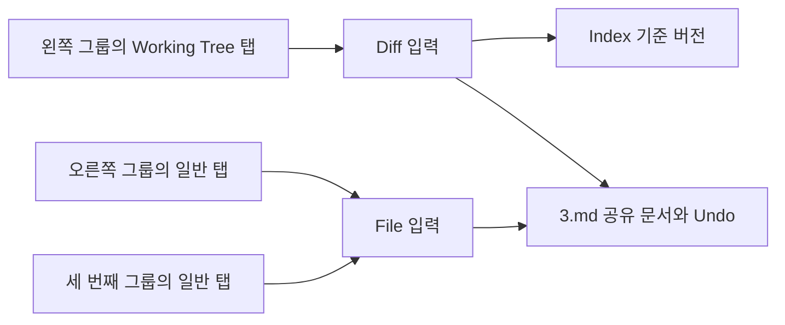

# VS Code 구조를 기준으로 한 Working Tree 독립 탭과 동일 파일 다중 그룹 구현 계획

작성일: 2026-10-23, Asia/Seoul.

**Working Tree 비교를 일반 문서 탭 없이 열고, 일반 문서와 서로 다른 편집 그룹에 동시에 표시한다. 같은 파일은 그룹마다 열 수 있으며, 동일 그룹에서는 동일한 편집 입력을 한 번만 연다.** 이를 위해 문서 버퍼, 편집 입력, 그룹별 탭, 화면 상태를 분리한다.

사용자가 말한 VS Code 동작이 맞다. 다만 중복 판단의 단위는 파일 경로만이 아니라 **편집 입력**이다. `3.md` 일반 입력과 `3.md (Working Tree)` 비교 입력은 다르므로 같은 그룹에서도 각각 한 탭씩 존재할 수 있다. 반대로 동일한 Working Tree 비교를 같은 그룹에 다시 열면 기존 탭을 선택한다.

여기서 Working Tree는 스크린샷의 변경 비교 탭을 뜻한다. “원래 문서”는 같은 파일의 일반 문서 탭이며, diff의 왼쪽 기준 버전과 구분한다. 목표는 같은 창 안의 편집 그룹이다.

## 1. 조사 기준과 기존 분석의 관계

| 대상 | 기준 |
| --- | --- |
| Setdown | `62e2c88cfd32bee6d3ef922c242a8c301465279d` |
| 직접 읽은 VS Code 소스 | `vendor/vscode`, `d3d31f62268b169a2dfab62ffb2d7d38158a5b7c` |
| 기존 구조 분석 | [Working Tree 비교 탭 독립화 분석](2026_10_23_working_tree_editor_architecture.md) |
| 유지할 계약 | [Workspace 계약](../docs/contracts/workspace.md), [preview 성능 계약](../docs/preview-performance-contract.md) |

기존 분석 문서는 보존한다. 이 계획은 그 분석에 **그룹 안의 중복 제거, 그룹 사이의 복사·이동, 같은 모델을 사용하는 여러 화면의 소유권**을 구체화한 후속 구현 계획이다. 아래 단계와 테스트는 구현 시 수행할 작업이며 완료 기록이 아니다.

VS Code 공식 문서도 동일 파일을 여러 그룹에서 나란히 편집하는 기능을 설명한다. 그룹 내부 분할인 `Split Editor in Group`은 별도 기능이며 이번 구현의 필수 범위는 아니다. [공식 Custom Layout 문서](https://code.visualstudio.com/docs/configure/custom-layout#editor-groups)

## 2. 먼저 확정할 사용자 동작

| 사용자 동작 | 구현 목표 |
| --- | --- |
| 일반 파일 탭이 없는 상태에서 Changes의 파일 선택 | 현재 그룹에 Working Tree 비교 탭 하나만 생성. 숨은 일반 탭도 만들지 않는다. |
| 오른쪽 그룹에 `3.md`가 있을 때 왼쪽 그룹에서 Working Tree 열기 | 왼쪽에 비교, 오른쪽에 일반 문서를 계속 표시. 오른쪽 탭을 이동하거나 선택 변경하지 않는다. |
| 오른쪽 그룹에 `3.md`가 있을 때 왼쪽 그룹에서 같은 파일 열기 | 왼쪽에도 일반 탭 생성. 두 탭은 같은 텍스트 모델을 참조한다. |
| 같은 그룹에서 일반 파일 또는 같은 비교 다시 열기 | 해당 입력의 기존 탭 선택. 중복 탭을 생성하지 않는다. |
| 같은 그룹에서 일반 파일과 Working Tree 열기 | 서로 다른 입력이므로 두 탭 허용. 탭 선택에 따라 표시한다. |
| `Open to the Side` | 기준 그룹의 오른쪽 인접 그룹을 사용하고, 없으면 생성. 원래 탭 유지. 대상에 같은 입력이 있으면 재사용한다. |
| `Split Editor Right/Down` | 새 그룹을 만들어 현재 입력의 화면을 복사. 탭 하나뿐인 그룹도 분할 가능하다. |
| 일반 탭 드래그 | 기존처럼 이동. 대상에 같은 입력이 있으면 하나로 합치며 원본 그룹의 해당 탭만 제거한다. |
| `Copy to Group` 또는 복사 modifier 드래그 | 원본 유지, 대상 그룹에 새 탭 또는 기존 동일 입력 재사용. 같은 그룹에서는 중복 없이 재정렬만 한다. 복사 modifier는 Linux/Windows Ctrl, macOS Alt를 사용한다. |
| 일반 탭 닫기 | Working Tree 및 다른 그룹의 동일 파일은 유지. |
| Working Tree 닫기 | 일반 탭 및 다른 그룹의 동일 비교는 유지. 마지막 탭이면 빈 화면으로 돌아갈 수 있다. |
| 어느 화면에서 편집·Undo·Redo·저장 | 공유 문서 내용과 dirty 상태를 모든 참조 화면에 반영. 각 화면의 선택·스크롤·표시 모드는 별도 유지. |

SCM에는 `Open Changes`, `Open Changes to the Side`, `Open File`, `Open File to the Side`를 구분해 노출한다. 비교 탭의 `Open File to the Side`는 modified의 일반 파일 입력을 열고 비교 탭을 유지한다. 새 비교는 현행처럼 source diff와 첫 변경 위치에서 시작한다.

Explorer 단일 클릭의 교체 가능한 preview 정책은 유지한다. 명시적 옆 열기·분할·복사·이동은 pin한다. Git 비교는 첫 도입에서 기존처럼 유지되는 탭으로 열며, SCM 단일 클릭을 교체 가능한 preview로 바꾸는 UX 변경은 포함하지 않는다.

## 3. VS Code 코드에서 가져올 책임 분리

아래 경로는 조사한 로컬 소스에 연결된다. 공개 소스 기준은 [VS Code 고정 커밋](https://github.com/microsoft/vscode/tree/d3d31f62268b169a2dfab62ffb2d7d38158a5b7c)이다.

| VS Code 근거 | 실제 동작 | Setdown에 적용할 설계 |
| --- | --- | --- |
| [editorGroupFinder.ts](../vendor/vscode/src/vs/workbench/services/editor/common/editorGroupFinder.ts), `doFindGroup()` | 명시한 그룹과 `SIDE_GROUP`을 먼저 처리. `revealIfVisible`, `revealIfOpened` 등으로 요청된 경우 다른 그룹에서 찾는다. | 대상 그룹 결정과 중복 검색을 분리한다. 명시적 옆 열기가 전역 경로 검색 때문에 다른 그룹으로 바뀌면 안 된다. |
| [editorGroupModel.ts](../vendor/vscode/src/vs/workbench/common/editor/editorGroupModel.ts), `openEditor():290`, `findEditor():1083` | 자신의 `editors`에서 `matches()`로 찾고 기존 입력을 재사용한다. | `(groupId, inputKey)` 단위의 중복 제거. 다른 그룹의 탭 존재는 새 탭 생성을 막지 않는다. |
| [editorGroupView.ts](../vendor/vscode/src/vs/workbench/browser/parts/editor/editorGroupView.ts), `moveEditor():1420`, `copyEditor():1540` | 다른 그룹에 먼저 열고 이동이면 원본을 닫는다. 복사면 원본을 남긴다. 같은 그룹 복사는 이동으로 처리한다. | `open`, `move`, `copy`, `split`을 명시적인 명령으로 분리. 실패 시 원본 보존. |
| [editorDropTarget.ts](../vendor/vscode/src/vs/workbench/browser/parts/editor/editorDropTarget.ts), `isCopyOperation():374` | singleton 입력은 복사하지 않으며 OS에 맞는 modifier로 이동·복사를 구분한다. | 드래그 payload에 operation과 입력 capability를 반영한다. 기존 drop 위치·geometry 판단은 재사용한다. |
| [textEditorService.ts](../vendor/vscode/src/vs/workbench/services/textfile/common/textEditorService.ts), `createTextEditor():125` | original과 modified 입력을 resolve할 수 있는 `DiffEditorInput` 구성. 파일 입력은 리소스 캐시 사용. | diff를 열기 위해 일반 파일 **탭**을 먼저 열 필요가 없다. 일반 입력과 diff가 같은 문서 서비스를 사용한다. |
| [diffEditorInput.ts](../vendor/vscode/src/vs/workbench/common/editor/diffEditorInput.ts), `createModel():203`, `matches():232` | 양쪽 입력을 직접 resolve. 동일성은 original·modified와 입력 종류에 맞는 옵션으로 판단한다. | 일반 문서와 diff의 동일성을 분리. Working Tree·Index·History도 서로 다른 입력이다. |
| [sideBySideEditorInput.ts](../vendor/vscode/src/vs/workbench/common/editor/sideBySideEditorInput.ts), `isDirty():187`, `save():195` | dirty·save·saveAs·revert를 primary 입력에 위임한다. diff에서는 modified에 해당한다. | Working Tree의 저장 대상은 그 입력의 live document. 배경의 일반 활성 탭으로 추정하지 않는다. |
| [textModelResolverService.ts](../vendor/vscode/src/vs/workbench/services/textmodelResolver/common/textModelResolverService.ts), `createModelReference():251` | canonical URI로 모델 참조 획득. 해제 시 파일 서비스의 dispose 가능 조건도 확인한다. | 문서 모델의 생존을 탭 하나에 묶지 않는다. 열린 입력 참조와 작업 중 참조를 관리한다. |
| [editorGroupView.ts](../vendor/vscode/src/vs/workbench/browser/parts/editor/editorGroupView.ts), `canDispose():716` | 다른 그룹과 side-by-side 양쪽에서 입력을 참조하는지 확인한다. | 일반 탭 닫기로 다른 그룹 및 diff의 공유 문서를 파괴하지 않는다. |
| [editorPane.ts](../vendor/vscode/src/vs/workbench/browser/parts/editor/editorPane.ts), `EditorMemento.saveEditorState():245` | 리소스별 상태 안에 `group.id`별 view state를 저장한다. 설정에 따른 초기 상태 공유도 별도 처리한다. | 모델 공유와 커서·스크롤 상태 공유를 분리. 새 split은 초기 위치만 복사하고 이후 독립적으로 움직인다. |
| [Git repository.ts](../vendor/vscode/extensions/git/src/repository.ts), `resolveChangeCommand():532` | 비교 가능한 변경은 두 URI를 `vscode.diff`로 전달한다. 상태에 따라 일반 열기·merge로 분기한다. | SCM은 비교할 리소스를 만들고 공통 open 경로를 호출한다. 일반 탭을 만드는 선행 작업 제거. |

VS Code의 [그룹 모델 테스트](../vendor/vscode/src/vs/workbench/test/browser/parts/editor/editorGroupModel.test.ts)의 `Multiple Editors - real user example`은 같은 입력을 다시 열어도 탭 수가 1임을 검사한다. [EditorService 테스트](../vendor/vscode/src/vs/workbench/services/editor/test/browser/editorService.test.ts)는 `SIDE_GROUP`, 일반·diff 입력, reveal 옵션과 여러 그룹에 열린 같은 리소스의 저장을 다룬다. 이 시나리오를 Setdown의 테스트에도 반영한다.

Workbench 전체를 가져오지는 않는다. 위의 **그룹 선택 → 입력 매칭 → 모델 resolve → 뷰 생성** 순서를 기존 Svelte·Monaco·Electron 구성에 맞춰 적용한다.

## 4. 현재 코드에서 고쳐야 할 지점

| 현재 지점 | 문제와 변경 방향 |
| --- | --- |
| [tab-controller.ts](../apps/desktop/src/renderer/workspace/tab-controller.ts), `show():559` | `workspace.documents.find(path)`가 모든 그룹을 검색한다. placement가 있으면 기존 탭을 이동시킨다. 대상 그룹 내부 검색과 명시적 이동 API로 분리한다. |
| [editor-groups.ts](../apps/desktop/src/core/workspace/editor-groups.ts), `add()`, `move()` | add는 현재 focused 그룹에 넣고 move는 같은 tab ID를 옮긴다. target 그룹을 직접 지정하는 add와 새 그룹 생성 API를 둔다. 단일 탭의 self-move 방지는 유지하되 split-copy에는 적용하지 않는다. |
| [workspace-state.ts](../apps/desktop/src/core/workspace/workspace-state.ts) | `DocumentTab`이 text·revision·document와 뷰 상태를 함께 가진다. 문서 상태를 공유 저장소로 추출. `WorkspaceTab`에는 diff 입력도 포함한다. |
| [monaco-editor.ts](../apps/desktop/src/renderer/adapters/monaco-editor.ts), `ensureModel():382` | 모델 URI와 owner가 `tab.id`에 묶인다. 여러 탭을 그대로 생성하면 같은 파일의 모델·Undo가 갈라진다. document ID 기준 모델로 변경한다. |
| 같은 파일의 `selectGroup()`, `hasLiveView()`, zoom 구독 | 모델 객체를 기준으로 첫 탭을 역검색한다. 공유 모델을 도입하면 오른쪽 클릭이 왼쪽 탭을 활성화할 수 있다. 각 Monaco view가 소유하는 group ID와 tab ID를 명시한다. |
| [live-document-model.ts](../apps/desktop/src/renderer/editor/live-document-model.ts) | `releaseOwner()`는 대여 모델이 남아도 변경 리스너를 종료한다. 일반 탭 대신 문서 저장소가 owner를 보유해야 한다. |
| [source-control-controller.ts](../apps/desktop/src/renderer/project/source-control/source-control-controller.ts), `review()`, `activateDiff()` | `activateWorkingTree/openWorkingTree`를 선행한다. 탭 없는 문서 획득으로 바꾸고 전역 diff 활성 상태를 제거한다. |
| [workspace-controller.ts](../apps/desktop/src/renderer/app/workspace-controller.ts) | 문서 닫기 뒤 비교 연쇄 닫기, 일반·diff 별도 탭 순환, 전역 `gitDiffActive` 분기가 있다. 입력별 공통 명령·닫기로 전환한다. |
| [TabChrome.svelte](../apps/desktop/src/renderer/workspace/tabs/TabChrome.svelte), [App.svelte](../apps/desktop/src/renderer/App.svelte) | 비교 버튼을 focused 그룹 뒤에 덧붙이고 별도 Git surface를 표시한다. 실제 그룹 구성원으로 렌더링한다. |
| [GitDiffSurface.svelte](../apps/desktop/src/renderer/project/source-control/GitDiffSurface.svelte), [git-diff-viewport.ts](../apps/desktop/src/renderer/project/source-control/git-diff-viewport.ts) | surface·viewport가 전역 active review를 따른다. 비교 인스턴스별 props·viewport·presentation으로 분리한다. |
| [reader-controller.ts](../apps/desktop/src/renderer/reader/reader-controller.ts), `syncView()` | Git review 활성 중 공통 reader 경로를 suspend한다. 각 그룹의 실제 visible surface를 합산하여 ordinary와 review가 서로를 숨기지 않게 한다. |

기존 [그룹 설계 문서](../docs/editor-groups-design.md)는 동일 문서 중복 화면과 Git 탭의 그룹 편입을 명시적으로 제외했다. 이번 구현에서 그 두 경계를 확장한다.

## 5. 목표 데이터 모델과 열기 알고리즘

```text
DocumentStore
  documentId → text/model, revision, saved baseline, dirty, path, LSP, save state

EditorInput
  file(documentId)
  diff(originalResource, modifiedResource, comparisonKind)

WorkspaceTab
  tabId → inputKey, groupId, pin/preview, viewState, contentZoom

EditorGroup
  ordered tabIds, activeTabId
Workspace
  focusedGroupId
```

위 `groupId`는 그룹 소속 조회를 뜻한다. 그룹의 tab 목록과 탭의 mutable groupId를 별도 원본으로 관리하지 않고, `EditorGroups`를 소속의 단일 소유자로 유지한다.



### 문서·입력·화면의 키를 구분한다

| 키 | 포함할 정보 | 포함하지 않을 정보 |
| --- | --- | --- |
| 문서 identity | renderer 내 안정적인 document ID, canonical resource 매핑 | tab ID, group ID |
| 일반 입력 identity | 입력 종류와 document ID | viewer/source 모드, 커서, revision |
| 비교 입력 identity | repo identity, Working Tree/Index/History 종류, 양쪽 리소스·경로·ref selector | 현재 그룹, scroll, live revision, 변경 때마다 바뀌는 Index generation |
| 비교 콘텐츠 버전 | resolved commit/blob 또는 Index generation, modified document revision, request generation | 탭의 중복 제거 규칙 |
| 화면 identity | 탭별 view ID와 소속 그룹 | 공유 문서 ID만으로 만든 전역 화면 ID |

History 입력에는 고정된 commit 선택을 넣고, Working Tree·Index 입력의 가변 기준은 콘텐츠 버전으로 갱신한다. stage할 때마다 새 탭이 생기지 않아야 한다. renamed 파일의 old/new 경로를 보존하고 일반·Working Tree·Index·History를 경로 하나로 합치지 않는다. 경로 정규화는 기존 symlink·Git literal path 계약을 따르며 무조건 realpath로 합치지 않는다.

`DocumentStore.acquire(resource)`는 탭·그룹·reader를 생성하지 않는다. 동시 획득은 하나의 진행 중 읽기로 합치고, 이미 dirty인 문서는 디스크의 오래된 내용으로 덮어쓰지 않는다. Monaco가 필요한 시점에 하나의 모델을 만들고, 변경 리스너·LSP 문서 연결은 문서당 하나를 둔다. 문서에 연결된 ordinary reader도 해당 버퍼의 열린 입력 참조로 센다.

열기 경로는 다음 의사코드로 통일한다.

```text
openEditor(input, target, options):
  group = resolveTarget(target, initiatingGroup, explicitRevealPolicy)
  key = identity(input)
  if group.findInput(key):
    pin/activate existing tab as requested
    return existing tab
  lease = resolveInputWithoutCreatingTabs(input)
  revalidate request generation, target group, and duplicate after await
  install new tab directly into target group
  replace only that group's eligible preview
  present/focus only as explicitly requested
```

비동기 처리 중 포커스가 바뀌어도 최초 요청의 대상 그룹을 유지한다. 파일별 모델 resolve의 병합과 그룹별 open 요청의 세대 관리는 별개다. 실패·취소 시 문서 lease와 새 빈 그룹을 정리하고, 기존 탭·preview·포커스를 보존한다. 대상 그룹이 닫혔으면 늦은 완료가 그 그룹을 되살리지 않게 한다.

일반 열기는 요청 시점의 현재 그룹이 기본이다. 다른 그룹으로 찾아가는 기능이 필요하면 VS Code의 reveal 옵션처럼 별도 명시한다. 단순 파일 열기에 전역 중복 제거를 숨겨 넣지 않는다. 주소 탐색·Back/Forward도 대상 그룹의 중복 규칙을 따른다. 이미 열린 입력으로 이동할 때 대상 탭을 재사용하고, 취소·실패 시 원래 탭과 journal cursor를 보존한다.

### 이동과 복사의 충돌 처리

복사는 새 tab ID와 독립 view state를 만든다. 같은 Monaco 모델 객체를 참조하고 텍스트를 복제한 새 모델을 만들지 않는다. 새 split은 커서·스크롤을 시작 위치로 복사하되 이후에는 동기 스크롤하지 않는다. 현재 콘텐츠 줌 계약에 따라 **새 탭은 100%**, 실제 이동은 기존 탭의 줌을 유지한다.

대상 그룹에 같은 입력이 있으면 복사는 대상 탭을 선택하고 원본을 남긴다. 이동은 대상 탭을 선택한 뒤 원본만 제거한다. 이때 목적지 탭의 기존 view state·줌을 유지한다. 새 탭이 필요한 이동에서는 원본의 view state·줌을 유지한다. 문서 참조는 목적지 확보 후 원본에서 해제하여 중간에 0이 되지 않게 한다.

## 6. 저장·닫기·화면 갱신의 불변 조건

**내용과 Undo는 문서 단위, 화면과 포커스는 뷰 단위다.** 일반 source 두 개, 일반 source와 diff modified, diff 두 개 모두 같은 live 모델을 쓴다. editor의 `setValue`로 서로 복사하는 방식은 Undo와 IME를 깨뜨리므로 사용하지 않는다. 편집 surface 전환 때 Undo 묶음을 나누는 현행 `beginEditing(surface)` 정책을 보존한다.

`Ctrl+S`는 focused group의 active input이 제공하는 저장 대상을 사용한다. Save All·자동 저장·Stage 전 저장·창 종료 확인은 `workspace.documents` 탭 목록 대신 문서 저장소를 문서 ID로 중복 제거하여 처리한다. dirty 표시는 같은 문서를 참조하는 일반·Working Tree 탭 모두에 표시하고, 편집된 문서를 참조하는 교체 가능한 preview는 pin한다. Index·History에는 live dirty를 전파하지 않는다.

닫기는 열린 입력 참조와 임시 렌더링·저장 참조를 구분한다. 다른 열린 입력이 있으면 해당 탭만 닫는다. 마지막 dirty 문서 입력을 닫을 때 Save·Don't Save·Cancel을 제공하고, 저장 실패·취소·저장 중 새 revision 발생 시 버퍼를 보존한다. Don't Save는 미저장 편집 포기이며 Git Discard와 다르다. 동시 닫기와 Close All은 문서별로 조정하여 확인창과 저장을 중복하지 않는다.

이 마지막 입력 기준 확인은 Setdown의 제안 정책이다. VS Code의 `doHandleCloseConfirmation()`에는 같은 그룹의 diff에 파일이 남아 있어도 일반 dirty 입력을 닫을 때 확인하는 예외가 있으므로, 확인 UX까지 완전히 같다고 설명하지 않는다.

rename·Save As는 document ID를 유지하면서 resource 매핑과 모든 참조 입력을 갱신한다. 목적지에 다른 live 문서가 있으면 자동 병합하지 않고 기존 충돌 처리를 거친다. 비교의 Git 소속은 새 경로로 재계산하고, 소속 저장소가 사라지면 내용을 보존한 일반 입력으로 전환하는 정책을 둔다. 외부 삭제·접근 실패는 열린 버퍼를 버리거나 autosave로 파일을 재생성하는 이유가 되지 않는다.

그룹별 Monaco view는 `{groupId, tabId, documentId}`를 명시한다. focus·search·zoom·saveView에서 모델 객체로 첫 탭을 역검색하는 경로를 모두 제거한다. 같은 모델이 두 뷰에 설치되어 있어도 오른쪽 클릭과 오른쪽 저장 명령은 오른쪽 입력에 귀속되어야 한다.

## 7. 일반 reader와 Git review의 동시 표시

`GitDiffSurface`와 `ReviewPresentation`은 tab/view별 상태를 받는다. source/rendered 모드, 양쪽 커서·스크롤, 준비 요청, 현재 bounds, observation ID, snapshot을 전역 active review에 저장하지 않는다. `project`에는 Git status·history·repository 작업 상태를 남긴다.

기존 [group-runtime.ts](../apps/desktop/src/renderer/workspace/groups/group-runtime.ts)와 `PreviewManager.setBackgrounds`를 활용하여 각 그룹에서 선택된 surface의 집합을 한 경로에서 계산한다. ordinary와 review controller가 각각 `showPreview(null, null)`을 보내 다른 그룹의 화면까지 숨기는 경쟁을 없앤다. focused group은 명령 대상으로, 나머지 선택된 그룹은 계속 visible한 뷰로 관리한다.

내용 준비 캐시는 문서·비교 버전별로 공유할 수 있지만 native WebContentsView, bounds, zoom, viewport 관측은 화면별이다. 같은 파일 두 reader 또는 같은 비교 두 rendered view가 있어도 각각의 native ID를 유지한다. 한 그룹의 resize·Esc·늦은 준비 완료가 다른 그룹의 anchor나 visibility를 바꾸면 안 된다.

준비·표시 요청은 최소한 view ID, input generation, document revision, 기준 버전, theme와 layout 소유권을 확인한다. peer 편집으로 화면 내용이 갱신되어도 사용자 스크롤과 포커스는 해당 뷰의 최신 상태를 따른다. 렌더링 속도 개선을 위해 준비 작업을 Esc 입력 경로로 옮기지 않는다.

## 8. 구현 순서와 완료 기준

| 단계 | 주요 작업과 파일 | 단계 완료 기준 |
| --- | --- | --- |
| 1. 문서 소유권 추출 | `renderer/workspace/document-store.ts` 신설 제안. `document-sessions.ts`, `monaco-editor.ts`, `live-document-model.ts`, `document-actions.ts`, `auto-save.ts` 연결. | 탭 0개에서 문서 resolve 가능. 두 lease가 하나의 model·Undo·revision 사용. 기존 일반 파일 저장·LSP 유지. |
| 2. 그룹별 입력과 열기 | `core/workspace/editor-input.ts` 신설 제안. `workspace-state.ts`, `editor-groups.ts`, `tab-controller.ts`, `tab-navigation-controller.ts` 변경. | 같은 일반 파일을 두 그룹에 동시 표시. 그룹 내 동일 입력은 하나. move/copy/split 충돌·실패 처리 통과. |
| 3. Working Tree 독립화 | `WorkspaceTab` diff 유형, `source-control-controller.ts`, `workspace-controller.ts`, `project-state.svelte.ts`, `GitDiffEditor.svelte` 변경. | 일반 탭 0개에서 비교 단독 편집·저장. 일반 탭을 닫아도 비교와 Undo 유지. 연쇄 닫기 제거. |
| 4. 그룹별 비교 표시 | `App.svelte`, `TabChrome.svelte`, `GitDiffSurface.svelte`, viewport/presentation, group-runtime, reader와 native preview 연결 변경. | 일반+비교, 비교+비교 동시 표시. source/rendered 각각 독립. 실제 키보드·IME·포커스·bounds 확인. |
| 5. 명령과 수명 경계 | `ui-actions.ts`, `tab-drag.ts`, `document-actions.ts`, main IPC·window state·종료 확인·파일 변경 경로 변경. | SCM 옆 열기, split/copy, 저장 전체 경로, dirty 확인, rename/삭제/폴더 닫기에서 누락 없는 문서 목록. |
| 6. 계약과 최종 검증 | 아래 회귀 테스트 및 성능 측정. `test/suites.json`, workspace·preview 계약과 `editor-groups-design.md` 갱신. | 사용자 목표와 기존 성능·입력 계약 동시 충족. 모든 단계의 실행 증거 기록. |

`WorkspaceTab`에 diff를 추가할 때 `isDocumentTab = web도 terminal도 아님`인 현재 판별을 명시적인 discriminant로 고친다. title/location, dirty/save, preview·export·language capability 및 transfer의 모든 분기를 함께 점검한다. 문서 목록과 화면 목록의 IPC 계약도 분리하여 비교만 남은 dirty 문서가 main의 종료 확인에서 빠지지 않게 한다.

1~3단계만으로 완료 처리하지 않는다. **일반 문서와 Working Tree가 서로 다른 그룹에서 실제로 동시에 동작하는 4~6단계까지가 이번 목표**다. 가짜 일반 탭을 숨기는 중간 구현은 최종 구조로 남기지 않는다.

## 9. 회귀 테스트와 성능 검증 계획

| 검증 영역 | 필수 시나리오 | 기존 확장 위치 |
| --- | --- | --- |
| 입력 동일성 | 같은 그룹 file/file·diff/diff 재사용, file/diff 공존, Working Tree/Index/History 구분, Index 갱신 때 탭 유지 | `editor-input.test.ts` 신설, `editor-groups.test.ts`, `text-workspace.test.ts` |
| 동시 열기 | 동일 문서 동시 획득은 모델 하나, 같은 그룹의 중복 요청은 탭 하나, 다른 그룹 요청은 두 탭. 늦은 완료·닫힌 그룹·실패 읽기 | document store 및 tab controller 단위 테스트 |
| 이동·복사 | 원본 유지 여부, 대상 중복, 단일 탭 split, nested group prune, drop 취소와 destination 실패 | `editor-groups.test.ts`, `workspace/editor-groups.spec.ts` |
| 문서 공유 | 일반↔일반, 일반↔Working Tree, Working Tree↔Working Tree 편집·Undo·Redo, 버퍼당 LSP 연결·저장 한 번 | `live-document-model.test.ts`, `text-workspace.test.ts`, `git-review-editing-tools.spec.ts` |
| 독립 수명 | 비교 단독 열기, 일반만 닫기, 비교만 닫기, 마지막 dirty Save/Don't Save/Cancel·실패·저장 중 편집, Close All 중복 확인 방지 | `source-control-controller.test.ts`, `git-review-tabs.spec.ts`, `git-review-first-open.spec.ts` |
| 실제 화면 | 좌 diff+우 일반 reader, 반대 배치, 같은 파일 source+reader, 같은 비교 source+rendered와 rendered+rendered | `workspace/editor-groups.spec.ts`, Git review E2E 확장 |
| 포커스와 위치 | 같은 모델의 오른쪽 클릭이 오른쪽 활성화, 배경 닫기, 독립 selection·scroll·find·zoom, native focus, 한글 composition 중 blur 없음 | `git-review-ime.spec.ts`, `workspace-zoom.spec.ts`, reading-position E2E |
| 내용 정확성 | dirty marker가 양쪽 최신 DOM·실제 capture에 반영, Index·History 불변, 늦은 응답과 다른 view의 anchor 무시 | freshness·presentation 단위 테스트와 실제 preview E2E |
| 파일·창 수명 | autosave·전체 저장·Stage 전 저장·종료, rename·Save As·삭제·외부 변경·폴더 닫기, 기존 transfer 실패 시 보존 | workspace/save/main window 테스트와 `tab-detach.spec.ts` |

기존의 “일반 탭 자동 생성”, “일반 문서 닫으면 Working Tree 닫힘”, “리뷰 닫으면 반드시 일반 reader로 복귀”를 전제한 테스트는 새 계약으로 교체한다. 공유 Undo, 최신 revision, 첫 열기가 ordinary reader를 기다리지 않는 검사는 유지한다. 테스트에서 탭 개수만 보지 않고 모델 동일성·저장된 파일·실제 그룹별 화면·포커스를 함께 검증한다.

구현 후 저장소 루트에서 실행할 필수 게이트:

```sh
npm run test:preview-contract
npm run bench:preview -- --baseline /absolute/path/to/installed-baseline --runs 5
```

baseline은 구현 전 커밋을 별도 checkout하고 자체 의존성을 설치하여 준비한다. 후보와 baseline은 동일한 격리 가상 디스플레이와 설정에서 기존 runner로 번갈아 측정한다. ordinary Markdown/Git review × 편집 유무 × 준비 0ms/3000ms의 8개 시나리오에 대해 Esc→reader와 double-click→source를 측정하고, first·second·warm을 별도로 보고한다. 기존 48개 비교 bucket과 25% 및 50ms를 모두 초과해야 실패하는 현행 기준을 유지한다.

새로운 비교 단독 첫 열기와 여러 그룹 동시 갱신 시나리오는 추가 측정한다. 기존 48개 비교를 대체하거나, baseline에 없는 기능을 지원한 것처럼 수치화하지 않는다. baseline이 없는 새 기능은 후보의 절대 측정치와 정확성 증거를 별도로 기록한다.

GUI/Electron은 `apps/desktop/scripts/with-isolated-display.sh`의 Xvfb, Wayland socket 제거, 독립 runtime directory와 D-Bus를 사용한다. 실제 Electron/Chromium·입력·IME·capture·로그를 유지한다. 테스트 skip·retry 추가·허용치 완화로 통과시키지 않으며, 누락 또는 stale capture는 성공한 측정으로 기록하지 않는다.

## 10. 범위와 최종 인수 조건

공통 그룹별 입력 규칙을 도입하되 이번 공유 모델 구현의 필수 대상은 Markdown과 일반 텍스트, 그리고 해당 파일의 Working Tree 비교다. PDF·이미지 등은 기존 reader/cache 계약을 유지하고, HWP·노트북에는 별도 content owner를 유지한다. terminal session의 singleton 동작이나 같은 URL의 독립 web tab을 파일 중복 규칙으로 바꾸지 않는다.

여러 그룹과 여러 Electron 창은 별개다. 신규 diff의 창 간 분리 및 여러 창 사이의 실시간 공유 Undo는 별도 설계 범위다. 기존 일반 탭의 tear-off는 회귀 검증한다. 공유 문서 참조가 원본 창에 남는 새 전송 경우에는 snapshot만 보내면 renderer 간 같은 모델이 되는 것이 아니므로, 명시적 transfer capability와 성공·실패 시 수명 정책을 먼저 정한다. 지원 범위 밖의 전송이 원본을 먼저 닫거나 미저장 내용을 잃어서는 안 된다.

새 프로세스·새 창의 빈 시작 계약은 유지한다. 폴더 닫기는 Git 입력을 정리하기 전에 마지막 dirty 문서를 확인하고, 일반 입력이 남으면 내용을 유지한다. Git linked worktree 관리와 재시작 후 탭 자동 복원은 이번 변경에 포함하지 않는다.

최종 인수 조건은 다음 다섯 가지다.

1. `3.md (Working Tree)`만 열어 편집·저장할 수 있고 일반 `3.md` 탭이 자동 생성되지 않는다.
2. 왼쪽 Working Tree와 오른쪽 일반 문서를 동시에 유지하며 어느 쪽을 닫아도 다른 쪽은 동작한다.
3. 같은 파일 또는 같은 비교를 여러 그룹에 열되 동일 그룹에는 동일 입력이 한 개만 존재한다.
4. 내용·dirty·Undo·저장은 공유하고, 화면 모드·커서·스크롤·줌·포커스는 각 탭에 귀속된다.
5. preview 계약과 격리 Electron 테스트, 기존 48개 성능 비교가 통과하고 새 시나리오의 증거가 남는다.

이번 산출물은 구현 계획서다. 애플리케이션 코드 변경, 테스트 실행, 성능 측정은 수행하지 않았다.
