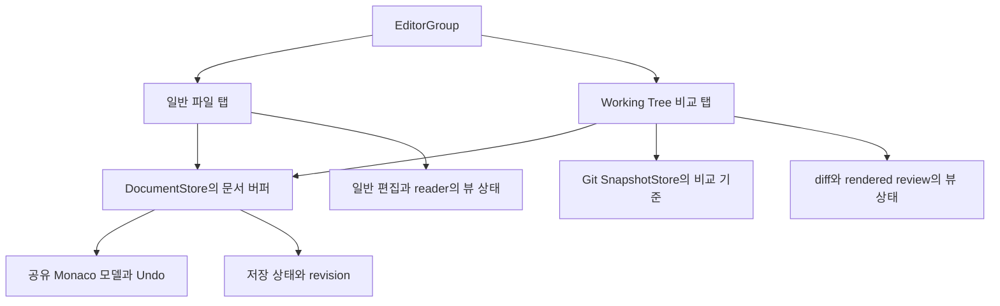

# Working Tree 비교 탭 독립화를 위한 VS Code 구조 분석과 Setdown 개선안

작성일: 2026-10-23, Asia/Seoul.

현재 Setdown의 Working Tree 비교 탭은 일반 문서 탭에 종속되어 있다. 비교 화면을 먼저 열어도 내부적으로 일반 문서 탭을 만들거나 활성화하고, 그 탭이 제공하는 편집 모델·저장 대상·수명주기를 사용한다. 일반 문서 탭을 닫으면 Working Tree 비교도 닫힌다. 사용자가 지적한 구조적 문제가 코드와 현행 테스트에 명시되어 있다.

개선의 중심은 **문서 모델을 탭 밖으로 옮기고, 일반 편집 탭과 비교 탭이 같은 문서를 동등하게 참조하게 만드는 것**이다. 공유 텍스트와 Undo는 유지하면서, 비교 탭만 열기·일반 탭만 닫기·비교 탭에서 저장하기가 가능해야 한다. 이어서 비교 탭을 공통 탭·그룹 모델에 편입해야 분할, 이동, 키보드 탐색도 일관되게 처리할 수 있다.

## 1. 용어와 조사 기준

여기서 Working Tree는 UI의 `파일명 (Working Tree)` 비교 탭이다. 일반 문서 탭은 동일 파일을 단독으로 읽거나 편집하는 탭이며, diff 왼쪽의 비교 기준 원문과 구분한다. Git의 `git worktree`로 만드는 별도 체크아웃 디렉터리는 8절에서 별도로 다룬다.

| 대상 | 기준 |
| --- | --- |
| Setdown | `62e2c88cfd32bee6d3ef922c242a8c301465279d`, 조사 시작 시 작업 디렉터리 변경 없음 |
| 비교한 VS Code 소스 | `vendor/vscode`, `d3d31f62268b169a2dfab62ffb2d7d38158a5b7c` |
| 공개 문서 | VS Code 공식 Source Control 문서 |
| 실행 검증 | 관련 현행 Vitest 3개 파일, 66개 테스트 통과 |

구조 판단은 위 커밋의 소스와 단위 테스트에 근거한다. 아래 목표 동작과 설계는 구현 제안이다. 이번 작업에서는 애플리케이션 코드를 변경하거나 Electron GUI·VS Code GUI·성능 벤치마크를 실행하지 않았다.

## 2. 현재 구조에서 종속성이 생기는 지점

### 비교 탭을 열기 전에 일반 문서 탭을 확보한다

현재 호출 순서는 다음과 같다.

```text
Source Control에서 Working Tree 선택
  → SourceControlController.review(path, false)
  → activateWorkingTree(path) 또는 openWorkingTree(path)
  → 일반 DocumentTab 활성화 또는 생성
  → presentation='review'로 일반 reader 표시 억제
  → 별도 project.gitDiffTabs에 비교 탭 생성·활성화
  → 일반 DocumentTab이 소유한 Monaco 모델 대여
```

[source-control-controller.ts:127](../apps/desktop/src/renderer/project/source-control/source-control-controller.ts)의 `review()`와 `activateDiff()`는 Working Tree일 때 문서 활성화 또는 열기 성공을 요구한다. [workspace-controller.ts:301](../apps/desktop/src/renderer/app/workspace-controller.ts)는 `openWorkingTree`를 `tabs.show(documentSnapshot, 'viewer', 'review')`로 연결한다. [tab-controller.ts:69](../apps/desktop/src/renderer/workspace/tab-controller.ts)는 기존 일반 탭을 찾아 pin하고 활성화한다.

`presentation='review'` 최적화 덕분에 일반 Markdown reader를 표시하거나 준비 완료까지 기다리지는 않는다. 그러나 **일반 탭의 생성과 활성화 자체는 남아 있다**. 첫 화면에 Monaco diff가 바로 나타나는 것과 비교 탭이 독립적인 것은 다른 조건이다. [첫 열기 단위 테스트](../apps/desktop/src/renderer/workspace/text-workspace.test.ts)는 이 상태에서도 `workspace.activeDocument`가 존재함을 검증한다.

### 모델 공유의 소유자가 일반 탭이다

[GitDiffEditor.svelte:182](../apps/desktop/src/renderer/project/source-control/GitDiffEditor.svelte)는 편집 가능한 Working Tree 오른쪽 모델을 `liveDocumentModels.acquire(filePath, monaco)`로 얻는다. 획득하지 못하면 일반 문서를 먼저 열라는 오류를 발생시킨다. Index·history·노트북 비교는 이 편집 모델 공유 경로에서 제외된다.

이 포트의 실제 제공자는 [monaco-editor.ts:90](../apps/desktop/src/renderer/adapters/monaco-editor.ts)다. `options.tabs()`에서 경로가 같은 문서 탭을 찾고, `owners.get(tab.id)`의 모델을 대여한다. 모델 저장소와 변경 리스너도 탭 ID 및 `DocumentTab`에 연결되어 있다. 모델 URI 역시 현재 `file URI + tab.id query`로 만들어진다.

공유 모델 자체는 좋은 기반이다. 일반 편집과 Working Tree 편집이 같은 Monaco 모델을 사용하므로 Undo·Redo, IME 입력, diff의 revert가 하나의 변경 경로로 전달된다. 바꿔야 할 부분은 모델의 수명과 접근 권한을 일반 탭 존재 여부가 결정한다는 점이다.

### 닫기와 저장도 일반 탭을 경유한다

| 동작 | 현재 근거와 의미 |
| --- | --- |
| 일반 문서 탭 닫기 | [workspace-controller.ts:375](../apps/desktop/src/renderer/app/workspace-controller.ts)의 `closeDocumentTab()`이 성공 후 `closeWorkingTreeReviews(path)`를 호출한다. |
| 일반 모델 해제 | [monaco-editor.ts:305](../apps/desktop/src/renderer/adapters/monaco-editor.ts)가 owner를 retire하고 `closed`를 발행한다. [source-control-controller.ts:361](../apps/desktop/src/renderer/project/source-control/source-control-controller.ts)는 이 이벤트로 해당 Working Tree를 닫는다. |
| 문서 경로 변경 | 같은 구독 코드가 `retargeted` 이벤트에도 Working Tree를 닫는다. 기존 경로로 잘못 편집하지 않게 하는 보호책이지만, 연결을 갱신하는 독립 입력 모델은 없다. |
| Working Tree에서 저장 | [workspace-controller.ts:162](../apps/desktop/src/renderer/app/workspace-controller.ts)의 저장 액션이 일반 `saveDocument()`를 호출한다. [document-actions.ts:30](../apps/desktop/src/renderer/workspace/document-actions.ts)는 활성 일반 문서 탭을 저장 대상으로 삼는다. |
| 자동 저장·전체 저장·Stage 전 저장 | [auto-save.ts](../apps/desktop/src/renderer/workspace/auto-save.ts)와 `DocumentActions.saveAll()/savePaths()`는 문서 탭 목록을 순회한다. 비교 탭만 남기는 변경에서는 이 목록 의존성도 함께 바뀌어야 한다. |
| dirty 표시 | [TabChrome.svelte:46](../apps/desktop/src/renderer/workspace/tabs/TabChrome.svelte)의 일반 탭에는 dirty 표시가 있지만, 뒤의 비교 탭 렌더링에는 없다. |

현재 [DocumentModelOwner](../apps/desktop/src/renderer/editor/live-document-model.ts)는 대여 참조가 남으면 물리적 `dispose()`를 늦춘다. 그러나 `releaseOwner()`는 변경 리스너를 즉시 끄고 새 대여를 막는다. 따라서 **연쇄 닫기 호출만 지우면 독립화가 완성되지 않는다**. 화면에 모델이 남더라도 저장·dirty·변경 통지가 끊긴 상태가 될 수 있다.

### 비교 탭은 공통 탭 시스템 밖에 있다

[WorkspaceTab](../apps/desktop/src/core/workspace/workspace-state.ts)은 `DocumentTab | BrowserTab | TerminalTab`이다. 비교 탭은 [project-state.svelte.ts](../apps/desktop/src/renderer/project/project-state.svelte.ts)의 `gitDiffTabs`, `activeGitDiffId`, `gitDiffActive` 등에 별도로 존재한다.

[TabChrome.svelte:55](../apps/desktop/src/renderer/workspace/tabs/TabChrome.svelte)는 비교 탭 전체를 현재 포커스된 그룹의 일반 탭 뒤에 덧붙인다. 일반 탭에 있는 `data-tab-id`, drag, pin 경로도 비교 버튼에는 연결되어 있지 않다. [App.svelte](../apps/desktop/src/renderer/App.svelte)는 공통 그룹 콘텐츠와 별도로 하나의 `GitDiffSurface`를 설치한다. 탭 순환 역시 [workspace-controller.ts:379](../apps/desktop/src/renderer/app/workspace-controller.ts)에서 두 목록을 합쳐 처리한다.

이 구조에서는 비교 탭이 어느 그룹에 속하는지 공통 모델로 표현할 수 없다. 일반 문서와 Working Tree를 서로 다른 그룹에 고정해서 동시에 편집하거나, 비교 탭 자체를 기존 drag·분리 경로로 옮기는 기능을 붙이려면 계속 별도 분기가 필요하다. [TransferableTab](../apps/desktop/src/protocol/desktop-api.ts)에도 현재 비교 입력 유형은 없다.

## 3. VS Code는 무엇을 다르게 하는가

### Git 확장은 비교할 리소스 두 개를 전달한다

VS Code Git 확장의 [ResourceCommandResolver.resolveChangeCommand](../vendor/vscode/extensions/git/src/repository.ts)는 비교가 가능한 항목에 대해 `vscode.diff(leftUri, rightUri, title)` 명령을 만든다. 일반 파일을 별도 탭으로 먼저 여는 명령을 선행하지 않는다. 보통의 수정 파일에서 오른쪽은 실제 파일 URI이며, 왼쪽은 Git 버전을 표현하는 URI다. 삭제·충돌·신규 파일에는 상태별 분기가 있다.

공식 문서의 비교 의미도 현재 Setdown과 같다. Changes는 Index와 작업 파일을, Staged Changes는 HEAD와 Index를 비교한다. 따라서 이번 개선은 Git 비교 기준을 바꾸는 작업이 아니다. [VS Code 공식 변경 검토 문서](https://code.visualstudio.com/docs/sourcecontrol/staging-commits#review-changes-with-the-diff-editor), [Setdown GitService.diff](../apps/desktop/src/main/project/git-service.ts).

### 비교 입력과 일반 파일 입력이 같은 리소스를 참조한다

[TextEditorService.createTextEditor](../vendor/vscode/src/vs/workbench/services/textfile/common/textEditorService.ts)는 diff 요청을 받으면 original·modified의 입력을 각각 만들거나 재사용하고, 이를 담는 `DiffEditorInput`을 만든다. 파일 입력은 리소스를 기준으로 캐시된다. 여기서 modified 파일 입력이 존재한다는 사실은 그 파일의 일반 탭을 별도로 표시한다는 뜻이 아니다.

[DiffEditorInput](../vendor/vscode/src/vs/workbench/common/editor/diffEditorInput.ts)은 두 입력을 직접 resolve한다. [SideBySideEditorInput](../vendor/vscode/src/vs/workbench/common/editor/sideBySideEditorInput.ts)의 `isDirty()`, `save()`, `saveAs()`, `revert()`는 primary, 즉 diff의 modified 입력에 위임한다. 그러므로 비교 탭만 열린 상태에서도 저장 대상이 분명하다.

[TextModelResolverService](../vendor/vscode/src/vs/workbench/services/textmodelResolver/common/textModelResolverService.ts)는 canonical URI를 기준으로 모델 참조를 획득한다. 파일 모델은 text file service를 통해 resolve하고, 참조 해제 시에도 파일 서비스의 `canDispose()` 조건을 기다린다. [TextDiffEditorModel](../vendor/vscode/src/vs/workbench/common/editor/textDiffEditorModel.ts)은 자신을 dispose할 때 빌려 온 양쪽 모델을 직접 파괴하지 않는다.

### 일반 탭 닫기와 문서 모델 해제를 구분한다

[EditorGroupView.canDispose](../vendor/vscode/src/vs/workbench/browser/parts/editor/editorGroupView.ts)는 다른 그룹뿐 아니라 열린 diff의 양쪽 입력도 검사한다. 일반 파일 탭을 닫아도 diff가 해당 입력을 참조하면 바로 dispose하지 않는다.

단, VS Code의 저장 확인 UX까지 “마지막 뷰에서만 확인한다”로 단순화하면 부정확하다. 같은 파일이 같은 그룹의 diff에 남아 있어도 일반 dirty 편집기를 닫을 때 확인하는 예외가 `doHandleCloseConfirmation()`에 명시되어 있다. **문서의 생존 여부와 저장 확인 정책은 별도 결정**이다. Setdown에 제안하는 마지막 편집 뷰 기준 확인은 아래에서 명시하는 제품 정책이며, VS Code 구현을 그대로 설명하는 문장이 아니다.

| 책임 | 현재 Setdown | VS Code에서 참고할 구조 |
| --- | --- | --- |
| 편집 내용과 Undo | 일반 탭에 연결된 모델 owner | 리소스 기반 모델 서비스 |
| 비교 입력 | 프로젝트 전역의 특수 상태 | 두 입력을 가진 독립 `DiffEditorInput` |
| 저장 대상 | 일반 활성 문서 탭 | 비교 입력의 modified 리소스 |
| 모델 해제 | 일반 owner retire, 비교 연쇄 닫기 | 다른 편집 입력의 참조 및 파일 모델 상태 확인 |
| 그룹·탭 소속 | 일반 탭 목록과 비교 목록 분리 | 공통 editor group의 편집 입력 |

## 4. 권고 설계

### 문서와 편집 입력과 화면의 책임을 나눈다



`DocumentStore`는 새로 추출할 책임이다. 지금의 [DocumentSessions](../apps/desktop/src/renderer/workspace/document-sessions.ts)는 content owner로 작업을 전달하는 라우터이며, 탭 없이 문서를 열고 수명을 유지하는 저장소는 아니다. 기존 라우팅은 재사용하되 이름만 바꾸는 작업으로 끝내서는 안 된다.

| 계층 | 소유할 상태와 책임 |
| --- | --- |
| DocumentStore | 안정적인 `documentId`, 경로 매핑, 최신 텍스트·revision, 저장된 상태, dirty, Monaco 모델·Undo, LSP 연결, 파일 변경 구독, 저장 진행 상태 |
| EditorInput | 일반 파일 또는 diff의 리소스 참조, 표시명, 읽기·쓰기 능력, 저장 대상, 입력의 동일성 판단 |
| EditorTab·EditorGroup | 탭 ID, 순서, 활성 상태, pin, 소속 그룹, 열기·닫기·이동 |
| EditorView | 일반 및 diff 커서·선택·스크롤, 좌우 선택, reader 위치, 해당 탭의 줌·렌더링 표시 상태 |
| Git snapshot 제공자 | 저장소와 상대 경로, 비교할 ref 또는 Index 세대, 텍스트·라벨·오류, 변경 시 무효화 |

첫 추출 범위는 현재 Working Tree가 편집 가능한 일반 텍스트 문서다. HWP·이미지·노트북까지 하나의 Monaco 텍스트 모델로 통합하지 않는다. 기존 형식별 content owner와 capability 경계를 유지한다.

### 탭 없는 문서 획득을 제공한다

필요한 인터페이스는 `openDocumentTab(path)`와 구분되는 `acquireDocument(resource)`다. 후자는 문서를 읽고 모델 참조를 제공하지만 탭을 만들거나 활성 그룹을 바꾸지 않는다.

일반 편집기와 Working Tree 비교 입력은 모두 이 API로 같은 문서를 참조한다. 문서의 변경 리스너는 일반 편집 화면이 마운트되었는지와 관계없이 살아 있어야 한다. 같은 파일의 동시 열기 요청은 하나의 in-flight resolve로 합쳐야 한다.

문서 ID는 탭 ID와 분리하고 rename에도 유지한다. 정규화된 리소스 경로는 문서를 찾는 인덱스로 사용하되 기존 symlink 및 파일 저장 계약을 따른다. 파일 종류마다 Git이 비교하는 항목과 편집할 실제 파일의 의미가 다를 수 있으므로 모든 경로를 무조건 `realpath`로 합치는 방식은 피한다. 별도 worktree의 파일은 절대 경로가 다르므로 같은 문서로 합쳐지면 안 된다.

### 비교 입력의 양쪽을 명시한다

목표 입력은 다음 정도의 정보를 가져야 한다. 이는 구현 코드가 아닌 설계 예시다.

```text
WorkingTreeInput
  original: GitResource(repoRoot, relativePath, INDEX, generation)
  modified: FileResource(documentId)

IndexInput
  original: GitResource(repoRoot, previousPath 또는 relativePath, HEAD)
  modified: GitResource(repoRoot, relativePath, INDEX, generation)

HistoryInput
  original: GitResource(repoRoot, originalPath, resolvedCommit)
  modified: GitResource(repoRoot, modifiedPath, resolvedCommit)
```

Working Tree의 오른쪽은 메모리의 최신 편집본이다. Index는 읽기 전용이지만 stage/unstage 후에는 새 버전으로 갱신되는 리소스다. History는 선택한 커밋의 고정된 내용을 사용한다. 신규 파일의 빈 비교 기준, 삭제되어 없는 오른쪽, binary·노트북의 기존 읽기 전용 처리는 별도 capability로 표현한다.

리뷰의 동일성은 최소한 저장소·양쪽 리소스·비교 종류를 포함한다. 파일 경로 하나만으로 Working Tree·Index·History를 중복 제거해서는 안 된다. 비동기 diff 결과에는 비교 입력 세대와 기준 버전, 문서 revision을 연결하여 이전 요청이 최신 화면을 덮지 못하게 한다.

### 비교 탭도 공통 WorkspaceTab에 넣는다

`WorkspaceTab`에 명시적인 diff 유형을 도입하고 `EditorGroups`의 일반 구성원으로 관리한다. 추가 시 현재의 `isDocumentTab = web도 terminal도 아님` 판별을 함께 고쳐야 한다. 그대로 두면 새 diff 유형을 문서 탭으로 잘못 취급한다.

`project`에는 Git 목록·저장소 작업 상태를 남기고, 열린 비교 입력과 그룹별 활성 상태는 workspace로 이동한다. `TabChrome`은 하나의 목록에서 공통 닫기·dirty·pin·drag UI를 만든다. `GitDiffSurface`는 자신에게 전달된 비교 입력과 그룹 geometry를 사용하며, 전역 `activeGitDiffId`를 모든 화면의 선택자로 사용하지 않는다.

여러 그룹에 같은 문서를 띄워도 문서 모델은 공유하고, 커서·스크롤·선택과 콘텐츠 줌은 각 탭 및 뷰에 보존한다. 기존 rendered review의 native preview ID는 문서 ID로 일괄 치환하지 않는다. 문서 내용의 동일성과 화면·표시 요청의 동일성이 서로 다르기 때문이다.

## 5. 독립 탭에서 보장할 사용자 동작

| 시나리오 | 제안 동작 |
| --- | --- |
| 아무 파일 탭 없이 Changes 클릭 | Working Tree 비교 탭 하나만 열린다. 일반 문서는 모델로만 resolve한다. |
| 일반 탭과 Working Tree를 함께 열기 | 동일한 텍스트와 Undo를 공유하고, 서로의 커서·스크롤·줌은 바꾸지 않는다. |
| 일반 탭 닫기 | Working Tree가 계속 편집 가능하면 문서 모델과 변경 내용을 유지한다. 일반 탭만 제거한다. |
| Working Tree 닫기 | 다른 일반 또는 Working Tree 입력이 있으면 그 입력과 문서를 유지한다. |
| 마지막 dirty 편집 뷰 닫기 | Save·Don't Save·Cancel을 제공한다. Cancel이나 저장 실패는 뷰와 모델을 유지한다. |
| 비교 탭에서 Ctrl+S | 해당 비교 입력의 modified 문서를 저장한다. 다른 활성·배경 문서를 저장 대상으로 추정하지 않는다. |
| 비교 탭만 남은 상태에서 자동 저장·Stage | 문서 저장소의 해당 dirty 버퍼를 처리한다. Stage 전에 저장하는 현재 정책을 보존한다. |
| 두 그룹에 일반 탭과 비교 탭 배치 | 두 화면을 동시에 표시하고, 각 그룹의 활성 탭과 포커스를 독립 관리한다. |
| 배경 비교 탭 닫기 | 사용 중인 그룹과 입력 포커스를 유지한다. |
| 마지막 깨끗한 비교 탭 닫기 | 일반 파일 탭을 새로 만들지 않고 기존 이웃 탭 또는 빈 화면으로 이동한다. |

마지막 편집 뷰 판정은 현재 보이는 DOM 수나 모델 대여 횟수로 계산하면 안 된다. 비활성 탭도 열려 있는 편집 입력이며, 숨은 preview 작업도 별도 참조를 가질 수 있다. 문서별로 **열린 편집 입력의 참조**, **일시적인 모델 사용 참조**, **저장·전송 중 보존 상태**를 구분한다.

마지막 dirty 뷰의 닫기는 확인부터 실제 해제까지 하나의 조정 경로를 사용한다. Save 처리 중 새 편집이 생겨 최신 revision이 여전히 dirty라면 닫지 않는다. Don't Save는 저장하지 않은 버퍼를 포기하는 동작이며, Git의 전체 Working Tree Discard와 구분한다. 닫기 확인 중 다른 뷰가 열리거나 동시 닫기가 발생하면 참조와 revision을 다시 확인한다.

### 저장과 main 프로세스 상태도 함께 옮긴다

탭 UI만 변경하면 비교 탭만 남은 dirty 문서가 전체 저장이나 창 종료 검사에서 빠질 수 있다. 현재 [TabController.render](../apps/desktop/src/renderer/workspace/tab-controller.ts)는 일반 문서 탭 목록을 main에 보내며, [install-ipc.ts](../apps/desktop/src/main/ipc/install-ipc.ts)는 이 목록과 단일 Git review 상태를 별도로 저장한다. [WindowManager](../apps/desktop/src/main/windows/window-manager.ts)는 이 상태를 바탕으로 종료 확인을 수행한다.

개선 시 저장 명령은 `documentId`와 저장할 revision을 명시하고, 전체 저장·종료 확인은 열려 있는 문서를 중복 제거한 목록을 사용한다. 일반 탭 없이도 자동 저장, 외부 변경 통지, LSP, Markdown 이미지 삽입의 대상 문서가 유지되어야 한다. 현재 `session.document`에 의존하는 편집 도구는 활성 입력의 capability로 저장 대상과 경로를 얻도록 바꾼다.

기존 `saveTabDocument`는 snapshot과 revision을 명시적으로 받으므로 재사용할 수 있는 기반이다. 다만 Save As·현재 문서 watcher·창 상태의 암묵적 활성 문서 의존성까지 검토해야 한다. 비교 탭 선택 때 보이지 않는 일반 탭을 활성화하는 우회로를 계속 남기면 이 문제가 해결되지 않는다.

## 6. 구현 순서와 변경 경계

| 단계 | 주요 변경 | 완료 조건 |
| --- | --- | --- |
| 1. 문서 소유권 추출 | `monaco-editor.ts`의 탭별 모델 owner·변경 리스너를 문서 저장소로 옮긴다. `DocumentSessions`, 일반 탭은 새 저장소를 사용하도록 연결한다. | 기존 일반 문서·공유 Undo·저장·LSP 동작 유지. 탭 없이 모델을 resolve하는 단위 테스트 통과. |
| 2. 독립 열기와 닫기 | `openWorkingTree/activateWorkingTree`를 문서 참조 획득으로 대체한다. 저장·자동 저장·종료 확인을 문서 기준으로 전환하고 마지막 뷰 닫기를 구현한다. | 비교 탭만 열기, 일반 탭만 닫기, 비교 단독 저장, Save·Discard·Cancel이 동작한다. |
| 3. 공통 탭과 그룹 통합 | `WorkspaceTab` diff 유형, 단일 탭 목록, 그룹별 비교 surface, 공통 명령 라우팅을 도입한다. | 재정렬·분할·그룹 이동·키보드 순환·배경 닫기가 일반 탭과 동일 경로로 동작한다. |
| 4. 수명 경계 완성 | rename·삭제·폴더 닫기·Index 갱신·reload·비교 입력 전송의 경계를 정리한다. | 경로·세대가 바뀐 뒤 늦게 끝나는 요청이 이전 입력을 재활성화하거나 잘못 저장하지 않는다. |

2단계와 3단계를 별도 변경으로 나눌 수 있지만, 공통 탭 모델 편입까지가 이번 구조 개선의 목표다. 일반 탭을 숨기거나 `hiddenOwnerTab` 같은 상태를 추가하는 해법은 임시 호환 수단으로만 다룬다. 최종 구조에서 문서의 생존을 가짜 탭이 책임져서는 안 된다.

우선순위는 문서 소유권과 저장·닫기의 정확성이다. VS Code workbench 전체를 이식할 필요는 없다. 기존 공유 Monaco 모델, 문서별 저장 처리, EditorGroups, preview 준비·표시 분리 구조를 재사용하면서 책임 경계를 바꾸는 접근이 적합하다.

### 별도 설계가 필요한 창 간 이동

같은 renderer 안에서 두 뷰가 같은 Monaco 모델을 참조하는 것과, 별도 Electron renderer 창 사이에서 모델·Undo를 유지하는 것은 다르다. 현재 transfer 자료형에 diff 입력을 추가하는 것만으로 창 간 공유 Undo가 보존되지는 않는다.

비교 탭 자체의 새 창 분리는 원본 창에 같은 문서를 참조하는 뷰가 남아 있는지부터 처리해야 한다. 수신 창이 문서와 비교 입력을 채택한 뒤 원본 참조를 해제하고, 실패하면 원본을 유지하는 전송 계약이 필요하다. renderer 간 편집 동기화와 Undo 연속성을 어떤 방식으로 보장할지는 별도 결정 사항이다. 이를 검증하기 전에는 새 창 분리까지 완전한 독립화가 끝났다고 선언하지 않는다.

### 폴더 닫기와 재시작 계약

일반 문서 탭에서 독립하는 것과 프로젝트 폴더에서 독립하는 것도 구분한다. 첫 변경에서는 현행 폴더 닫기 시 Git 리뷰를 정리하는 정책을 유지하되, 그 리뷰가 마지막 dirty 편집 뷰라면 문서 저장소를 통한 확인을 거쳐야 한다. 일반 문서 참조가 남으면 편집 내용은 유지한다. 이후 폴더 없는 리뷰를 지원하려면 `repoRoot`를 명시적으로 받는 Git 서비스와 구독 범위가 필요하다. 현재 [GitService.diff](../apps/desktop/src/main/project/git-service.ts)는 창의 프로젝트 루트에 의존한다.

[Workspace 계약](../docs/contracts/workspace.md)의 새 프로세스·새 창은 빈 상태로 시작한다는 정책도 유지한다. 독립 입력을 serialize할 수 있게 만드는 것이 앱 재시작 시 탭 자동 복원을 도입한다는 의미는 아니다. reload와 창 간 전송에 필요한 상태부터 구분해서 다룬다.

## 7. 검증과 기존 계약의 변경

### 이번에 확인한 현행 동작

다음 명령을 실행했다.

```sh
npm run test --workspace @setdown/desktop -- \
  src/renderer/editor/live-document-model.test.ts \
  src/renderer/project/source-control/source-control-controller.test.ts \
  src/renderer/workspace/text-workspace.test.ts
```

결과는 **3개 파일, 66개 테스트 통과**다. 각각 6개·20개·40개이며, 현행 구현의 동작을 확인한 결과다. 독립화 구현의 검증 결과가 아니다.

특히 [source-control-controller.test.ts:236](../apps/desktop/src/renderer/project/source-control/source-control-controller.test.ts)는 문서를 닫으면 해당 Working Tree가 닫히고 Index만 남는다고 검증한다. [git-review-first-open.spec.ts:61](../apps/desktop/test/e2e/git/git-review-first-open.spec.ts)도 일반 탭의 dirty 표시와 리뷰를 닫은 뒤 일반 reader로 돌아가는 동작을 전제한다. 의도적으로 동작을 바꿀 때 이 테스트들을 새 수명 계약으로 교체하면서 공유 Undo·최신 내용 보존 검증은 유지해야 한다.

저장소의 `docs/validation/working-tree-tabs-2026-10-22/review-tabs-final.log`에는 독립 닫기 시나리오의 성공 기록이 있지만, 조사한 HEAD의 테스트 파일에는 해당 시나리오가 없다. 이 로그는 현재 코드의 독립성 증거로 사용할 수 없다. 현재 소스 및 이번에 실행한 테스트를 판단 기준으로 삼았다.

### 구현 시 추가할 검증

| 영역 | 반드시 검증할 시나리오 |
| --- | --- |
| 독립 열기 | 일반 탭 0개에서 Working Tree만 1개 생성. 일반 reader 생성·준비·표시를 기다리지 않음. |
| 모델 공유 | Working Tree에서 편집 후 일반 탭을 열어 동일 모델·Undo 확인. 역순도 확인. |
| 독립 닫기 | 일반 탭을 닫아도 비교가 편집 가능. 비교를 닫아도 다른 일반·비교 입력 유지. |
| 마지막 뷰 | dirty 상태에서 Cancel·Save·Don't Save, 저장 실패, 저장 중 재편집, 연속 닫기. |
| 명령과 상태 | 비교 단독 Ctrl+S·자동 저장·전체 저장·Stage 전 저장·dirty 표시·창 종료 확인. |
| 리소스 변경 | rename·Save As·외부 수정·삭제·폴더 닫기·Index 갱신 중 비동기 응답의 무효화. |
| 형식 경계 | Index와 History가 live 수정본을 받지 않음. 노트북·binary·삭제 파일 capability 유지. |
| 그룹 | 일반+비교를 두 그룹에 동시 표시. 재정렬·pin·이동·배경 닫기·탭 순환·독립 줌. |
| 입력과 미리보기 | 한글 IME 중 blur 없음, 최신 revision 렌더링, Esc·double-click 위치, hidden preview 포커스 금지. |

단위 테스트에서는 모델 객체 동일성, 문서 참조의 해제 순서, 중복 저장 방지, 요청 세대 검증을 다룬다. 실제 Electron에서는 모델과 입력 이벤트, dirty UI, 저장 파일 내용, 그룹 포커스, rendered review를 함께 검증한다. 단순히 탭 개수가 줄었는지만 검사해서는 충분하지 않다.

이 변경은 preview·source 전환·문서 수명 경로에 들어가므로 [preview 성능 계약](../docs/preview-performance-contract.md)에 따라 다음 검사가 필요하다.

```sh
npm run test:preview-contract
npm run bench:preview -- --baseline /absolute/path/to/installed-baseline
```

baseline은 별도 checkout과 독립 설치된 의존성으로 준비하고, 후보와 같은 격리 가상 디스플레이·설정에서 측정한다. ordinary Markdown과 Git review 각각에 대해 편집 유무 × 준비 시간 유무의 8개 시나리오를 모두 수행하고, first·second·warm을 구분해 보고한다. 기본 5회 반복과 기존 허용치를 유지한다. 누락·stale content·실패를 성공 수치로 취급하지 않는다.

GUI는 `with-isolated-display.sh`의 Xvfb·전용 runtime directory·D-Bus·Wayland socket 제거를 사용한다. 새 독립 열기/닫기 시나리오를 추가하되 기존 포커스·IME·시각 검증이나 측정 시나리오를 줄이지 않는다. 일반 탭 자동 생성·연쇄 닫기·자동 복귀에 대한 계약 변경과 테스트 변경은 같은 구현 변경에 포함한다.

## 8. 별도 Git worktree를 여는 기능과의 관계

Git linked worktree 자체를 독립적으로 여는 요구라면 대상은 파일 비교 탭이 아니라 폴더·저장소 세션이다. VS Code의 [공식 worktree 문서](https://code.visualstudio.com/docs/sourcecontrol/branches-worktrees#open-a-worktree)는 worktree 폴더 직접 열기와 현재 창·새 창 열기를 제공한다. 로컬 소스의 [openWorktreeInCurrentWindow / openWorktreeInNewWindow](../vendor/vscode/extensions/git/src/commands.ts)는 `repository.root`를 `vscode.openFolder`에 넘긴다.

Setdown에서도 이 기능을 추가한다면 `worktree 경로 → 프로젝트 폴더 열기 → Git 저장소 감지` 경로로 설계해야 한다. 부모 문서 탭은 필요하지 않다. worktree 목록·생성·삭제 UI는 별도 저장소 관리 기능이며, 이 보고서의 Working Tree 비교 탭 독립화와는 다른 범위다. 두 경우 모두 문서 탭을 작업 공간의 수명 소유자로 삼지 않는다는 원칙은 같다.
