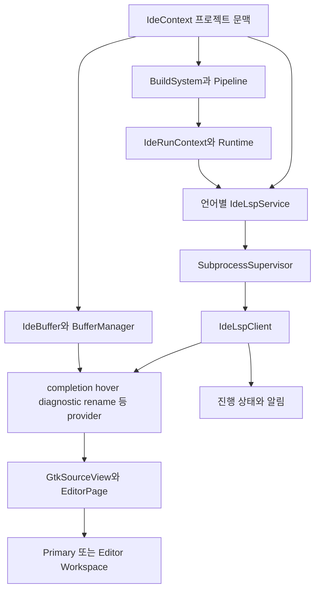
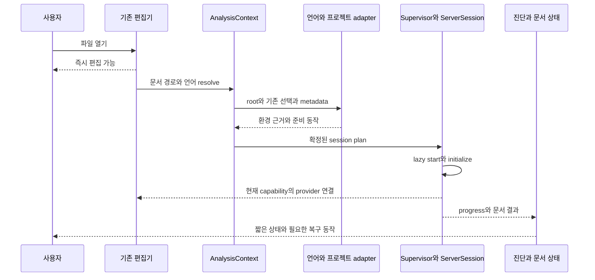

# GNOME Builder 기반 Setdown 편집기와 LSP 이식 설계

작성일: 2026년 10월 30일, Asia/Seoul

**Setdown은 GNOME Builder의 편집기 제품 구조를 적극적으로 이식해야 한다.** 가져올 중심은 간결한 편집 화면, 프로젝트가 소유하는 분석 문맥, 실행 환경을 조립하는 계층, 필요할 때 시작하는 언어 서비스, 기능별 제공자, 문서 가까이에 있는 상태와 복구 동선이다. 이 구조를 Setdown의 기존 Monaco·문서 모델·LSP 전송 계층 위에 대응시키면 된다.

현재 Setdown에 부족한 것은 자동완성 API의 개수가 아니다. 자동완성·Hover·탐색·rename·진단·여러 서버 조합은 이미 구현되어 있다. **사용자가 파일을 열었을 때 앱이 올바른 프로젝트와 환경을 정하고, 그 선택의 결과를 믿을 수 있게 만드는 제품 계층**이 마지막으로 연결되어야 한다. Builder에서 이 책임이 어디에 놓이는지 추적하면, Setdown에 무엇을 이식할지 상당히 명확해진다.

이 보고서의 구현 방향은 다음과 같다.

1. Builder의 `IdeContext → IdeLspService → IdeRunContext → provider → editor UI` 책임 구조를 Setdown에 대응시킨다.
2. `LanguageManager`의 루트·설정·프로세스 선택을 `AnalysisContext`와 `LanguageSessionPlan`으로 분리한다.
3. 일반 파일도 프로젝트 분석 문맥을 자동으로 얻는다. 창을 IDE 모드로 바꾸는 절차는 요구하지 않는다.
4. 언어 서버 실행 파일과 분석 대상의 Python interpreter·TypeScript SDK·C++ compile database를 별도 항목으로 관리한다.
5. 서버 연결 상태, 환경 준비 상태, 분석 범위, 현재 문서 결과의 신선도를 구별한다.
6. 평소에는 작은 언어 상태와 코드 주변 기능만 보여준다. 문제가 생기면 현재 파일에서 바로 환경을 고친다.
7. 이미 있는 버전 검사·취소·Undo·IPC 소유권·미리보기 성능 계약을 유지하며 이식한다.

## 분석 기준과 추가한 서브모듈

| 항목 | 고정된 기준 |
| --- | --- |
| Setdown 분석 기준 | `613786e533af55ed0590fe3a45c07abc3dd1c02e` |
| 새 서브모듈 | `vendor/gnome-builder` |
| 원격 | `https://github.com/GNOME/gnome-builder.git` |
| 고정 커밋 | `0e4dbc7afb05983fbe7f4ec922d09a40f4ac1718` |
| 해당 커밋 날짜 | 2026년 10월 24일 |
| 소스의 Meson 버전 선언 | `50.1` |
| 50.0 릴리스 태그 커밋 | `9471e73cd6818ba089f298d2a000ab6f3ab59efc`, 2026년 3월 17일 |

`.gitmodules`와 gitlink를 등록했다. 하위 저장소의 특정 커밋을 참조하므로 이후 상위 저장소를 받는 사람도 같은 소스를 재현할 수 있다. Builder를 Setdown 런타임 의존성으로 연결하거나 편집기 제품 코드를 변경한 단계는 아니다. 이 작업의 산출물은 서브모듈과 이식 설계다.

50.0과 고정 커밋을 비교했을 때 `src/libide/lsp`, `code`, `editor`, `sourceview`, `threading`, `plugins`, 그리고 비교 대상 `meson`, `cmake`, `clang`, `clangd`, `rust-analyzer`, `codeui`의 파일은 동일하다. 비교 범위에서 차이가 있는 곳은 `libide/foundry`의 헤더 3개와 `editorui/gbp-editorui-workspace-addin.c`다. 따라서 아래 핵심 LSP 분석은 50.0에도 적용된다. 저장소 전체가 50.0과 같다는 의미는 아니다.

Builder의 추적 파일은 3,715개, `.plugin` 파일은 134개, `X-LSP-Command`를 선언하는 공통 LSP 플러그인은 21개다. 이는 설치 가능한 서버 수나 검증한 언어 수가 아니다. 분석은 편집기·서비스·실행 환경·진단·주요 언어 플러그인의 호출 경로에 집중했다. [소스 버전과 파일 해시 색인](gnome-builder-lsp-2026-10-30/source-index.json)에 근거 파일 60개의 SHA-256, 모듈 규모, LSP 플러그인 선언을 기록했다.

### 인용된 설명에서 바로잡아야 할 세 가지

첫째, 2025년 5월의 ‘Simplifying LSP Selection’은 **Foundry**의 `foundry lsp run`과 `foundry lsp prefer`, 프로젝트별 선택을 설명한다. Builder가 그 명령과 선택 시스템을 이미 갖췄다고 해석하면 안 된다. Builder 내부 디렉터리 `src/libide/foundry`와 이 별도 Foundry 프로젝트도 구분해야 한다. 본 보고서는 Builder의 실제 구현을 기준으로 하며, 별도 Foundry 코드를 분석한 것으로 간주하지 않는다. [개발자 원문](https://blogs.gnome.org/chergert/2025/05/20/simplifying-lsp-selection/)

둘째, Builder의 간결한 화면과 프로젝트 분석의 장점은 실제 코드에 있지만, **독립 Editor 모드가 동일한 공통 LSP 서비스를 자동으로 제공한다는 가정은 성립하지 않는다.** `ide_lsp_service_class_bind_client_internal()`은 `ide_context_has_project(context)` 안에서만 공통 서비스를 확보하고 provider에 연결한다. 프로젝트에 연결된 보조 editor window와 프로젝트 없는 editor context는 다르다. Setdown이 가져와야 하는 조합은 ‘간결한 editor workspace + 자동 분석 context’다. [공통 서비스 연결 코드][B-service]

셋째, ‘잘못된 환경 때문에 생기는 모든 빨간 줄을 Builder가 판별해 제거한다’는 일반 장치는 확인되지 않는다. Builder가 실제로 잘하는 것은 **빌드·실행 환경을 분석에 전달하여 오류의 원인을 줄이는 것**이다. 공통 LSP 진단 수신부는 서버 진단을 변환하고 저장한다. 그러므로 이식의 중심도 환경을 제대로 연결하는 데 두어야 한다. [진단 수신 코드][B-client]

## Setdown은 어디까지 완성되어 있는가

과거 감사 보고서에 나온 결함을 현재 결함으로 다시 나열하면 우선순위를 잘못 잡는다. 10월 17일 감사 이후의 현재 코드를 기준으로 보면 다음 기반은 이미 있다.

| 영역 | 현재 구현 | 이식할 때의 처리 |
| --- | --- | --- |
| 편집 엔진 | 일반 문서·Git 편집기·노트북이 공통 Monaco 로딩과 worker 구성을 사용 | 유지 |
| 기본 편집 경험 | minimap·sticky scroll 비활성, CodeLens 기본 비활성, inlay hints는 눌렀을 때 표시 | 간결한 기본값 유지 |
| 언어 기능 | completion, Hover, signature, definition, references, rename, code action, symbol, semantic token, inlay hint 등 | provider를 다시 작성하기보다 환경과 선택 정책 개선 |
| 서버 정의 | 출처가 고정된 195개 연결 프로필 | 넓은 카탈로그 위에 소수의 검증된 기본 경험 추가 |
| 기본 서버 | Python은 bundled Pyright, TS/JS는 bundled TypeScript language server와 SDK | 기본 경로 유지, 프로젝트 환경과 분리 |
| 설치 탐색 | PATH·사용자 도구 디렉터리·Python script 경로·npm global bin, login shell 환경 복구 | 프로젝트 문맥을 입력으로 받도록 확장 |
| 분석 루트 | `.git` 파일 경계, Python marker, TS/JS 설정, Cargo workspace 처리 | 현재 문서가 속한 문맥의 근거로 승격 |
| 여러 제공자 | 주 서버와 supplementary 서버, formatter 단일 선택, 보조 서버 rename·semantic token 제외 | 기능별 계획을 명시적으로 표현 |
| 진단 | provider·epoch·channel별 저장, version 검사, Problems와 marker의 공통 저장소 | 환경 상태와 표시 정책을 연결 |
| 설정 | 프로젝트 경로별 options, `scopeUri` 설정 조회, Python extraPaths 호환 처리 | 프로젝트별 서버 선호와 환경 선택까지 확대 |
| 문서 상태 | 파일 위치 표시줄의 상태 버튼·popover, 현재 기능과 context 표시 | 현재 문서에서 직접 복구하도록 확장 |
| 노트북 Python | interpreter 목록·선택·분석과 실행 연결 | 일반 `.py`와 공통 환경 서비스로 통합 |

근거: [Monaco 로딩][S-monaco], [편집 기본값][S-editor], [기능 선언][S-features], [프로필][S-profiles], [탐색][S-discovery], [루트][S-root], [여러 제공자][S-services], [진단 저장소][S-diagnostics], [문서 상태][S-status], [노트북 환경][S-python-env].

이 표에서 가장 중요한 사실은 **기능 전달 통로를 다시 만드는 작업보다, 이미 있는 통로에 정확한 환경을 넣는 작업의 효과가 크다**는 것이다. 예를 들어 Pyright 자동완성을 새로 연결할 필요는 없다. 일반 `.py` 파일에 프로젝트의 interpreter를 안정적으로 전달하고, 잘못 선택됐을 때 한 번에 고치게 해야 한다.

## Builder의 간결함을 만드는 내부 구조

Builder의 UI는 단순하지만 내부는 작은 텍스트 편집기 규모가 아니다. `libide/lsp`만 추적 파일 57개, C·헤더·UI 12,326줄이다. `libide/foundry`는 125개 파일, 같은 기준 35,911줄이다. 이 수치는 전체 소스를 그대로 Electron에 연결해야 한다는 뜻이 아니라, 단순한 화면 뒤의 책임 분리가 핵심이라는 것을 보여준다. [모듈 집계](gnome-builder-lsp-2026-10-30/source-index.json)



`IdeContext`는 프로젝트의 서비스 소유자다. `IdeBuffer`는 문서 상태를 소유한다. `IdeLspService`는 언어 서비스와 프로세스의 연결을 책임진다. provider는 버퍼와 기능을 연결한다. workspace는 이를 배치한다. 화면이 단순해도 서비스가 사라지지 않는 이유는 화면 구성과 분석 소유권이 별개이기 때문이다.

Setdown에 적용할 때도 창·탭·Monaco model·언어 서버 세션을 같은 객체처럼 취급하지 않아야 한다. 한 창 안의 여러 탭은 분석 문맥을 공유할 수 있지만, 같은 경로를 서로 다른 미저장 내용으로 연 두 창은 별도의 버퍼 소유권이 필요하다. 현재 `LanguageManager`의 window owner 경계는 보존한다.

### 기능 제공자는 단일 선택과 복수 조합을 구분한다

Builder는 모든 기능을 하나의 ‘LSP 플러그인’에 일괄 위임하지 않는다. `IdeBuffer`에서 rename·formatter·code action에는 단일 `IdeExtensionAdapter`를, symbol resolver에는 `IdeExtensionSetAdapter`를 사용한다. 단일 adapter는 일치하는 플러그인 중 priority가 높은 것을 선택한다. 진단은 별도 manager에서 여러 provider의 결과를 관리한다. [버퍼의 provider 연결][B-buffer], [단일 adapter 선택][B-adapter], [진단 manager][B-diagnostics]

이 구분을 Setdown에도 명시적으로 옮겨야 한다. rename과 formatting은 문서를 바꾸므로 소유자가 명확해야 한다. 진단은 여러 출처를 병합할 수 있다. completion과 Hover는 복수 제공자를 허용하더라도 중복·응답 순서·서버별 기능 중첩을 다뤄야 한다. `LanguageServices`의 현재 primary/supplementary 구조는 이 방향의 좋은 출발점이다.

## 서버 실행에서 그대로 가져올 구조

### 실행 파일 탐색 순서는 프로젝트 환경에서 시작한다

`ide_lsp_service_create_launcher()`의 순서는 구체적이다.

1. 빌드 pipeline의 PATH에 프로그램이 있는지 확인한다.
2. 있으면 pipeline의 run context와 build system의 tooling 환경을 적용한다.
3. 없으면 host runtime에서 프로그램을 찾고 host에 맞는 context를 준비한다.
4. 플러그인이 제공하는 host의 추가 검색 경로를 확인한다.
5. 마지막으로 Builder 자체 실행 runtime의 PATH에서 찾는다.
6. 선택한 context에 프로그램·인자·source directory를 넣고 launcher를 만든다.

각 경로에서 plugin별 `prepare_run_context()`를 호출하므로 공통 실행 구조 안에 언어별 인자를 넣을 수 있다. 중요한 것은 발견한 절대 경로뿐 아니라 **어느 runtime의 PATH와 환경에서 그 경로가 유효한가**까지 다룬다는 점이다. [launcher 생성][B-service]

Setdown의 현재 `ServerDiscovery`는 설치 프로그램을 찾는 기능으로는 충분히 세밀하다. 다만 주된 입력이 사용자 환경과 명령 이름이고, 프로젝트별 runtime은 독립된 모델이 아니다. 이를 단순히 ‘탐색 디렉터리를 더 추가하기’로 해결하면 서버는 발견되어도 프로젝트의 import·SDK·header가 틀릴 수 있다.

### 실행 환경은 조립 가능한 객체다

`IdeRunContext`는 argv·cwd·환경 변수·파일 디스크립터 매핑을 층별로 조립한다. `IdePipeline.prepare_run_context()`는 runtime의 build 환경을 적용하고 `BUILDDIR`, `SRCDIR`, 구성별 환경 변수를 넣는다. `IdeLspService`는 이후 cwd를 source directory로 설정한다. 이렇게 환경의 출처와 최종 실행 계획을 분리한다. [RunContext][B-run], [Pipeline][B-pipeline]

Meson의 `prepare_tooling()`은 build directory의 `.gnome-builder-devenv`가 유효할 때 이를 적용하는 run-context layer를 추가한다. 해당 파일을 source하고 명령을 실행하는 쉘 문자열은 cwd·환경 변수·argv 각각을 quote하여 조립한다. 이는 프로젝트의 개발 환경이 언어 도구에도 전달되는 구체적인 연결점이다. [Meson tooling 환경][B-meson]

Setdown에서는 동일한 책임을 TypeScript의 `LaunchPlan`으로 구현하면 된다. host에서는 기존 `spawn(..., { shell: false })`를 계속 사용한다. 컨테이너 지원을 붙일 때는 argv·cwd·URI 매핑·PID namespace를 adapter가 함께 처리한다. Builder의 특정 Linux 쉘 호출을 모든 플랫폼의 기본 실행기로 옮길 이유는 없다.

### 시작 조건과 분석 완료는 구별해야 한다

Builder의 `ensure_started()`는 `ide_pipeline_is_ready()`가 참일 때 서비스를 시작한다. 그런데 이 함수의 실제 구현은 `self->loaded`를 반환한다. **pipeline이 로드되었다는 조건이지, 모든 dependency가 설치되었거나 모든 파일의 의미 분석이 완료되었다는 조건이 아니다.** 이 차이를 유지해야 이식 후 상태 모델이 정확해진다. [시작 조건][B-service], [pipeline ready 정의][B-pipeline]

따라서 Setdown에는 다음 세 단계를 따로 둔다.

| 단계 | 의미 | 가능한 동작 |
| --- | --- | --- |
| 실행 계획 준비 | 사용할 root·runtime·서버·설정이 정해짐 | 프로세스를 시작할 수 있음 |
| 연결 초기화 | LSP initialize와 capabilities 교환 완료 | 서버가 제공하는 기능을 요청할 수 있음 |
| 분석 준비 정도 | 해당 프로젝트·문서의 환경 및 분석 근거가 확보됨 | 근거에 맞게 상태를 표시하고 편집 범위를 판단 |

LSP에 모든 서버가 공통으로 제공하는 ‘프로젝트 전체 분석 완료’ 신호가 있다고 가정하지 않는다. Pyright의 초기 진단, 서버별 progress, clangd의 선택 명령 관측은 서로 다른 근거다. 하나의 `ready` boolean으로 합치면 잘못된 확신을 만들게 된다.

### 환경 변경과 프로세스 실패를 서비스가 수습한다

Builder는 pipeline 변경을 감시하고 이미 사용 중인 서비스를 정지한 뒤 새 pipeline이 준비되면 다시 시작한다. `has_seen_autostart`와 lazy binding으로 사용하지 않는 서비스가 pipeline 변경만으로 무조건 실행되지 않게 한다. 특히 workspace symbol search는 lazy binding을 사용하므로 검색 provider가 등록됐다는 이유만으로 모든 언어 서버를 띄우지 않는다. [서비스 재연결][B-service], [검색의 lazy 연결][B-search]

`IdeSubprocessSupervisor`는 프로세스 종료 후 재시작하고, 마지막 시작 이후 5초를 기준으로 빠른 반복 시작을 제한한다. Setdown의 현재 `ServerSession`은 실패를 전달하고 정리하는 책임은 있지만, 이 supervisor와 같은 자동 복구 책임은 없다. 별도의 supervisor를 추가하고 문서 model은 그대로 두어야 한다. [Builder supervisor][B-supervisor], [Setdown session][S-session]

이식 시 자동 복구는 **프로세스 재시작**에 한정한다. 실패 직전 rename·code action·파일 변경 명령을 다시 실행해서는 안 된다. 최신 미저장 버퍼를 새 세션에 재전송하는 것과 사용자의 편집 명령을 재실행하는 것은 다른 동작이다.

## 선언형 플러그인에서 가져올 구조

Builder의 공통 LSP 플러그인은 `.plugin`의 `X-LSP-Command`, `X-LSP-Languages`, 기능별 `X-…-Languages`를 읽는다. `ide_lsp_plugin_register_types()`가 해당 기능의 provider factory를 등록하고, service subtype이 실행 프로그램과 인자를 설정한다. 새로운 언어를 연결할 때 공통 lifecycle 코드를 복사하지 않게 하는 방식이다. [플러그인 해석기][B-plugin]

예를 들어 clangd는 C·C++·Objective-C 언어와 completion·diagnostic·formatter·Hover·rename·symbol 기능을 선언한다. Rust Analyzer도 같은 공통 진입점을 사용한다. PyLSP·Jedi·Ruff도 별도 `.plugin`에서 실행 명령을 선언한다. [clangd 선언][B-clangd], [Python 선언][B-pylsp], [Ruff 선언][B-ruff]

다만 선언은 실제 서버 capability의 증명이 아니다. Ruff descriptor에 여러 종류의 기능이 적혀 있다고 해당 서버가 그 모든 기능을 제공한다고 판단하면 안 된다. Setdown의 현재 capability negotiation과 동적 등록 처리는 유지하고, 프로필에는 **기본 기능 역할과 환경 adapter 연결 정보**를 추가한다.

또한 Builder `ide_lsp_plugin_service_configure_client()`는 settings 파일의 모듈 이름 아래 `initializationOptions`를 읽는다. 파일에 적힌 임의의 설정이 자동으로 올바른 `workspace/configuration` 응답이 된다고 볼 수 없다. 공통 client의 configuration handler에는 요청 params를 충분히 전달해야 한다는 TODO도 있다. Setdown의 `initializationOptions`와 workspace settings 분리, `scopeUri` 처리를 그대로 보존하는 것이 맞다. [Builder 설정 경로][B-plugin], [Builder configuration handler][B-client], [Setdown 설정 조회][S-session]

가져올 것은 **공통 service + 선언형 feature 연결 + 필요한 언어별 adapter**라는 구조다. 프로필 195개를 Builder의 21개 descriptor로 대체하면 오히려 현재 지원 범위를 잃는다. 프로필의 수는 유지하면서 Python·TS/JS·C/C++·Rust·Go의 완성도를 별도로 높인다.

## 진단에서 가져올 구조와 Setdown에 남길 보장

### 여러 진단 제공자의 결과를 독립적으로 소유한다

Builder `IdeDiagnosticsManager`는 파일별 group과 provider별 결과를 관리한다. provider가 새 결과를 반환하면 그 provider의 이전 결과를 정리하고, 진단에 연결된 파일에 결과를 넣는다. provider가 없어지면 그 출처의 진단을 정리할 수 있다. 작업이 진행 중이면 `needs_diagnose`를 세우고 완료 후 다음 작업을 이어 간다. 일반 진단 예약 지연은 333ms다. 이것은 모든 LSP 서버에 공통으로 강제되는 서버 측 debounce 수치가 아니다. [진단 manager][B-diagnostics]

Setdown `DiagnosticStore`의 provider·epoch·channel별 lease가 이미 같은 책임의 상당 부분을 가진다. 이를 버리고 다시 구현할 필요가 없다. 추가할 것은 진단이 만들어진 **분석 문맥의 세대와 환경 상태**, 그리고 원본 진단을 보존한 상태에서 표시를 결정하는 정책이다. [Setdown 진단 저장소][S-diagnostics]

### C++의 중요한 차이는 빌드 설정을 얻는 단계다

Builder의 native clang diagnostic provider는 `ide_build_system_get_build_flags_async()`로 파일별 flags를 얻고 clang client의 진단을 호출한다. Meson build system은 기존 compile database를 재사용하고, 없으면 CONFIGURE 단계 진행을 요청하여 생성된 database를 읽는다. 파일 감시와 캐시 무효화도 연결되어 있다. [native clang 진단][B-clang], [Meson compile database][B-meson]

이 경로를 공통 clangd 플러그인과 혼동해서는 안 된다. `clangd.plugin`의 공통 LSP 경로가 native clang provider의 모든 flags 처리를 자동 상속하는 것은 아니다. 공통 clangd의 명령 선언은 `clangd`다. Builder의 C++ 경험을 이식하려면 **build system에서 분석 문맥을 얻는 능력**까지 포함해야 한다.

clangd에서 실행 인자와 파일의 compile command는 서로 다른 것이다. include path·define·language standard·working directory가 맞지 않으면 올바른 코드에도 많은 오류가 생길 수 있다. 서버 프로세스를 성공적으로 실행한 사실만으로 이를 검증할 수 없다. [clangd 공식 설계](https://clangd.llvm.org/design/compile-commands)

### Builder의 진단 수신 코드를 그대로 복제하면 잃는 것도 있다

검토한 `ide_lsp_client_text_document_publish_diagnostics()`는 URI와 diagnostics를 파싱하여 파일별 캐시에 넣는다. 이 함수에는 수신한 `version`과 현재 문서 버전을 대조하는 검사가 없다. 일반 manager의 sequence도 LSP 문서 버전 검사와 동일하지 않다. Setdown에는 세션 generation과 문서 version 검사가 있으므로 이 보장은 유지한다. [Builder 수신부][B-client], [Setdown main 연결][S-manager], [Setdown 진단 lease][S-diagnostics]

Setdown도 버전 없는 push 진단을 완벽히 최신이라고 증명할 수는 없다. 현재 코드는 이를 best-effort로 구분한다. 이식 설계에서도 ‘도착 시각이 나중’이라는 이유로 최신 문서에 대한 결과라고 바꾸지 않는다. 확정된 버전 없는 결과에는 그 한계가 남는다.

### 환경 오류와 코드 오류의 처리는 원인을 고치는 방향이어야 한다

프로젝트 interpreter가 잘못되어 import 오류가 80개 생겼다면 해결은 해당 environment를 선택하는 것이다. compile database가 빠졌다면 생성하거나 연결한다. 이를 모든 `missing import` 메시지를 숨기는 공통 필터로 바꾸면 실제 오타나 빠진 dependency도 가려진다.

진단 정책은 다음 기준으로 설계한다.

| 근거 | 편집기 표시 | 문서 상태와 Problems |
| --- | --- | --- |
| 환경과 무관한 확인된 구문 오류 | 즉시 표시 | 일반 코드 문제 |
| 환경이 확인된 서버의 의미 진단 | 원래 severity로 표시 | 일반 코드 문제 |
| 선택한 interpreter가 사라졌음 | 해당 환경의 의미 진단을 현재의 확정 오류로 표시하지 않음 | `선택한 Python 환경을 찾을 수 없음`, 환경 선택 동작 |
| compile database가 없음 또는 아직 구성 중 | adapter가 확인한 범위에 따라 분석 제한을 표시 | 원본 결과와 ‘불완전한 빌드 설정’ 근거를 함께 제공 |
| 버전이 오래된 진단 | 현재 문서 marker로 설치하지 않음 | 이전 결과로 추적 가능하되 현재 오류 수에 포함하지 않음 |
| 서버 진단 0개, 분석 미시작 | ‘문제 없음’으로 단정하지 않음 | `검사 대기` 또는 `기본 편집` |
| 환경 원인을 판별할 근거가 없음 | 진단을 임의로 삭제하지 않음 | 출처와 분석 범위를 표시 |

환경 문제로 표시를 보류한 결과는 raw store에 남겨야 한다. Problems에서 `환경 확인이 필요한 결과`를 펼쳐볼 수 있고, 억제된 결과 수와 이유를 확인할 수 있어야 한다. 이 정책은 Builder에 이미 존재하는 범용 필터라는 주장이 아니라, Builder의 환경 연결 구조를 Setdown의 기존 진단 저장소까지 완성하는 설계다.

### 실제 서버에서 환경만 바꿔 확인한 결과

이 문제를 코드와 별개인 UI 취향으로 취급하지 않기 위해, 같은 source를 유지하면서 실행 환경 입력만 바꾸는 통제 실험을 수행했다. Pyright 1.1.414, clangd 22.1.0, Node 22.23.1, Python 3.14.8을 사용했다. 각 조건은 새 서버 세션에서 실행하고 문서 version 1의 진단과 Hover 응답을 기록했다. Builder나 Setdown GUI의 성능·품질 측정은 아니며, 제품에 연결할 서버 입력의 효과를 확인한 실험이다.

| 조건 | 반환 진단 | Hover 결과 |
| --- | --- | --- |
| Python host interpreter | `reportMissingImports` 경고 1개 | `value: Any` |
| 같은 Python source와 project interpreter | 0개 | `value: int` |
| C++ 외부 compile database 미선택 | header 없음·함수 미선언 오류 2개 | 응답 없음 |
| 같은 C++ source와 외부 database 선택 | 0개 | `audit_answer()` 함수와 반환형 `int` |

Python 표본은 `--without-pip`으로 만든 임시 venv의 site-packages에 작은 typed module을 두었다. 분석 대상 파일은 그 모듈을 import한다. 두 조건에서 바꾼 값은 `python.pythonPath`이며, 두 조건 모두 현재 Setdown 기본값과 같은 `typeCheckingMode: off`, `diagnosticMode: openFilesOnly`를 사용했다. 검사 강도를 낮추는 설정만으로 import 문맥이 해결되는 것은 아니며, 올바른 interpreter가 타입 추론에도 영향을 준다는 결과다.

C++ 표본은 source root 밖의 build directory에 compile database를 두었다. database에는 include path, `AUDIT_VALUE=42` define, C++20 옵션이 들어 있다. 두 조건에서 source와 header는 동일하고, 두 번째 실행에만 `--compile-commands-dir`를 전달했다. header와 함수를 찾을 수 없다는 오류가 사라지고 실제 함수 설명이 돌아왔다.

이는 작은 통제 표본의 결과다. 모든 Python dependency와 C++ build system의 호환성을 증명하지는 않는다. 다만 **환경을 올바르게 전달하는 것이 진단 표시와 편집 기능을 함께 개선하는 실제 구현 작업**이라는 근거는 된다. [원본 서버 응답](gnome-builder-lsp-2026-10-30/environment-observations.json), [실행 로그](gnome-builder-lsp-2026-10-30/environment-probe.log), [재현 스크립트](gnome-builder-lsp-2026-10-30/probe-environments.mjs)

## 화면과 편집 동선은 어디까지 복제할 것인가

### 기본 화면은 editor workspace를 따른다

`IdeEditorWorkspace.ui`의 중심은 `PanelDock → IdeGrid`다. 상단에는 추가·패널 토글·제목·검색·알림이 있고, 하단에는 얇은 `PanelStatusbar`와 패널 토글이 있다. 시작·끝·하단 영역이 각각 분리되어 있어서 필요할 때 도구를 배치할 수 있다. [Editor Workspace][B-editor-ui]

이 구성을 Setdown의 현재 editor groups와 location bar에 대응시킨다. Setdown 전체를 새 workspace로 갈아끼우기보다, 이미 있는 탭·분할·문서별 주소 표시줄 안에 Builder의 노출 원칙을 이식한다.

| 기능 | Builder의 접점 | Setdown의 접점 |
| --- | --- | --- |
| 자동완성 | GtkSourceCompletion provider | 현재 Monaco suggestion widget |
| 함수 설명 | Hover provider | 현재 Monaco Hover |
| 오류 설명 | `gbp-codeui-hover-provider`가 현재 줄 진단을 표시 | marker Hover와 원인·quick fix |
| 진단 표시 | gutter와 문서 진단 | 현재 Monaco marker, 필요 시 간결한 count |
| rename·code action | 문맥 메뉴와 해당 동작 UI | 문맥 메뉴·F2·Ctrl+.·명령 팔레트 |
| 정의·선언·참조 | codeui 메뉴 | F12·참조 탐색·Peek |
| 프로젝트 symbol | 전역 검색 provider | 현재 workspace symbol 검색 |
| 상태와 진행 | 알림과 상태 영역 | 현재 문서 언어 버튼 |
| 상세 설정 | tweaks와 플러그인 설정 | Language Support 고급 화면 |

Builder의 `codeui`는 provider 존재와 선택 상태에 따라 action을 활성화한다. Hover 진단은 버퍼의 해당 줄 진단을 읽는다. completion은 trigger character, 결과 refilter, snippet, additional edits를 처리한다. 이것들이 평소 화면에 큰 도구 패널 없이 편집을 강력하게 만드는 실제 연결점이다. [문맥 메뉴][B-code-menu], [action 활성화][B-code-actions], [진단 Hover][B-hover], [completion][B-completion]

### Setdown에서 바꿀 첫 화면

현재 `DocumentLanguageStatus`는 이미 좋은 위치에 있다. 다만 내용이 provider의 상태·기능·문자열 context 중심이고, 해결하려면 `Set up analysis…`를 통해 카탈로그로 이동해야 한다. 이 버튼을 **현재 파일의 분석 환경을 직접 다루는 표면**으로 완성한다. [현재 문서 UI][S-status]

기본 줄에는 파일 언어와 짧은 상태만 둔다.

```text
Python · 준비됨             Python · 환경 선택 필요
C++ · 설정 준비 중          TypeScript · 프로젝트 분석
```

클릭한 내용은 현재 파일에 한정한다.

```text
Python 분석

프로젝트       my-project
Python 환경    .venv · Python 3.12       [변경]
분석 도구      Pyright                  [고급]
검사 범위      열린 파일

자동완성 · 정의 이동 · 이름 변경 · 코드 검사

[문제 보기]   [이 분석 다시 시작]   [고급 설정]
```

복구가 필요할 때는 필요한 선택 하나를 전면에 둔다.

```text
이 프로젝트의 Python 환경을 찾을 수 없습니다.
이전에 선택한 .venv/bin/python이 없어졌습니다.

[환경 선택]    [기본 편집으로 계속]

자세히 보기: 프로젝트 경로, 서버, 로그, 원본 진단
```

이것은 서버 설치 여부와 interpreter 선택을 분리한 UI다. bundled Pyright가 있다는 이유로 `Python interpreter 준비됨`이라고 표시하지 않는다.

### 고급 설정을 없애지 않고 올바른 깊이에 둔다

현재 `LanguageSupport.svelte`의 전체 카탈로그, executable 선택, JSON 설정, import 기능은 유지한다. 기본 동선에서는 현재 언어의 선택지와 실제 문제를 우선 보여준다. 전체 카탈로그는 `다른 언어 도구` 또는 `고급 설정`에서 접근한다.

F1·문맥 메뉴에서 호출하는 기능은 서버 이름을 몰라도 사용할 수 있어야 한다. 예를 들어 `Rename Symbol`은 실제 capability와 현재 문서 상태로 활성화한다. 불가능하면 `분석 환경 준비 중`처럼 이유를 보여준다. 사용자에게 ‘rename provider를 설치하라’는 내부 용어를 기본 설명으로 내보내지 않는다.

상태 변경 때문에 popover를 자동으로 열거나 editor에서 focus를 빼앗지 않는다. 한국어 조합 중 Esc는 기존 composition guard를 따르고, 팝업을 닫으면 원래 편집 위치로 돌아간다. Builder UI의 접점을 가져오되 Setdown의 현재 키보드·IME 계약을 유지한다.

## 현재 코드에서 확인되는 남은 간극

### 설치 탐색과 프로젝트 환경 선택이 분리되어 있다

`ServerDiscovery.find()`의 입력은 command와 탐색 옵션이고, 캐시는 command·사용자 환경·Python/npm 탐색 조건에 묶인다. workspace root별 interpreter나 SDK를 선택하는 정책은 이 클래스에 없다. 이는 설치 탐색기로서는 올바른 경계다. 문제는 이 위에서 실행 계획을 완성하는 프로젝트 환경 계층이 아직 약하다는 데 있다. [서버 탐색][S-discovery]

현재 `ServerEnvironment`는 login shell 환경을 복구하고, 명시적으로 활성화된 `VIRTUAL_ENV`·`CONDA_PREFIX`가 있으면 상속 환경을 보존한다. 두 프로젝트를 서로 다른 환경으로 열 때 각각의 문맥을 표현하는 서비스는 아니다. 따라서 전역 shell snapshot을 프로젝트 분석 환경과 같은 뜻으로 사용하지 않아야 한다. [사용자 환경][S-environment]

### 일반 Python과 노트북이 서로 다른 환경 경험을 제공한다

일반 `.py`는 bundled Pyright와 root별 configuration을 사용하며 `python.pythonPath`를 수동 설정할 수 있다. `pythonProjectSettings()`는 `.vscode/settings.json`의 extraPaths와 project config 존재를 읽는다. 이 경로에서 노트북의 환경 목록 서비스가 자동으로 호출되지는 않는다. [일반 Python 설정][S-python-settings], [문서 open 경로][S-manager]

노트북은 `PythonEnvironments`가 `.venv`, `venv`, 활성 환경, Conda metadata, Jupyter kernelspec의 실행 파일 후보를 수집한다. 선택은 파일별로 저장되고, analysis와 kernel이 그 환경을 사용한다. 따라서 ‘Python 환경 탐색기를 새로 만들자’가 아니라 **이 기존 서비스를 프로젝트 환경 모델로 확장하자**가 정확한 작업이다. [환경 목록][S-python-env], [노트북 host][S-notebook]

후보를 발견하는 것과 그 interpreter를 실행하는 것도 구분되어 있다. 현재 notebook 탐색은 프로젝트 로컬 실행 파일을 목록에 제시하며 자동으로 실행하지 않는다. 새 공통 서비스 역시 metadata 탐색과 환경 사용을 분리하고, 사용자가 선택한 환경을 잃어버렸을 때 임의의 다른 환경으로 바꾸지 않는다.

### C++의 database 표시는 실제 적용 증거가 아니다

현재 `LanguageManager.open()`은 `--compile-commands-dir` 설정을 확인하고, 없으면 root와 `root/build`의 `compile_commands.json`을 찾아 context 문자열을 만든다. 이 부분은 발견 결과를 설명하는 코드이며, 발견한 경로를 자동으로 launch args에 삽입하는 단계가 아니다. `out/debug`, 별도 CMake preset directory, 외부 build directory를 제품이 관리하는 모델도 여기에는 없다. [clangd context 생성][S-manager]

따라서 UI에서 `database detected`를 보여주는 정도를 넘어, **선택한 build configuration → 실제 전달된 database 경로 → 해당 파일의 compile entry 또는 fallback**을 추적해야 한다. database가 디스크에 존재한다는 사실과 clangd가 해당 파일을 올바른 명령으로 분석한다는 사실은 다르다.

### 프로젝트별 options와 프로젝트별 서버 선호가 다르다

`ServerRegistry.options(id, resource)`는 경로별 설정을 합친다. 반면 `preferred`는 language ID별 전역 map이고, `setEnabled()`가 언어별 preferred를 갱신한다. 프로젝트별 `args/settings/root/role/formatting`과 프로젝트별 주 서버 선택은 같은 기능이 아니다. [registry][S-registry]

예를 들어 A 프로젝트에서 basedpyright를, B 프로젝트에서 bundled Pyright를 쓰려는 선택은 `project.preferred` 또는 분석 계획의 provider binding으로 표현해야 한다. 사용자가 A 파일의 상태창에서 서버를 바꿨는데 다른 프로젝트까지 바뀌는 흐름을 기본값으로 두지 않는다.

### 여러 서버가 설치되면 선택을 요구하는 경로가 있다

`LanguageManager.open()`은 명시적 선호가 없는 경우 bundled 후보를 우선하고, 그렇지 않으면 설치된 후보의 유일성을 확인한다. 여러 후보 또는 실행 파일이 모호하면 `selection-needed`를 반환한다. 즉 Python·TS/JS의 bundled 기본 경로까지 항상 선택을 요구하는 것은 아니다. [후보 선택][S-manager]

이 보호 장치는 유지하되, 자주 쓰는 언어에는 제품이 검증한 기본 조합을 제공한다. 정말 동등한 후보 두 개가 남았을 때만 현재 파일에서 짧게 선택한다. 카탈로그 순서나 실행 파일 이름의 사전순으로 선택을 숨겨서는 안 된다.

### 초기화 상태가 프로젝트 분석 준비를 충분히 표현하지 못한다

`LanguageManager`는 `server.ready` 뒤에 상태를 ready로 바꾼다. `ProviderSupport`에는 starting·ready·failed·missing·selection-needed 등이 있지만, interpreter 선택 여부·build configuration 준비·분석 범위·문서 최신성은 독립된 구조체가 아니라 주로 context 문자열에 담긴다. [상태 타입][S-support], [open 완료][S-manager]

Pyright rename에 초기 진단을 기다리는 별도 barrier가 이미 있는 것은 이 문제가 실제로 중요하다는 증거다. 다만 이 barrier를 모든 서버와 모든 작업의 준비 신호로 확장하면 안 된다. 기존 코드는 `renameAfterDiagnostics` 프로필 조건에 묶여 있고, 테스트도 해당 동작을 검증한다. [프로필 정책][S-definitions], [세션 요청][S-session]

### 복구 동작이 문맥보다 넓거나 상세 로그에 묻혀 있다

현재 일반 문서의 `language:restart` 경로와 `LanguageServices.restart()`는 창의 분석 서비스들을 재시작하는 흐름이다. Python 환경만 변경한 상황이라면 해당 owner·analysis root·provider에 속한 세션만 재시작하는 동작이 필요하다. [main 재시작][S-manager], [renderer 재시작][S-services]

`window/showMessageRequest`는 현재 메시지를 로그에 기록하고 `null`을 반환한다. 편집 중 modal을 띄우지 않는 장점은 있지만 서버가 제안한 동작을 사용자가 선택하는 UI는 없다. 상태 popover의 비모달 action으로 전달하고, 요청의 수명·취소·답변 기한을 관리하는 작은 계층이 필요하다. [서버 메시지 처리][S-session]

### 파일 감시와 환경 변경의 범위가 다르다

현재 세션 watcher는 `.git`, `node_modules`, `__pycache__`를 제외하며, Python 설정 파일의 변경은 별도 hook으로 세션을 무효화한다. interpreter 경로의 삭제, environment 선택 변경, TypeScript SDK 교체, build directory 변경은 각각에 맞는 fingerprint와 invalidation이 필요하다. 전체 트리를 계속 스캔하기보다 **분석 계획을 만든 근거 파일과 선택한 경로**를 감시한다. [watch와 설정 변경][S-session], [Python invalidation][S-manager]

### 루트 하나에 모든 의미를 몰아넣지 않아야 한다

현재 language root 코드는 `.git` 경계와 언어별 marker를 다룬다. 이 장점은 유지한다. 다만 UI가 연 폴더, package root, 분석 서버의 workspace root, runtime의 cwd, build directory는 서로 다를 수 있다.

TS/JS 루트 탐색은 각 ancestor에서 tsconfig/jsconfig를 먼저 확인하고 그 ancestor의 package.json이 있으면 반환한다. 따라서 가까운 package.json과 더 위의 tsconfig가 함께 있는 경우의 선택도 이 순서에 영향을 받는다. monorepo의 올바른 동작을 ‘가장 가까운 파일 하나’로 일반화하지 말고, root 선택 근거와 server의 project reference 해석을 구분해야 한다. [루트 알고리즘][S-root]

## 이식할 모듈과 책임

아래 이름은 새 설계이며 아직 제품에 추가된 파일이 아니다. Builder의 책임을 대응시키되 현재 Setdown의 검증된 코드가 계속 일하도록 분리하는 경계다.

| Builder 원형 | Setdown 대응 | 핵심 책임 |
| --- | --- | --- |
| `IdeContext` | `AnalysisContextService` | 문서가 속한 프로젝트 분석 문맥과 선택 근거 |
| `IdeBuildSystem` | `ProjectAnalysisAdapter` | 언어·빌드 시스템별 환경 metadata와 준비 동작 |
| `IdePipeline` | `AnalysisPreparation` | 선택한 구성에 필요한 준비 단계와 취소 |
| `IdeRunContext` | `LanguageLaunchPlan` | argv·cwd·env·runtime·URI mapping을 확정 |
| `IdeLspService` | `LanguageServiceSupervisor` | lazy start·환경 변경·프로세스 재시작·수명 |
| `IdeLspClient` | 기존 `ServerSession` | JSON-RPC·초기화·capability·요청·통지 |
| extension adapter | `LanguageFeaturePlan` + 기존 `LanguageServices` | 기능별 제공자 선택·조합 |
| diagnostics manager | 기존 `DiagnosticStore` + `DiagnosticPolicy` | 출처·버전·환경 문맥과 표시 결정 |
| editor page addin | 현재 Monaco adapter와 action registry | 편집 기능·키보드·문맥 메뉴 |
| workspace 상태·알림 | `DocumentLanguageStatus` + 복구 action | 현재 파일의 상태와 해결 동작 |

구현 위치는 다음 정도로 나눌 수 있다.

```text
apps/desktop/src/core/document/
  analysis-context.ts        상태와 선택 근거의 직렬화 가능한 타입
  language-feature-plan.ts   기능별 제공자 정책

apps/desktop/src/main/language/
  analysis-context.ts        문서별 문맥 resolve와 cache
  analysis-preparation.ts    환경 준비 작업과 취소
  language-supervisor.ts     세션 수명과 자동 복구
  launch-plan.ts             최종 실행 계획
  adapters/
    python.ts
    typescript.ts
    clangd.ts
    rust.ts
    go.ts

apps/desktop/src/renderer/language/
  DocumentLanguageStatus.svelte
  diagnostic-policy.ts
  language-repair-actions.ts
```

파일을 무조건 이 개수로 만들어야 한다는 뜻은 아니다. 중요한 경계는 OS 탐색이 main에 있고, 순수 정책이 core에 있으며, renderer가 실행 경로와 환경을 직접 조립하지 않는다는 것이다. `LanguageManager`에는 window ownership·IPC 검증·문서 바인딩 조정이 남고, 언어별 환경 처리의 큰 분기는 adapter로 이동한다.

### 분석 문맥의 최소 데이터

```ts
type Evidence = {
  source: 'user' | 'project-config' | 'discovery' | 'server-report';
  description: string;
  path?: string;
};

type AnalysisContext = {
  id: string;
  generation: number;
  analysisRoot: string;
  configurationRoot?: string;
  languageId: string;
  runtime: { kind: 'host' | 'container'; id: string };
  interpreter?: { path: string; evidence: Evidence };
  sdk?: { path: string; version?: string; evidence: Evidence };
  build?: { directory: string; database?: string; evidence: Evidence };
  environment: 'resolving' | 'usable' | 'partial' | 'action-needed';
  issues: AnalysisIssue[];
  evidence: Evidence[];
};

type LanguageSessionPlan = {
  ownerId: number;
  contextId: string;
  contextGeneration: number;
  serverId: string;
  executable: string;
  args: string[];
  cwd: string;
  environmentFingerprint: string;
  settingsFingerprint: string;
  features: LanguageFeaturePlan;
};
```

`AnalysisIssue`, `LanguageFeaturePlan` 등의 세부 필드는 구현 단계에서 protocol 타입과 맞춘다. 위 설계에서 환경 변수 값은 main에 남는다. renderer에는 선택 이유와 필요한 경로·버전·문제만 보낸다. UI 문자열을 다시 파싱해서 정책을 결정하지 않는다.

### 세션의 동일성을 명시한다

세션을 공유할 수 있는 최소 조건은 다음과 같다.

```text
window owner
  + analysis context
  + server ID와 실행 runtime
  + interpreter 또는 SDK 또는 build configuration
  + settings fingerprint
```

현재 코드에도 root·launch·configuration fingerprint와 window owner가 있다. 이를 없애는 변경이 아니라, 환경 선택을 공식적인 key에 포함하는 변경이다. 서버 transport 재시작에는 별도 epoch를 부여하고, 이전 epoch의 diagnostics·completion resolve·applyEdit가 새 세션으로 넘어오지 못하게 한다.

root만 같은 두 창이 서로 다른 미저장 내용을 갖는 경우에는 프로세스 공유를 먼저 추진하지 않는다. 하나의 LSP 세션에 같은 URI의 서로 다른 didOpen 내용을 넣을 수 없기 때문이다. 여러 창의 환경 metadata는 공유해도 문서 소유권과 서버의 열린 문서 상태는 분리한다.

## 파일을 열 때의 자동 처리 흐름



이 과정에서 파일을 보여주는 경로가 shell 환경 복구·SDK 탐색·서버 시작을 기다려서는 안 된다. 현재 `beforeSave()`가 초기화 중인 서버를 기다리지 않는 보장도 유지한다. 서버가 늦게 연결되면 그동안의 편집을 순서대로 동기화하고, 문서가 이미 닫혔거나 다른 환경으로 전환됐다면 결과를 폐기한다. [현재 바인딩과 변경 queue][S-client]

### 자동 선택은 결정 규칙으로 만든다

실행 파일과 프로젝트 분석 환경을 다음 순서로 결정한다.

1. 해당 문서·프로젝트에 사용자가 저장한 명시적 선택을 적용한다.
2. 서버가 이해하는 프로젝트 설정은 원래 의미를 유지한다. 앱이 파일 내용을 무리하게 합쳐 다른 의미로 바꾸지 않는다.
3. 프로젝트의 선택된 runtime·build configuration에서 필요한 도구를 찾는다.
4. 언어 adapter가 검증한 지역 환경 후보를 평가한다.
5. 앱이 제공하는 기본 서버와 host 도구를 사용한다.
6. 동등한 후보가 남거나 명시적 선택이 사라졌을 때 현재 문서에서 선택을 요청한다.

Python에서는 ‘bundled Pyright 실행 파일’과 ‘project interpreter’가 이 순서를 각각 적용받는다. TS에서도 LSP wrapper와 tsserver SDK의 선택을 구분한다. C++에서는 clangd 실행 파일과 compile database의 선택을 구분한다. 이 분리가 없으면 전역 도구 하나를 잘 찾았다는 이유로 프로젝트 환경까지 맞았다고 판단하게 된다.

각 결정에는 `사용자 선택`, `pyproject 프로젝트의 .venv`, `CMake preset`, `bundled SDK` 같은 근거를 남긴다. 이유 없이 점수만 매겨 승자를 고르는 정책보다, 잘못된 선택을 고치고 재현하기 쉬운 규칙이 필요하다.

## 언어별로 완성할 경로

### Python은 서버와 interpreter를 명확히 분리한다

현재 기본 Pyright의 `typeCheckingMode: off`, `diagnosticMode: openFilesOnly`는 이미 소음이 적은 출발점이다. 이것은 interpreter 선택 문제를 대신하지 않는다. Pyright는 client의 `python.pythonPath`를 처리하며, project configuration이 분석 설정의 우선순위에 영향을 줄 수 있다. [현재 프로필][S-profiles], [Pyright 설정 문서](https://raw.githubusercontent.com/microsoft/pyright/main/docs/settings.md)

이식 작업은 아래 순서로 고정한다.

1. `PythonEnvironments`를 일반 Python과 notebook에서 함께 호출할 수 있는 metadata 서비스로 분리한다.
2. notebook의 명시적 파일별 선택은 유지하고, project 기본 환경을 추가한다.
3. 프로젝트 경계 안의 `.venv`·`venv`, 활성 환경, 저장된 선택, Conda metadata를 후보로 만든다. notebook의 현재 4단계 ancestor 탐색을 그대로 모든 Python 프로젝트 정책으로 쓰지는 않는다.
4. `pyrightconfig.json`과 `pyproject.toml`의 서버 고유 해석은 Pyright에 남긴다. 실행 환경 배열을 평탄화하거나 다른 root의 extraPaths를 합치지 않는다.
5. 선택한 interpreter를 해당 context의 client configuration으로 전달한다.
6. 환경이 바뀌면 해당 세션만 새 generation으로 연결하고 최신 미저장 내용을 전송한다.
7. `.py`와 `.ipynb`가 같은 project 기본 환경을 사용하면 동일한 이름과 출처를 표시한다. notebook에서 다른 환경을 고르면 문서별 override임을 표시한다.

Python 상태의 구체적인 목표는 다음과 같다.

| 상황 | 기대 행동 |
| --- | --- |
| project `.venv`가 하나 있고 기존 선택이 없음 | metadata 근거를 제시하고 사용할 환경을 확정하는 가장 짧은 경로 제공 |
| 저장된 `.venv`가 삭제됨 | 다른 Python으로 조용히 대체하지 않고 현재 상태에서 선택 동작 제공 |
| 사용자가 터미널에서 Conda 환경을 활성화해 앱 실행 | 기존 상속 환경 존중, project override가 있으면 차이를 표시 |
| Pyright는 실행되나 interpreter 정보가 불명확 | 연결 성공과 환경 미확인을 별도 표시 |
| project 설정에 strict 검사가 지정됨 | 앱의 기본 off로 강제로 덮어쓰지 않음 |
| import 오류 발생 | interpreter·analysis path·project 설정 근거를 같은 문서에서 확인 |
| notebook와 일반 파일이 같은 모듈을 import | 같은 환경을 선택했을 때 결과 일치 여부를 실제 서버로 검사 |

Ruff는 현재처럼 supplementary 역할을 출발점으로 삼는다. 기본 분석은 Pyright, lint와 quick fix는 Ruff, formatting은 하나의 선택된 제공자로 구성한다. Pyright와 Ruff가 같은 import 정리 동작을 중복 수행하지 않도록 feature plan에서 명시한다. 전체 LSP 카탈로그의 단순 enabled 값만으로 이 조합을 표현하지 않는다.

### TypeScript와 JavaScript는 SDK와 프로젝트 상태를 제품에 연결한다

현재 bundled TS language server는 `serverProfile()`에서 bundled `typescript/lib/tsserver.js` 경로를 설정하고 automatic typing acquisition을 끈다. 프로젝트 TypeScript를 쓰고 싶다면 별도 SDK 선택이 필요하다. `$/typescriptVersion` 통지는 이미 수신하여 context에 보관한다. [프로필 생성][S-definitions], [버전 통지 수신][S-session]

따라서 첫 구현은 `TypeScript SDK: bundled / project`의 선택과 실제 서버 보고의 일치 검증이다. 프로젝트 SDK를 발견했다고 실행 승인이나 선택이 이미 이루어졌다고 보지 않으며, 기존 제품의 로컬 코드 실행 경계를 유지한다. 선택된 SDK가 없어지거나 버전 통지가 예상과 다르면 문서 상태에 구체적으로 보여준다.

환경 adapter는 tsconfig/jsconfig, package boundary, workspace 관계, `node_modules` 존재, 선택된 SDK를 기록한다. server가 처리하는 project references를 앱이 독자적인 단순 root 규칙으로 대체하지 않는다. dependency 설치 여부를 근거로 기능을 제한할 때도 실제 구문 오류는 유지한다.

TypeScript server가 제공하는 code action과 version notification은 명시된 protocol 접점으로 활용한다. 프로젝트별 SDK의 정확한 동작은 Setdown이 고정한 패키지 버전으로 확인한다. 현재 upstream README의 새 버전 설명을 설치된 제품의 능력으로 간주하지 않는다. [TypeScript language server 문서](https://raw.githubusercontent.com/typescript-language-server/typescript-language-server/master/README.md)

### C와 C++는 build configuration을 분석의 입력으로 만든다

Builder에서 가장 적극적으로 가져와야 하는 부분이다. 사용자가 source file을 열었을 때 다음을 하나의 흐름으로 연결한다.

```text
프로젝트 식별
  → 기존 build configuration 후보
  → compile database 선택
  → 해당 source entry 또는 header의 유추 근거
  → clangd launch 설정
  → 서버 관측과 문서 상태
```

기존 root·build뿐 아니라 사용자가 선택한 외부 build directory와 알려진 구성 경로를 다룬다. CMake preset 또는 Meson 설정은 해당 adapter가 처리한다. 디렉터리 전체를 재귀 탐색하는 방식으로 후보를 무제한 모으지 않는다.

준비된 compile database가 없을 때의 기본 메시지는 `C++ 환경 구성이 필요합니다`여야 한다. 여기서 `기존 빌드 폴더 선택`, `이 프로젝트 구성`, `기본 편집`으로 이어진다. 구성 실행은 사용자가 선택한 프로젝트 동작으로 제공하고, 한 번 선택한 구성과 실행 허용 범위는 이후에도 기억한다. 단순한 파일 열기만으로 임의의 build script를 실행하는 변경은 하지 않는다.

Builder처럼 CONFIGURE 단계로 database를 얻는 능력은 가치가 크다. 그러나 CONFIGURE가 생성 헤더까지 모두 만들어준다는 보장은 없다. dependency·generated header·cross compiler가 더 필요하면 해당 원인을 이어서 표시한다. `query-driver`처럼 컴파일러 실행을 수반할 수 있는 기능도 실제 선택한 toolchain 범위에 맞춰 적용한다.

완료 기준은 `compile_commands.json을 찾았다`가 아니다. 실제 clangd 테스트에서 별도 include directory·define·C++ 표준이 반영되고, 잘못된 build configuration을 선택했을 때 원인이 표시되며, 올바른 설정으로 바꾸면 최신 버퍼에 대한 결과로 회복되어야 한다.

### Rust와 Go도 같은 구조에 연결한다

Rust는 현재 `languageRoot()`의 Cargo workspace 처리와 rust-analyzer 프로필을 유지한다. 여기에 toolchain과 Cargo metadata·build script·proc macro 관련 환경 상태를 adapter가 책임지도록 한다. Builder의 Rust 설정 파일을 최신 rust-analyzer에 그대로 적용하면 된다고 가정하지 않는다. 서버 버전과 실제 설정 통로를 맞춰 검증한다. [현재 Cargo root 처리][S-root], [Builder Rust descriptor][B-rust]

Go는 `go.work`·`go.mod` 관계, 선택된 Go toolchain, gopls 실행 환경을 함께 기록한다. 단순히 `gopls` 바이너리가 발견된 상태와 module dependency 분석이 가능한 상태를 구분한다.

Rust·Go의 초기 목표는 새 기능을 더 노출하는 것이 아니라, ‘프로젝트를 열면 알려진 환경으로 연결되고, 필요한 도구가 없을 때 현재 파일에서 이유와 해결 방법을 알 수 있다’는 동일한 경험이다. 언어별 실행 확인은 뒤의 수용 기준에 포함한다.

## 진단과 편집 기능의 상태 설계

### 상태는 내부에서 분리하고 화면에서는 짧게 요약한다

```ts
type AnalysisStatus = {
  transport: 'stopped' | 'starting' | 'connected' | 'failed';
  environment: 'resolving' | 'usable' | 'partial' | 'action-needed';
  analysis: 'not-started' | 'working' | 'observed' | 'unknown';
  scope: 'syntax' | 'document' | 'open-files' | 'project';
  freshness: 'current' | 'best-effort' | 'stale' | 'none';
};
```

다섯 상태를 화면에 다 나열하라는 뜻이 아니다. UI는 `분석 중`, `환경 선택 필요`, `열린 파일 검사`처럼 요약하고, 자세히 보기에서 근거를 보여준다. 내부 상태를 하나로 합치지 않아야 잘못된 `준비됨`과 잘못된 ‘문제 없음’을 막을 수 있다.

`analysis: observed`는 해당 adapter가 확인한 분석 신호가 있다는 뜻이다. 프로젝트 모든 파일의 인덱싱이 끝났다는 뜻으로 자동 확장하지 않는다. project-wide rename처럼 범위가 중요한 작업은 그 서버에 맞는 준비 조건과 테스트를 별도로 둔다.

### 진단 원본과 표시 결과를 분리한다

기존 `DiagnosticBatch`를 확장할 때는 최소한 context generation, provider, channel, document version, freshness와 display decision을 추적한다. 원본 메시지·코드·severity·related information·data는 유지한다. quick fix 요청에는 같은 provider의 원본 diagnostic을 전달한다.

표시 결정을 내리는 `DiagnosticPolicy`는 서버·언어 adapter가 제공한 확실한 근거만 사용한다. 예를 들어 JSON schema를 가져오지 못했다는 문서화된 오류와 잘못된 JSON 구문을 구분하는 현재 `builtin-diagnostics.ts`의 처리는 이 방식의 작은 선례다. 환경과 무관한 오류까지 regex로 함께 지우는 방향은 피한다. [기존 local 진단][S-builtin]

단순히 오류 개수가 많다는 이유로 환경 오류라고 판정하지 않는다. 문제가 많은 실제 코드도 있고, dependency 하나의 부재가 정상 코드 전체에 파급될 수도 있다. 오류 수는 보조 관측일 뿐 결정 근거가 아니다.

### 기능별 선택을 표로 확정한다

| 기능 | 기본 정책 | 이유 |
| --- | --- | --- |
| completion·Hover·signature | 주 분석 제공자를 기본으로 하고 검증된 보조 기능만 추가 | 동일 내용 중복과 불필요한 요청 감소 |
| definition·references·rename | 프로젝트 문맥을 아는 주 제공자 | 분석 범위 일관성 |
| diagnostics | 활성 제공자별 독립 저장 후 표시 | lint·type·syntax 공존 |
| code action | 출처별 항목을 병합하되 명령 소유자 유지 | 잘못된 서버로 resolve·execute 전달 방지 |
| formatting | 문서에 하나 | 편집 충돌 방지 |
| semantic token | 하나의 명시된 주 제공자 | 색상 중복과 덮어쓰기 방지 |
| workspace symbol | 현재 문맥에서 시작된 서비스 우선 | 검색만으로 전체 서버 실행 방지 |
| save participant | 순서와 적용 범위를 명시 | 한 제공자의 편집 후 다음 제공자가 최신 내용을 보게 함 |

현재 `LanguageServices`는 formatter·rename·semantic token의 일부 소유권을 이미 제한한다. 나머지를 feature plan으로 명시하고 같은 계획을 capability 표시와 action 활성화에도 사용한다. 표시용 capability union만 따로 계산하여 실제 실행 제공자와 어긋나는 구조를 만들지 않는다.

### 편집은 계속 현재 모델과 Undo를 사용한다

Builder의 completion 활성화는 snippet 삽입과 additional edits를 다룬다. 이 동작의 목적은 가져오되, Setdown의 `ServerItems`·completion resolve lease·workspace edit version 검사는 유지한다. 현재 `applyEdit()`는 모든 대상 모델의 존재와 version을 먼저 확인한 뒤 모델 편집을 수행한다. [Builder completion][B-completion], [Setdown 편집 경로][S-client], [resolve handle 저장][S-items]

다중 파일 rename의 최소 계약은 모든 대상의 현재 상태를 확인하고, 미저장 변경을 보존하며, 파일을 임의로 저장하지 않는 것이다. 현재 모델별 Undo와 여러 파일 전체를 한 번에 되돌리는 workspace transaction은 같은 보장이 아니다. 후자를 추가하려면 문서 저장소의 별도 변경 이력을 설계해야 하며, 이 이식만으로 이미 생겼다고 주장하지 않는다.

## 복구와 설치 경험

Builder의 서비스 수명 관리와 Setdown의 현재 자동 탐색을 결합하여, 문제를 발견한 곳에서 해결하도록 한다.

| 문제 | 기본 복구 동작 | 고급 동작 |
| --- | --- | --- |
| 서버 없음 | 지원되는 설치 또는 도구 위치 선택 | 전체 카탈로그·실행 경로 |
| interpreter 없음 | 현재 프로젝트 환경 목록 | 직접 경로·분석 설정 |
| compile database 없음 | 기존 build folder 선택·프로젝트 구성 | launch args·toolchain |
| 서버 시작 실패 | 같은 분석의 재시작·실패 원인 확인 | stderr·initialize 정보 |
| 환경 변경됨 | 해당 context를 재연결 | 변경 전후 실행 계획 비교 |
| 연결은 됐지만 기능 없음 | 실제 capability와 대체 가능한 local 기능 표시 | 서버별 설정 |
| 프로젝트 설정 오류 | 해당 설정 파일의 위치와 원인으로 이동 | raw configuration |

설치 기능은 현재 카탈로그에 명령 문자열을 붙이는 것만으로 완성되지 않는다. managed tool을 제공한다면 고정 버전·업데이트·실패 복구·용량 정리의 수명이 필요하다. 첫 단계에서는 이미 bundled인 Python·TS/JS를 안정된 기본 경험으로 삼고, native 도구에는 설치된 프로그램 탐색과 위치 선택을 유지한다. 앱 내부 설치를 추가할 때는 사용자가 누르는 명시적 동작으로 제공한다.

자동 재시작은 Builder의 supervisor 구조를 따른다. 빠른 재시작 간격을 제한하고, 반복 실패가 계속되면 `action-needed`로 멈추며 로그와 복구 동작을 보여준다. 정확한 횟수·간격은 제품 정책으로 정하고 테스트한다. 이 보고서에서 임의의 재시도 횟수를 성능 해결책으로 사용하지 않는다.

`showMessageRequest`의 action은 현재 문서 상태나 알림에 비모달로 제시한다. 창이 닫히거나 세션이 바뀌면 이전 요청을 무효화한다. 응답이 필요한 요청을 영원히 대기시키지 않는다. 서버가 보낸 임의의 문자열을 앱 내부 명령 ID로 바로 실행하지 않고, 기존 요청·command handle의 소유권을 유지한다.

## 구현 순서와 완료 기준

다음 순서로 작게 나누어 병합할 수 있다. 순서는 UI 장식보다 실제 환경 일치와 상태 계약을 먼저 완성하도록 잡았다.

| 단계 | 구체적인 변경 | 완료 기준 |
| --- | --- | --- |
| 1 분석 문맥 | context·evidence·generation 타입, root 결과와 설정 출처 통합 | 현재 기능을 유지하며 모든 문서가 선택 이유를 가짐 |
| 2 Python 환경 | notebook 환경 탐색 재사용, project 기본값과 문서 override, 일반 Pyright 전달 | 같은 환경의 `.py`와 notebook에서 import 결과 일치 |
| 3 C++ 준비 | build configuration·database 선택과 launch 연결 | 실제 clangd가 의도한 include·define·표준을 사용 |
| 4 TS SDK | bundled/project SDK 선택과 실제 버전 관측 | 선택한 SDK와 서버 보고가 일치하고 변경 시 해당 문맥만 갱신 |
| 5 서비스 수명 | supervisor·문맥별 재시작·environment invalidation | crash·환경 변경 후 최신 미저장 버퍼로 복구 |
| 6 진단 정책 | 상태 분리·원본 보존·환경 원인 표시·scope/freshness | 잘못된 환경을 코드 오류와 구분하고 실제 오류를 보존 |
| 7 문서 복구 UI | status popover에서 환경 변경과 현재 분석 재시작, 카탈로그는 고급 동선 | 주요 복구에 전체 서버 목록을 탐색할 필요가 없음 |
| 8 기능 계획 | primary/supplementary 정책을 capability·실행·표시에 공통 적용 | 중복 formatting·rename·resolve 소유권 혼선 없음 |
| 9 Rust와 Go | toolchain·workspace adapter와 real-server 검증 | 동일한 환경·상태·복구 계약을 충족 |

이 구조 이식이 끝난 뒤에 code lens나 call hierarchy 같은 기능을 얼마나 기본 노출할지 조정하면 된다. 현재도 해당 기능의 기반이 있으므로 화면에 버튼을 먼저 늘리는 작업은 우선순위가 낮다.

### 첫 변경 묶음에서 직접 수정할 파일

| 현재 파일 | 변경 목적 |
| --- | --- |
| `main/language/language-manager.ts` | root·profile·launch 선택을 context/plan으로 위임, 현재 owner 검증 유지 |
| `main/language/server-registry.ts` | project별 preference와 environment 선택의 저장·마이그레이션 |
| `main/language/language-root.ts` | root와 근거를 context에 제공, package와 분석 root 구분 |
| `main/notebook/python-environments.ts` | metadata 탐색을 공통 서비스로 분리, 기존 notebook 선택 호환 |
| `main/language/notebook-language-host.ts` | 공통 환경 서비스 사용, notebook cell 동기화 유지 |
| `protocol/language.ts` | context snapshot·repair action·scoped restart 계약 |
| `renderer/language/document-support.ts` | transport·environment·analysis·scope·freshness 상태 |
| `renderer/language/DocumentLanguageStatus.svelte` | 현재 문서의 선택과 복구 동작 |

분석 정책과 UI를 한 번에 모두 교체하지 않는다. 기존 문서 열기와 provider 설치 경로에 새 context를 통과시킨 뒤, 언어별 adapter를 하나씩 연결한다. 설정 마이그레이션은 기존 executable·disabled 상태·명시적 서버 선택·notebook override를 보존한다.

## 검증할 실제 사용자 시나리오

아래는 향후 구현을 승인할 수 있는 수용 기준이다. 단위 검사뿐 아니라 실제 서버와 Electron의 편집 동작으로 확인해야 한다.

| 시나리오 | 확인할 관측 |
| --- | --- |
| 새 Markdown 파일 열기 | Python·TS·clangd 프로세스와 불필요한 compiler worker가 시작되지 않음 |
| Python 프로젝트 안 파일만 단독 열기 | 폴더 열기와 같은 analysis root·선택 환경, 다른 rename 대상 누락 없음 |
| 일반 `.py`와 notebook | 같은 interpreter를 선택했을 때 같은 import 경로 사용 |
| 서로 다른 `.venv`의 두 프로젝트 | 한쪽 변경이 다른 쪽 분석을 바꾸지 않음 |
| 명시적으로 고른 interpreter 삭제 | 자동 host fallback 없이 선택한 환경의 부재 표시 |
| Python 구문 오류와 환경 오류가 함께 있음 | 실제 구문 오류 유지, 환경 원인과 원본 결과 접근 가능 |
| TS bundled/project SDK 전환 | 실제 서버의 버전·출처가 선택과 일치 |
| TS monorepo·nested tsconfig | 선언 이동·rename 범위와 루트 선택의 일관성 |
| C++ root 밖 build directory | 선택한 database가 실제 서버에 적용됨 |
| C++ include·define·표준·generated header | 올바른 구성에서 진단과 completion이 정상이고 누락된 준비 단계가 구분됨 |
| C++ 구성 중 빠른 타이핑 | 편집·저장 가능, 완료 후 최신 revision에만 결과 반영 |
| Pyright + Ruff | 출처별 진단 유지, 하나의 formatter, action의 원래 서버로 resolve·execute |
| 서버 crash | model·undo·selection 보존, 제한된 자동 복구, 이전 epoch 결과 거부 |
| 서버가 응답하지 않음 | 요청 취소·deadline, UI와 저장이 무한 대기하지 않음 |
| 환경 변경 직후 늦은 응답 | 이전 문맥의 diagnostics·Hover·edit가 새 문서에 설치되지 않음 |
| 버전 없는 진단 | best-effort가 current로 둔갑하지 않음 |
| 같은 파일을 다른 두 창에서 미저장 편집 | 서로의 내용을 덮어쓰거나 진단을 섞지 않음 |
| 빈 진단과 미분석 상태 | 둘 다 ‘문제 없음’으로 표시되지 않음 |
| server message action | 비모달 선택, 닫힌 세션의 요청 무효화 |
| 한국어 IME 중 popup·상태 변경 | focus 탈취 없음, 조합 Esc와 편집기 전환의 기존 계약 유지 |
| source와 reader 왕복 | 일반 Markdown·Git review의 첫째·둘째·warm 결과와 최신 내용 유지 |

성능 수치 목표는 현재 측정 없이 임의로 약속하지 않는다. 다만 편집기 표시 경로가 환경 준비를 기다리지 않는 것, 미사용 서버를 시작하지 않는 것, 카탈로그가 매 상태 이벤트마다 불필요한 전체 탐색을 유발하지 않는 것은 설계 조건으로 둔다. 현재 catalog refresh는 activity 이벤트에서도 호출되므로 context별 snapshot과 전체 discovery를 분리할 여지가 있다. 실제 비용은 측정하여 판단한다. [현재 catalog UI][S-catalog-ui]

### 기존 미리보기 계약을 이식의 경계로 삼는다

구현이 preview 준비·표시·native bounds·zoom·source/reader 전환·theme/CSS·Electron/Crossnote 경로에 닿으면 저장소의 [preview 성능 계약](../docs/preview-performance-contract.md)을 적용한다.

```sh
npm run test:preview-contract
npm run bench:preview -- --baseline /absolute/path/to/installed-baseline --runs 5
```

baseline은 별도 checkout과 해당 버전의 설치된 의존성을 가져야 한다. 후보와 기준을 같은 Xvfb display와 동일 조건에서 번갈아 실행한다. ordinary Markdown/Git review × 편집 없음/있음 × 준비 0ms/3000ms의 8개 조합을 유지하고 첫째·둘째·warm을 분리한다. 기존 기준은 증가가 25%와 50ms를 모두 넘는 bucket을 실패로 처리하며, 최소 3회 matched repetition을 요구한다. 이번 이식 때문에 기준을 완화하거나 준비 작업을 측정 경로로 옮기지 않는다.

## 이번 분석에서 실행한 검사

현재 Setdown 코드의 언어 관련 기존 검사 19개 파일, 121개 테스트를 실행했다. 최종 격리 실행에서 **121개 모두 통과**했다. 실제 clangd와 Pyright/basedpyright 세션 검사, 탐색·루트·설정·동적 capability·진단·resolve·renderer provider 검사를 포함한다. 이는 현재 기반에 대한 확인이며 위의 새 환경 설계가 구현되었다는 검증은 아니다. [최종 로그](gnome-builder-lsp-2026-10-30/setdown-language-tests-isolated.log)

실행한 검사 선택은 다음과 같다.

```sh
npm test --workspace @setdown/desktop -- --run \
  src/main/language \
  src/renderer/language \
  src/core/document/language-policy.test.ts \
  src/protocol/language-request.test.ts \
  src/main/notebook/python-environments.test.ts
```

최종 실행은 저장소의 `with-isolated-display.sh`로 감싸고, `/var/tmp` 아래 전용 임시 디렉터리를 `TMPDIR`로 사용했다. 초기 샌드박스 실행에서는 Node 하위 프로세스 생성의 `EPERM`과 기존 `/tmp/.git`의 프로젝트 루트 간섭 때문에 10개가 실패하고 unhandled error 1개가 발생했다. 초기 로그도 보존했다. 검사·assertion·timeout을 바꾸거나 테스트를 생략하지 않았다. [초기 로그](gnome-builder-lsp-2026-10-30/setdown-language-tests.log)

별도의 환경 실험 4개는 다음 명령으로 재현한다. 설치된 Pyright·clangd와 `/usr/bin/python3`를 사용하며, 외부 패키지를 다운로드하지 않는다. 임시 project·venv·compile database는 `/var/tmp`에 만들고 종료 시 삭제한다. raw 응답과 요약은 이 보고서의 증거 디렉터리에 기록한다.

```sh
bash apps/desktop/scripts/with-isolated-display.sh \
  node reports/gnome-builder-lsp-2026-10-30/probe-environments.mjs
```

Builder 자체를 빌드해 GUI와 언어 서버 조합을 실행한 결과는 아니다. Builder의 동작 설명은 고정 소스의 호출 경로에 근거한다. 앱의 동작 코드와 성능 경로를 변경하지 않았으므로 이번 산출물에 대해 전체 preview contract와 baseline benchmark를 실행하지 않았다. 새 설계를 구현하는 변경에서는 위 수용 기준과 계약이 필요하다.

## 원형을 최대한 가져오는 범위와 소스 재사용

이식 방향을 다시 선택하는 작업은 필요하지 않다. Builder를 다음과 같이 원형으로 삼으면 된다.

| 원형의 부분 | 이식 방식 |
| --- | --- |
| 간결한 workspace·문맥 메뉴·상태·Hover 동선 | 현재 Setdown 레이아웃에 동등한 동작을 구현 |
| context가 소유하는 service와 provider 책임 | TypeScript 객체와 IPC 경계에 거의 일대일로 대응 |
| run context 조립과 runtime 탐색 | launch plan과 adapter로 이식 |
| pipeline 변경에 따른 서비스 재연결 | environment generation과 supervisor로 이식 |
| 선언형 language plugin | 기존 프로필에 역할·adapter metadata 추가 |
| 진단 provider별 소유권 | 기존 DiagnosticStore에 대응하고 환경 정책 추가 |
| C·GObject·GTK widget·signal 코드 | Monaco·Svelte·Electron의 해당 경계로 변환 |
| Builder의 build/run/debug UI 전체 | 분석 환경을 완성하는 데 필요한 부분부터 연결 |

직접 코드나 UI 리소스를 가져오는 경우에는 출처와 라이선스를 함께 기록해야 한다. Builder의 Meson 선언은 `GPL3+`이며 검토한 주요 C 파일에는 `GPL-3.0-or-later` 헤더가 있다. 서브모듈의 [COPYING](../vendor/gnome-builder/COPYING)과 개별 파일 고지를 유지하고, 실제 포트 파일에는 원본 경로·커밋·수정 내용을 남긴다. 언어를 C에서 TypeScript로 바꾸었다는 사실만으로 원본 코드의 라이선스 검토를 생략하지 않는다. 현재 단계에서는 원본 서브모듈과 설계를 추가했으며, GPL 코드를 제품 파일로 이식한 것은 아니다.

실제 코드 이식에는 별도 provenance 문서를 두어 `원본 symbol → Setdown symbol → 보존한 동작 → 의도적으로 다른 동작 → 검증`을 기록하는 편이 좋다. 그러면 후속 upstream 수정도 어떤 부분에 적용해야 하는지 알 수 있다. ‘Builder와 닮았다’는 설명보다 유지보수 가능한 복제 단위가 된다.

## 구현 판단

Setdown의 최종 형태는 **파일을 열면 바로 편집할 수 있고, 앱이 프로젝트와 환경을 준비하며, 고급 기능은 커서와 문서 상태에서 자연스럽게 드러나는 편집기**여야 한다. Builder의 구조를 원형으로 삼으면 이 목표를 위해 또 다른 에디터 프레임워크를 설계할 필요가 줄어든다.

핵심 구현 단위는 `AnalysisContext`, `LaunchPlan`, `LanguageServiceSupervisor`, `LanguageFeaturePlan`, 현재 문서의 복구 UI다. Python의 공통 interpreter 선택과 C++의 build configuration 연결부터 완성하면, 기존 LSP 기능들이 실제 사용에서 신뢰할 수 있는 하나의 경험으로 이어진다.

## 코드 근거 색인

Builder 링크는 모두 서브모듈의 고정 커밋을 가리킨다. Setdown 링크는 저장소 내 파일이며 분석 당시 커밋과 SHA-256은 [소스 색인](gnome-builder-lsp-2026-10-30/source-index.json)에 기록했다.

| 근거 | 핵심 파일과 읽을 진입점 |
| --- | --- |
| Builder 서비스 | [ide-lsp-service.c][B-service] — `create_launcher`, `ensure_started`, `on_notify_pipeline_cb`, `class_bind_client_internal` |
| Builder 전송과 진단 | [ide-lsp-client.c][B-client] — `text_document_publish_diagnostics`, `handle_call`, `start` |
| Builder 플러그인 | [ide-lsp-plugin.c][B-plugin] — `configure_client`, `register_types` |
| Builder 실행 계획 | [ide-run-context.c][B-run], [ide-pipeline.c][B-pipeline] — layer, `is_ready`, `prepare_run_context` |
| Builder 재시작 | [ide-subprocess-supervisor.c][B-supervisor] — `needs_rate_limit`, `wait_cb` |
| Builder 진단 수명 | [ide-diagnostics-manager.c][B-diagnostics] — provider별 저장과 `queue_diagnose` |
| Builder C++ 환경 | [gbp-meson-build-system.c][B-meson], [ide-clang-diagnostic-provider.c][B-clang] |
| Builder 기능 소유권 | [ide-buffer.c][B-buffer], [ide-extension-adapter.c][B-adapter] |
| Builder 편집 UI | [ide-editor-workspace.ui][B-editor-ui], [codeui 메뉴][B-code-menu], [action addin][B-code-actions] |
| Builder 코드 주변 UI | [진단 Hover][B-hover], [completion provider][B-completion], [검색 lazy binding][B-search] |
| Setdown 분석 진입점 | [language-manager.ts][S-manager], [server-session.ts][S-session] |
| Setdown 선택과 탐색 | [server-registry.ts][S-registry], [server-discovery.ts][S-discovery], [server-environment.ts][S-environment] |
| Setdown 환경 | [language-root.ts][S-root], [python-project-settings.ts][S-python-settings], [python-environments.ts][S-python-env] |
| Setdown notebook | [notebook-language-host.ts][S-notebook] |
| Setdown provider | [language-services.ts][S-services], [language-client.ts][S-client], [language-features.ts][S-features] |
| Setdown 진단 | [diagnostic-store.ts][S-diagnostics], [builtin-diagnostics.ts][S-builtin] |
| Setdown 상태와 설정 UI | [document-support.ts][S-support], [DocumentLanguageStatus.svelte][S-status], [LanguageSupport.svelte][S-catalog-ui] |
| Setdown 기존 보호 장치 | [server-items.ts][S-items], [server-definitions.ts][S-definitions], [monaco-runtime.ts][S-monaco] |

[B-service]: https://github.com/GNOME/gnome-builder/blob/0e4dbc7afb05983fbe7f4ec922d09a40f4ac1718/src/libide/lsp/ide-lsp-service.c#L186
[B-client]: https://github.com/GNOME/gnome-builder/blob/0e4dbc7afb05983fbe7f4ec922d09a40f4ac1718/src/libide/lsp/ide-lsp-client.c#L918
[B-plugin]: https://github.com/GNOME/gnome-builder/blob/0e4dbc7afb05983fbe7f4ec922d09a40f4ac1718/src/libide/lsp/ide-lsp-plugin.c#L113
[B-search]: https://github.com/GNOME/gnome-builder/blob/0e4dbc7afb05983fbe7f4ec922d09a40f4ac1718/src/libide/lsp/ide-lsp-plugin-search-provider.c#L42
[B-run]: https://github.com/GNOME/gnome-builder/blob/0e4dbc7afb05983fbe7f4ec922d09a40f4ac1718/src/libide/foundry/ide-run-context.c#L38
[B-pipeline]: https://github.com/GNOME/gnome-builder/blob/0e4dbc7afb05983fbe7f4ec922d09a40f4ac1718/src/libide/foundry/ide-pipeline.c#L4288
[B-supervisor]: https://github.com/GNOME/gnome-builder/blob/0e4dbc7afb05983fbe7f4ec922d09a40f4ac1718/src/libide/threading/ide-subprocess-supervisor.c#L32
[B-diagnostics]: https://github.com/GNOME/gnome-builder/blob/0e4dbc7afb05983fbe7f4ec922d09a40f4ac1718/src/libide/code/ide-diagnostics-manager.c#L40
[B-buffer]: https://github.com/GNOME/gnome-builder/blob/0e4dbc7afb05983fbe7f4ec922d09a40f4ac1718/src/libide/code/ide-buffer.c#L1299
[B-adapter]: https://github.com/GNOME/gnome-builder/blob/0e4dbc7afb05983fbe7f4ec922d09a40f4ac1718/src/libide/plugins/ide-extension-adapter.c#L137
[B-meson]: https://github.com/GNOME/gnome-builder/blob/0e4dbc7afb05983fbe7f4ec922d09a40f4ac1718/src/plugins/meson/gbp-meson-build-system.c#L257
[B-clang]: https://github.com/GNOME/gnome-builder/blob/0e4dbc7afb05983fbe7f4ec922d09a40f4ac1718/src/plugins/clang/ide-clang-diagnostic-provider.c#L90
[B-clangd]: https://github.com/GNOME/gnome-builder/blob/0e4dbc7afb05983fbe7f4ec922d09a40f4ac1718/src/plugins/clangd/clangd.plugin
[B-pylsp]: https://github.com/GNOME/gnome-builder/blob/0e4dbc7afb05983fbe7f4ec922d09a40f4ac1718/src/plugins/python-lsp-server/pylsp-language-server.plugin
[B-ruff]: https://github.com/GNOME/gnome-builder/blob/0e4dbc7afb05983fbe7f4ec922d09a40f4ac1718/src/plugins/ruff/ruff.plugin
[B-rust]: https://github.com/GNOME/gnome-builder/blob/0e4dbc7afb05983fbe7f4ec922d09a40f4ac1718/src/plugins/rust-analyzer/rust-analyzer.plugin
[B-editor-ui]: https://github.com/GNOME/gnome-builder/blob/0e4dbc7afb05983fbe7f4ec922d09a40f4ac1718/src/libide/editor/ide-editor-workspace.ui
[B-code-menu]: https://github.com/GNOME/gnome-builder/blob/0e4dbc7afb05983fbe7f4ec922d09a40f4ac1718/src/plugins/codeui/gtk/menus.ui
[B-code-actions]: https://github.com/GNOME/gnome-builder/blob/0e4dbc7afb05983fbe7f4ec922d09a40f4ac1718/src/plugins/codeui/gbp-codeui-editor-page-addin.c#L63
[B-hover]: https://github.com/GNOME/gnome-builder/blob/0e4dbc7afb05983fbe7f4ec922d09a40f4ac1718/src/plugins/codeui/gbp-codeui-hover-provider.c#L40
[B-completion]: https://github.com/GNOME/gnome-builder/blob/0e4dbc7afb05983fbe7f4ec922d09a40f4ac1718/src/libide/lsp/ide-lsp-completion-provider.c#L272
[S-manager]: ../apps/desktop/src/main/language/language-manager.ts
[S-session]: ../apps/desktop/src/main/language/server-session.ts
[S-registry]: ../apps/desktop/src/main/language/server-registry.ts
[S-discovery]: ../apps/desktop/src/main/language/server-discovery.ts
[S-environment]: ../apps/desktop/src/main/language/server-environment.ts
[S-root]: ../apps/desktop/src/main/language/language-root.ts
[S-python-settings]: ../apps/desktop/src/main/language/python-project-settings.ts
[S-python-env]: ../apps/desktop/src/main/notebook/python-environments.ts
[S-notebook]: ../apps/desktop/src/main/language/notebook-language-host.ts
[S-profiles]: ../apps/desktop/src/main/language/catalog/profiles.json
[S-definitions]: ../apps/desktop/src/main/language/server-definitions.ts
[S-services]: ../apps/desktop/src/renderer/language/language-services.ts
[S-client]: ../apps/desktop/src/renderer/language/language-client.ts
[S-diagnostics]: ../apps/desktop/src/renderer/language/diagnostic-store.ts
[S-builtin]: ../apps/desktop/src/renderer/language/builtin-diagnostics.ts
[S-support]: ../apps/desktop/src/renderer/language/document-support.ts
[S-status]: ../apps/desktop/src/renderer/language/DocumentLanguageStatus.svelte
[S-catalog-ui]: ../apps/desktop/src/renderer/language/LanguageSupport.svelte
[S-features]: ../apps/desktop/src/protocol/language-features.ts
[S-items]: ../apps/desktop/src/main/language/server-items.ts
[S-monaco]: ../apps/desktop/src/renderer/editor/monaco-runtime.ts
[S-editor]: ../apps/desktop/src/renderer/adapters/monaco-editor.ts
