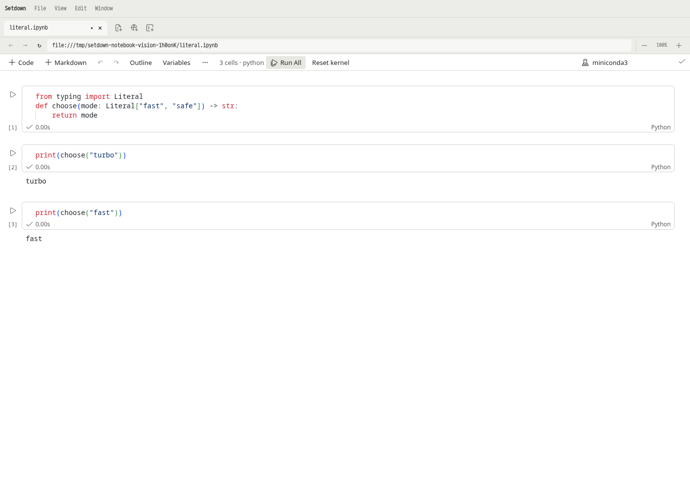
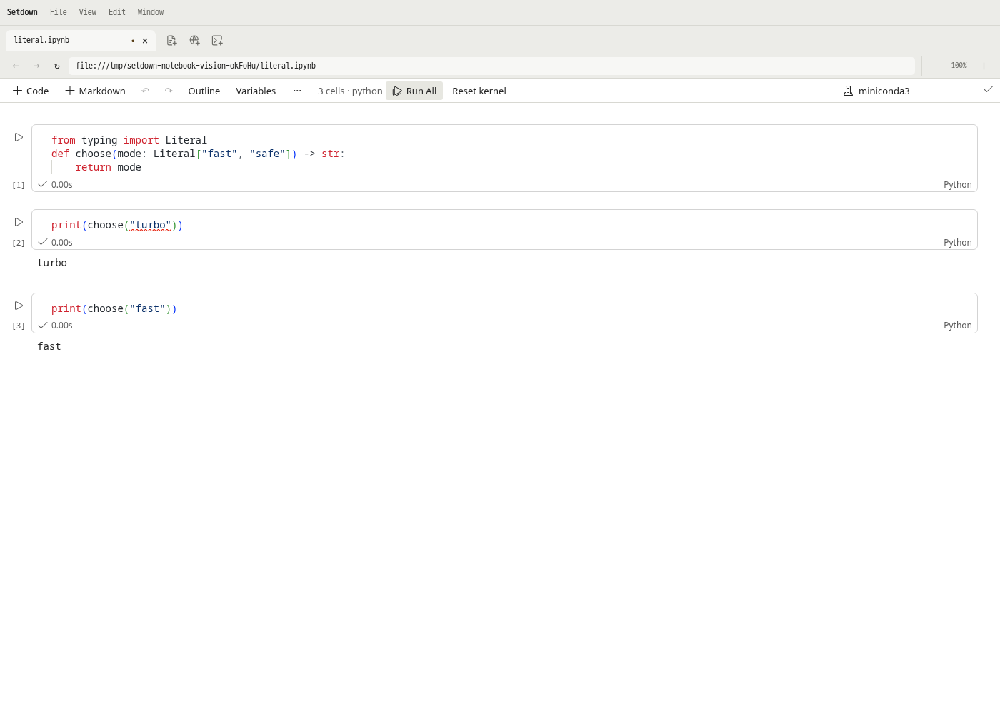
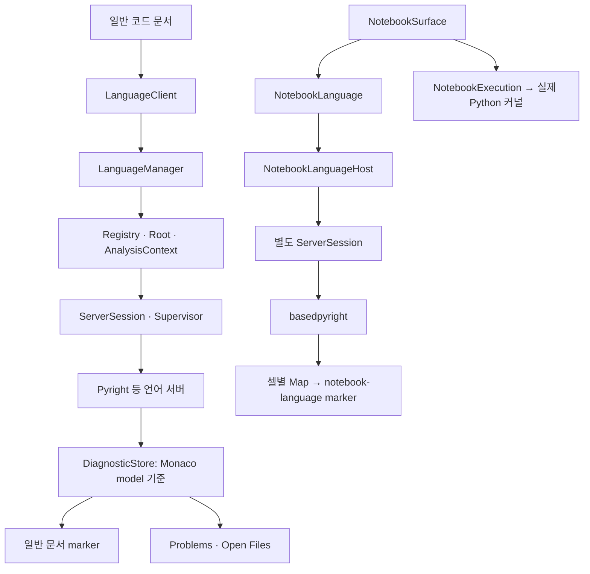
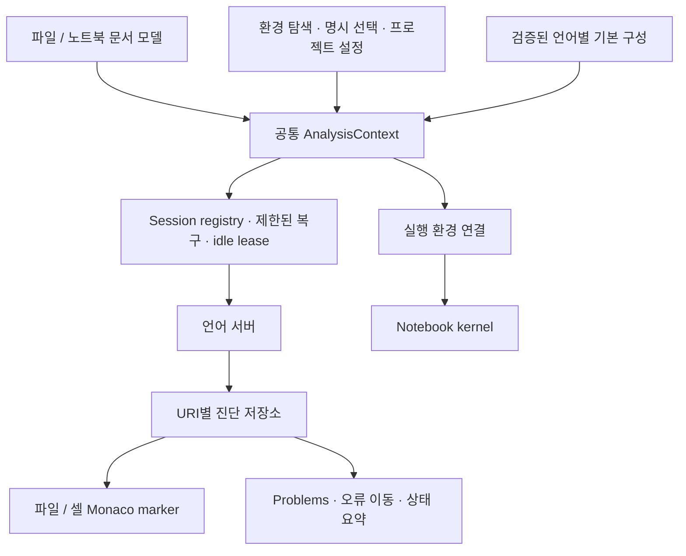

# Setdown LSP의 비전: 노트북에서 믿을 수 있는 기본값부터

작성일: 2026-11-08. 분석 기준: Setdown `7d0046876767fdc6adb54c6cfeeb919f4e1f8a28`. 제품 코드를 수정하지 않고 소스 분석, 실제 언어 서버 실험, 격리된 Electron에서 Jupyter 커널 실행을 수행했다.

## 1. 제안하는 방향

**Setdown은 현재의 LSP 기반 위에서 충분히 개선할 수 있다. 첫 번째 과제는 새 LSP 엔진을 만드는 일이 아니라, 이미 들어 있는 엔진이 올바른 환경에서 필요한 검사를 수행하고 그 결과를 모든 화면에 일관되게 보여 주도록 만드는 일이다.**

사용자가 지적한 `Literal` 문제는 실제 노트북에서 재현됐다. 기본 설정은 타입 검사를 `off`로 보낸다. 같은 애플리케이션, 같은 노트북, 같은 Python에서 프로젝트 설정만 `basic`으로 바꾸면 잘못된 인자에 정확히 빨간 줄이 생긴다. 두 경우 모두 커널은 정상 실행된다. 따라서 이 사례는 “엔진이 Python의 의미를 이해하지 못한다”는 증거가 아니라 **제품의 기본 검사 정책이 사용자의 요구를 충족하지 못한다는 증거**다.

추천하는 제품 약속은 다음과 같다.

> Python 파일이나 노트북을 열면 Setdown이 프로젝트 환경을 찾고, 명백한 타입 오류를 검사한다. 문제가 생기면 무엇을 고쳐야 하는지 설명한다. 사용자는 서버 이름, JSON-RPC, 분석 경로의 조합을 설계하지 않아도 된다.

이를 위해 세 가지 선례를 결합한다.

| 가져올 것 | 주된 참고 대상 | Setdown에 필요한 결과 |
| --- | --- | --- |
| 작고 명확한 서버 수명·루트·기능 선택 규칙 | Helix | 필요한 서버만 시작하고, 같은 분석 문맥에서 재사용하고, 각 기능의 담당 서버를 정한다 |
| 문서 종류와 화면 수명을 넘는 진단 관리 | VS Code | `.py`, 노트북 셀, Problems, 오류 이동이 같은 진단을 본다 |
| Python 환경 탐색과 선택의 검증된 구현 | Microsoft Python Environment Tools와 Python Environments 확장 | 일반적인 프로젝트에서 환경 선택을 자동화하고, 사용자의 명시 선택은 보존한다 |

타입 판단 자체는 이미 번들된 Pyright/basedpyright에 맡긴다. Python 지원의 중기 목표는 **basedpyright를 공통 엔진으로 쓰는 것**이 적절하다. 이미 노트북에 사용하고 있고 native notebook protocol을 지원하기 때문이다. 다만 `.py` 엔진 교체는 첫 수정과 분리하여 프로젝트 설정, rename, stubs, 성능의 호환성 검증 후 진행한다.

`basic`은 출발점으로 추천한다. 이것은 모든 Python 프로젝트에서 무조건 오탐이 없다는 결론이 아니다. 이번 실험에서 필요한 오류를 잡았고, 엄격한 Unknown 관련 경고를 기본으로 강제하지 않는 성숙한 upstream preset이라는 이유다. 진짜 사용자의 데이터 분석 노트북으로 기본값을 확정해야 한다.

우선순위는 **검사 정책 → 노트북 진단 통합 → 환경 자동 선택 → 공통 수명 관리 → 성능 검증**이다. 서버 카탈로그의 크기나 LSP 메서드 개수를 먼저 늘려서는 이 문제가 해결되지 않는다.

## 2. 분석 범위와 증거의 강도

### 분석한 소스

| 대상 | 고정한 버전 | 살펴본 영역 |
| --- | --- | --- |
| Setdown | `7d0046876767fdc6adb54c6cfeeb919f4e1f8a28` | catalog 생성, registry, root, AnalysisContext, Python 환경, stdio session, recovery, 일반 문서 진단, notebook sync·rendering·kernel, 관련 테스트 |
| Helix | `ba40e547426b0f9896c8bdc699a4ab11f2b37dbc` | language config, registry, client, root 결정, 기능 routing, 진단 저장·갱신·표시 |
| VS Code | `d3d31f62268b169a2dfab62ffb2d7d38158a5b7c` | extension diagnostics, marker service, model decorations, notebook marker navigation, 내장 Python extension |
| vscode-languageserver-node | `b8c8db0b6a5c1a257d224cda3f0c21ce0a8a3203` | notebook synchronization과 VS Code API 의존성 |
| monaco-languageclient | `c52125a809e5993509d53f10f5b478c989b18f5d` | client adapter, API/service dependencies |
| Python Environment Tools, 이하 PET | `02dd29e49e3c71d4ec06e1072d6331494a12e01d` | standalone JSON-RPC, locator 구성, probe subprocess 제한 |
| vscode-python-environments | `28ed7976ee4e4fc6c4df6d8a522f2fc2cffe1eed` | interpreter 선택 우선순위, local venv 자동 선택, 관련 회귀 테스트 |

앞의 다섯 대상은 저장소의 vendored source를 읽었다. 추가 Python 환경 프로젝트 두 개는 `/tmp`에 별도로 shallow clone하여 조사했으며 제품 의존성으로 추가하지 않았다. 외부 문서는 공식 저장소·공식 문서만 확인했다. 이 보고서의 비교는 위 revision에 대한 비교이며, 각 프로젝트의 모든 코드와 모든 확장을 검증했다는 뜻은 아니다.

증거를 세 종류로 구분한다.

- **실측**: 실제 서버의 진단, Electron DOM의 squiggle, 실제 ipykernel 출력, Problems 결과.
- **소스 확인**: 현재 실행 경로, 저장소 구조, 설정 우선순위, lifecycle 분기.
- **설계 제안·추론**: 자동 선택 정책, session pooling의 기대 효과, 성능 목표. 구현되었거나 성능이 입증된 사실로 읽으면 안 된다.

전체 원자료와 재현 스크립트는 [조사 디렉터리](lsp-vision-2026-11-08/README.md)에 있다.

## 3. 실제 Jupyter 노트북에서 확인한 문제

### 3.1 최소 재현

세 개의 코드 셀을 가진 실제 `.ipynb` 파일을 만들었다.

```python
# cell 1
from typing import Literal

def choose(mode: Literal["fast", "safe"]) -> str:
    return mode
```

```python
# cell 2: 정적 타입 계약을 어긴 호출
print(choose("turbo"))
```

```python
# cell 3: 올바른 호출
print(choose("fast"))
```

현재 빌드한 Setdown을 Xvfb, 별도 runtime directory, 별도 D-Bus session에서 실행했다. 실제 Python `/home/yabsed/miniconda3/bin/python3`와 ipykernel을 선택해 **Run all cells**를 눌렀다. 언어 서버 응답을 관찰했으며 가짜 진단을 주입하지 않았다.

| 조건 | 잘못된 호출의 진단 | 실제 빨간 줄 | 올바른 호출의 빨간 줄 | 커널 실행 |
| --- | --- | --- | --- | --- |
| 현재 기본값, 프로젝트 설정 없음 | 빈 배열 | 0개 | 0개 | `turbo`, `fast` 출력, idle 복귀 |
| 임시 프로젝트의 `pyrightconfig.json`에 `typeCheckingMode: basic` | `reportArgumentType`, severity 1 | 1개 | 0개 | `turbo`, `fast` 출력, idle 복귀 |

`basic`에서 보고된 범위는 두 번째 셀의 0-based 문자 **13–20**, 즉 `"turbo"`다. 현재 렌더러와 서버가 이 타입 오류를 표현할 능력은 이미 갖고 있다.

기본값의 실행 결과:



`basic`의 실행 결과:



이 구분은 사용자 요구의 핵심이다. Python의 타입 annotation은 이 예제에서 런타임 검증기가 아니다. **실행 성공과 정적 계약 위반은 동시에 성립한다.** 실행 성공을 이유로 진단을 제거해서는 안 된다.

원래 문제가 발생한 사용자 노트북은 제공받지 않았으므로, 이 결과가 모든 실제 라이브러리 호출의 원인을 확정하지는 않는다. 다만 사용자가 묘사한 증상을 notebook → LSP → Monaco → kernel 전체 경로에서 재현했다.

### 3.2 엔진과 설정을 분리한 9개 실험

별도 stdio probe로 Pyright `1.1.414`, basedpyright `1.40.2`를 실제 실행했다. basedpyright에는 `.py`로 위장한 셀이 아니라 `notebookDocument/didOpen`과 `didChange`를 보냈다. 입력에는 잘못된 `Literal` 호출, 잘못된 `int` 대입, `Any`를 거친 호출, 없는 import와 이름을 함께 넣었다.

| 서버·문서 | client preset / 추가 설정 | Literal 오류 | int 대입 오류 | 없는 import·이름 |
| --- | --- | --- | --- | --- |
| Pyright / `.py` | off | 없음 | 없음 | warning |
| Pyright / `.py` | basic | error | error | error |
| Pyright / `.py` | standard | error | error | error |
| Pyright / `.py` | strict | error | error | error, 추가 Unknown·unused 진단 |
| Pyright / `.py` | off + native config basic | error | error | error |
| Pyright / `.py` | off + `.vscode/settings.json` basic만 존재 | 없음 | 없음 | warning |
| basedpyright / native notebook | 현재 off + core warning 복원 | 없음 | 없음 | warning |
| basedpyright / native notebook | basic | error | error | error |
| basedpyright / native notebook | standard | error | error | error |

basedpyright는 위 조건들에서 unused import hint도 발행했다. 표의 error/warning과 구별해야 한다. 수정본을 version 2로 전송한 뒤에는 9개 모두 진단이 빈 배열로 정리됐다. `basic`과 `standard`가 이 작은 예제에서 같았다는 사실은 두 preset의 전체 동작이 같다는 뜻이 아니다.

`.vscode/settings.json`은 언어 서버가 자동으로 읽어 주는 범용 LSP 설정이 아니다. 다섯 번째·여섯 번째 행의 차이를 실제로 확인했고, Setdown의 현재 importer도 `extraPaths`만 호환 처리한다. 따라서 VS Code에서 쓰던 프로젝트를 열었다고 검사 모드까지 같아지는 것은 아니다. [원시 결과](lsp-vision-2026-11-08/python-lsp-results.json), [project settings 구현](../apps/desktop/src/main/language/python-project-settings.ts).

### 3.3 Problems도 별도 문제다

`basic` 노트북에서 오류를 확인한 뒤 정상 `clean.py`를 열고 그 파일의 진단 응답까지 기다렸다. **Problems · Open Files**에는 항목이 0개였고 다음 문구가 표시됐다.

> No diagnostics reported by the active checks. This does not establish project-wide coverage.

[실제 화면](lsp-vision-2026-11-08/notebook-artifacts/notebook-probe-real-notebo-4f643--and-kernel-execution-basic/problems-omits-notebook.png).

이 실험은 노트북과 Problems를 동시에 활성화한 비교가 아니다. 일반 파일로 이동하면 노트북 분석 객체를 dispose하는 lifecycle도 작동한다. 따라서 이 화면만으로 모든 원인을 하나로 단정하지 않는다. 그러나 코드에서는 더 직접적인 단절을 확인했다. 노트북은 자체 `Map`과 `setModelMarkers`를 사용하고, Problems는 일반 문서의 `DiagnosticStore`만 읽는다. **현재 두 경로에는 공통 집계가 없다.** 탭 전환 시 수명 문제와 진단 저장소 문제가 함께 존재한다.

### 3.4 Literal로 보장할 수 있는 범위

`Literal["fast", "safe"]`처럼 유한한 허용값과 인자의 타입을 알면 이 검사는 가능하다. `Literal[1, 2, 3]`도 같은 종류다. 반면 “임의의 정수가 0부터 100 사이인지”, “파일이 실제 존재하는지”, “DataFrame에 실행 시 어떤 column이 생기는지”까지 일반적인 정적 타입 검사기가 증명해 주지는 않는다.

이번 probe에서도 호출 대상이 `Any`가 된 경우에는 잘못된 문자열 호출을 잡지 못했다. 여기에 임의의 빨간 줄을 만드는 자체 추론기를 덧붙이는 방향은 추천하지 않는다. 필요한 타입 정보가 없는 경우와 검사기가 오류를 확인한 경우를 구분해야 한다.

## 4. Setdown 코드: 기반은 있으나 노트북이 별도 제품처럼 움직인다

### 4.1 현재 경로



공유되는 것은 transport와 일부 Python 설정 유틸리티다. 실행 정책, 분석 설명, 회복, 진단 저장, 화면 수명이 충분히 공유되지는 않는다.

### 4.2 보존할 가치가 있는 현재 구현

Setdown의 LSP 전체를 장난감 구현이라고 평가하는 것은 정확하지 않다. 사용자에게 중요한 결과가 빠져 있지만 기반에는 실용적인 방어와 상태 관리가 있다.

- [`server-session.ts`](../apps/desktop/src/main/language/server-session.ts)는 공식 `vscode-jsonrpc`를 사용한다. initialization, scoped configuration, capability 협상, cancellation, progress, server message, watched files를 처리한다. 초기화 제한은 20초, 일반 요청은 기본 15초, references/rename/documentSymbol은 기본 60초, 동시 요청은 64개다. 종료도 제한 시간이 있다.
- [`language-supervisor.ts`](../apps/desktop/src/main/language/language-supervisor.ts)는 일반 문서의 crash recovery를 60초 내 3회, 1/3/5초 지연으로 제한한다. 문서 재연결만 수행하고 rename·edit·서버 command를 재실행하지 않는다.
- [`analysis-context.ts`](../apps/desktop/src/main/language/analysis-context.ts)는 설명용 정보와 실제 launch plan을 같은 resolver에서 만든다. Python 외에도 TypeScript SDK, clangd compile database 등을 다룬다. 없어져 버린 명시적 환경 선택을 조용히 다른 것으로 바꾸지 않는다.
- [`language-client.ts`](../apps/desktop/src/renderer/language/language-client.ts)와 [`diagnostic-store.ts`](../apps/desktop/src/renderer/language/diagnostic-store.ts)는 generation, version, provider ownership을 보존한다. version 없는 push를 `best-effort`로 구별하는 것도 좋은 설계다.
- 노트북은 native notebook protocol을 사용하고, 셀 구조 변경 시 URI epoch를 바꿔 오래된 결과를 차단한다. 보이지 않는 `get_ipython` 정의 셀도 둔다. 일반 `.py` 여러 개로 흉내 내는 방식보다 적절한 출발점이다.
- 실행 중인 kernel의 Python과 분석 환경을 보존하는 규칙이 이미 있다. 프로젝트 환경 설정이 바뀌어도 실행 중인 커널을 몰래 다른 Python으로 바꾸지 않는다. [`notebook-execution.ts`](../apps/desktop/src/renderer/notebook/notebook-execution.ts)의 `loadEnvironment`를 보존해야 한다.

이 기반을 버리고 처음부터 다시 만들면, 지금 이미 해결한 stale result·cancellation·환경 선택 보존 문제를 다시 풀 가능성이 크다.

### 4.3 가장 직접적인 결함: 검사 정책이 off이고 테스트도 이를 보호한다

일반 Python은 [`language-profiles/overrides.json`](../apps/desktop/scripts/language-profiles/overrides.json)의 `python.analysis.typeCheckingMode`가 `off`다. 생성 결과인 [`catalog/profiles.json`](../apps/desktop/src/main/language/catalog/profiles.json)에도 반영된다. 노트북은 별도의 [`python-analysis.ts`](../apps/desktop/src/main/language/python-analysis.ts)에서 `off`를 지정한다.

노트북 설정은 basedpyright의 off가 꺼 버리는 core rule 네 개를 warning으로 복원한다. 이 덕분에 import·undefined name 등은 남지만, `reportArgumentType`과 `reportAssignmentType`은 돌아오지 않는다.

[`server-session.test.ts`](../apps/desktop/src/main/language/server-session.test.ts)의 **“off preset keeps core diagnostics and inference without type noise”** 테스트는 더 중요하다. 자체 정의한 `read_csv(float_precision: Literal["high"])`에 `"round_trip"`을 전달하고, 잘못된 멤버 접근과 `int = "wrong"`까지 넣은 뒤 **missing import와 undefined name만 나와야 한다고 검증한다.** 이것은 실제 pandas의 타입 정확성을 확인하는 테스트가 아니다. 필요한 타입 오류까지 나오지 않는 현재 동작을 성공 조건으로 삼는다.

따라서 과거 어느 버전의 테스트가 전부 통과했더라도 사용자 요구가 충족됐다고 말할 수 없다. 여기서는 테스트가 빠진 것뿐 아니라 **테스트가 보호하는 정책 자체를 바꿔야 한다.** 타입 추론·자동완성이 잘 된다는 사실도 타입 진단이 켜져 있다는 증거는 아니다.

### 4.4 노트북은 일반 문서의 관리 경로를 우회한다

[`language-manager.ts`](../apps/desktop/src/main/language/language-manager.ts)의 `open`은 `document.notebook === 'python'`이면 즉시 `NotebookLanguageHost`로 분기한다. 일반 문서의 provider 선택과 `AnalysisContext` 구성으로 들어가지 않는다.

[`notebook-language-host.ts`](../apps/desktop/src/main/language/notebook-language-host.ts)는 owner와 document ID별로 직접 `ServerSession`을 만들고, bundled basedpyright와 고정 notebook analysis 설정을 사용한다. 선택한 Python과 프로젝트 `extraPaths` 등은 적용하지만 일반 registry에서 편집한 모든 정책이 이 경로에 적용되는 구조는 아니다. 따라서 “Python 설정을 바꿨다”는 사용자 행동의 범위가 문서 종류에 따라 달라질 수 있다.

현재 노트북에도 실패 상태와 로그는 있다. 하지만 일반 문서의 bounded supervisor에 연결되어 있지 않다. 같은 엔진 실패라도 복구 동작이 달라지는 구조다. 자동 복구를 추가할 때도 LSP 재연결과 kernel 재시작을 구별해야 한다. 전자는 가능하지만 후자는 계산 상태를 잃게 한다.

### 4.5 진단의 주인이 editor model이다

일반 `DiagnosticStore`는 `Map<ITextModel, ...>`이다. owner/provider별 진단을 잘 구분하지만, 진단의 존재가 Monaco model의 수명에 묶인다. 노트북은 그 저장소조차 거치지 않고 [`notebook-language.ts`](../apps/desktop/src/renderer/notebook/notebook-language.ts)의 셀별 map에서 직접 marker를 만든다. 이 경로는 `relatedInformation`도 제거한다.

Problems의 `load`는 일반 store의 `entries()`만 읽는다. 현재 명칭이 **Open Files**인 것은 정직하다. 그러나 “노트북은 열린 문서인데 목록에서 빠진다”는 사용자의 관점에서는 통합이 부족하다. 이후 workspace 검사를 추가해도 model 기반 저장소를 그대로 두면 아직 열지 않은 파일의 진단을 제대로 보관하기 어렵다.

고쳐야 할 경계는 **진단 저장과 그 진단을 보여 주는 model을 분리하는 것**이다. URI별 진단을 먼저 저장하고, 현재 화면이 그것을 구독하도록 바꿔야 한다.

### 4.6 노트북 탭 전환이 분석 수명에 영향을 준다

[`NotebookSurface.svelte`](../apps/desktop/src/renderer/notebook/NotebookSurface.svelte)의 language effect는 `active`일 때만 `NotebookLanguage`를 생성하고 cleanup에서 dispose한다. 따라서 비활성 노트북은 분석 연결을 유지하는 구조가 아니다.

이는 무조건 잘못된 선택은 아니다. 메모리를 줄이지만 탭 왕복 시 분석 시작과 진단 초기화를 반복할 수 있다. “열린 노트북 수만큼 서버가 영구 실행된다”는 해석도 틀리다. 현재는 **활성 notebook instance 중심의 별도 session**이다. 이 차이를 고려하여 단기 idle lease와 재사용을 측정해야 한다.

### 4.7 수정할 때 전체 셀을 보내는 이유를 무시하면 안 된다

renderer는 셀 source를 모아 변경을 감지하고, notebook version을 올리고, 기존 노트북 진단을 지운 뒤 150ms debounce로 보낸다. host는 구조가 바뀌면 close/open하며 URI epoch를 바꾸고, 일반 text edit에서도 **모든 셀의 full text와 version**을 보낸다.

한 글자 수정에 전체 셀 문자열을 만드는 비용은 큰 노트북에서 조사할 가치가 있다. 그러나 코드 주석에 중요한 이유가 있다. **셀 A의 변경으로 내용이 그대로인 셀 B의 진단이 달라질 수 있다.** B의 이전 결과를 현재 결과로 잘못 인정하면 안 된다. 단순히 “바뀐 셀 하나만 보내기”로 최적화하면 이 보호를 무너뜨릴 수 있다.

문서 revision과 셀 text version, 분석 snapshot의 관계를 먼저 모델링하고, upstream notebook sync를 참고하여 최적화해야 한다. 이 보고서는 실제 대형 노트북 성능을 측정하지 않았으므로 현재 비용의 크기를 수치로 단정하지 않는다.

### 4.8 환경을 찾아도 사용자가 골라야 한다

[`python-environments.ts`](../apps/desktop/src/main/notebook/python-environments.ts)는 `.venv`, `venv`, `VIRTUAL_ENV`, `CONDA_PREFIX`, PATH, Conda 환경 목록, Jupyter metadata를 찾는다. 하지만 반환하는 `selected`는 저장된 notebook 선택, 프로젝트 선택, 발견된 host Python 순서다. 프로젝트 `.venv`를 후보로 찾았다는 이유만으로 자동 선택하지 않는다.

일반 `AnalysisContext`는 local environment가 있는데 명시 선택이 없으면 `python-project-environment`를 action-needed로 만든다. 이는 metadata만 읽고 프로젝트 interpreter는 명시 선택 후 쓰려는 현재 의도와 맞다. 다만 사용자가 원하는 “it just works”와는 긴장이 있다. **환경 탐색의 폭과 선택 정책을 별도로 개선해야 한다.**

잘못된 Python에서 시작한 missing import를 전부 끄는 방식으로 이 문제를 해결해서는 안 된다. 패키지가 없는 환경과 올바른 환경에서의 실제 import 오류는 다르다.

## 5. Helix에서 강하게 참고할 것

### 5.1 이미 Helix의 데이터를 쓰고 있다

[`sources.json`](../apps/desktop/scripts/language-profiles/sources.json)에 기록된 Helix revision은 새 `vendor/helix` submodule과 같은 `ba40e547…`이다. Setdown의 importer는 이미 Helix 언어·서버 설정을 참고한다. submodule을 추가했다고 새로운 LSP 엔진이나 검사 정책이 자동으로 생긴 것은 아니다.

[`update-language-profiles.py`](../apps/desktop/scripts/update-language-profiles.py)는 `language-servers` 원소가 객체여도 그 `name`을 뽑아 association을 만든다. Helix의 `only-features`, `except-features` 의미 전체를 수입하는 구조는 아니다. 지금까지 가져온 것은 주로 catalog data이며, 앞으로 필요한 것은 **runtime architecture의 규칙**이다.

### 5.2 Registry가 서버의 사용 범위와 수명을 소유한다

Helix의 [`Registry`](https://github.com/helix-editor/helix/blob/ba40e547426b0f9896c8bdc699a4ab11f2b37dbc/helix-lsp/src/lib.rs#L581)는 언어 서버 이름과 client 목록을 관리한다. 문서가 열릴 때 호환되는 기존 client에 붙일 수 있는지 `try_add_doc`으로 확인하고 필요할 때 시작한다. `stop`은 빈 목록을 tombstone으로 남겨 사용자가 멈춘 서버를 다음 문서 열기에서 즉시 되살리지 않는다.

Setdown도 일반 문서에서는 owner/root/config가 맞는 server를 재사용한다. 이 장점을 노트북까지 확장하고, explicit stop과 crash recovery를 구별하는 것이 핵심이다. Rust 코드를 TS로 기계적으로 옮기는 것보다 소유권과 상태 전이를 맞추는 것이 중요하다.

권장 session identity는 대략 `(owner 범위, root, server/version, Python 환경, 설정 fingerprint)`다. 파일 경로 하나나 notebook ID 하나가 분석 서비스를 소유하게 하지 않는다. 서로 다른 Python 환경은 같은 root여도 공유하면 안 된다. 여러 window 사이의 공유는 IPC와 소유권을 더 복잡하게 하므로 1차 목표로 삼지 않는다.

### 5.3 기능마다 담당 서버를 정한다

Helix의 [language configuration](https://github.com/helix-editor/helix/blob/ba40e547426b0f9896c8bdc699a4ab11f2b37dbc/book/src/languages.md#L220)은 서버 순서와 `only-features`/`except-features`를 사용한다. 보통 우선 서버를 사용하고 diagnostics, completion, code action, symbols 등은 복수 서버 결과를 합치는 규칙을 명시한다. 문서 쪽에서도 초기화 완료, capability 지원, 설정상 허용을 함께 확인한다.

Setdown의 [`language-feature-plan.ts`](../apps/desktop/src/renderer/language/language-feature-plan.ts)는 formatter 한 개를 고르고 secondary의 rename·semantic tokens를 제거하지만, 범용 feature ownership 정책까지 제공하지는 않는다.

Python의 추천 구성은 간단하다. **타입·completion·hover·definition·rename은 한 Python 분석기**, 필요할 때 **Ruff는 lint/format과 그 quick fix**를 담당한다. Pyright, basedpyright, Jedi, pylsp를 기본으로 모두 붙여 같은 의미의 오류와 자동완성을 중복 생산하게 하지 않는다. 합치는 기능에서도 provider provenance는 남긴다.

### 5.4 진단을 URI와 provider 기준으로 관리한다

Helix의 [`handle_lsp_diagnostics`](https://github.com/helix-editor/helix/blob/ba40e547426b0f9896c8bdc699a4ab11f2b37dbc/helix-view/src/handlers/lsp.rs#L284)는 version이 맞지 않는 열린 문서 결과를 버리고, URI별 raw diagnostics에 provider를 함께 보관한다. 같은 provider의 새 결과가 그 provider의 이전 결과를 대체한다. 아직 열지 않은 URI도 저장할 수 있다.

Setdown의 일반 문서에도 version/provider 보호는 있다. 가져올 차이는 **model이 없어도 진단을 소유할 수 있는 resource 저장소**다. 이 규칙은 notebook cell URI에도 그대로 적용할 수 있다.

Helix는 편집에 따른 진단 위치 mapping과 일부 persistent source 처리도 한다. Setdown은 수정 때 지우는 쪽에 가깝다. 이전 진단을 유지하면 깜빡임은 줄일 수 있지만, 이전 snapshot의 타입 오류를 현재 오류라고 표시해서는 안 된다. 보존할 경우 stale/provisional 상태와 marker 표시 정책을 명시해야 한다.

### 5.5 소음은 표시 방식에서도 줄인다

Helix [`handlers/diagnostics.rs`](https://github.com/helix-editor/helix/blob/ba40e547426b0f9896c8bdc699a4ab11f2b37dbc/helix-view/src/handlers/diagnostics.rs#L24)는 cursor-line 진단 표시를 350ms debounce한다. 분석 결과의 존재와 사용자의 시야에 메시지가 크게 나타나는 시점을 분리하는 사례다.

Setdown도 검사 강도를 꺼서 조용하게 만들기보다, 편집 중 팝업, 반복 toast, 긴 inline 설명의 노출을 다듬는 편이 좋다. 오류 자체는 Problems와 정확한 위치에 남기고, 세부 설명은 필요할 때 읽도록 한다.

### 5.6 그대로 가져오면 안 되는 것

**현재 pinned Helix의 Python 기본 서버 목록은 `ty`, `ruff`, `jedi`, `pylsp`, `zuban`이다.** 과거의 Helix 설정을 기억해 “Helix는 기본 Pyright이므로 그대로 쓰자”고 말하면 이 revision에는 맞지 않는다. [`languages.toml`](https://github.com/helix-editor/helix/blob/ba40e547426b0f9896c8bdc699a4ab11f2b37dbc/languages.toml#L1171).

또한 Helix client는 executable을 `which`로 찾고 stdio process를 시작한다. 이 registry 자체가 사용자에게 맞는 Python 가상환경과 서버 설치를 완성해 주지는 않는다. native `notebookDocument`를 처리하는 Setdown식 노트북 host의 선례도 조사한 Helix 경로에서는 찾지 못했다. **Helix의 가벼운 runtime 원칙과 Setdown의 초보자용 환경 자동화는 별개의 작업**이다.

루트 탐색도 복사하면 안 된다. Helix `find_lsp_workspace`는 workspace 경계 안에서 상위 marker까지 탐색하는 반면, Setdown은 가까운 marker와 Git/submodule 경계, Rust/TypeScript 특례가 있다. monorepo에서 어느 root가 맞는지는 언어와 프로젝트 구조에 달렸다. 기존 root 회귀 테스트를 보존하며 명시적으로 바꿔야 한다.

## 6. VS Code에서 참고할 것: 엔진보다 통합 계약

### 6.1 VS Code 본체에 Pylance 구현이 들어 있는 것은 아니다

vendored VS Code의 [`extensions/python/package.json`](../vendor/vscode/extensions/python/package.json)은 Python language/grammar configuration이다. 이것만 읽어서 Pylance의 타입 분석 알고리즘까지 분석했다고 주장할 수 없다.

Pylance는 Pyright를 기반으로 추가 기능과 stubs 등을 제공하고, interpreter integration은 Python/Python Environments 확장과 연결된다. Pylance 전체는 공개 소스가 아니며 공식 FAQ는 사용 가능한 제품 범위를 제한한다. 따라서 Setdown에 Pylance를 그대로 번들하는 것을 기술 전략으로 제안하지 않는다. [공식 Pylance FAQ](https://github.com/microsoft/pylance-release/blob/main/FAQ.md#general-questions).

VS Code의 기본 `python.analysis.typeCheckingMode`도 공식 설정 문서상 **off**다. 즉 “VS Code와 같은 기본값”이라는 설명만으로 사용자가 원하는 `Literal` 검사를 충족할 수 없다. 사용자가 경험한 VS Code에는 프로젝트 설정이나 별도 선택이 있었을 수 있으나, 그 환경은 이번에 확인하지 않았다. Setdown은 **사용자의 요구에 맞는 기본값을 명시적으로 결정해야 한다.** [공식 Python settings reference](https://code.visualstudio.com/docs/python/settings-reference).

### 6.2 DiagnosticCollection → MarkerService → 각 화면

VS Code의 [`DiagnosticCollection`](https://github.com/microsoft/vscode/blob/d3d31f62268b169a2dfab62ffb2d7d38158a5b7c/src/vs/workbench/api/common/extHostDiagnostics.ts#L22)은 resource URI를 키로 진단을 소유한다. collection owner, set/delete/clear, model version 전달, 진단 수 제한을 처리한다.

[`MainThreadDiagnostics`](https://github.com/microsoft/vscode/blob/d3d31f62268b169a2dfab62ffb2d7d38158a5b7c/src/vs/workbench/api/browser/mainThreadDiagnostics.ts#L69)는 canonical URI와 owner를 사용해 marker service에 전달한다. [`MarkerDecorationsService`](../vendor/vscode/src/vs/editor/common/services/markerDecorationsService.ts)는 model이 있을 때 이를 decoration으로 투영한다. **진단의 원본이 화면 decoration이 아니다.**

노트북도 [`markerProvider.ts`](https://github.com/microsoft/vscode/blob/d3d31f62268b169a2dfab62ffb2d7d38158a5b7c/src/vs/workbench/contrib/notebook/browser/contrib/marker/markerProvider.ts#L19)에서 같은 `IMarkerService`를 읽는다. `CellUri.parse`로 같은 노트북의 셀을 연결하고 오류 이동과 overview decoration을 만든다. Setdown에 가장 직접적으로 필요한 선례다.

이 구조만 도입한다고 project-wide 진단이 자동으로 생기는 것은 아니다. 서버가 해당 범위를 분석해야 한다. 그러나 분석 범위와 화면에 mount된 model의 범위를 분리할 기반이 생긴다.

### 6.3 환경 탐색은 성숙한 별도 구성 요소를 재사용할 수 있다

Microsoft [Python Environment Tools](https://github.com/microsoft/python-environment-tools/tree/02dd29e49e3c71d4ec06e1072d6331494a12e01d)는 Rust로 구현한 standalone 환경 탐색 도구다. [JSON-RPC 구현](https://github.com/microsoft/python-environment-tools/blob/02dd29e49e3c71d4ec06e1072d6331494a12e01d/crates/pet/src/jsonrpc.rs)과 [인터페이스 문서](https://github.com/microsoft/python-environment-tools/blob/02dd29e49e3c71d4ec06e1072d6331494a12e01d/docs/JSONRPC.md)를 통해 configure/refresh/resolve 등의 경계를 확인했다. 단순히 VS Code extension host 안에서만 쓸 수 있는 코드가 아니다.

환경 선택은 그 위의 정책이다. [Python Environments의 interpreterSelection.ts](https://github.com/microsoft/vscode-python-environments/blob/28ed7976ee4e4fc6c4df6d8a522f2fc2cffe1eed/src/features/interpreterSelection.ts#L226)는 workspace 자동 탐색에서 local venv manager를 먼저 보고 system manager로 넘어간다. [venv 자동 선택 테스트](https://github.com/microsoft/vscode-python-environments/blob/28ed7976ee4e4fc6c4df6d8a522f2fc2cffe1eed/src/test/managers/builtin/venvManager.autoSelect.unit.test.ts)는 프로젝트 root `.venv`, 하위 폴더 환경, 깨진 환경 등의 우선순위를 실제 사례로 다룬다.

추천하는 재사용 단위는 **PET 실행 파일과 좁은 adapter**, 그리고 **선택 정책의 테스트 사례**다. VS Code의 extension UI·API 전체를 이식할 필요는 없다. 패키징할 플랫폼/아키텍처, 버전 고정, startup/refresh 비용과 업데이트 방법은 별도 검증해야 한다.

주의할 구현 차이도 있다. PET는 일부 탐색·resolve 과정에서 interpreter나 manager subprocess를 probe한다. [process.rs](https://github.com/microsoft/python-environment-tools/blob/02dd29e49e3c71d4ec06e1072d6331494a12e01d/crates/pet-python-utils/src/process.rs#L105)는 timeout, output limit, shutdown supervision을 다룬다. 현재 Setdown의 metadata-only discovery와 완전히 같은 실행 모델이 아니다. 이 차이를 숨기지 말고, Setdown이 허용하는 interpreter 실행 범위 안에서 probe하고 notebook kernelspec의 임의 command는 계속 실행하지 않아야 한다.

### 6.4 공식 language client를 쓰면 전부 해결되는가

[`vscode-languageserver-node/client/src/common/notebook.ts`](../vendor/vscode-languageserver-node/client/src/common/notebook.ts)는 notebook structure, cell document, metadata, execution summary의 변화를 동기화하는 성숙한 참조 구현이다. 다만 `vscode` API의 notebook/document/event 객체를 전제로 한다. 현재 bare Monaco와 Setdown document model에 그대로 붙는 독립 함수가 아니다.

[`monaco-languageclient`](../vendor/monaco-languageclient/packages/client/src/index.ts)는 `vscode-languageclient/browser`의 `BaseLanguageClient`를 활용한다. [package dependencies](../vendor/monaco-languageclient/packages/client/package.json)에는 VS Code API 호환 계층과 여러 service override가 있다. 이 구조는 유지보수 측면의 장점이 있지만, “얇은 adapter 하나만 추가하면 끝”이라고 설명하면 부정확하다.

권고는 다음과 같다.

1. 지금 확인한 policy/store/environment 문제는 현재 transport 위에서 해결한다.
2. notebook sync, registration, edit semantics를 공식 client와 비교하는 제한된 prototype을 만든다.
3. 기존 client를 유지할 비용과 API 호환 계층을 도입할 비용을 실제 bundle/startup/RSS/회귀 테스트로 비교한다.
4. 이득이 확인된 경계만 교체한다. 단순 adapter 교체를 `Literal` 문제의 해결책으로 제시하지 않는다.

이는 재사용을 포기하는 제안이 아니다. **타입 엔진·환경 탐색기·프로토콜 라이브러리는 재사용하고, Setdown의 문서와 UI에 맞는 연결 부위만 소유하자는 제안**이다.

## 7. 목표 아키텍처: 파일과 노트북이 같은 분석 약속을 갖게 한다



### 7.1 AnalysisContext에 검사 정책을 추가한다

현재 context의 장점은 “설명한 환경과 실제 실행 환경이 같은 plan에서 나온다”는 것이다. 여기에 다음 정보를 확장한다.

| 정보 | 필요한 이유 |
| --- | --- |
| 분석 root와 선택 근거 | 다른 프로젝트의 설정·환경이 적용되는 문제 설명 |
| Python 실행 경로·선택 출처·환경 식별자 | kernel과 analyzer가 보는 package 세계 일치 |
| engine ID와 version | 보고 재현, 업데이트 회귀 추적 |
| client 검사 preset과 설정 출처 | 타입 검사가 꺼져 있는데 “정상”으로 오해하는 문제 방지 |
| native project config 존재·우선 적용 가능성 | client 기본값과 실효값을 혼동하지 않음 |
| 분석 범위 | 열린 파일/열린 노트북/전체 프로젝트 구별 |
| 최신 revision, 분석 중/응답 관찰/실패 | 진단 0개와 검사 완료를 구별 |
| 제한 사항 | Any, 미선택 환경, 불완전한 stubs 등의 범위를 설명 |

Pyright의 native config를 자체적으로 완전히 다시 해석하는 parser를 만들지는 않는다. `executionEnvironments`, config inheritance와 rule precedence를 자체 복제하면 upstream과 어긋난다. 서버가 실효 설정을 노출하지 않는 부분은 “client 기본값”, “프로젝트 설정이 우선할 수 있음”으로 정직하게 표시하고 검증 probe/log를 활용한다.

일반 Python과 notebook host가 같은 resolver/policy를 사용하되, wire configuration의 `python.analysis`/`basedpyright.analysis` 차이는 adapter가 담당한다. 공통 정책을 만들었다고 서버별 namespace 차이를 지워 버려서는 안 된다.

### 7.2 Python 기본값

프로젝트가 검사 수준을 명시하지 않았을 때의 후보 기본값은 다음과 같다.

```json
{
  "typeCheckingMode": "basic",
  "diagnosticMode": "openFilesOnly",
  "autoSearchPaths": true,
  "useLibraryCodeForTypes": true
}
```

이는 개념적인 공통 policy다. 실제 wire key, native config 우선순위, notebook 설정은 engine adapter가 구성한다. 현재 off 복원용 severity override를 아무 생각 없이 basic에 그대로 붙이지 않는다.

사용자에게는 **기본 검사 / 엄격 검사 / 타입 검사 끄기** 정도만 노출하고, 기본 검사의 실제 upstream preset과 버전은 Details에 둔다. 프로젝트가 `strict`나 `off`를 명시했다면 존중하고 출처를 보여 준다. UI 선택이 native project config 때문에 적용되지 않는데 성공했다고 표시하지 않는다.

`basic`으로 전환하면 이번 실험에서 missing import와 undefined name도 warning에서 error로 바뀐다. 이것까지 포함해서 실제 노트북 corpus를 평가해야 한다. 필요한 경우 소수의 문서화된 제품별 severity 정책을 둘 수 있지만, 빨간 줄 수를 줄이려고 core type error를 일괄 삭제해서는 안 된다.

### 7.3 환경 선택 기본값

제안하는 순서는 다음과 같다. 이는 현 구현 설명이 아니라 제품 정책 제안이다.

1. **실행 중인 kernel의 확정 환경**은 보존한다. 변경은 명시적인 환경 전환과 kernel 재시작 흐름에서만 한다.
2. notebook에 저장된 명시 선택과 프로젝트의 명시 선택을 존중한다. 선택한 환경이 없어졌으면 다른 환경으로 조용히 바꾸지 않는다.
3. 명시 선택이 없고 프로젝트 root에 사용 가능한 `.venv`가 하나면 자동 선택한다. 근거를 기록하고 간단히 되돌릴 수 있게 한다.
4. 프로젝트 manager metadata와 활성 환경 등으로 한 환경이 명확하게 연결되면 선택한다. 서로 충돌하거나 여러 후보가 동등하면 이름·Python 버전·프로젝트 경로를 보여 주는 한 번의 선택으로 해결한다.
5. host Python으로만 분석할 수 있으면 그 사실을 표시한다. 프로젝트 package를 확인한 것처럼 말하지 않는다.

3–4는 현재의 “프로젝트 interpreter는 명시 선택 후 사용” 정책을 바꾸는 결정이다. 메타데이터로 후보를 고르는 일, 실행 가능한 interpreter인지 probe하는 일, notebook 코드를 실행하는 일을 구분해서 설계해야 한다. 자동 환경 선택이 **자동 셀 실행·자동 package 설치**까지 뜻하지는 않는다.

ipykernel이 없을 때도 분석은 가능할 수 있다. 이 경우 “Python 분석은 가능, 실행에는 ipykernel 필요”로 나누어 설명한다. 설치 동작을 제공한다면 대상 환경을 명확히 하고 사용자 실행 동작으로 수행한다. 단순 파일 열기가 dependency 변경을 일으키게 하지 않는다.

### 7.4 URI별 진단 저장소

진단 저장소의 키는 최소한 다음 정보를 구별해야 한다.

```text
resource URI
  └─ provider + session epoch + channel
       └─ document revision / notebook snapshot / cell identity / diagnostics
```

저장소는 Monaco model을 소유하지 않는다. model mount/unmount는 marker adapter의 일이고, Problems는 같은 저장소를 읽는다. notebook 셀 URI는 부모 notebook과 stable cell ID로 역매핑할 수 있어야 한다. 구조 변경에 따른 transport URI epoch는 내부 수명 정보로 처리한다.

필수 규칙은 다음과 같다.

- 한 provider의 갱신이 다른 provider의 진단을 지우지 않는다.
- 빈 배열도 그 provider의 현재 진단을 제거하는 정상 갱신이다.
- 오래된 session, 삭제된 cell, 이전 notebook snapshot의 결과는 현재 결과로 승격하지 않는다.
- version 없는 push는 검증 가능한 versioned 결과와 구별한다.
- `relatedInformation`, code, codeDescription, tags, source를 잃지 않는다. 노트북 안팎 위치로 이동할 수 있게 한다.
- Problems에서 `notebook.ipynb → cell 3 → line 2`처럼 사용자 위치를 표시하고, 가상화된 셀도 reveal한다.
- 결과 수를 제한하면 생략 사실을 표시한다. 정상처럼 보이는 조용한 truncation을 만들지 않는다.
- tab 비활성, tab 닫힘, 프로젝트 닫힘에 따른 보존/제거 범위를 정의하고 UI의 “Open Files” 또는 “Project” 범위와 일치시킨다.

이 변경이 notebook 진단을 통합할 뿐 아니라 향후 workspace diagnostics, cross-file related information의 기반이 된다.

### 7.5 Notebook이 가져야 할 계약

native `notebookDocument` sync는 유지한다. 여러 셀을 무작정 한 `.py` 문자열로 이어 붙이는 방향은 셀 위치, IPython syntax, 셀 수명과 source mapping을 다시 풀게 만든다. basedpyright는 공식적으로 Jupyter 지원을 제공한다. [basedpyright 1.40.2의 notebook 기능](https://docs.basedpyright.com/v1.40.2/benefits-over-pyright/pylance-features/).

하지만 native protocol을 사용한다는 사실만으로 notebook UX가 완성되지는 않는다. 다음 조건이 필요하다.

- 아직 실행하지 않은 셀도 정적 검사한다. 오류 확인을 위해 커널을 켤 필요가 없다.
- 앞 셀의 타입 변경이 뒤 셀의 오류를 갱신한다.
- 셀 추가·삭제·이동·code/markdown 전환 이후 이전 진단이 다른 셀에 붙지 않는다.
- 커널 실행 순서와 정적 source order를 구별한다. 실행 이력 때문에 메모리에만 존재하는 이름을 영구적인 source 정의로 위장하지 않는다.
- notebook의 unsaved source가 분석의 기준이다. 저장된 JSON이나 과거 출력이 최신 소스보다 우선하지 않는다.
- 환경·policy·상태 설명과 recovery를 일반 Python과 공유한다.
- rename/code action은 변경 범위를 검증한다. 현재의 cell-only 제한을 풀 경우 다중 파일 edit transaction을 공유하고, 부분 적용을 허용하지 않는다.

“노트북에서 실행되는데 빨간 줄이 있다”는 현상을 모두 오탐으로 분류해서는 안 된다. 이번 `Literal`처럼 정상적인 정적 오류일 수 있고, 이전에 실행한 셀의 상태만 남아 있는 경우도 있다. 이 두 경우를 설명할 수 있어야 한다.

## 8. 빨간 줄을 남발하지 않는 방법

진단 수를 목표로 삼으면 필요한 오류까지 지우게 된다. 목표는 **근거 있고, 현재 소스에 맞고, 사용자가 대응할 수 있는 진단**이다.

| 상황 | 기본 대응 | 피해야 할 대응 |
| --- | --- | --- |
| 명확한 Literal·대입·인자 타입 위반 | basic의 실제 error를 해당 위치에 표시 | 실행 성공을 이유로 숨기기 |
| 다른 Python 환경을 분석 중 | 환경 원인을 먼저 설명하고 올바른 환경으로 연결 | 모든 missing import를 영구 비활성화 |
| 올바른 환경에 실제 package가 없음 | package/환경 이름과 해결 동작 제시 | 모호한 “LSP 설정 확인” 안내 |
| stub과 설치된 library API가 불일치 | engine/library/stub 버전을 식별하고 재현; 일치하는 stubs 또는 좁은 예외 | 프로젝트 전체 타입 검사 off |
| 동적 API, Any, Unknown 때문에 정보 부족 | 기본 preset을 유지하고 제한을 설명; strict는 선택 | 근거 없는 자체 error 생성 |
| 이전 snapshot의 진단 | 폐기하거나 stale로 구분, 현재 결과로 다시 검증 | 위치만 옮겨 현재 error처럼 유지 |
| 두 provider의 중복 진단 | 기능 소유권과 규칙 역할 조정 | message 문자열만 보고 무작정 dedup |
| 입력 중 잠깐 깨진 구문 | 짧은 debounce와 안정된 표시, 큰 popup 절제 | 모든 syntax error를 장시간 숨김 |

특히 pandas/numpy와 같은 데이터 분석 도구는 “그 라이브러리는 시끄럽다”는 이유로 한 덩어리로 처리하면 안 된다. 다음 유형을 분리한 실제 corpus가 필요하다.

1. library가 제공하거나 검증된 stubs가 제공하는 명확한 `Literal` signature.
2. 버전별로 허용값이 달라지는 API.
3. `itertuples` 등의 동적 attribute 접근처럼 정적 표현에 제약이 있는 API.
4. annotation이 없는 사용자 함수, decorator, extension module 때문에 정보가 소실되는 경로.
5. 실제 코드 오류이지만 Python이 실행 시 허용하는 호출.

우선 engine과 stubs의 올바른 조합을 사용한다. 마지막 수단의 ignore도 **한 줄·특정 rule·설명 가능한 범위**로 제한한다. `basic`은 이 문제들을 모두 해결하는 마법 설정이 아니므로, 실제 대표 노트북 검증 전에는 “오탐 해결 완료”라고 선언하지 않는다.

환경 장애를 잘 설명하는 것과 진단 severity를 renderer에서 임의로 바꾸는 것도 다르다. 전자는 사용자가 원인을 이해하게 하지만, 후자는 서버 정책과 Problems 표시가 서로 어긋날 수 있다. 정책 변경은 공통 analysis policy에서 수행하고 출처를 남긴다.

## 9. “가볍다”를 검증 가능한 목표로 바꾸기

현재 조사에서는 Setdown·Helix·VS Code의 CPU/RSS/latency 비교 benchmark를 수행하지 않았다. 코드 구조만 보고 Setdown이 더 빠르거나 어떤 adapter가 더 느리다고 단정할 수 없다.

가벼움을 위해 추천하는 구조적 선택은 다음과 같다.

- 필요한 언어를 사용할 때 lazy start한다. 앱 시작 시 catalog의 모든 서버를 깨우지 않는다.
- 분석 context별로 server를 재사용한다. 같은 root여도 Python이나 설정이 다르면 분리한다.
- 탭 이동 때 즉시 분석기를 종료하는 대신 **짧고 제한된 idle lease**를 실험한다. 초기 후보는 30초이며, 측정으로 조정한다. idle cache에는 process 개수/메모리 상한과 eviction이 있어야 한다.
- 기본 진단 범위는 open files/open notebooks로 시작한다. imports 분석까지 하지 않는다는 의미는 아니다. project-wide scan은 별도 동작과 진행·취소 상태를 둔다.
- typing·completion 요청을 배경 scan보다 우선한다. 무제한 queue를 만들지 않고 취소와 coalescing을 유지한다.
- watcher는 session 공유와 함께 중복을 줄이고, dependency/config 변경의 실제 영향 범위에 맞춘다.
- 대형 notebook은 셀 변경량과 IPC payload를 계측한 뒤 최적화한다. source dependency freshness를 희생하지 않는다.

### 측정 계획과 제안 기준

아래 수치는 **합의할 초기 목표**이며 이번에 측정한 결과가 아니다.

| 측정 | fixture·조건 | 제안하는 초기 기준 |
| --- | --- | --- |
| warm edit → 현재 revision의 정확한 진단 | 3셀 및 100셀 notebook, 타입 오류 추가/수정 | 작은 fixture p95 1초 이내를 출발 목표로 설정 |
| warm completion | 같은 Python, 같은 dependency cache | p95 200ms 목표, 실제 입력 지연과 분리 측정 |
| 탭 왕복 | `.py`↔notebook, notebook A↔B, 20회 | 같은 context의 짧은 왕복에서 process 재생성 0 목표 |
| 정확성 | 의도한 오류/정상 쌍의 고정 corpus | 필수 오류 누락 0, 지정 정상 예제의 새 error 0 |
| 프로세스와 메모리 | root/env 수를 변화 | 수가 문서 수보다 분석 context 수에 따라 증가하는지 확인; 절대 RSS 한도는 baseline 후 확정 |
| 종료·복구 | crash, timeout, owner 종료 | orphan process와 무제한 restart 0; kernel 자동 재실행 0 |
| idle CPU·watcher | 열린 채 입력 없는 상태 | baseline 대비 회귀를 기록하고 예산 확정 |
| large notebook | 100/1,000셀, 구조 변경과 작은 edit | main/renderer long task, payload bytes, p50/p95/p99와 최대치 공개 |

VS Code와 비교할 때는 두 축을 나눈다. 첫째, 같은 basedpyright와 같은 설정을 연결한 통제 비교로 client 비용을 본다. 둘째, 실제 사용 구성인 VS Code+Python/Pylance+Jupyter와 Setdown을 비교해 체감 기능/성능 차이를 본다. 다른 엔진·서로 다른 검사 강도로 메모리만 비교하면 해석하기 어렵다.

cold/warm, 최초 설치와 첫 분석, 활성/비활성 탭, kernel 포함/제외 RSS를 분리한다. Pylance의 프로세스 구조와 index가 다른데 숫자 하나로 “가볍다”고 주장하지 않는다.

향후 notebook surface, model lifecycle, Electron, theme 또는 source/reader 전환에 손대면 [preview performance contract](../docs/preview-performance-contract.md)도 적용한다. `npm run test:preview-contract`와 동일한 격리 display에서 baseline/candidate benchmark를 수행하고 ordinary Markdown/Git review, first/second/warm, edit 유무, preparation 포함/제외를 그대로 보고한다. LSP 개선이 기존 preview의 성능·focus·IME 보장을 훼손해서는 안 된다.

## 10. 구현 순서와 완료 조건

한 번에 client 교체, 환경 탐색기 교체, 검사 강화, 진단 UI를 바꾸면 어느 변경이 회귀를 만들었는지 알기 어렵다. 다음처럼 독립 검토 가능한 단계로 나누는 것을 권한다.

| 단계 | 바꿀 것·주요 파일 | 완료 조건 |
| --- | --- | --- |
| 1. 검사 계약 바로잡기 | `python-analysis.ts`, profile overrides와 생성물, 공통 policy adapter, `server-session.test.ts`, notebook tests | 설정 없는 새 notebook에서 invalid Literal은 error, valid call은 무진단. 수정하면 사라지고 커널 실행 성공과 공존. 명시 project off/strict 존중 |
| 2. notebook 진단 통합 | `diagnostic-store.ts`, `notebook-language.ts`, `language-client.ts`, notebook location adapter | 같은 raw diagnostic이 셀 marker/Problems/오류 이동에 나타남. virtualization·탭 전환·셀 삭제 이후 범위와 수명 일치 |
| 3. 환경과 설명 공통화 | `analysis-context.ts`, `python-environments.ts`, `python-project-settings.ts`, notebook host/execution | unique root venv 정상 흐름 자동 선택. 명시 선택·실행 중 kernel 보존. Python 경로·정책·root·scope를 한 곳에서 설명 |
| 4. 수명과 엔진 정리 | `language-manager.ts`, `notebook-language-host.ts`, supervisor, registry | 노트북에도 bounded recovery. context별 재사용 검증. basedpyright `.py` 전환은 compatibility gate 통과 후 활성화 |
| 5. 기능 소유권과 공급 | `language-feature-plan.ts`, registry/catalog/importer, packaging | 타입 provider 한 개, lint/format 역할 명확. bundled Python 기본 지원은 PATH의 우연한 설치 상태와 무관. 다른 언어 지원 등급 명시 |
| 6. 성능·회귀 출하 기준 | 실제 notebook corpus, latency/process/RSS 측정, preview contract | user-visible 계약과 성능 budget을 CI/릴리스 체크에서 함께 검증 |

단계 1에서는 일반 `.py`의 Pyright를 즉시 basedpyright로 교체할 필요가 없다. 두 engine adapter에 같은 product policy를 넣어 시급한 문제부터 해결할 수 있다. 이를 위해 generated `profiles.json`만 수동 수정하지 말고 source override와 생성 검증을 함께 갱신해야 한다.

단계 3의 PET는 짧은 도입 검증을 거친다. 지금 resolver와 같은 fixture에서 discovery 결과, startup/refresh, 실패/취소, 패키징을 비교한다. PET를 채택하더라도 선택 우선순위와 사용자 메시지는 Setdown의 책임이다.

단계 4의 basedpyright 통합 gate에는 일반 파일의 multi-file rename, unopened file edits, namespace package, pyproject/pyrightconfig 설정, `executionEnvironments`, extraPaths, editable install, notebook isolation이 포함되어야 한다. 이미 번들된 엔진이라고 교체 비용이 0은 아니다.

단계 5는 전체 서버 catalog를 관리형 설치기로 만드는 과제가 아니다. 처음에는 Python과 현재 제품이 핵심으로 지원할 언어에 **검증된 조합**을 제공한다. catalog의 “실행 파일 발견 가능”과 “Setdown에서 이 워크플로를 검증함”은 다른 상태다. 고급 사용자는 수동 연결을 계속 쓸 수 있다.

## 11. 사용자가 보게 될 정상 흐름

프로젝트의 `analysis.ipynb`를 처음 열었을 때 `.venv`가 하나 있고 사용할 수 있다면 Setdown이 이를 선택한다. 첫 화면에 서버 선택 마법사가 나타날 필요는 없다. 상태는 `Python · .venv`처럼 짧게 보여 주고 Details에서 분석기 버전, 검사 수준과 출처, 분석 범위를 확인한다.

`choose("turbo")`에는 빨간 줄이 생긴다. hover는 허용값 `fast`, `safe`와 현재 값의 차이를 설명한다. Problems에는 같은 notebook의 셀 위치가 표시되고 누르면 해당 셀이 열린다. `"safe"`로 수정하면 현재 revision의 결과가 온 뒤 오류가 사라진다. Run All은 별도 동작이고, 그 성공 여부가 타입 진단을 지우지 않는다.

환경이 두 개라 어느 것이 프로젝트 것인지 불명확할 때만 한 번 고른다. 이미 사용자가 고른 Python이 사라지면 그 경로와 복구 동작을 보여 준다. 엔진이 실패하면 제한된 자동 재시작을 수행하고, 계속 실패하면 원인과 재시작 버튼을 제공한다. 커널 계산을 자동으로 다시 실행하지 않는다.

패키지가 실제로 없거나 stub이 맞지 않을 때는 사용자가 어떤 환경·버전·규칙에서 나온 진단인지 알 수 있어야 한다. 해결책의 마지막 단계가 “당신이 LSP 설정 JSON을 설계하세요”가 되어서는 안 된다.

## 12. 출시 판단에 사용할 회귀 시나리오

| 영역 | 반드시 확인할 시나리오 | 성공 기준 |
| --- | --- | --- |
| 기본 검사 | 설정 없는 `.py`와 `.ipynb`의 동일 Literal 함수 | 같은 의미의 error, 정확한 범위 |
| 정상 코드 | valid Literal, 정확한 대입·호출 | 새 error 없음 |
| 수정 | invalid→valid→invalid, 빠른 연속 입력 | 최신 상태만 남고 이전 error 부활 없음 |
| kernel | 타입 오류가 있는 셀을 실제 실행 | runtime 출력과 정적 error 독립 |
| 셀 의존성 | A에서 함수 signature 변경, B 호출 그대로 | B 진단도 최신 snapshot으로 갱신 |
| 구조 | 셀 이동·삭제·추가·code/markdown 전환 | 오류가 다른 셀로 이동하지 않음 |
| 위치 | emoji·한글·여러 줄 인자 | UTF-16 range와 marker·navigation 일치 |
| notebook UI | model virtualization, 비활성 탭, 다시 열기 | 정의한 진단 수명과 Problems 범위 일치 |
| notebook semantics | `%` magic, `!` shell, `get_ipython`, 실행 순서와 source 순서 차이 | 지원하는 notebook 문법 오진 없음; 분석 기준 설명 |
| shared process | 두 notebook의 같은 변수명, 다른 root/환경 | notebook namespace와 환경 혼선 없음 |
| 환경 | root `.venv`, nested env, Conda, 깨진 explicit path | 선택 근거 일관, 명시 선택 silent fallback 없음 |
| 실행 환경 | kernel 실행 중 프로젝트 Python 변경 | running kernel·analysis 유지, 명시 전환 시 함께 변경 |
| config | native basic/strict/off, `.vscode` 호환 설정, 잘못된 JSONC | precedence 일관, 무시된 설정을 적용됐다고 표시하지 않음 |
| imports | src layout, namespace package, editable install | 원인별 분석·안내, 무조건 extraPaths 확대 없음 |
| stubs | engine/library/stub version 조합 | 명확한 API 오류 검출, 알려진 정상 호출 회귀 없음 |
| noise | 실제 pandas/numpy notebook corpus | 의도한 오류 검출과 정상 예제 무진단을 별도 집계 |
| diagnostics | provider 교체, 빈 결과, 오래된 epoch, versionless push | 소유권·freshness 보존 |
| Problems | cell error와 일반 파일 error, related information | 동일한 원본·severity·count, 위치 이동 가능 |
| edit 안전성 | notebook rename, cross-file rename, code action 중 사용자 edit | stale/부분 적용 없음, Undo 보존 |
| 장애 | 서버 crash/hang, owner 종료, 반복 실패 | bounded recovery, 요청/프로세스 누수 없음 |
| 성능 | cold/warm, 3/100/1,000셀, 여러 탭 | 앞 절의 지표와 환경을 함께 공개 |

실제 사용자 notebook corpus에서 오탐과 누락을 분리해 기록하는 것이 중요하다. “빨간 줄이 줄었다”는 수치만으로 릴리스하지 않는다. 오류가 있어야 하는 예제와 없어야 하는 예제를 짝으로 유지한다.

## 13. 이번에 검증한 것과 남아 있는 것

이번 조사에서 실제로 수행한 검증은 다음과 같다.

- 실제 Pyright/basedpyright stdio 9조건 비교. 진단 생성, hover, 수정 후 제거 확인.
- 실제 Setdown Electron에서 notebook 기본값/basic 두 조건과 실제 Python kernel 실행. 초기 두 테스트 모두 통과했고, Problems 관찰 조건을 강화한 basic 실행과 최종 default artifact 실행도 각각 통과했다. Playwright retry는 0이다.
- 현재 source의 typecheck와 renderer build 성공. 전체 build 명령은 마지막 Electron build의 sandbox `spawnSync git EPERM` 때문에 종료 코드 1이었고, 같은 Electron build 단계를 허용된 환경에서 따로 실행해 성공했다. 이 구분은 로그에 남겼다.
- 소스 조사와 별도 실험 코드를 추가했으며 제품 구현·설정·사용자 notebook을 변경하지 않았다.

**전체 제품 테스트 suite, preview benchmark, 실제 VS Code/Pylance GUI 비교, PET의 Setdown 통합, 대형 notebook 성능 측정은 이번에 수행하지 않았다.** 따라서 “현재 버전이 full test를 통과했다”, “VS Code보다 가볍다”, “basic이 모든 라이브러리 오탐을 해결한다”는 결론은 이 조사에서 나오지 않는다.

초기 연구 harness의 sandbox 실행 실패, ESM module 설정 실패, notebook change payload 형태 오류도 기록했다. payload 오류는 probe 코드의 실수였으며 제품 host의 오류가 아니었다. 이를 수정한 최종 실험과 실패 로그를 구별해 보관했다.

이 보고서가 제안하는 VS Code 대체의 첫 범위는 **Python 연구·데이터 분석에서 notebook과 보조 `.py`를 오가며 쓰는 흐름**이다. 이 범위의 타입 검사·환경·진단·실행·탐색을 믿을 수 있게 만드는 것은 현실적인 목표다. debugger, 모든 extension, 모든 language server의 기능 동등성까지 이번 결과로 약속하지 않는다. 먼저 이 사용 흐름에서 사용자가 LSP를 의식하지 않고 작업할 수 있는지를 출시 기준으로 삼는 것이 맞다.

## 부록: 핵심 코드 위치

| 질문 | 우선 읽을 코드 |
| --- | --- |
| 왜 Literal이 안 잡히나 | [notebook policy](../apps/desktop/src/main/language/python-analysis.ts), [profile source](../apps/desktop/scripts/language-profiles/overrides.json), [기존 성공 조건](../apps/desktop/src/main/language/server-session.test.ts) |
| notebook이 어디서 분기하나 | [LanguageManager](../apps/desktop/src/main/language/language-manager.ts), [NotebookLanguageHost](../apps/desktop/src/main/language/notebook-language-host.ts) |
| 왜 Problems에 없나 | [NotebookLanguage](../apps/desktop/src/renderer/notebook/notebook-language.ts), [DiagnosticStore](../apps/desktop/src/renderer/language/diagnostic-store.ts), [LanguageClient](../apps/desktop/src/renderer/language/language-client.ts) |
| 탭과 kernel 수명은 어떻게 다른가 | [NotebookSurface](../apps/desktop/src/renderer/notebook/NotebookSurface.svelte), [NotebookExecution](../apps/desktop/src/renderer/notebook/notebook-execution.ts) |
| 어떤 Python·설정이 쓰이나 | [Python environment resolver](../apps/desktop/src/main/notebook/python-environments.ts), [AnalysisContext](../apps/desktop/src/main/language/analysis-context.ts), [project settings](../apps/desktop/src/main/language/python-project-settings.ts) |
| root·provider·recovery 규칙은 어디 있나 | [root](../apps/desktop/src/main/language/language-root.ts), [registry](../apps/desktop/src/main/language/server-registry.ts), [feature plan](../apps/desktop/src/renderer/language/language-feature-plan.ts), [supervisor](../apps/desktop/src/main/language/language-supervisor.ts) |
| Helix의 핵심 선례 | [registry/root](../vendor/helix/helix-lsp/src/lib.rs), [client](../vendor/helix/helix-lsp/src/client.rs), [diagnostic ingestion](../vendor/helix/helix-view/src/handlers/lsp.rs), [document mapping](../vendor/helix/helix-view/src/document.rs) |
| VS Code의 핵심 선례 | [DiagnosticCollection](../vendor/vscode/src/vs/workbench/api/common/extHostDiagnostics.ts), [MainThreadDiagnostics](../vendor/vscode/src/vs/workbench/api/browser/mainThreadDiagnostics.ts), [notebook marker provider](../vendor/vscode/src/vs/workbench/contrib/notebook/browser/contrib/marker/markerProvider.ts) |
| 직접 확인할 실험 자료 | [실행 안내](lsp-vision-2026-11-08/README.md), [서버 실험](lsp-vision-2026-11-08/python-lsp-results.json), [Electron probe](lsp-vision-2026-11-08/notebook-probe.spec.ts) |
