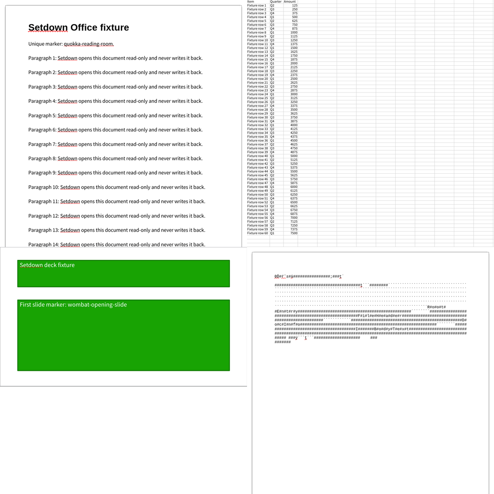
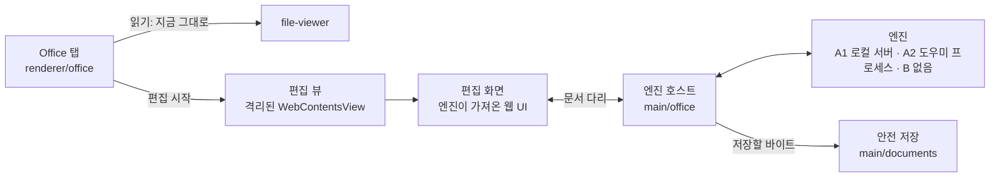
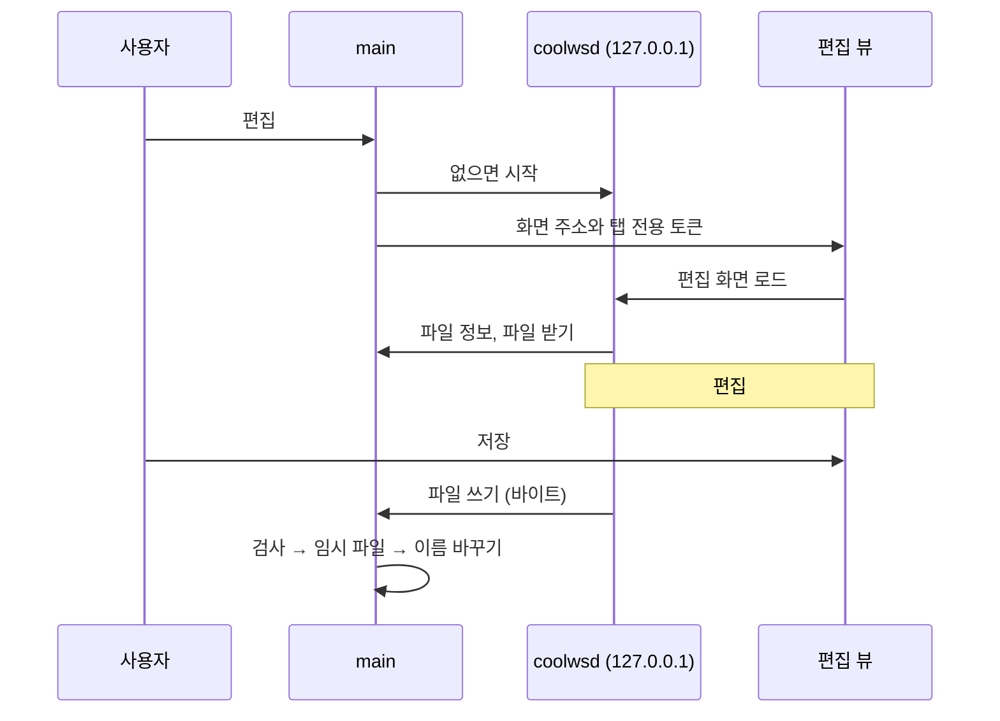

# Setdown에 LibreOffice 수준의 오피스 편집을 넣는 계획

작성일: 2026-11-21 · 계획 보고서 · 기준 `d45ceb2326f9cff12d9289757c8f65153c495971` · Electron 45.3.3 · 현재 뷰어 `@file-viewer/*` 3.3.3

소스와 공개 저장소를 읽고, 이 기기에서 작은 실험 하나를 돌려 쓴 계획이다. 제품 코드는 바꾸지 않았다. 표시는 세 가지다.

- **확인**: 2026-11-21에 원본에서 직접 본 것(저장소 파일, GitHub API 응답, 이 기기에서의 실행).
- **보도**: 기사나 공지로만 본 것. 원본 코드로 확인하지 않았다.
- **추정**, **제안**: 내 판단이다.

실험 코드와 결과는 [office-suite-research-2026-11-21/](office-suite-research-2026-11-21/)에 있다.

## 결론

**오피스 엔진은 만들지 않고 통째로 가져온다. "LibreOffice 수준"에 가장 정확히 맞는 재료는 LibreOffice 본체가 아니라 Collabora Office 모노레포다.**

1. LibreOffice 본체(`LibreOffice/core`)를 서브모듈로 넣어도 Electron 탭에 넣을 편집 화면은 생기지 않는다. 본체가 밖으로 내주는 것은 창 없는 엔진(LibreOfficeKit: 문서 열기, 화면 조각 그리기, 입력 전달, 저장)이다. 메뉴, 대화상자, 수식 입력줄 같은 화면은 본체의 데스크톱 툴킷에 묶여 있어 따로 떼어 올 수 없다.
2. 그 엔진 위에 웹 기술로 만든 완성된 편집 화면이 Collabora Online의 브라우저 클라이언트다. Collabora는 이것을 "웹뷰 + 같은 프로세스의 엔진"으로 묶은 데스크톱 앱을 Linux와 Windows에 내고 있고, 소스는 엔진까지 한 저장소에 있다(확인: 모노레포의 `engine/`, `browser/`, `qt/`, `windows/coda/`). Electron도 Chromium 웹뷰이므로 Setdown은 같은 구조의 셸을 하나 더 만드는 셈이다.
3. 라이선스는 MPL-2.0이라 GPL-3.0-only인 Setdown과 합칠 수 있다.

Setdown이 직접 만드는 것은 엔진이 아니라 **오피스 편집 탭**이다. 격리된 웹뷰 하나, 파일을 엔진에 건네고 저장된 바이트를 돌려받는 다리, 저장·닫기·복구 규칙이다. 이 부분은 어떤 엔진을 골라도 같다(5절).

| 단계 | 내용 | 끝나면 얻는 것 |
| --- | --- | --- |
| 0 | 실험 세 개, 같은 실제 문서 묶음으로 (4~6 작업일, 추정) | 엔진 확정, 또는 대안으로 전환 |
| 1 | 편집 탭 뼈대 + Linux 편집. 미리 빌드된 Collabora 서버를 로컬에서 띄운다. 컴파일 없음 | Linux에서 docx·xlsx·pptx 편집과 저장 |
| 2 | 런타임 내려받기, 고지, 보안, 복구 | Linux 출시 |
| 3 | Windows. WASM 엔진이 되면 그것으로, 아니면 네이티브 엔진 빌드 | Windows 편집 |
| 4 | 엔진이 있어서 싸진 것들: PDF 내보내기 교체, 새 문서, ODF | |

**가장 큰 위험은 Windows다.** Linux는 미리 빌드된 실행 파일이 있어 바로 시작할 수 있지만, Windows는 LibreOffice 엔진을 직접 빌드해야 할 수 있다(Visual Studio 2026, MSYS2, 수 시간). Windows와 Linux를 같은 시점에, 네이티브 빌드 없이 내야 한다면 1순위가 ONLYOFFICE 계열(7절)로 바뀐다. 이 판단은 14절의 첫 질문이다.

지금의 읽기 화면은 그대로 둔다. 탭을 열면 지금처럼 가벼운 뷰어로 읽고, 편집을 시작할 때만 엔진을 띄운다. HWP도 지금 뷰어가 계속 맡는다(확인: LibreOffice 26.8은 HWP 5 파일을 깨진 글자로 연다, 4절).

## 1. 지금 위치

| 항목 | 지금 | 근거 |
| --- | --- | --- |
| 읽기 | Word·Excel·PowerPoint·한글을 읽기 전용 탭으로 표시. flyfish-dev/file-viewer 3.3.3(Apache-2.0)을 형식군별로 지연 로드 | [office-runtime.ts](../apps/desktop/src/renderer/office/office-runtime.ts), [OfficeSurface.svelte](../apps/desktop/src/renderer/office/OfficeSurface.svelte) |
| PDF 저장 | 숨은 창에서 뷰어의 인쇄용 출력을 다시 만들어 `printToPDF`. 시트는 자체 레이아웃 | [office-pdf-exporter.ts](../apps/desktop/src/main/documents/office-pdf-exporter.ts), [spreadsheet-print.ts](../apps/desktop/src/renderer/office/spreadsheet-print.ts) |
| 파일 읽기 | 128 MiB 한도, 연 뒤 디스크 버전이 바뀌면 거부 | [office-file.ts](../apps/desktop/src/main/documents/office-file.ts) |
| 보장 사항 | 읽기 전용, 링크는 브라우저 탭으로, 문서는 신뢰하지 않음 | [reading-surfaces.md](../docs/contracts/reading-surfaces.md)의 Office 두 절 |
| 쓰기 | 없음 | |

편집은 두 번 넣었다가 뺐다.

| 시도 | 넣은 날 | 뺀 날 | 엔진 |
| --- | --- | --- | --- |
| HWP 편집 | 2026-10-17 (`91c486c`) | 2026-10-30 (`ddac00b`) | hop, rhwp |
| DOCX 편집 | 2026-11-15 (`3180285`) | 같은 날 (`4395050`) | eigenpal/docx-editor (`@docx-editor.dev/core` 2.37.0) |

뺀 이유는 커밋에 적혀 있지 않다. 이 계획에 쓸모 있는 것은 두 가지다.

- `3180285`에는 엔진과 무관한 Setdown 쪽 절반이 남아 있다. 편집 세션, 저장할 바이트가 읽을 수 있는 Word 패키지인지 보는 검사(`docx-save.ts`), 복구, 그리고 E2E 아홉 개다. 그 아홉 개(읽기에서 편집으로, 저장 후 다시 열기, 한글 조합 입력, 다른 이름으로 저장, 다른 곳에서 바뀐 파일을 덮어쓰지 않기, 링크, 프로세스가 죽은 뒤 복구, 이름만 `.docx`인 파일 거부)는 엔진을 바꿔도 그대로 요구사항이다.
- 두 번 다 한 형식짜리 JS 편집기였다. 이번 요청은 그 위의 수준이다.

## 2. "LibreOffice 수준"의 기준

계획을 검증할 수 있도록 기준을 적는다(제안).

- 문서·시트·슬라이드 세 종류를 모두 편집하고, 옛 바이너리 형식(doc, xls, ppt)도 연다.
- 기능의 폭: 스타일, 표, 머리글·바닥글, 각주, 목차, 변경 내용 추적, 메모 / 함수 수백 개, 피벗, 조건부 서식, 차트 / 슬라이드 마스터, 전환과 애니메이션, 발표 화면.
- 원래 형식으로 저장한 파일이 다른 프로그램에서 열리고, 손대지 않은 부분이 남아 있다.
- 한글 조합 입력, 시스템 글꼴, 인쇄와 PDF가 된다.

이 폭은 한 사람이 만들 수 있는 크기가 아니다. GitHub API가 알려 주는 저장소 크기로만 봐도 `LibreOffice/core`는 7.0 GB, `ONLYOFFICE/sdkjs`는 1.2 GB다(확인, 이력 포함 크기). 그래서 선택지는 "이미 이 수준인 엔진과 화면을 통째로 가져오는 방법"으로 좁혀진다.

## 3. 후보 비교

상태 열은 2026-11-21의 GitHub API 응답이다(확인).

| | 후보 | 라이선스 | 상태 | 편집 화면 | Windows + Linux | 판정 |
| --- | --- | --- | --- | --- | --- | --- |
| A | **Collabora Office 모노레포** (LibreOffice 엔진 + 웹 편집 화면 + 데스크톱 셸) | MPL-2.0 (일부 다른 오픈소스 라이선스, 브랜딩은 Apache-2.0) | 미러 2026-11-21 갱신. 데스크톱 앱은 2025-11 출시, 26.04 계열(보도) | 완성품 | Linux 셸 `qt/`, Windows 셸 `windows/coda/`를 upstream이 유지 | **1순위** |
| B | **ONLYOFFICE 계열** (`sdkjs` + `web-apps` + 변환기 `x2t`), 포크 Euro-Office | AGPL-3.0 + 추가 조건 | `sdkjs` 2026-10-15, Euro-Office 2026-11-21 갱신 | 완성품. docx·xlsx·pptx가 기본 형식 | 정적 파일이라 OS와 무관 | **차선.** Windows 동시 출시가 필수면 1순위 |
| C | LibreOffice를 WASM으로 (allotropia ZetaOffice/zetajs, Collabora `wasm/`) | MIT(zetajs), MPL-2.0 | zetajs 2026-04-01 갱신. CDN 바이너리는 LibreOffice 24.2 기반 브랜치. Collabora `wasm/README`는 "still a bit immature" | A와 같은 화면을 쓸 수 있음(추정) | OS와 무관 | **실험만.** A의 Windows 해법 후보 |
| D | LibreOfficeKit 직접 + 자체 화면 | MPL-2.0 | 이 기기에서 동작(4절). 같은 길을 간 Macro의 Electron 포크는 2024-09 이후 보관 | 전부 직접 만들어야 함 | 엔진을 OS별로 준비 | **편집용으로는 탈락.** 변환과 PDF에는 유용 |
| E | TypeScript 편집기 (Univer, eigenpal docx-editor, SuperDoc, IronCalc) | Apache-2.0 ~ AGPL-3.0 | Univer 31,002★, 그러나 xlsx·docx·pptx 가져오기와 내보내기는 Pro/서버 기능(보도, 공식 문서 검색 결과) | 형식별로 일부 | 무관 | **탈락.** 기준 미달이거나 한 형식뿐 |
| F | TDF LibreOffice Online | MPL-2.0 | 2026-02 재개, 배포 준비 안 됨(보도). GitHub 미러 기본 브랜치의 최신 커밋은 2020-09-30 | 옛 화면 | | **지금은 탈락** |
| G | 설치된 LibreOffice로 넘기기 | | | LibreOffice 자체 창 | 설치돼 있으면 | **항상 남겨 둘 탈출구** |

### A를 1순위로 두는 이유

- 요청이 "LibreOffice 수준"이고, A만 문자 그대로 그 엔진이다. 문서 형식의 폭(OOXML, ODF, 옛 바이너리, RTF)도 가장 넓다.
- Setdown에 필요한 모양(Chromium 웹뷰 안의 편집 화면 + 로컬 엔진)을 upstream이 두 OS에서 직접 유지한다. 흉내 낼 원본이 있다.
- MPL-2.0은 GPL과 합칠 수 있고, 브랜딩 자산이 분리돼 있다.
- Linux에서는 미리 빌드된 서버 실행 파일이 있어 컴파일 없이 실험과 첫 출시를 할 수 있다.

### B가 이기는 조건

- Windows와 Linux를 같은 시점에 내야 한다. B는 JS와 WASM뿐이라 한 벌로 두 OS에서 돈다.
- 네이티브 빌드 설비(수 시간짜리 빌드, 수십 GB)를 유지하고 싶지 않다.
- 문서 해석을 Chromium 샌드박스 안에 두고 싶다(8절).
- AGPL과 그 추가 조건, 그리고 2026년의 포크 분쟁(7절)을 받아들일 수 있다.

### D를 편집용에서 빼는 이유

엔진은 이 기기에서 잘 돈다(4절). 하지만 타일 위에 메뉴, 대화상자, 선택 핸들, 셀 편집, 수식 입력줄, 슬라이드 패널, 조합 입력, 클립보드를 전부 직접 얹어야 한다. 그것이 곧 Collabora Online의 브라우저 클라이언트가 하는 일이다. 같은 길을 간 Macro는 Electron 자체를 포크했고(`macro-inc/electron-libreoffice`), 그 저장소는 2024-09-11 이후 보관 상태다(확인).

## 4. 이 기기에서 확인한 것

Fedora 45에 설치된 LibreOffice 26.8.2.2(`/usr/lib64/libreoffice`, 469 MB)를 LibreOfficeKit으로 직접 불러 보았다. 90줄짜리 C 프로그램([lok_smoke.c](office-suite-research-2026-11-21/lok_smoke.c))이고, 창을 만들지 않도록 `DISPLAY`와 `WAYLAND_DISPLAY`를 지우고, 메모리 상한 1.5 GiB, 별도 프로필로 실행했다. 헤더는 설치본과 같은 태그(`libreoffice-26.8.2.2`)에서 받았다.

엔진 초기화는 148~178 ms, 초기화 직후 상주 메모리는 141 MiB였다. 문서별 결과는 다음과 같다([원문](office-suite-research-2026-11-21/lok-run-1.log)).

| 파일 | 열기 | 1024×1024 조각 그리기 | 같은 계열 형식으로 저장 | PDF 저장 | 상주 메모리 |
| --- | --- | --- | --- | --- | --- |
| report.docx | 1,278 ms (그 실행의 첫 Writer 문서) | 31 ms | docx 8 ms | 14 ms | 291 MiB |
| budget.xlsx | 59 ms | 7 ms | xlsx 11 ms | 31 ms | 324 MiB |
| deck.pptx | 53 ms | 13 ms | pptx 17 ms | 9 ms | 293 MiB |
| report.doc | 32 ms | 11 ms | docx 4 ms | 12 ms | 300 MiB |
| budget.xls | 30 ms | 6 ms | xlsx 10 ms | 13 ms | 352 MiB |
| deck.ppt | 17 ms | 7 ms | pptx 14 ms | 11 ms | 303 MiB |
| table.hwp | 56 ms | 35 ms | 실패 | 내용이 깨진 PDF | 315 MiB |

알게 된 것:

1. **엔진은 창 없이 돌고 빠르다.** 첫 Writer 문서만 1.3초가 걸리고(모듈을 처음 읽는 비용으로 보인다, 추정), 그 뒤는 수십 ms다.
2. **HWP는 못 연다.** `table.hwp`를 77쪽짜리 깨진 글자로 열었다(그림 오른쪽 아래). HWP는 지금 뷰어에 남긴다.
3. **종료할 때 죽는다.** `destroy()` 뒤 프로세스 종료 처리 중에 SIGSEGV가 났다(스택은 `LOKClipboard`). 엔진을 Setdown의 주 프로세스에 직접 올리면 안 되고, 별도 프로세스에서 돌리다 `_exit`로 끝내야 한다.
4. 조각에 맞춤법 밑줄이 그려진다. 읽기용으로 쓸 때는 꺼야 한다.

한계: 입력은 저장소의 작은 테스트 픽스처(6 KB~464 KB)다. 실제 문서의 수치는 0단계에서 잰다. 그리고 이 실험은 엔진만 본 것이다. 편집 화면은 여기 없다.

## 5. 구조: 오피스 편집 탭

엔진과 무관하게 Setdown이 만들 부분이다. A, B, C 어느 쪽이든 "웹으로 된 편집 화면을 격리된 뷰에 띄우고, 파일을 주고받는다"는 모양이 같다.

### 5.1 원칙 (제안)

1. **읽기가 먼저, 편집은 요청할 때.** 탭을 열면 지금의 뷰어다. 주소 줄의 "편집" 또는 본문 더블클릭으로 엔진을 띄운다. 엔진이 없거나 실패하면 읽기 화면에 그대로 남는다. 앱 시작과 Markdown 미리보기 경로에는 아무것도 더하지 않는다.
2. **편집 화면은 격리한다.** 별도 `WebContentsView`, 별도 세션, 샌드박스, 앱 셸의 다리 없음. 브라우저 탭이나 PDF 내보내기용 숨은 창과 같은 방식이다. 이 세션의 네트워크는 엔진의 로컬 주소만 허용한다.
3. **편집 중인 내용의 주인은 엔진이다.** Setdown은 사본을 갖지 않는다. "수정됨"은 엔진이 알려 주는 신호를 쓰고, 저장은 "바이트를 달라"는 요청이다. 지금의 `DocumentContentOwner`(직렬화할 수 있는 내용의 포트)와 종류가 다르므로 섞지 않는다.
4. **엔진은 원본 파일에 직접 쓰지 않는다.** 5.2절.
5. **엔진 프로세스는 필요할 때만 산다.** 첫 편집 때 시작하고, 마지막 편집 탭이 닫힌 뒤 일정 시간이 지나면 끝낸다. 죽으면 탭에 알리고 복구본을 보여 준다.
6. **Esc는 엔진에 준다.** 오피스 편집 화면에서 Esc는 선택 해제나 대화상자 닫기에 쓰인다. 읽기로 돌아가는 것은 버튼과 단축키로 한다.

### 5.2 안전 저장

엔진이 무엇이든 지킨다.

- 엔진이 준 바이트는 main이 받아서, 열 수 있는 패키지인지 검사한 뒤, 임시 파일에 쓰고 이름을 바꾼다. 검사는 `3180285`의 `docx-save.ts`를 되살리고 xlsx·pptx로 넓힌다.
- 파일의 디스크 버전이 연 때와 다르면 덮어쓰지 않고 묻는다.
- 편집 세션의 첫 저장 전에 원본을 한 번 복구 폴더에 보관한다.
- 옛 형식(doc, xls, ppt)은 제자리 저장을 하지 않는다. "다른 이름으로 저장"으로 새 형식 파일을 만든다.
- 매크로 문서(docm, xlsm, pptm)는 엔진이 매크로를 보존하는지 확인하기 전까지 읽기 전용이다. 매크로는 실행하지 않는다.

### 5.3 탭 기능과의 대응

| Setdown 기능 | 편집 화면에서 |
| --- | --- |
| 탭 확대·축소 | 엔진의 문서 배율로 전달. 화면 크롬은 확대하지 않는다 |
| 테마 | 밝게·어둡게만 맞춘다 |
| 찾기(Ctrl+F) | 엔진의 찾기를 연다 |
| 링크 | 지금처럼 Setdown 브라우저 탭으로 |
| 읽던 위치 | 읽기와 편집을 오갈 때 쪽·시트를 넘긴다 |
| 탭 떼어내기 | 뷰를 다른 창에 다시 붙인다([기존 방식](2026_09_12_15_51_tab_detach_webcontents_reparenting_architecture.md)) |
| 세션 복원 | 편집 중이던 탭은 읽기로 복원하고 복구본이 있으면 알린다 |
| PDF 저장 | 엔진이 떠 있으면 엔진으로, 아니면 지금 방식 |

### 5.4 코드 위치 (제안)

[코드 구조 문서](../docs/architecture/overview.md)의 계층을 따른다. 엔진 고유의 코드는 한 폴더에만 둔다. 세 번째로 빼게 되더라도 그 폴더와 런타임만 지우면 되게 한다.

| 경로 (`apps/desktop/src` 기준) | 책임 |
| --- | --- |
| `core/document/` | 어떤 확장자가 편집 가능한지, 제자리 저장이 되는지 |
| `protocol/office-edit.ts` | 셸과 main 사이의 메시지 |
| `main/office/engine-host.ts` | 엔진 프로세스의 시작, 재사용, 유휴 종료, 죽음 처리 |
| `main/office/edit-view.ts` | 편집 뷰 생성과 해제, 세션 격리, 네트워크 규칙 |
| `main/office/engines/<엔진>.ts` | 엔진 고유의 문서 다리. 이 폴더만 엔진을 안다 |
| `main/office/runtime-store.ts` | 런타임 내려받기, 해시 검증, 제거 |
| `main/documents/office-save.ts` | 5.2절의 저장 |
| `renderer/office/` | 읽기와 편집 전환, 수정됨 표시, 닫기 확인 |
| `office-edit-runtime/` | 편집 뷰의 preload |

## 6. A 경로: Collabora Office

### 6.1 저장소 (확인)

GitHub의 `CollaboraOnline/online`은 이제 이슈 전용이다. 소스는 Gerrit(`https://gerrit.collaboraoffice.com/online`)에 있고, GitHub에는 읽기 전용 미러 `CollaboraOnline/online.mirror`(4.8 GB)가 있다. 엔진이 같은 저장소에 들어온 모노레포다.

| 경로 | 내용 |
| --- | --- |
| `engine/` | 문서 엔진(옛 Collabora Office core, LibreOffice 계열) |
| `browser/` | 편집 화면(JS) |
| `wsd/`, `kit/`, `common/`, `net/` | 서버와 문서 프로세스. `net/FakeSocket.hpp`가 같은 프로세스 안의 연결을 맡는다 |
| `qt/` | Linux 데스크톱 셸 (Qt6 WebEngine) |
| `windows/coda/` | Windows 데스크톱 셸 |
| `macos/`, `ios/`, `android/` | 다른 셸 |
| `wasm/` | 엔진을 WASM으로 빌드 |

서브모듈은 `vendor/collabora-office`로 미러를 얕게(`shallow = true`) 가져온다. 1단계에서는 읽는 용도이고, 3단계에서 A2로 가면 빌드 입력이 된다. [외부 코드 지도](../docs/architecture/external-code.md)에 사용 기능, 고정 커밋, 라이선스 위치, 패치, 실행 환경과 생성·해제 주체를 적는다.

### 6.2 A1: 로컬 서버 방식 (Linux, 컴파일 없음)

Collabora 서버(`coolwsd`)를 자식 프로세스로 127.0.0.1에 띄우고, 편집 뷰가 그 서버의 편집 화면을 연다. 서버는 문서를 파일 경로로 읽지 않고 "문서 저장소"에 HTTP로 요청한다(WOPI라는 규약: 파일 정보, 파일 받기, 파일 쓰기 세 요청). Setdown의 main이 그 저장소 역할을 한다.

- 런타임: `CollaboraOnline/richdocumentscode`(Nextcloud의 "내장 CODE 서버")의 릴리스. 확인: 26.4.602(2026-11-20), x86_64 묶음 271 MiB, arm64 248 MiB. 일반 사용자 권한으로 돌도록 만든 배포물이다.
- 장점: 오늘 실험할 수 있다. 서버 방식은 upstream이 가장 많이 쓰는 경로다. 문서 프로세스를 가두는 기능(jail)을 쓸 수 있으면 보안에 유리하다.
- 단점: Linux 전용이다. 로컬 포트를 연다(탭 전용 토큰과 요청 검사가 필요). 내려받기가 크다.
- 0단계에서 확인할 것(지금은 추정): 묶음 안 실행 파일의 형태와 실행 옵션, 사용자 네임스페이스가 막힌 배포판에서의 동작, 화면 줄이기(SDK의 PostMessage API와 `ui_defaults`), 어두운 테마, 한국어 화면, 한글 조합 입력.

### 6.3 A2: 도우미 프로세스 방식 (Windows와 Linux 공통)

upstream 데스크톱 앱의 구조를 그대로 따른다. `qt/`에서 확인한 구조는 이렇다.

- 편집 화면 파일을 사용자 정의 주소 체계(`cool:`, `coollocal:`)로 웹뷰에 준다([`coda-qt.cpp`](https://github.com/CollaboraOnline/online.mirror/blob/main/qt/coda-qt.cpp), `CoolLocalSchemeHandler.cpp`).
- 서버 코드(`COOLWSD`)를 같은 프로세스의 백그라운드 스레드로 돌린다.
- 페이지는 `window.postMobileMessage`로 네이티브 `Bridge`에 말하고, 네이티브는 페이지에서 JS를 실행해 답한다. 연결은 `fakeSocket*` 함수들이다([`bridge.hpp`](https://github.com/CollaboraOnline/online.mirror/blob/main/qt/bridge.hpp), `net/FakeSocket.hpp`).

Setdown에서는(제안):

- 엔진을 Node 애드온으로 올리지 않고 **도우미 실행 파일** `setdown-office-host`로 만든다. 4절의 종료 크래시 때문에 별도 프로세스가 필요하고, 지금의 `setdown-language-host`(`tooling/language-host`)와 같은 형태라 빌드와 배포 방식을 그대로 쓸 수 있다. Electron의 ABI에도 묶이지 않는다.
- 편집 뷰는 `protocol.handle`로 등록한 전용 주소 체계에서 `browser/` 번들을 읽는다. preload가 `postMobileMessage`를 IPC로 잇고, main이 도우미와 파이프로 주고받는다.
- `qt/Bridge.cpp`(70 KB)를 사양으로 읽고, 메시지마다 "upstream의 어디에서 왔는지"를 적은 대응표를 둔다. 서브모듈을 올릴 때 그 파일의 차이를 보면 된다.

빌드(확인, 각 README):

- Linux: `engine/`에서 `./autogen.sh --with-distro=CPLinux-LOKit --without-package-format --with-system-nss && make`, 그 뒤 최상위에서 configure와 make. C++20(GCC 13+ 또는 Clang 17+).
- Windows: Visual Studio 2026, Git Bash, MSYS2. 엔진은 `--with-distro=CODAWindows`. `windows/coda/build/`에 엔진과 앱을 한 번에 빌드하는 진입점이 있다.

비용(추정): 엔진 전체 빌드는 16코어에서 1~2시간, 빌드 폴더는 수십 GB다. 이 기기(13 GiB)에서는 병렬 수를 줄이고 메모리 상한을 걸어야 한다. 지금의 릴리스 워크플로(확인: `windows-2022`와 `ubuntu-22.04`, 제한 90분)로는 못 한다. 그래서 런타임은 Setdown 릴리스와 따로, upstream을 올릴 때만 빌드해서 고정 해시로 배포한다(6.5절).

### 6.4 A3: WASM 엔진 (실험)

모노레포에 `wasm/`이 있고 configure에 `--enable-wasm-fallback`이 있다(확인). README 원문은 "still a bit immature"이고, 링크에 `-O2`로 약 12 GiB, `-O1`로 약 1.6 GiB가 든다고 적혀 있다(확인).

- 되면 얻는 것: 두 OS에서 도는 한 벌, Chromium 샌드박스 안의 문서 해석, Windows 네이티브 빌드가 필요 없음.
- 모르는 것: 완성도, 시작 시간, 큰 문서(wasm32의 4 GB 한도), 글꼴(가상 파일 시스템에 넣어야 한다), 이 기기에서의 빌드 가능 여부.

0단계에서 결론만 얻는다.

### 6.5 배포: 처음 편집할 때 내려받는다 (제안)

- 런타임은 설치 파일에 넣지 않는다. 크고(271 MiB), 갱신 주기가 Setdown과 다르고, 쓰지 않는 사람이 많을 것이다. 언어 도구 내려받기와 같은 흐름으로 한다([language-package-store.ts](../apps/desktop/src/main/language/language-package-store.ts)).
- 주소, 버전, SHA-256을 저장소의 recipe 파일에 고정한다(uBlock 빌드의 pin 방식).
- 설치된 LibreOffice는 A의 편집 화면에 쓸 수 없다. 그 화면은 Collabora 엔진에 맞춰 개발된다(추정). 변환과 PDF에는 쓸 수 있다(4절).

### 6.6 크기와 메모리

| 항목 | 값 | 구분 |
| --- | --- | --- |
| 지금 Linux 설치본(`linux-unpacked`) | 1.7 GB | 확인 |
| A1 런타임 내려받기 | 271 MiB | 확인 |
| 엔진 상주 메모리, 문서 하나 | 290~350 MiB (설치된 LibreOffice 기준) | 확인(4절) |
| 편집 화면 렌더러 | 150~300 MiB | 추정 |
| 첫 편집까지의 시간 | 서버 시작 포함 수 초 | 추정. 0단계에서 잰다 |

## 7. B 경로: ONLYOFFICE 계열 (차선)

- **구성.** `sdkjs`가 편집 엔진(JS, 캔버스에 직접 그림), `web-apps`가 화면, `core`의 `x2t`가 형식 변환기(docx ↔ 내부 바이너리)다. 공식 데스크톱 앱도 Chromium 위에서 같은 JS를 돌리는 구조로 알려져 있다(오늘 원본을 열어 확인하지는 않았다).
- **서버 없이 돌리기.** 공식으로 지원하는 방식은 아니다. 공개 사례는 있다: CryptPad(`x2t`를 WASM으로 다시 빌드, 보도), `ranuts/document`(AGPL-3.0, 2,030★, 2026-11-06 갱신), `electroluxcode/onlyoffice-web-comp`(v9, 541★). `x2t` WASM으로 파일을 내부 바이너리로 바꾸고, 서버 연결을 JS로 대신한다.
- **장점.** 네이티브 빌드가 없다. 두 OS에 한 벌이다. 문서 해석이 JS와 WASM이라 샌드박스 안이다. docx·xlsx·pptx가 기본 형식이라 왕복 손실이 구조적으로 적을 것이다(추정, 0단계에서 잰다). 8.3부터 HWP·HWPX를 연다(보도). HWP를 docx로 바꿔 편집하는 길이 생긴다.
- **위험.**
  - 라이선스. `sdkjs` 소스 헤더(확인, 2026): AGPL-3.0과 `LICENSE` 파일의 추가 조건, 수정본의 화면에 법적 고지 표시, 상표권 없음, 코드가 아닌 요소는 CC BY-SA 4.0. `LICENSE` 파일의 추가 조건 원문은 읽지 못했다.
  - 2026-03에 Nextcloud와 IONOS 등이 포크 Euro-Office를 냈고, ONLYOFFICE는 라이선스 위반을 주장했다(보도). 어느 쪽을 가져올지 정해야 한다. Euro-Office 조직의 저장소들은 2026-11에도 갱신되고 있다(확인).
  - 서버를 대신하는 코드가 upstream 릴리스마다 깨질 수 있다.
  - 시스템 글꼴 색인을 직접 만들어야 한다. 한글 글꼴이 없으면 쪽 나눔이 달라진다.
  - ODF와 옛 형식은 변환을 거친다.
- **합치기.** GPL-3.0-only와 AGPL-3.0의 결합은 GPLv3 13조가 허용한다. 각 부분은 자기 라이선스를 유지한다.
- **서브모듈.** `sdkjs`, `web-apps`, `core`(ONLYOFFICE 또는 Euro-Office), 참고용으로 `ranuts/document`.

## 8. 보안

문서는 신뢰할 수 없는 입력이다. 내장 브라우저로 내려받은 파일도 그대로 열린다.

| 조치 | A | B |
| --- | --- | --- |
| 문서 해석 위치 | 네이티브 C++ 프로세스. 별도 프로세스에 두고, A1에서는 jail을 쓸 수 있는지 확인(configure에 `seccomp`, `landlock` 옵션이 있다, 확인) | 렌더러 샌드박스 안 |
| 편집은 사용자가 누를 때만 | 예 | 예 |
| 편집 뷰 세션 | 격리, 엔진의 로컬 주소만 허용 | 격리, 네트워크 차단 |
| 매크로, 원격 리소스, 플러그인 | 끈다 | 끈다 |
| 로컬 포트(A1) | 127.0.0.1만, 탭마다 무작위 토큰, Host와 Origin 검사 | 해당 없음 |
| 엔진 프로필 | Setdown 전용 폴더. 사용자의 LibreOffice 프로필은 건드리지 않는다 | 해당 없음 |
| 런타임 | 고정 해시 검증 | 고정 해시 검증 |

[보안 점검 보고서](security-audit-2026-11-01.md)에 이 표면을 추가한다.

## 9. 라이선스와 고지

| 대상 | 라이선스 | Setdown(GPL-3.0-only)과 | 할 일 |
| --- | --- | --- | --- |
| Collabora 모노레포 | MPL-2.0. 내부 제3자 구성요소는 `THIRDPARTYLICENSES`, `CODA-THIRDPARTYLICENSES.html`(확인: 파일 존재) | 합칠 수 있음 | 런타임의 고지 파일을 앱 고지에 연결. 배포한 바이너리의 소스 위치(서브모듈 커밋과 패치)를 릴리스에 적는다 |
| Collabora 브랜딩 | 자산은 Apache-2.0(확인). 상표는 별개 | | 중립 브랜딩으로 바꾼다. 상표 정책은 확인 필요 |
| ONLYOFFICE 계열 | AGPL-3.0 + 추가 조건 | 합칠 수 있음(GPLv3 13조) | 화면의 법적 고지를 유지. 추가 조건 원문 확인 |
| file-viewer (지금) | Apache-2.0 | 변화 없음 | |

고지 생성은 지금의 [office-viewer-notices.mjs](../apps/desktop/scripts/office-viewer-notices.mjs) 방식을 넓힌다.

## 10. 단계

기간은 전부 추정이다.

### 0단계: 실험 (4~6 작업일)

제품 코드에는 넣지 않는다. 결과는 `reports/`에 남긴다.

| 실험 | 내용 | 기간 |
| --- | --- | --- |
| E1 (A1) | 격리 디스플레이의 Electron `WebContentsView`에 Collabora 서버의 편집 화면을 띄운다. docx·xlsx·pptx를 열고, 고치고, 저장하고, 다시 연다 | 2일 |
| E2 (B) | `ranuts/document` 방식으로 같은 시나리오 | 2일 |
| E3 (A3) | 미리 빌드된 WASM 산출물이 있으면 그것으로, 없으면 README의 컨테이너 빌드를 `-O1`과 메모리 상한으로 시도한다. 안 되면 "빌드 불가"로 적고 끝낸다 | 1~2일 |

통과 기준(제안):

- 세 형식 모두 열기, 수정, 저장, 다시 열기에 성공한다.
- 저장본이 다른 엔진(설치된 LibreOffice의 LibreOfficeKit)에서 열리고 수정 내용이 보인다.
- 한글 조합 입력에서 글자가 빠지거나 겹치지 않는다. 조합 중 Enter와 Esc를 포함한다.
- 런타임이 설치된 뒤 첫 편집까지 5초 이내, 두 번째부터 2초 이내.
- 문서 하나를 편집할 때 늘어나는 메모리가 700 MiB 이내.

결정:

- E1 통과 → A로 1단계. E3 결과에 따라 3단계의 Windows 방식을 정한다.
- E1 실패, E2 통과 → B로 1단계.
- 둘 다 실패 → 편집은 넣지 않는다. G("LibreOffice에서 열기"와 파일이 바뀌면 다시 읽기)만 다듬는다.

### 1단계: 편집 탭 뼈대와 Linux 편집 (2~3주)

- 5절의 구조를 만든다. 엔진 호스트, 편집 뷰, 문서 다리, 안전 저장, 수정됨 표시, 닫기 확인, 읽기와 편집 전환.
- `3180285`의 E2E 아홉 개를 새 엔진에 맞춰 되살리고 xlsx와 pptx로 넓힌다.
- [reading-surfaces.md](../docs/contracts/reading-surfaces.md)의 Office 절을 "읽기 전용"에서 "읽기와 편집"으로 고치고 테스트와 함께 바꾼다.
- 끝나는 조건: 개발 빌드에서 세 형식의 편집과 저장, E2E 통과, `npm run test:preview-contract` 통과. 새 네이티브 뷰가 미리보기의 뷰 배치와 확대 경로를 건드리면 [성능 계약](../docs/preview-performance-contract.md)에 따라 `npm run bench:preview`로 기준선과 비교한다.

### 2단계: 배포 마감 (1~2주)

- 런타임 내려받기(고정 해시, 진행 표시, 제거), 고지, 8절의 보안 조치, 죽음 뒤 복구, 탭 떼어내기, 세션 복원.
- 끝나는 조건: `npm run install:linux`로 설치한 앱을 테스트 드라이버 없이 실행해 편집과 저장을 확인한다.

### 3단계: Windows (범위는 E3이 정한다)

- E3 통과: WASM 엔진으로 두 OS를 한 벌로 맞춘다.
- E3 실패: A2. `tooling/office-host`와 Windows 엔진 빌드. 그 뒤 Linux도 A2로 옮길지 정한다.
- 끝나는 조건: Windows 설치본에서 같은 E2E.

### 4단계: 엔진이 있어서 싸진 것들

- Office → PDF를 엔진의 PDF 내보내기로 바꾼다(엔진이 설치된 경우). 지금의 인쇄용 출력과 [spreadsheet-print.ts](../apps/desktop/src/renderer/office/spreadsheet-print.ts)의 자체 레이아웃은 엔진이 없을 때의 경로로 남긴다.
- 탐색기에서 새 문서 만들기.
- ODF(odt, ods, odp) 열기.

## 11. 검증

- **실제 문서로 잰다.** 공개 저장소에서 고정 커밋으로 받는다. 후보: LibreOffice의 테스트 문서(`sw/qa`, `sc/qa`, `sd/qa`), Collabora `mso-test`가 쓰는 묶음, 한국어 공공 문서. 목록과 해시는 한 파일에 둔다([notebook-benchmark의 corpus.json](../apps/notebook-benchmark/corpus.json) 방식). 0단계에서는 스크립트 하나로 시작하고, 계속 쓸 가치가 보이면 `apps/office-benchmark`로 만든다.
- **왕복 검사.** 열기 → 한 군데 수정 → 저장 → (1) 패키지 구조 검사, (2) 다른 엔진으로 열어 PDF로 만들고 쪽 수와 본문을 비교, (3) 수정 전후의 차이가 수정한 자리에만 있는지 확인.
- **MS Office로 여는 확인은 자동화할 수 없다.** 이 기기에 없다. 표본을 사람이 열어 봐야 한다(14절).
- GUI 테스트는 전부 `scripts/with-isolated-display.sh`로 돌린다. 숨겨 돌려도 한글 입력 검사는 빼지 않는다.
- 엔진 빌드, 컨테이너 빌드, E2E는 한 번에 하나만, `systemd-run --user --scope -p MemoryMax=…`로 상한을 걸고 돌린다.

## 12. 위험

| 위험 | 가능성 | 영향 | 대응 |
| --- | --- | --- | --- |
| Windows 네이티브 빌드가 감당하기 어렵다 | 높음 | Windows가 늦어진다 | E3(WASM), 드물게 빌드해 고정 배포, 또는 B로 전환 |
| 한글 조합 입력이 편집 화면에서 깨진다 | 중간 | 쓸 수 없다 | 0단계의 통과 기준 |
| 저장으로 문서가 상하거나 기능이 사라진다 | 중간 | 신뢰를 잃는다 | 5.2절, 왕복 검사, 옛 형식 제자리 저장 금지 |
| 런타임이 크고 메모리를 많이 쓴다 | 높음 | 13 GiB 기기에서 다른 작업과 충돌 | 선택 내려받기, 유휴 종료 |
| upstream 변경으로 연결이 깨진다 | 중간 | 올릴 때마다 손질 | 버전 고정, 올릴 때 E2E, 대응표 |
| 네이티브 파서의 취약점 | 중간 | 높음 | 8절 |
| 화면이 Setdown답지 않다 | 확실 | 낮음~중간 | 크기와 색만 맞춘다. 다시 디자인하지 않는다 |
| 세 번째로 넣었다 빼게 된다 | 모름 | 낭비 | 0단계에서 먼저 거른다. 엔진 고유 코드는 한 폴더, 런타임은 선택 설치 |

## 13. 하지 않는 것

- 자체 오피스 엔진, 레이아웃, 수식 계산기.
- LibreOfficeKit 조각 위의 자체 편집 화면.
- Electron 포크.
- 실시간 공동 편집과 클라우드 저장소 연동.
- HWP 편집.
- 매크로 실행.
- 편집 화면의 재디자인.

## 14. 정해 주셔야 할 것

1. **Windows와 Linux를 같은 시점에 내야 합니까?** Linux가 먼저여도 되면 A, 동시여야 하면 B가 1순위입니다.
2. **AGPL 구성요소(ONLYOFFICE 계열)를 받아들일 수 있습니까?** 안 된다면 B는 대안에서 빠지고, A가 막혔을 때 남는 것은 G뿐입니다.
3. 런타임을 처음 편집할 때 내려받는 방식(약 270 MiB)이 괜찮습니까, 설치 파일에 넣어야 합니까?
4. 편집 화면이 Collabora(또는 ONLYOFFICE)의 화면 그대로이고 크기와 색만 맞추는 것으로 충분합니까?
5. 저장본을 MS Office로 열어 보는 확인을 해 주실 수 있습니까?
6. [언어 지원 작업 목록](vscode-extensions-direct-2026-11-19/report.md)과의 순서입니다. 제안은 0단계만 먼저 끼워 넣고, 1단계는 그 결과를 보고 정하는 것입니다.

## 15. 아직 확인하지 않은 것

- Collabora 서버 묶음을 일반 사용자 권한으로, jail 없이 또는 사용자 네임스페이스로 띄우는 실제 옵션과 동작.
- 편집 화면을 `WebContentsView` 안에서 띄웠을 때의 한글 조합 입력, 어두운 테마, 화면 줄이기.
- Collabora 편집 화면이 설치된 LibreOffice 엔진으로는 돌지 않는다는 추정.
- Collabora 데스크톱 앱의 Windows 판이 WebView2라는 것(보도). `windows/coda/`의 README와 솔루션 파일이 있는 것만 확인했다.
- WASM 빌드의 완성도와 이 기기에서의 빌드 가능 여부.
- Windows에서 엔진을 빌드하는 데 드는 실제 시간과 디스크.
- ONLYOFFICE `LICENSE` 파일의 추가 조건 원문, Euro-Office 분쟁의 현재 상태.
- 서버 없는 ONLYOFFICE에서 시스템 글꼴을 쓰는 방법.
- 실제 문서에서의 시간과 메모리. 4절의 수치는 작은 픽스처의 것이다.
- 매크로 문서를 저장할 때 각 엔진이 매크로를 보존하는지.
- 이전 두 번의 편집 기능을 뺀 이유.

## 출처

저장소(2026-11-21, GitHub API와 파일 원문):

- [CollaboraOnline/online.mirror](https://github.com/CollaboraOnline/online.mirror): `README.md`, `qt/README.md`, `qt/bridge.hpp`, `qt/coda-qt.cpp`, `qt/CoolLocalSchemeHandler.cpp`, `windows/coda/README.md`, `wasm/README`, `README-gbuild.md`, `configure.ac`, `net/FakeSocket.hpp`
- [CollaboraOnline/online](https://github.com/CollaboraOnline/online) (이슈 전용 안내), [CollaboraOnline/richdocumentscode](https://github.com/CollaboraOnline/richdocumentscode) 릴리스 26.4.602
- [LibreOffice/core](https://github.com/LibreOffice/core) `include/LibreOfficeKit/` (태그 `libreoffice-26.8.2.2`), [LibreOffice/online](https://github.com/LibreOffice/online)
- [macro-inc/electron-libreoffice](https://github.com/macro-inc/electron-libreoffice), [allotropia/zetajs](https://github.com/allotropia/zetajs)
- [ONLYOFFICE/sdkjs](https://github.com/ONLYOFFICE/sdkjs), [Euro-Office](https://github.com/Euro-Office), [ranuts/document](https://github.com/ranuts/document), [electroluxcode/onlyoffice-web-comp](https://github.com/electroluxcode/onlyoffice-web-comp), [cryptpad/onlyoffice-x2t-wasm](https://github.com/cryptpad/onlyoffice-x2t-wasm)
- [dream-num/univer](https://github.com/dream-num/univer), [ironcalc/IronCalc](https://github.com/ironcalc/IronCalc), [eigenpal/docx-editor](https://github.com/eigenpal/docx-editor), [superdoc/docx-editor](https://github.com/superdoc/docx-editor), [flyfish-dev/file-viewer](https://github.com/flyfish-dev/file-viewer)

보도와 공지(검색 결과로 읽음):

- [Collabora Office 26.04](https://www.collaboraonline.com/blog/collabora-office-26-04-release/), [Collabora Online now available on Desktop](https://www.collaboraonline.com/blog/collabora-online-now-available-on-desktop/), [betanews 2025-11-26](https://betanews.com/2025/11/26/collabora-office-is-an-open-source-desktop-suite-for-windows-macos-and-linux)
- [The Register: LibreOffice Online 재개](https://www.theregister.com/2026/03/02/libreoffice_online_deatticized/), [LWN](https://lwn.net/Articles/1060087/)
- [ONLYOFFICE의 Euro-Office 관련 공지](https://onlyoffice.com/blog/2026/03/onlyoffice-flags-license-violations-in-euro-office-project-by-nextcloud-and-ionos), [It's FOSS](https://itsfoss.com/news/onlyoffice-forked/), [LWN](https://lwn.net/Articles/1067771/)
- [ONLYOFFICE Docs 8.3: HWP·HWPX 지원](https://www.onlyoffice.com/blog/2025/02/onlyoffice-docs-8-3-released)
- [ZetaOffice 발표](https://blog.allotropia.de/2024/11/08/launching-zetaoffice/), [Univer 가져오기·내보내기 문서](https://docs.univer.ai/guides/sheets/features/import-export)
- [CryptPad의 새 앱 공지](https://blog.cryptpad.org/2021/10/21/Announcing-new-apps/)
