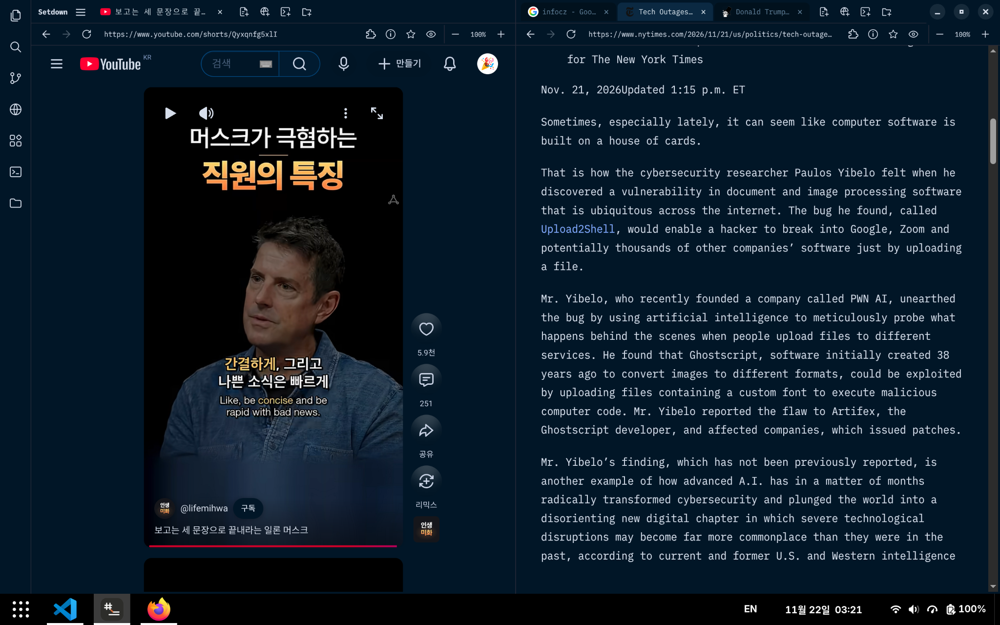
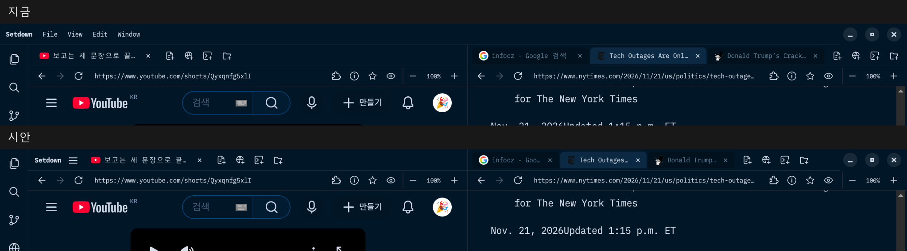

# 맨 위 가로 바를 없애고 버튼을 옮기는 방법

작성일: 2026-11-22 · 설계 보고서 · 기준 `9dd567d` · 코드는 고치지 않았다.

버튼 자리는 같은 날 사용자가 정했다. `Setdown`은 로고로 바꾸지 않고 지금의 글자 버튼으로 두며, 자리는 맨 왼쪽 위 탭 줄이다.

## 결론

**바를 없애고, 탭 줄을 창의 맨 윗줄로 쓴다.** 바에 있는 것은 세 가지뿐이고, 각각 갈 자리가 하나씩 있다.

| 지금 바에 있는 것 | 옮긴 뒤 |
| --- | --- |
| `Setdown` 버튼 (왼쪽 도구 접기/펴기) | 맨 왼쪽 위 탭 줄의 첫 자리. 지금과 같은 글자 버튼이고 하는 일도 그대로 |
| `File` `View` `Edit` `Window` | `≡` 버튼 하나. `Setdown` 바로 오른쪽. 누르면 네 메뉴가 그대로 나온다 |
| 창 버튼 `–` `□` `×` | 오른쪽 위 모서리. 지금 자리 그대로 |

맨 왼쪽 위 탭 줄의 순서는 `Setdown`, `≡`, 탭 목록, 새 탭 버튼이다. 탭 목록과 새 탭 버튼은 지금과 같다. 창을 끌어 옮기는 자리는 탭 줄의 빈 곳이 맡는다.

## 그림





보내 주신 스크린샷을 고쳐 만든 그림이다. 실제 앱 화면이 아니다.

- 왼쪽 아이콘 줄은 창 맨 위까지 올라간다.
- 왼쪽 탭과 새 탭 버튼은 `Setdown`과 `≡`의 폭(116px)만큼 오른쪽으로 밀렸다.
- 오른쪽 탭 세 개는 창 버튼 자리를 비키느라 폭이 줄었다(265px에서 198px).
- 맨 아래 48px는 원본에 없는 부분이라 배경으로 채웠다. 실제로는 기사 본문이 한 줄 더 보인다.

```
지금
+--------------------------------------------------------------------------+
| Setdown  File  View  Edit  Window                              -  []  x  |
+----+---------------------------------+-----------------------------------+
| :: | tab                 + + + +     | tab  tab  tab        + + + +      |
| :: | <  >  @   address               | <  >  @   address                 |

옮긴 뒤
+----+---------------------------------+-----------------------------------+
| :: | Setdown = tab        + + + +    | tab  tab  tab   + + + +   - [] x  |
| :: | <  >  @   address               | <  >  @   address                 |
| :: |                                 |                                   |
```

`=`는 `≡` 메뉴 버튼, `::`는 왼쪽 도구 아이콘이다.

- 왼쪽 도구를 숨기면 탭 줄이 창 왼쪽 끝에서 시작하므로 `Setdown`이 창 모서리에 온다.
- 화면을 여러 개로 나눠도 `Setdown`과 `≡`는 맨 왼쪽 위 탭 줄 하나에만, 창 버튼 자리는 오른쪽 위 모서리에 닿는 탭 줄 하나에만 붙는다.

## 얻는 것

위쪽 틀이 106px에서 70px로 준다(바 36 + 탭 줄 36 + 주소 줄 34 중 바 36이 빠진다). 3분의 1이 사라진다. 보내 주신 화면에서는 48px이고, 오른쪽 기사 본문 한 줄 남짓이다.

## 왜 이 방법인가

1. **창 버튼을 다시 만들 필요가 없다.** 창 버튼은 Electron이 창 오른쪽 위에 직접 그린다. 우리 바가 없어도 그 자리에 남는다. 바와 탭 줄은 높이(36px)도 배경색도 같아서, 탭 줄이 올라오면 창 버튼이 그대로 들어맞는다.
2. **브라우저와 같은 배치다.** Chrome과 Firefox도 탭 줄이 맨 위다. Setdown은 웹 탭과 주소 줄이 있는 앱이라 이미 손에 익은 배치다.
3. **메뉴를 다시 분류하지 않는다.** 네 메뉴를 `≡` 아래에 그대로 넣는다. 하위 메뉴는 이미 있는 기능이다(Theme 메뉴가 쓰고 있다). 메뉴 항목 43개 중 32개는 단축키가 있어서, 한 단계 깊어져도 부담이 작다.
4. **`Setdown` 버튼이 사라지지 않는다.** 이 버튼은 왼쪽 아이콘 줄까지 통째로 숨긴다. 버튼이 아이콘 줄이 아니라 탭 줄에 있으므로, 숨긴 뒤에도 남아서 다시 펼 수 있다.
5. **`Setdown`과 `≡`가 지금처럼 왼쪽 위에 붙어 있다.** 지금 바의 왼쪽 끝과 같은 자리, 같은 순서다. 새로 익힐 것이 `≡` 하나다.

## 버린 안

| 안 | 버린 이유 |
| --- | --- |
| `Setdown`을 앱 아이콘으로 바꿔 왼쪽 아이콘 줄 위에 두기 | 사용자가 기각했다. 지금의 글자 버튼을 유지한다 |
| `≡`를 창 버튼 옆(오른쪽 위)에 두기 | `Setdown`과 떨어진다. 둘을 왼쪽 위에 붙여 두는 안으로 바꿨다 |
| 메뉴를 왼쪽 아이콘 줄에 넣기 | 왼쪽 도구를 숨기면 메뉴도 같이 사라진다 |
| 바를 숨겨 두고 Alt 키로 불러내기 | 창 버튼과 끌 자리는 여전히 필요하고, 안 보이는 메뉴는 찾기 어렵다 |
| 바를 남기고 탭이나 주소 줄을 올려 채우기 | 탭과 주소 줄은 나뉜 화면마다 따로 있어서 바 하나에 올릴 수 없다 |
| `Setdown` 버튼 하나로 합치기(누르면 메뉴) | 한 번 클릭으로 접던 것이 두 번 클릭이 된다 |

## 걸리는 점

1. **탭 끌기와 창 끌기가 같은 자리를 쓴다.** 이 안에서 결과를 아직 모르는 유일한 부분이다. 지금 탭 줄은 일부러 창 끌기 자리에서 빠져 있고([style.css:177](../apps/desktop/src/renderer/style.css#L177)), 탭을 탭 줄 빈 곳에 끌어다 놓는 동작이 있다. 빈 곳을 창 끌기 자리로 바꿔도 탭 옮기기가 되는지 실제 앱에서 확인해야 한다. 안 되면 빈 곳 전체가 아니라 줄 끝의 좁은 칸만 창 끌기 자리로 쓴다.
2. **탭이 꽉 차도 끌 자리는 남아야 한다.** 맨 윗줄 탭 줄 끝에 최소 폭의 빈칸을 둔다. 지금 바도 24px를 남긴다. 오른쪽 위 탭 줄에서는 이 빈칸이 창 버튼 아래를 지나 창 끝까지 이어져서, 창 버튼 바로 옆 여백을 잡아도 창이 움직인다.
3. **맨 윗줄 탭 자리가 준다.** 왼쪽 위 탭 줄은 `Setdown`과 `≡`에 약 90px를, 오른쪽 위 탭 줄은 창 버튼에 110~140px를 내준다. 화면을 나누지 않으면 탭 줄 하나가 둘 다 내준다. 좁으면 탭 폭이 줄고, 더 좁으면 가로로 스크롤된다. 새 탭 버튼 옆에 탭 하나도 못 둘 만큼 좁으면 탭을 더 줄이지 않고, 새 탭 버튼이 탭과 한 줄로 같이 스크롤된다.
4. **탭이 하나도 없을 때.** 지금은 탭 줄이 숨는다. 맨 윗줄은 항상 남겨야 `Setdown`, `≡`, 창 버튼, 끌 자리가 있다.

## 고칠 곳

- 바 제거: [TitleBar.svelte](../apps/desktop/src/renderer/shell/TitleBar.svelte), [App.svelte](../apps/desktop/src/renderer/App.svelte), [style.css](../apps/desktop/src/renderer/style.css)의 `#app` 행 정의
- `Setdown`과 `≡`, 창 버튼 여백, 끝 빈칸: [TabChrome.svelte](../apps/desktop/src/renderer/workspace/tabs/TabChrome.svelte). 맨 왼쪽 위와 오른쪽 위 탭 줄이 어느 것인지는 화면 나눔 배치에서 정한다
- 메뉴를 버튼 하나에서 열기: [ApplicationMenu.svelte](../apps/desktop/src/renderer/shell/ApplicationMenu.svelte), [menu-overlay.ts](../apps/desktop/src/main/menu/menu-overlay.ts), [application-menu.ts](../apps/desktop/src/main/menu/application-menu.ts)
- 창 버튼 코드([window-manager.ts](../apps/desktop/src/main/windows/window-manager.ts))는 그대로 둔다.

본문 영역이 36px 위로 올라가므로 네이티브 뷰 위치가 바뀐다. 미리보기 성능 계약의 범위라서 `npm run test:preview-contract`를 돌려야 한다.
