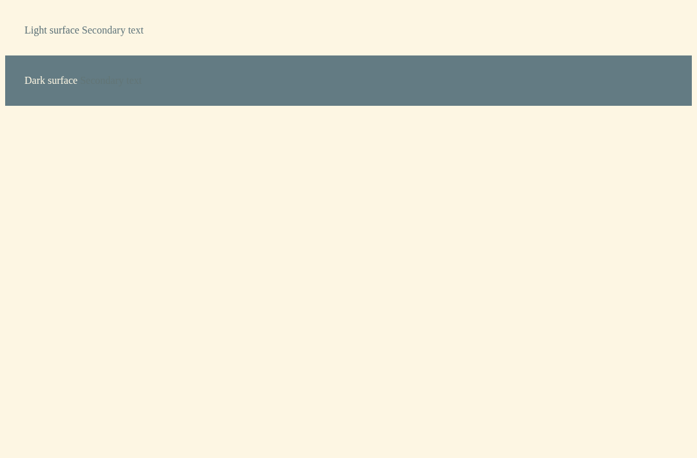

# Setdown 웹 테마·주소창·Markdown 복구·브라우저 저장 기능 검토

작성일: 2026-11-08 · 조사 기준: checkout `c1e5c2e`, Electron `44.7.2`

요청에 번호가 붙은 **네 항목**을 모두 검토했다. 이번 산출물은 원인 조사와 구현 설계다. 제품 코드는 수정하지 않았다. 사용자가 실행 중인 설치본의 버전과 로그인된 ChatGPT의 DOM은 확인하지 않았으며, 진단에는 별도 프로필과 기존 개발 빌드를 사용했다.

## 판단과 권장 순서

**우선 Markdown의 비정상 종료 복구와 웹 테마의 대비 계산을 고쳐야 한다.** 주소창은 모든 탭이 이미 공통 컴포넌트를 사용하므로 한 설계로 개선할 수 있다. 북마크 가져오기는 기존 저장소 확장으로 가능하고, 비밀번호는 별도의 저장·잠금·자동 입력 체계가 필요하다.

| 항목 | 확인한 사실 | 해결 방향 | 우선순위 |
| --- | --- | --- | --- |
| ChatGPT 글자 안 보임 | 최소 웹페이지에서 어두운 표면의 회색 글자 대비가 7.72:1 → 1.08:1로 붕괴하는 현상 재현 | 원래 색상 복구 기능을 즉시 활용하고, 배경별 대비 보정과 실제 텍스트 검증 추가 | P0 |
| 좁은 주소창 | 고정 폭 버튼 사이에서 입력란만 거의 0까지 줄어드는 CSS | 분할 영역의 가용 폭에 따라 검색 버튼으로 전환하고 공통 위치 패널 제공 | P1 |
| Esc 후 빈 Markdown | 테스트 렌더러 종료 후 원문은 남고 죽은 native view가 다시 표시되는 현상 재현 | 렌더러 수명과 준비된 revision을 함께 추적하고 자동 재생성·오류 UI 제공 | P0 |
| 북마크·비밀번호 | 북마크는 URL 중심의 평면 저장소, 비밀번호 저장소는 없음 | HTML 북마크 가져오기와 비밀번호 관리자를 별도 단계로 개발 | P2 |

## 1. ChatGPT에서 특정 테마의 글자가 사라지는 문제

### 현재 동작과 결함

웹페이지는 앱 CSS를 단순히 덮어쓰는 방식이 아니다. [page-theme.ts](../../apps/desktop/src/browser-runtime/page-theme.ts)의 `apply()`가 Dark Reader에 앱 테마의 배경색·글자색을 전달하고, 사이트의 원래 CSS를 변환한다. Solarized Light의 기준색은 배경 `#fdf6e3`, 글자 `#586e75`다.

여기에 Setdown 자체 보정이 추가되어 있다. [darkreader-colors.mjs](../../apps/desktop/scripts/browser/darkreader-colors.mjs)의 `readableLightText()`는 밝은 테마에서 일부 글자의 대비를 4.5:1까지 보정한다. 문제는 다음 입력을 사용한다는 점이다.

```text
실제 필요한 비교: 변환한 글자색 ↔ 그 글자 뒤에 실제로 칠해진 배경색
현재 코드의 비교: 변환한 글자색 ↔ theme.lightSchemeBackgroundColor
```

밝은 본문에는 유효하지만 어두운 사이드바·버튼·배너에도 같은 기준이 적용된다. 원래 회색 글자가 어두운 배경 위에서 잘 보이더라도, 앱의 밝은 배경에서 읽히도록 어둡게 보정하면 사이드바에서는 배경과 비슷해진다. 원본 색의 상대 휘도가 0.5 이하인지로 보정 대상을 결정하기 때문에 `#aaa` 같은 밝은 회색도 이 경로에 들어간다. 순백색 글자를 제외하는 현재 예외만으로는 충분하지 않다.

### 실제 Electron에서 확인한 대비 붕괴

밝은 본문과 어두운 사이드바를 흉내 낸 최소 페이지에 실제 웹 테마 경로를 적용했다. 투명한 텍스트 span의 배경은 불투명한 부모 section의 색을 사용해 계산했다.

| 텍스트/배경 | 원래 색상과 대비 | Solarized Light 적용 후 색상과 대비 |
| --- | --- | --- |
| 밝은 영역의 회색 글자 | `#666666` / `#ffffff`, **5.74:1** | `#5f757c` / `#fdf6e3`, **4.50:1** |
| 어두운 영역의 회색 글자 | `#aaaaaa` / `#171717`, **7.72:1** | `#627576` / `#637b83`, **1.08:1** |



[원시 computed style](theme-artifacts/diagnostic-observe-gray-text-on-a-dark-surface-contrast/observations.json) · [계산 결과](contrast-ratios.json) · [계산 코드](analyze-contrast.mjs) · [진단 로그](theme-diagnostic.log)

이 재현은 스크린샷의 어두운 사이드바와 흐릿한 글자를 설명하는 유력한 구현상 원인을 뒷받침한다. **ChatGPT의 해당 요소에서 같은 CSS 경로를 거쳤는지는 아직 확인하지 않았다.** 사이트의 동적 CSS 변수·투명도·색상 모드 불일치도 함께 점검해야 한다. 현재 포함된 Dark Reader dynamic fixes에는 `chatgpt.com` 전용 항목이 없다. `openai.com` 항목은 별도 도메인이므로 ChatGPT용 수정이라고 볼 수 없다.

참고로 최소 페이지의 순백색 글자도 어두운 영역에서 변환 후 대비가 4.15:1이다. 회색 글자 보정 문제만 제거해도 모든 조합이 기준을 충족하는 것은 아니다. 표면과 글자를 함께 검사해야 한다.

기존 [웹 테마 E2E](../../apps/desktop/test/e2e/browser/themes.spec.ts)는 배경색, 입력 보존, 스크롤, CSP, 창 사이 탭 이동을 검사한다. [보정 단위 테스트](../../apps/desktop/scripts/browser/darkreader-colors.test.mjs)는 일부 색상 변환을 검사하지만, 어두운 영역의 회색 글자와 실제 배경 사이의 대비를 검증하지 않는다. 따라서 기존 테스트 통과와 이 증상은 양립한다.

### 지금 사용할 수 있는 복구 방법

ChatGPT 탭의 주소창 **사이트 정보 ⓘ → `Keep Original Colors for This Site`**를 켜면 그 origin의 웹 테마 변환을 끌 수 있다. 설정은 저장된다. 주소창을 누르기 어려울 정도로 좁다면 **Browser → Appearance → Original website colors**로 전체 웹페이지 변환을 끄는 경로도 이미 있다. 앱 자체의 편집기 테마는 별도다. [사이트 메뉴](../../apps/desktop/src/main/browser/browser-manager.ts), [Appearance UI](../../apps/desktop/src/renderer/browser/BrowserAppearance.svelte)

### 권장 수정

1. **실제 배경을 모르는 전역 색상 변환에서 대비를 보장한다고 가정하지 않는다.** 기존 보정을 그냥 삭제하면 밝은 본문의 흐린 글자 문제가 돌아올 수 있으므로 두 상황을 함께 고친다.
2. ChatGPT의 문제 영역은 실제 DOM에서 확인한 표면·글자 토큰을 **한 쌍으로** 보정한다. 호스트 범위를 한정하고, 클래스를 추측해 전체 `div`에 `!important`를 뿌리지 않는다. 원래 색상 모드로 전환하면 추가 규칙도 제거한다.
3. 일반화할 때는 단색 배경과 상속 관계를 확인할 수 있는 영역부터 지원한다. 투명 배경은 조상 배경과 합성해야 한다. 이미지·그라데이션 위의 글자는 단일 CSS 색상 비교로 판정하지 않는다.
4. Dark Reader의 색상 등록은 색상 유형과 원본 RGB를 공유한다. 같은 회색이 밝은 본문과 어두운 사이드바에 쓰일 수 있으므로 **공유 색상 하나를 어느 한 배경에 맞춰 바꾸는 방식은 유지할 수 없다.** 표면별 CSS 변수나 범위를 분리해야 한다. [색상 변환·등록](../../vendor/darkreader/src/inject/dynamic-theme/modify-colors.ts)
5. 대비 감시는 개발 검증부터 넣는다. 실시간 자동 보정이 필요해도 페이지 전체를 매 프레임 순회하지 않는다. 보이는 텍스트·변경된 영역만 제한적으로 검사하고, SPA 이동·탭 종료 시 observer와 참조를 정리한다. 테마 오류를 잡다가 메모리 사용을 늘리지 않아야 한다.

일반 글자 4.5:1, 큰 글자 3:1을 기본 검증 기준으로 삼는다. disabled 요소 등 기준의 예외를 구분하고, hover·선택·placeholder·메뉴의 실제 합성 색상을 검사한다. [W3C 대비 기준](https://www.w3.org/WAI/WCAG22/Understanding/contrast-minimum.html)

출시 전에는 ChatGPT의 밝은/어두운 사이트 모드 × 앱 테마, 로그인 후 사이드바, 펼친 메뉴, 대화 이동, 동적으로 나타나는 항목을 확인해야 한다. 개인 대화 내용을 fixture에 저장하지 않고 색상 구조만 최소 재현으로 옮긴다.

## 2. 좁은 분할 영역의 공통 주소·검색 UI

### 원인과 적용 범위

[LocationBar.svelte](../../apps/desktop/src/renderer/workspace/location/LocationBar.svelte)의 주소 입력란은 `width: 0; flex: 1`이다. 주변 버튼은 최소 폭 또는 `flex: 0 0 28px`을 가진다. 공간이 부족하면 주소 입력란이 먼저 사라진다. 현재 작은 화면용 media query는 구분선 여백만 줄이며, 브라우저 창 안의 개별 분할 영역 폭을 해결하지 못한다.

이 컴포넌트는 이미 웹·Markdown·터미널·일반 파일을 공통으로 처리한다. **탭 종류별로 주소 UI를 새로 만들 필요가 없다.** `navigateLocation(groupId, value)`와 현재의 저장 확인·이동 정책을 유지하면서 표시 방식을 바꾸면 된다. [워크스페이스 이동 연결](../../apps/desktop/src/renderer/app/workspace-controller.ts), [탭 이동 처리](../../apps/desktop/src/renderer/workspace/tab-navigation-controller.ts)

### 제안 화면

주소 문자열 길이가 아니라 **주소창에 남은 폭**으로 전환한다. 긴 주소라도 넓은 영역에서는 말줄임 표시를 유지할 수 있다. 아래 수치는 디자인 시작값이며 실제 확대율·글꼴·버튼 수로 검증해야 한다.

```text
넓은 영역
←  →  ↻   [ https://chatgpt.com/c/…                 ]   ⓘ ☆ …

좁은 영역
←  ↻  [⌕ 검색·주소]   …

검색 버튼 또는 Ctrl/Cmd+L
┌──────────────────────────────────────────────┐
│ 현재 주소                              [복사] │
│ https://chatgpt.com/c/…                       │
├──────────────────────────────────────────────┤
│ [ 검색어, URL 또는 파일 경로 입력           ] │
│                                              │
│ 일치하는 북마크·방문 기록                     │
└──────────────────────────────────────────────┘
```

현재 주소와 입력 중인 검색어는 분리한다. 열 때 입력란에는 현재 주소를 넣고 전체 선택하여 기존 Ctrl/Cmd+L 습관을 유지한다. 바로 타이핑하면 검색어로 대체되고, 위쪽 현재 주소는 그대로 보인다. `about:blank`에서는 입력란을 비운다.

| 현재 탭 | 위쪽 현재 위치 | 아래 입력란의 동작 |
| --- | --- | --- |
| 웹사이트 | 현재 URL과 origin | URL로 이동하거나 검색 |
| Markdown | 현재 `file://` 위치, 미저장 문서는 미저장 표시 | 파일 경로 열기, URL 이동, 검색. 변경 사항 확인은 기존 경로 사용 |
| 일반 파일·PDF·이미지 | 현재 파일 위치 | 동일한 파일·웹 이동 규칙 |
| 터미널 | 세션 이름 및 `terminal://…` 식별자 | 기존 세션 주소로 이동하거나 파일·웹 열기. 입력 문자열을 셸 명령으로 실행하지 않음 |

현재 위치 파서는 이미 존재하는 `terminal://` 세션을 검증하며 임의의 새 세션 주소를 만들지 않는다. 터미널의 작업 디렉터리를 표시하더라도 세션의 주소와 구분해야 한다. Git 검토 화면도 동일 패널을 사용하되 현재 검토 파일을 명시하고 기존 이동 동작을 유지한다.

### 크기와 포커스 규칙

- `ResizeObserver`로 **해당 group의 주소 행**을 측정한다. 전체 창의 media query만 사용하지 않는다. 입력란 가용 폭이 예를 들어 180 CSS px 아래면 compact, 다시 220 px 이상이면 확장하는 여유 구간을 둔다.
- compact에서는 앞으로 가기·북마크·확장·읽기·삽입·확대 등을 `…`에 옮긴다. 검색 버튼만 넣고 나머지를 그대로 두면 더 좁은 영역에서 다시 넘친다. 권한 요청은 점 표시와 메뉴 항목으로 발견 가능하게 유지한다.
- 패널은 누른 group의 버튼에 붙이고 앱 content 영역 안으로 위치를 제한한다. 제안 폭은 `min(520px, 창 가용 폭 − 24px)`이다. 작은 split보다 패널이 넓어지는 것은 허용하되 화면 밖으로 나가지 않게 한다.
- Ctrl/Cmd+L은 현재 group 패널을 열고 입력란에 포커스를 준다. Enter는 기존 이동 함수를 한 번 호출한다. 한글 IME 조합 중 Enter/Esc는 주소 제출이나 패널 닫기로 처리하지 않는다.
- Esc는 주소 패널만 닫고 원래 문서·터미널·웹에 포커스를 되돌린다. 같은 Esc가 Markdown 읽기 전환이나 웹 reader 진입까지 전파되면 안 된다.
- 열어 둔 상태에서 resize가 일어나도 입력 DOM을 교체하지 않는다. 입력 중인 문자열·커서·조합 상태를 유지한다. 탭 닫기·이동·group 교체 후에는 오래된 패널이 다른 탭을 이동시키지 못하도록 token을 무효화한다.

### Electron에서 중요한 구현 선택

웹과 Markdown reader는 별도 `WebContentsView`다. 셸 DOM의 `z-index`만 높여서는 그 위에 패널이 올라가지 않는다. 이미 [LocationOverlay](../../apps/desktop/src/main/browser/location-overlay.ts)가 검색 제안을 native view로 올리고, 아래 페이지의 크기·재생을 유지한다. 이 기반을 확장하는 것이 적합하다.

다만 현재 overlay는 **제안 목록만** 표시하고 입력·IME는 셸 주소창이 소유한다. 요청한 패널은 입력란 자체가 아래에 있으므로 overlay 안에 입력 UI를 두고 포커스 소유권을 명시적으로 옮겨야 한다. 기존 코드를 단순히 크게 만드는 작업으로 끝나지 않는다.

제안 프로토콜은 `{ ownerWindowId, groupId, tabId, token, currentLocation, draft }`를 기준으로 열기·입력·선택·닫기를 처리한다. main은 요청한 창과 탭의 소유권을 검사하고, 늦게 도착한 검색 결과는 token이 같을 때만 반영한다. **창마다 최대 하나의 패널**을 재사용하고, 닫힌 패널은 유휴/메모리 압력에 따라 회수한다. 탭마다 native renderer를 추가하지 않는다.

검증은 각 탭 종류에서 split 폭 240/320/480/800 CSS px, 앱 확대와 콘텐츠 확대를 독립적으로 바꾼 조건, 마우스·키보드·한글 입력, 탭 이동, 저장 취소, 동영상 재생 중 패널 열기를 포함해야 한다.

## 3. Markdown에서 Esc 후 빈 화면

### 재현 결과

독립 Xvfb·D-Bus·runtime·임시 프로필에서 실제 Electron으로 다음을 실행했다.

1. `# Notes`와 본문이 있는 Markdown의 정상 미리보기를 확인했다.
2. 원본 편집 화면으로 전환했다.
3. **그 테스트 앱의 미리보기 렌더러만** `forcefullyCrashRenderer()`로 종료시켰다.
4. 편집기에서 Esc를 누르고 3초 뒤 상태를 기록했다.

| 관찰값 | 결과 |
| --- | --- |
| 종료 이벤트 | `reason: crashed`, `exitCode: 133` — 의도적으로 주입한 장애 |
| WebContents 객체 | `isDestroyed() === false`, `isCrashed() === true` |
| Esc 후 | 같은 WebContents ID 2, native view `visible: true` |
| 표시 영역 | 1080 × 710, 0 크기 문제가 아님 |
| 원문 | `# Notes\n\nKeep the reader intact.\n` 그대로 존재 |
| 화면 | 문서 대신 빈 테마 배경 |
| 셸 pageerror | 없음 |

[원시 관측값](artifacts/diagnostic-observe-transfo-db31d-t-and-preview-renderer-loss/observations.json) · [빈 화면 캡처](artifacts/diagnostic-observe-transfo-db31d-t-and-preview-renderer-loss/after-crash-escape.png) · [진단 코드](diagnostic.spec.ts)

**죽은 미리보기를 정상 화면처럼 다시 표시하는 결함은 확인됐다.** 이것이 사용자의 모든 빈 화면 사건을 설명한다고 단정하지는 않는다. 이번 검사는 메모리 부족을 발생시키지 않았다. 따라서 사용자 사건이 OOM·GPU 오류·렌더러 오류 중 무엇이었는지는 당시 로그가 필요하다. Electron은 렌더러 종료와 WebContents 객체 파괴를 별도 이벤트로 정의한다. [Electron WebContents 문서](https://www.electronjs.org/docs/latest/api/web-contents#event-render-process-gone)

### 왜 재시작하면 되는데 Esc로는 안 되는가

확인한 코드 경로는 다음과 같다.

```text
정상 준비 완료 → readyRevision 저장
미리보기 렌더러 종료 → main에서 사고 로그만 기록
                    → previewUrl / readyRevision / view 등록은 유지
Esc → ensure(같은 revision)는 이미 준비됐다고 반환
    → show()는 isDestroyed만 확인하고 죽은 view를 표시
    → 원문은 있지만 화면을 그릴 프로세스가 없음
```

- [main.ts](../../apps/desktop/src/main/main.ts)는 `memory-crashes.json`을 기록하지만 이 이벤트로 Markdown을 복구하지 않는다.
- [PreviewManager.show()](../../apps/desktop/src/main/preview/preview-manager.ts)는 객체 파괴 여부를 확인한다. 캡처 경로에는 있는 `isCrashed()` 확인이 표시 경로에는 없다. `create()`도 같은 tab ID가 map에 있으면 재생성하지 않는다.
- [PreviewRenderCoordinator.ensure()](../../apps/desktop/src/core/preview/preview-render-coordinator.ts)는 `readyRevision === revision`이면 즉시 성공한다. 이 값에 native renderer의 세대 정보는 없다.
- [SurfaceController.enterViewer()](../../apps/desktop/src/renderer/workspace/surface-controller.ts)는 reader 전환을 요청하고 비동기로 `ensure()`를 호출한다. 위 상태에서는 실패 사실이 전달되지 않는다.

재시작은 native view와 준비 상태를 새로 만들므로 증상이 해소될 수 있다. 따라서 우선 수정 대상은 Esc 키 자체보다 **렌더러 수명 종료 시 준비 상태를 무효화하는 경계**다.

추가로 [waitForUpdate()](../../apps/desktop/src/main/preview/preview-manager.ts)는 일반 Markdown의 설치 확인이 5초 동안 오지 않으면 기본 모드에서 성공처럼 resolve한다. Git의 strict 모드는 reject한다. 이는 “응답 없음”을 “설치 완료”로 오인할 수 있는 별도 결함 후보다. 이번 재현은 revision이 이미 준비된 경로이므로 이 타임아웃이 직접 원인이었다고 주장하지 않는다.

### 권장 복구 설계

상태를 `없음 → 준비 중 → 준비 완료 → 표시 중`으로만 두지 말고 `회수됨 / 비정상 종료 / 복구 중 / 복구 실패`를 구분한다. 준비 완료의 키에는 최소한 **문서 revision + renderer generation**을 포함하고 현재 theme·layout 준비 상태도 기존 규칙대로 검증한다.

1. `render-process-gone`에서 해당 view의 대기 중 작업을 실패 처리하고 준비·테마·viewport 캐시를 무효화한다. 비동기 응답은 이전 generation이면 버린다. 같은 프로세스를 공유한 다른 view가 있는지도 처리한다.
2. native view만 폐기한다. 문서 내용·미저장 변경·Monaco 모델·Undo·읽던 위치는 보존한다. 디스크 파일을 다시 읽어 미저장 원문을 덮어쓰지 않는다.
3. 현재 보이는 문서는 최신 메모리 원문에서 미리보기를 한 번 자동 복구한다. 숨겨진 문서는 필요해질 때 생성한다. 복구 중에는 로딩 상태와 “원본 보기”를 제공한다.
4. 반복 장애에서는 자동 재생성을 중단하고 “미리보기를 복구하지 못했습니다 / 다시 시도 / 원본 보기”를 표시한다. 예를 들어 30초 안의 재실패를 수동 재시도로 전환하되, 정확한 한도는 검증 후 결정한다.
5. 설치 ACK 타임아웃은 성공으로 처리하지 않는다. 최신 generation·revision의 ACK를 확인하거나 명시적인 실패로 전환한다. 오류 UI 자체가 native view 뒤에 가리지 않게 해야 한다.
6. 건강한 warm Esc에는 새 IPC 왕복이나 전체 렌더링을 추가하지 않는다. 정상 경로는 이벤트로 유지한 준비 상태를 사용하고 장애 경로에서만 재생성한다.

이미 메모리 회수 시에는 `marktex:discarded → previewDiscarded()`가 준비 메타데이터를 지우는 경로가 있다. 이를 공통 무효화 처리의 기반으로 사용할 수 있지만, **정상 회수와 사고 복구의 UI·재시도 정책은 구분**해야 한다. 최근 메모리 최적화가 사고의 시작 원인이라고 판단할 근거는 없다.

관측 로그에는 URL·본문 대신 탭의 임시 식별자, renderer generation, revision, 종료 사유, 복구 결과, visible/bounds, 당시 메모리 압력을 남긴다. 현재 로그의 `type`만으로는 웹과 Markdown 사고를 충분히 구별하기 어렵다. GPU 문제는 `child-process-gone` 등 별도 신호와 함께 조사한다.

검증은 표시 중/편집 중/숨겨진 reader의 종료, 준비 중 종료, worker 종료, 설치 ACK 유실, 캐시 문서 없음, 연속 Esc, 테마 변경 중 종료, split 및 Git A/B 화면을 포함한다. 복구 후 최신 내용·Undo·포커스·IME·anchor가 유지되는지 확인한다. 내용이 없는 정상 빈 문서도 허용해야 하므로 “텍스트가 0이면 crash” 같은 판정은 사용하지 않는다.

## 4. 북마크 가져오기와 비밀번호 저장

### 4-1. 북마크: HTML 가져오기부터 구현하는 것이 적합

현재 [BrowserPlaces](../../apps/desktop/src/main/browser/browser-places.ts)는 별도 서비스에 검색·개별 갱신을 요청한다. [places.ts](../../apps/desktop/src/browser-runtime/places.ts)는 IndexedDB에 URL을 고유 키로 저장하고 전체 목록을 메모리 캐시에 올린다. 북마크는 `isBookmarked` 플래그이며 폴더·순서·별도 북마크 ID가 없다. 조회 결과도 최대 100개다.

Chrome과 Firefox 모두 북마크 HTML 내보내기를 지원한다. 사용자가 내보낸 파일을 고르면 여러 브라우저에서 같은 가져오기 경로를 쓸 수 있다. [Chrome 공식 안내](https://support.google.com/chrome/answer/96816), [Firefox 공식 안내](https://support.mozilla.org/en-US/kb/export-firefox-bookmarks-to-backup-or-transfer)

제안 UI는 **Browser → Bookmarks → 가져오기… → HTML 선택 → 폴더·개수·중복 처리 확인 → 가져오기 결과**다. “이번 가져오기 되돌리기”를 제공하면 잘못 고른 파일도 복구하기 쉽다.

두 단계의 구현이 가능하다.

| 단계 | 내용 | 제한 |
| --- | --- | --- |
| 작은 첫 버전 | 제목·URL 가져오기, 기존 URL 중복 제거, 기존 별표와 검색 재사용 | 폴더·순서가 사라짐을 가져오기 전에 알려야 함 |
| 권장 완성 버전 | 폴더·순서·동일 URL의 여러 폴더 저장, 이동·내보내기 | Places와 별도의 북마크 노드 모델 및 DB migration 필요 |

사용자가 기존 브라우저를 옮겨 쓰려는 목적이라면 완성 버전을 목표로 하는 편이 낫다. 모델 예시는 `BookmarkNode { id, parentId, kind, title, url?, order, importedBatchId }`다. URL별 방문 기록은 Places에 남기고 북마크 트리는 별도로 둔다. 별표는 그 URL을 가리키는 노드 존재 여부와 일관되게 연결한다.

실제 구현에서 빠뜨리기 쉬운 부분은 다음과 같다.

- 파일을 웹페이지로 열지 않고 파서로 읽는다. 스크립트·이미지·favicon을 실행하거나 다운로드하지 않는다. URL 스킴을 검증하며 `javascript:`·`data:`는 기본 가져오기에서 제외한다. `file:`은 Setdown의 파일 기능과 맞추어 지원 여부와 UI를 별도로 정의한다.
- HTML의 중첩 `DL/DT/H3/A`, 생략된 닫는 태그, 한국어, 이스케이프, 오래된 인코딩을 다룬다. 파일 크기·노드 수·중첩 깊이를 제한하고 건너뛴 항목 수를 설명한다.
- 같은 URL이 다른 폴더에 있는 경우와 같은 폴더에 반복된 항목을 구별한다. 경로의 대소문자나 query를 임의로 없애서 중복으로 합치지 않는다.
- 개별 IPC를 수천 번 호출하지 않고 batch를 전송한다. DB transaction 완료 뒤 메모리 캐시를 갱신하며 실패·취소 시 부분 반영을 남기지 않는다. 가져온 항목을 실제 방문한 것으로 기록하지 않는다.
- 지금처럼 전체 캐시 복사와 최대 100개 결과만 사용하면 대규모 가져오기 뒤 목록이 잘린다. 목록 pagination·가상화·검색 인덱스를 함께 설계한다. URL별 `findIndex`를 매번 반복하는 개별 갱신도 bulk 경로에서 피한다.

참고할 [Min의 bookmarkConverter](../../vendor/min/js/bookmarkConverter.js)는 저장소에 이미 있지만 현재 제품에 연결된 기능은 아니다. 폴더를 태그로 바꾸는 평면 모델이므로 그대로 복사하면 원래 폴더 구조를 보존할 수 없다.

수용 기준은 폴더가 중첩된 Chrome/Firefox HTML, 동일 URL·한글·잘못된 항목·매우 큰 입력, 취소·실패·재시작, 가져오기 되돌리기, 기존 북마크·방문 기록 보존이다.

### 4-2. 비밀번호: 기존 인증 창만 확장해서는 완성되지 않는다

[BrowserAuth](../../apps/desktop/src/main/browser/browser-auth.ts)는 HTTP Basic/Digest 인증 요청에 값을 전달하는 기능이다. 일반 웹페이지의 `<input type="password">` 저장·자동 입력·금고와는 다르다. [확장 호스트](../../apps/desktop/src/main/browser/browser-extensions.ts)의 `privacy.services.passwordSavingEnabled` 역시 현재 unsupported 처리다. 브라우저 세션 쿠키가 남아서 로그인되는 현상도 비밀번호 저장 기능과 구분해야 한다.

현실적인 선택지는 다음과 같다.

| 방안 | 장점 | 확인하거나 개발할 것 |
| --- | --- | --- |
| Bitwarden 같은 확장 지원 | 기존 금고·동기화·저장 UI 활용 | 해당 확장의 content script, storage, service worker, 팝업, 권한, 잠금·저장·자동 입력 실제 호환성 |
| 외부 관리자 CLI 연동 | 브라우저 확장 외의 통합 경로 | 설치·잠금·세션 키 수명·성능·프로세스 권한 관리 |
| Setdown 내장 로컬 관리자 | 브라우저 UI와 자연스럽게 통합 | 저장소, 암호화, 잠금, 저장/갱신 확인, origin 매칭, 프레임별 입력, 삭제·복구·migration 모두 필요 |

**기존 관리자의 호환성 검증을 먼저 하는 방안을 권한다.** 확장을 설치할 수 있다는 사실만으로 비밀번호 기능 전체를 지원한다고 선언하면 안 된다. Bitwarden은 여러 브라우저용 확장을 제공하지만 Setdown에서의 호환성은 이 조사에서 실행 검증하지 않았다. 1Password의 데스크톱 연동도 지원 브라우저 및 추가 연결 조건을 확인해야 한다. [Bitwarden 확장 안내](https://bitwarden.com/help/getting-started-browserext/), [1Password 브라우저 연결 안내](https://support.1password.com/connect-1password-browser-app/)

`vendor/min/js/passwordManager/`에는 내장 관리자·Bitwarden CLI·1Password 연동 참고 코드가 있다. 현재 앱에 연결된 것은 아니다. 특히 금고 전체 자격 증명을 renderer로 돌려주는 인터페이스나 세션 키 전달 방식은 Setdown의 격리 구조에 맞게 재설계해야 한다.

내장 기능을 선택한다면 첫 범위는 **HTTPS 로그인 저장/갱신 + 사용자가 선택한 계정 채우기 + 잠금/삭제**로 제한하는 것이 적합하다. 패스키·OTP·카드·클라우드 동기화·다른 브라우저의 비밀번호 DB 직접 가져오기는 별도 기능으로 둔다.

권장 책임 분리는 다음과 같다.

```text
웹 프레임의 제한된 form 감지
  → main에서 origin / frame / navigation token 검증
  → 브라우저 chrome의 저장·갱신 확인
  → main 소유 암호화 저장소

사용자가 계정 선택
  → 현재 문서와 frame의 origin 재검증
  → 해당 frame의 해당 입력란에만 전달
```

origin은 scheme·host·port를 포함해 비교한다. 비슷한 도메인, 다른 서브도메인, cross-origin iframe으로 자동 확장하지 않는다. iframe 로그인은 실제 프레임 origin을 표시하고 별도로 승인된 규칙을 사용한다. 페이지가 바뀌었는데 이전 autofill 응답이 도착하는 경우도 token으로 차단한다. 로그인 성공 판정은 SPA에서 불확실하므로 제출했다는 이유만으로 기존 비밀번호를 덮어쓰지 않고 사용자에게 갱신을 확인한다.

저장 암호화는 main에서 OS 보호를 이용한다. Electron `safeStorage`는 OS별 보안 특성이 다르고, Linux 동기 API의 `basic_text`는 안전한 비밀 저장소가 없는 상태다. 현재 설치된 Electron 타입에는 비동기 암호화 API도 있다. 새 구현은 비동기 경로를 검토하되, **암호화 가능 여부와 Linux fallback의 실제 보호 수준을 확인**해야 한다. 동기 API의 backend 확인값만으로 비동기 provider의 보안을 증명하지 않는다. 안전한 저장소가 없으면 영구 저장을 중단하고 상태를 알린다. [Electron safeStorage](https://www.electronjs.org/docs/latest/api/safe-storage)

금고 전체를 웹이나 셸 renderer에 보내지 않고 필요한 계정의 최소 정보만 제공한다. 비밀번호는 로그·검색 기록·일반 설정 JSON에 남기지 않는다. OS 키 저장소 보호와 앱의 자동 잠금은 다른 책임이므로 잠금·재인증을 별도로 설계한다. JS 문자열을 완벽히 메모리에서 지운다고 보장할 수 없으므로 평문 보유 시간과 복사 횟수를 줄인다.

검증에는 저장/갱신 거절, 여러 계정, 페이지 이동 중 요청, 같은 URL의 새 문서, cross-origin iframe, HTTP downgrade, 잠긴 키 저장소, Linux 저장소 없음, 앱 업데이트 후 복호화, 손상된 데이터, 로그 유출 여부가 포함되어야 한다. 이 범위를 다루기 전에는 “비밀번호 관리자 지원 완료”로 보기 어렵다.

## 구현 묶음과 출시 조건

| 묶음 | 주요 수정 위치 | 완료 판단 |
| --- | --- | --- |
| A. 빈 미리보기 복구 | PreviewManager, PreviewRenderer, PreviewSession, coordinator, Git review 상태 | 장애 주입 후 최신 원문 복구 또는 명시적 오류, Undo 유지, 무한 재시도 없음 |
| B. 웹 대비 수정 | Dark Reader adapter, page-theme, site fixes | 밝은/어두운 표면의 실제 텍스트 대비, ChatGPT 동적 화면, 원래 색상 복구 |
| C. 공통 위치 패널 | LocationBar, LocationOverlay, protocol/preload, 공통 navigation | 모든 탭 종류·split·IME·Esc·포커스·저장 취소 검증 |
| D. 북마크 가져오기 | Places DB와 서비스, BrowserSidebar, importer | 폴더 정책 명확, batch 원자성, 대용량 검색·목록, 재시작 보존 |
| E. 비밀번호 관리자 | 확장 호환성부터 평가, 내장 선택 시 별도 credential 서비스 | 저장·자동 입력·잠금의 실제 지원 범위와 보안 경계 검증 |

A/B/C는 [preview performance contract](../../docs/preview-performance-contract.md)의 준비·표시·테마·포커스 경계에 걸친다. 구현 시 `npm run test:preview-contract`와 설치 baseline을 이용한 `npm run bench:preview -- --baseline /absolute/path/to/installed-baseline`가 필요하다. 일반 Markdown/Git, 첫 번째·두 번째·warm, 수정 유무, 준비 포함/제외를 따로 보고해야 한다. 정상 Esc 성능을 희생해 모든 전환에서 전체 재렌더링하는 수정은 피한다.

이번에는 제품 코드를 변경하지 않았으므로 전체 계약 테스트·성능 비교를 새로 실행하지 않았다. 진단은 실제 Electron을 격리 화면에서 실행했고, 테스트 scope의 메모리 상한 2 GiB·swap 0 및 호스트 여유 2 GiB 감시를 사용했다. **진단 실행의 `passed`는 관측 자료 수집 성공을 뜻하며 제품 결함이 해결됐다는 뜻이 아니다.** 첫 시도는 보고서 디렉터리의 ESM 설정 누락으로 앱 실행 전에 실패했고, 설정 수정 후 진단했다. [초기 설정 오류](harness-setup-error.log), [진단 로그](diagnostic.log)
