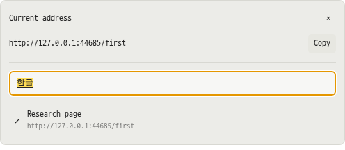

# Setdown 브라우저·문서 안정성 구현 기록

기준: `dc13af7e55005f77ec43a885b9e0cc364d2c9f08`의 [설계 보고서](../browser-reliability-design-2026-11-08/README.md). 요청한 네 기능과 URL 삽입창 유지 동작을 구현했다. 이 기록은 소스와 개발 빌드의 검증이며 실행 중인 설치본의 교체를 뜻하지 않는다.

## 바뀐 동작

| 기능 | 구현한 동작 |
| --- | --- |
| Markdown URL 삽입 | 바깥 클릭·창 전환·Escape·URL 명령 반복으로 닫히지 않는다. URL과 표시 문구를 따로 복사할 수 있다. X로 취소하고, Insert 성공 시 닫힌다. 원래 문서·선택 범위를 기억하며 다른 분할에서 돌아와도 그 문서에 삽입한다. 문서 내용이 바뀌었다면 잘못된 위치에 삽입하지 않고 오류를 표시한다. |
| 표 삽입 | 바깥 클릭과 Escape로 닫히는 기존 동작을 유지한다. 표와 URL 팝업은 원래 분할 영역의 버튼 또는 좁은 주소창의 더보기 버튼에 맞춰 배치한다. |
| 좁은 주소창 | 주소에 쓸 수 있는 폭이 180 CSS px 미만이면 검색 버튼과 더보기로 전환한다. 220 px 이상으로 넓어지면 일반 주소창으로 복귀한다. 검색 패널에 현재 주소·복사·검색/URL 입력·추천 목록을 제공한다. 웹·Markdown·일반 파일·터미널이 같은 경로를 사용한다. |
| 웹 테마 대비 | Dark Reader 적용 뒤 글자 바로 뒤의 실제 단색 배경을 조상 요소까지 합성해 4.5:1 대비를 보정한다. 밝은 본문과 어두운 사이드바를 같은 배경색으로 취급하지 않는다. 원래 사이트 색상 모드로 전환하면 보정을 제거한다. |
| 빈 Markdown 복구 | 죽은 native reader와 준비 완료 상태를 함께 폐기하고 현재 메모리의 문서로 재생성한다. 저장하지 않은 편집과 Undo를 유지한다. Git의 두 reader도 함께 교체한다. 30초 안에 다시 실패하면 자동 반복을 멈추고 원문·재시도 경로를 제공한다. 설치 확인 응답이 없으면 성공으로 처리하지 않는다. |
| 북마크 가져오기 | Browser → Bookmarks에서 Chrome/Firefox HTML을 선택·확인해 가져온다. 폴더·순서·한글·다른 폴더의 동일 URL을 보존한다. 이번 가져오기 되돌리기, 검색·100개 단위 목록을 제공한다. 기존 별표와 방문 기록을 migration/transaction으로 보존한다. |
| 비밀번호 | Browser → Passwords에서 사용을 허용한 뒤 HTTPS 페이지의 키 버튼/더보기에서 저장·갱신 확인·선택한 계정 채우기를 실행한다. 삭제·수동 잠금·10분 만료·화면 잠금/절전 시 잠금을 제공한다. |

## 메모리와 기존 동작을 지키는 방식

- 정상 Markdown 전환에 추가 전체 렌더링이나 IPC 왕복을 넣지 않았다. 실패한 reader만 교체하고 오래된 비동기 준비 결과는 generation으로 차단한다.
- 웹 대비 검사는 상시 전체 DOM 순회 대신 이벤트에 반응한다. 배치당 100개/8 ms, 대기 루트 32개, 루트당 10,000개, 보정 요소 1,024개로 제한하고 숨은 페이지에서는 멈춘다. 제거된 DOM 참조를 정리한다.
- 위치 패널은 기존 native overlay를 확장한다. 웹페이지를 숨기거나 재생성하지 않으며 닫힌 패널의 renderer는 60초 뒤 정리한다.
- 북마크 입력은 10 MiB·50,000개·32단계 폴더로 제한한다. HTML을 실행하거나 favicon을 내려받지 않는다. 폴더별 중복 및 지원하지 않는 URL은 건너뛰고 개수를 표시한다.
- 비밀번호의 지속적인 평문 캐시는 두지 않는다. 금고는 main이 소유하고 셸 목록에는 계정 메타데이터만 보낸다. 암호화한 파일만 0600 권한으로 원자적 교체한다.

## 지원 범위와 남은 한계

웹 대비는 계산 가능한 단색 표면을 대상으로 한다. 이미지·그라데이션·블렌드·필터·그룹 투명도와 의도적인 투명 텍스트에는 추정 보정을 하지 않는다. 로그인된 실제 ChatGPT 계정의 화면을 검사한 것은 아니며 재현 페이지와 전체 테마 조합을 검증한다. 문제가 남는 사이트는 기존 사이트별 원래 색상 설정을 사용할 수 있다.

북마크는 HTML 가져오기를 지원한다. 다른 브라우저의 실행 중인 프로필 DB 직접 읽기, 폴더 이동 편집·재내보내기는 이번 기능에 포함하지 않는다.

비밀번호는 사용자가 명시적으로 실행하는 로컬 기능이다. 로그인 제출을 자동 감지하거나 자동 제출하지 않는다. 보이는 사용자명·비밀번호가 하나인 같은 origin의 main-frame 폼을 지원한다. iframe, 다단계 로그인, 비밀번호 변경 폼, OTP·패스키·클라우드 동기화·외부 비밀번호 확장 호환성은 지원 완료로 주장하지 않는다. OS 계정 보호와 앱 잠금은 별개이며, 앱의 Allow 버튼은 OS 재인증이 아니다.

Electron 44.7.2의 `safeStorage`에서 보호된 OS 저장소를 확인할 수 있을 때만 저장한다. Linux `basic_text`와 알 수 없는 provider는 거절한다. 비동기 provider의 보안 수준을 동기 backend 정보로 추정하지 않는다. 손상·복호화 실패 시 기존 금고를 덮어쓰지 않는다. [Electron safeStorage 문서](https://www.electronjs.org/docs/latest/api/safe-storage)

저장/입력 직전에 HTTPS의 정확한 scheme·host·port, 소유 창, 보이는 탭, main frame, 문서 세대와 isolated-world 폼 토큰을 재확인한다. 같은 URL의 새 문서나 다른 origin으로 이동한 뒤 늦게 완료된 계정 선택은 적용하지 않는다.

## 검증 환경

모든 GUI 검사는 Xvfb·별도 D-Bus·별도 runtime directory에서 실행한다. 사용자 데스크톱과 Wayland 소켓을 사용하지 않는다. 메모리 제한은 전체 gate/성능 비교 3 GiB, 개별 GUI 검사 2 GiB이고 swap을 추가 사용하지 않는다. 호스트 가용 메모리가 2 GiB 미만이면 테스트 scope만 중단하는 감시기를 사용한다.

장애 주입 중 호스트 core-dump 서비스가 종료된 Chromium을 붙잡아 `render-process-gone` 전달을 지연시키는 현상을 확인했다. 격리 실행 wrapper의 자식 프로세스에 `ulimit -c 0`을 적용했다. 실제 `forcefullyCrashRenderer()` 호출과 Chromium 실행, 검사, 로그·스크린샷은 유지한다.

비밀번호 GUI 검사는 OS 암호화 경계만 실제 AES-GCM 테스트 provider로 교체한다. 실제 Chromium·isolated world·IPC·금고 파일·저장/갱신/입력/페이지 전환을 검사하며 사용자 keyring에는 접근하지 않는다. 따라서 플랫폼별 실제 keyring 프롬프트나 계정/OS 업그레이드 복호화는 별도의 플랫폼 QA가 필요하다.

## 실행 결과

2026-11-08 최종 소스와 개발 빌드에서 아래 검사가 완료됐다. 검사 생략·재시도 추가·성능 허용치 완화 없이 통과했다.

| 검사 | 결과 | 근거 |
| --- | --- | --- |
| `npm run test:preview-contract` | 단위 테스트 118개 파일 / 938개 통과, 빌드 도구 검사 14개 통과, TypeScript·Svelte 오류 0 / 경고 0, 빌드 성공, 실제 Electron 검사 335개 통과 | [전체 계약 검사 로그](validation/preview-contract.log) |
| 구조 경계 검사 | 5개 통과 | [검사 로그](validation/architecture.log) |
| 추가 Git 편집 도구 검사 | 실제 Electron 검사 2개 통과. Git 문서 URL 삽입창의 Escape 유지·X 닫기, 읽기 전용 영역과 편집 문서의 분리를 확인 | [검사 로그](validation/git-editing-tools.log) |
| 미리보기 성능 비교 | 48개 비교 항목 모두 기존 허용 범위 만족. 오류·성능 회귀 판정 0개 | [첫 번째·두 번째·Warm 전체 수치](benchmark-summary.md), [실행 로그](validation/preview-benchmark.log), [원시 비교 자료](benchmark/comparison.json) |

성능 비교는 독립된 `dc13af7` 기준본과 수정본을 각각 `SETDOWN_BUILD_SOURCEMAP=0`으로 빌드한 뒤 같은 Xvfb에서 AB/BA 순서를 교대로 실행했다. 각 버전 3회 × Markdown/Git review·수정 유무·준비 대기 0/3000 ms의 8개 시나리오 × 5회 전환이다. 첫 번째·두 번째·Warm과 편집기로 돌아오는 시간을 따로 비교했다. 기존의 상대 25%와 절대 50 ms를 **모두** 초과하는 악화를 실패로 판정하며 이 기준은 변경하지 않았다.

예를 들어 준비 대기·수정 없는 Markdown 첫 전환의 캡처 중앙값은 124 → 85 ms, Warm은 30 → 29 ms였다. 같은 조건의 Git 첫 전환은 958 → 963 ms였다. 따라서 이번 결과는 기존 성능 계약을 유지한다는 근거이며, 모든 전환이 빨라졌거나 메모리가 일정 비율 줄었다는 의미는 아니다.

전체 계약 검사에는 실제 클립보드로 URL·표시 문구를 따로 붙여넣는 흐름, 세 가지 분할 방향, 좁은 주소 패널의 한글 IME·네이티브 편집 명령·영상 재생·Markdown/터미널 포커스 복원, 실제 reader 강제 종료와 미저장 내용·Undo 복구, 전체 테마의 단색 표면 대비, 북마크 가져오기·재시작·되돌리기, 비밀번호 저장·갱신·취소·입력·페이지 변경 시 중단 검사가 포함된다.

전체 빌드·계약 검사·성능 비교 동안 감시기에 기록된 호스트 가용 메모리의 최솟값은 약 4.23 GiB였고 메모리 부족 중단은 없었다. 이는 테스트 환경의 가용량이며 Setdown 사용량이나 절감량 측정이 아니다. [자원 감시 기록](validation/resource-watch.json)
