# TypeScript 위에서 일하는 프레임워크 도구: 서로 필요한 도구를 함께 띄우기

작성일: 2026-11-22 · 구현 보고서 · 기준 `790866b`와 그 위의 커밋하지 않은 수정 · 사용자 설정(`~/.config/Setdown`)은 건드리지 않았다. 감사용 프로필을 썼다.

어제의 [감사 보고서](../zed-languages-ui-audit-2026-11-21/report.md)는 Vue 도구가 "Working"이라고 하면서 어떤 질문에도 답하지 않는다고 적었다. 이 보고서는 그 원인을 어떻게 고쳤는지, 같은 구조를 가진 다른 프레임워크 도구는 어떤지를 실제 GitHub 저장소로 확인한 결과다. 중간에 따로 요청받은 "닫기 확인 창이 뜨면 유튜브가 멈춘다"도 5절에 있다.

## 결론

**원인은 Vue에만 있지 않았다. 한 도구가 다른 도구에게서 받아야 하는 것을 Setdown이 전달하지 않았다. 도구 이름을 모르는 규칙 네 개로 고쳤고, 표의 아홉 가지를 실제 저장소 여덟 곳에서 수정 전과 후로 돌려 봤다.**

1. **도구별 결과.** "됨"은 호버, 자동완성, 정의로 이동(F12)이 실제 앱에서 답을 낸다는 뜻이다.

   | 도구 | 수정 전 | 수정 후 |
   | --- | --- | --- |
   | React (`.tsx`) | 됨. 다만 가져온 이름에서 F12를 누르면 정의로 가지 않고 항목 두 개짜리 목록이 떴고, 호버에 같은 줄이 두 번 나왔다 | 정의로 바로 간다. 호버는 한 번만 나온다 (3.3절) |
   | Svelte | 됨 | 변화 없음 |
   | Vue | "✓ Working"인데 호버는 "Loading..."에서 멈추고, 자동완성과 정의 이동이 없었다 | `<script>`, `<template>`, `.vue`를 가져오는 `.ts` 모두에서 됨. 타입 오류 표시와 이름 바꾸기도 된다 |
   | Astro | `.astro`는 됨 | `.astro`는 그대로. TypeScript 서버에 Astro 플러그인이 실린다 |
   | Angular | "Angular support can't start." 프로젝트에 `@angular/language-server`가 없어서였다 | 템플릿에서 됨. `.ts`의 `templateUrl`에서 F12를 누르면 그 템플릿이 열린다 |
   | Marko | `.marko`는 됨 | `.marko`는 그대로. `.marko`를 가져오는 `.ts`에서 "Cannot find module" 오류가 사라지고 타입이 나온다 |
   | Deno | TypeScript 서버가 `Deno`를 없는 이름이라고 표시하는데 화면은 "✓ Working"이었다 | "Limited"와 이유, 버튼 하나. 누르면 Deno 도구로 바뀌고 거짓 오류가 사라진다 |
   | Ember (`.gjs`) | "TypeScript and JavaScript has a message"가 뜨고 "Waiting for analysis results"가 끝나지 않았다 | `ember-language-server`가 연결된다. 그러나 이 도구는 `.gjs`에서 템플릿 자동완성만 한다 (4.1절) |
   | MDX | Markdown 문서로 열린다. 언어 도구는 없다 | 하지 않았다 (4.2절) |

2. **일반 규칙 넷**(2절). 도구가 다른 도구에 보태는 것을 Zed 확장에 묻고 전달한다. 플러그인이 이름을 댄 언어는 두 도구가 함께 답한다. 한 도구가 편집기에 넘긴 질문을 다른 도구가 답하게 한다. 프로젝트가 가져와야 하는 도구가 없으면 Setdown이 설치한다. 규칙 자체는 도구 이름을 모른다. 이름이 나오는 곳은 데이터 두 군데다. Vue가 편집기에 보내는 질문의 이름(`vue-rules.ts`, Zed도 같은 자리에 같은 코드를 둔다)과, 프로젝트의 패키지로 뜨는 도구를 적은 표의 한 줄(`project-package-tools.ts`, Angular의 패키지 이름과 설정 이름)이다. Glimmer 파일과 Deno 프로젝트는 이 규칙들과 별개로 고쳤다(2.5절).
3. **실험하면서 화면에서 찾아 고친 것이 여섯이다**(3절). 그중 둘은 프레임워크가 아니라 모든 TypeScript 파일의 문제였다. 가져온 이름의 F12가 목록을 띄우는 것과 호버가 두 번 나오는 것이다. 편집기에 내장된 TypeScript 작업자가 프로젝트 도구와 같은 질문에 따로 답하고 있었다.
4. **남은 것**(4절). Ember의 `.gjs`는 도구가 붙어도 호버와 정의 이동이 없다. MDX는 손대지 않았다. Deno 도구를 고른 뒤 `Deno` 같은 내장 이름에서 F12를 누르면 "No definition found"가 나온다. `.vue`와 `.ts`에 걸친 이름 바꾸기는 해 보지 않았다.
5. **닫기 확인 창**(5절). 웹 탭이 보이는 창에서는 확인 창을 투명한 층에 띄운다. 페이지는 멈춘 그림으로 바뀌지 않고 계속 그려진다.

수정은 커밋하지 않았다. 설치해 쓰는 앱에는 `npm run install:linux`를 해야 반영된다. `npm run dev`로 띄운 앱은 main 프로세스 쪽 수정이 있어서 다시 시작해야 한다.

계약 시험 전체(`npm run test:preview-contract`)는 통과하지 못했다. 실제 앱 시험 411개 중 하나가 실패한다. 어제 기록으로는 이번 수정 전부터 실패하던 시험이다. 원인은 찾았고 고치지는 않았다(6.1절). 나머지 시험은 모두 통과했다.

## 1. 방법

| 항목 | 내용 |
| --- | --- |
| 앱 | 빌드한 실제 Electron 앱. 가상 화면(`with-isolated-display.sh`)에서만 띄웠다 |
| 프로필 | 어제 감사에 쓴 프로필(`target/validation/zed-languages-ui-audit-2026-11-21/profile`) |
| 입력 | 도구마다 실제 GitHub 저장소 하나, 고정한 커밋의 실제 파일(부록 A) |
| 의존성 | 저장소의 패키지는 `--ignore-scripts`로 설치했다. 저장소 안의 스크립트와 지시 파일은 실행하지도 따르지도 않았다 |
| 한 번에 | 사례 하나씩, 메모리 5.5 GiB 제한 안에서 |

사례마다 사람이 하는 순서대로 기록했다: 파일을 연 직후, 언어 칩의 패널, 상세와 도구별 페이지, 로그, Problems, 호버, 우클릭 메뉴, 자동완성, F1, F12. 몇 사례는 더 했다: F2로 이름 바꾸기, 틀린 대입을 써넣고 빨간 줄과 그 호버 읽기, 안내의 버튼 누르기, 도구 선택 목록 열기. 기록은 [notes/](notes/)에, 시험 프로그램은 `apps/desktop/.probe/zed-audit.spec.ts`에 있다.

실행은 다섯 묶음이다.

| 묶음 | 빌드 |
| --- | --- |
| `family-before` | 수정 전 |
| `family-after` | 일반 규칙 넷이 들어간 빌드 |
| `family-after-6` | 이름 바꾸기 순서와 Deno 버튼이 들어간 빌드 |
| `family-after-7`, `-8` | 내장 작업자와 도구 선택 목록 수정이 들어간 빌드 |
| `family-noplugin` | 같은 빌드에서 다른 도구가 보탠 것 없이(기준 비교, Marko만) |

한계는 어제와 같다. 한 컴퓨터, 도구마다 파일 하나와 자리 몇 곳이다. 도구의 기능을 넓게 시험한 것이 아니다.

## 2. 일반 규칙 넷

Vue 도구는 타입에 관한 질문을 스스로 답하지 않는다. TypeScript 서버가 Vue 플러그인을 싣고 `.vue` 파일도 읽어야 하고, Vue 도구는 필요한 사실을 그 서버에 묻는다. Setdown에서는 TypeScript 서버를 자체 LSP 클라이언트가 띄우고 Vue 도구는 Zed 확장이 띄운다. 둘 사이를 잇는 것이 없었다. VS Code에서는 확장의 선언(`contributes.typescriptServerPlugins`)이, Zed에서는 확장에 묻는 함수가 이 일을 한다.

### 2.1 한 도구가 다른 도구에 보태는 것

Zed 확장은 자기가 띄우지 않는 서버에 무엇을 보태는지 답할 수 있다(`language_server_additional_initialization_options`, `language_server_additional_workspace_configuration`). Setdown은 자체 도구를 띄우기 전에 확장들에 이 질문을 한다(`tooling/language-host`의 `contributions`). 답한 적이 있는 확장은 `language-packages/contributors.json`에 남고, 다음부터는 그 확장이 아직 로드되지 않았어도 묻는다. 이 질문 때문에 내려받는 것은 없다.

- 답이 가리키는 폴더나 패키지가 이 컴퓨터에 없으면 그 답은 쓰지 않는다. 서버가 없는 플러그인을 실으려다 실패하지 않게 하기 위해서다.
- 도구 자신의 설정과 사람이 쓴 설정이 보탠 것보다 우선한다. 목록은 양쪽 항목을 모두 지킨다(`tool-contributions.ts`).
- 나중에 설치된 도구가 무언가를 보태면, 이미 떠 있는 받는 쪽 도구를 그것과 함께 다시 시작한다.
- 무엇이 보태졌는지는 도구 페이지에 나온다: **Supported features and service context → Added by other tools**. 이 감사 프로필의 TypeScript 서버에는 `@vue/typescript-plugin (vue-language-server); @marko/ts-plugin (marko); @astrojs/ts-plugin (astro-language-server)`라고 적힌다.

Marko로 효과를 쟀다. `examples/app`의 `stories.ts`는 `./index.marko`를 가져온다.

| | 보탠 것 없이 (`family-noplugin`) | 보탠 것과 함께 |
| --- | --- | --- |
| 칩 | "TypeScript · Limited" | "TypeScript" |
| Problems | `Cannot find module './index.marko' or its corresponding type declarations.` | 없음 |
| `Template`의 호버 | `import Template` | `const Template: Marko.Template<Input, void>` |

### 2.2 언어의 도구 옆에서 함께 답하는 도구

플러그인은 서버가 새로 읽게 되는 언어의 이름을 댈 수 있다. Vue 플러그인은 `vue.js`를 댄다. 그러면 TypeScript 서버가 `.vue` 파일에도 Vue 도구 옆에서 답한다. 문서 패널은 이 도구를 따로 한 줄로 보이고 "Additional diagnostics and tools"라고 적는다.

확장이 자기가 정의하지 않은 언어에 도구를 붙이는 경우도 같은 길이다. Angular 도구는 `.ts`와 HTML도 읽는다. 다만 이 도구는 Angular 프로젝트에서만 쓸모가 있어서, 그 프로젝트에서 자기 파일(템플릿)로 한 번 뜬 뒤에만 `.ts`와 HTML에 붙는다(`companion-projects.json`). 다른 프로젝트의 TypeScript와 HTML 파일은 도구 하나로 남는다.

### 2.3 넘겨받은 질문

Vue 도구는 타입에 관한 사실을 편집기에 묻는다(`tsserver/request`). Setdown은 같은 프로젝트의 TypeScript 서버에게 그 질문을 넘기고(`typescript.tsserverRequest`) 답을 돌려준다(`vue-rules.ts`). Zed의 `vue_language_server_ext.rs`가 하는 일과 같다. TypeScript 서버가 없으면 없다고 답해서 Vue 도구가 그 사실 없이 계속하게 한다. 수정 전에는 이 질문에 아무도 답하지 않아서 호버가 "Loading..."에 머물렀다.

### 2.4 프로젝트가 가져와야 하는 도구

Angular의 Zed 확장은 아무것도 설치하지 않는다. 프로젝트의 `node_modules`에 있는 `@angular/language-server`를 실행한다. 예제 저장소에는 그 패키지가 없었고, 수정 전 화면은 `Cannot find module '…/node_modules/@angular/language-server/index.js'`였다. 이제 프로젝트에 없고 내려받기가 허용되어 있으면 Setdown이 Mason이 고정한 버전을 자기 폴더에 설치하고, 확장의 설정(`angular_language_server_path`)으로 그 위치를 알려 준다. 프로젝트에 있는 것이나 사람이 그 설정에 적은 경로는 그대로 쓴다(`project-package-tools.ts`).

### 2.5 함께 고친 두 가지

- **Glimmer 파일(`.gjs`, `.gts`).** 가져온 카탈로그는 이 파일에도 TypeScript 서버를 적어 두었다. 그 서버는 어떤 카탈로그에도 없는 플러그인이 있어야만 이 파일을 읽는다. 그래서 "Waiting for analysis results"가 끝나지 않았다. TypeScript 서버는 이제 자기 언어 넷에만 답하고, 이 파일은 `ember-language-server`로 간다.
- **Deno 프로젝트.** `deno.json`이 있고 `tsconfig.json`이 없으면 Deno 프로젝트로 본다. TypeScript 서버는 거기서 `Deno`를 없는 이름으로 표시한다(`application.ts:569`에 "Cannot find name 'Deno'." 두 개와 "Element implicitly has an 'any' type …" 하나). 화면은 "Limited"와 그 이유를 보이고 버튼을 준다. Deno 도구를 대신 골라 주지는 않는다. 고르는 것은 사람이다.

## 3. 실험하면서 화면에서 찾아 고친 것

### 3.1 Vue 스크립트의 변수는 이름을 바꿀 수 없었다

`ArticleDetail.vue`의 `const slug = route.params.slug as string`에서 F2를 누르면 "This symbol cannot be renamed."가 나왔다. 편집기는 한 파일에 이름 바꾸기 답을 하나만 받는데, Vue 도구만 물었고 Vue 도구는 스크립트의 변수를 자기 것이 아니라고 거절했다.

이제 파일의 도구들을 차례로 묻는다. 언어의 도구가 먼저고, 거절하면 옆의 도구에 묻는다. 고친 내용은 수락한 도구에게서 받는다. 린터는 묻지 않는다.

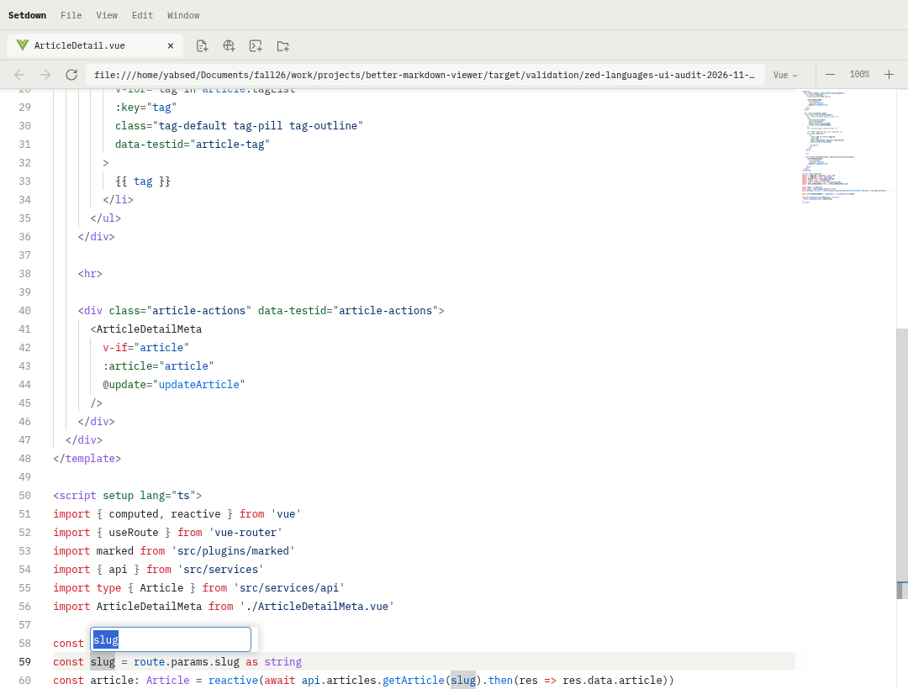

`slugRenamed`를 넣고 Enter를 누르면 선언과 `getArticle(slug)`의 두 곳이 바뀌고 `route.params.slug`는 그대로다. Ctrl+Z로 되돌아간다.

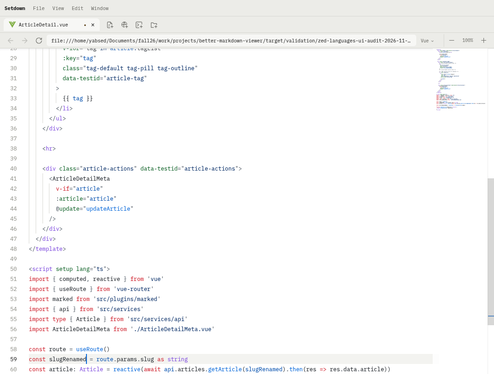

### 3.2 Deno 안내의 버튼이 목록으로 보냈다

안내 아래의 버튼은 **Choose analysis tool…**이었고, 누르면 여덟 줄짜리 목록에서 `deno`를 찾아야 했다. 버튼을 **Use Deno's tool**로 바꿨다. 한 번 누르면 이 프로젝트의 도구가 Deno로 바뀐다. Deno 도구가 이 파일에 제공되지 않는 경우에만 목록을 연다.

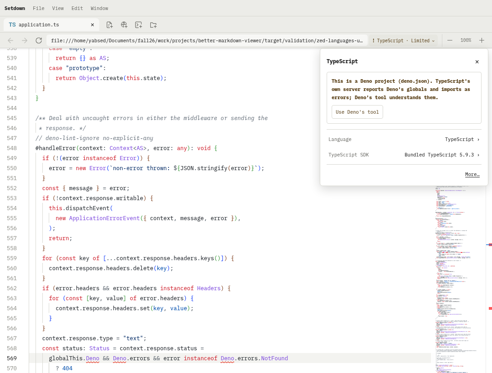

이 감사 프로필에는 Deno가 이미 내려받아져 있어서 누른 뒤 2.5초 안에 "✓ Working"이 됐다. 처음 고를 때는 내려받는 데 30초쯤 걸렸다(`family-after`의 `deno-choose`).

### 3.3 내장 TypeScript 작업자가 같은 질문에 한 번 더 답했다

편집기에는 자체 TypeScript 작업자가 있다. 열려 있는 파일 하나만 읽고 그 파일이 가져오는 것은 모른다. 프로젝트 도구가 연결된 뒤에도 이 작업자가 호버, 자동완성, 정의 이동에 따로 답하고 있었고, 편집기는 두 답을 모두 보였다. 이것은 프레임워크와 무관하게 모든 TypeScript와 JavaScript 파일에 있던 문제다.

| 질문 | 수정 전 | 수정 후 |
| --- | --- | --- |
| 가져온 이름에서 F12 (`article.component.ts`의 `ArticlesService`) | 탭은 그대로, 항목 두 개짜리 목록: import 줄 자신과 `articles.service.ts` | `articles.service.ts:9` `export class ArticlesService {`로 이동 |
| 같은 것 (React `ErrorBoundary.tsx`의 `ErrorBoundaryContextProvider`) | 목록 | `ErrorBoundaryContextProvider.ts:7`로 이동 |
| 호버 (React) | 서버의 답 아래에 `import ErrorBoundaryContextProvider`가 한 번 더 | 서버의 답만 |
| 호버 (Deno 도구를 고른 뒤 `Deno`) | Deno 도구의 답 아래에 `any` | Deno 도구의 답만 |
| 자동완성 (Deno 도구를 고른 뒤) | `DOMException`, `DOMException`, `DOMMatrix`, `DOMMatrix` … 모든 전역이 두 번 | 한 번씩 |

수정 전의 F12:

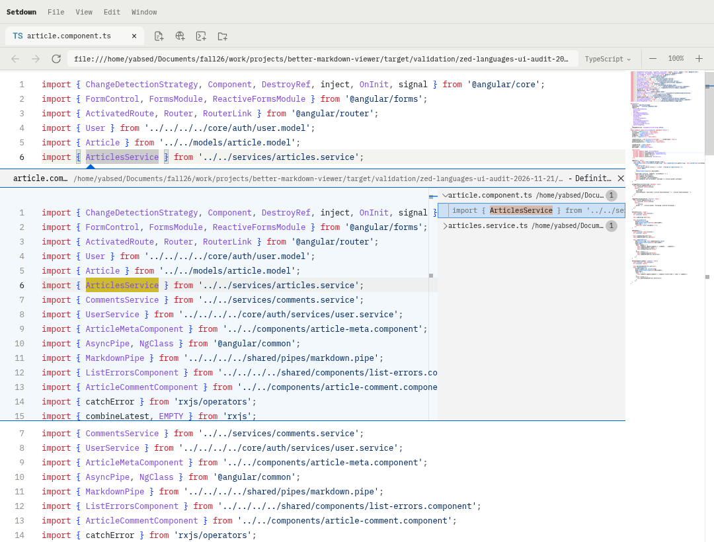

수정 후:

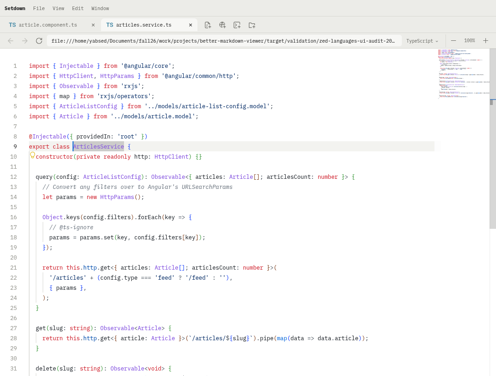

Deno 도구를 고른 뒤의 호버, 수정 전과 후:

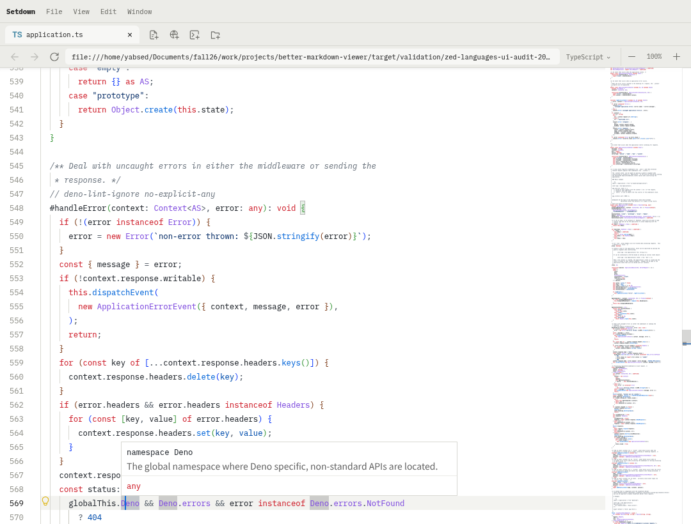

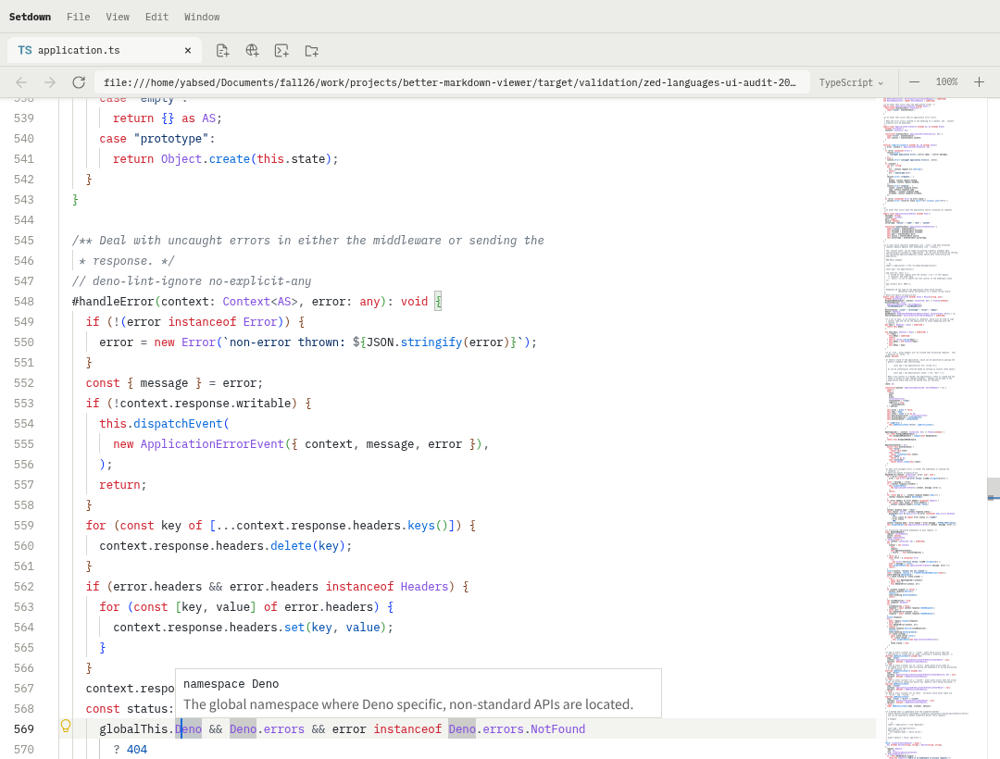

고친 방식은 이렇다. 언어의 도구가 연결되어 어떤 질문에 답한다고 알리면, 작업자는 그 파일의 그 질문에는 답하지 않는다(호버, 자동완성, 정의, 참조, 강조, 매개변수 힌트, 심볼, 빠른 수정, 인레이 힌트). 도구가 떠나면 다시 답한다. 린터처럼 옆에 붙은 도구는 작업자를 조용하게 만들지 않는다. 문서 패널의 **Built in** 줄은 작업자가 아직 답하는 것만 적는다. 프로젝트 도구가 붙은 파일에서는 "Completion · Hover · Formatting"이 "Formatting"이 됐다(`ownLanguageAnswers`, `typescript.worker.ts`).

JSON, CSS, HTML에도 내장 작업자가 있다. 그쪽에 같은 겹침이 있는지는 보지 않았다.

### 3.4 주 도구 목록에 주 도구가 될 수 없는 도구가 있었다

TypeScript 파일의 **Choose analysis tool…** 목록은 "TypeScript and JavaScript, biome, deno, vtsls, graphql, angular"였다. `graphql`과 `angular`는 TypeScript를 대신할 수 없다. 고르면 TypeScript 서버가 꺼지고 아무 답도 없게 된다.

확장이 정의하지 않고 이름만 올린 언어에서 그 확장의 도구는 손님이다. 손님은 그 언어의 주 도구 목록에 넣지 않는다. 문서의 목록과 Language Support 화면 둘 다다. 수정 후 목록은 "TypeScript and JavaScript, biome, deno, vtsls"다. 묶음 카탈로그에서 이 규칙에 걸리는 것은 13개 언어의 20쌍이다(TypeScript의 graphql과 angular, HTML의 angular, Vue·Svelte·Astro의 graphql과 stylus 등).

### 3.5 한 번 답한 확장이 목록에서 빠졌다

`contributors.json`은 다음 실행에서 누구에게 물을지를 기억한다. Marko 프로젝트를 연 뒤 이 목록에서 Astro가 사라졌다. Astro 확장은 프로젝트의 `package.json`을 보고 답하는데, Marko 프로젝트에서는 답할 것이 없었고, 그때의 규칙은 답하지 않은 확장을 지웠다. 한 프로젝트에서 조용했다는 것은 다음 프로젝트에 대해 아무것도 말해 주지 않는다. 이제 한 번 답한 확장은 목록에 남는다. 패키지가 지워진 확장은 로드되지 않을 뿐이다.

### 3.6 문구

- 도구가 보낸, Setdown이 쓰지 않는 메시지는 로그에 `The tool sent "<이름>". Setdown does nothing with this message.`로 한 번 적힌다.
- 도구 페이지에 "Added by other tools" 줄이 생겼다(2.1절).

## 4. 고치지 않은 것

### 4.1 Ember: 도구는 붙지만 `.gjs`에서 거의 답하지 않는다

`super-rentals`의 `rental.gjs`에서 `ember-language-server`는 "✓ Working"이 된다. 그러나 `<RentalImage`에서 호버는 없고 F12는 "No definition found for 'RentalImage'"다. 도구에 직접 물어도 같았다(호버 null, 정의 빈 목록, 템플릿 자동완성만). Ember가 `.gjs`에 쓰라고 하는 도구는 Glint인데, Zed 카탈로그에도 Mason에도 없고 예제 프로젝트에도 들어 있지 않다. "Working"이라는 말은 도구가 살아 있다는 뜻으로는 맞지만, 어제 Vue에서 본 것과 같은 실망을 준다. 도구 페이지의 기능 목록이 실제로 무엇을 답하는지를 말해 줄 뿐이다.

### 4.2 MDX: Markdown으로 읽는다

`.mdx`는 Markdown 문서로 열린다. 읽기 화면은 `import`와 `export` 줄을 본문 문단으로 보이고, `<Note>` 안의 Markdown(`**Note**`, 링크)을 풀지 않은 글자 그대로 보인다.

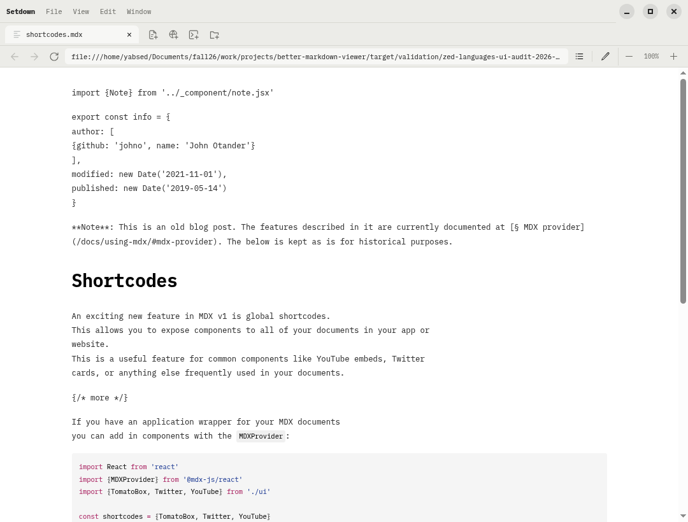

편집 화면은 Markdown 편집기에 MDX 색을 입힌 것이고 언어 도구는 없다. Zed에는 MDX 확장이 있지만, Markdown 편집기에 언어 도구를 붙이는 것과 읽기 화면이 JSX를 다루는 것은 이번 범위 밖의 작업이다.

### 4.3 Deno: 내장 이름의 정의로 갈 수 없다

Deno 도구를 고른 뒤 `Deno`에서 F12를 누르면 "No definition found for 'Deno'"가 나온다. Deno 도구는 답을 주지만 그 위치가 Deno가 만들어 주는 가상 문서(`deno:` 주소)다. Setdown에는 도구에게서 문서 내용을 받아 읽기 전용으로 여는 길이 없다. 문구도 사실과 다르다. 정의가 없는 것이 아니라 열 수 없는 것이다.

Deno 도구가 `application.ts:753`에 보고하는 타입 오류 하나는 TypeScript 서버도 같은 문장으로 보고한다. 거짓 오류가 아니다.

### 4.4 그 밖에

- **`.vue`와 `.ts`에 걸친 이름 바꾸기**는 해 보지 않았다. 코드에서는 허용했다(같은 서버가 두 파일을 다른 역할로 읽는 경우). 확인한 것은 한 `.vue` 파일 안의 이름 바꾸기뿐이다.
- **Vue 템플릿의 자동완성**에 같은 컴포넌트가 두 번 나온다(`ArticleDetailMeta, Variable`과 `ArticleDetailMeta, ./ArticleDetailMeta.vue`). 두 도구가 각각 답한 것이다.
- **모든 프로젝트의 TypeScript 서버에 알려진 플러그인이 다 실린다.** Angular 프로젝트의 TypeScript 서버에도 Vue, Marko, Astro 플러그인이 실린다. VS Code에서 확장을 여럿 설치했을 때와 같다. 도구 페이지에 보이지만 그 비용은 재지 않았다.
- **도구 이름**은 `deno`, `angular`, `biome`, `vtsls`처럼 도구 자신의 이름 그대로다. `gopls`, `clangd`와 같은 규칙이라 두었다. 버튼은 "Use Deno's tool"인데 그 뒤의 줄은 `deno`다.
- **Astro의 `astro:content` 타입**은 프로젝트에서 `astro sync`를 해야 생긴다. 도구가 호버에서 그렇게 말한다("Run astro dev or astro sync to generate high fidelity types"). Setdown이 대신 하지는 않는다.
- **Angular `.ts`의 수정 전 "Limited"**(가져오기 5개를 찾지 못함)는 그때 예제 저장소에 의존성을 설치하지 않아서였다. 수정으로 달라진 것이 아니다.
- 도구 페이지의 "The server did not include a document version."과 표준 오류의 "Language request cancelled." 줄은 전부터 있던 것이고 손대지 않았다.

## 5. 닫기 확인 창과 멈추는 영상

저장하지 않은 탭을 닫을 때 뜨는 "Save Changes" 창은 셸의 HTML이다. 웹 페이지는 그 위에 놓인 네이티브 뷰라서 HTML 창이 페이지에 가려진다. 지금까지는 창이 떠 있는 동안 페이지를 캡처한 그림으로 바꾸고 실제 뷰를 숨겼다. 그래서 창은 보였지만 영상의 화면이 멈췄다.

이제 그 창에 웹 페이지가 보이고 있으면 확인 창을 창 전체를 덮는 투명한 네이티브 층에 띄운다(`close-prompt-overlay.ts`). 메뉴가 이미 쓰는 방식이다. 페이지는 자리와 표시 상태를 그대로 지키고 계속 그려진다. 웹 페이지가 보이지 않는 창에서는 전과 같이 셸의 창이 묻는다.

가상 화면 전체를 찍은 그림이다. 페이지에 프레임 수를 세는 숫자를 띄웠다. 확인 창이 뜬 직후가 101, 1.5초 뒤가 198이고, 취소한 뒤 241까지 이어졌다.

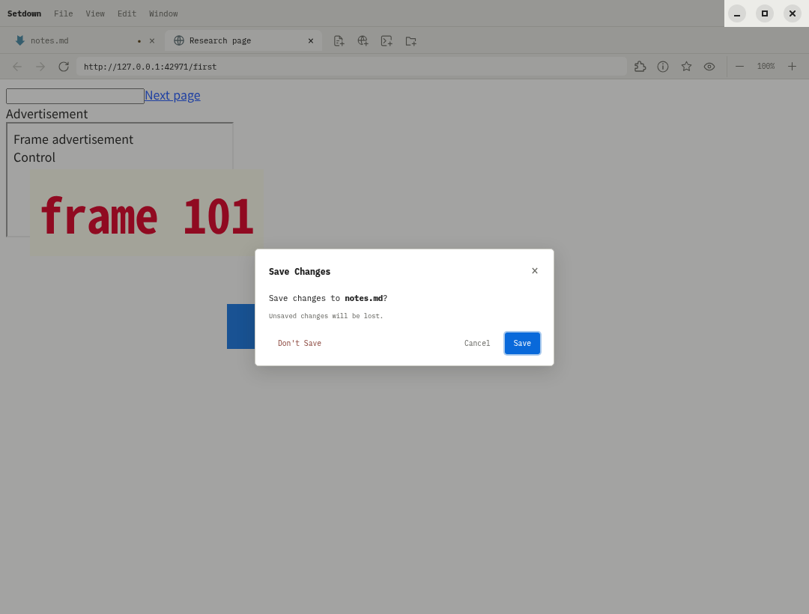

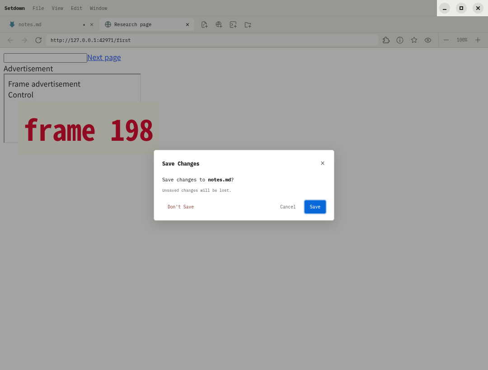

다른 셸 오버레이(탐색기의 우클릭 메뉴, 휴지통 확인 등)는 여전히 캡처한 그림을 쓴다. 그것들이 떠 있는 동안에는 영상의 화면이 멈춘다. 이번에 바꾼 것은 닫기 확인 창 하나다.

## 6. 시험

| 시험 | 결과 |
| --- | --- |
| 단위 시험 전체 (`npm test`) | 246개 파일, 1952개 통과 |
| 타입 검사와 빌드 (`npm run build`) | 통과 |
| 닫기 확인 창을 여는 실제 앱 시험 6개 파일 | 45개 통과 |
| 계약 시험 전체 (`npm run test:preview-contract`) | **실패.** 단위 시험 1247개와 도구 시험 20개 통과, 빌드 통과, 실제 앱 시험 411개 중 410개 통과, 1개 실패 (6.1절) |

새로 쓴 실제 앱 시험 둘은 수정이 없는 빌드에서 실패하는 것을 확인했다.

- `test/e2e/browser/lifecycle.spec.ts`의 "the close prompt is asked above a live web page, which stays shown and keeps drawing": 이전 빌드에서 실패, 새 빌드에서 통과.
- `test/e2e/language/language-policy.spec.ts`의 "beside the project service the editor's own worker adds no second answer, and answers again when analysis is off": 수정 한 줄을 빼고 빌드하면 실패, 되돌리면 통과.

새 단위 시험은 보탠 것의 합치기와 걸러내기(`tool-contributions.test.ts`), 묻는 대상과 기억(`language-provisioner.test.ts`), 프로젝트 패키지 도구(`project-package-tools.test.ts`), Vue의 질문 전달(`vue-rules.test.ts`), 이름 바꾸기 순서(`language-client.test.ts`, `language-feature-plan.test.ts`), 손님 규칙(`runtime-language-catalog.test.ts`), 작업자가 물러나고 돌아오는 것(`builtin-diagnostics.test.ts`), Deno 안내(`analysis-context.test.ts`, `document-presentation.test.ts`), 확인 창의 순서(`close-prompt-controller.test.ts`)를 본다.

미리보기 성능 벤치마크(`npm run bench:preview`)는 돌리지 않았다. 미리보기의 준비·표시·전환 경로를 바꾸지 않았다. 닫기 확인 창의 층은 확인 창이 떠 있을 때에만 창에 붙는다.

### 6.1 실패한 시험 하나

`test/e2e/language/language-registry.spec.ts`의 "an imported npm profile starts automatically and supplies completion without a connection form"이다. 편집기의 상태가 5초 안에 "ready"가 되어야 하는데 "starting"에 머문다. 혼자 돌려도 똑같이 실패한다.

어제 보고서(`reports/zed-languages-ui-audit-2026-11-21/report.md`)가 커밋 `508d564`의 소스에서 같은 실패를 적어 두었다. 오늘 수정을 뺀 소스로 다시 돌려 보지는 않았다. 아래 원인은 이번에 바꾼 코드를 지나지 않는다.

원인은 이렇다.

- 이 시험은 JSON 도구를 `PATH`에 없는 npm 전역 폴더에만 둔다. 앱이 그 폴더에서 도구를 찾아 그대로 실행하기를 기대한다.
- 커밋 `d75384a`부터 JSON 파일은 Zed 프로젝트 엔진이 맡는다(`zed-settings.ts`의 `projectEngineTools`). Zed의 JSON 어댑터는 `PATH`에서만 도구를 찾고, 없으면 자기 폴더에 npm으로 새로 설치한다.
- 시험 환경의 `PATH`에는 `node`만 있고 `sh`가 없다. 그래서 그 설치가 실패한다.

같은 준비로 앱을 1분 동안 지켜본 기록이다(`apps/desktop/.probe/npm-profile.spec.ts`).

| 시각 | 상태 |
| --- | --- |
| 1.2초 | starting |
| 29.5초 | failed: "failed to execute npm install subcommand" |
| 30.5초, 35.1초, 41.5초 | 다시 starting, 1.5초쯤 뒤 같은 이유로 failed (세 번) |
| 1분 뒤 | 시험이 둔 도구는 한 번도 실행되지 않았다 |

패널에는 "JSON support can't start. … npm error syscall spawn sh"가 나온다.

고치지 않았다. 시험과 제품 중 어느 쪽을 바꿀지가 결정할 일이기 때문이다.

1. **시험을 바꾼다.** `language-manager.ts`에는 "지원되는 Zed 어댑터가 외부 도구 찾기를 맡는다"는 주석이 있다. 그 결정대로라면 시험이 도구를 `PATH`에 두어야 한다. 바꾸는 양이 가장 적다. 권하는 쪽이다.
2. **제품을 바꾼다.** Setdown이 npm 폴더에서 찾은 프로그램을 Zed에 알려 준다. gopls에는 이미 그렇게 한다(`project-languages.ts`의 `prepareTool`). JSON, YAML, CSS, HTML, Dockerfile 도구가 시작하는 방식이 함께 바뀐다.

실제 컴퓨터에는 `sh`가 있어서 설치가 된다. 그러니 평소 쓰는 데에는 이 실패가 나타나지 않는다. 다만 이미 있는 도구를 두고 한 벌을 더 내려받는다. Language Support 화면이 그런 도구를 지금도 "Found on this computer"로 보여 주는지는 확인하지 않았다.

## 부록 A. 저장소

| 도구 | 저장소 | 커밋 | 파일 |
| --- | --- | --- | --- |
| React | `bvaughn/react-error-boundary` | `797fe9c117` | `lib/components/ErrorBoundary.tsx` |
| Svelte | `sveltejs/realworld` | `df79670804` | `src/routes/+layout.svelte` |
| Vue | `mutoe/vue3-realworld-example-app` | `741c215ef0` | `src/components/ArticleDetail.vue`, `src/pages/Article.vue`, `src/router.ts` |
| Astro | `satnaing/astro-paper` | `217c4e3362` | `src/layouts/Layout.astro`, `src/utils/getSortedPosts.ts` |
| Angular | `gothinkster/angular-realworld-example-app` | `a7a19c511b` | `src/app/features/article/pages/article/article.component.html`, `.ts` |
| Marko | `marko-js/examples` | `c097507ffe` | `examples/basic/src/routes/+page.marko`, `examples/app/src/tags/char-count/stories.ts` |
| Deno | `oakserver/oak` | `9e2ca3c581` | `application.ts` |
| Ember | `ember-learn/super-rentals` | `110abce609` | `app/components/rental.gjs` |
| MDX | `mdx-js/mdx` | `52285a6758` | `docs/blog/shortcodes.mdx` |

## 부록 B. 사례별 기록 (수정 후)

| 사례 | 호버 | 자동완성 | F12 |
| --- | --- | --- | --- |
| Vue `<script>` (`useRoute`) | `useRoute<string \| symbol>(…): RouteLocationNormalizedLoaded<…>`와 설명 | `updateArticle`, `useRoute`, `useRouter` … | `vue-router`의 `.d.ts:2288` |
| Vue `<template>` (`ArticleDetailMeta`) | `import ArticleDetailMeta` | `ArticleDetail`, `ArticleDetailMeta`, 태그 이름들 | `ArticleDetailMeta.vue:1` |
| `.ts`에서 `.vue` 가져오기 (`router.ts`) | `module "./pages/Article.vue"` | 파일 이름 | `Article.vue:1` (수정 전에는 제자리에서 목록) |
| Vue 타입 오류 | 빨간 줄 위에서 "Type 'string' is not assignable to type 'number'. typescript(2322)" | | Problems에 출처 `typescript`로 두 건, 되돌리면 사라짐 |
| Angular 템플릿 (`a.title`) | `(property) Article.title: string` | `tagList`, `title` | `article.model.ts:5` |
| Angular `.ts` (`templateUrl`) | 없음 | | `article.component.html:1` |
| Astro `.astro` | 됨 | `resolveDefaultOgImagePath` | `resolveDefaultOgImagePath.ts:24` |
| Astro `.ts` (`CollectionEntry`) | `type CollectionEntry<C> = any`와 "Run astro dev or astro sync …" | `CollectionEntry`, `CollectionKey` … | `content.d.ts:36` (`astro sync`를 하지 않아 타입이 `any`인 선언) |
| Marko `.marko` (`mouse-mask`) | 태그가 어디서 왔는지와 `Marko.Template<Input, void>` | 태그 이름들 | `mouse-mask.marko:1` |
| Marko `.ts` (`Template`, `./index.marko`에서 가져옴) | `interface Template`과 `const Template: Marko.Template<Input, void>` | `type` | 제자리에 목록. 두 줄 모두 `index.marko` (도구가 선언 둘을 돌려준다) |
| Deno 도구 (`Deno`) | `namespace Deno`와 설명 | 전역 이름, 한 번씩 | "No definition found for 'Deno'" (4.3절) |
| Ember `.gjs` (`RentalImage`) | 없음 | `RentalImage` | "No definition found" (4.1절) |

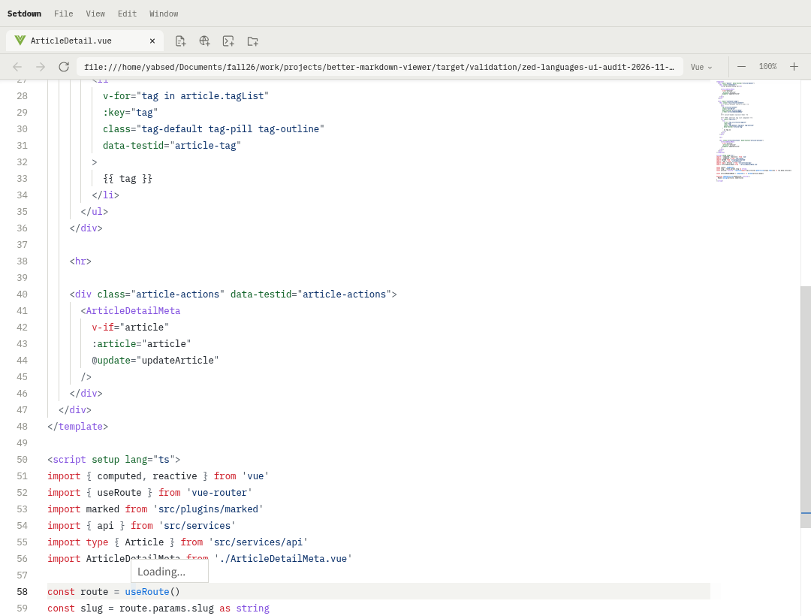

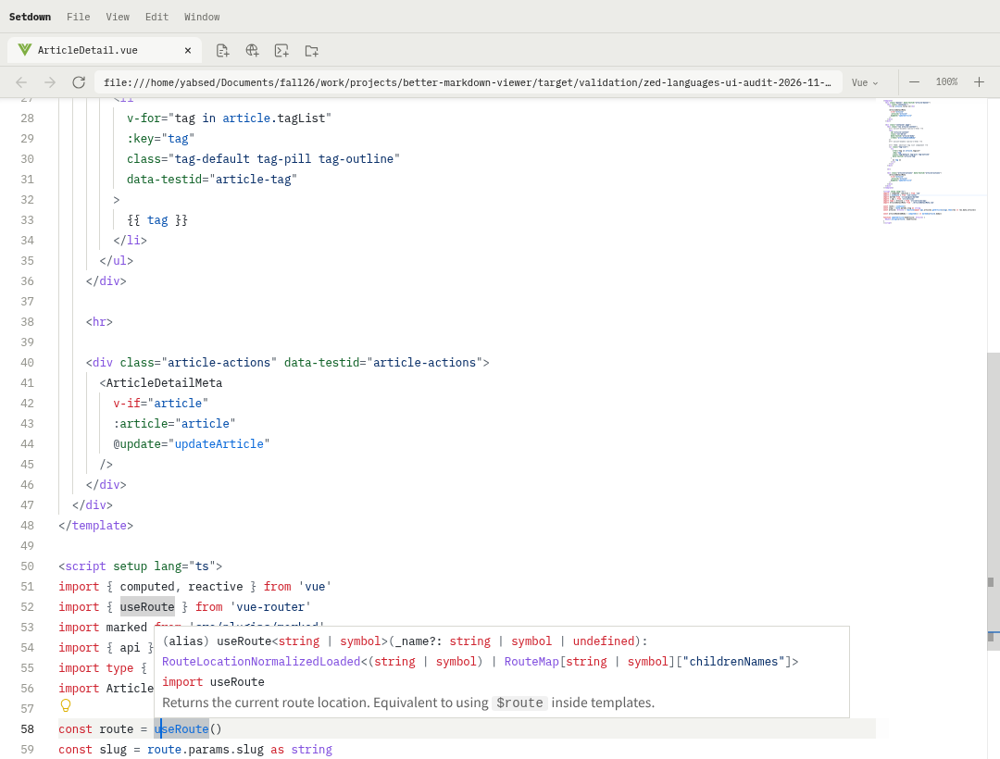

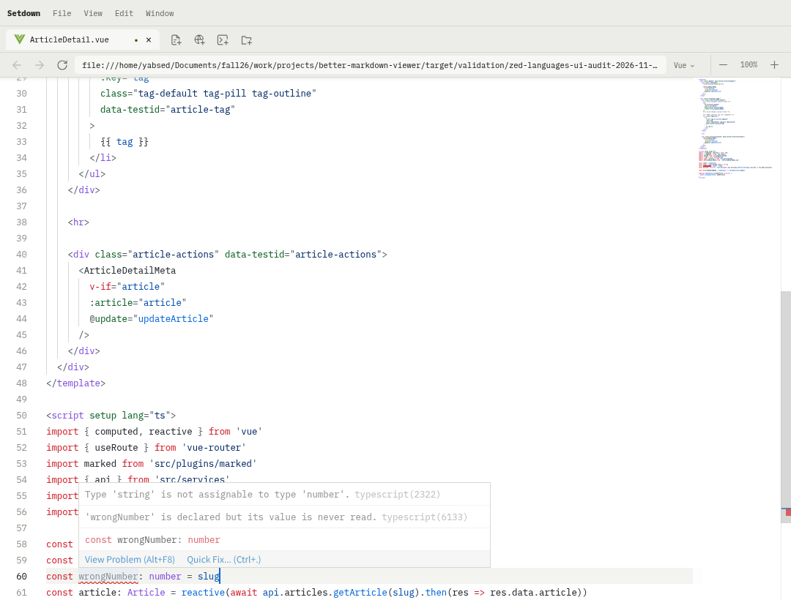

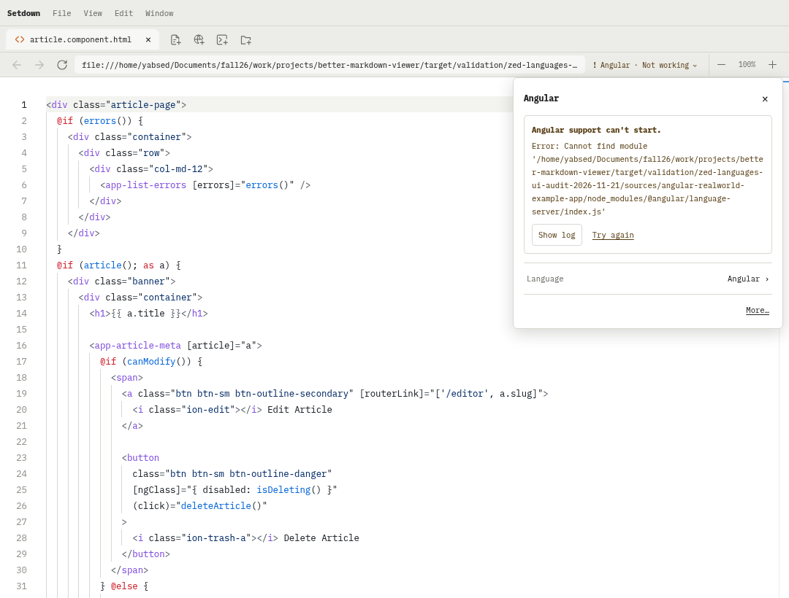

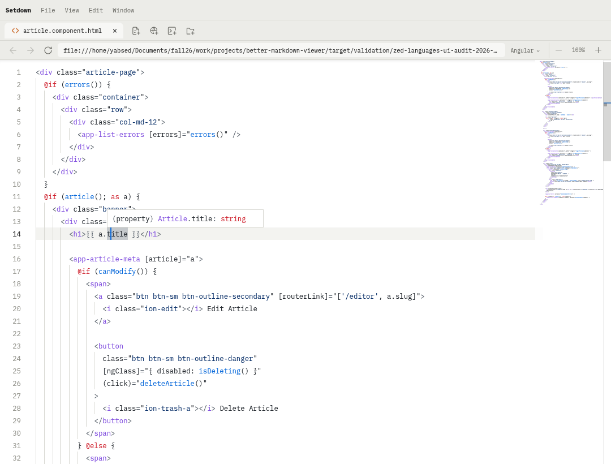
