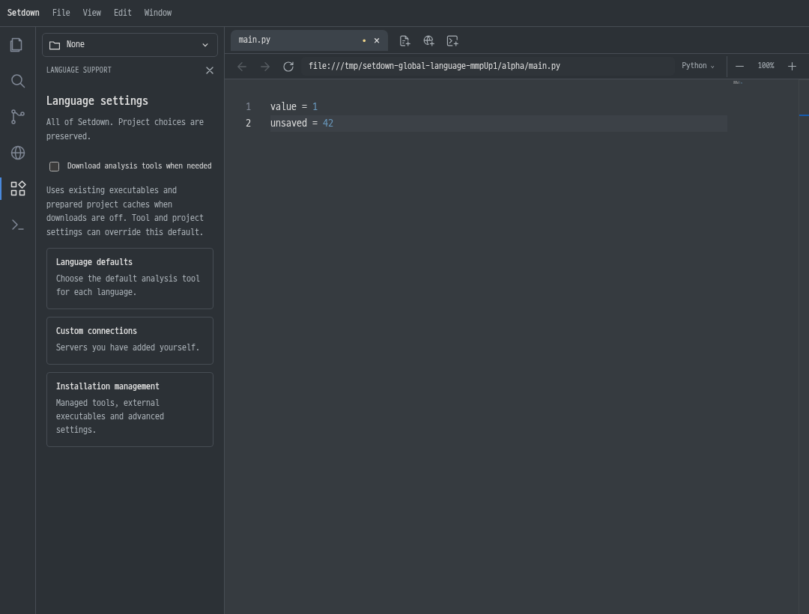
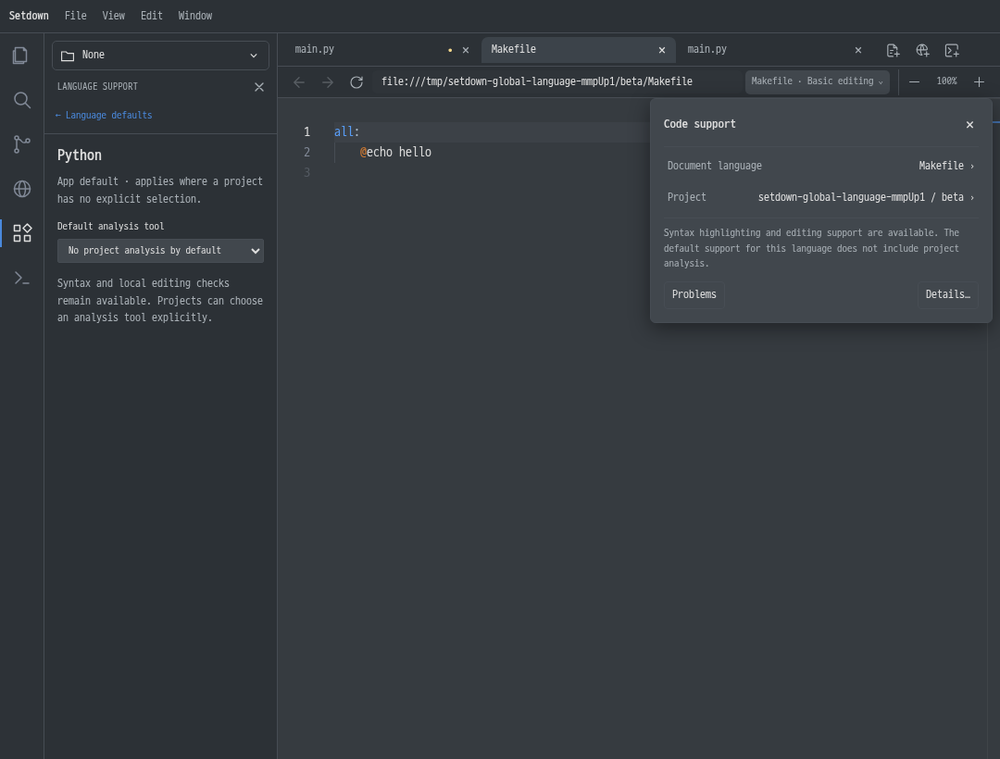

# 언어 지원 전역 설정 구현

2026-11-10. 기준 버전: `52bbaa9`.

[설계 문서](../../docs/language-support-global-settings-design.ko.md)의 방향을 제품 코드에 적용했다. 왼쪽 첫 화면은 Setdown 전체의 기본 동작을 정하고, 현재 파일의 Code support는 그 파일에 실제 적용된 선택과 실행 결과를 설명한다.

실행 중인 Setdown을 종료한 뒤 [새 Linux 실행 파일](../../apps/desktop/release/language-global-settings-2026-11-10/linux-unpacked/setdown)을 열면 확인할 수 있다. 실행 파일은 같은 폴더의 resources·라이브러리와 함께 사용한다.

패키징된 `app.asar`를 실제로 실행해 전역 설정 표시와 저장, 다운로드를 끈 상태의 기본 제공 Python 연결, Makefile의 올바른 지원 안내를 확인했다. renderer 오류는 없었다. [확인 결과](packaged-settings-result.json)와 [패키지 실행 화면](packaged-settings.png)을 보관했다. 성능 비교는 80회 실행·48개 항목 모두 통과했으며, 전체 GUI 검사에 남은 Git 시간 초과 1건은 아래에 별도로 기록했다.

## 사용자에게 달라지는 동작

- 왼쪽 첫 화면에는 자동 다운로드, 언어별 기본 분석기, 사용자 연결, 고급 설치 관리가 있다. 첫 화면과 언어 기본값 조회는 실행 파일을 탐색하거나 서버를 시작하지 않는다. 파일·프로젝트가 없어도 사용할 수 있다.
- 일반적인 파일 열기는 선언된 기본 분석기를 선택하고 필요하면 자동 준비한다. 여러 대안이 설치되어 있다는 이유만으로 선택을 강요하지 않는다. 기본값이 없는 실제 모호함과 실행 파일 후보의 충돌은 계속 선택을 요구한다.
- 앱 기본값은 별도 선택이 없는 프로젝트에 적용된다. 프로젝트에서 지정한 분석기와 명시적인 분석 끄기는 유지된다. 프로젝트의 **Use app default**는 상속을 복원한다.
- Makefile에는 문법과 편집 지원이 있다는 설명이 나온다. 비활성 보조 프로필 때문에 Python 환경이나 “프로젝트 분석이 꺼짐”을 표시하지 않는다.
- 서버의 연결·진단·환경·출력·재시작은 현재 파일에서 확인한다. 전역 설치 목록은 설치 상태와 출처를 표시한다. 관리형 설치가 PATH에 없거나 서버 프로세스가 멈췄다는 이유만으로 미설치로 취급하지 않는다.
- 직접 추가한 연결, 가져오기, 실행 파일 선택, 외부 설치 재확인은 고급 관리 화면에서 계속 사용할 수 있다.

## 설정과 실행 수명

기존 `language-servers.json`의 버전과 사용자 연결 ID, 경로, 인수, 설정, 프로젝트별 선택을 보존한다. 새 전역 다운로드 기본값과 언어별 앱·프로젝트 선택은 선택적 필드로 추가했다. 기존 선호 서버와 활성화 설정도 읽으며, “자동” 복원은 다른 언어가 공유하는 연결 설정을 지우지 않는다. 주 분석기의 자동 선택을 복원할 때 보조 도구의 독립적인 활성화 설정도 유지한다.

주요 소유권은 다음과 같다.

| 코드 | 책임 |
| --- | --- |
| `main/language/server-registry.ts` | 앱·프로젝트 정책, 기존 설정 해석, 선언된 기본 분석기 선택 |
| `main/language/language-manager.ts` | 실제 문서 root와 환경, 자동 준비, 영향받는 세션의 교체 |
| `main/language/language-provisioner.ts` | 검증된 관리형 실행 기록과 다운로드 정책 |
| `renderer/language/LanguageSupport.svelte` | 앱 기본값과 고급 설치 관리 |
| `renderer/language/DocumentAnalysisPanel.svelte` | 현재 파일의 선택 출처·환경·진단·복구 |

전역 정책 변경은 실행 설정이 실제로 달라진 세션만 교체한다. 유지 가능한 문서의 ID와 generation을 renderer에도 전달하여, main의 프로세스만 남고 클라이언트가 다시 연결하는 일이 없도록 했다. 미저장 내용과 Undo, 관련 없는 프로젝트와 노트북 실행 환경을 보존한다.

TypeScript/TSX, JavaScript/JSX처럼 동일한 편집기 언어를 공유하는 프로토콜 변형은 같은 선택 정책을 사용한다. 한 언어를 껐을 때 다른 변형의 경로가 대신 연결되는 문제를 수정하고, 프로젝트의 명시적인 끄기·상속 복원·다른 프로젝트의 독립성을 함께 검사한다.

## 자동 준비의 범위

다운로드 정책은 도구·프로젝트의 명시적인 설정이 우선한다. 기본 제공 도구와 외부 실행 파일은 다운로드를 꺼도 사용할 수 있다. 관리형 실행 기록은 파일 크기·수정 시각을 다시 확인하며, 다운로드 허용 여부 자체는 같은 실행 명령의 캐시를 무효화하지 않는다. 유효한 기록을 재사용할 때는 설치 호스트나 네트워크에 접근하지 않는다.

실행 기록은 프로젝트 입력과 실행 설정에 연결된다. 다른 프로젝트에서 준비한 도구가 있더라도 새 프로젝트나 변경된 manifest에는 새 준비가 필요할 수 있다. 다운로드가 꺼져 있으면 이 상황을 설명하고 설치를 시작하지 않는다. 이 설정은 분석 도구의 준비 정책이며, 문법 패키지나 언어 카탈로그의 갱신 정책을 대체하지 않는다.

사용자가 직접 선택한 실행 파일이 없어진 경우, 이전 관리형 설치 기록이 그 오류를 가리지 않는다. 설치 관리에서 선택한 실행 파일을 복구할 수 있다.

## 검증 방법

실제 GUI와 벤치마크는 `with-isolated-display.sh`의 Xvfb, 분리된 runtime 디렉터리와 D-Bus에서 순차 실행한다. 데스크톱 화면에는 테스트 창을 띄우지 않는다. 빌드·검증 프로세스는 `MemoryHigh=3G`, `MemoryMax=4G`, `MemorySwapMax=256M`, Cargo 1개 작업으로 제한한다. 기준·변경 빌드 모두 `SETDOWN_BUILD_SOURCEMAP=0`을 사용한다.

성능 기준본은 `target/validation/language-global-settings-2026-11-10/baseline`에 따로 준비했다. 기준 커밋의 소스와 독립된 의존성·Electron 설치를 사용한다. vendor는 기준 커밋에 고정된 각 submodule 커밋의 `git archive`로 복사했다. 처음 준비한 vendor 심볼릭 링크는 Git identity 검사에서 거부되어 측정 시작 전에 교체했으며, 이 준비 실패 로그도 보존했다. Rust 빌드 캐시는 공유하되 각 앱 빌드에서 실제 호스트 빌드와 inventory 검사를 수행한다.

추가 검증과 Linux 실행 파일 준비는 [finish-validation.sh](finish-validation.sh), 패키징된 앱의 전역 설정·기본 제공 Python·Make 동작 검사는 [check-packaged-settings.mjs](check-packaged-settings.mjs)에 기록했다. 원시 실행 결과는 `target/validation/language-global-settings-2026-11-10`에 보관한다.

## 실제 화면

실제 Electron 검사에서 저장한 화면이다. 첫 화면에는 전역 설정만 표시하고, 설치 재확인은 관리 화면에서 제공한다.

[밝은 테마의 전역 설정](global-language-settings.png)에서도 같은 범위와 조작을 제공한다. 아래 Makefile의 현재 파일 화면에는 해당 문서의 편집 지원 범위가 표시된다.

## 정확성 검사 결과

최종 소스로 실행한 `npm run test:preview-contract` 결과:

| 검사 | 결과 |
| --- | --- |
| 단위 테스트 | 126개 파일, 1,011개 통과 |
| 빌드·벤치마크 도구 테스트 | 14개 통과 |
| TypeScript·Svelte 검사 | 오류 0, 경고 0 |
| 프로덕션 빌드 | 통과 |
| 실제 Electron/Chromium GUI | 339개 통과, 1개 시간 초과, 21.7분 |

시간 초과는 `git/git-activity-badge.spec.ts`의 긴 저장소 경로·여러 저장소 배지 시나리오다. 두 너비의 화면 캡처 이후 테스트 60초와 worker 종료 제한에 걸렸으며, 실패 기록만으로 정확한 정지 지점을 확정할 수 없다. 같은 최종 빌드와 메모리 제한에서 **테스트 내용·제한 시간을 바꾸지 않고** 추적을 켠 단독 실행은 2.9초에 통과했다. 두 차례의 이전 전체 실행에서도 이 시나리오는 통과했다. 최종 전체 실행을 전부 통과한 것으로 기록하지 않으며, 원인이 재현되지 않은 시간 초과 1건을 남긴다. 원시 결과는 `final-contract/`, 별도 조사 결과와 trace는 `git-timeout-investigation/`에 있다.

앞선 전체 검사에서 발견한 가져오기 후 화면 이동과 TypeScript/TSX 정책 우회는 제품 코드에서 수정했다. 전역 패널의 새 탐색 구조에 맞춰 GUI 조작을 수정했으며, 클립보드 검사는 비동기 쓰기의 실제 완료를 기다리고 서버 재연결 검사는 일시적인 상태를 발생 직후 관찰하도록 정리했다. 기존 검사 항목과 검증 조건을 유지했고, 실패한 전체 실행도 `first-contract/`, `second-contract/`에 보존했다. 최종 전체 검사에서는 모든 언어 지원 시나리오가 통과했다.

추가 실제 서버 검사도 **2개 모두 통과(14.1초)**했다. `fortls 3.2.2`에서는 등록 없이 연결, 설치 재확인, hover·완성·진단을 확인했다. `rust-analyzer 0.3.3081-standalone`에서는 실행 파일 선택, 전역 활성화, 완성·hover·진단·이름 변경·Undo·정의 이동·재시작을 확인했다. Rust 바이너리는 `2026-10-12` 릴리스의 Linux x86_64 실행 파일이며 압축본 SHA-256 `040cab4e2abc490fadd95c3f6cbc60b941a78761dbc3acf0ec66fd7a97f31db3`을 확인했다. 로그와 결과는 `real-language-servers.log`, `real-language-servers/`에 있다.

## 미리보기 성능 비교

기준 `52bbaa9`와 변경본을 각각 5회씩 비교했다. 8개 시나리오에서 총 80회 앱을 실행했고, 48개 비교 항목 모두 기존 허용 기준 안에 들었다. 회귀 판정 기준은 **25%와 50ms를 모두 넘는 증가**이며 변경하지 않았다. 누락된 시나리오와 최신 편집 내용 검사 실패는 없었다. 원시 표본·실행 순서·빌드와 harness 해시는 [preview-comparison.json](preview-comparison.json)에 있다.

보고서의 JSON은 모든 시간 표본과 비교 메타데이터를 보존하고 상세 trace 배열만 생략했다. 전체 원본과 실행별 로그는 `target/validation/language-global-settings-2026-11-10/benchmark/`에 있다.

아래 수치는 ms이며 각 칸은 **첫 번째 / 두 번째 / 반복** 순서다. 반복은 각 앱의 3~5번째 사이클 중앙값을 구한 뒤 5회 실행 사이의 중앙값을 취한다. 첫 번째와 두 번째도 5회 실행의 중앙값이다. `화면 캡처`는 Esc 입력부터 최신 내용을 포함한 비어 있지 않은 native capture까지의 값으로 IPC·읽기 비용을 포함하며 모니터 표시 시각을 뜻하지 않는다. `편집 복귀`는 실제 더블클릭부터 편집기 복귀까지다.

| 대상 | 편집 | 준비 시간 | 측정 | 기준 첫 / 둘 / 반복 | 변경 첫 / 둘 / 반복 |
| --- | --- | --- | --- | --- | --- |
| Markdown | 없음 | 0ms | 화면 캡처 | 67.0 / 22.0 / 27.0 | 61.0 / 33.0 / 25.0 |
| Markdown | 없음 | 0ms | 편집 복귀 | 26.0 / 45.0 / 13.0 | 23.0 / 18.0 / 13.0 |
| Markdown | 있음 | 0ms | 화면 캡처 | 301.0 / 96.0 / 93.0 | 311.0 / 101.0 / 92.0 |
| Markdown | 있음 | 0ms | 편집 복귀 | 18.0 / 16.0 / 15.0 | 17.0 / 16.0 / 16.0 |
| Markdown | 없음 | 3000ms | 화면 캡처 | 49.0 / 23.0 / 21.0 | 44.0 / 23.0 / 20.0 |
| Markdown | 없음 | 3000ms | 편집 복귀 | 18.0 / 16.0 / 14.0 | 19.0 / 16.0 / 14.0 |
| Markdown | 있음 | 3000ms | 화면 캡처 | 118.0 / 81.0 / 89.0 | 115.0 / 102.0 / 93.0 |
| Markdown | 있음 | 3000ms | 편집 복귀 | 17.0 / 15.0 / 14.0 | 21.0 / 15.0 / 15.0 |
| Git 리뷰 | 없음 | 0ms | 화면 캡처 | 726.0 / 21.0 / 19.0 | 757.0 / 20.0 / 20.0 |
| Git 리뷰 | 없음 | 0ms | 편집 복귀 | 23.0 / 11.0 / 11.0 | 23.0 / 11.0 / 11.0 |
| Git 리뷰 | 있음 | 0ms | 화면 캡처 | 779.0 / 1498.0 / 176.0 | 790.0 / 1513.0 / 177.0 |
| Git 리뷰 | 있음 | 0ms | 편집 복귀 | 23.0 / 16.0 / 15.0 | 21.0 / 16.0 / 15.0 |
| Git 리뷰 | 없음 | 3000ms | 화면 캡처 | 26.0 / 22.0 / 24.0 | 26.0 / 24.0 / 20.0 |
| Git 리뷰 | 없음 | 3000ms | 편집 복귀 | 21.0 / 10.0 / 15.0 | 20.0 / 10.0 / 15.0 |
| Git 리뷰 | 있음 | 3000ms | 화면 캡처 | 235.0 / 188.0 / 169.0 | 237.0 / 188.0 / 169.0 |
| Git 리뷰 | 있음 | 3000ms | 편집 복귀 | 19.0 / 15.0 / 14.0 | 20.0 / 15.0 / 14.0 |
