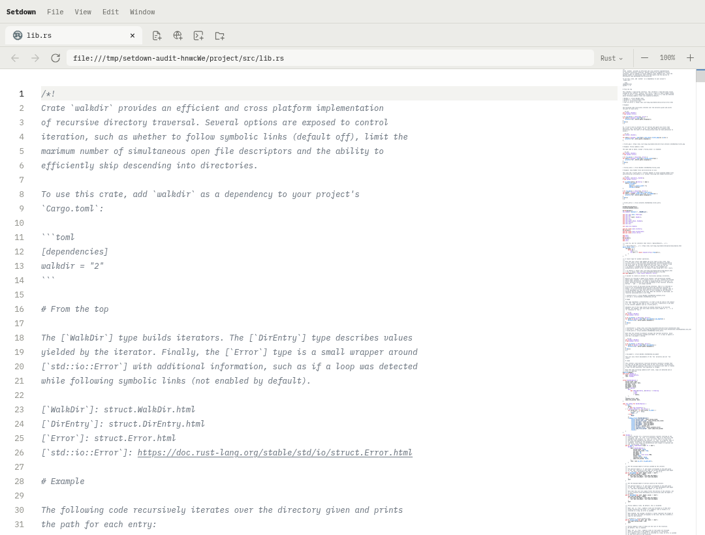
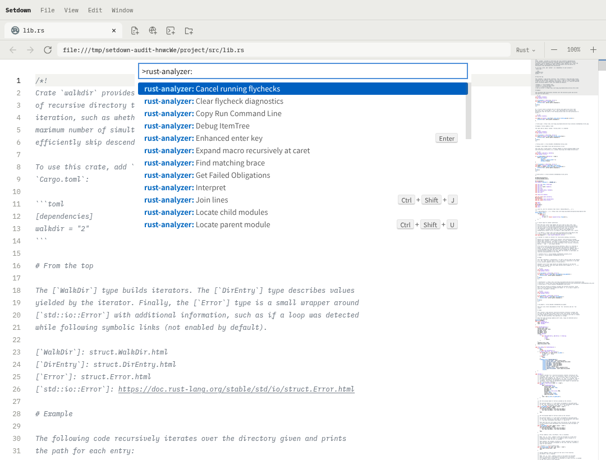
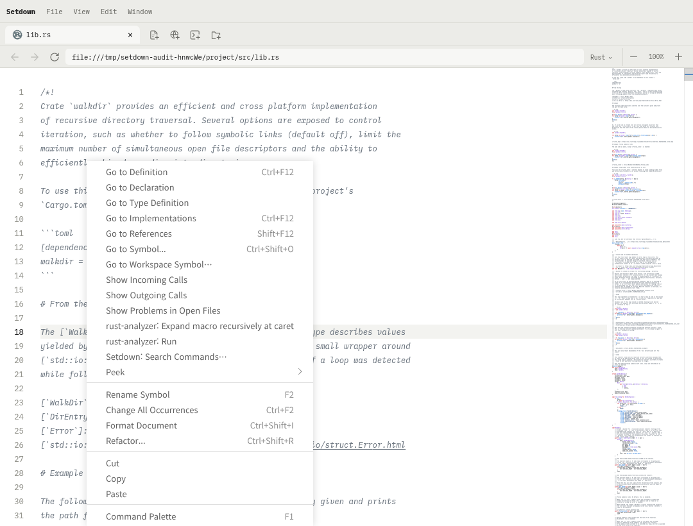
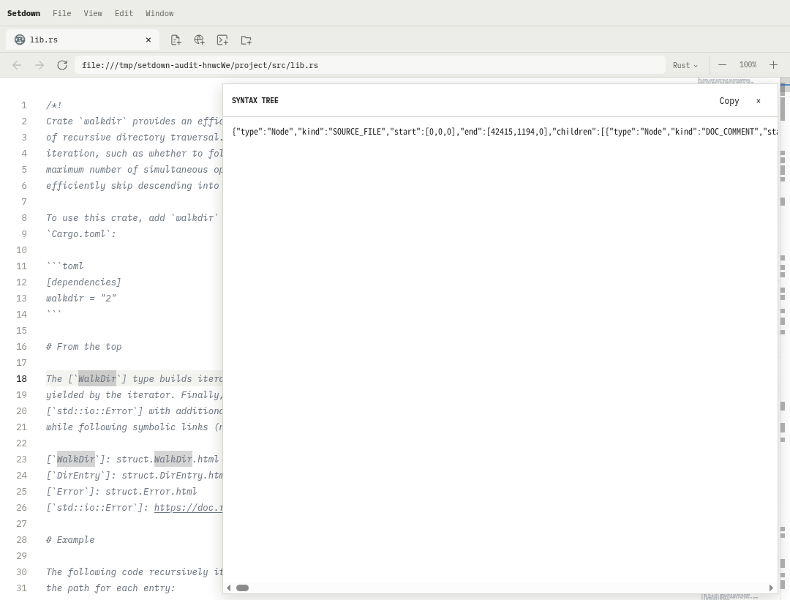
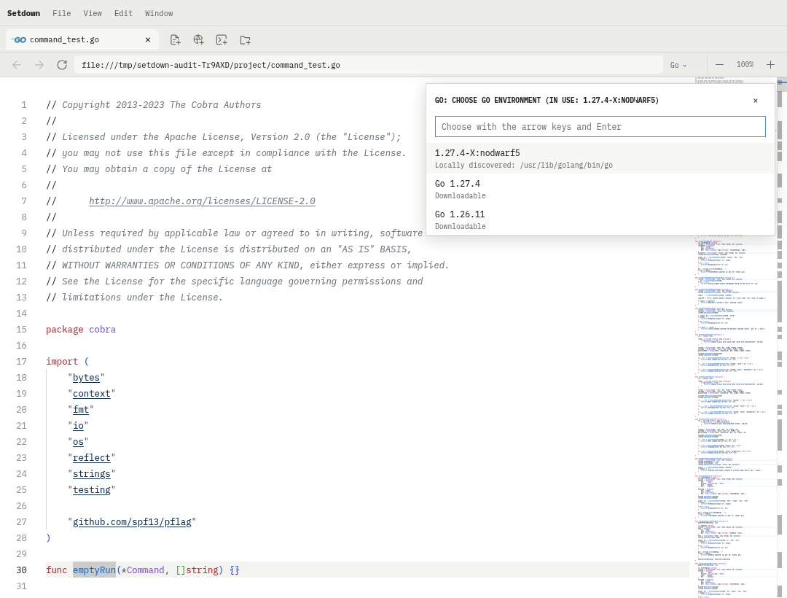

# 언어 도구를 사람에게 보여 주는 체계

작성일: 2026-11-21 · 연구 보고서 · 기준 `85af5c0` · 코드는 고치지 않았다. 사용자 설정(`~/.config/Setdown`)도 건드리지 않았다.

이 보고서는 2026-11-18의 [언어 지원 안내를 짧게 만드는 설계 논리](../2026_11_18_12_49_lsp_guidance_design_logic.md)를 잇는다. 그 보고서는 "도구가 안 될 때 무엇을 말할 것인가"만 다뤘다. 이번에는 언어 도구가 화면에 나타나는 모든 자리를 다룬다.

## 결론

**우리 UI는 충분하지 않다. 모자란 것은 기능도 화면도 아니고, "무엇이 어느 자리에 오는가"를 정하는 규칙이다.**

1. **평소 화면은 이미 셋 중 가장 조용하다.** Rust 파일을 열면 언어 이름 하나만 보인다. VS Code와 Zed는 그보다 많이 보여 준다. 이것은 지켜야 할 자산이다.
2. **묻는 순간부터 무너진다.** F1에는 명령 179개가 알파벳순으로 나오고 그중 31개가 `rust-analyzer:`로 시작한다. 우클릭 메뉴는 22개가 넘는다. "Show Syntax Tree"는 JSON 한 줄을 떠 있는 창에 보여 준다. 요청은 성공하지만 쓸 수 있는 답이 아니다.
3. **두 실패는 같은 실패다.** 오늘 C++ 파일에서 도구가 멀쩡한데 "Needs setup"이 뜬 것과, 매크로가 아닌 자리에서 "Expand macro"가 메뉴에 있는 것은 원인이 같다. 화면이 도구가 방금 한 말이 아니라 우리가 미리 가진 지식(파일 유무, 확장의 명령 목록)으로 만들어진다.
4. **그래서 원칙은 하나다. 화면의 문장과 메뉴 항목은 도구가 방금 한 말에서만 나온다.** 이 보고서에서는 "관측 원칙"이라 부른다. 추측은 문장도 항목도 되지 못하고, 관측된 증상 옆의 제안으로만 붙는다.
5. **체계는 한 줄이다. 언어는 답을 보태고, 자리는 보태지 않는다.** 자리는 여섯 개로 고정한다: 본문, 칩, 여기 메뉴, 문서, 터미널, F1. 어떤 언어의 어떤 기능도 일곱 번째 자리를 만들지 못한다.
6. **평소의 간결함과 전문가의 간결함은 같은 자리를 다른 깊이로 쓰는 데서 나온다.** 보이는 것(아무것도 없음), 묻는 것(그 자리에서 한 번), 부르는 것(이름을 쳐서). "고급 모드"는 두지 않는다.

먼저 할 일은 세 가지다. 상태 문장에서 추측을 빼는 것(오늘의 결함), F1과 우클릭 메뉴에서 목록을 걷어내는 것, 떠 있는 창을 문서 탭으로 바꾸는 것. 가장 큰 일인 "여기 메뉴"는 그다음이다. 순서와 근거는 8절에 있다.

## 1. 조사한 것과 증거의 강도

| 대상 | 방법 | 강도 |
| --- | --- | --- |
| VS Code 확장 13개와 본체 | `vendor/`에 고정된 소스를 읽음. 명령·설정·알림 호출 수는 스크립트로 셈([manifest-count.py](manifest-count.py)) | 소스 사실. 실행해 보지는 않았다 |
| Zed | `vendor/zed`(`b5cd310b`) 소스를 읽음 | 소스 사실. 실행해 보지는 않았다 |
| Setdown | 가상 화면에서 실제 앱을 띄워 실제 프로젝트를 엶. Rust는 BurntSushi/walkdir, Go는 spf13/cobra, C는 DaveGamble/cJSON | 실제 화면. 새 프로필 기준 |
| 오늘의 C++ 사례 | 같은 구조를 복사해 실제 앱에서 재현 | 재현함 |

소스를 읽는 일은 조사 에이전트 넷에게 나눠 맡겼고, 보고서의 핵심 근거로 쓴 주장은 내가 소스에서 다시 확인했다. 확인한 것은 Zed 상태 표시줄의 구성, Zed 확장 선언에 UI 항목이 없다는 것, Zed 기본값, clangd 클라이언트에 컴파일 데이터베이스 처리가 없다는 것, Microsoft C/C++의 경고 조건, rust-analyzer의 상태 알림 협상이다. 나머지는 에이전트가 붙인 `파일:줄` 근거에 의존한다.

한계는 넷이다.

- 알림 수는 호출 지점의 수다. 실제로 몇 번 뜨는지가 아니다.
- Pylance와 Intelephense 서버는 소스가 없어 문서와 클라이언트만 봤다.
- 사용자 연구는 하지 않았다. 6절의 설계는 근거에서 끌어낸 판단이고 검증된 결과가 아니다.
- 화면 점검은 새 프로필에서 했다. 사용자의 프로필에서는 설정에 따라 다르게 보일 수 있다.

## 2. VS Code 확장: 숫자가 말하는 것

### 2.1 수치

| 확장 | 명령 | 팔레트에 항상 보임 | 설정 | 알림 호출 지점 | 뷰 |
| --- | ---: | ---: | ---: | ---: | ---: |
| Go | 67 | 59 | 67 | 150 | 3 |
| rust-analyzer | 47 | 20 | 219 | 26 | 2 |
| C/C++ (Microsoft) | 46 | 3 | 167 | 75 | 2 |
| Python Environments | 35 | 4 | 12 | 109 | 2 |
| Java (Red Hat) | 31 | 13 | 136 | 62 | 0 |
| Python (Microsoft) | 23 | 2 | 41 | 62 | 0 |
| clangd | 17 | 14 | 17 | 18 | 3 |
| Svelte | 16 | 12 | 55 | 5 | 0 |
| TypeScript (내장) | 15 | 2 | 226 | 38 | 0 |
| Pyright | 7 | 2 | 19 | 1 | 0 |
| Kotlin (JetBrains) | 7 | — | 33 | 41 | — |
| Intelephense | 3 | 1 | 75 | 3 | 0 |
| JSON (내장) | 2 | 2 | 9 | 2 | 0 |
| YAML | 0 | 0 | 30 | 8 | 0 |

"팔레트에 항상 보임"은 선언에서 조건이 붙지 않은 명령의 수다. Kotlin 행은 에이전트가 센 값이고 나머지는 스크립트 값이다.

### 2.2 읽어 낸 것

**UI의 양은 분석의 질과 관계가 없다.** Pyright는 상태 항목 0개, 알림 1개, 명령 7개(그중 5개는 개발 모드 전용)로 일급 분석을 준다. clangd는 설정이 17개다. Go 확장은 명령 67개에 알림 호출 지점이 150개다. 지난번에 옮겨 오려던 "확장의 강력한 경험"은 서버의 질과 몇 개의 결정적 순간이었지, 명령 67개가 아니었다.

**한 순간을 여러 표면이 겹쳐서 말한다.**

| 순간 | 동시에 쓰이는 표면 |
| --- | --- |
| Java 프로젝트를 처음 가져올 때 | 상태 표시줄 문구, 알림 진행 표시, 터미널, 끝났다는 알림, Problems 패널 (5개) |
| Microsoft C/C++의 상태 | 언어 상태 항목 3개, 상태 표시줄 항목 3개, 출력 채널 7개 |
| Go에서 테스트를 돌리는 길 | 코드 렌즈, 테스트 탐색기, 우클릭 메뉴가 모두 기본으로 켜짐 |
| Python 인터프리터가 없을 때 | 경고색 상태 항목, 오류 알림, 선택 목록의 행, 출력 로그 |
| rust-analyzer에서 실행하는 길 | 코드 렌즈, 실행 선택 목록, hover 안의 링크, 테스트 탐색기(이것만 기본으로 꺼져 있다) |
| Svelte "Find File References" | 같은 명령이 팔레트, 편집기 메뉴, 탭 메뉴, 탐색기 메뉴에 한 번씩 |

**본체는 장치를 주지만 강제하지 않는다.** VS Code는 확장이 상태 표시줄을 어지럽히지 않도록 "언어 상태 항목"(언어 이름 옆 `{}`)을 만들었다. 그런데 이것을 쓰라는 규칙은 API 주석 한 문장뿐이고 코드는 아무것도 막지 않는다. 항목 수의 상한도 없다. Microsoft가 직접 만든 TypeScript 확장조차 스스로 띄우는 알림이 13종이고, 파일 이름을 바꾸면 버튼 네 개짜리 모달을 기본으로 띄운다.

**긴 꼬리는 팔레트에 쌓인다.** rust-analyzer의 명령 47개 중 39개는 선언에 메뉴도 단축키도 없이 팔레트에만 있다(선언 파일에서 직접 셌다. 메뉴에 있는 것 6개, 단축키가 있는 것 2개). Go는 우클릭 메뉴 항목 19개 중 18개를 설정의 참·거짓 값 17개로 켜고 끈다.

**전문가용 조회 결과의 형태가 한 확장 안에서도 넷이다.** rust-analyzer는 가상 문서(8개 명령), 웹뷰(2개), 트리 뷰(1개), 알림(메모리 사용량)을 섞어 쓴다.

### 2.3 그래도 잘 만든 순간들

확장들이 다 나쁜 것은 아니다. 아래는 그대로 배울 만하다.

| 무엇 | 왜 좋은가 |
| --- | --- |
| Python 인터프리터 목록의 "Recommended" 행 | 자동 선택에 쓰는 비교 함수와 같은 함수가 고른다. 자동으로 한 일과 추천이 어긋날 수 없다 |
| YAML의 스키마 상태 항목 | 지금 쓰는 스키마를 보여 주는 그 항목이 바꾸는 유일한 문이다. 목록은 쓰는 것을 맨 위에 체크와 함께 둔다 |
| rust-analyzer의 상태 협상 | 클라이언트가 상태 알림을 받겠다고 선언하면 서버는 팝업 대신 상태 항목으로만 건강을 보낸다 |
| Microsoft C/C++의 include 오류 수리 | "Select an IntelliSense configuration to locate system headers", "Add to includePath: {0}"가 못 찾은 include의 밑줄에 빠른 수정으로 붙는다 |
| Microsoft C/C++의 컴파일러 선택 | 찾은 컴파일러가 하나면 묻지 않고 기본값으로 쓴다 |
| TypeScript의 기본값 | 인레이 힌트와 코드 렌즈를 전부 끈 채로 낸다 |
| VS Code의 인레이 힌트 `offUnlessPressed` | 평소에는 숨기고 키를 누르고 있는 동안만 보여 준다. Setdown이 이미 쓰는 값이다 |
| VS Code 코드 액션 메뉴의 고정 순서 | Quick Fix, Extract, Inline, Rewrite, Move, Surround With, Source Action. 언어가 달라도 자리가 같다 |

## 3. Zed: 같은 서버, 다른 헌법

Zed는 같은 언어 서버를 쓰면서 표면이 훨씬 적다. 디자이너가 더 절제해서가 아니라 구조가 다르기 때문이다.

**확장에는 UI 권한이 없다.** 확장 선언에 있는 것은 테마, 언어, 문법, 언어 서버, 스니펫, 디버그 어댑터, 그리고 AI 대화 쪽의 컨텍스트 서버·슬래시 명령·모델 제공자다. 편집기의 명령·메뉴·뷰·상태 항목을 넣을 자리는 없다(`crates/extension/src/extension_manifest.rs:88-127`). 상태 표시줄 항목 16개는 앱 코드 한 곳에서 등록한다(`crates/zed/src/zed.rs:636-652`). 패널은 일곱 개가 전부다.

**말할 것이 없으면 자리 자체가 없다.** 언어 서버 버튼은 서버가 없으면 숨고, 도구 모음 선택은 해당 언어가 아니면 숨고, 활동 표시는 할 일이 없으면 숨는다.

**결과는 편집기다.** 프로젝트 진단, 참조 찾기, 정의가 여럿일 때, 여러 파일에 걸친 이름 바꾸기 결과가 모두 발췌를 모은 탭 하나로 열린다. 트리도 패널도 아니다.

**도구 전용 기능은 여덟 개뿐이고, 맞는 편집기에서만 존재한다.**

| 동작 | 나타나는 조건 | 결과의 형태 |
| --- | --- | --- |
| 매크로 펼치기 | 버퍼 언어가 Rust | 읽기 전용 Rust 탭 |
| 문서 열기 | Rust | 로컬 문서 또는 웹 주소 |
| 부모 모듈로 가기 | Rust | 이동 |
| flycheck 실행·취소·지우기 | 프로젝트에 rust-analyzer가 있음 | 보이는 것 없음 |
| 소스·헤더 전환 | C 또는 C++ | 파일 열기 |
| 약어로 감싸기 | Emmet 서버가 돌고 마크업 언어 | 미리보기가 있는 입력 |

rust-analyzer의 VS Code 확장이 명령 47개를 가진 것과 대비된다. HIR, MIR, 메모리 사용량, 크레이트 그래프는 Zed에 없다.

**기본으로 꺼 둔 것이 많다.** 인레이 힌트, 줄 안 진단, 코드 렌즈, 시맨틱 토큰, 자동 시그니처 도움말이 꺼져 있다. 켜 둔 것은 밑줄, 스크롤바 표시, hover, 여백의 실행 버튼, 커서 줄의 코드 액션 표시다.

**건강은 알림으로 가지 않는다.** 서버 실패는 상태 표시줄의 한 줄 "Failed to run {…}. Click to show error."로만 나오고, 누르면 오류 출력이 담긴 읽기 전용 버퍼가 열린다. `experimental/serverStatus`는 서버 이름을 가리지 않고 받아서 같은 자리에 쓴다.

**코드 액션 메뉴 하나가 여러 가지를 합친다.** `ctrl-.` 메뉴에 실행할 작업, 코드 액션, 디버그 시나리오가 함께 나오고, 코드 렌즈를 "menu" 방식으로 두면 렌즈의 명령도 여기로 들어온다. 보여 줄 것이 없으면 메뉴가 열리지 않는다.

**명령 목록은 지금 쓸 수 있는 동작만, 최근에 쓴 순서로 보여 준다.**

Zed를 그대로 베낄 수는 없다. 이유는 셋이다.

- Zed도 묻지 않았는데 보여 주는 것이 17가지다. 상태 표시줄의 언어 관련 항목만 다섯이고, 서버가 보내는 메시지는 알림으로 뜬다.
- 빈 곳이 있다. 환경 선택은 Python 가상 환경뿐이고 JDK나 빌드 설정 선택은 찾지 못했다. 호출 계층은 조건 없이 등록돼 있어서 "No callable symbol under the cursor"라는 답을 받게 된다.
- 대상이 다르다. Zed는 하루 종일 코드를 쓰는 사람의 도구이고 Setdown은 읽는 일이 먼저다.

가져올 것은 화면이 아니라 헌법이다. Zed의 UI 점검표에는 이렇게 적혀 있다(`docs/src/development/ui-checklist.md:65-66`).

> Are power features discoverable but not intrusive?
> Is there a path from beginner → expert usage (progressive disclosure)?

## 4. Setdown의 지금

### 4.1 화면

평소 화면. 오른쪽 위의 `Rust ⌄` 하나가 언어 도구가 보여 주는 전부다.



F1에 `rust-analyzer:`를 쳤을 때. 31개가 알파벳순이다. "Enhanced enter key"는 Enter 키의 동작인데 명령으로 올라와 있다.



주석 안의 단어에서 우클릭했을 때. 주석인데도 호출 계층과 매크로 펼치기가 있다.



"rust-analyzer: Show Syntax Tree"의 결과.



Go 버전 선택. 형태는 좋다. 다만 F1 명령으로만 열린다.



### 4.2 수치

| 항목 | 값 | 출처 |
| --- | --- | --- |
| F1 명령 수 | Rust 179, Go 156, C 153 | 실제 화면 |
| F1의 기본 순서 | 알파벳순. 맨 위가 "Add Cursor Above" | 실제 화면 |
| 확장에서 이름 그대로 옮긴 도구 명령 | 55개. rust-analyzer 31, Svelte 6, Go 6, Java 3, Intelephense 3, clangd 2, Kotlin 2, JSON 1, YAML 1 | `tool-command-list.ts` |
| 우클릭 메뉴 항목 | 22개 이상(화면 아래로 잘림) | 실제 화면 |
| 칩의 상태 문구 | 9종: 없음, Setting up…, Reconnecting…, Needs setup, Not working, Limited, Not installed, Needs answer, Notice | `document-presentation.ts` |
| 도구 명령의 결과 형태 | 떠 있는 글 창, 위치 목록, 파일 열기, 선택 목록, 입력 칸, 한 줄 알림 | `tool-commands.ts` |
| 칩 패널에 행이 있는 환경 | Python 환경, TypeScript SDK, C/C++ 빌드 설정 | `analysis-context.ts` |
| F1 명령으로만 여는 환경 | Go 버전, YAML 스키마 | `tool-command-list.ts` |

### 4.3 강점

- **평소 화면이 조용하다.** 상태 표시줄이 없고 알림이 없다. 코드 렌즈는 꺼져 있고 인레이 힌트는 키를 누를 때만 보인다.
- **구조가 이미 Zed 쪽이다.** 확장 호스트가 없으니 어떤 확장도 표면을 만들 수 없다. 지켜야 할 규칙이 구조로 보장돼 있다.
- **안 될 때의 문장은 설계가 있다.** 원인마다 문장 하나와 버튼 하나(11-18 보고서).
- **실행은 터미널 탭이 명령줄을 직접 친다.** 사람이 무엇이 실행됐는지 볼 수 있다.
- **도구의 질문은 칩으로 온다.** "Needs answer"가 있어서 알림 창이 필요 없다.

### 4.4 결함

**가. 목록을 옮겼다.** 확장의 명령을 "확장이 붙인 이름 그대로" 55개 옮겼다. 그 결과가 4.1의 두 번째 화면이다. 옮긴 것은 VS Code의 목록이고, 그 목록을 다루는 VS Code의 장치(조건, 최근 사용 순서)도 Zed의 장치(맞는 편집기에서만 존재)도 함께 오지 않았다. 매크로가 아닌 자리에서 "Expand macro"를 고르면 "Not available in this position."이 돌아온다. 메뉴가 먼저 알았어야 할 일이다.

**나. 답에 형태가 없다.** 도구가 돌려준 긴 답은 전부 같은 떠 있는 창에 들어간다. 매크로 펼친 결과도, 상태 보고도, 구문 트리도 같다. 창은 코드를 가리고, 구문 트리는 JSON 한 줄이다. 요청이 성공했다는 뜻에서 "구현됨"이지만 쓸 수 있는 답은 아니다. 한 줄 알림도 문제다. 점검 중 "crate graph를 그릴 수 없다"는 알림은 그 뒤 명령 세 개를 실행하는 동안 남아 있었다.

**다. 상태가 추측으로 말한다.** 오늘의 사례다. `.clangd`가 한 폴더 위에 있는 C++ 파일에서 칩은 "Needs setup", 패널은 "Choose a build folder or configure this project…"라고 했다. 같은 순간 clangd는 torch 타입까지 정확히 답하고 있었다. 앱이 도구에게 묻지 않고 프로젝트 폴더에 파일 셋이 있는지만 보고 말한 것이다(`analysis-context.ts:221-223`). 같은 상황을 네 제품이 어떻게 다루는지 놓고 보면 차이가 분명하다.

| 제품 | 컴파일 데이터베이스가 없는 C++ 파일 |
| --- | --- |
| clangd 확장 | 이 경우를 다루는 코드가 없다. 서버가 보내는 진단만 보인다 |
| Microsoft C/C++ | 고를 수 없을 때만 경고한다(제공자가 등록됐는데 선택이 없음, 데이터베이스가 발견됐는데 지정이 없음, 아무 설정도 없고 컴파일러도 못 찾음). 수리는 include 오류의 빠른 수정에 붙는다 |
| Zed | 빌드 설정을 고르는 화면을 찾지 못했다 |
| Setdown | 프로젝트 폴더에 세 파일이 없으면 언제나 "Needs setup" |

경고하는 것은 Setdown뿐이다. 여기에 두 번째 문제가 겹쳤다. 사용자 화면의 칩은 "Not working"이었는데 패널은 빌드 설정을 탓했다. 칩과 패널이 서로 다른 자료로 문장을 만들기 때문이다(`DocumentLanguageStatus.svelte:12`, `DocumentAnalysisPanel.svelte:21`).

**라. 환경을 고르는 자리가 언어마다 다르다.** C의 빌드 설정은 칩 패널의 행이다. Go 버전과 YAML 스키마는 F1 명령이다. 사람에게는 같은 질문("이 분석은 무엇을 기준으로 하는가")인데 문이 다르다.

**마. 우클릭 메뉴가 자리를 가리지 않는다.** 항목은 언어 단위로 정해지고, 커서 위치에서 되는지는 보지 않는다. 4.1의 세 번째 화면이 그 결과다.

### 4.5 판정

| 순간 | 지금 | 판정 |
| --- | --- | --- |
| 평소(아무것도 묻지 않을 때) | 언어 이름 하나 | 충분하다 |
| 안 될 때의 문장 | 설계가 있으나 추측이 섞이고 목소리가 둘이다 | 고쳐야 한다 |
| 그 자리에서 묻기 | 정적인 긴 메뉴 | 부족하다 |
| 이름으로 부르기 | 179개 알파벳순 | 부족하다 |
| 답을 받기 | 떠 있는 창 하나 | 부족하다 |
| 환경 고르기 | 언어마다 다른 문 | 부족하다 |
| 실행하기 | 터미널 탭 | 충분하다 |

## 5. 사유: 간결함은 어디서 오는가

### 5.1 차이는 누가 자리를 소유하느냐다

VS Code에서 확장은 세입자이고 저마다 가게 앞을 꾸민다. 확장 하나하나는 합리적이다. Java 확장이 가져오기 진행을 알리는 것도, Go 확장이 도구 설치를 알리는 것도 그 확장 안에서는 맞는 결정이다. 어지러움은 합에서 생긴다. 본체가 장치를 줘도 강제하지 않으니 합은 줄지 않는다.

Zed에서 언어는 자료만 낸다. 서버, 문법, 실행할 수 있는 것의 표식. 보여 주는 일은 전부 편집기의 몫이다. 그래서 언어가 열 개든 백 개든 표면의 수가 같다.

Setdown은 구조상 Zed 쪽에 서 있다. 그런데 지난 작업에서 한 일은 VS Code의 산출물(명령 목록)을 그 구조 위에 부은 것이다. 지금 필요한 것은 기능을 더 옮기는 일이 아니라, 이미 가진 구조에 맞는 규칙을 쓰는 일이다.

### 5.2 사람이 코드 앞에서 묻는 것은 일곱 가지다

확장 13개의 명령 수백 개를 사람의 질문으로 접으면 일곱 개가 남는다.

| 사람의 질문 | 확장들이 내놓는 것의 예 | 답이 올 자리 |
| --- | --- | --- |
| 이게 뭐지 | hover, 문서 열기, 매크로 펼치기, 컴파일된 코드 | 본문, 여기 메뉴, 문서 |
| 어디서 쓰이지 | 참조, 호출 계층, 관련 테스트, 부모 모듈 | 여기 메뉴, 문서 |
| 뭐가 틀렸지 | 진단, flycheck, 린트 | 본문 |
| 바꿔 줘 | 빠른 수정, 리팩터링, 태그 추가, 테스트 생성 | 여기 메뉴 |
| 돌려 봐 | 실행 렌즈, 테스트 탐색기, 작업 | 여기 메뉴, 터미널 |
| 믿어도 되나 | 상태 항목, 인터프리터·JDK·빌드 설정, 다시 불러오기, 로그 | 칩 |
| 도구 안쪽을 보여 줘 | 구문 트리, HIR, 메모리, 크레이트 그래프 | F1, 문서 |

질문이 일곱이면 자리도 그만큼이면 된다. 언어가 늘어도 질문은 늘지 않는다. 꼬리 언어 21개를 조사하려던 계획에도 이것이 답이 된다. 언어마다 화면을 설계하는 것이 아니라, 그 언어의 도구가 일곱 질문 중 무엇에 답할 수 있는지만 알면 된다.

### 5.3 관측 원칙

4.4의 "가"와 "다"는 다른 종류의 결함으로 보이지만 같은 것이다.

- "다"는 **추측으로 만든 문장**이다. 파일이 없으니 설정이 필요할 것이라고 짐작해 "Needs setup"이라고 썼다.
- "가"는 **미리 가진 목록으로 만든 메뉴**다. rust-analyzer 확장에 이 명령이 있으니 Rust 파일에서는 언제나 보여 준다.

둘 다 도구에게 묻지 않고 화면을 만들었다. 그래서 둘 다 도구가 실제로 하는 일과 어긋났다. 원칙은 이렇다.

> **화면의 문장과 메뉴 항목은 도구가 방금 한 말에서만 나온다.**
> 우리가 추측한 것은 문장도 항목도 되지 못한다. 추측은 관측된 증상 옆의 제안으로만 붙는다.

이 원칙이 각 자리에서 뜻하는 것은 이렇다.

| 자리 | 관측 원칙의 뜻 |
| --- | --- |
| 본문 | 밑줄은 도구가 문제라고 한 곳에만 긋는다 |
| 칩 | 상태는 도구의 시작·종료·응답·진단에서만 나온다. 파일 유무로 상태를 만들지 않는다 |
| 여기 메뉴 | 항목은 도구가 이 위치에서 된다고 답한 것만 온다 |
| 문서 | 도구가 한 말을 그대로 문서로 연다 |
| F1 | 도구가 붙어 있을 때만 그 도구의 이름이 검색된다 |

이것은 2026-11-19에 정한 제품 방향(코드 분석을 믿을 수 있는 Setdown)의 UI 쪽 표현이기도 하다. 믿을 수 있다는 것은 화면이 말하는 것과 도구가 아는 것이 같다는 뜻이다.

우리가 한 일은 관측에 포함된다. "내려받는 중", "이 Python으로 분석을 시작했다"는 추측이 아니라 우리가 아는 사실이다. 그 환경이 맞는지는 증상(해결되지 않은 import)이 있을 때만 말한다.

### 5.4 같은 자리, 다른 깊이

"일상에서는 믿을 수 없을 만큼 간결하고 전문가에게도 간결하다"는 요구는 서로 다른 두 화면을 만들라는 뜻이 아니다. 같은 자리를 세 깊이로 쓰라는 뜻으로 읽었다.

| 깊이 | 무엇 | 누가 |
| --- | --- | --- |
| 보이는 것 | 본문의 밑줄과 칩의 언어 이름. 그 밖에는 없다 | 모두 |
| 묻는 것 | 그 자리에서 한 번: 우클릭이나 키 하나, 칩 누르기 | 모두 |
| 부르는 것 | F1에 이름을 쳐서 | 이름을 아는 사람 |

평소의 사용자는 위의 둘만으로 끝난다. 도구 이름을 몰라도 된다. 전문가는 같은 자리에서 더 빨리 간다. 묻는 목록은 전부 글자를 쳐서 좁힐 수 있고, 답은 검색하고 나누고 복사할 수 있는 문서로 오고, 닫아야 할 것이 없다. 전문가의 간결함은 메뉴가 짧은 것이 아니라 단계가 없는 것이다.

"고급 모드" 같은 스위치는 두지 않는다. 스위치가 생기면 화면이 둘이 되고 둘 다 덜 다듬어진다.

### 5.5 기믹과 생산성을 가르는 기준

기능 하나를 목록에 올릴지는 세 물음으로 정한다.

1. 누가 이 질문을 하는가.
2. 얼마나 자주 하는가.
3. 우리가 주는 답의 형태로 그 사람이 다음 일을 할 수 있는가.

"Show Syntax Tree"는 도구를 만드는 사람이 드물게 하는 질문이고, JSON 한 줄로는 다음 일을 할 수 없다. 셋 다 떨어진다. 이런 기능은 구현돼 있어도 목록에 올리지 않는다. 이름을 정확히 치는 사람에게만 열리게 하거나, 답의 형태를 제대로 만들 때까지 뺀다.

반대로 "매크로 펼치기"는 Rust를 읽는 사람이 자주 하는 질문이고, 펼친 결과가 Rust 문서로 열리면 그 안에서 계속 읽을 수 있다. 셋 다 통과한다. 이런 기능은 매크로 위에서 저절로 나타나야 한다.

## 6. 제안하는 체계

### 6.1 헌법

> **언어는 답을 보태고, 자리는 보태지 않는다.**

자리는 여섯 개다. 일곱 번째를 만들려면 여섯 개 중 하나를 없애야 한다.

### 6.2 여섯 자리와 규칙

| 자리 | 오는 것 | 규칙 | 지금과 다른 점 |
| --- | --- | --- | --- |
| 본문 | 도구가 문제라고 한 곳의 밑줄. 인레이 힌트는 키를 누르는 동안만 | 묻지 않았는데 본문에 나타나는 것은 도구의 주장뿐이다 | 없다. 지금 그대로다 |
| 칩 | 이 문서에 대해: 상태 한 문장, 환경 행들, 프로젝트 동작, 도구의 보고서 | 잘 되면 말하지 않는다. 관측만 상태가 된다. 칩과 패널은 한 자료로 말한다 | 추측 제거, 환경 행 통일, 프로젝트 동작을 여기로 |
| 여기 메뉴 | 커서 위치에서 되는 동작만. 알아보기, 찾기, 바꾸기, 돌리기 순 | 이 자리에서 안 되는 항목은 없다. 도구 이름을 붙이지 않는다. 글자를 쳐서 좁힌다 | 우클릭 메뉴를 대체한다 |
| 문서 | 한 줄보다 긴 모든 답. 옆 탭에 읽기 전용으로 | 내용을 담는 떠 있는 창은 없다. 창은 묻기만 한다(고르기, 입력) | 떠 있는 글 창을 없앤다 |
| 터미널 | 도구가 시작하는 프로그램 | 터미널 탭이 명령줄을 직접 친다 | 없다 |
| F1 | 이름으로 부르는 모든 것 | 빈 검색어에서는 최근에 쓴 것과 여기서 되는 것만. 도구 내부 명령은 쳐야 나온다 | 순서와 기본 목록 |

끼어드는 자리는 없다. 도구가 묻는 것은 칩으로 온다. 알림 창은 만들지 않는다.

### 6.3 결정적인 순간 다섯

제품이 믿음을 얻거나 잃는 순간은 다섯이다. 각각을 문장 하나나 동작 하나로 설계한다.

**하나. 파일을 처음 열 때.** 아무것도 보이지 않거나, 내려받는 동안 `Rust · Setting up…`이 한 번 보인다. 지금 그대로다.

**둘. 해결되지 않는 include나 import를 만났을 때.** 확장들이 알림을 띄우는 바로 그 순간이다. 수리는 아픈 자리에 붙인다.

```text
1  #include <torch/extension.h>
            ~~~~~~~~~~~~~~~~~~~  'torch/extension.h' file not found
                                 ┌──────────────────────────────────┐
                                 │ Choose build configuration…      │
                                 └──────────────────────────────────┘
```

칩은 그때만, 본 것을 말한다.

```text
C++ · Limited                                    ×
1 include was not found, so results here are incomplete.
[ Choose build configuration… ]
──────────────────────────────────────────────────
Build configuration   none; clangd uses its defaults  ›
Language   C++ ›                              More…
```

include 오류가 없으면 칩은 `C++`뿐이다. 오늘의 사례가 이 경우다. 증상을 알아보려면 도구별로 진단 코드 몇 개를 알아야 한다. clangd의 `pp_file_not_found`, Pyright의 `reportMissingImports`, TypeScript의 2307이 그런 코드라고 기억하는데, 구현할 때 고정된 소스에서 확인해야 한다.

**셋. "여기서 뭘 할 수 있지?"** 여기 메뉴다. 매크로 호출 위에서는 이렇다.

```text
vec!  ·  macro
Understand   Go to Definition                 F12
             Expand Macro
             Open Documentation
Find         References                 Shift+F12
Type to narrow…
```

Go 테스트 함수 위에서는 이렇다.

```text
TestNoArgs  ·  function
Run          Run test
Understand   Go to Definition                 F12
Find         References                 Shift+F12
             Callers
Change       Rename                            F2
Type to narrow…
```

주석 안의 단어 위에서는 복사와 명령 목록만 남는다. 메뉴가 짧은 것은 줄여서가 아니라 사실이어서다. 도구 전용 기능을 찾는 길도 이것이다. 31개 목록을 훑는 것보다 매크로 위에서 "Expand Macro"를 만나는 쪽이 낫다.

항목의 출처는 넷이고 모두 도구의 답이다.

- 서버가 이 범위에 돌려준 코드 액션. 순서는 VS Code의 고정 순서를 따른다.
- 이 줄의 코드 렌즈가 가진 명령. Zed의 "menu" 방식과 같다. 렌즈를 본문에 그리지 않고 메뉴 항목으로 쓴다.
- 준비 요청이 이 위치에서 된다고 답한 이동(이름 바꾸기, 호출 계층, 타입 계층).
- 도구 전용 요청 중 이 위치에서 답이 있는 것.

**넷. 돌려 보기.** 여기 메뉴의 `Run test`를 고르면 터미널 탭이 명령줄을 친다. 지금 만든 그대로이고 문만 바뀐다.

**다섯. "믿어도 되나?"** 칩을 누르면 한 화면이다.

```text
Go                                               ×
✓ Working
──────────────────────────────────────────────────
Go            1.27.4 · /usr/lib/golang            ›
Project       go.mod · github.com/spf13/cobra     ›
──────────────────────────────────────────────────
Language   Go ›                               More…
```

환경은 언어마다 행의 이름만 다르고 형태는 같다. Python 환경, TypeScript SDK, C/C++ 빌드 설정, Go 버전, YAML 스키마, Java의 JDK. 누르면 같은 모양의 선택 목록이 열리고, 지금 쓰는 것이 맨 위에 표시와 함께 있고, 자동으로 고른 것에는 추천 표시가 붙는다. `More…` 아래에는 프로젝트 동작(다시 불러오기, 다시 색인, 다시 빌드)과 도구의 보고서가 있다. 보고서는 문서로 열린다.

### 6.4 명령 55개가 갈 자리

| 갈 자리 | 수 | 명령 |
| --- | ---: | --- |
| 여기 메뉴(되는 자리에서만) | 14 | Rust: Run, Peek Related Tests, Expand macro, Open Docs, Move Item Up/Down · Svelte: Extract Component, Find File References, Find Component References · Kotlin: Go to Test · Go: Add Import, Generate Unit Tests, Add Tags, Remove Tags |
| 칩의 프로젝트 동작과 보고서 | 13 | Rust: Reload workspace, Rebuild proc macros, Run/Cancel/Clear flycheck, Status, Open Cargo.toml · Java: Reload Projects, Import Projects, Force Compilation · Kotlin: Reload Workspace · Intelephense: Index workspace, Cancel indexing |
| 칩의 환경 행 | 2 | Go: Choose Go Environment · YAML: Select JSON Schema |
| 설정 | 1 | Intelephense: Enter licence key |
| F1에서 쳐야 나옴(파일 단위 동작) | 7 | Rust: Locate parent module, Locate child modules, Copy Run Command Line, Structural Search Replace · Svelte: Migrate to Svelte 5 · JSON: Sort Document · Go: Toggle compiler optimization details |
| F1에서 쳐야 나옴, 결과는 문서 | 15 | Rust: Memory Usage, Show Syntax Tree, View Hir, View Mir, Interpret, View File Text, Debug ItemTree, Get Failed Obligations, View Crate Graph (둘), View Memory Layout · clangd: Show AST, Show memory usage · Svelte: Show Compiled Code, Show Compiled CSS |
| 명령이 아님(편집 동작) | 3 | Rust: Find matching brace, Join lines, Enhanced enter key |

이 표대로면 Rust 파일의 F1 기본 목록에서 `rust-analyzer:`로 시작하는 줄은 0개가 된다. 쳐서 찾으면 전부 그대로 있다. 이름은 확장이 붙인 그대로 둔다. VS Code에서 온 전문가가 아는 이름이기 때문이다.

지금 편집기 메뉴에 들어가 있는 "clangd: Show AST"는 메뉴에서 뺀다. "View File Text (as seen by the server)"는 성격이 다르다. 도구가 실제로 보고 있는 글을 보여 주는 것이라 믿음에 관한 질문이고, 칩의 보고서 쪽에 둘 만하다.

### 6.5 문서로 답한다는 것

Setdown에서 가장 잘 다듬어진 표면은 문서 탭이다. 탭, 분할, 확대, 찾기, 읽던 위치가 있다. 도구의 긴 답을 문서로 열면 이 전부를 그냥 얻는다. rust-analyzer 확장도 여덟 개 명령에 가상 문서를 쓰고, Zed도 펼친 매크로를 읽기 전용 Rust 탭으로 연다.

| 답 | 문서의 형태 |
| --- | --- |
| 펼친 매크로, 컴파일된 Svelte, HIR, MIR | 해당 언어로 색이 입혀진 읽기 전용 탭 |
| 도구의 상태 보고, 메모리 사용량, Go 환경 | 글 문서 |
| 크레이트 그래프 | 그림 문서 |
| 구문 트리 | 들여쓴 글 문서. 줄을 고르면 원본의 범위를 가리킨다. 이만큼 못 만들면 뺀다 |

위치 목록(참조, 구현)은 지금의 결과 화면을 유지한다. Zed처럼 발췌를 모아 그 자리에서 고칠 수 있는 탭은 큰 공사이고, 이 보고서는 약속하지 않는다.

## 7. 지켜졌는지 잴 수 있는 기준

설계가 체계라면 잴 수 있어야 한다. 실제 앱에서 실제 프로젝트로 재는 값들이다. 지금 값은 4.2에 있다.

| 기준 | 목표 | 지금 |
| --- | --- | --- |
| 평소 화면의 언어 도구 요소 | 칩의 언어 이름 1개 | 1개 |
| 도구가 응답하고 진단 증상이 없을 때 경고색 칩 | 0건 | 오늘 1건 재현 |
| 칩과 패널의 문장이 다른 경우 | 0건 | 오늘 1건 관찰 |
| 여기 메뉴에서 고른 항목이 "이 위치에서는 안 됨"으로 끝나는 경우 | 0건 | 재현됨(Expand macro) |
| 주석 안 단어에서 여기 메뉴의 언어 항목 | 0개 | 12개 이상 |
| F1 빈 검색어의 목록 | 최근에 쓴 것과 여기서 되는 것 | 179개 알파벳순 |
| F1 기본 목록에서 도구 이름으로 시작하는 줄 | 0개 | Rust 31개 |
| 내용을 담은 떠 있는 창의 종류 | 0 | 1(모든 긴 답) |
| 평소 사용자가 보는 문구 속 도구 이름 | 0 | 메뉴에 `rust-analyzer:` |
| 환경을 고르는 문의 종류 | 1(칩의 행) | 2(칩의 행, F1 명령) |

[audit-spec.ts.txt](audit-spec.ts.txt)가 지금 값을 잰 스크립트다. 고친 뒤 같은 스크립트로 다시 재면 된다.

## 8. 순서, 크기, 위험

| 순서 | 일 | 크기 | 근거 |
| ---: | --- | --- | --- |
| 1 | 상태에서 추측을 뺀다. `compilation-unknown`은 상태가 아니라 include 증상 옆의 제안으로. 칩과 패널을 한 자료로. 취소된 시작은 다시 시도 | 작다 | 오늘 본 결함 셋이다. 믿음을 직접 깎는다 |
| 2 | 목록을 걷어낸다. F1 순서(최근 먼저), 도구 내부 명령은 쳐야 나오게, 편집 동작 셋은 명령에서 빼기, 우클릭 메뉴에서 도구 이름 줄 빼기 | 작다 | 새로 만드는 것 없이 4.4의 "가"가 대부분 풀린다 |
| 3 | 떠 있는 글 창을 읽기 전용 문서 탭으로 | 중간 | 4.4의 "나". 답의 형태가 생긴다 |
| 4 | 환경 행을 통일한다. Go 버전과 YAML 스키마를 칩으로 | 중간 | 4.4의 "라" |
| 5 | 여기 메뉴 | 크다 | 4.4의 "마"와 "가"의 나머지. Rust와 Go로 먼저 만들어 본다 |

크기는 코드를 읽고 내린 판단이고 재지 않았다.

위험은 넷이다.

- **여기 메뉴의 지연.** 위치마다 도구에 묻는 일이 메뉴를 늦출 수 있다. VS Code의 전구처럼 커서가 멈췄을 때 미리 묻고 저장해 두는 방식이 필요하다. 메뉴가 열린 뒤 항목이 늘거나 줄면 안 된다. 얼마나 걸리는지는 재지 않았다.
- **Monaco의 한계.** 우클릭 메뉴와 F1 목록은 Monaco의 것이다. 순서와 구성을 어디까지 바꿀 수 있는지는 확인하지 않았다. 여기 메뉴는 Monaco 메뉴를 고치는 것이 아니라 따로 그려야 할 수 있다.
- **전문가의 길이 길어질 수 있다.** 지금은 우클릭에 "Expand macro"가 항상 있다. 매크로 위에서만 나오게 하면 틀린 자리에서 찾던 사람은 헤맨다. F1에서 이름으로 찾는 길이 그대로 남아 있어야 한다.
- **증상 코드는 도구별 지식이다.** 둘째 순간의 설계는 도구마다 "해결되지 않은 include"가 어떤 진단 코드인지 알아야 한다. 모르는 도구에서는 제안이 붙지 않을 뿐이고 틀린 경고는 나오지 않는다.

## 9. 결정이 필요한 것

| 질문 | 권장 | 이유 |
| --- | --- | --- |
| 설정 파일이 없다는 이유만으로 경고하는 것을 없앨지 | 없앤다 | 네 제품 중 Setdown만 경고한다. 오늘 틀린 경고가 나왔다 |
| 도구 내부 명령 15개를 기본 목록에서 뺄지 | 뺀다. 쳐서 찾으면 나오게 둔다 | 5.5의 세 물음에서 떨어진다. 지우지는 않는다 |
| 떠 있는 글 창을 문서 탭으로 바꿀지 | 바꾼다 | 가장 잘 만든 표면을 쓰지 않을 이유가 없다 |
| 코드 렌즈를 본문에 그리는 대신 여기 메뉴 항목으로 쓸지 | 그렇게 한다. "Toggle Code Lens"는 쳐서 찾는 명령으로 남긴다 | 평소 화면을 지킨다. Zed에 같은 방식이 있다 |
| 구문 트리를 제대로 만들지 뺄지 | 뺀다. 필요하다는 사람이 나오면 만든다 | 지금 형태는 쓸 수 없고, 묻는 사람이 드물다 |
| 우클릭 메뉴를 여기 메뉴로 바꿀지 | 바꾸되 Rust와 Go로 먼저 만들어 보고 정한다 | 가장 큰 일이고 지연 위험이 있다 |
| 꼬리 언어 조사를 이 체계로 할지 | 한다. 언어마다 "일곱 질문 중 무엇에 답하는가"만 기록한다 | 언어별 화면 설계가 필요 없어진다 |

## 부록: 재현

- 수치: `python3 -I reports/language-ui-design-2026-11-21/manifest-count.py` (`rg` 필요).
- 화면 점검: [audit-spec.ts.txt](audit-spec.ts.txt)를 `apps/desktop` 아래 테스트 목록 밖의 폴더에 두고, `scripts/with-isolated-display.sh`를 거쳐 Playwright로 실행했다. 프로젝트는 `apps/lsp-benchmark/work/sources`의 walkdir, cobra, cjson이다. 기록은 [audit-rust.txt](audit-rust.txt), [audit-go.txt](audit-go.txt), [audit-c.txt](audit-c.txt)에 있다.
- 오늘의 C++ 사례를 재현한 화면은 사용자의 코드가 찍혀 있어서 넣지 않았다.
