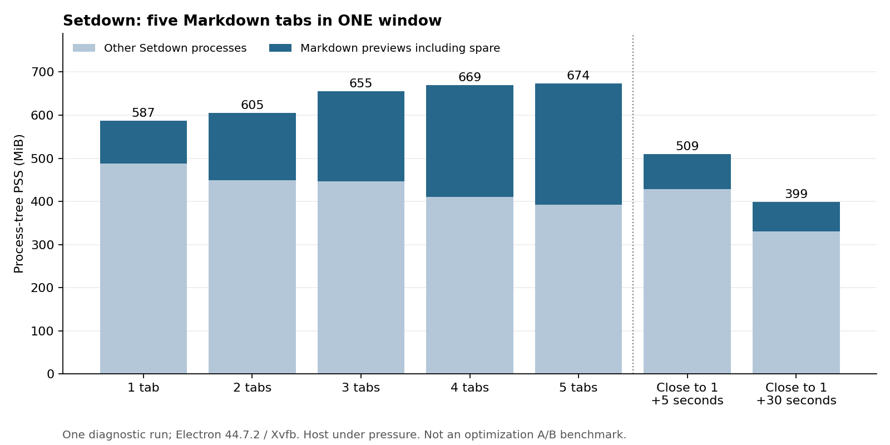
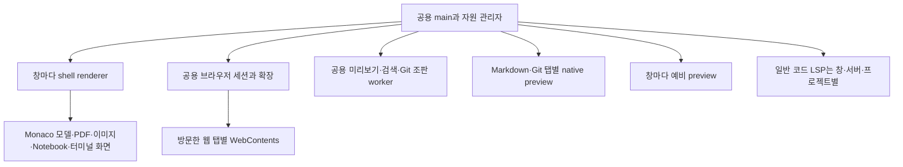

# Setdown 메모리 고갈 원인과 개선 설계

2026년 11월 8일. 코드 기준 `7cd3d97`, Setdown 2.5.2. 격리 실행은 Electron 44.7.2와 현재 production build를 사용했다. 사용 조건은 여러 창에서 웹페이지와 Markdown을 섞어 쓰는 경우다.

**개선 여지가 크다. 가장 먼저 앱 전체의 메모리 예산과 재생성 가능한 화면의 회수 정책을 구현해야 한다.** 현재는 빠른 전환을 위해 웹 탭, Markdown 미리보기, 예비 미리보기, 여러 편집 화면을 오래 유지한다. 창과 탭이 늘어날 때 이 비용을 조정하는 공통 관리자가 없다. 일부 캐시의 개수 제한만으로는 전체 메모리를 제어하지 못한다.

실제로 커널이 메모리 부족으로 Setdown 프로세스를 종료했다. 동시에, 격리 실험에서는 Markdown 탭을 닫으면 프로세스 수와 메모리가 줄었다. 우선 해결할 문제는 **지속적으로 보유하는 자원의 양과 수명**이다. 개별 누수는 별도 장시간 반복 측정으로 찾되, 누수가 발견될 때까지 메모리 정책 도입을 미룰 이유가 없다.

## 1. 실제로 무슨 일이 일어났는가

### 시스템 OOM으로 종료된 기록

[커널 기록](kernel-oom-check.log)에 다음 종료가 있다. 시간은 PC의 로컬 시간인 KST다.

| 시간 | 종료된 프로세스 | 해당 프로세스의 anonymous RSS | 커널 판정 |
| --- | --- | ---: | --- |
| 18:33:19 | setdown PID 649943 | 약 657 MiB | global OOM |
| 18:46:04 | setdown PID 675443 | 약 1,310 MiB | global OOM |
| 18:51:12 | setdown PID 809254 | 약 945 MiB | global OOM |
| 19:07:48 | setdown PID 854498 | 약 580 MiB | global OOM |

이 값은 종료된 **한 프로세스**의 anonymous RSS다. 앱 전체 사용량이나 PSS가 아니다. `total-vm`에 나타나는 약 1.5 TB는 가상 주소 공간이므로 실제 RAM 사용량으로 해석하면 안 된다. `oom-killer`를 호출한 프로세스와 실제 종료 대상도 다르다. 이 기록으로 시스템 메모리 고갈은 확인되지만, 특정 웹사이트나 Setdown 하나가 모든 압박을 만들었다고 단정할 수는 없다.

[실행 중인 앱의 읽기 전용 스냅샷](live-processes.json)에서는 Setdown 프로세스 트리의 읽을 수 있는 PSS 합계가 **2.50 GiB**였다. 한 PID의 메모리는 읽지 못했으므로 하한에 가까운 집계다. 가장 큰 renderer는 약 583 MiB, main은 약 411 MiB였다. 사용자 앱에는 디버거를 연결하지 않았으므로 이 renderer를 특정 탭이나 확장 기능으로 식별하지 않았다. 실행 중인 사용자 앱의 빌드 버전도 이 스냅샷만으로 확정하지 않았다.

PC에서 OS가 보고한 RAM은 **13.38 GiB**다. 이 스냅샷의 `MemAvailable`은 약 1.74 GiB였고, 조사 중 크게 변했다. `/dev/zram0`의 약 8 GiB 스왑 공간은 거의 모두 사용 중이었다. zram은 압축 데이터를 RAM에 보관하므로 이를 여분의 물리 RAM 8 GiB로 더하면 안 된다. 후속 [시스템 상태](host-pressure.json)에는 zram 통계도 보관했다. [Linux zram 문서](https://docs.kernel.org/admin-guide/blockdev/zram.html)

NVIDIA 드라이버의 `NV_ERR_NO_MEMORY`도 반복됐다. 이 로그만으로 GPU VRAM 부족과 시스템 메모리 할당 실패를 구분할 수 없으므로, 그래픽 드라이버 문제는 별도 조사 항목이다. GPU 가속 비활성화를 근본 해결책으로 채택할 근거는 아직 없다.

### 진단의 범위와 영향

모든 GUI 실행은 Xvfb, 별도 D-Bus·runtime 디렉터리, 임시 사용자 프로필에서 수행했다. 사용자 데스크톱에 테스트 창을 표시하지 않았다. `/proc/PID/smaps_rollup`을 읽어 PID 중복 없이 PSS를 합산하고, 진단 앱 안에서만 WebContents와 PID를 대응시켰다. 공유 페이지를 중복 합산하는 RSS보다 PSS가 앱 전체 비교에 적합하다. 다만 GPU 전용 메모리 등 모든 자원을 포함하는 수치는 아니다. [Linux proc 문서](https://docs.kernel.org/filesystems/proc.html)

진단에는 여유 메모리 650 MiB, 진단 앱 PSS 1,100 MiB라는 중단 기준과 1.5초 감시를 적용했다. **이는 OS 차원의 자원 격리가 아니며 급격한 시스템 압박을 막기에 충분하지 않았다.** 19:07 OOM은 이번 GUI 진단 중 발생했고, 진단의 추가 부하가 영향을 줬을 가능성이 있다. 커널 기록을 확인한 시점에는 마지막 탭 회수 진단이 종료됐으며, 이후 GUI 실행을 중단했다. 앞의 세 OOM은 이번 메모리 진단 앱을 실행하기 전에 발생했다.

따라서 아래 수치는 용량과 수명 구조를 확인한 진단값이다. 절감률을 검증한 baseline/candidate 벤치마크가 아니다. 다음 부하 시험은 사용자 작업이 없는 별도 머신 또는 적절히 제한된 cgroup에서 수행해야 한다. Xvfb는 화면 격리만 제공한다.

## 2. 현재 버전에서 측정한 결과

### 한 창 안의 Markdown 탭 보유와 회수

80개 section과 문단, 강조, 링크, 인라인 수식이 있는 동일한 크기의 로컬 Markdown 파일을 탭마다 열었다. 탭 선택과 각 미리보기 본문 설치를 확인했다. 전체 시나리오가 완료된 [원자료](markdown-tabs.json)를 사용한다.

| 상태 | 앱 트리 PSS | 미리보기 프로세스 PSS 합계 | 미리보기 수 |
| --- | ---: | ---: | ---: |
| 빈 창 | 463.2 MiB | 0 | 0 |
| Markdown 1탭 | 586.7 MiB | 99.0 MiB | 2 |
| Markdown 2탭 | 604.7 MiB | 155.5 MiB | 3 |
| Markdown 3탭 | 655.1 MiB | 208.8 MiB | 4 |
| Markdown 4탭 | 669.5 MiB | 259.6 MiB | 5 |
| Markdown 5탭 | 673.7 MiB | 281.3 MiB | 6 |
| 4탭을 닫고 5초 | 509.1 MiB | 81.2 MiB | 2 |
| 닫은 뒤 약 30초 | 399.3 MiB | 69.4 MiB | 2 |

5탭에서 실제 문서용 미리보기는 5개, 다음 탭을 위한 예비 미리보기는 1개였다. 각각 별도 renderer PID를 사용했다. 숨긴 문서 4개도 유지됐으며, 예비 미리보기 하나만 약 24 MiB였다. 1탭 시점의 예비는 약 36 MiB여서 고정 비용으로 단정할 수는 없다.

4탭을 닫은 뒤 미리보기 수가 6 → 2로 줄고 앱 PSS가 5초 안에 약 **165 MiB** 감소했다. 30초 시점은 약 **274 MiB** 감소했지만, 다른 공용 프로세스의 GC·회수도 포함한다. 이 전체 감소를 자동 휴면의 예상 절감량으로 그대로 사용하면 안 된다. 반면 사용하지 않는 native preview를 회수할 실질적인 여지는 분명하다.

5탭 시점에 네이티브로 숨긴 미리보기 4개와 예비 미리보기의 `document.visibilityState`는 모두 `visible`이었다. 이는 **Markdown 미리보기에서 직접 관측한 사실**이다. 숨김 준비·hydration 계약과의 관계를 확인하고, 준비 완료 뒤 애니메이션·타이머 활동을 추가 측정해야 한다. 웹 탭의 현재 visibility가 같다고 확대 해석하지 않는다.

### 창을 늘리는 경우

별도 [다중 창 진단](markdown.json)에서는 Markdown을 하나 연 창이 435.6 MiB, 두 창이 606.9 MiB였다. shell renderer 합계는 87.1 → 175.4 MiB, preview 합계는 78.4 → 139.6 MiB로 증가했다. 3번째 창 생성 중 시스템 여유 메모리 625 MiB로 중단됐다.

빈 창의 수치가 다른 실행과 다른 것은 초기화 시점, OS의 공유 페이지 분배·회수, GC, 다른 앱의 부하가 영향을 주기 때문이다. **두 창의 증가량을 단순히 곱해서 다섯 창의 실측값으로 제시하지 않는다.** 5창 및 5창×웹·Markdown 혼합 시나리오는 완료하지 못했다.

### 웹 공용 런타임의 초기 비용

[웹 진단](web.json)에서 빈 창은 461.8 MiB, 웹 탭을 열기 전 브라우저 확장 초기화가 끝난 직후는 930.6 MiB였다. 확장 background renderer의 PSS만 약 **478.4 MiB**였다. 임시 프로필에는 사용자 설치 확장이 없고, 코드에서 기본 uBlock Origin을 초기화한다.

이 값은 **새 프로필의 초기 필터 준비 직후**이며 장시간 안정 상태가 아니다. 첫 웹 탭 준비 중 전체 PSS 1,108 MiB로 진단 상한에 도달했다. 웹 5탭, 웹 5창, 닫은 뒤 회수, 현재 버전의 숨긴 웹 페이지 rAF 측정은 완료하지 못했다. uBO의 상시 비용이 478 MiB라고 단정하거나 이 값을 창 수만큼 곱하면 안 된다.

기존 [10월 조사](../../docs/brave-memory-research-2026-10-09.md)는 Electron 38.8.6 기준이며 웹 탭 회수 가능성을 이미 확인했다. 현재 코드는 숨긴 웹 view를 부모에서 떼는 처리가 추가돼 있다. 과거의 웹 visibility 문제나 메모리 수치를 Electron 44의 재현 결과로 재사용하지 않는다.

## 3. 왜 창과 탭을 늘리면 비용이 커지는가

앱 전체 구조는 다음과 같다. 모든 항목이 항상 활성화되는 것은 아니다.

[main.ts](../../apps/desktop/src/main/main.ts)의 PreviewRenderer, ProjectSearchRenderer, BrowserManager 등은 앱 공용 인스턴스다. uBO와 조판 worker가 창마다 전부 복제되는 구조는 아니다. 반면 [WindowManager](../../apps/desktop/src/main/windows/window-manager.ts)는 창마다 BrowserWindow와 shell을 만들며, 문서와 웹 화면은 그 위에 더해진다. 창을 5개 쓴다는 정보만으로 비용을 계산할 수 없는 이유다.

### 원인별 코드 근거와 우선순위

| 항목 | 현재 동작과 근거 | 개선 방향 | 우선순위 |
| --- | --- | --- | --- |
| 앱 전체 메모리 정책 | 개별 관리자는 있으나 앱 전체 예산·압박 기반 회수 흐름 없음. `main.ts` | 공통 ResourceBudget과 소유권 집계 | P0 |
| 웹 탭 | [browser-manager.ts:636](../../apps/desktop/src/main/browser/browser-manager.ts#L636): 숨기고 detach해도 WebContents는 생존 | 적격 탭만 화면을 폐기하고 탭 메타데이터 유지 | P1 핵심 |
| Markdown preview | [preview-manager.ts:165](../../apps/desktop/src/main/preview/preview-manager.ts#L165): 탭별 view, 숨김 뒤 유지 | 오래 비활성인 재생성 가능한 view를 전역 예산으로 회수 | P1 핵심 |
| 예비 preview | 같은 파일 `ensureSpare`: 창별 한 개, 새 view 생성 뒤 다시 준비 | 압박 시 0개, 회복 뒤 제한적으로 재생성 | P0 |
| HTML 저장소 | 같은 파일 `storeDocument`: 64개 제한 뒤 warmup 추가 가능, 바이트 제한 없음 | 소비자·탐색 중 참조를 보호하는 byte budget | P0 |
| 검색 인덱스 | [render-worker.ts:109](../../apps/desktop/src/main/preview/render-worker.ts#L109): 원문과 index 최대 128개 | 크기 제한, 큰 항목 캐시 제외, 경로별 무효화 | P0 |
| Crossnote Notebook 캐시 | 같은 worker의 폴더·테마별 Map, 자체 용량 제한 없음. 새 Markdown 열기 등에서 전체 초기화 | 사용 중 객체 보호, 부분 LRU와 크기 계측 | P1 |
| 유휴 utility worker | [preview-renderer.ts](../../apps/desktop/src/main/preview/preview-renderer.ts), [project-search-renderer.ts](../../apps/desktop/src/main/project/project-search-renderer.ts), [review-render-client.ts](../../apps/desktop/src/main/preview/review-render-client.ts): 필요 뒤 유지 | 작업·참조가 없을 때 압박 기반 종료 | P0/P1 |
| 일반 LSP | [language-manager.ts:35](../../apps/desktop/src/main/language/language-manager.ts#L35): 창·서버 종류·root별 서버 | 호환 context에 한해 창 간 공유 | P1, 코드 사용 시 |
| PDF·이미지 | [media-cache.ts](../../apps/desktop/src/renderer/workspace/media-cache.ts): 창별 기본 3개, 보이는 group 보호 | 전체 창의 decoded byte budget | P1 |
| Notebook·Git·터미널 화면 | [App.svelte:65](../../apps/desktop/src/renderer/App.svelte#L65): 비활성 surface도 mount 유지 | 상태와 화면 분리, 무거운 DOM·canvas 가상화 | P2 |
| overlay 진입점 | [renderer/main.ts:1](../../apps/desktop/src/renderer/main.ts#L1): workspace를 정적으로 import한 뒤 overlay 분기 | 경량 별도 entry 또는 조건부 import | P2 |
| Places | [places.ts](../../apps/desktop/src/browser-runtime/places.ts): 전체 DB를 JS 배열로 로드 | 검색 인덱스·페이지 처리, 유휴 서비스 종료 | P2 |

### 이미 적용된 제한도 있다

Git row cache는 [64 MiB·16페이지](../../apps/desktop/src/main/preview/review-row-cache.ts), baseline cache는 [16 MiB·8항목](../../apps/desktop/src/main/preview/review-baseline-cache.ts)로 제한된다. 이 제한은 캐시 문자열의 근사 크기이며 프로세스 전체 한도는 아니다.

Monaco는 [loadMonaco](../../apps/desktop/src/renderer/editor/monaco-runtime.ts)에서 실제 코드를 지연 로딩하며, 언어 worker도 필요한 경우에 생성한다. 빈 창에서 TypeScript 컴파일러까지 항상 로드한다고 볼 수 없다. 모델은 [owner와 dispose 경로](../../apps/desktop/src/renderer/adapters/monaco-editor.ts)를 갖고 있고, 일반 LSP도 마지막 문서를 닫거나 창을 닫으면 서버를 정리한다. 이 경로 전체를 확정된 누수라고 부를 근거는 없다.

[Notebook 실행 출력](../../apps/desktop/src/main/notebook/kernel-bridge.py)은 셀 실행당 전송량을 약 8 MiB로 제한하고, 프로토콜 수신에도 한도가 있다. 저장 중 직렬화 스냅샷은 [최대 4개](../../apps/desktop/src/core/notebook/notebook-document.ts)다. 다만 여러 셀·여러 Notebook의 합계, Python kernel 내부 배열, 이미 저장된 큰 출력의 표시 비용은 별도다.

[웹 PDF](../../apps/desktop/src/main/browser/browser-pdf.ts)는 다운로드를 임시 파일에 기록하고 범위별로 읽으며 256 MiB 제한이 있다. 개선할 핵심은 모든 PDF 파일을 main이 무제한 통째로 저장한다는 가정이 아니라 PDF.js의 디코딩·캔버스·worker 보유 비용이다.

## 4. 우선 구현할 메모리 관리 구조

### P0 공통 메모리 예산과 진단

main에 `ResourceBudget`을 추가하고 BrowserManager, PreviewManager, worker client, renderer의 media cache가 여기에 자원을 등록하게 한다. 최소한 다음 필드가 필요하다.

`resourceId, ownerWindowId, tabId, generation, kind, pidSet, lastUsedAt, visibleInAnyWindow, busy, protectedReasons, estimatedRetainedBytes, release(), restore()`

PID는 자원 간 공유될 수 있다. 같은 PID를 각 탭에 중복 합산하지 말고 공용 비용으로 표시한다. `app.getAppMetrics()`와 WebContents의 OS PID를 대응시키고, LSP·Python·PTY 자식도 별도 추적한다. Linux에서는 PSS·SwapPss, `MemAvailable`, cgroup 제한·사용량, PSI를 함께 본다. Windows와 macOS의 메모리 지표를 Linux PSS와 같은 의미로 섞지 않는다. PSI는 실제 메모리 경합으로 작업이 멈춘 시간을 제공한다. [Linux PSI 문서](https://docs.kernel.org/accounting/psi.html)

관측 비용도 제한해야 한다. 기본 상태에서는 5~10초 간격의 저비용 집계, 압박 때만 짧은 간격의 상세 집계로 시작하고 오버헤드를 측정한다. 매 프레임 모든 프로세스의 상세 메모리를 읽는 설계는 피한다. 사용자에게는 창·탭·공용 서비스별 사용량, 마지막 사용 시간, 휴면 가능 여부, 회수된 양을 보여준다. 원문·폼 내용·URL 전체를 원격 텔레메트리로 보내지 않는다.

현재 [웹 crash 처리](../../apps/desktop/src/main/browser/browser-manager.ts#L438)는 `render-process-gone`의 상세 이유를 버리고 일반 crash로 처리한다. `reason`, `exitCode`, 시각, 소유 탭, 최근 메모리·압박 상태를 로컬 순환 로그에 남겨야 한다. Electron은 `oom`, `killed`, `crashed` 등을 구분하지만 OS OOM이 반드시 `oom`으로만 전달되는 것은 아니므로 커널 기록과 함께 해석한다. [Electron 종료 원인 API](https://www.electronjs.org/docs/latest/api/structures/render-process-gone-details)

회수는 단계적으로 시행한다.

1. 새 예비 화면·백그라운드 사전 렌더 생성을 멈추고, 참조 없는 HTML·검색 캐시를 줄인다.
2. 예비 preview와 유휴 검색·Git worker를 해제한다. 진행 중인 작업은 취소·종결 응답을 처리한다.
3. 모든 창의 보이는 group과 최근 전환 대상을 제외한 오래된 문서·media 화면을 회수한다.
4. 안전 판정이 끝난 웹 탭을 휴면시킨다.
5. 여전히 부족하면 추가로 무거운 콘텐츠를 활성화하기 전에 사용자에게 현재 비용과 선택지를 알린다. 보호 중인 상태를 임의로 삭제하지 않는다.

압박 진입·해제 기준은 다르게 두고, 회수 직후 같은 자원을 다시 만드는 루프를 막는다. 복구도 한 번에 하나씩 진행한다. 앱 자체의 soft budget과 시스템 압박을 모두 사용하며, “창마다 500 MiB”처럼 창 수에 따라 전체 한도가 늘어나는 방식은 사용하지 않는다. 구체적인 예산 수치는 8/16/32 GiB 머신에서 얻은 정상·압박 데이터로 정해야 한다.

### P0 캐시를 바이트와 소유권으로 제한

HTML Map은 항목 수뿐 아니라 문자열 크기, 마지막 사용, 현재 consumer와 탐색 중 lease를 관리한다. 마지막 consumer가 없어지고 재생성 가능한 항목부터 지운다. warmup template는 테마·런타임 버전 단위로 공유할 수 있다. 단, protocol 요청 전에 URL의 HTML을 지우면 빈 화면이 되므로 생성 직후 임의 삭제는 금물이다.

visible index도 원문·인덱스 배열을 합산한 근사 예산을 갖게 한다. 실제 V8 객체 비용은 추정치보다 크거나 작을 수 있으므로 프로세스 수치로 검증한다. 큰 문서 한 개가 전체 예산을 넘으면 결과는 반환하되 캐시에 넣지 않는 방식이 가능하다. 검색된 파일과 닫힌 문서는 소유 관계가 다르므로 단순한 `close-tab → 해당 경로 삭제`보다 consumer별 참조를 구분해야 한다.

시작 실험값으로 HTML 32 MiB, 검색 index 16 MiB 같은 작은 예산을 설정하고 hit rate·재생성 지연을 비교할 수 있다. **제품 기본값이나 검증된 최적값은 아니다.** Git 캐시까지 합친 총량을 공통 예산에서 조절해야 개별 한도의 합이 커지는 문제를 막을 수 있다.

요청 큐도 바이트 단위로 관측한다. [PreviewRenderCoordinator](../../apps/desktop/src/core/preview/preview-render-coordinator.ts)는 이미 중간 revision을 합치고, main도 superseded 요청을 걸러낸다. 일반 타이핑마다 무제한 렌더가 쌓인다는 주장은 맞지 않는다. 남은 검토 대상은 여러 창·Notebook 셀·검색이 함께 들어오는 [worker 직렬 큐](../../apps/desktop/src/main/preview/render-worker.ts#L525)다. 대기 텍스트 크기 제한과 consumer별 취소·최신 작업 우선 처리를 추가하되 Crossnote의 비재진입성은 유지한다.

### P1 웹 탭의 논리 상태와 WebContents 수명 분리

탭 목록에서 탭을 지우지 않고, 화면만 해제하는 상태가 필요하다.

`active → hidden-resident → discard-eligible → dormant → restoring → active`

`dormant`에는 tab ID, URL, 제목, favicon, zoom, 복원 가능한 탐색 기록·스크롤 상태만 둔다. 기존 시작 시 복원용 dormant 경로를 활용하되, 실행 중 회수는 별도 전이를 둔다. 현재 `destroyed` handler는 saved tab을 지우고 닫기 이벤트를 보내므로 `contents.close()`를 그대로 호출하는 것으로는 구현되지 않는다. `user-close / memory-discard / transfer / crash`를 구분하고 generation으로 오래된 이벤트를 차단해야 한다.

숨김과 CPU throttling만으로 DOM·JS heap이 사라지지는 않는다. Electron의 background throttling은 타이머·애니메이션과 visibility에 영향을 주는 기능이다. 실제 메모리 회수는 페이지 수명을 끝내는 별도 작업이다. [Electron WebContents](https://www.electronjs.org/docs/latest/api/web-contents#contentssetbackgroundthrottlingallowed), [Chrome Page Lifecycle](https://developer.chrome.com/docs/web-platform/page-lifecycle-api)

자동 회수에서 보호해야 하는 대상은 다음과 같다.

- 다른 창을 포함해 실제 보이는 모든 탭과 split group, 최근 사용한 소수의 탭.
- 수정된 폼·contenteditable·업로드·페이지 내부 저장되지 않은 상태, 또는 안전 여부를 판단할 수 없는 페이지.
- 오디오 재생, 화면·마이크·카메라 캡처, WebRTC, 중요한 실시간 통신.
- 진행 중인 다운로드·인증·permission 창·navigation·창 간 transfer·opener 관계.
- 사용자가 “항상 유지”로 지정한 사이트.

`beforeunload`가 없다는 사실만으로 안전하다고 판단하면 안 된다. iframe과 페이지 자체 상태까지 완벽히 식별하기 어렵기 때문에, 초기는 사용자가 지정한 자동 휴면 허용 사이트와 확실히 안전한 읽기 탭부터 시작하는 편이 낫다. 보호 탭이 많아 예산을 넘으면 그 이유를 보여준다. 현재 소켓·폼·JS heap을 완벽하게 저장했다 복원한다는 보장은 하지 않는다.

복원은 사용자가 선택한 탭 하나부터 한다. URL만 재로드하면 POST 재전송이나 페이지 내부 상태 손실이 발생할 수 있으므로 history 복원 정책과 제외 조건을 명시해야 한다. 저장소·로그인은 기존 session을 유지하고, 외부 네트워크 페이지와 shell을 같은 renderer로 합쳐 보안 격리를 없애지 않는다.

### P1 Markdown과 Git 미리보기의 회수

현재 앱은 source ↔ reader 즉시 전환을 위해 native view, 렌더된 DOM, geometry와 준비 상태를 보관한다. 탭을 전환할 때마다 모두 폐기하면 메모리는 줄어도 핵심 사용감이 악화된다.

보이는 문서, 편집 중인 문서의 최신 preview, 바로 직전 전환 대상, 렌더·IME·transfer 중인 view는 보호한다. 오래 비활성인 문서는 원문·수정 revision·undo·읽기 위치를 보관하고 preview만 해제한다. 다시 선택하면 최신 revision으로 준비한 뒤 표시한다. Git의 A/B 준비 화면도 해당 review가 얼마나 최근 사용됐는지와 전체 예산으로 관리한다.

예비 view는 압박 시 먼저 0개로 줄일 수 있다. 다만 `ensureSpare()`의 여러 호출 지점을 공통 정책으로 막지 않으면 지운 직후 다시 생성된다. 실측에서 예비 하나는 약 24~36 MiB였으나 5창에서의 총 절감량은 직접 검증해야 한다.

미리보기 worker는 공용이며, 빈 시작에서도 [warmup](../../apps/desktop/src/main/main.ts#L231)한다. 웹만 쓰는 세션에서는 필요 시 시작하거나 유휴 때 종료할 여지가 있다. 검색 worker는 같은 Crossnote worker 파일을 별도 프로세스로 실행한다. 이를 무조건 하나로 합치면 검색이 현재 문서 조판을 막을 수 있으므로, 우선 유휴 종료와 가벼운 검색 경로를 검토한다.

### P1 PDF와 이미지의 디코딩 예산

[PdfRuntime](../../apps/desktop/src/renderer/pdf/pdf-runtime.ts)의 `suspend()`는 상태 플래그를 바꾸며 canvas·worker를 파괴하지 않는다. PDFViewer의 `maxCanvasPixels = 16 × 1024 × 1024`는 한 canvas의 한도다. RGBA 한 장은 상한에서 약 64 MiB이며, PDF.js는 여러 page view를 캐시할 수 있다. 이것을 PDF 한 탭의 총 메모리 제한으로 해석하면 안 된다.

한 창의 media cache 3개는 여러 창에서 누적되고, 보이는 group은 더 많이 유지할 수 있다. 파일 크기 대신 canvas의 `width × height × 4`, 이미지 디코딩 해상도, worker와 page cache를 근사 집계한다. 압박 시 오래된 비활성 surface를 unmount하고, 복귀 시 page·zoom·scroll·rotation을 복원한다. 연속으로 사용하는 surface는 기존 canvas identity와 빠른 복귀를 유지한다. 큰 이미지 편집 중 undo 데이터는 표시용 bitmap과 분리해야 한다.

### P1 일반 코드 LSP의 조건부 공유

현재 일반 코드의 LSP는 같은 프로젝트라도 창이 다르면 별도 서버다. 서버 종류에 따라 프로젝트 인덱스 비용이 반복될 수 있다. 실제 Python·Rust·C++ 사용량에 대한 이번 측정은 없으므로 절감 MiB를 제시하지 않는다.

공유 key는 실행 파일·버전, 프로젝트 root, interpreter/SDK, 환경변수, 설정, 신뢰·권한 context를 포함해야 한다. 같은 URI에 서로 다른 미저장 buffer가 있으면 공유할 수 없다. 진단·요청·취소·workspace edit의 owner도 보존해야 한다. [LanguageSessionPool](../../apps/desktop/src/main/language/language-session-pool.ts)은 Notebook 경로에서 이미 쓰이지만 일반 LanguageManager에는 적용되지 않았다. 이 구현의 URI 충돌 방지 원칙을 출발점으로 삼을 수 있다.

### P2 shell과 기타 큰 보유 상태

overlay는 workspace 모듈 그래프를 필요 없이 평가하지 않도록 별도 entry로 나눈다. 번들 파일 크기 감소가 곧 같은 양의 RAM 절감은 아니므로 renderer heap과 초기 PSS로 검증한다. Monaco는 필요한 기능만 로드하되, 비활성 모델을 무조건 dispose해서 undo를 없애면 안 된다.

Notebook은 보이는 셀 위주로 DOM·editor·출력 canvas를 유지하고, 데이터와 실행 kernel 수명은 따로 관리한다. Python kernel의 사용자 변수는 단순 캐시가 아니므로 임의 종료하지 않는다. 터미널은 [50,000줄 scrollback](../../apps/desktop/src/core/terminal/terminal-options.ts)을 main의 headless 화면과 renderer가 보유할 수 있다. 총 셀·문자·세션 예산과 디스크 보관 정책을 검토하되 현재 동작을 바꿀 경우 명시적인 UX와 회귀 검증이 필요하다.

Places는 전체 history/bookmark 배열을 로드한다. 북마크를 지워 비용을 줄이기보다 IndexedDB 검색·범위 조회, 제한된 결과 캐시, IPC가 없는 유휴 시점의 종료를 검토한다.

uBO는 warm profile, 필터 준비 직후, 30초·수분 idle, 여러 실제 사이트를 나눠 측정한다. 필터 데이터·컴파일 결과·로깅·사이트별 상태 중 무엇이 큰지 allocation profile로 확인한 뒤 작업을 정한다. 광고 차단을 없애면 웹페이지 자체 비용이 증가할 수 있다. 엔진 교체는 차단 정확도, cosmetic filtering, scriptlet, 예외 설정, 업데이트 호환성까지 평가할 별도 프로젝트다.

## 5. 구현 순서와 완료 조건

다음은 작업 분할안이다. 시간과 절감률의 보장은 아니다.

| 순서 | 리뷰 가능한 변경 묶음 | 완료 조건 |
| --- | --- | --- |
| 1 | 자원·PID 소유권, 메모리 진단 화면, crash 사유 순환 로그 | 공용 프로세스 중복 합산 없음. 종료된 탭과 살아 있는 자원을 대응 가능 |
| 2 | HTML/index byte budget, 예비 view 제어, 유휴 worker 종료 | 큰 단일 항목도 예산을 깨지 않음. 진행 중 요청 누락·빈 preview 없음 |
| 3 | 웹 탭 수명 상태와 수동 휴면·복원 | tab ID·순서·session 보존. 폼·오디오·다운로드·transfer 보호 |
| 4 | 보호 판정과 자동 휴면, 전역 pressure policy | 실제 보이는 모든 창 보호. 압박 때 줄고 회복 때 재생성 폭주 없음 |
| 5 | Markdown/Git·media 전역 회수 | 최신 revision·undo·scroll·zoom·IME 유지, 기존 전환 계약 통과 |
| 6 | LSP 공유, 경량 overlay, Notebook·터미널·Places 개선 | 해당 기능 사용 시 메모리 감소와 정확성·복귀 지연을 함께 검증 |

가장 먼저 배포할 묶음은 **1 + 2**다. 웹 사용이 많다는 조건에서는 **3 + 4**가 장기적인 효과의 핵심이다. Markdown도 많이 사용하므로 **5**를 같은 메모리 관리 구조 위에서 진행한다. uBO 교체나 UI 프레임워크 교체부터 시작하면 일정과 호환성 비용에 비해 결과가 불확실하다.

목표는 “5창을 켤 수 있다”에서 끝나면 안 된다. 같은 5창의 활성 작업을 유지하면서 탭 수가 늘어도 **재생성 가능한 비활성 자원**은 예산 안에서 정체하고, 닫은 뒤 자원 수가 돌아오며, 압박으로 인한 데이터 손실이 없어야 한다. 모든 탭이 실시간 회의·대형 편집처럼 보호 대상이면 자동 회수만으로 임의의 RAM 한도에 맞출 수는 없다.

## 6. 검증 계획

후속 측정은 별도 머신이나 OS 메모리 제한이 설정된 시험 환경에서 수행한다. 처음부터 5창 혼합 부하를 사용자 PC에 재현하지 않는다. 현재 스크립트의 주기적 PSS 감시는 안전한 자원 격리의 대체물이 아니다.

| 축 | 필요한 시나리오 |
| --- | --- |
| 창 수 | 동일한 총 탭을 1창과 5창에 배치, 창만 추가한 상태도 별도 측정 |
| Markdown | 작은 일반 문서·수식 많은 문서·큰 문서, source/reader, Git review |
| 웹 | 같은 origin·다른 origin, 정적 문서·복잡한 앱, fresh/warm profile, 실제 사용 확장 |
| 혼합 | 5창에서 Markdown과 웹, PDF, 코드 LSP를 단계별 추가 |
| 수명 | 숨김·휴면·재활성화·닫기·창 닫기·창 간 transfer, 30~100회 반복 |
| 장시간 | 30~60분 idle와 반복 작업, 5초·30초·120초 회수 관측 |
| 보호 상태 | 폼·contenteditable·iframe·음성·WebRTC·다운로드·dirty 문서·undo·IME |
| 압박 | 앱 예산 초과, 시스템/cgroup 압박, worker/renderer 종료와 복구 |

집계할 것은 전체 PSS, 프로세스별 private·SwapPss, renderer DOM·JS heap, main의 heap·external·ArrayBuffer, worker 수, 살아 있는 WebContents 수, 캐시 bytes, 큐 bytes, 활성·휴면 탭 수다. GPU 메모리는 별도 지표로 기록한다. JS heap만 낮아졌다는 이유로 성공 처리하지 않는다.

동일 작업 반복 뒤 GC가 안정화된 시점의 retained 객체·자원 수가 계속 늘면 누수를 의심하고 allocation profile과 heap snapshot의 retaining path를 확인한다. 정상 캐시가 큰 상태, GC 직전의 일시적 증가, 해제 불가능한 참조 누수를 구분한다. snapshot 자체도 메모리를 쓰므로 압박 중인 사용자 앱에서 바로 수집하지 않는다. [Chrome 메모리 진단](https://developer.chrome.com/docs/devtools/memory-problems)

최초 회귀 기준안은 다음과 같다. 기준 수치는 안정된 전용 runner에서 baseline 분포를 얻은 뒤 확정한다.

- 보호 대상이 없는 100회 열기·닫기 이후 WebContents·worker·model 소유권 수가 정상 기준으로 복귀할 것.
- cache의 항목 수와 추정 bytes가 예산을 넘지 않을 것. 일시적인 pinned 초과는 기록하고 작업 종료 후 해소할 것.
- 반복 사이클의 idle PSS가 선형 증가하지 않을 것. 초기 제안은 안정 baseline 대비 `max(10%, 50 MiB)` 이내이며, 플랫폼 변동폭으로 검증할 것.
- 회수와 복원으로 수정 내용·undo·폼·인증·출력·읽기 위치가 사라지지 않을 것.
- 재활성화 지연을 cold/warm으로 구분해 p50/p95를 함께 보고할 것. 메모리 절감만 제시하지 않을 것.

preview 준비·표시·native bounds·zoom·hydration·CSS·Electron/Crossnote를 바꾸면 [preview performance contract](../../docs/preview-performance-contract.md)를 따라야 한다. `npm run test:preview-contract`와 별도로 설치한 baseline을 이용한 `npm run bench:preview -- --baseline /absolute/path/to/installed-baseline`를 실행한다. 일반 Markdown/Git review, 편집 유무, 준비 시간 유무, 첫째·둘째·warm cycle의 48개 비교를 보존한다. 의도적으로 cold eviction 상태를 추가하면 계약과 테스트를 함께 확장하며 기존 warm 보장과 IME를 약화하지 않는다.

이번 작업은 조사·보고서·진단 자료만 추가했다. 제품 구현, 기존 테스트 기준, 의존성, 사용자 설정은 변경하지 않았다. 따라서 위 후속 구현 검증을 이미 통과한 것으로 보고하지 않는다.

## 7. 근거 파일과 재현 시 주의점

| 자료 | 내용과 상태 |
| --- | --- |
| [proc-memory.py](proc-memory.py) | 읽기 전용 Linux PSS 수집. 명령행·URL·문서 본문을 결과에 저장하지 않음 |
| [live-processes.json](live-processes.json) | 사용자 앱 스냅샷. 접근하지 못한 PID 1개 명시 |
| [kernel-oom-check.log](kernel-oom-check.log) | OOM 종료와 NVIDIA 메모리 오류 기록 |
| [host-pressure.json](host-pressure.json) | RAM·PSI·zram 후속 스냅샷 |
| [measure.mjs](measure.mjs) | 별도 프로필·격리 display에서만 실행하는 진단 harness |
| [markdown-tabs.json](markdown-tabs.json), [실행 로그](markdown-tabs.log) | 1창 5 Markdown 탭과 닫기 전체 완료. `complete: true` |
| [markdown.json](markdown.json), [실행 로그](markdown.log) | 다중 창 진단. 메모리 guard 중단, `complete: false` |
| [web.json](web.json), [실행 로그](web.log) | 확장 준비와 첫 웹 탭 진단. guard 중단, `complete: false` |
| [plot.py](plot.py), [SVG](markdown-retention.svg) | 완료된 1창 Markdown 자료만 사용한 그래프 |

초기 harness의 `/proc/status` 숫자 파싱 오류, 브라우저 cold-start 준비 누락, 탭 닫기 선택자 오류를 고쳤다. 실패 자료는 각각 `harness-initial-parser-error.log`, `web-cold-start-failure.{json,log}`, `markdown-tabs-selector-failure.{json,log}`로 보존했다. 기존 브라우저 fixture와 동일하게 확장 준비를 기다리는 단계를 추가했고 초기화 비용은 별도 표본으로 남겼다. 5초 본문 검증 기준과 메모리 guard를 완화하지 않았다. 최종 Markdown 진단은 각 문서의 native 본문 설치까지 확인한다.

이 harness는 오류도 JSON에 기록하며, 완료 여부는 셸 종료 코드가 아니라 `complete`와 `error`로 확인해야 한다. GUI 재현은 `with-isolated-display.sh`를 거쳐야 하며, 현재 메모리 압박이 있는 사용자 PC에서는 실행하지 않는다. 향후 자동 벤치마크 편입 시에는 실패 exit code, 외부 timeout, OS 메모리 제한, 구간별 peak 기록을 추가해야 한다.

진단 앱의 main PID는 모두 종료된 것을 확인했다. 이 보고서의 수치에서 5창 성공·실제 사이트 절감률·누수 해결·제품 최적화 완료를 추론해서는 안 된다. 확인된 성과는 **실제 OOM 원인 분류, 자원 보유 구조 확인, Markdown 닫기 회수 측정, 구체적인 구현 우선순위와 검증 조건 도출**이다.
