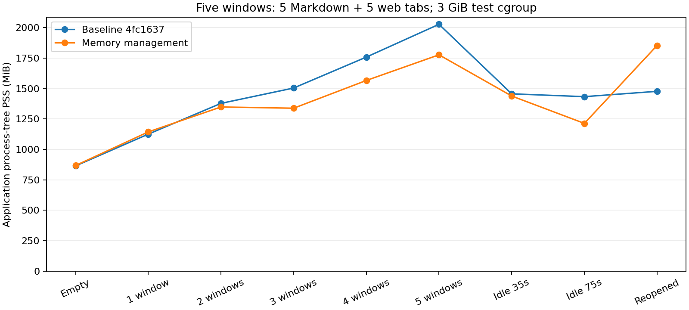

# Setdown 메모리 관리 적용 및 검증

2026-11-08. 기준 버전 `4fc1637`, Electron 44.7.2. [원인 분석 보고서](../memory-audit-2026-11-08/README.md)의 앱 전체 예산, 비활성 화면 회수, 캐시 제한을 실제 코드에 적용했다. 변경 사항은 현재 작업 트리에 있으며, 사용 중인 설치 앱을 교체하거나 재시작하지 않았다.

## 적용한 동작

창마다 독립적으로 메모리를 늘리던 정책을 앱 전체에서 조정한다. Linux에서는 Setdown의 자식 프로세스까지 PSS로 합산하고, 시스템 `MemAvailable`, 메모리 경합 시간(PSI), 상위 cgroup 제한을 읽는다. 다른 OS에서는 Electron working set을 사용한다. 기본 관측 주기는 10초, 압박 시 3초다.

앱의 회수 기준은 OS와 cgroup이 허용한 총 메모리 용량의 18%, 최소 768 MiB, 최대 3 GiB다. 앱 사용량이 이 기준을 넘거나 시스템 여유가 줄면 회수를 시작한다. 기준의 135%를 넘거나 시스템 여유가 매우 낮으면 더 빠르게 회수한다. 압박 해제에는 30초 동안 충분한 여유가 필요하다. **이 값은 회수를 시작하는 기준이지, 활성 페이지를 강제로 종료하는 하드 제한이 아니다.**

| 자원 | 적용한 제한·회수 | 다시 사용할 때 |
| --- | --- | --- |
| 비활성 웹 탭 | 정상 10분, 압박 2분, 심한 압박 30초 후 적격 탭의 WebContents 종료. 관측 주기당 최대 2개 | 기존 세션으로 다시 로드하고 탐색 기록·스크롤·음소거·탭 배율 복원 |
| Markdown·Git 미리보기 | 같은 유휴 기준으로 native view 회수. Git의 두 준비 화면은 한 논리 탭으로 보호 | 최신 원문으로 재생성. 편집 모델과 Undo 유지 |
| 예비 미리보기 | 전체 앱에서 최대 2개, 압박 시 0개 | 필요할 때 생성 |
| main의 HTML 캐시 | RAM 32 MiB, 최대 64개. 사용자 프로필 아래 비공개 디스크 파일로 보완 | 캐시에서 빠진 살아 있는 URL도 디스크에서 읽기 |
| worker 캐시 | 블록 기록 64 MiB/32개, 검색 인덱스 16 MiB/128개, Crossnote notebook 4개와 각각 engine 4개 | 캐시가 없으면 최신 전체 HTML 생성 |
| 조판·Git worker | 유휴 5분, 압박 시 1분 후 종료 | 다음 요청에 재시작 |
| 검색 worker | 유휴 2분, 압박 시 15초 후 종료 | 다음 요청에 재시작 |
| PDF·이미지 화면 | 압박 시 숨긴 화면 해제, 현재 보이는 모든 그룹 보호 | 저장된 읽기 위치로 다시 열기 |
| 작은 메뉴·팝업 창 | workspace 코드와 Monaco의 무거운 모듈 그래프를 로드하지 않도록 분리 | 공통 테마 CSS는 유지 |

캐시 바이트 한도는 문자열·인덱스 payload의 추정치다. V8 객체, DOM, 엔진 내부 보유분까지 포함한 프로세스 전체의 하드 상한은 아니므로 앱 PSS와 함께 확인한다.

웹 휴면은 보이는 탭, 최근 사용한 탭, 입력 흔적이 있는 폼, 편집 가능한 영역, iframe·canvas 등 안전 판정이 어려운 페이지, 재생 중인 미디어, 권한·인증·팝업·다운로드 작업과 창 간 이동을 보호한다. `beforeunload`가 종료를 막으면 자동 확인하지 않고 해당 탭을 유지한다. 사이트 메뉴의 **Keep This Tab Awake**로 자동 휴면을 막을 수 있다. 휴면한 탭에는 달 아이콘을 표시한다.

웹 휴면은 페이지의 모든 JavaScript 상태를 저장하는 기능은 아니다. 알려진 위험 상태를 제외해도 사이트 내부의 모든 상태·통신을 탐지할 수는 없으며, 복귀 시 네트워크 재로드가 필요할 수 있다. 중요한 실시간 페이지는 유지 옵션을 사용할 수 있다. 영상 파일의 기존 제한된 LRU 캐시는 유지하며, 메모리 압박 때문에 추가로 퇴출하지 않는다.

HTML 탐색·PDF 내보내기 중에는 lease로 파일을 보호한다. 미사용 파일을 정리하고 종료 시 세션 캐시를 제거하며, 비정상 종료 잔여 파일은 다음 시작 때 제거한다. 디스크 파일은 사용자만 읽을 수 있게 만들고, RAM 기반일 수 있는 `/tmp`를 제품 캐시로 사용하지 않는다.

**View → Memory Usage…**에서 사용량, 예산, 자원 개수를 확인하고 비활성 자원 회수를 요청할 수 있다. renderer 비정상 종료는 최근 16개까지 로컬 `memory-crashes.json`에 원인과 직전 메모리 수치를 기록한다. 페이지 본문·폼·URL은 이 기록에 넣지 않는다.

## 검증 환경

기준 버전은 `/var/tmp/setdown-memory-baseline-4fc1637`에 별도 checkout과 자체 설치한 의존성·Electron을 사용한다. 제품 코드의 메모리 정책은 양쪽 모두 해당 버전 그대로다. 비교 시 두 버전 모두 `SETDOWN_BUILD_SOURCEMAP=0`으로 빌드한다.

모든 GUI 검증은 프로젝트의 Xvfb wrapper를 통해 사설 runtime 디렉터리·D-Bus 세션·프로필에서 실행한다. 사용자 데스크톱과 Wayland 소켓을 사용하지 않는다. 검증 전체에는 별도의 cgroup으로 `MemoryMax=3G`, `MemoryHigh=2800M`, `MemorySwapMax=0`을 적용한다. 최초 빌드 중 `MemoryHigh=2300M`의 과도한 throttling을 확인해 2800 MiB로 올렸으며 최대 한도는 유지했다. 시스템 여유가 2 GiB 아래로 내려가면 [감시기](resource-watch.py)가 검증 전용 scope만 중단한다.

이전에 여유 메모리가 부족한 상태의 실행은 감시기가 1,632 MiB에서 중단했다. 해당 [기록](resource-watch-resource-stop.json)과 `contract-complete-resource-stop.log`를 보존했다. 별도 저용량 Node 힙 실험도 빌드 단계에서 실패했으며 `build-low-memory.log`에 남겼다. 실패·중단된 실행은 통과 또는 절감률 계산에 포함하지 않는다. 이후 사용자가 RAM 여유를 확보한 상태에서 전체 검증을 재개했다.

## 검증 결과

- 계약 단위 테스트: **114개 파일, 890개 테스트 통과**.
- 빌드 도구 테스트: **14개 통과**.
- TypeScript·Svelte 검사: **오류 0, 경고 0**. production build 완료.
- 새 메모리 Electron 시나리오 **3개 통과**: Git의 두 native buffer 회수 후 수정 내용 복구, Markdown 최신 내용·Undo 복구, 웹 WebContents 회수·기록/스크롤 복구와 폼/`beforeunload` 보호. 실제 30초 유예를 기다리며 fake clock이나 테스트 전용 회수 우회 경로를 쓰지 않는다.
- 실제 Electron 계약 테스트 **324개 모두 통과**(19.7분). 기존 PDF 테마 여백, 표 삽입 팝오버, 한글 IME, 여러 그룹·창 이동, 미디어·Notebook·언어 기능을 포함한다. `npm run test:preview-contract` 전체가 성공했다. [전체 로그](contract-complete.log).
- 전환 지연 비교: **48개 항목 모두 통과, 퇴행 0개**. 8개 시나리오 × 버전별 3회 = 48회 앱 실행. 편집 시 최신 내용의 실제 capture를 검증했고, 기존 25%·50ms 허용치를 변경하지 않았다. [원자료·해시·판정](preview-benchmark/comparison.json).
- 5창 혼합 메모리 비교: **양쪽 모두 완료, 10개 탭 재열기·실제 본문 확인 성공, renderer 비정상 종료 0, cgroup OOM/kill 0**. [기준 원자료](mixed-baseline.json), [변경 원자료](mixed-candidate.json), [전체 표](mixed-table.md), [실행 로그](mixed.log).

성능 기준 통과가 모든 항목의 속도 향상을 뜻하지는 않는다. 가장 큰 절대 증가가 나온 항목은 **편집 있음·준비 0ms인 Git의 두 번째 Esc**로, 중앙값 1,609 → 1,981ms(+372ms, +23.1%)였다. 기존의 두 조건(25%와 50ms) 중 상대 기준을 넘지 않아 통과했지만 후속 최적화 대상으로 남긴다. 전체 항목의 첫째·둘째·warm 수치를 분리해 제공하며 빠른 항목과 평균내지 않는다.

[일반 Markdown·Git의 첫째·둘째·warm 전체 비교표](latency-tables.md)에 편집 여부와 준비 시간별 양방향 전환 수치를 기록했다.

### 5창 메모리 결과와 복귀 비용

| 시점 | 기준 PSS | 변경 PSS | 차이 |
| --- | ---: | ---: | ---: |
| 5창·10탭을 모두 연 뒤 | 2,027.1 MiB | 1,776.6 MiB | 250.5 MiB 감소, **12.4%** |
| 35초 유휴 | 1,456.3 MiB | 1,438.4 MiB | 17.9 MiB 감소, 1.2% |
| 75초 유휴 | 1,433.1 MiB | 1,213.7 MiB | 219.4 MiB 감소, **15.3%** |
| 10개 탭을 연속 재열기한 직후 | 1,476.9 MiB | 1,853.1 MiB | **376.2 MiB 증가, 25.5%** |

75초 시점에 변경 버전은 native Markdown 미리보기 2개, 웹 페이지 3개, 휴면 웹 탭 2개를 유지했다. 예비 미리보기와 조판·Git·검색 worker는 모두 0개였다. 전체 WebContents 수는 기준 27개에서 변경 17개로 줄었다. 편집 모델과 논리 탭은 그대로 유지됐다. 관측된 시스템 최소 여유는 2,265 MiB로, 재개한 검증은 감시기에 의해 중단되지 않았다.

**유휴 회수 효과와 재생성 비용을 함께 봐야 한다.** 재열기 직후 변경 버전의 사용량은 기준보다 높았다. 이 시나리오는 그 뒤의 안정화까지 측정하지 않았으므로 이 증가가 얼마나 빨리 사라지는지 단정하지 않는다. 휴면에서 복귀하면 페이지와 조판 worker를 새로 준비해야 하며, 빠른 왕복 전환에서 항상 메모리가 더 적다고 주장할 수 없다. 이번 관측 시점들 중 최대 PSS는 기준 2,027.1 MiB, 변경 1,853.1 MiB였지만 연속 샘플링으로 얻은 실제 peak는 아니다.

## 비교 측정의 범위

[혼합 측정 스크립트](measure-mixed.mjs)는 5개 창 각각에 Markdown 1탭과 웹 1탭을 열어 총 10탭을 만든다. Markdown은 80개 section, 웹은 500개 문단과 실제 할당한 8 MiB 배열이다. 2개 창에서 Markdown, 3개 창에서 웹을 표시한다. 35초·75초 유휴 뒤 메모리를 측정하고, 마지막에는 10개 탭을 모두 다시 열어 실제 본문과 탭 수를 확인한다. 강제 GC는 사용하지 않는다.

기준·변경 버전을 같은 가상 화면에서 순서대로 실행한다. 테스트 cgroup이 3 GiB이므로 변경 버전의 앱 예산은 최소값인 768 MiB다. 이는 13.38 GiB인 이 PC에서 제한 없이 실행할 때의 약 2.41 GiB 예산과 다르다. 따라서 이 측정은 **메모리 압박 시 회수 효과**를 평가하며, 임의의 실제 웹사이트 5개에서 같은 절감률을 보장하지 않는다. PSS에는 GPU 전용 메모리 등 모든 자원이 포함되지 않는다.

일반 Markdown·Git의 전환 성능은 별도의 기존 벤치마크를 사용한다. 편집 여부 × 준비 시간 0/3000ms의 8개 시나리오, 버전별 3회, 첫째·둘째·warm 주기와 양방향 전환의 48개 비교를 유지한다. 허용치는 기존의 25%와 50ms이며 둘 다 초과하면 실패한다. 3회 측정으로 P95나 보편적인 체감 지연을 주장하지 않는다.

실행 절차는 [run-validation.sh](run-validation.sh), 시스템 여유 기록은 [resource-watch.json](resource-watch.json), 표·그래프 생성은 [summarize.py](summarize.py)에 남겼다. cgroup `memory.peak`는 빌드부터 전체 scope의 누적 값이므로 앱 PSS peak로 사용하지 않았다.

## 남은 범위

이번 변경은 재생성 가능한 비활성 화면과 캐시의 수명을 줄인다. 활성 웹사이트 5개 자체가 큰 메모리를 요구하거나 모든 탭이 입력·미디어 상태로 보호되면 예산을 넘을 수 있다. 이를 숨기기 위해 편집 내용, Python kernel, 언어 서버, 보이는 페이지를 임의로 종료하지 않는다.

일반 코드 LSP의 창 간 공유, PDF canvas의 앱 전체 바이트 예산, Notebook kernel 내부 메모리, 확장 기능의 상시 비용 감축, 장시간 반복 사용의 heap 누수 분석은 별도 과제다. 이번에 모두 해결했다고 주장하지 않는다. 현재 보이는 화면의 메모리가 계속 높다면 **View → Memory Usage…**와 로컬 종료 기록을 다음 분석의 출발점으로 사용할 수 있다.

구현 소유권과 보존할 동작은 [미리보기 성능 계약](../../docs/preview-performance-contract.md), 웹 탭 동작은 [workspace 계약](../../docs/contracts/workspace.md)에 반영했다.
