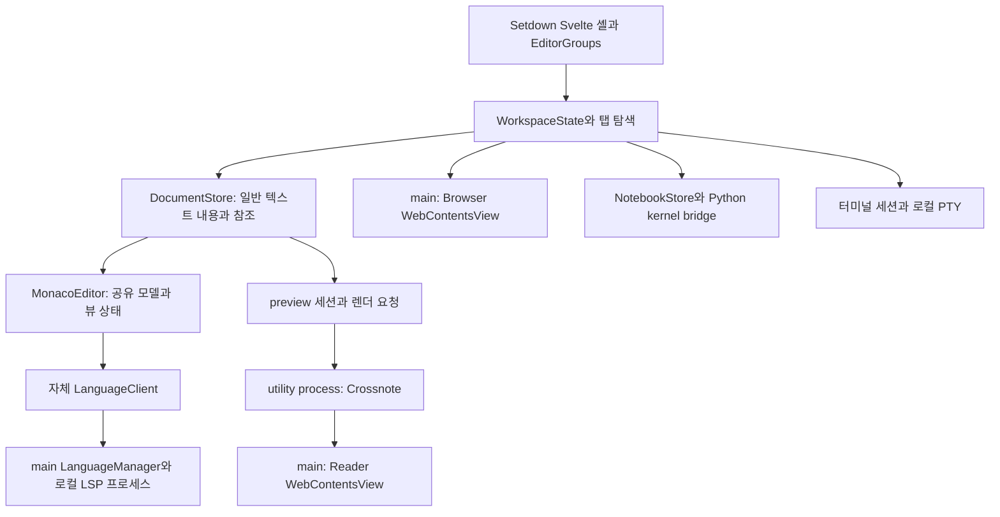
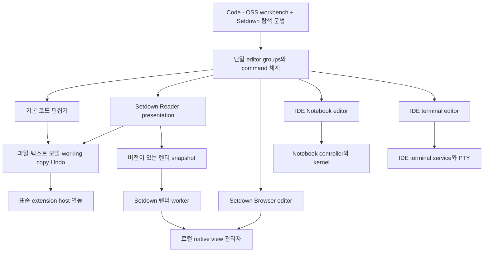
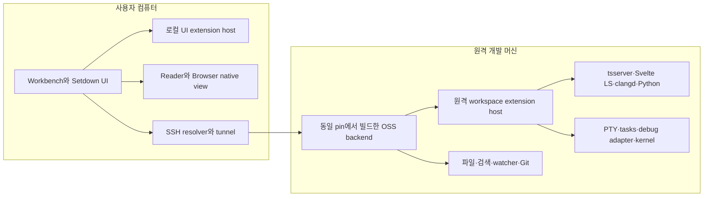

# Setdown은 VS Code의 코딩 환경을 가져올 수 있는가

작성: 2026-10-24 · 코드 조사: 2026-10-23~24 · 대상: Setdown, Code - OSS, Eclipse Theia, monaco-languageclient

**요구사항:** Python, Jupyter, TypeScript, Svelte, C++, Remote SSH, Codex 같은 VS Code 확장을 사용하면서, Markdown·웹·코드·터미널·파일을 동등한 탭으로 다루는 Setdown으로 VS Code를 대체한다.

## 1. 결론과 권고

**가져올 수 있다. 이번 목표에는 Code - OSS의 실제 데스크톱 워크벤치와 확장 호스트를 기반으로 삼고, Setdown의 읽기·브라우징·리소스 탐색 경험을 그 위에 이식하는 방식을 먼저 검증하는 것이 가장 타당하다.**

이것은 기존 Setdown에 `npm install vscode`를 하고 코딩 컴포넌트를 삽입하는 작업이 아니다. 파일 모델, 저장과 복구, 편집기 그룹, 확장 호스트, Notebook, 디버거, 작업 실행, 원격 연결을 함께 제공하는 플랫폼의 **소유권을 받아들이는 작업**이다. 현재 Svelte 셸을 반드시 유지한다는 제약보다, Setdown의 사용자 경험을 유지한다는 제약을 우선해야 한다.

Theia도 유력한 후보다. 자체 제품을 만들기 위한 확장 지점과 IDE 기능을 제공한다. 다만 사용자가 원하는 것은 일반적인 맞춤형 IDE가 아니라 **VS Code에서 하던 일을 폭넓게 그대로 수행하는 환경**이다. 이 조건에서는 실제 VS Code 구현을 재사용하는 Code - OSS가, 별도의 구현으로 VS Code API와 동작을 맞추는 Theia보다 먼저 실험할 이유가 크다. 이것은 소스 구조와 요구사항에 근거한 우선순위이며, 실행 검증을 마친 승자 선언은 아니다.

다음 세 가지를 분리해야 판단이 정확해진다.

| 원하는 것 | 가능한 접근 | 자동으로 해결되지 않는 것 |
| --- | --- | --- |
| VS Code의 코딩 기능과 조작 체계 | Code - OSS 워크벤치·내장 확장·확장 호스트 재사용 | Setdown 통합, 패키징, 업데이트, 플랫폼별 검증 |
| Python·Jupyter·SSH·AI 등을 포함하는 실제 작업의 대체 | 허용된 확장 배포물과 대체 도구를 조합하고 작업 단위로 검증 | 특정 확장과 버전의 기능·인증·원격 동작 |
| Microsoft 배포판과 동일한 모든 확장·서비스 | 각각의 사용 조건과 공식 지원 범위 충족 필요 | Marketplace 접근, 독점 확장, Microsoft 서버 사용 권리 |

Code - OSS의 MIT 소스 라이선스가 Microsoft 배포판, Marketplace, 모든 확장 배포물의 권리까지 제공하지는 않는다. 공식 FAQ도 이들을 구분한다. 따라서 **“VS Code 대체”는 실현 가능한 제품 목표지만, “Microsoft 제품에 들어 있는 모든 것을 그대로 재배포”는 같은 목표가 아니다.** [Microsoft FAQ](https://code.visualstudio.com/docs/supporting/faq)

권고하는 첫 결과물은 새 제품 전체가 아니라 다음 질문에 답하는 **패키징된 수직 시제품**이다.

> 같은 창에서 SSH 프로젝트를 열고, Python·Jupyter·TypeScript/Svelte·C++ 작업과 Codex를 수행하면서, Setdown Markdown Reader와 웹 탭을 코드와 같은 그룹에 배치할 수 있는가? 저장·Undo·원격 실행·포커스·복구가 하나의 체계로 작동하는가?

코딩 확장 검증과 Setdown 고유 UI 검증을 모두 통과하기 전에는 기존 제품을 폐기하거나 전체 이전을 시작하지 않는 것이 좋다.

## 2. 조사 범위와 증거의 한계

이 보고서는 일반적인 제품 비교가 아니다. 현재 Setdown과 등록된 서브모듈의 구현을 읽고, 이 컴퓨터에 존재하는 관련 VS Code 확장의 `package.json`을 조사했다. 외부 정보는 공식 문서와 프로젝트 소스를 확인했다.

### 2.1 고정한 소스 기준

| 대상 | 조사한 커밋 | 관찰한 버전 |
| --- | --- | --- |
| Setdown | `d7645a9c6c8095af7d4c86fcffe489dbe6a2cda1` | 현재 저장소 HEAD |
| `vendor/vscode` | `d3d31f62268b169a2dfab62ffb2d7d38158a5b7c` | 루트 `package.json`: `1.142.0` |
| `vendor/theia` | `71ee592eab40c0e7c1d808aef884b29db956097e` | Electron 예제·plugin 패키지: `1.76.0` |
| `vendor/monaco-languageclient` | `c52125a809e5993509d53f10f5b478c989b18f5d` | client: `11.0.3-next.0` |

이 버전들은 **로컬 checkout의 관찰값**이다. 최신 안정 배포판이라는 뜻이 아니다. Theia 루트 패키지 버전은 `0.0.0`이므로 제품 구성 패키지의 버전과 구분했다. monaco-languageclient의 위 버전도 README에서 unreleased로 표시된 개발 버전이다.

Setdown의 선언된 주요 의존성은 Electron `44.7.2`, Monaco `0.56.0`, Crossnote `0.9.35`, Svelte `^5.57.0`, TypeScript `5.9.3`, typescript-language-server `6.0.2`, pyright `1.1.414`, basedpyright `1.40.2`다. 버전 범위 선언과 실제 설치 결과는 구분해야 한다. 근거: [desktop package.json](../../apps/desktop/package.json).

Theia와 monaco-languageclient는 이미 서브모듈로 존재한다. 그러나 **서브모듈 등록은 제품 통합이 아니다.** 현재 문서에서도 둘은 직접 빌드 입력이 아닌 참조 저장소로 분류한다. [외부 코드와 빌드 입력](../../docs/architecture/external-code.md)

### 2.2 확인한 것과 아직 확인하지 않은 것

| 구분 | 이 보고서의 상태 |
| --- | --- |
| Setdown의 문서·편집·LSP·브라우저·Reader·Notebook·터미널 소유권 | 소스와 설계 문서 조사 |
| Code - OSS와 Theia의 대응 서비스·확장 호스트·네이티브/원격 구조 | 고정 checkout의 소스 조사 |
| 관련 확장 24개 manifest 기록 | Stable/Insiders 디렉터리에서 선택적으로 읽음 |
| 후보 제품의 실제 빌드·설치·확장 활성화 | **미실행** |
| Codex 로그인, SSH 연결, Jupyter 위젯, 디버깅의 후보별 성공 여부 | **미검증** |
| 성능·메모리·IME·장시간 안정성 | **미측정** |
| 확장 재배포 권리 | 공식 안내와 manifest 위험 요인 확인; 배포물별 확정 필요 |

설치 폴더가 존재한다는 사실은 해당 버전이 현재 활성화되어 있거나 사용 중이라는 증거가 아니다. 여러 버전과 Stable/Insiders 복사본이 함께 있다. 설정, 계정, 토큰은 수집하지 않았다. 버전, 진입점, API proposal, 의존성, manifest 해시는 [evidence.json](evidence.json)에 남겼다.

이하에서 “확인”은 소스에서 확인한 사실, “권고/설계”는 제안, “검증 필요”는 아직 실행 결과가 없다는 뜻이다.

## 3. 앞선 상담에서 수정해야 할 전제

### 3.1 Setdown Reader는 Svelte 컴포넌트 하나가 아니다

현재 Reader의 표시 경로에는 Electron `WebContentsView`, 별도 preview runtime, main의 생명주기 관리, utility process의 Crossnote 렌더링이 있다. Svelte UI를 Theia 위젯에 마운트하는 것만으로 Reader 통합이 끝나지 않는다. 브라우저와 Reader **둘 다** 네이티브 뷰의 위치·노출·포커스·창 소유권을 다뤄야 한다.

근거: [preview-manager.ts](../../apps/desktop/src/main/preview/preview-manager.ts), [preview-renderer.ts](../../apps/desktop/src/main/preview/preview-renderer.ts), [render-worker.ts](../../apps/desktop/src/main/preview/render-worker.ts), [성능 계약](../../docs/preview-performance-contract.md).

### 3.2 Code - OSS도 웹과 터미널을 일반 편집기 탭으로 다룰 수 있다

조사한 Code - OSS에는 `BrowserEditorInput`, Browser editor pane, Electron main의 `WebContentsView` 구현이 이미 있다. 터미널도 `TerminalEditorInput`과 editor pane으로 등록된다. 따라서 “VS Code 기반으로 가면 웹과 터미널은 반드시 하단 도구 창에 갇힌다”는 전제는 현재 소스와 맞지 않는다. 공식 통합 브라우저 문서도 편집기 내 브라우저를 설명한다. [공식 브라우저 문서](https://code.visualstudio.com/docs/debugtest/integrated-browser)

근거: [browserEditorInput.ts](../../vendor/vscode/src/vs/workbench/contrib/browserView/common/browserEditorInput.ts), [browserView.contribution.ts](../../vendor/vscode/src/vs/workbench/contrib/browserView/electron-browser/browserView.contribution.ts), [native browserView.ts](../../vendor/vscode/src/vs/platform/browserView/electron-main/browserView.ts), [terminal.contribution.ts](../../vendor/vscode/src/vs/workbench/contrib/terminal/browser/terminal.contribution.ts).

다만 Setdown의 차별점은 단순히 “웹도 탭에 있다”보다 크다. 같은 탭에서 파일→웹→터미널로 이동하고 뒤로/앞으로 가는 탐색 문법, 문서 읽기를 중심에 둔 전환, 터미널 세션과 탭의 분리까지 포함한다. 이 의미는 별도로 이식해야 한다.

### 3.3 Theia에는 자체 Remote SSH 기반이 있다

현재 checkout의 `@theia/remote`는 로컬 backend를 통해 SSH로 원격 시스템을 준비하고, Node 및 backend·플랫폼 의존성을 배치한 뒤, 프록시를 거쳐 원격 backend에 frontend를 연결한다. Theia를 “SSH가 없는 플랫폼”으로 평가하면 틀린다. 반대로 이 기능이 Microsoft Remote-SSH 확장을 그대로 실행한다는 뜻도 아니다. [Theia remote README](../../vendor/theia/packages/remote/README.md)

### 3.4 기존 Setdown 코딩 기능도 상당하다

Setdown은 문법 색상만 있는 에디터가 아니다. 공유 문서 모델, 편집기 그룹, Git diff 연동, LSP 세션과 진단·탐색·리팩터링, 명령 팔레트와 편집 도구, 복구 기반이 있다. 문제는 이 구현의 가치가 없다는 것이 아니라, 앞으로 요구되는 **IDE 전체의 책임 범위**가 훨씬 넓다는 점이다.

## 4. 현재 Setdown을 실제 소유권 기준으로 해부하기



### 4.1 문서 내용과 탭을 이미 구분한다

`WorkspaceTab`은 `DocumentTab | BrowserTab | TerminalTab | DiffTab`이다. 일반 텍스트는 `DocumentStore`가 소유하고, 여러 뷰가 참조한다. 같은 경로를 다시 읽어도 기존 dirty buffer를 디스크 내용으로 덮어쓰지 않으며, 동시에 발생한 acquire는 pending 요청을 공유한다. `attach()`는 탭의 `document/text/revision`을 공통 record에 연결한다.

`MonacoEditor`도 모델과 그룹별 editor/view를 분리한다. 일반 편집기와 Git 변경 검토가 같은 현재 문서 모델을 사용할 수 있고, 커서·접힘·스크롤 같은 표시 상태는 뷰별로 관리한다. 이 방향은 새 기반에서도 보존해야 한다. 근거: [workspace-state.ts](../../apps/desktop/src/core/workspace/workspace-state.ts), [document-store.ts](../../apps/desktop/src/core/workspace/document-store.ts), [monaco-editor.ts](../../apps/desktop/src/renderer/adapters/monaco-editor.ts), [editor groups 설계](../../docs/editor-groups-design.md).

다만 현재 `ensureModel()`은 `Uri.file(path).with({ query: documentIdentity(tab) })`로 standalone Monaco 모델을 만든다. **이 URI와 모델을 VS Code 파일 모델에 그대로 얹으면 안 된다.** Setdown 안에서는 문서 정체성을 구분하는 방식이지만, 새 플랫폼에서는 실제 파일 URI와 다른 리소스로 인식되어 확장, 저장, diff, 진단이 별도 모델을 볼 수 있다. 새 설계에서는 정규 resource URI와 탭/표시 인스턴스 ID를 분리해야 한다.

### 4.2 LSP는 자체 구현이며 이미 많은 기능을 다룬다

renderer의 `LanguageClient`가 Monaco provider와 LSP 응답을 연결하고, main의 `LanguageManager`와 `ServerSession`이 stdio 프로세스·세션·환경·워크스페이스·파일 감시를 관리한다. 프로토콜에는 completion/resolve, hover, signature, 여러 정의 탐색, references, rename, code action, formatting, semantic tokens, inlay hints, workspace symbols, call/type hierarchy 등이 들어 있다.

이는 중요한 투자다. 하지만 LSP는 확장 호스트, Notebook controller, 디버거, task provider, test controller, remote authority resolver를 대체하지 않는다. 현재 `workspaceEdit.resourceOperations`도 빈 배열로 협상한다. 언어 서버가 제공하는 파일 생성·이동·삭제까지 포함한 프로젝트 리팩터링과, 단순 텍스트 수정은 범위가 다르다.

또한 local absolute path와 `file:` URI를 기준으로 세션·편집을 검증한다. 이 검증을 단순히 제거해 원격 URI를 받아들이는 방식은 해결책이 아니다. 원격 리소스의 권한과 읽기·쓰기·감시·실행 위치를 별도로 모델링해야 한다.

근거: [language-client.ts](../../apps/desktop/src/renderer/language/language-client.ts), [language-manager.ts](../../apps/desktop/src/main/language/language-manager.ts), [server-session.ts](../../apps/desktop/src/main/language/server-session.ts), [language-features.ts](../../apps/desktop/src/protocol/language-features.ts), [언어 지원 문서](../../docs/language-support.md).

### 4.3 편집 UX도 재사용할 설계 자산이다

명령 팔레트는 Monaco와 Setdown 명령을 묶고, 검색·이력, 선택 편집, 다중 커서, 반복, 복사 기록, 결과 목록 같은 도구를 제공한다. 문서 세션 경계는 `DocumentContentOwner`를 통해 일반 텍스트와 별도 소유자를 구분한다. 이 port는 유용한 출발점이지만 파일시스템·확장 호스트까지 추상화한 플랫폼 API는 아니다.

현재 checkpoint/dirty recovery, 그룹 이동, 창 이동 정책도 이전 대상이다. 특히 기존 문서가 보장하지 않는 diff tear-off나 창 사이 Undo 연속성을 새 구현이 이미 보장한다고 써서는 안 된다. 우선 현재 보장과 새 요구를 분리해 테스트해야 한다. [편집 도구](../../docs/editor-tools.md), [document-sessions.ts](../../apps/desktop/src/renderer/workspace/document-sessions.ts), [document-content port](../../apps/desktop/src/renderer/ports/document-content.ts)

### 4.4 Reader와 브라우저는 네이티브 표면을 공유하지만 정책은 다르다

Reader는 최신 revision/theme/epoch를 확인하며 준비된 결과를 표시한다. Crossnote 렌더링은 utility process에서 수행한다. 숨긴 뷰의 준비와 재사용, 한국어 IME, 소스↔Reader 위치 복원은 성능 계약의 일부다.

브라우저는 실제 `WebContentsView`, 영속 session partition, popup·인증·다운로드·권한 처리, Chrome 확장 및 읽기 기능을 갖는다. 이 Chrome 확장 호스트는 **VS Code 확장 호스트와 다른 것**이다. 이름에 extension이 있다는 이유로 연결 가능한 기반으로 평가하면 안 된다. [browser-manager.ts](../../apps/desktop/src/main/browser/browser-manager.ts)

### 4.5 Notebook과 터미널에는 각자의 내용·실행 소유자가 있다

일반 `DocumentStore`는 Notebook을 제외한다. Notebook은 자체 store와 serialize/save 경로, Python `ipykernel`/`jupyter_client` bridge를 사용한다. 고급 상호작용·위젯·일부 디버깅 경험은 별도 JupyterLab 웹 탭 경로로 연결되며, 네이티브 Notebook과 커널 상태가 자동 공유되는 것은 아니다. 이는 유용한 현재 기능이지만, VS Code Jupyter 통합과 동일한 구조는 아니다. [Notebook 문서](../../docs/notebooks.md), [Notebook 내용 소유자](../../apps/desktop/src/renderer/notebook/document-content.ts)

터미널은 탭과 세션이 분리된다. 탭을 닫거나 다른 리소스로 탐색해도 PTY가 반드시 종료되지 않는다. headless xterm snapshot과 출력 전달·소유권 이전도 관리한다. 새 IDE의 task/debug 통합을 가져오면서 이 의미를 유지하려면, 같은 셸을 두 terminal service가 동시에 관리하게 만들지 않아야 한다. [통합 터미널 문서](../../docs/integrated-terminal.md)

## 5. 왜 Monaco + LSP가 VS Code가 되지 않는가

다음은 기능 목록보다 중요한 책임 구분이다.

| 층 | 현재 Setdown/라이브러리에서 얻는 것 | VS Code 대체에 추가로 필요한 것 |
| --- | --- | --- |
| 편집기 | Monaco 텍스트 모델·선택·렌더링·provider | 파일 내용/저장/복구/그룹과 일관된 연결 |
| 언어 프로토콜 | LSP 서버와 요청·진단·편집 | 프로젝트 환경, 확장 고유 UI, 여러 종류의 provider |
| 워크벤치 | Setdown 자체 탭·문서·명령 | 설정 scopes, context keys, keybindings, 파일·검색·SCM·tasks·debug·tests·Notebook |
| 확장 실행 | 현재 앱에는 일반 VS Code Node extension host가 없음 | `vscode` API, main-thread RPC, contribution points, 활성화·업데이트·로그·복구 |
| 원격 개발 | 현재 주요 파일/LSP/PTY 경로는 로컬 중심 | remote authority, 원격 파일·검색·watcher·확장 호스트·디버거·포트 |
| 제품 배포 | 현재 Setdown Electron 패키징 | 후보 플랫폼 빌드, 확장 공급, 원격 서버, 서명·업데이트·지원 |

소스 검색에서 일반 VS Code 확장 호스트와 통합 DAP/task/test-provider 플랫폼은 확인하지 못했다. 이것은 앱에 실행 기능이나 Notebook 디버깅 경로가 전혀 없다는 주장이 아니다. VS Code 확장이 기대하는 통합 계약이 현재 기반에 없다는 뜻이다.

### 5.1 확장 호스트만 떼어 오는 방식의 실제 의존성

Code - OSS의 `MainThreadDocuments`는 단순한 `getText()` bridge가 아니다. `IModelService`, `ITextFileService`, `IFileService`, `ITextModelService`, URI identity, working-copy file service 등에 연결된다. `MainThreadEditors`도 editor groups, code editor service, 설정과 연결된다. native extension service는 원격 연결, trust, gallery, lifecycle 등 여러 서비스를 요구한다.

즉 확장이 실행하는 `workspace.applyEdit()` 하나도 “텍스트를 교체한다”로 끝나지 않는다. 닫힌 파일을 열고, 현재 dirty 내용과 충돌을 처리하고, 리소스 생성/이동을 수행하고, Undo·저장 상태·확장 이벤트를 일관되게 갱신해야 한다. 디버그·Notebook·터미널 API에서는 더 많은 서비스가 필요하다.

근거: [mainThreadDocuments.ts](../../vendor/vscode/src/vs/workbench/api/browser/mainThreadDocuments.ts), [mainThreadEditors.ts](../../vendor/vscode/src/vs/workbench/api/browser/mainThreadEditors.ts), [nativeExtensionService.ts](../../vendor/vscode/src/vs/workbench/services/extensions/electron-browser/nativeExtensionService.ts), [bulkEditService.ts](../../vendor/vscode/src/vs/workbench/contrib/bulkEdit/browser/bulkEditService.ts).

확장 호스트를 단독 SDK처럼 이식하면 이 서비스들을 순차적으로 재구현하거나 다시 가져오게 된다. 사용자가 요구한 범위에서는 결국 작은 워크벤치 재구현 프로젝트가 될 가능성이 높다.

### 5.2 TypeScript부터 이미 서로 다른 경로다

Setdown의 Monaco 내장 분석 및 typescript-language-server 연결과, VS Code 내장 `typescript-language-features` 확장의 tsserver 통합은 동일하지 않다. 후자는 프로젝트 TypeScript 선택, TS server plugin, 명령과 워크벤치 설정에 걸친 구현이다. 실제 설치된 Svelte 확장도 `typescript-svelte-plugin`을 `typescriptServerPlugins`로 등록한다.

따라서 `.svelte` 파일의 hover가 되는 것만 확인해서는 부족하다. `.ts`에서 Svelte 컴포넌트를 import하고, 컴포넌트 props를 바꾸고, 파일을 이동했을 때 프로젝트 전반이 따라오는지까지 확인해야 한다. 근거: [TypeScript 확장 manifest](../../vendor/vscode/extensions/typescript-language-features/package.json), [typescriptServiceClient.ts](../../vendor/vscode/extensions/typescript-language-features/src/typescriptServiceClient.ts), [로컬 manifest 증거](evidence.json).

## 6. 가능한 경로를 같은 기준으로 비교하기

| 경로 | 코딩 기반 재사용 | 현재 셸 유지 | 사용자 요구에 대한 핵심 비용 | 판단 |
| --- | --- | --- | --- | --- |
| 현재 Setdown + LSP 보강 | 언어 기능 중심 | 가장 쉬움 | Notebook·debug·tasks·tests·확장·remote 전체를 계속 구축 | 최종 기반으로 비권고 |
| monaco-languageclient 도입 | 표준 LSP client와 연결 인프라 | 높음 | IDE/확장 플랫폼이 따로 필요 | 국소 개선 후보 |
| monaco-vscode-api 서비스 통합 | 실제 VS Code 서비스 일부를 선택적으로 재사용 | 가능하나 서비스 소유권 재설계 | Node 확장 호스트, 원격 backend, 전체 UI·서비스 연결 | 별도 연구 가치, 우선순위 낮음 |
| 완성된 IDE를 Setdown 탭 안에 내장 | 내부 IDE는 높은 기능 완성도 가능 | 외부 셸 유지 | 두 탭·두 명령·두 문서·두 포커스 체계 | 비교용 시제품에는 가능, 목표 구조에는 부적합 |
| Theia 기반 새 Setdown | IDE 플랫폼 + VS Code API 호환층 | 현재 셸 대체/이식 | 고급 확장 동작 검증, native 통합, Theia lifecycle | 두 번째 후보 |
| Code - OSS 기반 새 Setdown | 실제 워크벤치·확장 호스트·내장 기능 | 현재 셸 대체/이식 | 내부 API 기반 통합, fork 갱신, 배포·확장 공급 | **첫 번째 검증 후보** |
| 공식 VS Code 위의 Setdown 확장 | Microsoft 제품 경험을 직접 사용 | 제한적 | 전역 탐색 문법·native 뷰·브라우저 통합의 공개 API 한계 | 동일 확장 보존이 절대 조건일 때 대안 |

여기서 “현재 셸 유지”는 제품 정체성과 같지 않다. Svelte 컴포넌트를 덜 옮기기 위해 확장 생태계와 원격 실행 체계를 직접 만드는 비용이 더 커질 수 있다.

### 6.1 monaco-languageclient와 monaco-vscode-api의 정확한 위치

monaco-languageclient는 LSP 통신과 Monaco/VS Code 서비스 연결을 돕는다. 조사한 개발 버전은 Codingame 서비스 패키지들과 결합되어 있다. Setdown의 현재 standalone Monaco에 client 하나만 끼우는 단순 교체라고 가정하면 안 된다. 현재 client package의 peer/dependency 조합과 Monaco·VS Code 서비스 버전을 함께 맞춰야 한다. [client package.json](../../vendor/monaco-languageclient/packages/client/package.json), [프로젝트 README](../../vendor/monaco-languageclient/README.md)

`@codingame/monaco-vscode-api`는 실제 VS Code 서비스를 재사용하므로 단순 LSP wrapper보다 훨씬 넓다. 모델, 파일시스템, 확장, debug, remote 관련 구성이 존재한다. 그러나 README 자체가 standalone `monaco.editor.createModel()` 모델과 VS Code 서비스가 관리하는 모델을 구분하고, filesystem provider와 `createModelReference()`를 통한 수명 관리를 안내한다. Setdown의 현재 모델 생성과 충돌하는 핵심 지점이다. [공식 README](https://github.com/CodinGame/monaco-vscode-api/blob/main/README.md)

특히 이름만 보고 Node 지원을 추정하면 위험하다. 조사한 `localExtensionHost.ts`는 `ExtensionHostKind.LocalProcess`를 사용하지만, worker 쪽 확장 서비스를 가져와 같은 JavaScript 환경에 `ExtensionHostMain`을 구성하며 `pid`도 없다. **이 구현의 LocalProcess 표기는 Electron의 Node 자식 프로세스 확장 호스트를 제공한다는 증거가 아니다.** 별도 remote extension host 연결 경로는 있지만, 그 서버와 파일·프로세스 환경을 제품이 준비해야 한다. [localExtensionHost.ts](https://github.com/CodinGame/monaco-vscode-api/blob/main/src/localExtensionHost.ts), [extensions service override](https://github.com/CodinGame/monaco-vscode-api/blob/main/src/service-override/extensions.ts)

웹 편집 서비스나 제한된 확장 집합을 위한 제품이라면 이 경로의 장점이 크다. 이번 요구처럼 Node 기반 Python/Jupyter/C++/Codex와 SSH까지 넓게 포함하면, 기존 셸을 유지하는 대신 구현해야 할 플랫폼 범위가 너무 커지는지 먼저 따져야 한다.

### 6.2 전체 IDE를 iframe이나 별도 WebContentsView에 넣는 경우

코딩 영역 전체를 별도 IDE로 넣으면 빠르게 많은 기능을 볼 수 있다. 그러나 Setdown 문서 탭과 내부 IDE editor group이 공존하며 “같은 파일”, “현재 편집기”, “저장”, “전역 명령”, “뒤로 가기”의 의미가 갈라진다. SSH 파일을 Setdown Reader로 열려면 결국 내부 IDE의 파일·문서 서비스를 외부로 연결해야 한다.

이 방식은 호환성 비교용 실험에는 쓸 수 있다. 최종 제품으로 사용하려면 중첩 UI를 제거하고 소유권을 통합해야 하므로, 이를 우회로 없는 최종 아키텍처로 추천하지 않는다.

## 7. Code - OSS 기반 Setdown의 구체적 설계

이 절은 구현 완료 상태가 아니라 권고 설계다. 원칙은 **하나의 워크벤치와 하나의 문서 권위**다.



### 7.1 파일 내용은 Code - OSS가 소유한다

일반 파일은 `FileEditorInput`, text file model, working-copy 서비스가 소유하도록 한다. Setdown Reader는 해당 문서의 다른 표시 방식으로 붙인다. 현재 `DocumentStore`와 새 working copy를 동시에 쓰면서 이벤트로 양방향 동기화하는 설계는 피한다.

구현 지점은 다음과 같다.

| 책임 | Code - OSS 연결 후보 | Setdown이 남길 책임 |
| --- | --- | --- |
| 파일 열기·동일성 | `IEditorService`, URI identity, `FileEditorInput` | 리소스 종류별 열기/탐색 정책 |
| 현재 내용·dirty·save | text file service, model reference, working copy | Reader에 보낼 버전별 snapshot |
| 편집 표시 | `TextFileEditor`와 code editor | source↔Reader 전환, 읽기 위치 |
| 여러 파일 수정 | bulk edit 및 관련 파일 서비스 | Reader 무효화·갱신 |
| 미저장 복구 | working-copy backup과 제품 lifecycle | 기존 Setdown 복구 데이터의 명시적 가져오기 |
| 그룹·탭 이동 | editor groups/service | 같은 탭 탐색 이력과 제품 정책 |

근거: [fileEditorInput.ts](../../vendor/vscode/src/vs/workbench/contrib/files/browser/editors/fileEditorInput.ts), [textFileEditor.ts](../../vendor/vscode/src/vs/workbench/contrib/files/browser/editors/textFileEditor.ts), [workingCopyService.ts](../../vendor/vscode/src/vs/workbench/services/workingCopy/common/workingCopyService.ts), [textModelResolverService.ts](../../vendor/vscode/src/vs/workbench/services/textmodelResolver/common/textModelResolverService.ts).

처음에는 기본 텍스트 편집기를 유지하고 Reader만 custom editor pane/contribution으로 추가하는 것이 합리적이다. 공개 custom editor API로 가능한 범위를 먼저 확인하되, 기존 파일 input과 Undo를 유지하는 source↔Reader 전환 및 네이티브 뷰 연결이 공개 API만으로 충분하다고 가정하지 않는다. 필요한 경우 작은 workbench 통합 모듈을 두고 내부 API 의존성을 그 안에 모은다.

### 7.2 “한 파일, 여러 뷰”의 식별자를 분리한다

권고하는 식별 체계는 다음과 같다.

```text
resource URI      = 실제 문서 정체성; file: 또는 원격 filesystem URI
working copy      = 해당 문서의 편집·저장 상태를 가진 플랫폼 객체
presentation ID   = 코드/Reader/diff 등 표시 인스턴스
group ID          = 배치 위치
render token      = resource + model version + theme + request epoch
```

같은 Markdown을 두 그룹에서 열면 버퍼와 저장 상태는 같고 스크롤 위치는 달라야 한다. source와 Reader를 바꾸어도 새 텍스트 모델을 만들지 않는다. Git의 과거 revision은 현재 파일과 구분되는 읽기 전용 리소스로 유지한다. 닫힌 파일, untitled, rename, symlink, 대소문자 정책도 URI identity 서비스와 정합성을 맞춰야 한다.

### 7.3 편집→Reader→확장 수정의 실제 흐름

1. 사용자가 Markdown source를 수정한다. 플랫폼 모델의 버전이 증가하고 dirty가 된다.
2. Reader adapter가 **미저장 모델 내용**과 버전·테마·URI를 snapshot으로 보낸다. 디스크를 다시 읽어 최신이라고 간주하지 않는다.
3. worker가 렌더링한다. 이 동안 확장의 workspace edit가 문서를 다시 바꿀 수 있다.
4. 반환된 결과의 resource/version/epoch가 현재 요청과 맞을 때만 표시한다. 오래된 결과는 버린다.
5. Reader의 소스 위치 이동은 같은 모델과 editor input으로 돌아간다. Undo stack은 살아 있어야 한다.
6. 저장은 플랫폼 working copy를 통해 한 번 수행하고, 확장에 올바른 save 이벤트가 전달되도록 한다.

이 흐름이 통과해야 “Reader가 IDE 안에 들어갔다”고 볼 수 있다. 단순한 파일 preview 화면은 충분하지 않다.

### 7.4 네이티브 뷰는 하나의 배치·가림·포커스 정책으로 관리한다

Code - OSS에 이미 `WebContentsViewHost`가 있다는 사실은 큰 장점이다. 해당 구현은 표시 상태, overlay에 의한 가림, 포커스, screenshot placeholder를 다룬다. 그러나 Setdown Reader의 성능 계약까지 이미 충족한다고 볼 수는 없다. 예를 들어 조사한 host에는 보이는 모델의 screenshot을 주기적으로 확보하는 경로가 있어, 이를 Reader에 적용할 때 비용과 동작을 다시 확인해야 한다. [webContentsViewHost.ts](../../vendor/vscode/src/vs/workbench/contrib/browserView/electron-browser/webContentsViewHost.ts)

통합 계층은 최소한 다음 정보를 단일하게 결정해야 한다.

- 어느 창과 editor pane이 해당 뷰를 소유하는가.
- 활성·비활성 그룹과 분할 상태에서 실제로 노출되는 영역은 어디인가.
- command palette, 메뉴, drag overlay가 뜰 때 뷰를 어떻게 가리는가.
- app zoom과 브라우저/문서 content zoom을 어떻게 구분하는가.
- 숨김 준비 중에는 포커스를 건드리지 않고, 사용자 입력으로만 포커스를 넘기는가.
- 창 이동·닫기·복구 중 뷰와 세션을 언제 넘기고 해제하는가.

CSS 좌표를 native DIP로 바꾸는 책임을 중복시키면 확대율별 위치 오류가 발생한다. 별도 manager들이 각자 `setBounds()`를 호출하는 구조보다, 최종 배치를 결정하는 경계를 하나로 만드는 것이 좋다.

### 7.5 Setdown의 탭 탐색 문법은 별도 제품 계층으로 남긴다

현재 `TabVisit`는 file/web/terminal을 다루고, navigation controller는 비동기 전환의 최신 요청, dirty 닫기, terminal 세션 보존을 관리한다. 이 의미는 새 `SetdownNavigation` 계층으로 옮길 가치가 있다. [tab-navigation.ts](../../apps/desktop/src/core/workspace/tab-navigation.ts), [tab-navigation-controller.ts](../../apps/desktop/src/renderer/workspace/tab-navigation-controller.ts)

플랫폼의 `openEditor()`/`replaceEditors()`와 editor input을 사용하되, 다음 세 가지를 구분한다.

- **탐색 이력:** 같은 탭에서 이전 리소스로 돌아가는 동작.
- **문서/실행 수명:** 다른 곳에서 참조 중인 dirty 문서나 PTY를 유지하는 동작.
- **표시 수명:** 사용하지 않는 native view와 listener를 해제하는 동작.

이력을 무조건 살아 있는 editor 객체로 보관하면 메모리와 native view가 누적된다. 직렬화 가능한 resource/session 참조를 기본으로 하고, 미저장 내용은 working copy가, 실행 중 PTY는 terminal service가 소유하도록 해야 한다. close veto와 save prompt도 플랫폼 경로를 거쳐야 한다. [editorService.ts](../../vendor/vscode/src/vs/workbench/services/editor/common/editorService.ts)

### 7.6 Notebook·터미널·SCM의 이중 소유를 피한다

Notebook은 먼저 Code - OSS의 notebook 모델과 Jupyter 확장이 요구하는 controller·execution lifecycle을 사용한다. Setdown의 현재 NotebookStore를 병렬 실행하며 JSON만 동기화하면 cell identity, execution state, output, metadata, dirty와 Undo가 쉽게 어긋난다. 읽기 UX를 유지하려면 플랫폼 Notebook 모델을 읽는 presentation으로 붙이는 것이 우선이다.

터미널도 IDE terminal service를 기준으로 tasks/debug/extensions에서 만든 터미널과 사용자 터미널을 함께 관리한다. 기존 “탭을 닫아도 세션을 보존”하는 정책은 terminal instance의 수명과 editor view의 수명을 분리하는 방식으로 재현해야 한다. 현재 PTY manager를 함께 살려 같은 실행을 두 경로에서 관리해서는 안 된다.

Git은 플랫폼 SCM 확장·파일 모델을 기준으로 하고 Setdown의 Markdown Git review를 별도 표시 방식으로 연결한다. stage/unstage, rename, dirty buffer의 내용과 디스크의 차이를 하나의 Git/문서 상태에서 설명할 수 있어야 한다.

### 7.7 Svelte와 기존 렌더링 코드는 어디까지 남길 수 있는가

Svelte로 작성했다는 이유로 모든 UI를 재작성할 필요는 없다. 독립된 표시 컴포넌트와 설정 UI는 빌드된 자산으로 workbench contribution이나 별도 runtime에 연결할 수 있다. Crossnote 변환, source anchor, Reader runtime, 미디어 렌더링도 재사용 후보가 크다.

반면 전체 Svelte shell, 전역 workspace store, standalone Monaco 초기화, 자체 전역 키바인딩을 통째로 가져오면 두 워크벤치가 된다. **재사용 단위는 프레임워크가 아니라 책임**이어야 한다. UI 재사용률보다 저장·Undo·포커스·확장 이벤트의 단일성이 우선이다.

## 8. Theia를 선택한다면 무엇을 얻고 무엇을 직접 해야 하는가

### 8.1 Theia의 강점은 제품 확장을 위한 구조다

Theia는 VS Code의 포크가 아니라 독립적인 플랫폼이다. build-time Theia extension으로 서비스와 UI를 구성하고, runtime VS Code extension은 호환 API를 통해 실행한다. `ApplicationShell`은 여러 영역과 widget의 배치·활성화를 관리하므로 Setdown의 여러 리소스를 main 영역의 widget으로 만들 수 있다. [Theia FAQ](https://theia-ide.org/docs/faq/), [확장 방식](https://theia-ide.org/docs/extensions/), [application-shell.ts](../../vendor/theia/packages/core/src/browser/shell/application-shell.ts)

장점은 명확하다. 임의의 VS Code 내부 코드를 계속 수정하는 대신 제품 구성과 DI contribution을 중심으로 작업할 수 있다. 코드 편집, 파일, debug, tasks, terminals, Notebook, testing, plugin host, Open VSX, remote 관련 패키지도 존재한다. 실제 제품에는 필요한 패키지를 명시적으로 조합해야 하며, 패키지 존재만으로 특정 확장이 모두 작동한다고 볼 수는 없다.

### 8.2 VS Code API 지원은 실제 VS Code 구현과 다르다

`plugin-vscode-init.ts`는 확장이 `require('vscode')`할 때 Theia의 API factory를 제공한다. plugin host의 RPC는 Theia의 document/editor/workspace 서비스에 연결된다. 따라서 API 이름이 같아도 순서, 수명, 이벤트, 예외 동작이 동일한지는 별도 문제다.

현재 checkout의 기본 지원 API 버전은 `1.139.0`이다. 이것이 버전 조건을 만족하는 모든 확장의 전체 동작을 보증하지 않는다. Theia 자체 문서도 comparator가 **interface 수준**을 검사하며 구현 동작 호환성은 직접 테스트해야 한다고 명시한다.

근거: [plugin-vscode-init.ts](../../vendor/theia/packages/plugin-ext-vscode/src/node/plugin-vscode-init.ts), [API 버전 정의](../../vendor/theia/dev-packages/application-package/src/api.ts), [Plugin-API.md](../../vendor/theia/doc/Plugin-API.md), [공식 comparator](https://eclipse-theia.github.io/vscode-theia-comparator/status.html).

### 8.3 현재 코드의 통합 경계

| 영역 | Theia에서 사용할 기반 | Setdown 통합 시 주의점 |
| --- | --- | --- |
| 일반 문서 | MonacoTextModelService·resource/file services | standalone Monaco를 만들면 plugin이 보는 문서와 달라질 수 있음 |
| 탭과 분할 | ApplicationShell·widget manager | 현재 탭의 리소스 전환·history를 widget lifecycle과 연결 |
| Reader | custom widget + Electron main contribution | widget만으로 native view 소유권·포커스가 해결되지는 않음 |
| 브라우저 | custom widget + 기존 native browser service 이식 | Theia mini-browser의 iframe을 현재 브라우저와 동등하게 취급하지 않음 |
| 확장 | plugin-ext + plugin-ext-vscode | 구체적 확장 API·proposals·webview 동작 검증 |
| 원격 | @theia/remote와 SSH provider | backend 이동 후에도 로컬 Electron native 기능을 유지하는 별도 경계 필요 |

근거: [monaco-text-model-service.ts](../../vendor/theia/packages/monaco/src/browser/monaco-text-model-service.ts), [documents-main.ts](../../vendor/theia/packages/plugin-ext/src/main/browser/documents-main.ts), [mini-browser-content.ts](../../vendor/theia/packages/mini-browser/src/browser/mini-browser-content.ts), [electron-main-application.ts](../../vendor/theia/packages/core/src/electron-main/electron-main-application.ts).

특히 원격 연결 후 일반 backend가 원격으로 이동하는 구조에서, `WebContentsView`를 만드는 코드는 계속 **사용자 컴퓨터의 Electron main**에 있어야 한다. 기존 로컬 backend RPC를 무심코 재사용하면 remote backend에서 Electron 기능을 호출하려는 잘못된 구조가 생긴다. document/file service와 native UI service의 위치를 명시적으로 나눠야 한다.

### 8.4 현재 요구에서 먼저 확인할 호환 위험

로컬 Theia `packages`에서 `chatSessionsProvider`, `languageModelProxy`, `registerChatSession`, `registerLanguageModelProxy` 같은 이름을 찾지 못했다. 반면 Code - OSS checkout에는 해당 proposal 선언 파일이 있다. Python/Jupyter가 선언한 일부 Notebook proposal 이름도 Theia에서 일치하는 항목을 찾지 못했다.

이것은 **정적 위험 신호**다. “Codex가 절대로 실행되지 않는다”는 결과가 아니다. 확장이 선택 기능으로만 API를 사용할 수 있고, 명칭이 바뀌었거나 안정 API로 옮겨졌을 수도 있으며, compatibility shim이 다른 형태일 수 있다. 따라서 설치 → activate → 핵심 작업 → 원격 작업 순으로 실패 로그와 실제 호출을 확인해야 한다.

Code - OSS에서도 선언 파일이 존재한다는 것만으로 성공은 아니다. 제품별 proposal 허용 설정, 확장 버전, 구현의 변경, 서비스 인증이 남는다. **두 후보 모두 실행 검증이 필요하되, 불확실성이 생기는 위치가 다르다.**

### 8.5 Theia가 더 좋은 선택이 되는 조건

다음 조건이 실제 검증으로 확인되면 우선순위는 바뀔 수 있다.

- 필수 확장과 대체 확장 집합이 Theia에서 요구 작업을 모두 수행한다.
- Code - OSS에서 Setdown의 탭/Reader 통합을 유지하려면 upstream 핵심부를 광범위하게 수정해야 한다.
- 같은 통합을 Theia contribution과 제한된 adapter로 구현할 수 있다.
- SSH 연결과 로컬 native UI의 조합이 안정적으로 작동한다.
- 고급 API 누락을 자체 호환층 개발로 계속 메워야 하는 상황이 아니다.

이 경우 Theia의 유지보수 이점이 Code - OSS의 구현 일치성보다 중요해질 수 있다. 반대로 Codex/Jupyter의 필수 동작을 위해 plugin API를 지속적으로 확장해야 한다면, 사용자의 목표에서 얻는 이점이 줄어든다.

## 9. 실제 확장 요구를 분해한 호환성 표

### 9.1 조사한 manifest가 말해 주는 것

아래는 선택한 로컬 설치 기록이다. proposal 목록은 핵심 예시만 표시했고 전체는 [evidence.json](evidence.json)에 있다. `main`은 Node 진입점, `browser`는 웹 진입점 선언이다. 둘 다 존재해도 동일 기능을 제공한다는 뜻은 아니다. extensionKind가 없는 경우 실행 위치를 임의로 단정하지 않았다.

| 기능/ID | 관찰한 버전 예시 | 실행 환경 단서 | 이번 선택에서 중요한 조건 |
| --- | --- | --- | --- |
| `ms-python.python` | `2026.10.0` | main + browser, engine `^1.95.0` | 환경 선택, testObserver, 터미널 이벤트, Notebook 관련 proposals |
| `ms-python.debugpy` | `2026.6.0` | main, Python 확장 의존 | DAP 외에도 launch/configuration/terminal 및 원격 환경 연결 |
| `ms-python.vscode-python-envs` | `1.40.0` | main | terminalShellEnv, taskExecutionTerminal 등 환경/터미널 서비스 |
| `ms-python.vscode-pylance` | `2026.4.1` | main + browser | 배포물 사용 조건, language service 선택과 기능 차이 |
| `ms-toolsai.jupyter` | Stable `2025.9.1`, Insiders `2026.6.2026071501` | main, workspace kind, 관찰한 manifest에는 browser 없음 | Notebook 실행·메시징·kernel source·REPL·변수 관련 proposals |
| `ms-toolsai.jupyter-renderers` | `1.3.0` 등 | main + browser | notebook static preload, output renderer·메시지 전달 |
| `svelte.svelte-vscode` | `110.3.2` | main, engine `^1.82.0` | Svelte LS와 TypeScript server plugin을 함께 검증 |
| `llvm-vs-code-extensions.vscode-clangd` | `0.6.0` | main, engine `^1.75.0` | 실제 compile database·clangd 프로세스·원격 toolchain |
| `ms-vscode-remote.remote-ssh` | `0.128.0` | main, ui kind, engine `^1.133.0` | resolvers/tunnels 등 proposals와 별도 배포 조건 |
| `openai.chatgpt` | `26.1002.51308`, `26.1007.21434` 등 | main, browser 없음, engine `^1.96.2` | chatSessionsProvider, languageModelProxy, 인증·webview·실행 위치 |

이 목록만 보아도 browser-only extension host를 먼저 만들고 나머지는 나중에 처리하는 전략은 이번 요구와 맞지 않는다. Node 실행 환경과 워크벤치 서비스가 중심이다. VS Code 공식 문서도 로컬 Node, 원격 Node, browser worker 호스트와 `extensionKind`의 차이를 설명한다. [Extension Host 문서](https://code.visualstudio.com/api/advanced-topics/extension-host)

### 9.2 “지원”은 다섯 단계를 모두 통과해야 한다

```text
① 확보·설치 가능
   → ② manifest/API 조건 충족
   → ③ 올바른 host에서 활성화
   → ④ 실제 개발 작업 성공
   → ⑤ 재시작·원격·업데이트에서도 유지
```

VSIX가 설치되었다는 것은 ①의 일부일 뿐이다. 확장 아이콘이 보인다는 것은 ③도 충분히 입증하지 못한다. “VS Code 지원 버전보다 extension engine 최소 버전이 낮다”는 것 역시 proposal이나 네이티브 바이너리, 서비스 사용 조건을 해결하지 못한다.

### 9.3 Python

Python에는 적어도 네 가지 역할이 있다. 언어 분석, 인터프리터·환경 선택, 실행·테스트, 디버깅이다. 이들을 Pylance 하나와 동의어로 취급하면 선택이 좁아진다.

Setdown에는 이미 pyright/basedpyright 관련 기반이 있다. 이것은 OSS 대체 경로를 검토할 자산이다. 그러나 CLI/LS가 있다는 사실은 VS Code용 Python 환경·테스트·debug 통합이 완성됐다는 의미가 아니다. Python/Jupyter 관련 manifest가 MIT로 표시되는 경우와 Pylance의 별도 라이선스도 구분해야 한다. 특정 게시자의 모든 확장을 같은 사용 조건으로 분류해서는 안 된다.

**필수 작업:** venv 선택 → 해당 환경의 import/타입 분석 → pytest 수집·단일 테스트 디버깅 → breakpoint에서 변수 확인 → integrated terminal 실행 → SSH에서도 동일 환경 사용. Pylance를 다른 분석기로 대체한다면 타입 진단·자동 import·성능·노트북 경험의 차이를 명시적으로 비교해야 한다.

### 9.4 Jupyter

Notebook은 텍스트 파일 편집기와 kernel 실행 버튼의 합이 아니다. cell 모델, metadata, 실행 순서, output lifecycle, MIME renderer, controller 선택, interrupt/restart, 메시징, 변수와 debug가 결합되어 있다.

현재 Setdown에서 ipynb를 읽고 실행할 수 있는 것은 유리한 출발점이지만, VS Code 대체의 성공 기준을 낮추면 안 된다. 별도 JupyterLab 탭을 열어 작업을 끝내는 것은 현재 기능의 유지이고, VS Code Jupyter 확장의 대체 검증과는 구분해야 한다.

**필수 작업:** 기존 notebook을 정보 손실 없이 열고 저장, 미저장 셀 실행, 올바른 Python 환경 선택, 오류·중단·재시작, image/HTML/표 출력, Plotly·ipywidgets 같은 실제 사용 출력, 긴 실행 도중 편집, kernel 전환, 원격 kernel. 디버깅을 실제 사용한다면 breakpoint와 cell 실행 상태도 필수 항목이다. 모든 MIME 출력의 호환을 한 번에 주장하지 말고 사용 fixture별로 기록한다.

### 9.5 TypeScript와 Svelte

Setdown 자체를 개발하는 경험을 첫 현실적 기준으로 삼는다. `apps/desktop`의 Svelte/TypeScript 파일을 실제 프로젝트 설정으로 열고, 컴포넌트·모듈 경계를 넘는 탐색과 refactor, workspace TypeScript 선택, formatting, build/test task, Git diff까지 확인한다.

현재 standalone worker와 LS를 남긴 채 새 플랫폼의 TypeScript 확장을 켜면 중복 진단·completion·다른 버전의 프로젝트 분석이 발생할 수 있다. 전환된 문서의 기존 provider는 끄고, 하나의 경로가 담당해야 한다. Svelte 확장의 TS plugin이 내장 TypeScript 서비스와 올바르게 연결되는지 반드시 확인한다.

### 9.6 C++

실제 설치 기록에는 clangd 확장이 있다. 따라서 첫 검증을 Microsoft C/C++ 확장의 완전 복제로 한정할 필요는 없다. clangd로 코드 분석, 별도의 debugger 확장으로 디버깅을 구성할 수 있다. clangd 공식 문서는 VS Code용 확장과 compilation database 설정을 설명하고, CodeLLDB는 LLDB 기반 debugger 확장이다. 이 조합은 후보이며 현재 Setdown에서 동작 검증을 마친 구성은 아니다. [clangd 설치 문서](https://clangd.llvm.org/installation.html), [CodeLLDB 프로젝트](https://github.com/vadimcn/codelldb)

**필수 작업:** 실제 CMake 프로젝트의 `compile_commands.json`, 헤더 탐색, macro/조건부 컴파일 진단, multi-file rename, configure/build task, debug launch/attach, breakpoint·변수·call stack, remote toolchain. Linux에서 성공한 결과로 Windows/MSVC나 모든 LLDB 배포 조합을 지원한다고 발표해서는 안 된다.

### 9.7 Codex

로컬 `openai.chatgpt` manifest는 Node 진입점과 `chatSessionsProvider`, `languageModelProxy`를 선언한다. 이것은 단순 webview 채팅창 이상의 결합 가능성을 보여 준다. Code - OSS에도 product 설정과 proposal 허용을 맞추는 작업이 필요할 수 있다.

중요한 함정은 개발 실행과 패키징 결과의 차이다. Code - OSS의 `ExtensionsProposedApi`에는 소스 실행에서 proposal을 넓게 허용하는 경로가 있지만, 빌드된 제품은 product 설정과 허용 조건을 적용한다. **`scripts/code.sh` 같은 개발 실행에서 성공했다는 결과만으로 배포판 호환성을 판정하면 안 된다.** 필요한 확장·proposal만 버전에 맞춰 명시적으로 관리하고, 존재하지 않는 API를 설정으로 해결하려 해서는 안 된다. [extensionsProposedApi.ts](../../vendor/vscode/src/vs/workbench/services/extensions/common/extensionsProposedApi.ts)

OpenAI 공식 IDE 문서는 VS Code와 일부 호환 IDE 설치 경로를 안내한다. 이 사실은 Setdown 또는 Theia에 대한 공식 지원 보증이 아니다. [Codex IDE 문서](https://learn.chatgpt.com/docs/codex/ide)

**필수 작업:** 로그인과 callback, 세션 생성·재개, 선택 코드와 workspace 문맥 전달, 파일 편집 및 diff 검토, 명령 실행과 승인, 취소·재시도, 재시작 후 상태, 원격 프로젝트에서 올바른 머신의 파일·명령 사용. UI가 뜨는지만 확인하지 않는다.

별도 대안으로 Codex app-server를 직접 연결해 자체 클라이언트를 만들 수 있다. 공식 문서는 IDE 등 풍부한 클라이언트를 위한 프로토콜과 인증·세션·승인·이벤트를 설명한다. 그러나 이는 새 UI와 상태 관리를 구현하는 별도 작업이다. 사용자가 요구한 **기존 VS Code 확장 호환**의 통과 결과로 계산해서는 안 된다. [Codex App Server 문서](https://learn.chatgpt.com/docs/app-server)

## 10. Remote SSH는 파일 열기 기능이 아니라 실행 위치의 재설계다

### 10.1 성공했을 때의 위치 관계



이것은 Code - OSS 경로의 권고 구조다. Theia는 frontend↔proxy↔remote backend라는 자체 연결 모델을 사용하지만, 로컬 표시와 원격 실행을 구분해야 한다는 원칙은 같다.

단순 SFTP로 파일을 받아 로컬 LSP에 넣으면 원격의 Python 환경, include path, node_modules, compiler, 파일 감시를 일치시키기 어렵다. SSH 터미널이 열린다고 remote workspace가 완성되는 것도 아니다.

### 10.2 현재 Setdown에서 바뀌어야 하는 네 가지 경계

**파일 경계.** 현재 많은 경로가 `path`, `fs`, `pathToFileURL`을 전제로 한다. 원격 URI를 로컬 `fsPath`로 바꾸면 원격 파일과 같은 이름의 로컬 파일을 읽거나 실패할 수 있다. 문서·검색·watcher·저장·rename은 플랫폼 filesystem service를 통해야 한다.

**렌더 경계.** 현재 `resource-url.ts`는 로컬 파일을 `marktex-resource://file…`로 변환하고, render worker도 로컬 경로와 filesystem 기반 Crossnote 작업을 수행한다. 원격 Markdown의 상대 이미지·include·첨부 파일을 해결하려면 URI-aware resource provider 또는 제한된 snapshot/asset bridge가 필요하다. 기존 URL 생성기를 그대로 재사용할 수 없다. [resource-url.ts](../../apps/desktop/src/main/preview/resource-url.ts), [render-worker.ts](../../apps/desktop/src/main/preview/render-worker.ts)

**실행 경계.** 언어 서버, formatter, test runner, compiler, debug adapter, Notebook kernel은 프로젝트 환경이 있는 머신에서 실행되어야 한다. 로컬에 우연히 설치된 패키지 덕분에 통과하는 테스트를 방지하려면 local/remote에 서로 다른 sentinel 경로와 버전을 둬서 실행 위치를 확인한다.

**localhost 경계.** 원격 개발 서버의 `localhost:3000`과 사용자 컴퓨터의 `localhost:3000`은 다르다. 브라우저가 어떤 포워딩 주소를 열어야 하는지 tunnel service와 연결해야 한다. Jupyter, 웹 개발, OAuth callback을 무조건 같은 규칙으로 처리할 수 없다.

### 10.3 Reader 렌더링 위치는 명시적으로 선택한다

권고하는 첫 실험은 로컬에서 표시와 렌더링을 유지하면서, 현재 문서 snapshot과 필요한 파일을 플랫폼 resource service로 공급하는 방식이다. UI 반응과 native view 수명은 로컬에 두고, 원격 내용 접근은 별도 adapter에 모을 수 있다.

그러나 Crossnote가 필요로 하는 파일 접근을 충분히 대체하기 어렵다면 원격에서 일부 변환을 수행하고 산출물을 로컬에 표시하는 구조도 비교해야 한다. 이 경우 worker 배포, 버전, 네트워크 단절, 상대 자원, 실행 권한까지 설계 범위가 커진다. **원격 문서를 로컬 임시 파일로 복사하는 것만으로 완성이라고 보지 않는다.** 캐시 무효화·경로 충돌·미저장 내용·권한·세션 종료 정리가 필요하다.

### 10.4 원격 연결과 재연결의 계약

첫 시제품은 한 창에 하나의 remote authority를 두는 범위로 제한하는 것이 합리적이다. 같은 창의 여러 원격 프로젝트까지 지원하려면 extension host와 workspace 설정 경계를 추가로 설계해야 한다. 이 제한은 시제품 범위이며 사용자의 최종 요구를 축소한 완료 기준이 아니다.

필수 시나리오는 인증 실패, passphrase, host key, 연결 중단, sleep/wake, 서버 시작 실패, 서버 버전 불일치, 포트 충돌, 재연결 후 terminal/kernel 상태다. 플랫폼이 지원하지 않는 세션 복구는 명확히 알려야 하며, 로컬 다른 경로에 저장되는 식의 조용한 fallback은 금지한다.

### 10.5 Microsoft 서버를 그대로 붙일 수는 없다

Microsoft Remote Development FAQ는 Remote Development 확장과 VS Code Server의 사용 범위를 구분하며, Microsoft 서버를 다른 클라이언트와 사용하는 것을 허용하지 않는다고 안내한다. 따라서 Code - OSS 클라이언트에 Microsoft 서버 다운로드 경로를 붙이는 것을 제품 설계로 삼으면 안 된다. [Remote Development FAQ](https://code.visualstudio.com/docs/remote/faq)

OSS SSH 대안인 Open Remote - SSH는 검토할 수 있다. 다만 extension, client, server 조합과 서버 다운로드·설치 경로를 제품이 책임져야 한다. 같은 source pin에서 클라이언트와 서버를 빌드하고 플랫폼별 산출물의 무결성과 버전을 맞추는 경로를 검증해야 한다. commit 값을 가장하거나 버전 검사를 끄는 방식은 호환성 증거가 아니다. [Open Remote - SSH README](https://github.com/jeanp413/open-remote-ssh/blob/master/README.md)

## 11. 무엇을 유지하고 무엇을 교체해야 하는가

“기존 코드를 얼마나 많이 살리는가”보다 “어떤 책임을 중복시키지 않는가”를 기준으로 분류한다.

| 현재 자산 | 권고 | 구체적인 작업 |
| --- | --- | --- |
| Markdown 변환·source anchor·Reader runtime | 최대한 유지 | 입력을 플랫폼 문서 snapshot으로 바꾸고 원격 자원 adapter 추가 |
| preview epoch/revision/theme 검사와 성능 계약 | 유지·이식 | 모델 버전 매핑, 새 layout/focus 서비스에 맞춘 harness adapter |
| native 브라우징·세션·다운로드·읽기 기능 | 유지할 UX 선정 후 통합 | Code - OSS native browser와 기능/소유권 비교, 공통 manager 경계 결정 |
| 동일 탭의 file/web/terminal history | 제품 계층으로 유지 | editor input/service에 연결하고 close/save veto 준수 |
| 일반 DocumentStore | 새 기반에서는 플랫폼으로 대체 | dirty buffer·Undo·save·backup의 중복 권위 제거 |
| standalone Monaco 초기화·모델 생성 | 전환된 문서에서는 제거 | 플랫폼 editor/model reference 사용 |
| 자체 LanguageClient·provider·main LSP manager | 전환된 언어에서는 교체 | 플랫폼 확장으로 언어 서비스 이동, 중복 provider 차단 |
| 언어 서버 발견·환경 조사 경험 | 선택적 재사용 | 진단/설치 도움말로 활용, 별도 session owner는 만들지 않음 |
| NotebookStore와 실행 bridge | IDE Notebook으로 단계적 교체 | metadata round-trip·output·kernel lifecycle 먼저 검증 |
| terminal PTY/session manager | 플랫폼 terminal service로 통합 | 세션 유지 UX와 출력/IME 계약을 재현 |
| Git/검색 패널의 제품 UX | 필요한 부분만 유지 | 플랫폼 SCM/search 결과와 연결, 독립 dirty 상태 제거 |
| PDF·이미지·HWP·영상 등 custom content | custom editor/presentation으로 이식 | binary/serialized content owner와 save/backup 규약 연결 |
| 설정·키바인딩·명령 | 제품 기여분만 유지 | 플랫폼 설정 scope와 command/context 체계로 이동 |
| 기존 사용자 상태와 복구 파일 | 명시적 migration | 지원 범위·실패 처리·원본 보존을 정의 |
| 테스트·fixture·벤치마크 | 핵심 자산으로 유지 | 구현 문자열이 아닌 사용자 보장 기준으로 adapter 갱신 |

특히 이미 존재하는 `DocumentContentOwner`는 비텍스트 편집기의 저장 경계를 파악하는 데 좋다. 그러나 새 플랫폼의 working-copy 및 custom editor 인터페이스와 같은 것으로 취급해서 바로 연결하지는 않는다. 모델·save·backup·dispose 순서의 변환이 필요하다.

브라우저도 전면 복사와 전면 폐기 중 하나만 선택할 필요는 없다. upstream browser editor의 배치·포커스 기반을 활용하고 Setdown의 session/읽기/확장 기능을 올리는 편이 작은 변경일 수 있다. 반대로 upstream과 세션 정책이 많이 다르면 native view host만 공통화하는 편이 낫다. 두 구현의 실제 정책 비교 후 결정할 항목이다.

## 12. 배포와 업데이트도 아키텍처의 일부다

### 12.1 소스·갤러리·확장 배포물을 따로 관리한다

Code - OSS의 소스 사용 권리, Microsoft 브랜드·배포판, Marketplace 서비스, 개별 VSIX의 조건은 별개다. 공식 FAQ는 비 Microsoft 제품의 Marketplace 접근과 Marketplace에서 취득한 Microsoft 확장 사용에 제한을 설명한다. OSS 저장소가 있다는 이유만으로 Marketplace 배포물을 새 제품에 묶을 수 있다고 추론해서는 안 된다. [Microsoft FAQ](https://code.visualstudio.com/docs/supporting/faq)

제품에서 지원할 확장은 다음 정보를 가진 명시적 목록으로 관리하는 것이 좋다.

```text
extension ID / version / source URL / artifact URL / artifact hash
source license / artifact terms / redistribution status
engine range / proposed APIs / dependencies / native platform binaries
local host or remote host / tested application pin / tested scenarios
```

Open VSX나 프로젝트가 직접 제공하는 배포물은 후보 공급 경로다. 등록 여부와 버전, 기능 차이, 배포 권한은 각각 확인해야 한다. 로컬 VS Code 설치 폴더를 복사해 제품 번들을 만드는 방식으로 이 검토를 대신하면 안 된다. 로컬 manifest의 `MIT` 표기는 조사 단서이지 모든 취득·배포 조건을 확정하는 증거가 아니다.

### 12.2 Code - OSS fork의 비용을 작게 유지하는 방법

권고 구조는 다음 세 층이다.

1. **Upstream:** 고정된 Code - OSS source와 표준 빌드.
2. **Product composition:** product 설정, branding, 허용된 확장 공급, remote server 구성, 업데이트·프로토콜 handler.
3. **Setdown contributions:** Reader, browser 기능, 탭 탐색, custom files와 이를 연결하는 소수의 adapter.

독립 모듈과 등록 지점으로 해결되는 코드는 contribution에 둔다. 핵심 service의 의미를 바꾸는 패치는 별도 목록으로 관리한다. 각 패치에는 upstream 파일, 이유, 사용자 보장, 테스트, 제거 조건을 기록한다. 처음부터 arbitrary internal import를 모든 Svelte 컴포넌트에 흩뿌리면 다음 rebase 때 비용이 급증한다.

빌드와 패키징은 현재 Setdown의 Electron entry를 일부 바꾸는 정도가 아닐 수 있다. Code - OSS 자체의 build graph, 내장 확장, assets, native dependency, server packaging을 받아들이는 것이 기본 방향이다. 기존 `apps/desktop` 빌드에 소스 일부를 끼워 맞추는 경로는 의존성 경계를 다시 검토해야 한다.

### 12.3 제품 설정은 장식이 아니다

앱 ID, 사용자 데이터 디렉터리, URI scheme, callback, extension storage, secrets, update URL, remote 서버 식별자와 product proposal 설정이 동작에 영향을 준다. VS Code 사용자 디렉터리를 그대로 공유하면 실험 중 설정·확장·세션을 손상시킬 수 있으므로 새 제품은 별도 프로필을 사용해야 한다.

다만 별도 프로필 사용은 로그인과 설정 가져오기를 저절로 해결하지 않는다. 인증 callback이 제품 scheme을 처리하는지, 확장이 특정 appName/URI를 가정하는지 실제 로그인으로 확인해야 한다. 동작시키기 위해 Microsoft 제품으로 가장하는 것을 기본 설계로 삼지 않는다.

### 12.4 갱신 검증이 한 번의 통합보다 중요할 수 있다

첫 빌드 성공 다음에 **인접한 upstream 버전으로 한 번 갱신하는 실험**을 해야 한다. 새 proposal, Notebook API, native browser 서비스, Electron의 변화가 custom contribution에 미치는 영향을 기록하면 유지 비용을 실제로 추정할 수 있다.

Theia도 이 비용이 없어지지 않는다. npm 패키지 조합, supported API, Node/Electron, plugin host와 native dependency가 함께 움직인다. 조사한 Theia root는 Node `>=24`, Electron 예제는 `44.9.1`을 사용한다. 현재 Setdown과 런타임 차이가 있으므로 “모듈화되어 있으니 기존 Reader 성능이 유지된다”는 결론은 불가능하다.

### 12.5 실행 권한의 경계를 유지한다

브라우저의 웹 페이지, 렌더링된 Markdown, Node 확장은 신뢰 모델이 다르다. Node extension host를 별도 프로세스로 실행하는 것은 성능과 장애 격리에 도움이 되지만, 그 자체로 사용자 파일에 대한 sandbox를 보장하지 않는다.

현재 Reader/browser의 context isolation과 sandbox, native owner 확인은 유지하고, 웹 콘텐츠에 IDE command·파일·프로세스 bridge를 넓게 공개하지 않아야 한다. remote URI 요청은 해당 연결과 workspace 경계에서 검증한다. 이는 새 보안 기능을 덧붙이자는 이야기가 아니라 기존 표시 표면을 강력한 IDE 서비스에 연결할 때 유지해야 하는 설계 경계다.

## 13. 통합 코드를 작성하기 전에 고정할 계약

아래 인터페이스는 설계 예시이며 현재 저장소에 구현되어 있지 않다. 목적은 Code - OSS 또는 Theia 내부 타입이 Reader와 파일 렌더러 전체로 번지는 것을 막는 것이다.

```ts
type ResourceRef = { uri: string }; // URI 전체를 보존한다. 로컬 경로라는 가정 금지.
type RevisionToken = string;       // 해당 문서 세션 안에서 내용 변화를 구분한다.

interface DocumentSnapshot {
  resource: ResourceRef;
  revision: RevisionToken;
  text: string;
  dirty: boolean;
}

interface ReaderDocumentPort {
  readCurrent(resource: ResourceRef): Promise<DocumentSnapshot>;
  onDidChange(
    resource: ResourceRef,
    listener: (revision: RevisionToken) => void
  ): { dispose(): void };
  revealSource(resource: ResourceRef, line: number, column: number): Promise<void>;
  readAsset(resource: ResourceRef, signal: AbortSignal): Promise<Uint8Array>;
}
```

실제 구현에서는 URI 파싱/정규화, encoding, 권한, asset 크기·취소, 문서 삭제/rename, 폐기된 reference 처리까지 정해야 한다. 위 문자열 표현이 플랫폼 URI 서비스를 대체하는 것은 아니다. 또한 `readCurrent()`와 변경 구독 사이의 경합으로 이벤트가 유실되지 않도록 먼저 구독하고 snapshot을 읽거나, 플랫폼이 제공하는 모델 reference 안에서 원자적으로 상태를 확보해야 한다.

Reader에는 임의의 `setText()`나 직접 파일 저장 권한을 주지 않는 편이 좋다. 내용 변경이 필요한 기능은 플랫폼의 정식 edit/save 경로에 명령으로 연결한다. 렌더된 DOM의 source anchor를 따라가다가 그 사이 문서가 변경됐다면, 버전을 확인하고 최신 위치를 다시 계산해야 한다.

| 계약 | 반드시 성립해야 하는 불변식 | 대표적인 실패 사례 |
| --- | --- | --- |
| 문서 | resource당 현재 편집 내용의 권위가 하나 | Reader와 코드가 서로 다른 dirty 내용을 저장 |
| 편집 | 확장·사용자·refactor가 같은 Undo/working copy 경로 사용 | extension edit 이후 Undo가 오래된 내용으로 덮음 |
| 렌더 | 표시 결과는 요청한 문서·버전·테마와 일치 | 빠른 탭 전환 뒤 다른 문서의 결과 노출 |
| native 뷰 | 최종 owner와 bounds를 한 경계에서 결정 | split/zoom 후 native 뷰가 옆 그룹을 덮음 |
| 포커스 | 숨김 준비가 사용자의 입력 대상에 영향 없음 | 한국어 조합 중 Reader 준비가 blur 유발 |
| Notebook | 문서 모델과 실행 lifecycle의 권위가 각각 명확 | 닫은 셀에 output이 붙거나 두 커널 실행 |
| 터미널 | view 종료와 process 종료를 구분 | 탭 탐색만 했는데 task 종료, 또는 PTY 누수 |
| 원격 | URI authority와 실행 host가 일치 | remote 파일의 formatter가 local 환경 사용 |
| 복구 | 미저장 내용이 시각적 탭보다 우선해서 복원 | 레이아웃은 복구되지만 dirty 내용 유실 |

이 계약을 만족하는 adapter가 있으면 기반 선택을 비교하기도 쉬워진다. 그러나 처음부터 두 플랫폼 전체를 지원하는 범용 추상화 계층을 구축할 필요는 없다. 우선 Code - OSS용 최소 adapter를 만들고, Theia 비교에서 실제 공통성이 확인된 부분만 추출하는 것이 낫다.

## 14. 구현 순서와 중단 기준

### 단계 0 — 기준선 확보: 이번 보고서에서 수행한 범위

소스 pin, 현재 구조, 관련 확장 manifest, 성능 계약을 정리했다. 다음 실험은 기존 앱과 별도 프로필·별도 빌드 산출물로 수행한다. 이 단계에서 후보 제품의 런타임 호환성을 통과 처리하지 않는다.

### 단계 1 — Setdown UI를 옮기기 전에 코딩 기반부터 검증

Code - OSS의 패키징된 데스크톱 제품과 일치하는 OSS remote backend를 준비한다. 허용된 공급 경로에서 확장을 확보하고 ID·버전·hash를 고정한다. 가장 불확실성이 큰 **Codex, Jupyter, Remote SSH**를 먼저 확인한 다음 Python debug/test, Svelte/TypeScript, C++로 넓힌다.

이 순서를 권하는 이유는 단순하다. Reader를 완벽히 이식한 뒤 필수 확장이 동작하지 않는 것을 발견하면 의사결정 비용이 커진다. 반대로 코딩 기반만 통과했다고 Setdown 통합을 완료했다고 볼 수도 없다.

**산출물:** 재현 가능한 설치/빌드 절차, 확장 공급 목록, local/remote 실행 위치, proposal 설정, 작업별 pass/fail와 로그. 개발 모드의 성공과 패키지 실행의 성공을 별도로 기록한다.

**중단/재검토 조건:** 필수 기능에 합법적으로 확보 가능한 배포 경로가 없거나, 필요한 API·서비스를 구현하기 위해 광범위한 자체 호환층이 필요하다. 이 경우 실패 원인을 확장 자체, 배포 제한, 제품 설정, API, host 위치로 분류한 뒤 Theia 또는 대체 확장과 비교한다. 같은 배포 제한은 Theia로 바꿔도 없어지지 않는다.

### 단계 2 — Markdown 한 종류로 소유권 통합을 증명

최소 기능은 다음으로 한정한다.

- 같은 Markdown을 source와 Reader로 전환한다.
- 같은 파일을 두 그룹에서 열고 한 버퍼·한 dirty 상태를 유지한다.
- 미저장 편집, extension edit, Undo/Redo, save, close veto가 일치한다.
- 빠른 전환·테마 변경·Git review에서도 최신 내용만 표시한다.
- native view의 split/zoom/overlay/IME가 현재 계약을 만족한다.

**산출물:** 실제 파일 input/working copy와 연결된 Reader adapter, isolated GUI 검증, 기존 성능 계약과 비교 가능한 결과.

**중단/재검토 조건:** Reader를 연결하려고 편집기·working-copy·그룹의 핵심 의미를 광범위하게 바꿔야 하거나, 네이티브 표시의 정확성과 포커스를 안정적으로 유지하지 못한다. 이때 Theia custom widget 경로를 같은 조건으로 비교할 가치가 커진다.

### 단계 3 — Setdown의 제품 문법을 하나의 흐름으로 검증

코드·Markdown·웹·터미널을 같은 그룹에서 열고, 같은 탭에서 리소스를 바꾸며 뒤로/앞으로 이동한다. 파일의 dirty 상태와 terminal 세션은 보존하고, 불필요한 native 뷰는 해제한다. 브라우저 세션, 팝업, 다운로드, 명령 팔레트와 창 이동까지 포함한다.

동시에 SSH 프로젝트의 Markdown·상대 이미지·개발 서버 페이지를 연다. 코드 편집만 remote이고 Reader는 로컬 파일을 찾는 식의 부분 성공은 제외한다.

**산출물:** “Setdown 자체 개발 + 문서 읽기 + 자료 웹 탐색 + 터미널 실행”을 한 창에서 수행하는 시연과 자동화 가능한 회귀 시나리오.

### 단계 4 — Notebook·비텍스트 파일·사용자 상태 이전

Notebook은 기존 fixture로 metadata와 출력 보존을 확인하고, 실제 Python 환경과 remote kernel로 검증한다. PDF·이미지·HWP·영상은 각 content owner의 열기·저장·backup·닫기 동작을 이식한다. 현재 제품의 모든 파일 형식을 첫 PoC에 넣을 필요는 없지만, **정식 전환 전 완료 범위에서는 빠뜨리지 않는다.**

기존 설정·최근 항목·세션·미저장 복구 데이터는 형식별 migration을 설계한다. 새 제품을 실행하면서 예전 데이터를 임의로 수정하지 않는다. 정상 종료와 충돌 복구를 구분하고, migration 실패 시 원본과 실패 이유를 남긴다.

### 단계 5 — 실제 사용과 upstream 갱신을 통과한 뒤 기반 확정

권고하는 사용 검증 기간은 예를 들어 연속 5개 작업일이다. 이는 소요기간 추정이나 충분조건이 아니라, 시연을 일상 사용으로 확장하기 위한 최소 운영 계획 예시다. 그 기간 동안 VS Code로 돌아간 이유를 기록한다. Python·Jupyter·C++·SSH를 사용하지 않은 주간을 전체 요구 통과로 계산하면 안 된다.

그 다음 upstream pin을 한 번 갱신해 재빌드하고 핵심 회귀를 반복한다. 변경 파일 수만이 아니라 수정 원인과 반복 가능성을 기록한다. 이 결과를 보고 Code - OSS를 장기 기반으로 확정하거나 Theia로 우선순위를 바꾼다.

## 15. 합격 기준: 기능이 보이는지보다 실제 일을 끝낼 수 있는지

### 15.1 코딩 작업 매트릭스

| 영역 | 최소 fixture/작업 | 확인할 결과 | 남겨야 할 증거 |
| --- | --- | --- | --- |
| TypeScript/Svelte | Setdown 소스, 컴포넌트·TS 간 수정/rename | import·진단·정의·format·build·test·Git 상태 일치 | 확장/TS 버전, 변경 diff, 실행 로그 |
| Python | 격리 venv, 패키지 import, pytest | 환경 선택·진단·test 발견·단일 테스트 debug | interpreter 경로, debug/test 로그 |
| Jupyter | metadata·여러 MIME·widget 포함 notebook | round-trip, kernel, interrupt/restart, outputs, 실제 필요 debug | 저장 전후 구조 비교, kernel/renderer 로그 |
| C++ | 실제 CMake + compile database | 헤더/심볼 탐색, build, breakpoint, 변수, stack | toolchain·clangd·adapter 버전과 로그 |
| Codex | 작은 다중 파일 변경 작업 | 인증·문맥·수정·검토·실행 승인·취소·재개 | 민감정보를 제거한 extension/host 로그, 결과 diff |
| Remote SSH | 다른 환경의 실제 SSH host | 원격 파일·검색·Git·LSP·PTY·debug·kernel·port | host 위치 증거, client/server pin, 재연결 로그 |
| 일반 확장 | theme, keymap, formatter, SCM 등 대표 유형 | contribution 활성화와 설정 scope | 실제 설치/업데이트/비활성화 결과 |

Codex·kernel처럼 계정이나 실행 환경이 필요한 검증은 실제 환경이 준비되어야 한다. 준비되지 않은 항목은 “환경 미준비”로 남기며 stub 응답으로 호환성을 통과 처리하지 않는다.

### 15.2 문서 일관성 매트릭스

다음 조합을 순차적으로 늘린다. 처음부터 모든 조합의 곱을 실행할 필요는 없지만, 핵심 경합을 빠뜨리면 안 된다.

| 축 | 필수 변형 |
| --- | --- |
| 문서 상태 | clean, dirty, untitled, disk 외부 변경, rename/delete |
| 뷰 | source, Reader, 같은 파일의 두 그룹, Git original/current |
| 변경 주체 | 타이핑, 확장 workspace edit, formatter, rename, 저장 hook |
| 수명 | 탭 닫기, 다른 리소스로 탐색, 그룹 이동, 창 이동, 앱 재시작 |
| 위치 | local file, remote URI, 연결 단절 중 dirty 문서 |
| 입력 | 한국어 조합, 키보드 명령, 마우스 전환, 드래그 |

대표 시나리오는 “두 그룹에서 같은 Markdown을 연 상태로 한쪽에서 수정하고, 확장이 추가 편집을 수행하는 동안 다른 쪽 Reader를 열고, 저장한 뒤 Undo하고, 앱을 재시작”이다. 이 경우에도 내용의 권위와 복구 상태를 설명할 수 있어야 한다.

### 15.3 기존 preview 성능 계약을 그대로 의사결정에 사용

이 프로젝트에는 이미 [preview performance contract](../../docs/preview-performance-contract.md)가 있다. 기반을 바꾼다고 이 보장을 없애서는 안 된다.

현재 계약의 핵심은 다음과 같다.

- 숨김 준비는 유효한 viewport에서 진행하고 포커스를 이동하지 않는다.
- CSS 좌표와 native bounds 변환, app/content zoom, source 위치 복원이 정확해야 한다.
- 표시 결과는 최신 revision이어야 하고, 오래된 렌더가 최신 상태를 덮지 않는다.
- 한국어 IME 및 source↔Reader 전환의 시각적 정확성을 보존한다.
- ordinary Markdown/Git review × edit/no-edit × 준비 시간 0/3000ms의 **8개 시나리오**를 유지한다.
- 각 실행의 5회 전환에서 **첫 회, 두 번째, 3~5회 warm median**을 별도로 비교한다.
- 현재 기본값은 버전별 5회 반복, 총 80개 앱 실행과 48개 비교 bucket이다. 최소 3개의 짝지은 반복이 필요하다.
- 해당 bucket의 증가가 **25%와 50ms를 모두 초과**하면 실패한다. 시나리오 누락, 오래된 내용 capture, 잘못된 sample도 실패다.

baseline과 candidate는 같은 가상 디스플레이·fixture·측정 harness로 교대로 실행하되 각자의 설치된 Electron을 사용한다. 계약의 Esc 지표는 polling·IPC·capture readback을 포함하므로 모니터의 실제 presentation timestamp라고 부르면 안 된다. 5회 정도의 표본에서 신뢰할 만한 P95를 얻었다고 주장하지 않는다.

현재 Setdown 구현을 해당 범위에서 변경하면 `npm run test:preview-contract`와 baseline benchmark를 실행해야 한다. 새 Code - OSS/Theia 제품에는 기존 runner가 그대로 연결된다고 가정하지 말고 adapter를 작성하되, 실제 Electron/Chromium 입력·capture·최신 내용·IME 검증은 유지해야 한다. 기존 앱 테스트만 통과해 놓고 새 기반의 성능이 검증됐다고 보고해서는 안 된다.

### 15.4 GUI 실행과 추가 제품 성능

모든 GUI/Electron 테스트는 저장소 지침대로 Xvfb 등 격리된 display에서 실행한다. Wayland에서는 socket·runtime directory·D-Bus session도 격리한다. 기존 [with-isolated-display.sh](../../apps/desktop/scripts/with-isolated-display.sh)를 기준으로 하며, 사용자 데스크톱에 창을 띄우거나 포커스를 가져오는 fallback은 사용하지 않는다.

추가로 측정할 항목은 앱 cold/warm startup, workspace 준비 시간, extension host 시작·복구, SSH 연결·재연결, 대형 프로젝트 검색, Notebook 대형 출력, 여러 native 탭의 idle CPU와 메모리다. 절대 목표치는 측정 전에 근거 없이 정하지 말고 현재 앱과 공식 VS Code의 동일 작업 기준선을 먼저 얻는다. 기능을 덜 로드해서 빠른 후보와 필요한 확장을 모두 로드한 기준선을 비교하지 않는다.

## 16. 비용과 위험: 소스에서 추정할 수 있는 것과 없는 것

현재 정보로 “몇 주면 VS Code 대체가 끝난다”는 신뢰할 만한 견적을 낼 수 없다. 특히 확장 사용 조건, packaged Codex/Jupyter 동작, SSH 서버 배포, native Reader 통합은 실행 결과가 없다. 코드 행 수나 지원 API 비율로 기간을 환산해서는 안 된다.

대신 비용이 발생하는 위치는 비교할 수 있다.

| 비용 항목 | 현재 기반 확대 | Theia | Code - OSS |
| --- | --- | --- | --- |
| IDE 기능 자체 구현 | 가장 넓음 | 상당 부분 플랫폼 활용 | 가장 직접적인 구현 재사용 |
| 기존 Svelte 셸 유지 | 유리 | 이식 필요 | 이식 필요 |
| 고급 VS Code 확장 차이 해결 | 실행 기반부터 필요 | 호환 API/동작 차이 가능 | 동일 구현 기반이나 product/API/배포 차이 존재 |
| Setdown native Reader/browser | 현재 보장 유지 쉬움 | Electron contribution 통합 필요 | 기존 native browser host 활용 가능, 계약 검증 필요 |
| 원격 개발 | 구조 확장이 큼 | 자체 remote backend 활용 | OSS server와 resolver 제품화 필요 |
| upstream 갱신 | 자체 IDE 코드 유지 비용 지속 | 패키지·호환층 변화 대응 | 내부 API·fork patch·빌드 변화 대응 |
| 확장 공급·사용 조건 | 별도 해결 | 별도 해결 | 별도 해결 |

Code - OSS가 모든 항목에서 가장 싸다는 주장은 하지 않는다. **사용자가 원하는 IDE 동작을 직접 재현해야 하는 범위를 가장 줄일 가능성이 높다**는 것이 이번 권고의 근거다.

### 주요 위험과 확인 방법

| 위험 | 현재 근거 수준 | 먼저 할 확인 | 선택에 미치는 영향 |
| --- | --- | --- | --- |
| 필수 확장의 배포물/권리 문제 | 공식 안내와 manifest로 존재 확인 | 허용된 artifact 확보·조건 확인 | 기반 변경만으로 해결 안 됨 |
| Codex proposal/인증/host 문제 | manifest·소스의 정적 위험 | 패키징된 후보에서 실제 작업 | 초기 플랫폼 선별 기준 |
| Jupyter의 일부 고급 동작 누락 | 다수 proposal과 복합 lifecycle | widgets/debug/remote fixture | 사용자 요구에 따라 결정적 |
| 문서 소유권 중복 | 현재/후보 모두 모델 소유자 존재 | 한 파일 두 그룹+extension edit | 실패하면 통합 설계 수정 |
| 원격 URI와 Reader 로컬 경로 충돌 | 현재 local fs 구현 확인 | SSH Markdown+상대 자원 | Reader adapter 비용을 결정 |
| native 뷰 포커스·bounds 회귀 | 기존 계약과 새 host 구조 확인 | isolated real GUI 테스트 | Setdown 정체성의 필수 조건 |
| upstream fork 유지 비용 | 내부 API 의존 구조 확인 | 인접 버전 rebase 실험 | Theia와 최종 비교 기준 |

Theia의 EPL 계열 라이선스와 Code - OSS의 MIT 등 기본 라이선스도 제품 배포 계획에서 각각 확인해야 한다. 기본 플랫폼의 라이선스가 다르다는 사실만으로 통합 제품 전체의 의무를 여기서 단정하지는 않는다. 실제 수정·포함·배포하는 파일과 제3자 의존성을 기준으로 정리할 항목이다. [Theia 패키지의 라이선스 안내](../../vendor/theia/packages/remote/README.md), [Code - OSS License](../../vendor/vscode/LICENSE.txt)

## 17. 지금 내릴 결정과 아직 유보할 결정

### 지금 내릴 수 있는 결정

1. **목표를 VS Code의 실사용 대체로 고정한다.** 언어별 completion 지원 수는 성공 지표의 일부일 뿐이다.
2. **Code - OSS를 첫 검증 후보로 올린다.** Theia 도입 자체를 목표로 삼지 않는다.
3. **일반 IDE 기능의 새 자체 구현은 기반 검증과 중복되지 않게 제한한다.** 현재 제품의 버그 수정과 사용자 기능 유지까지 멈출 필요는 없다.
4. **Setdown의 제품 계약을 보존한다.** 동등한 리소스 탭, 같은 탭의 탐색, 빠른 Reader, 브라우저 세션, 터미널 수명, 입력/복구 정확성이 대상이다.
5. **첫 실험은 packaged extension/remote 검증부터 한다.** 그 다음 최소 Reader 통합으로 두 위험을 결합한다.

### 실행 증거를 얻은 뒤 결정할 항목

- Code - OSS와 Theia 중 장기 기반.
- 기존 browser manager를 유지할 범위와 upstream browser host를 활용할 범위.
- 원격 Reader 변환을 로컬과 원격 중 어디서 수행할지.
- Pylance·Remote-SSH 등 특정 확장과 기능 대체 조합의 최종 지원 목록.
- Codex 확장 그대로 지원하는 경로와 별도 app-server 통합의 필요성.
- 사용자 상태 migration 및 플랫폼별 정식 배포 범위.

**“VS Code의 코딩 기능을 가져오자”라는 방향은 타당하다. 가장 직접적인 방법은 실제 워크벤치를 기반으로 받아들이는 것이다. Setdown이 직접 책임질 부분은 그 위에서 문서·웹·코드·터미널을 하나의 작업 문법으로 연결하는 경험이다.**

이번 조사는 그 선택의 소스 수준 근거와 검증 계획을 제공한다. 아직 후보 제품의 실제 호환성을 입증한 것은 아니며, 기존 앱을 교체하거나 확장을 설치·실행한 변경도 포함하지 않는다.

## 부록: 증거를 다시 확인하는 방법

정적 manifest 및 pin은 [evidence.json](evidence.json)에 있다. 원본 manifest의 SHA-256은 관찰한 버전을 구분하기 위한 값이며, 실행 바이너리 전체의 검증 hash는 아니다. 디렉터리 목록에는 사용하지 않는 버전이 남아 있을 수 있다.

소스는 보고서에 연결한 상대 경로와 2절의 commit을 함께 사용해 확인한다. 이후 서브모듈을 갱신하면 같은 경로의 구현이 달라질 수 있다. Codingame/Open Remote - SSH 등 외부 GitHub 링크의 기본 브랜치도 움직일 수 있으므로 실제 채택 시 반드시 별도 pin을 고정한다.

다음 명령은 주요 정적 판단을 다시 확인하는 예시다. 후보 실행 테스트를 대신하지 않는다.

```sh
git rev-parse HEAD
git -C vendor/vscode rev-parse HEAD
git -C vendor/theia rev-parse HEAD
git -C vendor/monaco-languageclient rev-parse HEAD

rg -n 'Uri.file|createModel' apps/desktop/src/renderer/adapters/monaco-editor.ts
rg -n 'DEFAULT_SUPPORTED_API_VERSION' vendor/theia/dev-packages/application-package/src/api.ts
rg --files vendor/vscode/src/vscode-dts | rg 'chatSessionsProvider|languageModelProxy'
rg -n 'chatSessionsProvider|languageModelProxy' vendor/theia/packages
```

마지막 검색의 결과가 없다는 것은 해당 이름을 찾지 못했다는 뜻이다. 확장 전체의 실행 불가능성을 증명하지 않는다. 보고서의 최종 판정은 이 차이를 전제로 한다.
