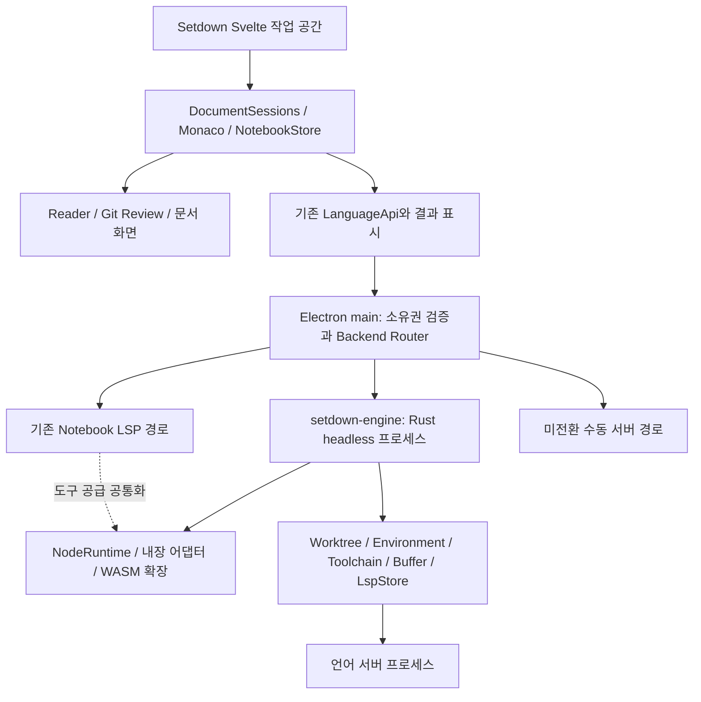
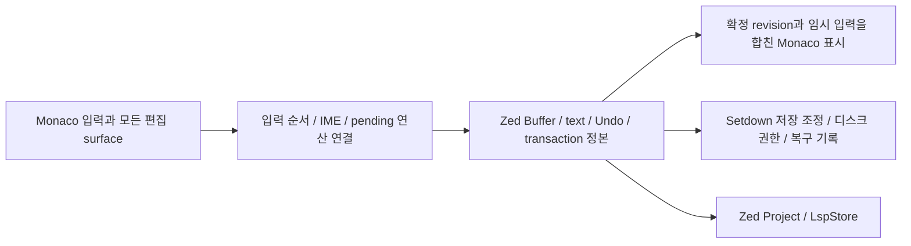

# Setdown에 Zed를 최대한 깊게 도입하는 설계 검토

작성일: 2026-11-09 · 작성: Codex · 상태: 소스 조사에 근거한 제안, 통합 구현 전

**내 권고는 Zed 언어 도구 Host를 첫 번째 납품물로 만들고, 일반 코드 파일의 프로젝트·텍스트·Undo·편집 트랜잭션까지 실제 Zed 엔진에 맡기는 것을 장기 목표로 삼는 것이다.** Setdown은 문서 중심 작업 공간과 Reader·브라우저·노트북 경험을 계속 소유한다. 편집 화면까지 가져오는 GPUI 경로도 별도 실험으로 열어 둔다. 다만 각 단계에서 실제로 넘긴 책임과 삭제한 중복 구현으로 도입의 깊이를 판단한다.

사용자가 준 [원문 제안](input-proposal.ko.md)은 수정하지 않고 저장했다. 원문이 권하는 최종 경계는 주로 도구 준비 계층이다. 나는 **그 경계를 좋은 첫 단계로 받아들이되, 최종 목표로 고정하지 않는 편**이 요청에 더 맞는다고 판단한다. 아래에서 B는 도구 Host, C는 Setdown 문서를 복제하는 프로젝트 Host, D는 일반 코드의 편집 정본까지 맡는 엔진으로 구분한다. C를 통해 연결을 검증하고 D의 비용과 보존 조건을 초기에 비교한다. 아직 D의 실행 가능성이 입증됐다는 뜻은 아니다.

## 1. 조사 기준과 검증 수준

| 대상 | 조사한 버전·범위 |
| --- | --- |
| Setdown | `d4c8de8d777d611513ef9f56b5a0e7d5da3bb040`의 문서, 현재 코드, 빌드 설정 |
| Zed 서브모듈 | `vendor/zed`, gitlink와 checkout 모두 `b5cd310b3b54dfc659fcc06453e6358843dfe216` |
| Svelte 외부 확장 | `zed-extensions/svelte`의 `ca6c2c6c891583a23820d9b23772e116426cc57d`, 확장 `0.2.11`, API 의존성 `0.7.0`; GitHub에서 해당 커밋 파일을 읽음 |
| 제품 보장 | [구조](../../docs/architecture/overview.md), [언어 지원](../../docs/language-support.md), [Notebook 계약](../../docs/contracts/notebook.md), [Preview 성능 계약](../../docs/preview-performance-contract.md) |

이 보고서의 **확인**은 해당 버전의 소스에서 경로·타입·호출을 확인했다는 의미다. **제안**은 앞으로 구현할 경계다. Rust Host 컴파일, 확장 실행, 통합 E2E, 메모리·성능 측정은 이번 작업에서 수행하지 않았다. 따라서 바이너리 크기, 속도 향상, 개발 기간, 플랫폼 호환성을 확정하지 않는다. 현재 서브모듈 브랜치 이름을 최신 안정판과 같은 의미로 사용하지도 않는다.

원문 SHA-256: `4c954592e0e46f1120b2a8d3640dea48559eae7b729ea46ddf4bb6f7d54f7729`. 조사 경로와 해시는 [source-evidence.json](source-evidence.json)에 기록한다. 이 파일은 제품의 의존성 lockfile이 아니다.

## 2. 현재 Setdown은 이미 무엇을 갖고 있는가

Setdown의 언어 지원은 단순히 Monaco에 서버 하나를 연결한 상태가 아니다. [LanguageManager](../../apps/desktop/src/main/language/language-manager.ts)는 창·서버·분석 루트별 수명을 관리하며, 같은 파일의 미저장 내용이 다른 창으로 섞이지 않게 서버를 분리한다. [LanguageApi](../../apps/desktop/src/protocol/language.ts)는 허용된 LSP 요청, 취소, 진단, 편집 승인 결과, 환경 선택과 복구의 경계다.

현재 기반을 다음처럼 평가한다.

| 자산 | Zed 도입에서의 판단 |
| --- | --- |
| Monaco 모델, DocumentStore, 문서 세션, 저장·Undo | 첫 전환에서 보존할 제품의 핵심 상태. 분석 Host가 별도 저장 주인이 되면 안 됨 |
| 서버 카탈로그·Helix 프로필·실행 파일 탐색 | Zed 관리 대상에서는 단계적으로 책임을 넘길 영역. 수동 연결과 아직 이관하지 않은 서버는 유지 |
| `ServerSession`, 세션 풀, supervisor, LSP capability 처리 | 프로젝트 엔진 도입 단계의 실제 대체 대상. 설치기만 도입하면 이 책임은 대부분 남음 |
| Python/TS SDK/C++ 빌드 환경 선택 | 사용자 선택과 제품 표시 정책은 유지. 실행 환경 계산은 대상별로 Host에 위임 |
| Monaco의 completion·navigation·semantic·edit provider | Host 결과를 표시하는 어댑터로 유지. 기능별 capability와 오래된 응답 거부가 필요 |
| NotebookStore·셀 URI/revision·진단 저장소 | Zed 일반 Buffer로 대체할 수 없는 Setdown 자산 |
| Crossnote Reader·Git rendered review·브라우저·PDF·미디어 | Zed 프로젝트 도입의 직접 대체 대상이 아님. 같은 앱에서 기존 계약대로 동작해야 함 |

[LanguageClient](../../apps/desktop/src/renderer/language/language-client.ts)의 `applyEdit`는 모든 대상 모델과 버전을 확인한 뒤 Monaco의 편집 이력에 변경을 넣는다. 이 경계는 유지할 가치가 높다. 서버가 준비되었는지, 실제 진단을 받았는지, 그 진단이 현재 내용에 대한 것인지를 구분하는 현재 UI도 유지한다.

현재 빌드 입력을 조사한 범위에서는 `vendor/zed`를 컴파일하거나 제품에서 실행하는 경로를 찾지 못했다. 서브모듈 존재 자체는 실행 계층 도입이 아니다. [외부 코드 지도](../../docs/architecture/external-code.md)의 원칙대로, 실제 빌드 입력과 참조 소스를 구분해야 한다.

## 3. 실제 Zed 소스가 열어 주는 길

### 3.1 도구 공급부터 프로젝트 엔진까지 이어지는 구현이 있다

| 재사용 후보 | 소스에서 확인한 경계 | 도입 시 주의점 |
| --- | --- | --- |
| `node_runtime` | [crate](../../vendor/zed/crates/node_runtime/Cargo.toml), [구현](../../vendor/zed/crates/node_runtime/src/node_runtime.rs) | Node/npm 공통 기반. 이것만 도입하면 서버별 설정과 세션 관리는 남음 |
| `languages` | [등록·초기화](../../vendor/zed/crates/languages/src/lib.rs) | 내장 Rust 어댑터를 실제 실행할 수 있으나 `project`, `language`, GPUI 문맥 등과 결합 |
| `language_extension` | [ExtensionLspAdapter](../../vendor/zed/crates/language_extension/src/extension_lsp_adapter.rs) | 외부 확장의 실행 명령·초기화 옵션·workspace 설정·추가 서버 설정 연결 |
| `extension_host` | [HeadlessExtensionStore](../../vendor/zed/crates/extension_host/src/headless_host.rs), [WasmHost](../../vendor/zed/crates/extension_host/src/wasm_host.rs) | 실제 Wasmtime Host. GPUI App/Entity 및 프로젝트·확장 proxy 초기화가 필요 |
| `project` | [LspStore](../../vendor/zed/crates/project/src/lsp_store.rs), [BufferStore](../../vendor/zed/crates/project/src/buffer_store.rs), [WorktreeStore](../../vendor/zed/crates/project/src/worktree_store.rs) | 단순 설치 API보다 깊은 재사용. 문서 동기화와 편집 트랜잭션 경계를 설계해야 함 |
| `remote_server` | [HeadlessProject](../../vendor/zed/crates/remote_server/src/headless_project.rs) | 위 서비스들을 화면 없이 조립하는 선행 구현. 그대로 범용 LSP 프록시가 되지는 않음 |

`HeadlessProject`에는 Worktree/Buffer/LSP/Toolchain 외에도 Git, Task, DAP, Agent 및 Context Server 관련 구성이 들어 있다. 따라서 이 생성자를 호출하는 것과 필요한 프로젝트 서비스를 최소 조합으로 재사용하는 것은 다른 작업이다. **첫 PoC는 기존 조립을 최대한 활용해 실행 가능성을 확인하고, 배포 경계에서는 사용하지 않는 서비스의 시작과 외부 연결을 제거하는 순서**가 합리적이다. 의존성 목록에 존재하는 것과 실제 프로세스·네트워크가 활성화되는 것도 구별한다.

`HeadlessExtensionStore`는 이름만 보고 완성된 언어·구문 분석 엔진으로 간주할 수 없다. 원격 환경을 위한 언어 로딩 경로에서 `grammar = None`을 설정한다. 확장 실행에 성공해도 Tree-sitter 구문 분석과 Monaco 표시가 자동 연결되지는 않는다.

언어별 Rust 모듈과 `ExtensionLspAdapter`에는 private 경계도 있다. 외부 crate에서 원하는 adapter를 모두 직접 생성할 수 있는 공개 SDK가 아니다. B의 첫 구현은 실제 `languages::init`/LanguageRegistry 등록 경로를 사용하거나, 필요한 visibility·feature 분리에 작은 패치를 두는 작업을 포함한다.

### 3.2 Svelte 사례는 설치기 이상의 재사용을 입증한다

확인한 [Svelte 확장 소스](https://github.com/zed-extensions/svelte/blob/ca6c2c6c891583a23820d9b23772e116426cc57d/src/svelte.rs)는 `svelte-language-server`와 `typescript-svelte-plugin`을 준비하고, `vtsls`를 대상으로 추가 workspace 설정을 제공한다. 이 관계를 실제 확장 호출로 가져오는 것이 유용하다. 반면 Setdown의 현재 번들 TypeScript 서버는 `typescript-language-server`다. **현재 서버를 그대로 두고 확장만 로드하면 같은 연동이 생긴다고 가정하면 안 된다.** 첫 실험에는 TS 서버 선택까지 포함해야 한다.

또한 해당 확장은 설치 실패 시 기존 패키지를 사용할 수 있지만, 그 전에 최신 버전 조회가 실패하면 오류가 전파된다. 오프라인 재시작은 별도 정책과 검증이 필요하다. [확장 manifest](https://github.com/zed-extensions/svelte/blob/ca6c2c6c891583a23820d9b23772e116426cc57d/extension.toml)와 [Cargo 설정](https://github.com/zed-extensions/svelte/blob/ca6c2c6c891583a23820d9b23772e116426cc57d/Cargo.toml)도 함께 고정해야 한다. 이 확장은 현재 Setdown 서브모듈에 추가한 상태가 아니다.

### 3.3 네이티브 화면 이식의 가능성도 다시 평가해야 한다

이 Zed pin에는 [gpui_web](../../vendor/zed/crates/gpui_web/src/gpui_web.rs), [웹 backend 선택](../../vendor/zed/crates/gpui_platform/src/gpui_platform.rs), [Application::run_embedded](../../vendor/zed/crates/gpui/src/app.rs), 이를 쓰는 [hello_web 예제](../../vendor/zed/crates/gpui_web/examples/hello_web/main.rs)가 실제로 있다. 그러므로 “GPUI여서 Electron 안에는 원천적으로 못 넣는다”는 결론은 맞지 않는다.

다만 현재 웹 플랫폼은 문서가 소유하는 canvas 하나와 최상위 window 하나를 전제로 한다. [WebWindow::prepare_canvas](../../vendor/zed/crates/gpui_web/src/window.rs)는 canvas를 document body에 붙인다. Svelte 분할 패널마다 그대로 mount하는 API로 볼 수 없다. 더구나 [editor crate](../../vendor/zed/crates/editor/Cargo.toml)는 `project`, `workspace`, `client`, `ui` 등과 결합되어 있다. GPUI 데모의 WASM 실행은 Zed 편집기 전체의 WASM 실행 증거가 아니다.

## 4. 도입 수준을 선택하는 기준

| 수준 | 실제로 가져오는 책임 | 얻는 것 | 한계·결정 |
| --- | --- | --- | --- |
| A. 프로필·설치 알고리즘 참고 | 데이터 또는 TS 재구현 | 작은 초기 변경 | upstream 실행 코드와 멀어짐. 이번 목표의 최종안으로 부족 |
| B. Rust·WASM Tooling Host | 런타임, 설치, 언어 어댑터, 확장 설정 | 실제 Zed 코드가 언어별 준비를 담당 | 좋은 첫 납품물. Setdown의 자체 LSP 엔진은 계속 필요 |
| C. Zed Project Host | B + Worktree/환경/Toolchain/Buffer 분석 복제본/LspStore | 일반 코드의 세션·분석 관리까지 upstream 재사용 | 중간 통합 목표. 편집 제안 경계를 검증한 기능부터 전환 |
| D. Zed가 텍스트·Undo도 소유 | C + text/Buffer transaction의 정본 소유 | upstream의 편집 의미까지 재사용하고 두 편집 이력의 조정 부담을 줄일 수 있음 | **장기 우선 목표.** Monaco 입력·투영과 저장·복구 계약을 검증한 뒤 전환 |
| E. Zed editor/GPUI까지 사용 | 편집 명령·키맵·레이아웃·렌더링 | 편집기 수준의 가장 깊은 코드 재사용 | Web/네이티브 임베딩 PoC 필요. 기본 제품 전환을 미리 약속하지 않음 |

**B를 배포 가능한 단위로 완성하고 C로 프로젝트 연결을 증명하되, D까지 가는 것을 장기 우선안으로 둔다. E는 별도 작은 실험으로 가능성을 확인한다.** D를 선호하는 이유는 Zed의 직접 편집 경로가 여러 곳에 분산되어 있어, Setdown 정본을 영구 유지하려면 이를 계속 중재하는 fork가 필요하기 때문이다. D의 입력·복구 보존 비용이 더 크면 C에 머무를 수 있지만, 그때는 유지할 MutationSink 패치와 기능 한계를 명시한다.

전체 앱을 Zed fork로 바꾸는 선택은 E보다도 더 크다. 이 경우 문서 Reader, 브라우저·확장, Notebook, PDF, 미디어, 탭 전송을 새 셸로 옮겨야 한다. 이식 범위가 사용자 가치에 비해 얼마나 큰지 별도 평가해야 하므로, 현재 권고의 기본 경로로 택하지 않는다.

## 5. 권장 구조: Setdown이 제품을, Zed가 코드 프로젝트를 맡는다

아래 이름과 프로토콜은 **제안**이며 아직 존재하는 구현이 아니다. 첫 그림은 **C 전환기**의 소유권이다.



장기 목표 **D**에서 전환한 일반 코드 문서는 다음처럼 달라진다. 미전환 Markdown/Notebook은 기존 owner를 유지한다.



### 책임과 프로세스 수명

Setdown 문서 모델은 C 단계까지 텍스트·dirty·Undo·저장·복구의 정본이다. Zed Buffer는 분석용 복제본이다. 이는 새 독립 문서 저장소를 두는 것이 아니라, 현재 LSP 서버가 받는 문서 복제본의 범위를 프로젝트 엔진까지 확장하는 것이다. 복제본에 독립적인 사용자 Undo·자동 저장 권한을 주지 않는 조건이 필수다.

Host는 코드 분석을 처음 요청할 때 지연 시작한다. Markdown 읽기나 브라우징만 하는 앱 시작에서 전체 workspace scan, Node 다운로드, 확장 설치를 시작하지 않는다. Markdown 분석을 사용자가 실제 활성화한 경우는 별도 수요로 처리한다. Zed의 기본 Markdown 등록은 LSP 어댑터가 비어 있으므로 문서 링크·수식 의미 분석까지 자동 획득하는 것도 아니다.

초기 구현은 **창별 분석 소유권 영역마다 Host 하나**를 우선 검증한다. 그 안에서 여러 프로젝트 문맥을 식별한다. 같은 창·루트·환경·설정의 일반 파일은 세션을 공유할 수 있지만, 다른 창의 동일 URI에 서로 다른 미저장 내용이 있으면 분석 문맥을 분리한다. 도구 다운로드 캐시는 공통으로 둘 수 있으며 버전별 설치 lock과 원자적 publish가 필요하다. 메모리가 측정된 뒤 다중 영역을 한 Host에 넣는 최적화를 검토한다.

`Backend Router`는 `(문서 종류, provider, 분석 문맥)`마다 소유 backend 하나를 정한다. 같은 binding에 기존 Manager와 Zed가 동시에 진단·편집을 게시하지 않게 한다. 보조 lint 서버처럼 의도된 다중 provider는 provider ID를 분리한다. 테스트용 병렬 비교에서는 후보 엔진의 결과를 UI와 파일에 적용하지 않는다.

### 기존 원격 프로토콜을 그대로 제품 경계로 쓰지 않는 이유

Zed remote-server는 worktree·buffer·설정·확장 등을 Zed 프로젝트 RPC로 주고받는다. Monaco의 LSP client를 stdio에 붙이는 것으로 해결되지 않는다. Electron에 Zed 내부 protobuf와 Buffer 연산을 그대로 노출하면 upstream 변경이 renderer까지 번진다.

권장 구조는 **Host 내부에서 Zed Entity/Task와 프로토콜을 사용하되, main에는 Setdown의 버전이 있는 좁은 API를 제공하는 것**이다. 처음에는 현재 `LanguageApi`를 유지해 renderer의 변경을 줄인다. 미전환 provider/document는 통째로 기존 backend에 남기고, 전환한 binding은 검증한 기능만 capability에 표시한다. 같은 provider의 빠진 method를 다른 세션에 몰래 분산하지 않는다. 지원하지 않는 요청을 성공한 빈 결과로 위장하지 않는다.

Host와 main은 상속한 로컬 pipe 등의 전용 채널로 연결한다. framing, 메시지 크기 제한, 취소, deadline, backpressure를 정한다. 포맷은 첫 PoC에서 JSON으로 읽기 쉽게 시작할 수 있다. WASI Host에 `inherit_stdio()` 경로가 있으므로 확장의 stdout/stderr와 제품 메시지를 분리해야 한다. TCP listener나 renderer의 임의 명령 실행 API는 필요 없다.

## 6. 가장 어려운 부분: 문서 버전과 편집의 단일 권한

다음 제안이 없으면 C는 단순히 엔진 두 개가 같은 파일을 만지는 구조가 된다.

### 6.1 문서 동기화

Host 메시지는 적어도 `protocolVersion`, `hostEpoch`, `contextId`, `contextRevision`, `documentId`, `documentGeneration`, `documentRevision`, `requestId`를 구분한다. URI는 파일 식별에 쓰되 세션 소유권 전체를 대신하지 않는다. 분석 문맥에는 루트, 설정 digest, 선택된 SDK/interpreter/toolchain과 provider 구성이 포함된다.

문서를 열 때 전체 snapshot을 한 번 보낸다. 이후 변경은 기준 revision과 새 revision이 있는 순서화된 delta로 보낸다. sequence gap이나 재시작은 snapshot으로 재동기화한다. Host 응답은 문서 revision 외에도 Host epoch와 문맥 revision이 맞아야 사용한다. 최신 버전을 모르는 서버의 진단을 임의로 “현재 버전 검증 완료”로 승격하지 않는다.

Monaco의 UTF-16 위치와 Zed의 byte offset/anchor, 언어 서버의 협상된 position encoding은 연결부에서 명시적으로 변환한다. 한글 조합, emoji·surrogate pair, combining mark, CRLF, BOM, 파일 rename 뒤 URI 변경을 독립 사례로 검증한다. 한 줄의 byte 수를 column으로 취급하면 눈에 잘 띄지 않는 편집 손상이 생긴다.

### 6.2 편집 요청은 제안과 적용을 나눈다

제안하는 순서는 다음과 같다.

1. 엔진은 기준 문서 revision들과 `operationId`가 있는 편집 제안을 만든다.
2. main과 renderer는 현재 문서의 세대·버전·소유권 및 대상 경로를 확인한다.
3. Setdown의 기존 편집 경로로 적용한다. 텍스트 편집의 Undo·dirty는 기존 모델 이벤트가 갱신한다.
4. 성공 결과와 실제 새 revision을 Host에 보낸다. Host가 그 결과를 확인하기 전에는 해당 변경에 의존하는 후속 작업을 완료했다고 보고하지 않는다.
5. 거부·취소·중복·Host 종료는 operation 상태로 처리한다. Host의 **메모리 분석 복제본만** 앞서갔으면 결과를 버리고 현재 Setdown snapshot으로 복구한다. 이미 수행한 파일 생성·삭제·rename·저장은 snapshot으로 되돌릴 수 없으므로, 허가되지 않은 디스크 부작용은 실행 전에 막아야 한다.

**이것은 Zed에 이미 존재하는 완성 API라고 주장하는 것이 아니다.** `LspStore`의 rename·format·code action·서버 `workspace/applyEdit` 경로 중에는 Buffer나 파일을 직접 변경하는 동작이 있다. mutation 이후의 이벤트만 가로채는 것으로는 충분하지 않다. 실행 전 편집 제안을 내보내는 정책 hook 또는 별도 query adapter가 필요하다. 이 경계를 실제 코드로 만들 수 있는지가 C의 가장 중요한 기술 실험이다.

특히 [LspStore](../../vendor/zed/crates/project/src/lsp_store.rs)의 `deserialize_workspace_edit`는 이름과 달리 파일 생성·rename·삭제, 일부 dirty buffer 저장, `buffer.edit`를 수행한다. `WorkspaceEditApplied`는 적용 이후 이벤트다. `deserialize_text_edits`, formatter 경로, completion의 additional edits에도 별도 직접 변경이 있다. `push_to_history = false`는 실제 편집 금지가 아니다. 반환된 `ProjectTransaction`을 아직 적용하지 않은 편집 제안처럼 다루면 안 된다.

미지원 mutation 경로는 capability를 닫는다. 연결부가 완성되기 전까지 읽기 성격의 hover/definition/diagnostics부터 전환하며, rename·자동 format·임의 server command를 몰래 활성화하지 않는다. 서버가 읽기 요청 중에도 `workspace/applyEdit`를 먼저 보낼 수 있으므로 pre-apply handler의 거부 또는 Setdown commit 대기가 먼저 필요하다. 일부 `resolve_code_action`·completion resolve는 적용과 분리되어 있으므로 활용할 수 있지만, 이를 모든 mutation을 다룬 증거로 확대하지 않는다. 완료된 단계의 기능표에는 이 차이가 드러나야 한다.

여러 파일 편집은 “대상 사전 검증”과 “디스크 작업까지 포함한 트랜잭션”을 구분해야 한다. 기존 Monaco 텍스트 편집 경로만으로 파일 생성·삭제·rename의 원자성이 생기지 않는다. 파일 작업은 현재 main의 승인된 Explorer/파일 작업 경계와 연결하고, 중간 실패·부분 적용 결과를 명시한다. Host에서 직접 저장한 뒤 Setdown에게 알리는 방식은 채택하지 않는다.

### 6.3 장기 목표 D: 일반 코드의 편집 정본을 Zed로 옮긴다

내 장기 우선안 D에서는 Zed transaction이 텍스트·Undo의 기준이 되고 Monaco는 입력·표시 projection이 된다. 이때 Monaco의 독립 Undo와 Zed Undo를 동시에 켜 두면 안 된다. 키 입력을 매번 동기 RPC 뒤에 그리는 구조도 피해야 한다. 입력을 로컬에서 임시 반영하고 순서·기준 revision·ACK로 확정하는 연결을 실험하되, composition 중 원격 반영이 조합 문자열을 덮어쓰지 않게 해야 한다. `operationId`로 echo를 제거하고, engine commit 뒤에 남은 미확정 입력을 재조정해야 한다. 이것은 Monaco의 기본 모드를 그대로 쓰면 자동 제공되는 기능이 아니다. text/Undo 소유권은 LSP의 설치·연결 상태와 독립이어야 하며, 서버 초기화를 기본 편집·저장 선행 조건으로 만들지 않는다.

Setdown은 탭·파일 선택·저장 명령·디스크 권한을 계속 조정하고, 일반 코드의 저장 내용은 엔진이 확정한 revision snapshot에서 얻는다. 저장 응답보다 새 편집이 있으면 dirty를 유지한다. 엔진의 모든 파일 쓰기를 자유롭게 허용하는 뜻도 아니며, 저장·파일 작업은 main의 경로·소유권 정책과 연결한다.

전환 단위는 화면 mount가 아니라 영속 `documentIdentity`를 가진 문서 세션이다. 같은 창에서 같은 문서를 여러 group에 표시해도 편집 정본은 하나다. Save As, 언어 모드 변경, 경로 변경 때문에 owner가 바뀌지 않는다. 이미 열린 dirty 문서나 Undo가 있는 문서의 backend를 설정 토글로 즉시 바꾸지 않는다. 처음에는 새 일반 코드 세션에만 적용하고, 기존 세션의 이전은 편집 이력 변환 또는 명시적 종료·재개 절차가 검증된 뒤 다룬다.

Markdown/source, Git의 불변 비교 snapshot, Notebook cell은 자동으로 이 대상에 넣지 않는다. 그러나 **일반 코드의 수정 가능한 Working Tree diff는 현재도 같은 Monaco 모델과 Undo를 빌린다.** 따라서 D 문서의 일반 편집기·diff·split 입력을 모두 같은 엔진으로 연결해야 한다. 같은 문서를 다른 종류의 탭으로 보았다고 별도 저장 주인을 만들 수 없다. [live-document-model](../../apps/desktop/src/renderer/editor/live-document-model.ts)과 [공유 이력 테스트](../../apps/desktop/src/renderer/adapters/shared-document-history.test.ts)가 이 전환의 회귀 기준이다.

Host crash에서 텍스트 snapshot만 재전송하면 본문은 복구해도 Zed가 소유한 Undo는 잃는다. [Zed text의 History](../../vendor/zed/crates/text/src/text.rs)는 undo/redo stack과 grouping 정보를 따로 가지며, [Buffer의 proto 복원](../../vendor/zed/crates/language/src/buffer.rs)만으로 그 보존이 입증되지 않는다. D의 납품 조건에는 확정 transaction, Undo group, redo branch, 저장 기준, 미ACK 입력의 journal/checkpoint와 복원을 포함한다. 미ACK 입력도 operation ID로 중복 없이 복구해야 한다.

현재 Setdown의 [전체 앱 workspace snapshot](../../apps/desktop/src/core/workspace/workspace-snapshot.ts)은 텍스트·화면 상태를 보존하며 Undo 전체의 직렬화를 약속하지 않는다. 여기서 추가하는 요구는 **Electron이 살아 있는 동안 새 편집 Host 하나가 죽었다고 기존 live Undo까지 사라지지 않게 하는 것**이다. 이를 위한 main 메모리 보존과 전체 앱 crash에 대비한 durable 기록·ACK·손실 가능 구간은 구분해서 설계한다. 자동 Monaco fallback도 owner 전환이므로 조용히 수행하지 않는다.

창별 Host 사이의 탭 전송에는 source pending 입력 확정 → revision/Undo 인계 → destination 수락 → 이전 owner 해제 순서가 필요하다. snapshot만 복사해서 성공 처리하지 않는다. 복구 과정에서 raw server command나 rename을 재실행하는 대신 확정된 문서 연산과 저장 상태를 복원한다. D에서도 여러 Buffer의 Undo와 디스크 파일 작업의 원자성이 저절로 같아지는 것은 아니다.

따라서 D는 C의 사소한 옵션이 아니다. **C의 편집 연결 비용과 D의 문서 모델 전환 비용을 작은 동작 실험으로 비교한 뒤 제품 전환을 결정**한다. 현재 Setdown을 즉시 D로 바꾸거나 D가 C보다 빠르다고 가정하는 권고는 아니다. 기존 `DocumentContentOwner`도 직렬화 가능한 내용 포트이므로, 그 인터페이스를 연결하는 것만으로 위 transaction·입력·복구 계약이 완성되지 않는다.

## 7. Notebook은 독립된 통합 과제다

현재 [NotebookLanguageHost](../../apps/desktop/src/main/language/notebook-language-host.ts)는 `notebookDocument/didOpen`, `didChange`, `didClose`를 보내고 구조 변경·재연결에 따른 wire URI 세대를 관리한다. 문서 snapshot 버전과 개별 셀 revision을 함께 대조한다. [NotebookStore](../../apps/desktop/src/renderer/notebook/notebook-store.ts)는 mount 여부와 별개로 셀 모델·내용을 소유한다.

반면 조사한 Zed의 [REPL notebook cell](../../vendor/zed/crates/repl/src/notebook/cell.rs)은 로드한 셀을 `Buffer::local`로 만들며 프로젝트 Buffer로 등록하지 않는 설명이 있다. 셀 Editor 생성에도 Project를 넘기지 않는 경로가 있다. 이 pin의 project/lsp/remote_server/language 범위 검색에서는 Setdown에 대응하는 `notebookDocument` 동기화 경로를 확인하지 못했다. 이는 Zed의 모든 버전이나 REPL 기능 전체에 대한 단정이 아니다.

결정은 다음과 같다.

- 도구 준비는 Zed Host와 공유할 수 있다. 단, 일반 Python 파일용 분석기와 Notebook용 분석기·설정을 같은 것으로 합치지 않는다.
- 초기에는 현재 Notebook LSP 경로와 basedpyright 정책을 유지한다. Zed 관리 코드 문서와 Notebook 문서가 같은 URI/세션을 이중으로 소유하지 않게 한다.
- Notebook 분석까지 Rust로 옮기려면 native notebook protocol, virtual URI, 셀 순서·삭제·이동, snapshot version, 진단 수명을 구현한 adapter를 별도 납품한다.
- 분석 도구 변경과 실행 중인 Python kernel 수명은 분리한다. 도구 업데이트나 환경 재탐색으로 kernel을 재시작하거나 셀을 실행하지 않는다.
- 숨겨진 셀의 Problems, 셀 간 정의와 실제 import, 복원 후 진단, 첨부물·metadata·출력 보존이 통과하기 전에는 NotebookStore/serializer를 대체하지 않는다.

노트북 지원을 빼고 일반 코드만 빨라진 결과를 Setdown 전체의 성공으로 보고해서는 안 된다. 반대로 Notebook의 특수 경로를 유지하는 것은 Zed 도입 실패도 아니다. 재사용할 수 있는 책임과 Setdown이 계속 구현해야 하는 책임이 다른 것이다.

## 8. 얼마나 지울 수 있어야 성공인가

| 현재 코드 | B: Tooling Host | C: Project Host |
| --- | --- | --- |
| `server-discovery.ts`, `server-environment.ts` | Zed 관리 도구는 Host 결과 사용. 사용자 수동 후보 탐색은 남음 | 대상 provider의 중복 탐색 제거 |
| `server-definitions.ts`, `catalog/profiles.ts` | 제품 목록·기존 연결 유지, 설치·언어별 준비 지식을 Host로 이동 | Zed 관리 대상의 중복 실행 정의와 설정 조립 제거 |
| `analysis-context.ts`, `language-root.ts` | 사용자 선택을 보존하고 Host 실행 계획과 일치시킴 | 루트·환경·toolchain 계산 책임을 대상별로 넘김. 제품 선택·설명은 남음 |
| `server-session.ts`, `server-capabilities.ts`, `language-supervisor.ts` | 기존 LSP 소유권 유지 | 일반 코드 Zed 경로의 중복 lifecycle/protocol 처리 제거. Host 프로세스 supervisor는 별개로 필요 |
| `language-manager.ts` | 도구 준비 adapter 추가 | main의 인증·소유권·라우팅·제품 API 변환 중심으로 축소 |
| `notebook-language-host.ts`, `language-session-pool.ts` | 유지 | Notebook 전환 검증 전까지 유지 |
| renderer `language-*features.ts`, `diagnostic-store.ts` | 유지 | Monaco 표시·revision 검증은 유지. 지원 기능별 Host 변환으로 연결 |

이 표는 파일을 통째로 삭제하라는 지시가 아니다. 같은 파일에 Notebook·수동 연결·제품 정책 책임이 섞여 있으므로, **이관한 provider의 중복 실행 경로부터 제거한다.** migration flag를 영구적인 두 번째 IDE 구현으로 남기지 않도록 각 단계의 제거 목록을 리뷰한다. D에 도달하면 이관한 일반 코드 세션의 Monaco 독립 Undo·내용 정본·편집 트랜잭션 처리도 대체 대상이다. `MonacoEditor`/`DocumentModelOwner`의 그 부분은 projection/lease adapter로 축소한다. 저장·retarget 등을 조정하는 `DocumentSessions` 전체를 지우는 것은 아니다. 문서별 owner를 명시하고 기존 Notebook/Markdown 경로까지 삭제하지 않는다.

`ServerItems`의 opaque resolve/command handle은 구현 위치를 옮길 수 있지만 보호 기능은 남겨야 한다. renderer가 임의로 바꾼 command/data를 서버에 넘기는 범용 tunnel을 만들면 기존 경계가 퇴보한다. 루트·환경 전환에는 submodule의 `.git` 파일 경계, Cargo workspace, nested TS 프로젝트, missing explicit SDK/interpreter/compile database를 조용히 대체하지 않는 현재 정책을 회귀 입력으로 넣는다. CMake/Meson configure도 파일 열기만으로 자동 실행하지 않는다.

Tree-sitter, fuzzy search, Git, task, DAP, remote development도 후속 후보지만 무조건 함께 옮기지 않는다. 구문 분석 결과를 Monaco에 표시하는 연결, Git index 변경 권한, task의 실행 동의, debugger UI, 원격 파일·저장 의미는 각각 별도다. `TaskStore`나 `DapStore`가 생성된다는 사실로 사용자 기능이 완성되지는 않는다.

## 9. 실제 upstream 코드를 유지하는 빌드·배포 전략

### 첫 빌드는 분리 추출보다 upstream workspace 안의 overlay가 유리하다

Zed의 [Cargo workspace](../../vendor/zed/Cargo.toml)는 공유 의존성, git revision, `[patch.crates-io]`를 사용한다. [rust-toolchain.toml](../../vendor/zed/rust-toolchain.toml)은 `1.98.1`과 여러 target을 지정한다. 원본 crate 몇 개를 다른 폴더에 복사한다고 같은 빌드가 되는 것은 아니다. 기본 workspace build가 Zed 앱을 선택하므로 필요한 `-p` target을 명시해야 한다.

제안은 원본 submodule을 기준으로 재생성 가능한 staging checkout을 만들고, Host crate와 최소 patch를 overlay하는 방식이다. 첫 목적은 GPUI event loop, settings, language registry, extension proxy, NodeRuntime을 포함한 실제 초기화가 headless로 성공하는지 확인하는 것이다. 제품 runtime은 `gpui_platform::headless()`를 기준으로 하고 테스트 문맥으로 대체하지 않는다. 이후의 crate 분리는 측정된 의존성과 변경 비용을 보고 결정한다.

실행 자원 경로를 초기화하기 전에 [paths::set_custom_data_dir](../../vendor/zed/crates/paths/src/paths.rs)를 Setdown 전용 디렉터리에 연결해야 한다. 설치된 Zed의 사용자 설정·확장·캐시를 묵시적으로 공유하지 않는다. `LspAdapter`의 책임에는 설치뿐 아니라 diagnostics/completion의 후처리도 있으므로, 명령 문자열만 추출한 구현은 재사용 범위가 더 좁다는 점도 기록한다.

```text
vendor/zed/                         고정 upstream; 조사·빌드 기준
vendor/zed-extensions/svelte/       도입 시 별도로 고정할 외부 확장
tooling/zed/host/                   제안: setdown-engine 소스
tooling/zed/patches/                제안: 정책·편집 연결 등의 최소 patch
tooling/zed/build.mjs               제안: staging과 명시 target 빌드
tooling/zed/toolchains.lock.json    제안: 도구·확장·artifact 고정 정보
apps/desktop/src/main/language/    Host client와 backend 선택
apps/desktop/src/protocol/         직렬화 가능한 Setdown 경계
```

이는 폴더·package를 미리 늘리라는 뜻이 아니다. 첫 실행 경계를 구현할 때 필요한 항목부터 만든다. Setdown의 [기존 구조 원칙](../../docs/architecture/overview.md)에 따라 renderer에 Rust 내부 타입이나 별도 범용 프레임워크를 퍼뜨리지 않는다.

### 재현 가능한 조합 전체를 고정한다

고정 대상은 Zed SHA, patch hash, Rust toolchain/target, Cargo.lock, 확장 SHA·manifest·WASM artifact hash·API 범위, Node 버전, LSP/npm 패키지 및 전이 설치 결과, 플랫폼별 도구 artifact다. 최상위 npm 버전만 고정해도 전이 의존성이나 install script가 달라질 수 있다. 조사한 NodeRuntime의 npm 설치에는 `--no-package-lock`도 있으므로 Zed SHA만으로 설치 결과가 고정되지 않는다. 실행 시마다 `latest`를 조회하는 upstream 경로는 검증 버전 정책과 맞는지 확인하고 차이는 패치·테스트로 기록한다.

[WIT 호환성 검사](../../vendor/zed/crates/extension_host/src/wasm_host/wit.rs)는 release channel에 따라 API 범위를 다르게 적용한다. 조사한 pin에서 Stable/Preview와 Dev/Nightly의 상한이 다르므로, 본체의 최신 extension API crate 버전을 쓰면 항상 로드된다고 가정할 수 없다. Svelte의 `0.7.0` 의존성과 Host 조합도 실제 로드 시험이 필요하다. 확장 WASM target과 GPUI 웹 target도 서로 다르다.

설치 상태는 임시 다운로드 → 검증 → 버전별 불변 디렉터리 → 원자적 사용 전환으로 다룬다. 정상 실행 중인 세션은 업데이트로 갑자기 교체하지 않는다. 캐시가 있는 오프라인 실행, 설치 중 종료, 동시 창의 중복 설치, 실패 버전 rollback을 검증한다. 사용자 지정 도구 경로·명시적 비활성화·수동 설정도 보존한다.

### Linux와 Windows를 처음부터 배포 단위로 다룬다

현재 제품의 배포 대상은 Linux/Windows x64다. Linux headless 성공만으로 Windows 지원을 완료 처리하지 않는다. 경로·URI, Node 실행, DLL/런타임, 프로세스 트리 종료, 파일 watcher를 각각 확인한다. Host 실행 파일과 필요한 자원은 Electron ASAR 밖의 실행 가능한 패키지 자원으로 넣고 실제 설치본에서 찾는 경로를 검증한다.

Host·WASM·Node·서버까지 포함한 프로세스 트리의 메모리와 디스크 크기를 기록한다. Rust로 옮긴다는 이유로 더 작은 설치본이나 낮은 PSS를 약속할 수 없다. Host 오류도 편집 문서와 kernel을 닫지 않아야 하며, 종료된 Host의 자식 서버가 고아 프로세스로 남지 않아야 한다.

## 10. 제품 정책·권한·라이선스

Zed의 [capability 문서](https://zed.dev/docs/extensions/capabilities)는 프로세스 실행·다운로드·npm 설치를 제한하는 기능을 설명한다. 하지만 조사한 기본 설정은 넓은 grant를 사용한다. Setdown의 허용 공급원·관리 디렉터리·실행 범위로 정책을 정해야 한다. capability 목록만으로 모든 HTTP 요청이나 실행된 native LSP까지 격리했다고 주장하지 않는다. Host의 HTTP client, 설치 경로, archive 해제, 프로세스 실행 경계까지 별도로 검증해야 한다.

workspace를 열었다고 모든 프로젝트 설정·실행 파일을 신뢰하는 것과, 사용자가 도구 설치를 요청한 것은 구분한다. Zed의 worktree trust를 무조건 trusted로 초기화해 통과시키지 않는다. Reader·웹페이지·Notebook 출력에서 Host로 임의 실행 요청을 보낼 수 없도록 main이 호출자와 문서 소유권을 확인한다. 설치 UI는 선택한 분석 도구·실행 환경과 실패 상태를 보여 주면 된다. 내부 crate 이름을 사용자의 설정 절차로 노출할 필요는 없다.

Setdown은 [루트 package](../../package.json)와 [desktop package](../../apps/desktop/package.json)에 `GPL-3.0-only`를 명시한다. 조사한 Zed의 언어·프로젝트 관련 crate는 `GPL-3.0-or-later`, GPUI 관련 재사용 부분에는 Apache-2.0이 있다. 이미 GPL 기반인 제품이라는 사실은 출발 조건이지만, 배포 artifact별 라이선스·저작권·대응 소스·변경 내역과 전이 의존성 검토를 대신하지 않는다. 별도 프로세스라는 이유만으로 라이선스 검토가 없어지는 것도 아니다.

공식 [Software Overview](https://zed.dev/software-overview)는 소스 라이선스, Zed 운영 서비스의 약관, 상표 권리를 구분한다. Setdown 자체 Host를 빌드하는 것과 Zed의 확장 배포·계정·클라우드 서비스를 제품에서 이용하는 것은 따로 검토한다. 첫 실행 검증은 계정 로그인이나 Zed 운영 서비스의 자동 이용을 필수 조건으로 삼지 않는 구성을 목표로 한다. 이는 법률적 적합성 확정이 아니라 배포 설계에 필요한 확인 항목이다.

## 11. 가장 강한 경로로 가기 위한 실행 순서

달력 기준의 낙관적인 기간보다 결과물과 통과 조건으로 구분한다. B를 너무 오래 다듬기 전에 C의 어려운 경계를 실험해야 한다.

| 단계 | 구체적 결과물 | 통과 기준·다음 결정 |
| --- | --- | --- |
| 0. 빌드 가능성 | 고정 workspace overlay, 창을 만들지 않는 Host, 버전 handshake | Linux와 Windows에서 시작·종료, 실제 Zed SHA/patch 표시, 정상 자식 정리. 미빌드는 실패로 기록 |
| 1. 실제 언어 조합 | 내장 TS 어댑터와 Svelte WASM 확장 실행 | 깨끗한 profile에서 실제 도구 준비; `.ts` 먼저/`.svelte` 먼저 모두 설정 연결; 문맥·실행 명령 일치 |
| 2. 프로젝트 복제 실험 | 일반 코드 한 루트의 Worktree/Buffer/LspStore 연결 | 미저장 내용의 진단·정의, Unicode 위치, cancellation, 재시작 snapshot, 두 창 분리 |
| 3. 편집 경계 판정 | C의 대표 편집 제안→적용→ACK와 D의 입력→transaction→Undo 비교 | stale target 거부, 여러 파일, IME, 서버 applyEdit, crash 후 내용·이력. 장기 D 전환과 C 패치 유지 비용 비교 |
| 4. B 제품화 | 검증된 도구 조합과 관리 UI, offline/cache/rollback | 언어별 TS 설치 지식 중복 제거, 기존 노트북·수동 도구·설정 유지 |
| 5. C 일반 코드 전환 | 지원 기능별 LanguageApi bridge와 backend 전환 | 실서버 기능표 통과, 세션·루트·환경 중복 구현 제거, 성능·메모리 비교 완료 |
| 6. 확장 범위 확대 | Python 파일, C/C++, Rust 등 검증된 조합 | 프로젝트 환경과 다중 provider, 사용자 override, 실제 workload 통과; 개수만 늘리지 않음 |
| 7. Notebook 엔진 연계 | 검증된 native notebook adapter 또는 기존 경로 유지 결정 | 셀/URI/revision/진단/커널/직렬화 계약을 모두 보존해야 전환 |
| 8. D 일반 코드 전환 | Zed text/Undo/transaction과 Monaco projection | 입력·히스토리·저장·crash·탭 전송 parity, 기존 중복 owner 제거. Notebook 작업과 독립적으로 진행 가능 |

**가장 먼저 요청할 개발 묶음은 0~3이다.** 자동 설치 UI부터 크게 만드는 것보다, 실제 소스 실행과 프로젝트 편집 경계를 증명하는 것이 도입 전략의 성패를 먼저 알려 준다. 0~3의 후보는 격리 실험 경로이고, 제품 B 전환은 검증된 범위에만 적용한다.

### GPUI/editor 병렬 실험

E는 다음 네 관문으로 따로 진행할 수 있다.

1. `gpui_web`의 작은 입력 예제를 Electron의 격리된 로컬 문서에 띄우고 mount/unmount·resize·자원 해제를 검증한다. canvas 하나인 현재 제약을 명시한다.
2. 실제 Zed `Editor`의 최소 의존 구성이 WASM으로 빌드되는지 확인한다. 실패하면 필요한 target 분리·Host API 작업량을 기록한다. 데모 성공으로 대체하지 않는다.
3. 한글 IME·클립보드·접근성·키맵·다중 커서·대형 파일·split·탭 이동·앱/탭 zoom을 현재 Monaco와 같은 작업으로 비교한다.
4. Markdown Esc↔double-click, Git review, 두 창, 숨겨진 화면의 focus까지 통과하면 특정 코드 탭부터 선택적 전환을 검토한다.

GPUI 웹 이식은 canvas 기반 화면 경로이고, native GPU renderer를 그대로 Electron에 넣는 경로와 같지 않다. `run_embedded`는 외부 event loop를 위한 수명 경계이며 완성된 Electron native view bridge가 아니다. 네이티브 경로를 택하면 Windows와 Wayland/X11의 입력·표면 수명·z-order를 별도로 풀어야 한다. 어느 경로도 Zed 네이티브의 성능이 자동 이전된다고 보지 않는다.

## 12. 성공 판정: 실제 작업과 기존 계약을 함께 통과시킨다

| 검증 묶음 | 반드시 남길 증거 |
| --- | --- |
| 실행 코드 | Host 빌드 SHA, patch hash, 실제 adapter/확장 ID·버전, 도구 실행 경로·설정 출처 |
| TS/Svelte | 양쪽 파일 열기 순서, cross-file 탐색, 미저장 진단, 지원되는 rename·format·Undo, 프로젝트 TS SDK 선택 |
| Python | 일반 파일과 Notebook 분리, interpreter 선택, 실제 import, kernel 무재시작 |
| C++/Rust | compile_commands/toolchain 선택, 실행 루트, 미저장 내용, 서버 오류·복구 |
| 문서 일관성 | 두 창의 상이한 내용, 여러 group, rename·close·reopen, 오래된 응답·중복 ACK·버전 불일치 거부 |
| 설치·장애 | 네트워크 차단 재실행, 잘못된 artifact, 중단·동시 설치, Host/서버 강제 종료, 명시 경로 소실 |
| 자원 | 앱+Host+Node+LSP 프로세스 트리, cold/warm 시작, 큰 repository scan, 입력 중 CPU/PSS, 종료 후 잔류 |
| 배포 | 개발 checkout 이외의 Linux/Windows 설치본, ASAR 밖 실행 경로, 호환 API, license/source 자료 |

기존 [언어 E2E](../../apps/desktop/test/e2e/language), [Notebook E2E](../../apps/desktop/test/e2e/notebook/notebook.spec.ts), [suite manifest](../../apps/desktop/test/suites.json)의 요구 시나리오를 새 backend에도 적용한다. 특히 `project-environment.spec.ts`, `language-reform.spec.ts`, `document-analysis-ui.spec.ts`, `syntax-highlighting.spec.ts`의 의미를 보존한다. 새 Host의 단위 테스트만으로 기존 실서버·Electron 시나리오를 대체하지 않는다. 설치 성공과 기능 검증 성공도 따로 기록한다.

코드·문서 모델·언어 provider 변경이 preview 경로에 영향을 주는 단계에서는 [Preview 성능 계약](../../docs/preview-performance-contract.md)에 따라 다음을 실행한다.

```bash
npm run test:preview-contract
npm run bench:preview -- --baseline /absolute/path/to/installed-baseline --runs 5
```

baseline은 별도 checkout에 자체 의존성이 설치된 상태로 준비하고 명시한 기준 커밋을 사용한다. baseline/candidate를 같은 격리 display와 동일 설정에서 비교한다. ordinary Markdown/Git review × 편집 유무 × 준비 시간 0/3000ms의 8개 시나리오, 첫째·둘째·warm cycle, Esc와 double-click의 48개 비교를 구분한다. 기본 5회 반복이며 최소 3회의 matched repetition이 필요하다. 기존 gate의 “25%와 50ms를 모두 초과하는 증가” 기준을 임의로 완화하지 않는다. 준비 비용을 입력 경로로 옮기거나 stale capture·빠진 시나리오를 성공 처리하지 않는다.

모든 GUI/Electron 실험은 [with-isolated-display.sh](../../apps/desktop/scripts/with-isolated-display.sh)를 사용한다. Xvfb뿐 아니라 Wayland socket 제거, 별도 runtime directory와 D-Bus session 격리가 필요하다. 사용자의 desktop에 창을 띄우지 않는다. focus·한국어 IME·최신 revision·실제 Chromium 화면 검증을 유지한다.

## 13. 이번 조사로 내리는 판단

Zed를 강하게 도입하는 데 가장 큰 장애물은 Rust와 TypeScript가 다르다는 사실이 아니다. **도구·프로젝트·문서·화면의 권한이 Zed 내부에서 연결되어 있다는 사실**이다. 실제 headless 구성이 있으므로 화면을 갈아엎지 않고 프로젝트 엔진을 실행할 근거는 있다. 동시에 그 엔진이 문서를 수정하는 순간에는 Setdown의 기존 문서 권한과 맞물리는 연결부가 필요하다.

그래서 나는 언어 도구 Host를 출발점으로 삼되, **프로젝트 Host를 거쳐 일반 코드의 text/Undo/transaction까지 Zed에 맡기는 것을 장기 우선안으로 두고, 편집·복구 경계를 초기에 검증하며, GPUI/editor 이식은 별도 실험으로 가능성을 열어 두는 방향**을 권한다. Setdown이 계속 새로 만들어야 하는 언어별 실행·세션·편집 기반을 줄이고, 제품 실행 중에 실제 upstream 코드가 그 책임을 맡게 하는 것이 이 보고서가 말하는 강한 도입이다.

이번 변경은 원문 보관과 조사 보고서 작성이다. 애플리케이션 코드, 서브모듈 pin, 의존성, 제품의 기존 계약은 변경하지 않았다. GUI 테스트나 benchmark를 실행한 결과로 읽어서는 안 된다.
