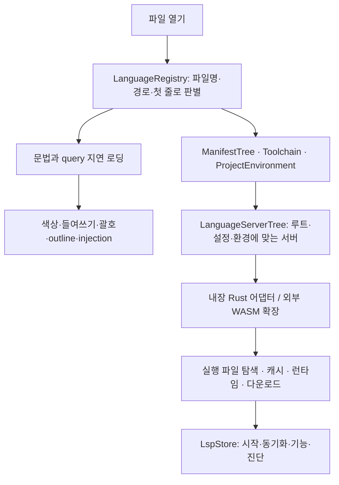
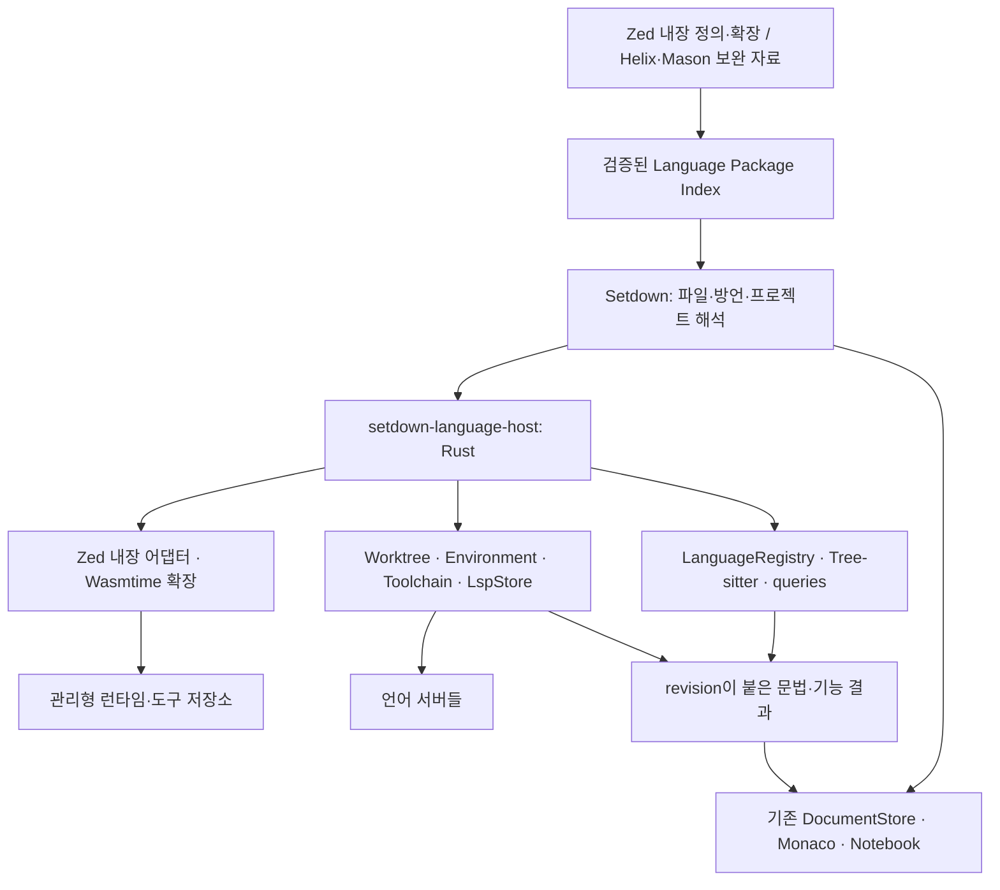

# Setdown의 범용 언어 플랫폼: Zed 소스 심층 조사

2026-11-10 · 조사·설계 결과 · 제품 통합 구현 전

**권고: Setdown에 모든 언어를 수용하는 언어 패키지 체계를 만들고, Zed의 실제 언어·확장·도구 실행 코드를 Rust 호스트로 재사용한다.** 언어를 하나 추가할 때 Setdown의 편집기나 서버 관리 코드를 수정하지 않아도 되는 것이 목표다. 파일을 여는 것만으로 언어 인식, 문법, 편집 규칙, 서버 준비, 프로젝트 연결이 이어져야 한다.

범위는 Make나 YAML의 개별 수정이 아니다. 프로그래밍 언어, 설정 파일, DSL, 템플릿, 복합 언어와 앞으로 추가될 언어까지 같은 경로로 받아들인다. 아래 사례들은 범용 경로가 어디서 끊기는지를 드러내는 조사 표본이다.

## 조사 기준과 실행한 검증

Setdown `2c910993dc948b53b2875233bcbe835b5c6e56f7`, 로컬 Zed `b5cd310b3b54dfc659fcc06453e6358843dfe216`을 기준으로 읽었다. Zed 최신 공식 문서와 Make·Svelte·Java 확장, 확장 등록 저장소도 확인했다. 외부 소스의 정확한 revision과 URL은 [sources.json](sources.json)에 있다. 로컬 Zed pin을 최신 안정판과 동일시하지 않는다.

[audit.mjs](audit.mjs)는 설치된 Monaco의 기본 언어 등록 데이터와 Setdown의 실제 `recognizedLanguage`/`languageSupport` 함수를 실행한다. 결과와 입력 SHA-256은 [audit.json](audit.json)에 저장했다. 사용자별 설정 없이 기본 소스 경로를 조사한 결과다. Chromium 렌더링, LSP 실행, Rust 호스트 컴파일, 설치·성능 검증은 수행하지 않았다. 아래의 **확인**은 소스 또는 이 실행 결과이며, **제안**은 앞으로 구현할 내용이다.

## 1. 지금의 숫자는 지원 범위를 과대평가하게 한다

| 실제 데이터 | 개수 | 의미 |
| --- | ---: | --- |
| Mason 카탈로그 항목 | 331 | 서버가 목록에 있다는 뜻 |
| 생성된 연결 프로필 | 195 | 명령·인수·파일 연결을 알고 있다는 뜻 |
| 그중 Mason 항목과 연결된 프로필 | 142 / 331 | 카탈로그 전체가 연결 가능한 것도 아님 |
| 프로필의 고유 language ID | 181 | 문법이나 서버 설치 완료를 뜻하지 않음 |
| 입력 Helix 언어 정의 | 342 | 인식·들여쓰기·문법 정보의 더 넓은 원본 |
| 서버 연결 선언이 없는 Helix 언어 | 156 | 별도 언어 카탈로그가 필요함을 보여 줌 |
| 설치된 Monaco 기본 언어 등록 | 89 | 복수 ID를 등록하는 파일도 포함 |
| Setdown의 추가 문법 등록 | 1 | Svelte |

서버 연결이 없는 Helix 언어의 정보가 현재 변환기에서는 독립 언어 정의로 출력되지 않는다. 그중 일부는 Monaco가 별도로 인식하지만, Helix의 전체 메타데이터가 편집기에 전달되는 구조는 아니다. [프로필 변환기](../../apps/desktop/scripts/update-language-profiles.py)는 `helix['language-server']`를 중심으로 순회하고, [언어 연결 목록](../../apps/desktop/src/main/language/server-registry.ts)은 서버 정의의 `languages`에서 생성된다.

Zed 확장 등록 저장소에는 조사한 revision 기준 최상위 항목이 1,590개 있다. 테마 등도 포함된 숫자이므로 이를 지원 언어 수 또는 정상 작동하는 LSP 수로 제시해서는 안 된다. Setdown의 목표 지표도 카탈로그 크기보다 **사용자가 준비 없이 실제로 사용할 수 있는 기능**이어야 한다.

## 2. Make와 YAML에서 서로 다른 구조적 문제가 드러난다

| 파일 | 실제 인식 함수 결과 | 등록된 기본/추가 문법 | 연결 프로필 |
| --- | --- | --- | --- |
| `Makefile`, `GNUmakefile`, `fragment.mk` | `plaintext` | 없음 | 없음 |
| `config.yaml`, `config.yml` | `yaml` | 있음 | 있음 |
| `.github/workflows/ci.yaml` | `github-action` | 없음 | 있음 |
| `compose.yaml` | `dockercompose` | 없음 | 있음 |
| `.gitlab-ci.yml` | `gitlab-ci` | 없음 | 있음 |
| `Justfile` | `just` | 없음 | 있음 |
| `CMakeLists.txt` | `cmake` | 없음 | 있음 |
| `main.f90` | `fortran` | 없음 | 있음 |
| `app.svelte` | `svelte` | 있음 | 있음 |

이 표는 문법 등록과 인식 결과를 뜻한다. 실제 화면의 색상이나 설치된 서버 유무를 측정한 표는 아니다. 프로필에 여러 후보가 있다는 것도 모두 실행된다는 뜻이 아니다.

**Make:** 원본 Helix에는 파일명, 확장자, shebang, 주석, 실제 탭 들여쓰기 정보가 있다. 그러나 서버 연결이 없어 프로필 중심 변환에서 전달되지 않고 Monaco에도 기본 Make 문법이 없다. Mason의 `autotools-language-server`는 수동 연결 항목으로 남아 있다. 실행 파일 하나를 추가하는 것으로 문법·탭 규칙까지 해결되지 않는다.

**일반 YAML:** 문법과 프로필은 있지만 [서버 탐색](../../apps/desktop/src/main/language/server-discovery.ts)은 기존 설치를 찾는다. 프로필의 `automatic: true`는 npm 패키지 자동 설치를 뜻하지 않는다. `yaml-language-server --stdio` 실행 파일이 필요하며, YAML은 [로컬 언어 워커](../../apps/desktop/src/renderer/language/language-runtime.ts)의 기본 분석 서비스에도 없다. 따라서 색이 나오는 것과 오류 검사·스키마 완성이 되는 것은 별개다.

**YAML 방언:** 더 구체적인 파일 연결이 `yaml`을 `github-action`, `dockercompose`, `gitlab-ci`로 바꾼다. [언어 판별](../../apps/desktop/src/core/document/language-policy.ts)이 이를 반환하고, [Monaco 어댑터](../../apps/desktop/src/renderer/adapters/monaco-editor.ts)의 `connectLanguage` 경로는 미등록 ID를 이름만 등록한다. 문법 상속은 없다. 일반 YAML 문법이 있어도 방언에서는 이용하지 못하는 구조다. LSP에 전달할 ID 또한 각 서버의 계약에 맞아야 하므로 Helix의 방언 이름을 모든 서버에 그대로 전달하는 방식은 별도 검증이 필요하다.

따라서 기본 언어, 방언, 문법 제공자, 서버별 문서 ID, 프로젝트 스키마를 분리해야 한다. 이 규칙은 YAML 외에 TSX, Vue, Svelte, Helm, Jinja, Markdown 코드 블록 같은 복합 문서에도 적용된다.

## 3. Zed의 동작을 따라가면 필요한 계층이 보인다



이것은 단일 범용 분석기가 모든 언어를 이해하는 구조가 아니다. 언어별 지식을 가진 어댑터와 문법을 동일한 호스트가 실행하고, 사용자는 그 준비 과정을 거의 보지 않는 구조다. 언어별 지식은 계속 필요하지만, 이를 Setdown 본체에 계속 수작업으로 쌓을 필요는 없다.

| Zed 소스 | 확인한 책임 | Setdown에 필요한 재사용 |
| --- | --- | --- |
| [language_registry.rs](../../vendor/zed/crates/language/src/language_registry.rs) | 언어·문법·LSP 어댑터의 별도 등록, 파일 판별, lazy grammar 로딩, 중복 로드 합류 | 서버 유무와 독립적인 언어·문법 레지스트리 |
| [languages/lib.rs](../../vendor/zed/crates/languages/src/lib.rs) | 내장 언어와 실제 Rust 어댑터 초기화 | YAML·Rust 등 내장 어댑터를 빠뜨리지 않는 호스트 |
| [language.rs](../../vendor/zed/crates/language/src/language.rs) | `LspAdapter`, `LspInstaller`, 공통 설치·캐시 경로 | 명령뿐 아니라 초기화·설정·진단/완성 후처리까지 |
| [extension_lsp_adapter.rs](../../vendor/zed/crates/language_extension/src/extension_lsp_adapter.rs) | 외부 확장의 명령·설정·추가 서버 설정·label 변환 호출 | Zed 확장의 실행 의미 보존 |
| [wasm_host.rs](../../vendor/zed/crates/extension_host/src/wasm_host.rs) | Wasmtime component 실행, 버전별 API, 작업 디렉터리와 host 기능 | 기존 확장을 실행하는 실제 ABI 호스트 |
| [node_runtime.rs](../../vendor/zed/crates/node_runtime/src/node_runtime.rs) | 지정 Node/npm → PATH 탐색 → 관리형 Node 준비, npm 작업 | 사용자가 Node/npm을 설치하지 않아도 되는 공급 경로 |
| [server_tree.rs](../../vendor/zed/crates/project/src/manifest_tree/server_tree.rs) | 하위 프로젝트 루트·설정·toolchain별 서버 선택과 재사용 | monorepo에서 파일의 실제 환경에 연결 |
| [lsp_store.rs](../../vendor/zed/crates/project/src/lsp_store.rs) | 서버 수명, 문서 등록, 기능 협상, 진단, 서버 요청 | 일반 코드의 프로젝트 분석 관리 |

## 4. 소스에서 확인한 자동화의 세부 동작

### 내장 서버는 공통 설치 흐름을 갖는다

`LspStore::get_language_server_binary`는 명시한 실행 경로를 먼저 처리한다. 일반 어댑터 경로에서는 프로젝트에 설치된 서버를 확인하고, 메모리 캐시와 기존 다운로드를 이용하며, 필요하면 새 버전을 구한다. 어댑터의 사용자 설치 결과를 전역 캐시에 넣지 않는 이유도 소스에 명시되어 있다. 프로젝트마다 다른 실행 파일을 사용할 수 있기 때문이다.

캐시가 있을 때도 무조건 즉시 시작하는 구현은 아니다. 이 pin에서는 기존 바이너리와 다운로드 작업을 함께 받고, 다운로드가 `SERVER_DOWNLOAD_TIMEOUT`인 10초를 넘기면 기존 바이너리를 반환하고 나머지를 배경 작업으로 보낸다. 업데이트 실패 시 이전 바이너리를 찾는 fallback도 있다. Setdown의 빠른 재실행을 설계할 때는 이 동작을 그대로 가져올지, 검증된 설치를 즉시 사용하는 정책으로 바꿀지 측정해서 결정해야 한다.

[YAML 어댑터](../../vendor/zed/crates/languages/src/yaml.rs)는 PATH 탐색, npm 설치, Node 실행, 캐시 확인, workspace 설정, 스키마 경로 처리까지 갖는다. 패키지 이름과 `--stdio`만 복사하면 이 책임의 일부만 가져오게 된다. [Rust 어댑터](../../vendor/zed/crates/languages/src/rust.rs)는 프로젝트 rustup override, OS/아키텍처/libc별 배포 파일, 다운로드 검증 등 또 다른 지식을 담고 있다.

### 외부 확장은 실행 코드이며 설치 정책도 서로 다르다

`ExtensionLspAdapter`는 공통 `LspInstaller`의 기본 경로 대신 확장의 `language_server_command`를 호출한다. 이 함수에서 확장은 npm 설치, GitHub release 선택, 실행 환경 계산 등을 수행할 수 있다. 따라서 모든 확장이 공통 캐시·오프라인 정책을 자동으로 따른다고 보면 안 된다.

실제 [Svelte 확장](https://github.com/zed-extensions/svelte/blob/ca6c2c6c891583a23820d9b23772e116426cc57d/src/svelte.rs)은 서버와 TypeScript 플러그인을 설치하고 **vtsls에 추가 설정을 주입**한다. Setdown의 현재 `typescript-language-server`에 명령만 연결하면 같은 관계가 생기지 않는다. 또 이 revision에서는 최신 버전 조회가 실패하면, 뒤에 있는 설치 실패 fallback에 도달하기 전에 오류가 반환될 수 있다. 캐시가 있다는 사실만으로 오프라인 시작을 보장할 수 없다.

Java는 서버 런타임 공급까지 보여 준다. 조사한 [JDK 코드](https://github.com/zed-extensions/java/blob/b66544c8bab1003e1660a6d53c21104727c1e092/src/jdk.rs)에는 Corretto 25 다운로드 구현이 있고, [설정 코드](https://github.com/zed-extensions/java/blob/b66544c8bab1003e1660a6d53c21104727c1e092/src/config.rs)의 `jdk_auto_download` 기본값은 false다. 이는 “Java 서버 설치”와 “서버 실행용 JDK 준비”가 서로 다른 책임이라는 구체적인 사례다. 프로젝트의 컴파일 대상 JDK와 서버 실행용 JDK도 구분해야 한다.

### 확장 자동 설치와 서버 자동 설치도 서로 다르다

Zed 공식 문서는 지원 언어 서버의 자동 다운로드를 설명하면서, 미설치 확장은 설치를 제안할 수 있다고 밝힌다. 실제 [extension_suggest](../../vendor/zed/crates/extension_suggest/src/extension_suggest.rs)에는 파일명·확장자별 추천 목록이 있고 [UI](../../vendor/zed/crates/extensions_ui/src/extension_suggestions.rs)가 설치 제안을 만든다. [ExtensionStore](../../vendor/zed/crates/extension_host/src/extension_host.rs)의 `auto_install_extensions`는 설정에 지정된 확장을 설치하는 별도 경로다.

사용자가 원하는 경험은 여기서 한 단계 더 나간다. Setdown은 **아직 설치하지 않은 확장도 판별할 수 있는 인덱스**와 적절한 기본 선택을 갖고, 지원 패키지를 필요할 때 자동으로 준비해야 한다. 파일을 열 때마다 확장 검색 화면을 방문하게 해서는 안 된다. 공식 설명: [언어 설정](https://zed.dev/docs/configuring-languages).

### 문법 전용 언어도 정상적인 지원 대상이다

[Make 확장 manifest](https://github.com/caius/zed-make/blob/f7c5052790c20b4ec2aad87f28fc85860d151443/extension.toml)에는 grammar가 있으며 LSP 선언은 없다. [언어 설정](https://github.com/caius/zed-make/blob/f7c5052790c20b4ec2aad87f28fc85860d151443/languages/make/config.toml)은 파일명과 hard tabs를 제공한다. 이 패키지가 정상적으로 설치되었다면 문법·편집 기능은 정상 지원 상태다. 서버 미연결을 이유로 장애 표시를 해서는 안 된다.

별도의 Make 분석기를 연결하는 것은 가능하지만, 그 분석기가 제공하는 기능을 확인해야 한다. [autotools-language-server](https://github.com/Freed-Wu/autotools-language-server/blob/527f88774984782fa96509308043a7f1b07d9beb/README.md)의 존재만으로 임의의 Makefile을 완전하게 분석한다고 주장할 수 없다. 이 원칙은 모든 언어에 동일하다.

## 5. 권장 설계: 독립적인 언어 패키지와 Zed 호스트



아래 이름은 제안이며 아직 제품에 구현되지 않았다.

### A. 모든 언어를 담는 인덱스

서버를 기준으로 언어를 생성하는 의존 방향을 바꾼다. `LanguageDefinition`이 파일 연결, 별칭, 문법, 주석, 들여쓰기, 방언·injection 정보를 소유한다. 서버 연결은 그 정의에 붙는 선택 가능한 기능이다. 서버가 없는 언어도 완전한 언어 항목으로 남는다.

예를 들어 GitHub Actions 파일은 다음 정보가 함께 존재할 수 있다.

```text
기본 문법: yaml
문서 방언: github-actions
파일 연결: .github/workflows/*.yml, *.yaml
문법 제공자: YAML grammar
서버별 문서 ID: 각 adapter가 선언한 값
분석 제공자: YAML schema 서비스 + 선택한 Actions 전문 서비스
편집 규칙: YAML 기본값 + 명시한 프로젝트 설정
```

모든 방언을 `yaml`로 덮어쓰는 방식도 전문 분석을 잃는다. 문법을 공유하면서 방언과 서버 계약을 유지해야 한다.

인덱스에는 설치하지 않은 언어의 파일 연결도 포함한다. 확장 저장소의 이름·버전 목록만으로는 부족하다. 게시 시점에 각 확장의 `extension.toml`, `languages/*/config.toml`, grammar/query, API 버전, 배포 artifact 정보를 읽어 가벼운 인덱스를 생성해야 한다. 런타임에서는 전체 확장 저장소를 clone하거나 문법을 컴파일하지 않는다.

주 공급자는 실제로 실행 가능한 Zed 내장·확장 경로다. Zed에 없는 언어는 Helix의 독립 언어 정의, 기존 문법 공급자, Mason의 도구 메타데이터, 일반 stdio LSP 연결을 같은 패키지 모델의 보완 공급자로 받는다. **공급자가 늘어도 편집기 코드에 언어별 분기가 생기지 않아야 한다.** 식별자 충돌과 별칭은 인덱스 생성 단계에서 해결하고, 실행 계약을 추측해서 자동 생성하지 않는다. 누락된 정보는 기계적으로 보이는 coverage gap으로 남겨 패키지 갱신으로 채운다.

### B. Zed의 실제 실행 코드를 사용한다

내장 Rust 어댑터와 외부 WASM 확장을 함께 실행해야 한다. 외부 확장만 지원하면 YAML 같은 Zed 내장 어댑터가 빠진다. 반대로 내장 서버만 가져오면 긴 꼬리의 언어 생태계가 빠진다.

Zed 확장 WASM은 Wasmtime component와 버전별 WIT host 함수에 의존한다. Chromium의 `WebAssembly.instantiate`만으로 호환 호스트가 되지 않는다. Tree-sitter grammar WASM도 확장 WASM과 같은 것이 아니다. [실제 WasmHost](../../vendor/zed/crates/extension_host/src/wasm_host.rs)를 재사용하는 편이 호환 계층 전체를 TypeScript로 재작성하는 것보다 근거가 분명하다.

[HeadlessProject](../../vendor/zed/crates/remote_server/src/headless_project.rs)는 화면 없이 Worktree·Buffer·환경·확장·LSP를 조립하는 실례다. [gpui_platform::headless](../../vendor/zed/crates/gpui_platform/src/gpui_platform.rs)도 존재한다. 다만 이 프로젝트는 공개된 독립 LSP SDK가 아니며 GPUI App/Entity와 여러 내부 서비스에 연결되어 있다. 최소 호스트 컴파일과 실제 확장 실행으로 비용을 먼저 검증해야 한다.

호스트의 데이터 디렉터리는 [set_custom_data_dir](../../vendor/zed/crates/paths/src/paths.rs)를 경로 초기화 전에 호출해 Setdown 전용으로 둔다. 설치된 Zed의 설정·캐시에 의존하지 않는다. 배포하는 Setdown에 호스트와 필요한 런타임을 넣고, 사용자가 Rust toolchain이나 Zed 본체를 설치할 필요가 없게 한다.

### C. 문법 연결까지 포함해야 한다

현재 [HeadlessExtensionStore](../../vendor/zed/crates/extension_host/src/headless_host.rs)의 원격용 로딩은 `config.grammar = None`으로 설정한다. 이를 그대로 실행하면 외부 서버 연결에 성공해도 언어별 색상·들여쓰기는 완성되지 않는다.

호스트에서 grammar/query를 실제 로딩하고, 공통 Monaco 연결 계층이 색상·언어 설정·outline 등을 받도록 한다. Tree-sitter의 바이트 위치, Zed의 위치 타입, Monaco/LSP의 UTF-16 위치를 명시적으로 변환한다. 결과에는 문서 incarnation과 revision을 붙이고, 오래된 결과를 버린다. 처음 색상이 준비될 때와 재분석할 때 입력·IME·Undo 모델은 교체하지 않는다. 대용량 파일은 증분 변경과 표시 영역 우선 처리가 필요하다.

기존 Monaco/로컬 TextMate 문법을 즉시 제공할 수 있는 언어는 먼저 표시할 수 있다. 다만 색상 토큰, semantic tokens, 테마 우선순위의 소유자는 하나로 정해야 한다. Zed의 query를 전부 Monaco 기능으로 옮기는 일은 별도 작업이며, grammar를 파싱했다는 사실을 기능 완성으로 보고하지 않는다.

### D. 도구 공급과 분석 세션을 구분한다

설치 캐시는 앱 전체에서 공유하고 같은 도구 설치 요청은 합친다. 설치 중 앱이 끝나도 미완성 디렉터리를 정상 설치로 보지 않게 staging·검증·교체 단계를 둔다. 호스트가 창별로 여러 개면 메모리 Promise만으로 설치 중복을 막을 수 없으므로 프로세스 간 설치 lock 또는 단일 공급 조정자가 필요하다.

분석 세션은 문서 소유권, 루트, 서버, 실행 환경, 설정에 맞춰 분리한다. 특히 서로 다른 창에서 같은 파일을 다르게 수정했을 때 내용을 합치지 않는다. 현재 [LanguageManager](../../apps/desktop/src/main/language/language-manager.ts)도 이 경계를 갖는다. 화면에 보이는 파일을 우선 준비하고, 코드 프로젝트를 사용하지 않는 Markdown 읽기·브라우징에는 모든 서버를 기동하지 않는다.

기본 선택은 명시한 사용자 선택을 우선하고, 이후 검증된 프로젝트 조건과 패키지의 기본 분석기를 따른다. 같은 기능을 제공하는 서버를 모두 켜지 않는다. 진단·탐색은 여러 공급자를 합칠 수 있지만 formatting·rename·code action의 편집 책임과 실행 순서는 명시해야 한다. 이 선택은 패키지 데이터와 adapter에서 표현한다.

### E. 캐시·환경 정책을 제품 전체에서 일관되게 만든다

선택한 확장만 불러오고 도구가 없으면 관리형 저장소에 준비한다. Node, Python 도구 환경, JRE/JDK, .NET 같은 서버 런타임과 프로젝트가 실제로 사용하는 런타임은 구분한다. 프로젝트의 기존 가상환경이나 lockfile을 도구 설치 대상으로 사용하지 않는다.

검증된 설치는 재시작에 재사용하고 업데이트는 별도 수명으로 관리한다. 외부 확장의 latest 조회를 포함한 오프라인 정책은 host API 경계에서 설계해야 한다. 직전 명령 문자열만 재사용하면 프로젝트별 환경과 추가 서버 설정을 놓칠 수 있으므로, 확장의 설정 계산을 보존하면서 설치 메타데이터·artifact 조회에 캐시를 제공하는 방향을 우선 검증한다. 패키지별 예외가 필요한 경우 이를 본체 분기보다 버전이 붙은 adapter 패치로 관리한다.

확장 설치, 서버 설치, 프로젝트의 코드 실행은 서로 다른 작업이다. Zed도 서버 시작 전에 worktree trust를 확인한다. Setdown에서는 기존 제품 정책 안에서 관리형 도구 준비를 자동화하되, 파일을 열었다는 이유로 `make`, `npm install` 또는 임의의 프로젝트 setup 스크립트를 실행하는 것으로 범위를 확대하지 않는다. 확장 WASM의 제한된 파일 접근이 자식 서버 프로세스 전체의 sandbox를 뜻하는 것도 아니다.

## 6. 사용자가 보게 될 경험

일반적인 흐름은 다음과 같다. 파일을 열면 즉시 편집할 수 있고, 인식한 언어에 맞는 문법과 편집 규칙이 적용된다. 서버가 필요하면 뒤에서 설치·시작된다. 서버 준비 중에 사용자가 입력한 내용까지 현재 revision으로 연결하고 완성·진단·정의 이동이 나타난다. 다음 실행에서는 검증된 설치를 재사용한다.

정상 상태에는 언어 이름만 표시한다. 서버 이름과 실행 인수는 필요할 때 여는 상세 정보다. 짧은 준비 과정에 모달이나 연속 알림을 띄우지 않는다. 선택이 모호하거나 복구가 필요한 경우에만 같은 파일의 작은 상태 표시에서 해결 경로를 제공한다.

내부 상태도 한 개의 `ready`로 뭉치지 않는다. 인식됨, 문법 준비됨, 도구 준비 중, 서버 초기화됨, 현재 문서 결과 수신됨은 독립 상태다. 문법 전용 언어에는 서버 미연결 경고를 만들지 않는다. 진단이 없다는 사실도 분석 완료를 뜻하지 않는다.

“모든 언어”는 **언어별 하드코딩으로 지원 대상을 제한하지 않고, 존재하는 지원 패키지를 범용적으로 받아들이는 제품 목표**로 구현한다. 분석기 자체가 없는 언어에 의미 분석을 만들어 내거나 모든 언어에 같은 refactoring 품질을 약속할 수는 없다. 그 경우에도 문법·구조·편집 지원을 제공하고, 분석기가 추가되면 앱 본체 수정 없이 연결할 수 있어야 한다. 이 구분은 몇 개 언어로 범위를 축소하는 근거가 아니라 패키지별 실제 제공 기능을 정확히 표현하기 위한 것이다.

## 7. 구현 순서와 완료 조건

이 순서는 “Python부터 몇 개만 지원”하는 언어별 단계가 아니다. **전체 카탈로그에 적용되는 공통 능력을 순서대로 완성**하는 단계다.

| 단계 | 구현할 공통 능력 | 완료 조건 |
| --- | --- | --- |
| 1 | 서버 독립 언어 카탈로그, 기본 문법·방언·서버 ID 분리, 전체 import coverage | 원본 언어가 서버 부재로 사라지지 않음. YAML 방언이 기본 문법을 상속. 등록되지 않은 새 언어도 같은 resolver로 인식 |
| 2 | 실제 Zed 호스트, 내장 adapter + WASM extension, grammar 로딩 | mock이 아닌 양쪽 실행 경로와 grammar 전용 패키지가 작동. 필요한 API 버전/플랫폼을 기록 |
| 3 | 필요 시 확장·도구·런타임 설치, 캐시·업데이트·복구 | 사용자에게 실행 파일 선택을 요구하지 않는 기본 경로. 깨끗한 환경과 오프라인 재시작 검증 |
| 4 | Zed 프로젝트 분석 연결, Monaco feature/문법 bridge | 서버 설정·복합 언어·현재 revision·다중 창·Undo·IME를 실제 앱에서 보존 |
| 5 | 카탈로그 갱신·게시·호환성 검증과 배포 | 앱 본체 수정 없이 신규 언어 패키지를 추가하고 릴리스. 실패 항목과 기능별 coverage를 공개적으로 추적 |

Zed 프로젝트 엔진의 도입에서 `workspace/applyEdit`, rename, code action 같은 편집 경로는 특별히 중요하다. [LspStore](../../vendor/zed/crates/project/src/lsp_store.rs)는 Zed Buffer를 직접 변경하는 경로를 갖는다. Setdown 문서가 정본인 동안에는 편집 제안과 적용 승인 결과를 기존 DocumentStore/Monaco 트랜잭션으로 연결해야 한다. 성공 응답을 먼저 보내고 나중에 복사하는 방식은 미저장 문서와 Undo를 망가뜨릴 수 있다.

앞선 [Zed 통합 검토](../zed-integration-2026-11-09/README.md)의 Tooling Host와 Project Host 경계를 활용할 수 있다. 이번 요구의 완료 조건에는 Zed가 텍스트·Undo 정본이나 화면 렌더러까지 소유해야 한다는 조건을 추가하지 않는다. 그 선택은 편집 엔진을 더 깊게 바꿀 때 별도로 판단한다. 언어 플랫폼의 범용성을 먼저 증명한다.

## 8. 좁은 데모로 끝나지 않게 하는 검증

전 카탈로그에 정적 검증을 적용한다. 파일명·확장자·shebang·방언 연결, 문법 artifact, host ABI, 서버별 language ID, 런타임 의존성, 지원 OS/아키텍처, 기본 공급자 충돌과 누락을 검사한다. source import의 누락은 조용히 무시하지 않는다. 모든 항목에 실제 제공 수준과 검증 상태를 남긴다.

실행 검증은 언어 이름보다 메커니즘을 덮어야 한다.

| 유형 | 실행에서 증명할 것 |
| --- | --- |
| 문법 전용 패키지 | 서버 없이 인식·색상·들여쓰기·주석이 동작하고 오류 상태가 되지 않음 |
| Node/npm 기반 서버 | 시스템 Node/서버가 없는 환경에서 관리형 런타임과 서버가 준비됨 |
| native release 서버 | 실제 OS/아키텍처 artifact 선택·실행·캐시 재사용 |
| 별도 런타임이 필요한 서버 | 서버용 런타임과 프로젝트 런타임을 구분하고 각 정책을 지킴 |
| 방언·스키마 문서 | 일반 문법을 유지하며 실제 파일의 schema와 전문 공급자 적용 |
| 복합 언어 | injection 범위와 위치 변환, 추가 서버 설정, 양방향 탐색 |
| 다중 프로젝트·환경 | 같은 언어의 서로 다른 환경, 중첩 루트, 설정 변경 시 올바른 세션 |
| 수명·복구 | 동시 설치, 취소, 손상 캐시, 서버 crash, 업데이트 실패, 오프라인 재시작 |
| 문서 일관성 | 설치 도중 입력, Save As, 같은 경로의 다른 창, 닫힌 문서 응답, 다중 파일 편집·Undo |

**범용성의 결정적 검증은 본체가 모르는 언어를 담은 새 패키지를 추가하고 본체 코드를 바꾸지 않은 채 전체 흐름이 작동하는지 확인하는 것이다.** synthetic 패키지는 프로토콜 경계를 검증하고, 실제 공개 확장과 실제 언어 서버는 실행 호환성을 검증한다. 어느 하나로 다른 쪽을 대체하지 않는다.

성능은 깨끗한 설치, 설치 후 첫 연결, 따뜻한 재연결을 나누고 최초 편집 가능 시각·문법 표시·첫 실제 기능 응답·현재 revision 진단을 따로 기록한다. 서버 초기화만으로 “3분 안에 지원 완료”를 판정하지 않는다. 네트워크와 대형 프로젝트 인덱싱을 포함한 보편적 시간 보장은 아직 근거가 없다.

제품 변경 시 [Preview 성능 계약](../../docs/preview-performance-contract.md)을 지켜야 한다. 공통 편집 경로·문법/테마·전환 성능에 영향이 생기면 `npm run test:preview-contract`와 설치된 baseline을 이용한 `npm run bench:preview -- --baseline /absolute/path/to/installed-baseline`을 수행한다. GUI는 반드시 Xvfb·분리된 runtime/D-Bus wrapper에서 실행한다. ordinary Markdown/Git review 각각 첫째·둘째·warm cycle, 편집 유무, 준비 시간 포함/제외를 모두 보고하고 기존 허용치를 유지한다.

## 9. 이번에 남긴 결과와 다음 실제 납품물

이번 변경은 이 조사 문서, 출처 목록, 재실행 가능한 판별 probe와 결과뿐이다. 앱 코드는 바꾸지 않았다. Make/YAML을 고쳤거나 Zed 통합을 실행 검증했다고 주장하지 않는다. 첫 probe는 환경의 동기 자식 프로세스 제한 때문에 revision 조회에서 중단되었고, 제품 함수를 바꾸지 않은 채 revision을 명시 인자로 받도록 바꾼 뒤 정상 완료했다.

재실행 명령:

```sh
node reports/zed-language-platform-2026-11-10/audit.mjs \
  2c910993dc948b53b2875233bcbe835b5c6e56f7 \
  b5cd310b3b54dfc659fcc06453e6358843dfe216
```

revision 인자는 설명용 label이며 실제 입력은 결과의 `sourceHashes`로 확인한다. 현재 문서·probe 변경에는 GUI나 preview runtime 변경이 없으므로 제품 빌드·GUI suite·benchmark를 실행하지 않았다.

**첫 실제 납품물은 전체 언어 정의를 보존하는 카탈로그와, 내장 어댑터·외부 확장·문법 전용 패키지를 동일하게 받는 실행 가능한 Zed 호스트다.** 여기에 새 패키지만 넣어 기능을 확장하는 검증을 포함해야 한다. 서버 목록을 더 늘리거나 특정 언어만 연결하는 결과를 이 목표의 완료로 간주해서는 안 된다.
